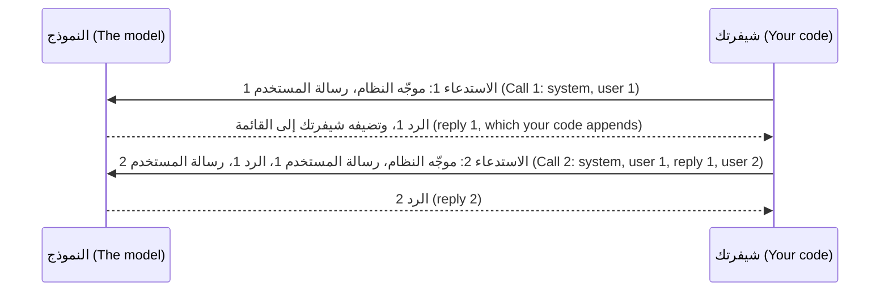
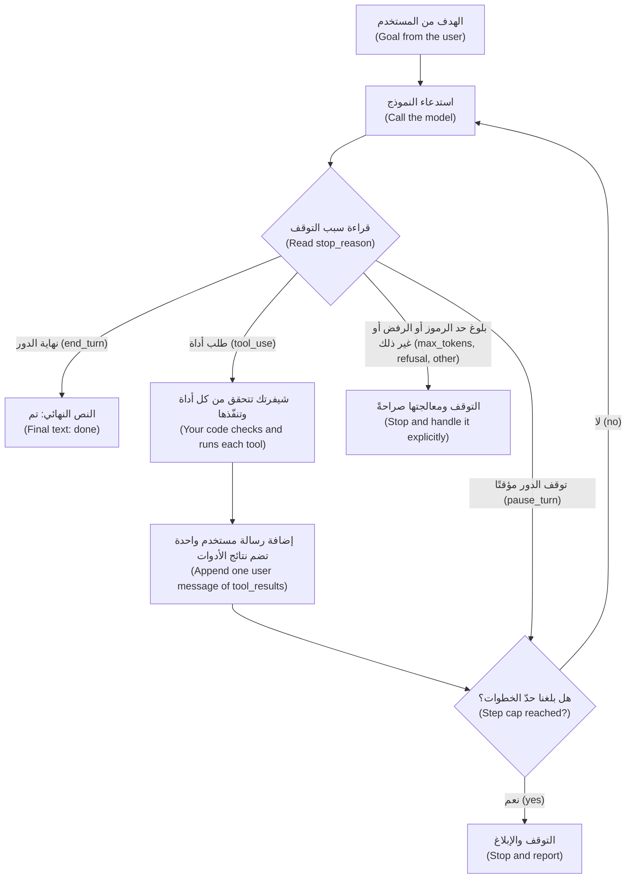

# الوحدة 1 — كيف يعمل تطبيق النموذج اللغوي فعليًا

*كل روبوت محادثة (chatbot) ومساعد (copilot) ووكيل ستبنيه لبنك نجم يقوم على فكرة واحدة: النموذج اللغوي الكبير (LLM) دالة عديمة الحالة (stateless function) تحوّل قائمة رسائل إلى الرسالة التالية، وكل ما عدا ذلك شيفرة تحيط به. يعلّمك الدرس 1.1 هذه الفكرة والمفردات المرافقة لها: الرموز ونافذة السياق (context window) وقائمة الرسائل (messages list) وموجّه النظام (system prompt) و`max_tokens` و`stop_reason` و`usage`، وما يمكنك فعله وما لا يمكنك فعله بشأن درجة الحرارة (temperature). أما الدرس 1.2 فهو مختبر: تبني روبوت محادثة ذاكرته قائمة Python، وتكسره عمدًا بإغراق نافذة السياق، وتكتب `trim()`، ثم تخطو الخطوة الواحدة التي تحوّل روبوت المحادثة إلى وكيل: حلقة (loop) يطلب فيها النموذج أداة (tool) وتقرر شيفرتك هل تنفّذها. يعمل كل شيء دون اتصال على نسخة المحاكاة (mock) لواجهة البرمجة (API) في عدّة المختبر (lab kit)، ودون أي تغيير على الواجهة الحقيقية. ويبدأ من هنا نجم ديسك، مساعد مكتب خدمة تقنية المعلومات الذي ستأخذه من الاستكشاف إلى الإطلاق (go-live)، بأول إجابة صادقة عن تذكرة.*

> **الطبقة:** Model, Agents — ما هو استدعاء النموذج حقًّا: الرسائل والرموز والسياق والتكلفة، وأصغر حلقة وكيل مبنية عليه، وهي الأساس تحت كل طبقة لاحقة.

---

# 1.1 — الفكرة الواحدة: دالة عديمة الحالة والرموز ونافذة السياق وقائمة الرسائل
*المستوى: 🟢 مبتدئ* · *المتطلبات: 0.2* · *الطبقة: Model*

**بعد هذا الدرس تستطيع** أن تكتب `system` و`messages` كما تُرسَل حرفيًا في كل استدعاء من محادثة، وأن تبني نموذج تكلفة يعيد إنتاج نمو رموز الإدخال والتكلفة مع كل دور. *مدة الدراسة: قراءة نحو 15 دقيقة، وعمل تطبيقي نحو 75 دقيقة (تقدير).*

## ⚡ الدرس في دقيقة
- النموذج اللغوي الكبير **دالة**: قائمة رسائل تدخل، والرسالة التالية تخرج. لا يحتفظ بشيء بين الاستدعاءات، لذا **الذاكرة (memory) هي ما تعيد شيفرتك إرساله**. وكل روبوت محادثة ومساعد ووكيل يستدعيه في حلقة ويقرر ما يدخل القائمة.
- يقرأ النموذج ويكتب **رموزًا**. تدفع مقابل رموز الإدخال (input tokens) في كل استدعاء، أي السجل كله مرة أخرى، ومقابل رموز الإخراج (output tokens) بما فيها التفكير؛ لذا تنمو التكلفة أسرع من عدد الأدوار.
- اعرف خمسة أشياء في كل استدعاء: `system` وهو معامل لا رسالة، و`messages`، و`max_tokens` (اترك مجالًا للتفكير)، و`stop_reason`، و`usage`.
- لا تبنِ على ضبط درجة الحرارة، وأيّ النماذج تقبله مشروح في «كيف يعمل». احصل على الاتساق عبر موجّهات دقيقة ومخرجات مهيكلة (structured output) وتحقق من الصحة؛ واختبر شكل الإجابة لا بايتاتها.
- مؤشر القرار: حين يبدو أن شيئًا ما «ينسى» أو «يكلّف كثيرًا» أو «ينقطع»، فاطبع القائمة و`usage` و`stop_reason` أولًا.

## 🧭 لماذا يهم
إنه الأربعاء الثاني من التجربة التشغيلية (pilot) لنجم ديسك، وهي افتراضية بأرقام خيالية. نجا النموذج الأولي (prototype) الذي بنته لجين من كل العروض التجريبية. ثم تصل ثلاث رسائل. يارا، قائدة فريق مكتب الخدمة: «نسي طراز حاسوبي المحمول بعد رسالتين من إخباري له.» وهند، الراعية: «توقفت إجابة في منتصف الجملة وكانت أخرى فارغة.» وفهد، من تقرير الاستخدام: «لماذا رموز الإدخال أكثر بعشرين ضعفًا من رموز الإخراج مع أن الموظفين يكتبون سطرًا قصيرًا واحدًا في كل مرة؟»

تطارد لجين ثلاثة أخطاء، وفكرتان تفسران الثلاثة كلها. يبدأ المعالج كل طلب بـ `history = []`، فلم يرَ النموذج طراز الحاسوب المحمول قط. واستُهلك `max_tokens=400` في التفكير، وهو إخراج، قبل أن تظهر أول كلمة من الإجابة. والتقرير محق: ففي محادثة من عشرين دورًا أعاد كل استدعاء إرسال كل دور سابق. **النموذج دالة عديمة الحالة، وكل ما «يعرفه» عن المحادثة هو القائمة التي ترسلها شيفرتك.** وكل وحدة لاحقة تجيب عن سؤال واحد بمزيد من العناية: *ما الذي ينبغي أن يكون في القائمة في هذا الاستدعاء؟*

## 📐 كيف يعمل

### 🟢 الأساسيات

**النموذج دالة.** يأخذ النموذج اللغوي الكبير قائمة رسائل ويعيد الرسالة التالية. ليس لديه ذاكرة ولا حالة، ولا فكرة بأنه كلّمك قبل ثانية.



> **انعدام الحالة.** يبدأ كل استدعاء من الصفر. و«ذاكرة المحادثة» وهم تصنعه شيفرتك بإعادة إرسال السجل في كل مرة. وهذه الحقيقة وراء كثير من الالتباس حول النماذج اللغوية الكبيرة (LLMs) وكثير من تكلفة تشغيلها.

**الرموز.** يقرأ النموذج *رموزًا*، وهي أجزاء أصغر من الكلمة: فالكلمة الإنجليزية الشائعة غالبًا رمز واحد، أما الكلمة النادرة أو الرقم أو الكلمة العربية فقد تكون عدة رموز. والقاعدة التقريبية القديمة — 4 أحرف لكل رمز، و750 كلمة إنجليزية لكل 1,000 رمز — تحسب أقل من الواقع في نماذج Claude الحالية: إذ تقدّر نظرة Anthropic العامة على النماذج (راجعناها في نوفمبر 2026) أن 1,000 رمز تعادل نحو 555 كلمة إنجليزية بمقسّم الرموز (tokenizer) الذي جاء مع Opus 4.7. وتُقسَّم الشيفرة وJSON واللغات الأخرى بصورة مختلفة؛ وكثيرًا ما يُقال إن العربية «ضعفان إلى ثلاثة أضعاف» عدد الرموز الإنجليزي لكل كلمة. لا تعتمد على هذا الرقم؛ بل **قِس** باستخدام `client.messages.count_tokens(...)` لنموذجك. والأعداد خاصة بكل نموذج: تذكر ملاحظات Anthropic أن بعض النماذج الأحدث تحسب النص نفسه بعدد رموز أكبر بنحو 30% مما تحسبه سابقاتها، فقد تغيّر الترقية فاتورتك. لا تستخدم `tiktoken` مع Claude أبدًا: فهو مقسّم رموز من مزوّد آخر ويحسب أقل من العدد الفعلي.

**نافذة السياق** هي أقصى عدد من الرموز يستطيع النموذج التعامل معه في استدعاء واحد. ويجب أن يتسع الإدخال والإخراج، بما فيه التفكير، معًا.

```text
| system | turn 1 | turn 2 | ... | turn N | new message |  reply + thinking  |
|<----------- input: you pay for all of it on every call ---------->|<- output ->|
|<------------------- must fit inside the context window ------------------------>|
```

تُعلن نماذج Claude الحالية نوافذ بين 200K و1M رمز: معظمها 1M، ويُعلن Haiku 4.5 نافذة 200K. اسأل واجهة البرمجة: يعيد `client.models.retrieve(MODEL)` القيمتين `max_input_tokens` و`max_tokens` على الواجهة الحقيقية فقط. ثلاث حقائق تصمد أمام أي حجم للنافذة: تدفع مقابل كل رمز إدخال في كل استدعاء؛ وقد تتراجع الجودة قبل بلوغ الحد؛ ويُرفض الموجّه (prompt) الأطول من النافذة، فعلى شيفرتك أن تدير القائمة. يتشارك الإدخال والرد النافذة نفسها: ففي موجّه شبه ممتلئ يتوقف الرد الطويل بـ `model_context_window_exceeded` في النماذج الأحدث، أو يُرفض الطلب في النماذج الأقدم. النافذة الأكبر تنقل الجدار لا التكلفة.

**قائمة الرسائل.** `messages` قائمة من القواميس على الشكل `{"role": ..., "content": ...}` بدورين هما `user` و`assistant`. ويجب أن يكون الأول `user`. و`content` إما نص أو قائمة من الكتل: `text` الآن، و`tool_use` و`tool_result` و`thinking` في الدرس 1.2. تضيف شيفرتك كل رد بوصفه رسالة `assistant`؛ وهذا كل ما تعنيه كلمة «تذكّر». بدّل الأدوار تبديلًا صارمًا: فقد تُدمج رسالتان متتاليتان بالدور نفسه في دور واحد أو تُرفضان، لذلك لا تعتمد على أيٍّ منهما.

**موجّه النظام ليس رسالة.** من هو النموذج، وما الذي يحق له الإجابة عنه، وأي لغة يستخدم، كلها تُوضع في المعامل المنفصل `system=`. يُرسل في كل استدعاء ويُحاسَب عليه في كل استدعاء، ووجود عنصر `{"role": "system"}` رسالةً أولى خطأ، وإن كانت بعض النماذج تقبل واحدًا في موضع متأخر من المحادثة. استدعاء كامل، يعمل على النسخة المحاكاة:

```python
import os

from anthropic import Anthropic

client = Anthropic()
MODEL = os.environ.get("MODEL", "claude-sonnet-5-5")
SYSTEM = "You are a helpful assistant for a bank's IT service desk. Answer briefly. If you don't know, say so."

history = []                                          # the memory: a list that YOUR code owns
for q in ["How do I request a new laptop?", "And how long does it take?", "Who approves it?"]:
    history.append({"role": "user", "content": q})
    resp = client.messages.create(model=MODEL, max_tokens=1024, output_config={"effort": "low"},
                                  system=SYSTEM, messages=history)
    reply = next(b.text for b in resp.content if b.type == "text")    # the text block, never content[0]
    history.append({"role": "assistant", "content": reply})         # write it back, or it is gone
    print(f"sent {len(history) - 1} messages | input_tokens={resp.usage.input_tokens} "
          f"output_tokens={resp.usage.output_tokens} stop={resp.stop_reason}")
```

```text
sent 1 messages | input_tokens=36 output_tokens=13 stop=end_turn
sent 3 messages | input_tokens=62 output_tokens=12 stop=end_turn
sent 5 messages | input_tokens=84 output_tokens=9 stop=end_turn
```

يرتفع الإدخال مع أن كل سؤال سطر قصير واحد؛ والردود الحقيقية أطول من ردود النسخة المحاكاة، فالارتفاع الحقيقي أشد انحدارًا. **اقرأ الاستجابة، لا النص وحده.** `content` *قائمة كتل*؛ و`stop_reason` يقول لماذا توقف؛ و`usage` هو فاتورتك:

| `stop_reason` | المعنى | ما ينبغي أن تفعله شيفرتك |
|---|---|---|
| `end_turn` | أنهى النموذج | استخدم النص |
| `max_tokens` | بلغ سقفك: الإجابة مقطوعة | ارفع الحد أو استخدم البث؛ ولا تثق بها أبدًا |
| `model_context_window_exceeded` | بلغ نافذة السياق في النماذج الأحدث | قصّر القائمة أو لخّصها؛ ولا تثق بها أبدًا |
| `stop_sequence` | بلغ سلسلة إيقاف مخصصة ضبطتها أنت | تعامل معه مثل `end_turn` |
| `tool_use` | يطلب النموذج أداة | نفّذها وأعد النتيجة، الدرس 1.2 |
| `pause_turn` | توقف دور أداة خادم طويل مؤقتًا | أعد المحادثة إلى الواجهة لاستئنافها |
| `refusal` | رفض مصنِّف أمان | اعرض رسالة واضحة؛ وقد يذكر `stop_details` السبب، وقد يكون `None` |

يحتوي `usage` على `input_tokens` و`output_tokens`، إضافة إلى `cache_creation_input_tokens` و`cache_read_input_tokens` متى استخدمت التخزين المؤقت للموجّه (prompt caching) في الدرس 14.2؛ وعند تفعيل التخزين المؤقت لا يحسب `input_tokens` إلا الجزء غير المخزَّن مؤقتًا.

### 🟡 التعمق أكثر

**تكلفة المحادثة.** يكلّف كل دور أكثر من سابقه لأن الإدخال يُحاسَب عليه في كل استدعاء. الأسعار **أرقام لعبة، $1 لكل مليون رمز إدخال و$5 لكل مليون رمز إخراج؛ وهي ليست سعر أي نموذج**. اقرأ صفحة الأسعار الحالية لمعرفة الأسعار الحقيقية. افترض موجّه نظام من 1,000 رمز، ثم رسالة مستخدم من 200 رمز ورد من 300 رمز في كل دور. يرسل الاستدعاء *n* ما مقداره 1,000 + (*n* − 1) × 500 + 200 رمز إدخال، فيبلغ مجموع ما ترسله *N* من الأدوار 1,200*N* + 250*N*(*N* − 1).

| الدور *N* | الإدخال في هذا الاستدعاء | الإدخال حتى الآن | التكلفة حتى الآن، بأرقام اللعبة |
|---|---|---|---|
| 1 | 1,200 | 1,200 | $0.0027 |
| 10 | 5,700 | 34,500 | $0.0495 |
| 20 | 10,700 | 119,000 | $0.1490 |
| 40 | 20,700 | 438,000 | $0.4980 |

تحقق من الدور 10: الإدخال 34,500 × $1 ÷ 1,000,000 = $0.0345؛ والإخراج 3,000 × $5 ÷ 1,000,000 = $0.0150؛ فالمجموع $0.0495. مضاعفة الأدوار من 10 إلى 20 ترفع التكلفة إلى ثلاثة أمثالها، من $0.0495 إلى $0.1490: فالمجموع ينمو مع *مربع* عدد الأدوار. ومن بين 119,000 رمز إدخال محاسَب عليها على مدى 20 دورًا لم يكن جديدًا من كلمات المستخدم إلا 4,000؛ و95,000 كانت سجلًا أُعيد إرساله، و20,000 هي موجّه النظام. وسائل التحكم: محادثة واحدة لكل موضوع، والتقليم أو التلخيص في الدرس 1.2 والوحدة 9، وتخزين البادئة مؤقتًا في الدرس 14.2، ونموذج أرخص للخطوات السهلة.

**التفكير والجهد (effort) و`max_tokens`.** تفكّر النماذج الحالية قبل أن تجيب. والتفكير مفعّل افتراضيًا في عدة نماذج، ولا يمكن إيقافه في بعضها، والنموذج هو الذي يقرر مقداره. رموز التفكير (thinking tokens) هي **رموز إخراج**، تُحاسَب وتُحتسب ضمن `max_tokens`. وإذا نفدت الميزانية أثناء التفكير حصلت على `stop_reason == "max_tokens"` وكتلة نص قصيرة أو فارغة: وهذا هو خطأ لجين. اضبط `max_tokens` على 1024 على الأقل — وتستخدم أمثلة مرجع واجهة البرمجة نحو 16,000 — وافحص `stop_reason`، ووجّه العمق والتكلفة بـ `output_config={"effort": "low"}`. تمتد مستويات الجهد من `low` إلى `max`؛ ويختلف الافتراضي من نموذج إلى آخر: `high` في Sonnet 5.5. وتستخدم المختبرات `low`؛ وقد أُزيل `budget_tokens` من أحدث النماذج.

**الأخطاء لها أنواع.** التقط الأخطاء بفئات حزمة التطوير، لا بنصوص الرسائل أبدًا. الخطأ 400 هو `anthropic.BadRequestError`: طلبك خاطئ، فأصلحه. وتعني 401 و403 و404 مفتاحًا سيئًا أو صلاحية ناقصة أو معرّف نموذج مجهولًا؛ و429 هو `RateLimitError`؛ و500 و529 من جانب الخادم. تعيد حزمة التطوير محاولة الأخطاء 408 و409 و429 و5xx وأخطاء الاتصال مرتين افتراضيًا، ولا تعيد 400 أبدًا. ويُرفض الموجّه الأطول من النافذة مقدمًا، عادةً بخطأ 400؛ أما متن الطلب الذي يتجاوز حد البايتات فخطؤه 413، `RequestTooLargeError`. يتسبب الدرس 1.2 في خطأ منها عمدًا، على نسخة محاكاة بدأت بـ `MOCK_CONTEXT_WINDOW=8000`. وتختلف الصياغة الحقيقية: طابق الفئة، لا الجملة.

**درجة الحرارة وبقية المقابض، بصدق.** الخطوة الأخيرة في النموذج تحوّل الدرجات إلى احتمالات للرمز التالي وتختار واحدًا. وتعيد *درجة الحرارة* تحجيمها أولًا: القيم المنخفضة تترك الرمز الأرجح يفوز تقريبًا دائمًا، فالنتيجة أبسط وقابلة للتكرار؛ والقيم المرتفعة تمنح الرموز غير المرجحة فرصة، فالنتيجة متنوعة وأكثر مخاطرة. أما *Top-p* و*top-k* فتقلّمان قائمة المرشحين بدلًا من ذلك. تقول الدروس التعليمية «اضبط درجة الحرارة على 0». وهناك ثلاث حقائق:

1. في الإصدار 1.x من حزمة التطوير (SDK) لا تملك `messages.create()` **معامل `temperature`**؛ ويؤدي تمريره إلى رفع `TypeError: Messages.create() got an unexpected keyword argument 'temperature'` قبل إرسال أي طلب.
2. أحدث النماذج — Opus 5.5 وSonnet 5.5 وHaiku 5.5 وOpus وSonnet 5 وFable 5.x وOpus 4.7 و4.8 — **ترفض** قيم أخذ العينات غير الافتراضية بخطأ 400، حتى عبر `extra_body`.
3. النماذج الأقدم مثل Sonnet 4.6 وHaiku 4.5 تقبل `extra_body={"temperature": 0}`، لكن شيفرة كهذه تنكسر عند الترقية. ولا يزال المزوّدون الآخرون والنماذج المفتوحة يتيحون هذا المقبض.

بدلًا من ذلك: للحصول على *الشكل* نفسه، استخدم المخرجات المهيكلة بمخطط JSON (JSON schema) في الوحدة 3؛ وللحصول على *السلوك* نفسه، استخدم موجّهًا دقيقًا ومعرّف نموذج مثبّتًا لا يتغير إلا بعد اجتياز تقييم في الوحدتين 2 و12؛ وللحصول على مخرجات *صالحة*، تحقق وأعد المحاولة مع تمرير الخطأ تغذيةً راجعة في الدرس 3.1؛ وللحصول على *الإجابة* نفسها، خزّنها وأعد استخدامها بذاكرة نتائج مؤقتة في الدرس 14.2. **لا تختبر أبدًا تطابق المخرجات بايتًا ببايت.** فحتى حيث وُجدت درجة الحرارة 0 كان يمكن أن يختلف استدعاءان؛ واختبار النص المطابق تمامًا يفشل عند إعادة صياغة غير ضارة، فتخفف الفرق صرامته حتى لا يلتقط شيئًا. اختبر الشكل: JSON صالح، وتسمية مسموحة، ومعرّف التذكرة، وسياسة مستشهد بها — الوحدة 12؛ وانظر أيضًا [*اختبار البرمجيات (Software Testing)*، الدرس 7.1 — التقييمات](../testing/index.ar.html#/7.1). في سؤال الحاسوب المحمول، الاختبار الضعيف هو `answer == "Open a ticket under Hardware."`؛ والقوي هو `"Hardware" in answer and len(answer) < 600`.

### 🔴 نظرة الخبير

**أين يمكن أن تعيش الذاكرة.** واجهة الرسائل (Messages API) عديمة الحالة (stateless)، فالذاكرة من تصميمك: قائمة داخل عملية التشغيل في المختبرات، أو صف قاعدة بيانات لكل محادثة في الإنتاج، أو ملخص يحل محل الأدوار القديمة في الوحدة 9، أو ميزة في المنصة مثل الضغط (compaction) وجلسات Managed Agents، وعدد منها تجريبي (beta).

**للتقليم تكلفة خفية.** يطابق التخزين المؤقت للموجّه بادئة مطابقة تمامًا، فإسقاط أقدم دور في كل استدعاء يكسر البادئة المخزَّنة مؤقتًا للمحادثة؛ فقلّم بخطوات أكبر أو لخّص. احتفظ *بالسجل الكامل* للتدقيق وأرسل *عرضًا* مقلَّمًا في الدرس 1.2. والقائمة بيانات أيضًا: ومن يحتفظ بها يتحمل واجبات خصوصيتها في الوحدتين 9 و13.

**التذكّر من السياقات الطويلة ليس مجانيًا.** أفادت ورقة «Lost in the Middle» لعام 2023 بأن النماذج استخدمت وسط الموجّه الطويل بموثوقية أقل من بدايته أو نهايته. وقد تتحسن النماذج الأحدث؛ فاختبر بمستنداتك أنت.

## 🧰 الأدوات
| الأداة أو الممارسة أو النمط | ما هي وماذا تفعل | متى تلجأ إليها |
|---|---|---|
| **Messages list** — قائمة الرسائل | الذاكرة الوحيدة: رسائل متناوبة تعيد شيفرتك إرسالها | كل استدعاء |
| **Token counting** — عدّ الرموز | `count_tokens`: عدد رموز الإدخال الدقيق لنموذج معيّن | تقدير التكلفة؛ والعربية والشيفرة |
| **Context budget** — ميزانية السياق | خطة مكتوبة: النافذة والأدوار و`max_tokens` ونقطة التقليم | قبل التجربة التشغيلية |
| **Stop-reason check** — فحص سبب التوقف | تفرّع بحسب `stop_reason` وسجّل `usage` قبل استخدام `content` | بعد كل استدعاء |

## 🏛️ عمليًا في بنك نجم
المُخرَج هو **Najm Desk Context Budget v1**، أي ميزانية سياق نجم ديسك: جدول من صفحة واحدة تملؤه لجين قبل التجربة التشغيلية ويراجعه فهد. القيم عناصر نائبة خيالية ينبغي استبدالها.

| البند | قيمة نائبة، خيالية | الرقم الحقيقي من |
|---|---|---|
| النموذج والنافذة | `claude-sonnet-5-5`؛ والنافذة من واجهة النماذج | `client.models.retrieve(MODEL)` |
| موجّه النظام مع الأدوات | 1,500 رمز | `count_tokens` مع `system=` و`tools=` |
| رسالة المستخدم والإجابة | 80 و250 رمزًا، وتشمل الإجابة التفكير | 20 تذكرة عيّنة؛ وسجلات التجربة التشغيلية |
| الأدوار | الوسيط 6، وسقف صارم 40 | سجلات التجربة التشغيلية |
| لكل محادثة | 14,430 رمز إدخال و1,500 رمز إخراج | صيغة التكلفة |
| في الأسبوع | نحو 6.5M إدخال و0.7M إخراج | 450 محادثة، وهي ربع التذاكر الخيالية البالغة 1,800 الخاصة بأسئلة السياسات |
| من يحتفظ بالقائمة | مخزن مفتاحه معرّف المحادثة، يُحذف بعد N يومًا | يُقرَّر مع سارة، مسؤولة حماية البيانات (Data Protection Officer) |

الرقم 14,430 هو ستة استدعاءات من 1,500 + (*n* − 1) × 330 + 80 رمزًا: 1,580 + 1,910 + 2,240 + 2,570 + 2,900 + 3,230. والتكلفة الأسبوعية هي 6.5 × سعر الإدخال + 0.7 × سعر الإخراج لكل مليون، من صفحة أسعار اليوم. ونقطة التقليم هي النافذة − `max_tokens` − هامش أمان.

## 🛠️ التمارين
الدرجات: 🟢 دون اتصال فقط، 🟡 دون اتصال مع صفحة أسعار، 🔴 مفتاح واجهة برمجة حقيقي.

- 🟢 **ارسم إعادة الإرسال.** اكتب `system` و`messages` بالضبط كما أُرسلا في الاستدعاءات 1 و2 و3 من محادثة طلب حاسوب محمول، وقدّر رموز الإدخال. ثم شغّل الحلقة أعلاه على النسخة المحاكاة. *يكتمل عندما:* تُعرض ثلاث قوائم جنبًا إلى جنب، وترتفع تقديراتك، وتستطيع أن تسمّي ما الجديد في الاستدعاء 3.
- 🟡 **نموذج التكلفة.** اكتب `cost(system, user, reply, turns, price_in, price_out)` وأعد إنتاج الجدول. أوجد أول استدعاء يكلّف عشرة أضعاف الأول، وهو الاستدعاء 50 هنا، ثم أعد التشغيل بأسعار من صفحة الأسعار الحالية. *يكتمل عندما:* يطابق الناتج الجدول حتى أربع خانات عشرية وتبيّن ملاحظة ما إذا كنت ستقلّم أم تلخّص أم تبدأ من جديد عند دور العشرة أضعاف، ولماذا.
- 🔴 **قِس ولا تفترض.** على واجهة البرمجة الحقيقية: (a) اقرأ `max_input_tokens` لنموذجين؛ (b) عُدّ رموز فقرة سياسة واحدة نصًّا عاديًا وبصيغة JSON منسّقة؛ (c) شغّل عشرة أدوار، وسجّل `usage` وقارنه بنموذج التكلفة؛ (d) اطرح سؤالًا واحدًا بـ `max_tokens=64` وسجّل `stop_reason` وهل كتلة النص فارغة. *يكتمل عندما:* يحتوي `NOTES.md` على معرّفات النماذج (model ids) والتاريخ والرموز المتوقعة مقابل المقيسة مع تفسير الفجوة، وعلى نتيجة (d). *يحتاج إلى واجهة البرمجة الحقيقية*؛ اضبط سقف الإنفاق من الدرس 0.2 أولًا.

## ⚠️ أخطاء وفخاخ
- **`history` عامّ، أو `[]` جديدة في كل طلب.** الأول يسرّب محادثة مستخدم إلى آخرين، والثاني ينسى. أبقِ قائمة واحدة لكل معرّف محادثة.
- **`resp.content[0].text`.** قد تكون الكتلة الأولى هي `thinking`. خذ الكتلة التي `type` فيها `"text"`.
- **`max_tokens` صغير.** يلتهمه التفكير فتصبح الإجابة فارغة أو مقطوعة. استخدم 1024 أو أكثر، وخفّض `effort`، وافحص `stop_reason`.
- **نسبة رموز في ذهنك، أو `tiktoken`.** كلاهما تخمين بالنسبة إلى Claude. استدعِ `count_tokens`.
- **`temperature=0` واختبارات النص المطابق.** الأول يرفع `TypeError`، والثاني يتذبذب. اختبر الشكل.

## 🧾 الخلاصة
- النموذج دالة عديمة الحالة لقائمة رسائل؛ والذاكرة هي كل ما تعيد شيفرتك إرساله.
- الرموز وحدة التكلفة والحدود: قِسها بـ `count_tokens`.
- يُحاسَب على الإدخال في كل استدعاء، فتنمو التكلفة الإجمالية مع مربع عدد الأدوار.
- `system` معامل منفصل. اقرأ `stop_reason` و`usage` في كل مرة؛ وخذ كتلة النص (text block)، لا `content[0]` أبدًا.
- رموز التفكير هي رموز إخراج: اترك مجالًا في `max_tokens` ووجّه بـ `effort`.
- درجة الحرارة مفهوم لا مقبض: ابنِ الاتساق بالموجّهات والمخططات (schemas) والتحقق من الصحة واختبارات الشكل.

## ✍️ اختبر نفسك

**1. «تنسى» محادثة يارا طراز حاسوبها المحمول. يبدأ معالج الويب كل طلب بـ `history = []`. أي تغيير يصلح ذلك؟**

- A. خفّض `effort` ليقلّ تفكير النموذج في الرسائل القديمة
- B. ارفع `max_tokens` لتبقى أجزاء أكثر من كل رد
- C. أبقِ قائمة لكل معرّف محادثة وأعد تحميلها كل مرة
- D. كرّر موجّه النظام الكامل داخل أول رسالة مستخدم

<details><summary>الإجابة</summary>

**C.** بنى كل طلب قائمة جديدة والنموذج لا يحتفظ بشيء، فيجب أن تعيش القائمة أطول من الطلب. والخيارات الأخرى تغيّر العمق أو الطول، لا القائمة. 🟢 النموذج دالة.

</details>

**2. تحمل محادثة 180,000 رمز من السجل ونافذة النموذج 200,000. ما أكبر حجم آمن تقريبًا لـ `max_tokens`؟**

- A. 200,000، لأن النافذة كلها متاحة للإخراج
- B. دون 20,000، لأن الإدخال والإخراج يتشاركان النافذة
- C. 180,000، ليطابق طول الإدخال
- D. أي قيمة، لأن الإخراج يُحاسَب عليه على نحو منفصل

<details><summary>الإجابة</summary>

**B.** يتشارك الإدخال والإخراج النافذة، فتترك 180,000 رمز إدخال أقل من 20,000 للرد. وإن طلبت أكثر فقد يُرفض الطلب أو يُقطع الرد مع `model_context_window_exceeded`. 🟢 نافذة السياق.

</details>

**3. يضيف كل دور 200 رمز مستخدم و300 رمز رد خلف موجّه نظام من 1,000 رمز. لماذا تكلّف محادثة من 40 دورًا أكثر بكثير من ضعفي محادثة من 20 دورًا؟**

- A. الردود المتأخرة أطول وتكلّف أكثر لكل رمز من الأولى
- B. يتباطأ النموذج في المحادثات الطويلة، فيرتفع سعر الرمز
- C. كل استدعاء يعيد إرسال السجل كله، فينمو الإدخال مع مربع الأدوار
- D. تُحاسَب الرموز المخزَّنة مؤقتًا بسعر أعلى كلما طالت المحادثة

<details><summary>الإجابة</summary>

**C.** إجمالي الإدخال تربيعي تقريبًا: 119,000 رمز عند 20 دورًا و438,000 عند 40. وأسعار الرمز لا تتغير داخل المحادثة. 🟡 تكلفة المحادثة.

</details>

**4. في نموذج حالي، يعيد استدعاء محادثة بـ `max_tokens=400` القيمة `stop_reason: "max_tokens"` وكتلة نص فارغة. ما أفضل إصلاح؟**

- A. أضف `temperature=0` كي يكفّ النموذج عن الاسترسال حين يبلغ الحد
- B. غلّف الاستدعاء بحلقة إعادة محاولة، لأن الخطأ عابر فقط
- C. اقرأ `content[0].text` وتجاهل كل كتلة أخرى
- D. ارفع `max_tokens` إلى 1024+ وخفّض `effort` وافحص `stop_reason`

<details><summary>الإجابة</summary>

**D.** تُحتسب رموز التفكير ضمن الإخراج واستهلكت السقف أولًا. وإعادة المحاولة (retry) تصطدم بالحد نفسه. 🟡 التفكير والجهد و`max_tokens`.

</details>

**5. يتحقق اختبار دانة من أن الإجابة تساوي جملة واحدة مخزَّنة. نجح يوم الاثنين وفشل يوم الثلاثاء دون أي تغيير في الشيفرة. ماذا ينبغي أن تفعل؟**

- A. شغّله ثلاث مرات واقبل البناء إن نجح تشغيلان
- B. تحقق من الشكل: الحقائق المطلوبة والصيغة الصالحة والتسمية المسموحة
- C. أرسل `temperature=0` عبر `extra_body` لتثبيت المخرجات
- D. قارن الجملة الأولى فقط، فهي نادرًا ما تتغير

<details><summary>الإجابة</summary>

**B.** تنكسر النصوص المطابقة تمامًا عند إعادة صياغة غير ضارة؛ أما فحوص الشكل فتلتقط الانحدارات الحقيقية. وأحدث النماذج ترفض `temperature` غير الافتراضية. 🟡 لا تختبر أبدًا تطابق المخرجات بايتًا ببايت.

</details>

## 📚 المراجع
- Claude API، نظرة عامة على النماذج (Models overview)، وفيها نوافذ السياق (context windows) ومعرّفات النماذج: https://platform.claude.com/docs/en/about-claude/models/overview
- Claude API: الأسعار https://platform.claude.com/docs/en/about-claude/pricing; الجهد https://platform.claude.com/docs/en/build-with-claude/effort; عدّ الرموز (Token counting) https://platform.claude.com/docs/en/build-with-claude/token-counting; التفكير التكيفي (Adaptive thinking) https://platform.claude.com/docs/en/build-with-claude/adaptive-thinking; الأخطاء https://platform.claude.com/docs/en/api/errors
- حزمة تطوير Anthropic لـ Python (Anthropic Python SDK): https://github.com/anthropics/anthropic-sdk-python
- **اقرأ هذا الأسبوع، الوحدة 1.** Grokking AI Applications، الفصلان 1 و2: النسخة المصوّرة من هذا الدرس، اقرأها أولًا: https://www.manning.com/. Microsoft، *AI Agents for Beginners*، الدرس 01، ومدته 15 دقيقة مع الفيديو (15 minutes plus the video): https://github.com/microsoft/ai-agents-for-beginners. Gulli، *Agentic Design Patterns*: المقدمة وقسم «What makes an AI system an agent?» في 9 صفحات (9 pages)، ويذكر الدرس 0.1 أين تجد المسودة. Anthropic، «Building effective agents»: قسم «When to use agents» فقط؛ وناقشه في المجموعة: https://www.anthropic.com/engineering

---

# 1.2 — مختبر: روبوت محادثة بذاكرة، ثم كسره عمدًا، ثم أول حلقة وكيل لك
*المستوى: 🟢 مبتدئ* · *المتطلبات: 0.2، 1.1* · *الطبقة: Model, Agents*

**بعد هذا الدرس تستطيع** أن تبني روبوت محادثة بذاكرة، وتكتب دالة `trim()` مختبَرة تبقيه داخل نافذة السياق، وتشغّل أول حلقة وكيل لك على المحاكي بحدّ أقصى للخطوات. *مدة الدراسة: قراءة نحو 10 دقيقة، وعمل تطبيقي نحو 3 ساعة (تقدير).*

## ⚡ الدرس في دقيقة
- **المختبر A.** روبوت المحادثة قائمة ودالة واحدة: أضف رسالتك، وأرسل القائمة كلها، وأضف الرد. أرسل أقل فينسى.
- **اكسره عمدًا.** القائمة الطويلة جدًا تعني خطأ 400. وترسل `trim()` *عرضًا* مقلَّمًا؛ والميزانية = النافذة − `max_tokens` − هامش أمان.
- **المختبر B.** يضيف الوكيل شيئًا واحدًا: قد يجيب النموذج بإجراء؛ وتنفّذه شيفرتك وتعيد `tool_result`. **النموذج يقترح وشيفرتك تقرر.**
- يجب أن تضع الحلقة سقفًا لخطواتها، وأن تعالج كل `stop_reason`، وتجيب عن كل معرّف `tool_use` في رسالة مستخدم **واحدة**، وتعلّم الإخفاقات بـ `is_error`. تثبت النسخة المحاكاة الآليات لا الجودة.

## 🧭 لماذا يهم
يطلب فهد من لجين أن تُري يارا أول شيء يلمس تذاكرها. وحين يُسأل «هل انتهت التذكرة 4471 بعد؟» لا يستطيع روبوت المحادثة في المختبر A إلا أن يعترف بأنه لا يستطيع البحث عن أي شيء، أو أن يخمّن بطلاقة: «نعم، أُغلقت أمس.» والتخمين يبدو معرفة. والحل ليس موجّهًا أفضل بل حلقة يستطيع فيها النموذج أن *يسأل* TicketHub: أصغر وكيل، ومن السهل بناؤه بناءً سيئًا. والنسخة الأولى من لجين، وهي افتراضية، بلا حدّ للخطوات: فحين تنتهي مهلة TicketHub يستطيع النموذج مواصلة الطلب، وكل استدعاء يحمل السجل الكامل، حتى ينطلق إنذار الإنفاق.

## 📐 كيف يعمل

### 🟢 الأساسيات

**المختبر A: روبوت محادثة بذاكرة في نحو 40 سطرًا.** شغّل النسخة المحاكاة ووجّه حزمة التطوير إليها؛ وعلى واجهة البرمجة الحقيقية تكون الشيفرة هي نفسها: ألغِ ضبط `ANTHROPIC_BASE_URL` وضع مفتاحك الحقيقي في `ANTHROPIC_API_KEY`.

```bash
cd aiapps/labkit
python -m labkit.mock_server --port 8787 &            # the offline "API"
export ANTHROPIC_BASE_URL=http://127.0.0.1:8787 ANTHROPIC_API_KEY=mock
python labs/m01/chat.py
```

```python
# labs/m01/chat.py
"""Lab A: a chatbot with memory in about 40 lines. Read every comment: the comments are the lesson."""
import os

from anthropic import Anthropic

MODEL = os.environ.get("MODEL", "claude-sonnet-5-5")   # one place to change the model
client = Anthropic()                                    # reads ANTHROPIC_API_KEY (and ANTHROPIC_BASE_URL)

SYSTEM = "You are a helpful assistant for a bank's IT service desk. Answer briefly. If you don't know, say so."

history = []                                            # THIS is the memory: a plain list in your process


def text_of(resp) -> str:
    """The reply text: pick the text block. content can start with a thinking block, so never index content[0]."""
    return next((b.text for b in resp.content if b.type == "text"), "")


def ask(user_text: str) -> str:
    history.append({"role": "user", "content": user_text})
    try:
        resp = client.messages.create(
            model=MODEL,
            max_tokens=1024,                   # a ceiling on the reply; thinking tokens count against it too
            output_config={"effort": "low"},   # chat needs little thinking (delete this line on older models)
            system=SYSTEM,                     # a separate parameter, resent on EVERY call
            messages=history,                  # the whole conversation, every time
        )
        reply = text_of(resp)
        if not reply:                          # thinking can eat max_tokens and leave no text at all
            raise RuntimeError(f"no text in the reply (stop_reason={resp.stop_reason}): raise max_tokens")
    except Exception:
        history.pop()                          # failed or empty: take the question back out of the list
        raise
    history.append({"role": "assistant", "content": reply})   # write it back or it is gone

    # These numbers are your bill. Watch input climb: that is the history being resent.
    print(f"[in={resp.usage.input_tokens} out={resp.usage.output_tokens} stop={resp.stop_reason}]")
    return reply


if __name__ == "__main__":
    while True:
        try:
            text = input("you> ")
        except EOFError:
            break
        if text.strip() in ("exit", "quit"):
            break
        print("bot>", ask(text))
```

> **ما تستطيع النسخة المحاكاة إظهاره وما لا تستطيع.** تشغّل حزمة التطوير الحقيقية أمام ردود مكتوبة مسبقًا وأعداد رموز مقدّرة، ولذلك تثبت الآليات: إعادة الإرسال، ونمو الرموز، وخطأ 400 عند الفيض، والحلقة، وأخطاء البروتوكول. ولا تستطيع الحكم على جودة الإجابة أو أوصاف الأدوات (tool descriptions) أو الصدق.

يعالج شرط الحماية (guard) `if not reply` إجابة لجين الفارغة: فرسالة مساعد فارغة في القائمة ستجعل الاستدعاء *التالي* خطأ 400.

اكتب هذه الجمل الإنجليزية كما هي: "My name is Rayan." (اسمي ريان) و"How do I request a new laptop?" (كيف أطلب حاسوبًا محمولًا جديدًا؟) و"What is my name?" (ما اسمي؟) و"What did I just ask?" (ماذا سألتُ للتو؟). تجيب النسخة المحاكاة بـ `Your name is Rayan.` وتقتبس سؤالك الأخير، بينما يرتفع `in=` فيصبح 33 ثم 56 ثم 79 ثم 95 مع إعادة إرسال السجل.

**أثبت لنفسك انعدام الحالة.** في `ask`، غيّر `messages=history,` إلى `messages=history[-1:],` واطرح الأسئلة نفسها. تصبح إجابة الاسم `I don't know your name. It has not come up in this conversation.` وهذه صياغة النسخة المحاكاة. لم يتغير إلا القائمة.

### 🟡 التعمق أكثر

**التمرين 1.1: اكسره عمدًا.** أوقف النسخة المحاكاة، وأعد تشغيلها بـ `MOCK_CONTEXT_WINDOW=8000 python -m labkit.mock_server --port 8787 &` ومرّر أربعة أسطر طويلة إلى روبوت المحادثة عبر الأنبوب:

```bash
python3 -c "for _ in range(4): print('Staff connect to the corporate VPN before opening internal systems. ' * 150)" > big.txt
python labs/m01/chat.py < big.txt
```

ينتهي السطر الرابع بـ `anthropic.BadRequestError: Error code: 400 ... prompt is too long: 10351 tokens > 8000 maximum`. اكتب `trim(history, max_tokens)` بنفسك، ثم قارن:

```python
# labs/m01/trim.py
"""Exercise 1.1, reference answer: send a trimmed VIEW of the history so the call fits the window."""
import os

from anthropic import Anthropic

MODEL = os.environ.get("MODEL", "claude-sonnet-5-5")
client = Anthropic()
SYSTEM = "You are a helpful assistant for a bank's IT service desk. Answer briefly. If you don't know, say so."   # as in chat.py


def count(history: list[dict]) -> int:
    """Input tokens the API would see. Exact on the real API; an estimate on the mock."""
    return client.messages.count_tokens(model=MODEL, system=SYSTEM, messages=history).input_tokens


def trim(history: list[dict], max_tokens: int, count=count) -> list[dict]:
    """Drop the oldest turns until the history fits. Call it AFTER appending the new user message.
    The system prompt is a separate parameter, so it can never be trimmed; the newest message
    always stays, and the result starts with a user message, as the API requires."""
    kept = list(history)                              # never mutate the caller's list
    while len(kept) > 1 and count(kept) > max_tokens:
        del kept[0]                                   # the oldest message...
        while len(kept) > 1 and kept[0]["role"] != "user":
            del kept[0]                               # ...and its orphaned reply
    return kept
```

اربطها بـ `chat.py` بتعديلين: `from trim import trim` تحت `import os`، و`messages=trim(history, 6000),` بدل `messages=history,`؛ فالقيمة 6000 هي النافذة 8000 ناقص `max_tokens` البالغ 1024 وهامش أمان. شغّل `big.txt` مرة أخرى: تنجح الأسطر الأربعة كلها ويستقر `in=` عند 5169. يبقى `history` السجل الكامل؛ ولا يُقلَّم إلا *العرض*. والتقليم ينسى بصمت، لذا تلخّص المنتجات الحقيقية في الوحدة 9؛ ورسالة واحدة أكبر من النافذة لا يمكن تقليمها بعيدًا.

**من روبوت المحادثة إلى الوكيل.** حلقة روبوت المحادثة هي: يتكلم المستخدم، ويجيب النموذج، ثم الانتظار. ويغيّر الوكيل شيئًا واحدًا: قد يجيب النموذج بـ *إجراء*، وتنفّذه شيفرتك، وتعود النتيجة إلى القائمة، حتى يقرر النموذج أنه انتهى.



> **النموذج يقترح وشيفرتك تقرر.** لا ينفّذ النموذج شيفرة أبدًا، ولا يلمس قاعدة بيانات، ولا يرسل بريدًا إلكترونيًا. إنه يُصدر طلبًا مهيكلًا — «استدعِ `get_ticket_status` مع `ticket_id` بقيمة 4471» — ويقرر برنامجك هل يلبّيه، ثم ينفّذه ويبلّغ النموذج بالنتيجة. وكل حاجز وقائي (guardrail) وفحص صلاحيات وسجل تدقيق (audit log) في هذه الدورة يعيش في تلك الفجوة.

### 🔴 نظرة الخبير

**المختبر B: وكيلك الأول، أداة واحدة، بلا إطار عمل.** اقرأ التعليقات المرقّمة بالترتيب.

```python
# labs/m01/agent.py
"""Lab B: your first agent. One tool, a step cap, every stop_reason handled, no framework."""
import os
import sys

from anthropic import Anthropic

MODEL = os.environ.get("MODEL", "claude-sonnet-5-5")
client = Anthropic()

SYSTEM = "You help IT service desk staff at a bank. Use the tool for questions about tickets."

# 1. Describe the tool. This JSON is ALL the model sees about it: the name, the description, the schema.
TOOLS = [{
    "name": "get_ticket_status",
    "description": "Look up the status of an IT support ticket by its number. Call this whenever the user asks about a ticket.",
    "input_schema": {"type": "object",
                     "properties": {"ticket_id": {"type": "string", "description": "The ticket number, e.g. 4471"}},
                     "required": ["ticket_id"]},
}]


def get_ticket_status(ticket_id: str) -> str:
    """2. The real implementation. Fake data for now; Module 3 connects the kit's tools."""
    fake_db = {"4471": "In progress, assigned to Networks", "4472": "Closed", "4473": "Open"}
    return fake_db.get(ticket_id, f"No ticket {ticket_id} found")


IMPLEMENTATIONS = {"get_ticket_status": get_ticket_status}     # the ONLY things the model can make happen


def text_of(resp) -> str:
    return next((b.text for b in resp.content if b.type == "text"), "")


def run_tools(blocks) -> list[dict]:
    """YOUR code disposes. Permission checks, approvals and audit logs all go here, in this gap."""
    results = []
    for block in blocks:
        if block.type != "tool_use":
            continue
        print(f"  model proposes {block.name}({block.input})")
        try:
            fn = IMPLEMENTATIONS.get(block.name)
            if fn is None:
                raise LookupError(f"unknown tool {block.name!r}")
            result = {"type": "tool_result", "tool_use_id": block.id, "content": fn(**block.input)}
        except Exception as e:     # a failing tool must not crash the loop: report it to the model instead
            result = {"type": "tool_result", "tool_use_id": block.id, "content": f"Error: {e}", "is_error": True}
        results.append(result)     # every tool_use id needs a tool_result, or the next call is a 400
    return results


def run_agent(goal: str, max_steps: int = 5, max_tokens: int = 1024, tools: list = TOOLS) -> str:
    messages = [{"role": "user", "content": goal}]
    for step in range(1, max_steps + 1):                                  # 3. ALWAYS cap the loop
        resp = client.messages.create(model=MODEL, max_tokens=max_tokens, output_config={"effort": "low"},
                                      system=SYSTEM, tools=tools, messages=messages)
        print(f"[step {step}] stop_reason={resp.stop_reason} in={resp.usage.input_tokens} out={resp.usage.output_tokens}")
        messages.append({"role": "assistant", "content": resp.content})  # 4. the WHOLE content list, not just the text
        if resp.stop_reason == "end_turn":                                # 5a. final answer
            return text_of(resp) or "Stopped: the model returned no text."
        if resp.stop_reason == "tool_use":                                # 5b. the model asked; your code answers
            messages.append({"role": "user", "content": run_tools(resp.content)})   # ONE message, ALL the results
        elif resp.stop_reason == "pause_turn":                            # 5c. paused mid-turn: send it back to resume
            continue
        elif resp.stop_reason == "max_tokens":                            # 5d. cut off: never run a half-written call
            return f"Stopped: reply cut off at max_tokens={max_tokens}. {text_of(resp)}".strip()
        else:                                                             # 5e. refusal, model_context_window_exceeded, stop_sequence, or a future value
            return f"Stopped: stop_reason={resp.stop_reason} {resp.stop_details or ''}".strip()
    return f"Stopped: step cap of {max_steps} reached."                   # 6. the guard fired


if __name__ == "__main__":
    print(run_agent(" ".join(sys.argv[1:]) or "Is ticket 4471 done yet? And what about 4472?"))
```

شغّله واقرأ التتبّع (trace):

```text
[step 1] stop_reason=tool_use in=115 out=20
  model proposes get_ticket_status({'ticket_id': '4471'})
  model proposes get_ticket_status({'ticket_id': '4472'})
[step 2] stop_reason=end_turn in=151 out=16
Here is what I found: In progress, assigned to Networks; Closed.
```

طلبان في رد واحد، يُجاب عنهما معًا في رسالة واحدة، ثم النص النهائي: هذا لبّ كل منصة وكلاء مهما كبرت. وفي النسخة المحاكاة يأتي الاستدعاء من تداخل الكلمات مع وصف الأداة؛ أما النموذج الحقيقي فيقرر بنفسه، فتوقّع استدعاءات مختلفة.

**قواعد البروتوكول.** أضف `resp.content` *كاملًا* بوصفه دور المساعد، لا نصه فقط: فهو يحمل كتل `tool_use`، وكتل التفكير (thinking blocks) إن وُجدت، التي يجب أن يطابقها الاستدعاء التالي. كل معرّف `tool_use` يحتاج إلى `tool_result` بـ `tool_use_id` نفسه، كلها في رسالة مستخدم **واحدة**؛ وإن فاتك واحد صار الاستدعاء التالي خطأ 400. استخدم `is_error: True` حين *تفشل* أداة — مهلة (timeout) أو وسائط خاطئة أو أداة مجهولة؛ أما «التذكرة غير موجودة» فنتيجة عادية. لا تنفّذ أدوات من رد `max_tokens` أو `refusal` أبدًا: فقد يكون الاستدعاء مكتوبًا ناقصًا.

**وصف الأداة موجّه.** الضعيف: `does stuff`. والقوي: وصف المختبر، الذي يقول ما تفعله الأداة *ومتى تُستدعى*. أحدث النماذج مثل Sonnet 5.5 وOpus 5.5 وFable 5.1 ترفض `tool_choice` المفروض، فوجّه بالوصف أو بـ `strict: true` أو بالمخرجات المهيكلة في الوحدة 3. يستطيع مشغّل الأدوات التجريبي في حزمة التطوير تشغيل هذه الحلقة عنك، ويقبل سقف `max_iterations`؛ فابنها بيدك أولًا كي تعرف ما الذي يفعله عنك.

> **تحذير: الحلقات الثلاث التي يكتبها المبتدئون أولًا.** يمكن إعادة إنتاج كل منها على النسخة المحاكاة:
> - **بلا حدّ للخطوات.** مع `[mock:loop]` في الهدف يطلب النموذج التذكرة نفسها حتى يوقفه الحد.
> - **بلا معالجة لـ `stop_reason`.** عامل الرد الأول على أنه نهائي: يرفع `resp.content[0].text` الخطأ `AttributeError: 'ToolUseBlock' object has no attribute 'text'`، وطباعة الرد تُظهر للمستخدم JSON خامًا.
> - **سلسلة نصية عادية بدل كتلة `tool_result`.** يكون الاستدعاء التالي خطأ 400 تقول رسالته إن معرّفات `tool_use` وُجدت دون كتل `tool_result`؛ وقد تختلف الصياغة الدقيقة في الواجهة الحقيقية.

يتجنب المختبر B الثلاثة كلها: التعليقات 3 و5a إلى 5e، و`run_tools`.

## 🧰 الأدوات
| الأداة أو الممارسة أو النمط | ما هي وماذا تفعل | متى تلجأ إليها |
|---|---|---|
| **Tool use loop** — حلقة استخدام الأدوات | استدعِ، واقرأ `stop_reason`، ونفّذ الأدوات، وأعد النتائج، وكرّر | حين يجب على النموذج أن يبحث أو يفعل شيئًا |
| **Tool definition** — تعريف الأداة | الاسم والوصف وJSON Schema: كل ما يعرفه النموذج عن الأداة | كل أداة |
| **Tool result block** — كتلة نتيجة الأداة | `tool_result` مع `tool_use_id` والمحتوى و`is_error` الاختياري | كل `tool_use`، في رسالة مستخدم واحدة |
| **Step cap** — حدّ الخطوات | حد صارم لتكرارات الحلقة | كل حلقة |
| **History trim** — تقليم السجل | أرسل عرضًا مقلَّمًا؛ واحتفظ بالسجل الكامل | المحادثات الطويلة، إلى أن تلخّص |

## 🏛️ عمليًا في بنك نجم
**المُسلَّم الأسبوعي.** أودِع `chat.py` (مع `trim()` الخاصة بك)، و`agent.py`، واختبارات ناجحة دون اتصال، وملف `NOTES.md` يجيب عن أسئلة «اختبر نفسك» في الدرسين، ويسجل نسبة الرموز بين العربية والإنجليزية، ويقتبس جملتك من التمرين 1.3(c) (Exercise 1.3(c) sentence).

**جلسة المجموعة، 60 دقيقة.** يعرض كل فرد التمرين 1.3(c) وجملة `SYSTEM` الخاصة به، ويقارن النسب العربية. ويرسم كل شخص الحلقة من الذاكرة ويشير إلى السطر الذي يوقفها. اختتموا بالنقاش حول «متى (ومتى لا) تستخدم الوكلاء»، وهو قسم «When to use agents».

**ابنِه مع Claude Code.** *لا Claude Code لديك؟ نفّذ خطوات المواصفة بيدك وشغّل فحوصها بنفسك (الدرس 0.3).* أعطِ هذه المواصفة (spec) إلى Claude Code في مستودع فارغ، في وضع التخطيط — وتحقق من توثيق Claude Code الحالي — وراجع خطته قبل أن يعدّل أي شيء:

```text
Goal: chat.py (a chatbot with memory), trim.py (trim(history, max_tokens)) and
agent.py (a one-tool agent loop), plus pytest tests.
Context: Python 3.11, anthropic>=1,<2, the offline mock in aiapps/labkit (read its README).
MODEL from the environment, default claude-sonnet-5-5.
Constraints:
- max_tokens>=1024, output_config={"effort": "low"}. No temperature, top_p, top_k, prefill or
  forced tool_choice. Take the text block; never content[0].text; never store an empty reply.
- Agent loop: capped steps; handle end_turn, tool_use, max_tokens, refusal, pause_turn; ONE
  user message with a tool_result for EVERY tool_use id; is_error when a tool raises or is
  unknown; never run tools from a max_tokens reply.
- trim() never mutates its input, keeps the newest message, starts with a user message.
- No frameworks, no eval, no keys in code, no new dependencies, no other files touched.
Acceptance: pytest passes offline; a [mock:loop] goal stops at the cap; a three-ticket goal
gets one user message holding three tool_results.
```

**تحقق قبل أن تقبله.**
- شغّل الاختبارات، ثم اكسر الشيفرة عمدًا بحذف إضافة رسالة المساعد وضبط الحد على 1، وتأكد من أن اختبارًا يفشل في كل مرة.
- ابحث في الفرق عن `temperature` و`content[0]` و`tool_choice` و`eval(` والمفاتيح المكتوبة داخل الشيفرة ومعرّفات النماذج غير المقروءة من `MODEL`.
- اقرأ الحلقة بنفسك: حدّ للخطوات، وكل سبب توقف، وكل معرّف `tool_use` يُجاب عنه في رسالة واحدة، والإخفاقات بوصفها `is_error`.
- تأكد من أن الملفات التي طلبتها وحدها هي التي تغيّرت. والمزيد عن فحص الشيفرة التي يكتبها الوكيل: [*اختبار البرمجيات*، الدرس 6.1 — التحقق من الشيفرة المولَّدة بالذكاء الاصطناعي](../testing/index.ar.html#/6.1).

## 🛠️ التمارين
في `NOTES.md`، اذكر أي الملاحظات جاءت من النسخة المحاكاة وأيها من نموذج حقيقي.
- 🟢 **التمرين 1.1: اكسره عمدًا، ثم اكتب `trim()` (Exercise 1.1: break it on purpose, then write trim()).** أغرق روبوت المحادثة كما هو موضح، وسجّل الخطأ، ثم اكتب `trim(history, max_tokens)` مع اختبارات: إبقاء أحدث رسالة، ورسالة المستخدم أولًا، وعدم تعديل المُدخل أبدًا. *يكتمل عندما:* يعمل `big.txt` حتى النهاية مع ربط دالة trim الخاصة بك. وعلى واجهة البرمجة الحقيقية استخدم ميزانية صغيرة من 2,000 رمز؛ ولا تملأ نافذة حقيقية أبدًا.
- 🟡 **التمرين 1.2: فحص تكلفة العربية.** *يحتاج إلى واجهة البرمجة الحقيقية* (`count_tokens`). عُدّ رموز فقرة إنجليزية من 200 كلمة ونسخة عربية منها — ترجمها بـ Claude Code ثم راجعها — بـ `MODEL` الخاص بك. *يكتمل عندما:* يحتوي `NOTES.md` على العدّين، والنسبة، ومعرّف النموذج والتاريخ، وما تفعله النسبة بتكلفة محادثة من ستة أدوار. وأعداد النسخة المحاكاة تأتي من قاعدة مصطنعة ولا معنى لها هنا. لا مفتاح بعد؟ اكتب «لم يُقَس» بدل التخمين.
- 🔴 **التمرين 1.3: اجعله يسيء التصرف، ثم أصلحه.** (a) دون اتصال: `max_steps=1` مع ثلاث تذاكر، ثم `[mock:loop]` بحد قدره 5. (b) *يحتاج إلى واجهة البرمجة الحقيقية:* غيّر الوصف فقط إلى `does stuff`، ثم أعد تسمية الأداة إلى `tool_one` وأسقط وصف الخاصية؛ خمس مرات تشغيل لكل حالة. (c) *يحتاج إلى واجهة البرمجة الحقيقية:* اسأل عن التذكرة 9999 خمس مرات: تقرير صادق أم حالة مختلقة؟ أضف جملة `SYSTEM` واحدة تمنع النوع المختلق وشغّل خمس مرات أخرى، وإن كانت الخمس كلها صادقة فاذكر ذلك. *يكتمل عندما:* يكون لكل جزء ملاحظة. لا تستطيع النسخة المحاكاة إظهار (b) أو (c): فهي لا تستدعي أبدًا أداة لا يتشارك اسمها ووصفها أي كلمة مع السؤال، وتردّد نتائج الأدوات، فينجح (c) في الحالتين.

## ⚠️ أخطاء وفخاخ
- **معاملة النسخة المحاكاة كأنها حَكَم.** تثبت أن الحلقة تعمل، لا أن موجّهك أو وصف أداتك جيد؛ فكرّر على نموذج حقيقي.
- **الإجابة عن بعض معرّفات `tool_use` فقط، أو تقسيم النتائج على عدة رسائل.** المعرّف الناقص يعني خطأ 400، والتقسيم يكسر الصيغة. أرسل رسالة مستخدم واحدة، و`tool_result` واحدة لكل معرّف.
- **حلقة حيث يكفي استدعاء دالة.** إن كانت الخطوات ثابتة — ابحث ثم نسّق — فاستدعِ الأداة في شيفرتك أنت؛ ولا تستخدم الحلقة إلا حين يجب على النموذج أن يختار في الوحدة 5.
- **الوثوق بـ `block.input`.** إنه مخرجات النموذج: تحقق من صحته وافحص الصلاحيات في `run_tools` في الوحدة 13.

## 🧾 الخلاصة
- روبوت المحادثة قائمة ودالة؛ أرسل أقل يعرف أقل.
- تجنب خطأ 400 الناتج عن الطول الزائد بعرض مقلَّم وسجل كامل. والتقليم ينسى.
- النموذج يقترح وشيفرتك تقرر: كل ضابط مكانه تلك الفجوة.
- ضع سقفًا للخطوات، وعالج كل سبب توقف، وأجب عن كل معرّف في رسالة واحدة، وعلّم الإخفاقات بـ `is_error`.

## ✍️ اختبر نفسك

**1. تؤدي عملية نشر إلى إعادة تشغيل عملية روبوت المحادثة فتُنسى كل محادثة. أين كانت الذاكرة؟**

- A. في قائمة `history` في Python داخل العملية
- B. في الذاكرة قصيرة المدى (short-term memory) للنموذج، التي تُعاد تهيئتها مع كل نشر
- C. في جلسة من جانب الخادم مرتبطة بمفتاح الواجهة (API key)
- D. في موجّه النظام الذي تخزّنه حزمة التطوير مؤقتًا

<details><summary>الإجابة</summary>

**A.** واجهة البرمجة عديمة الحالة؛ والذاكرة الوحيدة كانت قائمة عمليتك. 🟢 المختبر A.

</details>

**2. تحذف الدالة `trim()` التي كتبتها لجين أقدم رسالة حتى يتسع السجل؛ ويكون الاستدعاء التالي خطأ 400 مع أن السجل أقل بكثير من النافذة. ما السبب الأرجح لذلك؟**

- A. قُلِّم موجّه النظام مع أقدم دور
- B. تبدأ القائمة الآن برسالة مساعد
- C. غيّرت `trim()` قائمة المستدعي وأضاعت السجل
- D. تعدّ النسخة المحاكاة والواجهة الحقيقية الرموز بطريقتين مختلفتين

<details><summary>الإجابة</summary>

**B.** حذف رسالة واحدة من قائمة تبدأ برسالة مستخدم يترك رسالة مساعد في المقدمة، وهو ما ترفضه واجهة البرمجة؛ فأسقط الرد اليتيم أيضًا. 🟡 التمرين 1.1.

</details>

**3. يعيد استدعاء `messages.create()` العادي كتلة `tool_use`. هل نُفِّذت الأداة، ومن ينفّذها؟**

- A. لا؛ شيفرتك تنفّذها، أو ترفض تنفيذها
- B. نعم؛ نفّذتها واجهة البرمجة قبل الرد
- C. لا؛ تنفّذها خوادم Anthropic (servers) بمجرد أن ترسل نتيجة
- D. نعم؛ تنفّذها حزمة التطوير تلقائيًا للأدوات التي عرّفتها أنت

<details><summary>الإجابة</summary>

**A.** النموذج يطلب فقط؛ وبرنامجك هو الذي يقرر هل يلبّي الطلب، وحتى مشغّل الأدوات (tool runner) في حزمة التطوير لا يشغّل إلا دوالك أنت. 🟡 من روبوت المحادثة إلى الوكيل.

</details>

**4. يحتوي رد واحد على ثلاث كتل `tool_use`. كيف ينبغي أن تجيب الحلقة؟**

- A. رسالة مستخدم واحدة تضم النتائج الثلاث مدموجة في سلسلة واحدة
- B. رسالة مساعد واحدة تحمل النتائج الثلاث
- C. النتيجة الأولى فقط، لأن النموذج سيسأل مجددًا
- D. رسالة مستخدم واحدة تحمل ثلاث كتل `tool_result`، واحدة لكل معرّف

<details><summary>الإجابة</summary>

**D.** يحتاج كل معرّف إلى كتلة `tool_result` مطابقة في رسالة مستخدم واحدة؛ والسلسلة المدموجة أو المعرّف الناقص يعني خطأ 400. 🔴 قواعد البروتوكول.

</details>

**5. تخفق خدمة التذاكر في كل استدعاء، وليس للحلقة حدّ للخطوات. على ماذا يمكنك الاعتماد لإنهاء الحلقة؟**

- A. ترفض واجهة البرمجة استدعاءً مطابقًا ومتكررًا للأداة بوصفه نسخة مكررة
- B. يتوقف النموذج دائمًا من تلقاء نفسه بعد ثلاث محاولات فاشلة
- C. حدّك أنت للخطوات فقط؛ فلا الواجهة ولا حزمة التطوير تنهيها
- D. تنهيها حزمة التطوير بمجرد استنفاد إعادتي المحاولة الافتراضيتين

<details><summary>الإجابة</summary>

**C.** لا شيء في واجهة البرمجة أو حزمة التطوير ينهي الحلقة؛ فالنموذج هو الذي يقرر هل يواصل السؤال، لذا لا يحدّ التكلفة إلا سقفك أنت، لأن كل خطوة تعيد إرسال السجل المتنامي. وإعادات محاولة حزمة التطوير تغطي إخفاقات HTTP، لا حلقتك. 🔴 الحلقات الثلاث.

</details>

## 📚 المراجع
- Claude API، نظرة عامة على استخدام الأدوات (Tool use overview): https://platform.claude.com/docs/en/agents-and-tools/tool-use/overview
- Claude API، الأخطاء: https://platform.claude.com/docs/en/api/errors
- Anthropic، «Building effective agents»: https://www.anthropic.com/engineering
- ملف README لعدّة المختبر، ويشمل النسخة المحاكاة والتوجيهات (directives) ومتغيرات البيئة (environment variables): https://github.com/Tamoura/system-design-for-vibe-coders/tree/main/aiapps/labkit
