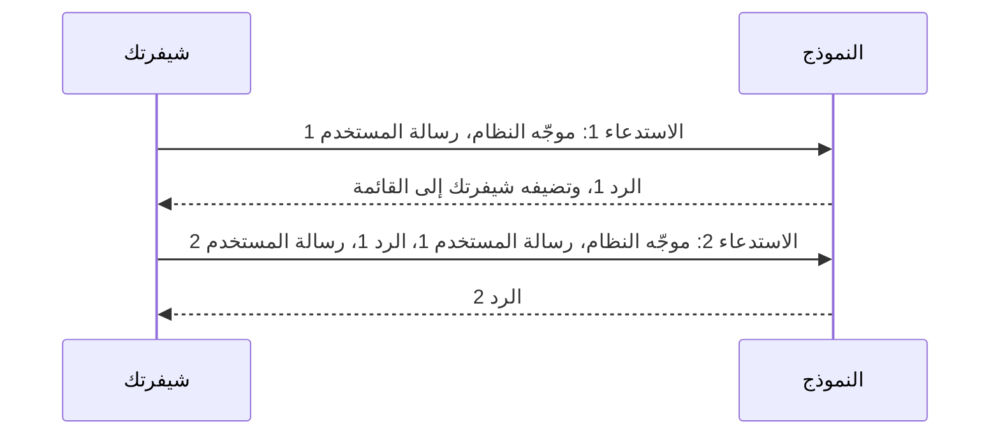
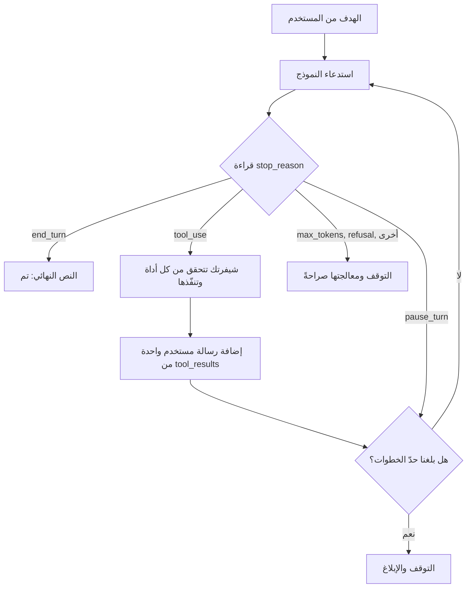

# الوحدة 1 — كيف يعمل تطبيق النموذج اللغوي فعليًا (How an LLM application actually works)

*كل روبوت محادثة (chatbot) ومساعد (copilot) ووكيل (agent) ستبنيه لبنك نجم (Najm Bank) يقوم على فكرة واحدة: النموذج اللغوي الكبير (LLM) دالة عديمة الحالة (stateless function) تحوّل قائمة رسائل (list of messages) إلى الرسالة التالية (next message)، وكل ما عدا ذلك شيفرة (code) تحيط به. يعلّمك الدرس 1.1 هذه الفكرة والمفردات المرافقة لها: الرموز (tokens) ونافذة السياق (context window) وقائمة الرسائل (messages list) وموجّه النظام (system prompt) و`max_tokens` و`stop_reason` و`usage`، وما يمكنك فعله وما لا يمكنك فعله بشأن درجة الحرارة (temperature). أما الدرس 1.2 فهو مختبر (lab): تبني روبوت محادثة ذاكرته قائمة Python، وتكسره عمدًا (break it on purpose) بإغراق نافذة السياق، وتكتب `trim()`، ثم تخطو الخطوة الواحدة التي تحوّل روبوت المحادثة إلى وكيل: حلقة (loop) يطلب فيها النموذج أداة (tool) وتقرر شيفرتك هل تنفّذها. يعمل كل شيء دون اتصال (offline) على نسخة المحاكاة (mock) لواجهة البرمجة (API) في عدّة المختبر (lab kit)، ودون أي تغيير على الواجهة الحقيقية (real API). ويبدأ من هنا نجم ديسك (Najm Desk)، مساعد مكتب خدمة تقنية المعلومات (IT Service Desk) الذي ستأخذه من الاستكشاف (discovery) إلى الإطلاق (go-live)، بأول إجابة صادقة (first honest answer) عن تذكرة (ticket).*

> **الطبقة (Layer):** Model, Agents — ما يكونه استدعاء النموذج حقًّا (what a model call really is): الرسائل (messages) والرموز (tokens) والسياق (context) والتكلفة (cost)، وأصغر حلقة وكيل (smallest agent loop) مبنية عليه، وهي الأساس (foundation) تحت كل طبقة لاحقة (every later layer).

---

# 1.1 — الفكرة الواحدة: دالة عديمة الحالة والرموز ونافذة السياق وقائمة الرسائل (The one idea: a stateless function, tokens, the context window and the messages list)
*المستوى (Level): 🟢 مبتدئ (Beginner)* · *المتطلبات (Prerequisites): 0.2* · *الطبقة (Layer): Model*

## ⚡ الدرس في دقيقة (In 60 seconds)
- النموذج اللغوي الكبير (LLM) **دالة (function)**: قائمة رسائل (a list of messages) تدخل، والرسالة التالية (the next message) تخرج. لا يحتفظ بشيء بين الاستدعاءات (keeps nothing between calls)، لذا **الذاكرة (memory) هي ما تعيد شيفرتك إرساله (resends)**. وكل روبوت محادثة (chatbot) ومساعد (copilot) ووكيل (agent) يستدعيه في حلقة (in a loop) ويقرر ما يدخل القائمة (what goes into the list).
- يقرأ النموذج ويكتب **رموزًا (tokens)**. تدفع مقابل رموز الإدخال (input tokens) في كل استدعاء، أي السجل كله (the whole history) مرة أخرى، ومقابل رموز الإخراج (output tokens) بما فيها التفكير (thinking included)؛ لذا تنمو التكلفة (cost) أسرع من عدد الأدوار (number of turns).
- اعرف خمسة أشياء في كل استدعاء: `system` وهو معامل (a parameter) لا رسالة (not a message)، و`messages`، و`max_tokens` (اترك مجالًا للتفكير (leave room for thinking))، و`stop_reason`، و`usage`.
- لا تستطيع في الغالب ضبط درجة الحرارة (temperature) في نماذج Claude الحالية. احصل على الاتساق (consistency) عبر موجّهات دقيقة (precise prompts) ومخرجات مهيكلة (structured output) وتحقق من الصحة (validation)؛ واختبر شكل الإجابة (the shape of an answer) لا بايتاتها (never its bytes).
- مؤشر القرار (Decision cue): حين يبدو أن شيئًا ما «ينسى» (forgets) أو «يكلّف كثيرًا» (costs too much) أو «ينقطع» (gets cut off)، فاطبع القائمة (print the list) و`usage` و`stop_reason` أولًا.

## 🧭 لماذا يهم (Why it matters)
إنه الأربعاء الثاني من التجربة التشغيلية (pilot) لنجم ديسك (Najm Desk)، وهي افتراضية (hypothetical) بأرقام خيالية (fictional numbers). نجا النموذج الأولي (prototype) الذي بنته لجين (Lujain) من كل العروض التجريبية (demos). ثم تصل ثلاث رسائل. يارا (Yara)، قائدة فريق مكتب الخدمة (Service Desk team lead): «نسي طراز حاسوبي المحمول بعد رسالتين من إخباري له.» ⁦(It forgot my laptop model two messages after I told it.)⁩ وهند (Hind)، الراعية (the sponsor): «توقفت إجابة في منتصف الجملة وكانت أخرى فارغة.» ⁦(One answer stopped mid-sentence and one was blank.)⁩ وفهد (Fahad)، من تقرير الاستخدام (usage report): «لماذا رموز الإدخال (input tokens) أكثر بعشرين ضعفًا من رموز الإخراج (output tokens) مع أن الموظفين يكتبون سطرًا قصيرًا واحدًا في كل مرة؟»

تطارد لجين (Lujain) ثلاثة أخطاء (bugs)، وفكرتان تفسران الثلاثة كلها. يبدأ المعالج (handler) كل طلب بـ `history = []`، فلم يرَ النموذج طراز الحاسوب المحمول قط. واستُهلك `max_tokens=400` في التفكير (thinking)، وهو إخراج (output)، قبل أن تظهر أول كلمة من الإجابة. والتقرير محق (the report is right): ففي محادثة من عشرين دورًا (a twenty-turn chat) أعاد كل استدعاء إرسال كل دور سابق (resent every earlier turn). **النموذج دالة عديمة الحالة (stateless function)، وكل ما «يعرفه» (knows) عن المحادثة (about the conversation) هو القائمة (list) التي ترسلها شيفرتك.** وكل وحدة لاحقة تجيب عن سؤال واحد بمزيد من العناية: *ما الذي ينبغي أن يكون في القائمة في هذا الاستدعاء؟ ⁦(what should be in the list on this call?)⁩*

## 📐 كيف يعمل (How it works)

### 🟢 الأساسيات (The essentials)

**النموذج دالة (A model is a function).** يأخذ النموذج اللغوي الكبير (LLM) قائمة رسائل (a list of messages) ويعيد الرسالة التالية (the next message). ليس لديه ذاكرة (memory) ولا حالة (state)، ولا فكرة بأنه كلّمك قبل ثانية (a second ago).



> **انعدام الحالة (Statelessness).** يبدأ كل استدعاء من الصفر (starts from zero). و«ذاكرة المحادثة» (conversation memory) وهم (an illusion) تصنعه شيفرتك بإعادة إرسال السجل (history) في كل مرة. وهذه الحقيقة وراء كثير من الالتباس (confusion) حول النماذج اللغوية الكبيرة (LLMs) وكثير من تكلفة تشغيلها (cost of running them).

**الرموز (Tokens).** يقرأ النموذج *رموزًا (tokens)*، وهي أجزاء أصغر من الكلمة (sub-word chunks): فالكلمة الإنجليزية الشائعة (common English word) غالبًا رمز واحد، أما الكلمة النادرة (rare word) أو الرقم (number) أو الكلمة العربية (Arabic word) فقد تكون عدة رموز. وبالنسبة إلى النثر الإنجليزي (English prose)، فإن 4 أحرف لكل رمز (4 characters per token) قاعدة تقريبية (rough rule) — إذ تقارب 750 كلمة نحو 1,000 رمز — وليست حقيقة عن Claude. ويُقسَّم الكود (code) وJSON واللغات الأخرى (other languages) بصورة مختلفة؛ وكثيرًا ما يُقال إن العربية «ضعفان إلى ثلاثة أضعاف» (two to three times) عدد الرموز الإنجليزي لكل كلمة. لا تعتمد على هذا الرقم؛ بل **قِس (measure)** باستخدام `client.messages.count_tokens(...)` لنموذجك. والأعداد خاصة بكل نموذج (model-specific): تذكر ملاحظات Anthropic أن بعض النماذج الأحدث تحسب النص نفسه بنحو 30% رمزًا أكثر من سابقاتها (predecessors)، فقد تغيّر الترقية (upgrade) فاتورتك (bill). لا تستخدم `tiktoken` مع Claude أبدًا: فهو مقسّم رموز (tokenizer) من مزوّد آخر (another vendor) ويقلل العدّ (undercounts).

**نافذة السياق (The context window)** هي أقصى عدد من الرموز (the most tokens) يستطيع النموذج التعامل معه في استدعاء واحد (in one call). ويجب أن يتسع الإدخال (input) والإخراج (output)، بما فيه التفكير (thinking included)، معًا (fit together).

```text
| system | turn 1 | turn 2 | ... | turn N | new message |  reply + thinking  |
|<----------- input: you pay for all of it on every call ---------->|<- output ->|
|<------------------- must fit inside the context window ------------------------>|
```

تُعلن نماذج Claude الحالية (current Claude models) نوافذ بين 200K و1M رمز: معظمها 1M، ويُعلن Haiku 4.5 نافذة 200K. اسأل واجهة البرمجة (API): يعيد `client.models.retrieve(MODEL)` القيمتين `max_input_tokens` و`max_tokens` على الواجهة الحقيقية فقط (real API only). ثلاث حقائق تصمد أمام أي حجم للنافذة (three facts survive any window size): تدفع مقابل كل رمز إدخال (input token) في كل استدعاء؛ وقد تتراجع الجودة (quality can degrade) قبل بلوغ الحد (the limit)؛ ويُرفض الموجّه (prompt) الأطول من النافذة (longer than the window)، فعلى شيفرتك أن تدير القائمة (manage the list). يتشارك الإدخال والرد (reply) النافذة نفسها: ففي موجّه شبه ممتلئ (nearly full prompt) يتوقف الرد الطويل بـ `model_context_window_exceeded` في النماذج الأحدث (newer models)، أو يُرفض الطلب في النماذج الأقدم (older ones). النافذة الأكبر تنقل الجدار (moves the wall) لا التكلفة (the cost).

**قائمة الرسائل (The messages list).** `messages` قائمة (list) من القواميس (dicts) على الشكل `{"role": ..., "content": ...}` بدورين (two roles) هما `user` و`assistant`. ويجب أن يكون الأول `user`. و`content` إما نص (string) أو قائمة من الكتل (list of blocks): `text` الآن، و`tool_use` و`tool_result` و`thinking` في الدرس 1.2. تضيف شيفرتك كل رد (reply) رسالةَ `assistant`؛ وهذا كل ما تعنيه كلمة «تذكّر» (remembered). بدّل الأدوار تبديلًا صارمًا (alternate roles strictly): فقد تُدمج رسالتان متتاليتان بالدور نفسه (two same-role messages in a row) في دور واحد أو تُرفضان، لذلك لا تعتمد على أيٍّ منهما.

**موجّه النظام (The system prompt) ليس رسالة (not a message).** من هو النموذج (who the model is)، وما الذي يحق له الإجابة عنه (what it may answer)، وأي لغة يستخدم (which language to use)، كلها تُوضع في المعامل المنفصل (separate parameter) `system=`. يُرسل في كل استدعاء ويُحاسَب عليه في كل استدعاء (sent and billed on every call)، ووجود عنصر `{"role": "system"}` رسالةً أولى خطأ (an error)، وإن كانت بعض النماذج تقبل واحدًا في موضع متأخر من المحادثة (later in a conversation). استدعاء كامل (a complete call)، يعمل على النسخة المحاكاة (mock):

```python
import os

from anthropic import Anthropic

client = Anthropic()
MODEL = os.environ.get("MODEL", "claude-sonnet-5-5")
SYSTEM = "You are a helpful assistant for a bank's IT service desk. Answer briefly. If you don't know, say so."

history = []                                          # the memory: a list that YOUR code owns
for q in ["How do I request a new laptop?", "And how long does it take?", "Who approves it?"]:
    history.append({"role": "user", "content": q})
    resp = client.messages.create(model=MODEL, max_tokens=1024, output_config={"effort": "low"},
                                  system=SYSTEM, messages=history)
    reply = next(b.text for b in resp.content if b.type == "text")    # the text block, never content[0]
    history.append({"role": "assistant", "content": reply})         # write it back, or it is gone
    print(f"sent {len(history) - 1} messages | input_tokens={resp.usage.input_tokens} "
          f"output_tokens={resp.usage.output_tokens} stop={resp.stop_reason}")
```

```text
sent 1 messages | input_tokens=36 output_tokens=13 stop=end_turn
sent 3 messages | input_tokens=62 output_tokens=12 stop=end_turn
sent 5 messages | input_tokens=84 output_tokens=9 stop=end_turn
```

يرتفع الإدخال (input climbs) مع أن كل سؤال سطر قصير واحد (one short line)؛ والردود الحقيقية أطول من ردود النسخة المحاكاة، فالارتفاع الحقيقي أشد انحدارًا (steeper). **اقرأ الاستجابة (response)، لا النص وحده.** `content` *قائمة كتل (list of blocks)*؛ و`stop_reason` يقول لماذا توقف؛ و`usage` هو فاتورتك (your bill):

| `stop_reason` | المعنى (Meaning) | ما ينبغي أن تفعله شيفرتك (Your code should) |
|---|---|---|
| `end_turn` | أنهى النموذج (The model finished) | استخدم النص (Use the text) |
| `max_tokens` | بلغ سقفك (hit your ceiling): الإجابة مقطوعة (the answer is cut off) | ارفع الحد (raise the limit) أو استخدم البث (stream)؛ ولا تثق بها أبدًا (never trust it) |
| `model_context_window_exceeded` | بلغ نافذة السياق (hit the context window) في النماذج الأحدث (newer models) | قصّر القائمة أو لخّصها (shorten or summarise the list)؛ ولا تثق بها أبدًا (never trust it) |
| `stop_sequence` | بلغ سلسلة إيقاف مخصصة (custom stop string) ضبطتها أنت | تعامل معه مثل `end_turn` (handle like end_turn) |
| `tool_use` | يطلب النموذج أداة (the model asks for a tool) | نفّذها (run it) وأعد النتيجة (return the result)، الدرس 1.2 |
| `pause_turn` | توقف دور أداة خادم طويل مؤقتًا (a long server-tool turn paused) | أعد المحادثة إلى الواجهة لاستئنافها (send the conversation back to resume) |
| `refusal` | رفض مصنِّف أمان (a safety classifier declined) | اعرض رسالة واضحة (show a clear message)؛ وقد يذكر `stop_details` السبب، وقد يكون `None` |

يحتوي `usage` على `input_tokens` و`output_tokens`، إضافة إلى `cache_creation_input_tokens` و`cache_read_input_tokens` متى استخدمت التخزين المؤقت للموجّه (prompt caching) في الدرس 14.2؛ وعند تفعيل التخزين المؤقت (caching on) لا يحسب `input_tokens` إلا الجزء غير المخزَّن مؤقتًا (uncached part).

### 🟡 التعمق أكثر (Going deeper)

**تكلفة المحادثة (The cost of a conversation).** يكلّف كل دور (turn) أكثر من سابقه لأن الإدخال يُحاسَب عليه في كل استدعاء (billed on every call). الأسعار **أرقام لعبة (toy numbers)، دولار واحد لكل مليون رمز إدخال و5 دولارات لكل مليون رمز إخراج؛ وهي ليست سعر أي نموذج**. اقرأ صفحة الأسعار الحالية (current price page) لمعرفة الأسعار الحقيقية. افترض موجّه نظام (system prompt) من 1,000 رمز، ثم رسالة مستخدم (user message) من 200 رمز ورد (reply) من 300 رمز في كل دور. يرسل الاستدعاء *n* ما مقداره 1,000 + (*n* − 1) × 500 + 200 رمز إدخال (input tokens)، فترسل *N* دورًا (turns) في المجموع 1,200*N* + 250*N*(*N* − 1).

| الدور *N* (Turn) | الإدخال في هذا الاستدعاء (Input on this call) | الإدخال حتى الآن (Input so far) | التكلفة حتى الآن (Cost so far)، بأرقام اللعبة (toy) |
|---|---|---|---|
| 1 | 1,200 | 1,200 | $0.0027 |
| 10 | 5,700 | 34,500 | $0.0495 |
| 20 | 10,700 | 119,000 | $0.1490 |
| 40 | 20,700 | 438,000 | $0.4980 |

تحقق من الدور 10 (check turn 10): الإدخال 34,500 × $1 ÷ 1,000,000 = $0.0345؛ والإخراج 3,000 × $5 ÷ 1,000,000 = $0.0150؛ فالمجموع $0.0495. مضاعفة الأدوار (doubling the turns) من 10 إلى 20 تضاعف التكلفة ثلاث مرات (triples the cost)، من $0.0495 إلى $0.1490: فالمجموع ينمو مع *مربع (square)* عدد الأدوار. ومن بين 119,000 رمز إدخال محاسَب عليها (billed) على مدى 20 دورًا لم يكن جديدًا من كلمات المستخدم (new user words) إلا 4,000؛ و95,000 كانت سجلًا أُعيد إرساله (history resent)، و20,000 هي موجّه النظام (system prompt). الرافعات (Levers): محادثة واحدة لكل موضوع (one conversation per topic)، والتقليم (trim) أو التلخيص (summarise) في الدرس 1.2 والوحدة 9، وتخزين البادئة مؤقتًا (cache the prefix) في الدرس 14.2، ونموذج أرخص (a cheaper model) للخطوات السهلة (easy steps).

**التفكير (Thinking) والجهد (effort) و`max_tokens`.** تفكّر النماذج الحالية (current models) قبل أن تجيب. وهو مفعّل افتراضيًا في عدة نماذج (on by default)، ولا يمكن إيقافه في بعضها (cannot be switched off)، والنموذج هو الذي يقرر مقداره. رموز التفكير (thinking tokens) هي **رموز إخراج (output tokens)**، تُحاسَب وتُحتسب ضمن `max_tokens`. وإذا نفدت الميزانية (budget) أثناء التفكير حصلت على `stop_reason == "max_tokens"` وكتلة نص قصيرة أو فارغة (short or empty text block): وهذا هو خطأ لجين (Lujain's bug). اضبط `max_tokens` على 1024 على الأقل — وتستخدم أمثلة مرجع واجهة البرمجة (API reference) نحو 16,000 — وافحص `stop_reason`، ووجّه العمق والتكلفة (steer depth and cost) بـ `output_config={"effort": "low"}`. تمتد مستويات الجهد (levels) من `low` إلى `max`؛ ويختلف الافتراضي (default) من نموذج إلى آخر: `high` في Sonnet 5.5. وتستخدم المختبرات `low`؛ وقد أُزيل `budget_tokens` من أحدث النماذج (newest models).

**الأخطاء لها أنواع (Errors are typed).** التقط فئات حزمة التطوير (SDK's classes)، لا نصوص الرسائل (message strings) أبدًا. الخطأ 400 هو `anthropic.BadRequestError`: طلبك خاطئ (your request is wrong)، فأصلحه. وتعني 401 و403 و404 مفتاحًا سيئًا (a bad key) أو صلاحية ناقصة (a missing permission) أو معرّف نموذج مجهولًا (an unknown model id)؛ و429 هو `RateLimitError`؛ و500 و529 من جانب الخادم (server-side). تعيد حزمة التطوير محاولة الأخطاء 408 و409 و429 و5xx وأخطاء الاتصال (connection errors) مرتين افتراضيًا (twice by default)، ولا تعيد 400 أبدًا. ويُرفض الموجّه الأطول من النافذة مقدمًا (refused up front)، عادةً بخطأ 400؛ أما الجسم الذي يتجاوز حد البايتات (a body over the byte limit) فخطؤه 413، `RequestTooLargeError`. يتسبب الدرس 1.2 في خطأ منها عمدًا (on purpose)، على نسخة محاكاة (mock) بدأت بـ `MOCK_CONTEXT_WINDOW=8000`. وتختلف الصياغة الحقيقية (real wording): طابق الفئة (match the class)، لا الجملة (not the sentence).

**درجة الحرارة (Temperature) وبقية المقابض (the other knobs)، بصدق.** الخطوة الأخيرة في النموذج تحوّل الدرجات (scores) إلى احتمالات (probabilities) للرمز التالي (next token) وتختار واحدًا. وتعيد *درجة الحرارة (temperature)* تحجيمها (rescales) أولًا: القيم المنخفضة تترك الرمز الأرجح (likeliest token) يفوز تقريبًا دائمًا، فالنتيجة أبسط (plainer) وقابلة للتكرار (repeatable)؛ والقيم المرتفعة تمنح الرموز غير المرجحة فرصة (unlikely tokens a chance)، فالنتيجة متنوعة (varied) وأكثر مخاطرة (riskier). أما *Top-p* و*top-k* فتقلّمان قائمة المرشحين (candidate list) بدلًا من ذلك. تقول الدروس التعليمية (tutorials) «اضبط درجة الحرارة على 0» (set temperature to 0). وهناك ثلاث حقائق (three facts):

1. في الإصدار 1.x من حزمة التطوير (SDK) لا تملك `messages.create()` **معامل `temperature` (no temperature parameter)**؛ ويؤدي تمرير واحد إلى رفع `TypeError: Messages.create() got an unexpected keyword argument 'temperature'` قبل إرسال أي طلب (before any request is sent).
2. أحدث النماذج (newest models) — Opus 5.5 وSonnet 5.5 وHaiku 5.5 وOpus وSonnet 5 وFable 5.x وOpus 4.7 و4.8 — **ترفض (reject)** قيم أخذ العينات غير الافتراضية (non-default sampling values) بخطأ 400، حتى عبر `extra_body`.
3. النماذج الأقدم (older models) مثل Sonnet 4.6 وHaiku 4.5 تقبل `extra_body={"temperature": 0}`، لكن شيفرة كهذه تنكسر عند الترقية (breaks on upgrade). ولا يزال المزوّدون الآخرون (other providers) والنماذج المفتوحة (open models) يتيحون هذا المقبض (the knob).

بدلًا من ذلك (instead): للحصول على *الشكل* نفسه (same format)، استخدم المخرجات المهيكلة (structured output) بمخطط JSON (JSON schema) في الوحدة 3؛ وللحصول على *السلوك* نفسه (same behaviour)، استخدم موجّهًا دقيقًا (a precise prompt) ومعرّف نموذج مثبّتًا (a pinned model id) لا يتغير إلا خلف تقييم (behind an eval) في الوحدتين 2 و12؛ وللحصول على مخرجات *صالحة* (valid output)، تحقق وأعد المحاولة (validate and retry) مع تمرير الخطأ تغذيةً راجعة (the error as feedback) في الدرس 3.1؛ وللحصول على *الإجابة* نفسها (same answer)، خزّنها وأعد استخدامها (store and reuse it) بذاكرة نتائج مؤقتة (a result cache) في الدرس 14.2. **لا تختبر أبدًا تطابق المخرجات بايتًا ببايت (never test for byte-identical output).** فحتى حيث وُجدت درجة الحرارة 0 كان يمكن أن يختلف استدعاءان (two calls could differ)؛ واختبار النص المطابق تمامًا (exact-string test) يفشل عند إعادة صياغة غير ضارة (harmless rewording)، فتخفف الفرق صرامته (loosen it) حتى لا يلتقط شيئًا (catches nothing). اختبر الشكل (test the shape): JSON صالح (valid JSON)، وتسمية مسموحة (an allowed label)، ومعرّف التذكرة (the ticket id)، وسياسة مستشهد بها (a cited policy) — الوحدة 12؛ وانظر أيضًا [*اختبار البرمجيات (Software Testing)*، الدرس 7.1 — التقييمات (Evals)](../testing/index.ar.html#/7.1). في سؤال الحاسوب المحمول (the laptop question)، الاختبار الضعيف (weak test) هو `answer == "Open a ticket under Hardware."`؛ والقوي (the strong one) هو `"Hardware" in answer and len(answer) < 600`.

### 🔴 نظرة الخبير (Expert view)

**أين يمكن أن تعيش الذاكرة (Where memory can live).** واجهة الرسائل (Messages API) عديمة الحالة (stateless)، فالذاكرة من تصميمك: قائمة في عملية (a list in a process) في المختبرات، أو صف قاعدة بيانات لكل محادثة (a database row per conversation) في الإنتاج (production)، أو ملخص يحل محل الأدوار القديمة (a summary replacing old turns) في الوحدة 9، أو ميزة في المنصة (a platform feature) مثل الضغط (compaction) وجلسات Managed Agents، وعدد منها تجريبي (beta).

**للتقليم تكلفة خفية (Trimming has a hidden cost).** يطابق التخزين المؤقت للموجّه (prompt caching) بادئة مطابقة تمامًا (an exact prefix)، فإسقاط أقدم دور في كل استدعاء يكسر البادئة المخزَّنة مؤقتًا (cached prefix) للمحادثة؛ فقلّم بخطوات أكبر (larger steps) أو لخّص (summarise). احتفظ *بالسجل الكامل (full log)* للتدقيق (audit) وأرسل *عرضًا (view)* مقلَّمًا (trimmed) في الدرس 1.2. والقائمة بيانات أيضًا (the list is also data): ومن يحتفظ بها يتحمل واجبات خصوصيتها (privacy duties) في الوحدتين 9 و13.

**السياقات الطويلة ليست استدعاءً مجانيًا (Long contexts are not free recall).** أفادت ورقة «Lost in the Middle» لعام 2023 بأن النماذج استخدمت وسط الموجّه الطويل بموثوقية أقل من بدايته أو نهايته (less reliably than its start or end). وقد تتحسن النماذج الأحدث (newer models may do better)؛ فاختبر بمستنداتك أنت (your own documents).

## 🧰 الأدوات (The toolkit)
| الأداة أو الممارسة أو النمط (Tool, practice or pattern) | ما هي وماذا تفعل (What it is and does) | متى تلجأ إليها (When to reach for it) |
|---|---|---|
| **Messages list** — قائمة الرسائل | الذاكرة الوحيدة (the only memory): رسائل متناوبة (alternating messages) تعيد شيفرتك إرسالها (resends) | كل استدعاء (every call) |
| **Token counting** — عدّ الرموز | `count_tokens`: عدد رموز الإدخال الدقيق (exact input tokens) لنموذج معيّن | تقدير التكلفة (cost sizing)؛ والعربية والشيفرة (Arabic and code) |
| **Context budget** — ميزانية السياق | خطة مكتوبة (a written plan): النافذة (window) والأدوار (turns) و`max_tokens` ونقطة التقليم (trim point) | قبل التجربة التشغيلية (before the pilot) |
| **Stop-reason check** — فحص سبب التوقف | تفرّع بحسب `stop_reason` وسجّل `usage` قبل استخدام `content` (Branch on stop_reason and log usage before using content) | بعد كل استدعاء (after every call) |

## 🏛️ عمليًا في بنك نجم (In practice at Najm Bank)
المُخرَج (the artefact) هو **Najm Desk Context Budget v1**، أي ميزانية سياق نجم ديسك: جدول من صفحة واحدة (a one-page table) تملؤه لجين (Lujain) قبل التجربة التشغيلية (pilot) ويراجعه فهد (Fahad). القيم عناصر نائبة خيالية (fictional placeholders) ينبغي استبدالها (to replace).

| البند (Item) | قيمة نائبة (Placeholder)، خيالية (fictional) | الرقم الحقيقي من (Real number from) |
|---|---|---|
| النموذج والنافذة (Model and window) | `claude-sonnet-5-5`؛ والنافذة من واجهة النماذج (window from the Models API) | `client.models.retrieve(MODEL)` |
| موجّه النظام مع الأدوات (System prompt plus tools) | 1,500 رمز (tokens) | `count_tokens` مع `system=` و`tools=` |
| رسالة المستخدم والإجابة (User message, answer) | 80 و250 رمزًا، وتشمل الإجابة التفكير (answer includes thinking) | 20 تذكرة عيّنة (sampled tickets)؛ وسجلات التجربة التشغيلية (pilot logs) |
| الأدوار (Turns) | الوسيط 6، وسقف صارم 40 (median 6, hard cap 40) | سجلات التجربة التشغيلية (pilot logs) |
| لكل محادثة (Per conversation) | 14,430 رمز إدخال (tokens in) و1,500 رمز إخراج (out) | صيغة التكلفة (the cost formula) |
| في الأسبوع (Per week) | نحو 6.5M إدخال و0.7M إخراج | 450 محادثة (conversations)، وهي ربع التذاكر الخيالية البالغة 1,800 الخاصة بأسئلة السياسات (the policy-question quarter of the fictional 1,800 tickets) |
| من يحتفظ بالقائمة (Who holds the list) | مخزن مفتاحه معرّف المحادثة (a store keyed by conversation id)، يُحذف بعد N يومًا (deleted after N days) | يُقرَّر مع سارة (Sara)، مسؤولة حماية البيانات (Data Protection Officer) |

الرقم 14,430 هو ستة استدعاءات (six calls) من 1,500 + (*n* − 1) × 330 + 80 رمزًا: 1,580 + 1,910 + 2,240 + 2,570 + 2,900 + 3,230. والتكلفة الأسبوعية (weekly money) هي 6.5 × سعر الإدخال (price in) + 0.7 × سعر الإخراج (price out) لكل مليون، من صفحة أسعار اليوم (today's price page). ونقطة التقليم (trim point) هي النافذة (window) − `max_tokens` − هامش أمان (a margin).

## 🛠️ التمارين (Exercises)
الدرجات (grades): 🟢 دون اتصال فقط (offline only)، 🟡 دون اتصال مع صفحة أسعار (offline plus a price page)، 🔴 مفتاح واجهة برمجة حقيقي (a real API key).

- 🟢 **ارسم إعادة الإرسال (Draw the resend).** اكتب `system` و`messages` بالضبط كما أُرسلا في الاستدعاءات 1 و2 و3 من محادثة طلب حاسوب محمول (laptop-request chat)، وقدّر رموز الإدخال (input tokens). ثم شغّل الحلقة أعلاه على النسخة المحاكاة (mock). *يكتمل عندما (Done when):* تجلس ثلاث قوائم جنبًا إلى جنب (three lists sit side by side)، وترتفع تقديراتك (your estimates rise)، وتستطيع أن تسمّي ما الجديد في الاستدعاء 3 (what is new in call 3).
- 🟡 **نموذج التكلفة (Cost model).** اكتب `cost(system, user, reply, turns, price_in, price_out)` وأعد إنتاج الجدول (reproduce the table). جد أول استدعاء يكلّف عشرة أضعاف الأول (ten times the first)، وهو الاستدعاء 50 هنا، ثم أعد التشغيل بأسعار من صفحة الأسعار الحالية (current price page). *يكتمل عندما (Done when):* يطابق الناتج الجدول حتى أربع خانات عشرية (four decimals) وتذكر ملاحظة هل ستقلّم (trim) أم تلخّص (summarise) أم تبدأ من جديد (restart) عند دور العشرة أضعاف (the ten-times turn)، ولماذا.
- 🔴 **قِس ولا تفترض (Measure, do not assume).** على واجهة البرمجة الحقيقية (against the real API): (a) اقرأ `max_input_tokens` لنموذجين؛ (b) عُدّ رموز فقرة سياسة واحدة نصًّا عاديًا (plain text) وبصيغة JSON منسّقة (pretty-printed JSON)؛ (c) شغّل عشرة أدوار (ten turns)، وسجّل `usage` وقارنه بنموذج التكلفة (your cost model)؛ (d) اطرح سؤالًا واحدًا بـ `max_tokens=64` وسجّل `stop_reason` وهل كتلة النص فارغة (the text block is empty). *يكتمل عندما (Done when):* يحتوي `NOTES.md` على معرّفات النماذج (model ids) والتاريخ والرموز المتوقعة مقابل المقيسة (predicted against measured tokens) مع تفسير الفجوة (the gap explained)، وعلى (d). *يحتاج إلى واجهة البرمجة الحقيقية (Needs the real API)*؛ اضبط سقف الإنفاق (spending cap) من الدرس 0.2 أولًا.

## ⚠️ أخطاء وفخاخ (Mistakes and traps)
- **`history` عامّ، أو `[]` جديدة في كل طلب (a global history, or a new [] on every request).** الأول يسرّب محادثة مستخدم إلى آخرين (leaks a user's chat to others)، والثاني ينسى (forgets). أبقِ قائمة واحدة لكل معرّف محادثة (one list per conversation id).
- **`resp.content[0].text`.** قد تكون الكتلة الأولى (the first block) هي `thinking`. خذ الكتلة التي `type` فيها `"text"`.
- **`max_tokens` صغير (a small max_tokens).** يلتهمه التفكير (thinking eats it) فتصبح الإجابة فارغة أو مقطوعة (empty or cut off). استخدم 1024 أو أكثر، وخفّض `effort`، وافحص `stop_reason`.
- **نسبة رموز في رأسك (a token ratio in your head)، أو `tiktoken`.** كلاهما تخمين (guesses) بالنسبة إلى Claude. استدعِ `count_tokens`.
- **`temperature=0` واختبارات النص المطابق (exact-text tests).** الأول يرفع `TypeError`، والثاني يتذبذب (flakes). اختبر الشكل (test the shape).

## 🧾 الخلاصة (Recap)
- النموذج دالة عديمة الحالة (stateless function) لقائمة رسائل (messages list)؛ والذاكرة (memory) هي كل ما تعيد شيفرتك إرساله (resends).
- الرموز (tokens) وحدة التكلفة والحدود (unit of cost and limits): قِسها بـ `count_tokens`.
- يُحاسَب على الإدخال (input) في كل استدعاء، فتنمو التكلفة الإجمالية (total cost) مع مربع عدد الأدوار (square of the turns).
- `system` معامل منفصل (separate parameter). اقرأ `stop_reason` و`usage` في كل مرة؛ وخذ كتلة النص (text block)، لا `content[0]` أبدًا.
- رموز التفكير (thinking tokens) هي رموز إخراج (output tokens): اترك مجالًا في `max_tokens` ووجّه بـ `effort`.
- درجة الحرارة (temperature) مفهوم لا مقبض (a concept, not a knob): ابنِ الاتساق (consistency) بالموجّهات (prompts) والمخططات (schemas) والتحقق من الصحة (validation) واختبارات الشكل (shape tests).

## ✍️ اختبر نفسك (Check yourself)

**1. «تنسى» (forgets) محادثة يارا (Yara) طراز حاسوبها المحمول. يبدأ معالج الويب (web handler) كل طلب بـ `history = []`. أي تغيير يصلح ذلك (which change fixes it)؟**

- A. خفّض `effort` ليقلّ تفكير النموذج في الرسائل القديمة (reasons less about old messages)
- B. ارفع `max_tokens` لتبقى أجزاء أكثر من كل رد (more of each reply survives)
- C. أبقِ قائمة واحدة لكل معرّف محادثة (one list per conversation id) وأعد تحميلها في كل مرة (reload it each time)
- D. كرّر موجّه النظام الكامل (full system prompt) داخل أول رسالة مستخدم (first user message)

<details><summary>الإجابة</summary>

**C.** بنى كل طلب قائمة جديدة (a fresh list) والنموذج لا يحتفظ بشيء (keeps nothing)، فيجب أن تعيش القائمة أطول من الطلب (outlive the request). والخيارات الأخرى تغيّر العمق أو الطول (depth or length)، لا القائمة. 🟢 النموذج دالة (A model is a function).

</details>

**2. تحمل محادثة 180,000 رمز (tokens) من السجل (history) ونافذة النموذج 200,000. ما أكبر حجم آمن تقريبًا لـ `max_tokens`؟ ⁦(Roughly how large can max_tokens safely be?)⁩**

- A. 200,000، لأن النافذة كلها متاحة للإخراج (available to output)
- B. أقل من 20,000، لأن الإدخال والإخراج يتشاركان النافذة (share the window)
- C. 180,000، ليطابق طول الإدخال (matches the input length)
- D. أي قيمة، لأن الإخراج يُحاسَب عليه بشكل منفصل (billed separately)

<details><summary>الإجابة</summary>

**B.** يتشارك الإدخال والإخراج النافذة (share the window)، فتترك 180,000 رمز إدخال أقل من 20,000 للرد (reply). وإن طلبت أكثر فقد يُرفض الطلب (rejected) أو يُقطع الرد (cut off) مع `model_context_window_exceeded`. 🟢 نافذة السياق (The context window).

</details>

**3. يضيف كل دور 200 رمز مستخدم و300 رمز رد خلف موجّه نظام (system prompt) من 1,000 رمز. لماذا تكلّف محادثة من 40 دورًا أكثر بكثير من ضعفي محادثة من 20 دورًا (far more than twice)؟**

- A. الردود المتأخرة أطول وتكلّف أكثر لكل رمز من الأولى (cost more per token)
- B. يتباطأ النموذج في المحادثات الطويلة (slows down in long chats)، فيرتفع سعر الرمز (per-token price rises)
- C. كل استدعاء يعيد إرسال كل السجل (resends all history)، فينمو الإدخال مع مربع عدد الأدوار (turns squared)
- D. تُحاسَب الرموز المخزَّنة مؤقتًا (cached tokens) بسعر أعلى كلما طالت المحادثة

<details><summary>الإجابة</summary>

**C.** إجمالي الإدخال تربيعي تقريبًا (roughly quadratic): 119,000 رمز عند 20 دورًا و438,000 عند 40. وأسعار الرمز لا تتغير داخل المحادثة (per-token prices do not change). 🟡 تكلفة المحادثة (The cost of a conversation).

</details>

**4. في نموذج حالي (a current model)، يعيد استدعاء محادثة بـ `max_tokens=400` القيمة `stop_reason: "max_tokens"` وكتلة نص فارغة (empty text block). ما أفضل إصلاح (best fix)؟**

- A. أضف `temperature=0` ليكفّ النموذج عن الاسترسال عند الحد (stops rambling at the limit)
- B. غلّف الاستدعاء بحلقة إعادة محاولة (retry loop)، لأن الخطأ عابر (transient) فقط
- C. اقرأ `content[0].text` وتجاهل كل كتلة أخرى (ignore every other block)
- D. ارفع (raise) `max_tokens` إلى 1024 فأكثر، وخفّض (lower) `effort`، وافحص (check) `stop_reason`

<details><summary>الإجابة</summary>

**D.** تُحتسب رموز التفكير (thinking tokens) ضمن الإخراج واستهلكت السقف (ceiling) أولًا. وإعادة المحاولة (retry) تصطدم بالحد نفسه (same limit). 🟡 التفكير (Thinking) والجهد (effort) و`max_tokens`.

</details>

**5. يتحقق اختبار دانة (Dana) من أن الإجابة تساوي جملة واحدة مخزَّنة (one stored sentence). نجح يوم الاثنين وفشل يوم الثلاثاء دون أي تغيير في الشيفرة. ماذا ينبغي أن تفعل (what should she do)؟**

- A. شغّله ثلاث مرات واقبل البناء (build) إن نجح تشغيلان
- B. تحقق من الشكل (assert the shape): الحقائق المطلوبة (required facts) والصيغة الصالحة (valid format) والتسمية المسموحة (allowed label)
- C. أرسل `temperature=0` عبر `extra_body` لتثبيت المخرجات (fix the output)
- D. قارن الجملة الأولى فقط (only the first sentence)، فهي نادرًا ما تتغير

<details><summary>الإجابة</summary>

**B.** تنكسر النصوص المطابقة تمامًا (exact strings) عند إعادة صياغة غير ضارة (harmless rewording)؛ أما فحوص الشكل (shape checks) فتلتقط الانحدارات الحقيقية (real regressions). وأحدث النماذج ترفض `temperature` غير الافتراضية (non-default). 🟡 لا تختبر أبدًا تطابق المخرجات بايتًا ببايت (never test for byte-identical output).

</details>

## 📚 المراجع (References)
- Claude API، نظرة عامة على النماذج (Models overview)، وفيها نوافذ السياق (context windows) ومعرّفات النماذج (model ids): https://platform.claude.com/docs/en/about-claude/models/overview
- Claude API: الأسعار (Pricing) https://platform.claude.com/docs/en/about-claude/pricing; الجهد (Effort) https://platform.claude.com/docs/en/build-with-claude/effort; عدّ الرموز (Token counting) https://platform.claude.com/docs/en/build-with-claude/token-counting; التفكير التكيفي (Adaptive thinking) https://platform.claude.com/docs/en/build-with-claude/adaptive-thinking; الأخطاء (Errors) https://platform.claude.com/docs/en/api/errors
- حزمة تطوير Anthropic لـ Python (Anthropic Python SDK): https://github.com/anthropics/anthropic-sdk-python
- **اقرأ هذا الأسبوع (Read this week)، الوحدة 1.** Grokking AI Applications، الفصلان 1 و2 («Peeking inside the black box» و«Building your first GenAI app»): النسخة المصوّرة من هذا الدرس (the illustrated version of this lesson)، اقرأها أولًا (read first): https://www.manning.com/. Microsoft، *AI Agents for Beginners*، الدرس 01، ومدته 15 دقيقة مع الفيديو (15 minutes plus the video): https://github.com/microsoft/ai-agents-for-beginners. Gulli، *Agentic Design Patterns*: المقدمة (the introduction) وقسم «What makes an AI system an agent?» في 9 صفحات (9 pages)، ويذكر الدرس 0.1 أين تجد المسودة (where to find the draft). Anthropic، «Building effective agents»: قسم «When (and when not) to use agents» فقط؛ وناقشه في المجموعة (argue about it in the group): https://www.anthropic.com/engineering

---

# 1.2 — مختبر: روبوت محادثة بذاكرة، ثم كسره عمدًا، ثم أول حلقة وكيل لك (Lab: a chatbot with memory, break it on purpose, then your first agent loop)
*المستوى (Level): 🟢 مبتدئ (Beginner)* · *المتطلبات (Prerequisites): 0.2، 1.1* · *الطبقة (Layer): Model, Agents*

## ⚡ الدرس في دقيقة (In 60 seconds)
- **المختبر A (Lab A).** روبوت المحادثة (chatbot) قائمة (list) ودالة واحدة (one function): أضف رسالتك (append your message)، وأرسل القائمة كلها (send the whole list)، وأضف الرد (append the reply). أرسل أقل فينسى (forgets).
- **اكسره عمدًا (Break it on purpose).** القائمة الطويلة جدًا (over-long list) تعني خطأ 400. وترسل `trim()` *عرضًا (view)* مقلَّمًا (trimmed)؛ والميزانية (budget) = النافذة (window) − `max_tokens` − هامش أمان (margin).
- **المختبر B (Lab B).** يضيف الوكيل (agent) شيئًا واحدًا: قد يجيب النموذج بإجراء (an action)؛ وتنفّذه شيفرتك وتعيد `tool_result`. **النموذج يقترح وشيفرتك تقرر (the model proposes, your code disposes).**
- يجب أن تضع الحلقة (loop) سقفًا لخطواتها (cap its steps)، وأن تعالج كل `stop_reason`، وتجيب عن كل معرّف `tool_use` في رسالة مستخدم **واحدة**، وتعلّم الإخفاقات (flag failures) بـ `is_error`. تثبت النسخة المحاكاة (mock) الآليات (mechanics) لا الجودة (quality).

## 🧭 لماذا يهم (Why it matters)
يطلب فهد (Fahad) من لجين (Lujain) أن تُري يارا (Yara) أول شيء يلمس تذاكرها (tickets). وحين يُسأل «هل انتهت التذكرة 4471 بعد؟» ⁦(Is ticket 4471 done yet?)⁩ لا يستطيع روبوت المحادثة (chatbot) في المختبر A (Lab A) إلا أن يعترف بأنه لا يستطيع البحث عن أي شيء (cannot look anything up)، أو أن يخمّن بطلاقة (guess fluently): «نعم، أُغلقت أمس.» ⁦(Yes, it was closed yesterday.)⁩ والتخمين يبدو معرفة (sounds like knowledge). والحل ليس موجّهًا (prompt) أفضل بل حلقة (loop) يستطيع فيها النموذج أن *يسأل (ask)* TicketHub: أصغر وكيل (the smallest agent)، ومن السهل بناؤه بناءً سيئًا (easy to build badly). والنسخة الأولى من لجين، وهي افتراضية (hypothetical)، بلا حدّ للخطوات (no step cap): فحين تنتهي مهلة (times out) TicketHub يستطيع النموذج مواصلة الطلب، وكل استدعاء يحمل السجل الكامل (full history)، حتى ينطلق إنذار الإنفاق (spending alarm).

## 📐 كيف يعمل (How it works)

### 🟢 الأساسيات (The essentials)

**المختبر A: روبوت محادثة بذاكرة في نحو 40 سطرًا (Lab A: a chatbot with memory in about 40 lines).** شغّل النسخة المحاكاة (mock) ووجّه حزمة التطوير (SDK) إليها؛ وعلى واجهة البرمجة الحقيقية (real API) تكون الشيفرة هي نفسها: ألغِ ضبط `ANTHROPIC_BASE_URL` وضع مفتاحك الحقيقي (real key) في `ANTHROPIC_API_KEY`.

```bash
cd aiapps/labkit
python -m labkit.mock_server --port 8787 &            # the offline "API"
export ANTHROPIC_BASE_URL=http://127.0.0.1:8787 ANTHROPIC_API_KEY=mock
python labs/m01/chat.py
```

```python
# labs/m01/chat.py
"""Lab A: a chatbot with memory in about 40 lines. Read every comment: the comments are the lesson."""
import os

from anthropic import Anthropic

MODEL = os.environ.get("MODEL", "claude-sonnet-5-5")   # one place to change the model
client = Anthropic()                                    # reads ANTHROPIC_API_KEY (and ANTHROPIC_BASE_URL)

SYSTEM = "You are a helpful assistant for a bank's IT service desk. Answer briefly. If you don't know, say so."

history = []                                            # THIS is the memory: a plain list in your process


def text_of(resp) -> str:
    """The reply text: pick the text block. content can start with a thinking block, so never index content[0]."""
    return next((b.text for b in resp.content if b.type == "text"), "")


def ask(user_text: str) -> str:
    history.append({"role": "user", "content": user_text})
    try:
        resp = client.messages.create(
            model=MODEL,
            max_tokens=1024,                   # a ceiling on the reply; thinking tokens count against it too
            output_config={"effort": "low"},   # chat needs little thinking (delete this line on older models)
            system=SYSTEM,                     # a separate parameter, resent on EVERY call
            messages=history,                  # the whole conversation, every time
        )
        reply = text_of(resp)
        if not reply:                          # thinking can eat max_tokens and leave no text at all
            raise RuntimeError(f"no text in the reply (stop_reason={resp.stop_reason}): raise max_tokens")
    except Exception:
        history.pop()                          # failed or empty: take the question back out of the list
        raise
    history.append({"role": "assistant", "content": reply})   # write it back or it is gone

    # These numbers are your bill. Watch input climb: that is the history being resent.
    print(f"[in={resp.usage.input_tokens} out={resp.usage.output_tokens} stop={resp.stop_reason}]")
    return reply


if __name__ == "__main__":
    while True:
        try:
            text = input("you> ")
        except EOFError:
            break
        if text.strip() in ("exit", "quit"):
            break
        print("bot>", ask(text))
```

> **ما تستطيع النسخة المحاكاة إظهاره وما لا تستطيع (What the mock can and cannot show).** تشغّل حزمة التطوير الحقيقية (real SDK) أمام ردود مكتوبة مسبقًا (scripted replies) وأعداد رموز مقدّرة (estimated token counts)، ولذلك تثبت الآليات (mechanics): إعادة الإرسال (the resend)، ونمو الرموز (token growth)، وخطأ 400 عند الفيض (overflow)، والحلقة (the loop)، وأخطاء البروتوكول (protocol errors). ولا تستطيع الحكم على جودة الإجابة (answer quality) أو أوصاف الأدوات (tool descriptions) أو الصدق (honesty).

حارس `if not reply` هو معالجة إجابة لجين (Lujain) الفارغة (blank answer): فرسالة مساعد فارغة (empty assistant message) في القائمة ستجعل الاستدعاء *التالي* خطأ 400.

اكتب (type) هذه الجمل الإنجليزية كما هي: "My name is Rayan." (اسمي ريان) و"How do I request a new laptop?" (كيف أطلب حاسوبًا محمولًا جديدًا؟) و"What is my name?" (ما اسمي؟) و"What did I just ask?" (ماذا سألتُ للتو؟). تجيب النسخة المحاكاة بـ `Your name is Rayan.` وتقتبس سؤالك الأخير (quotes your last question)، بينما يرتفع `in=` فيصبح 33 ثم 56 ثم 79 ثم 95 مع إعادة إرسال السجل (the history is resent).

**أثبت لنفسك انعدام الحالة (Prove statelessness to yourself).** في `ask`، غيّر `messages=history,` إلى `messages=history[-1:],` واطرح الأسئلة نفسها (ask the same questions). تصبح إجابة الاسم `I don't know your name. It has not come up in this conversation.` وهذه صياغة النسخة المحاكاة (mock wording). لم يتغير إلا القائمة (only the list changed).

### 🟡 التعمق أكثر (Going deeper)

**التمرين 1.1: اكسره عمدًا (Exercise 1.1: break it on purpose).** أوقف النسخة المحاكاة (mock)، وأعد تشغيلها بـ `MOCK_CONTEXT_WINDOW=8000 python -m labkit.mock_server --port 8787 &` ومرّر أربعة أسطر طويلة (four long lines) إلى روبوت المحادثة (chatbot) عبر الأنبوب (pipe):

```bash
python3 -c "for _ in range(4): print('Staff connect to the corporate VPN before opening internal systems. ' * 150)" > big.txt
python labs/m01/chat.py < big.txt
```

ينتهي السطر الرابع بـ `anthropic.BadRequestError: Error code: 400 ... prompt is too long: 10351 tokens > 8000 maximum`. اكتب `trim(history, max_tokens)` بنفسك، ثم قارن (compare):

```python
# labs/m01/trim.py
"""Exercise 1.1, reference answer: send a trimmed VIEW of the history so the call fits the window."""
import os

from anthropic import Anthropic

MODEL = os.environ.get("MODEL", "claude-sonnet-5-5")
client = Anthropic()
SYSTEM = "You are a helpful assistant for a bank's IT service desk. Answer briefly. If you don't know, say so."   # as in chat.py


def count(history: list[dict]) -> int:
    """Input tokens the API would see. Exact on the real API; an estimate on the mock."""
    return client.messages.count_tokens(model=MODEL, system=SYSTEM, messages=history).input_tokens


def trim(history: list[dict], max_tokens: int, count=count) -> list[dict]:
    """Drop the oldest turns until the history fits. Call it AFTER appending the new user message.
    The system prompt is a separate parameter, so it can never be trimmed; the newest message
    always stays, and the result starts with a user message, as the API requires."""
    kept = list(history)                              # never mutate the caller's list
    while len(kept) > 1 and count(kept) > max_tokens:
        del kept[0]                                   # the oldest message...
        while len(kept) > 1 and kept[0]["role"] != "user":
            del kept[0]                               # ...and its orphaned reply
    return kept
```

اربطها بـ `chat.py` بتعديلين (two edits): `from trim import trim` تحت `import os`، و`messages=trim(history, 6000),` بدل `messages=history,`؛ فالقيمة 6000 هي النافذة 8000 ناقص `max_tokens` البالغ 1024 وهامش أمان (a margin). شغّل `big.txt` مرة أخرى: تنجح الأسطر الأربعة كلها (all four lines succeed) ويستقر `in=` عند 5169. يبقى `history` السجل الكامل (complete log)؛ ولا يُقلَّم إلا *العرض (view)*. والتقليم ينسى بصمت (trimming forgets silently)، لذا تلخّص المنتجات الحقيقية (real products summarise) في الوحدة 9؛ ورسالة واحدة أكبر من النافذة لا يمكن تقليمها بعيدًا (cannot be trimmed away).

**من روبوت المحادثة إلى الوكيل (From chatbot to agent).** حلقة روبوت المحادثة (a chatbot's loop) هي: يتكلم المستخدم، ويجيب النموذج، ثم الانتظار (wait). ويغيّر الوكيل (agent) شيئًا واحدًا: قد يجيب النموذج بـ *إجراء (action)*، وتنفّذه شيفرتك، وتعود النتيجة إلى القائمة (goes back into the list)، حتى يقرر النموذج أنه انتهى (done).



> **النموذج يقترح وشيفرتك تقرر (The model proposes, your code disposes).** لا ينفّذ النموذج شيفرة أبدًا (never runs code)، ولا يلمس قاعدة بيانات (database)، ولا يرسل بريدًا إلكترونيًا (email). إنه يُصدر طلبًا مهيكلًا (a structured request) — «استدعِ `get_ticket_status` مع `ticket_id` بقيمة 4471» (call get_ticket_status with ticket_id 4471) — ويقرر برنامجك هل يلبّيه (honour it)، ثم ينفّذه ويبلّغ النموذج بالنتيجة (reports back). وكل حاجز وقائي (guardrail) وفحص صلاحيات (permission check) وسجل تدقيق (audit log) في هذه الدورة يعيش في تلك الفجوة (that gap).

### 🔴 نظرة الخبير (Expert view)

**المختبر B: وكيلك الأول، أداة واحدة، بلا إطار عمل (Lab B: your first agent, one tool, no framework).** اقرأ التعليقات المرقّمة (numbered comments) بالترتيب.

```python
# labs/m01/agent.py
"""Lab B: your first agent. One tool, a step cap, every stop_reason handled, no framework."""
import os
import sys

from anthropic import Anthropic

MODEL = os.environ.get("MODEL", "claude-sonnet-5-5")
client = Anthropic()

SYSTEM = "You help IT service desk staff at a bank. Use the tool for questions about tickets."

# 1. Describe the tool. This JSON is ALL the model sees about it: the name, the description, the schema.
TOOLS = [{
    "name": "get_ticket_status",
    "description": "Look up the status of an IT support ticket by its number. Call this whenever the user asks about a ticket.",
    "input_schema": {"type": "object",
                     "properties": {"ticket_id": {"type": "string", "description": "The ticket number, e.g. 4471"}},
                     "required": ["ticket_id"]},
}]


def get_ticket_status(ticket_id: str) -> str:
    """2. The real implementation. Fake data for now; Module 3 connects the kit's tools."""
    fake_db = {"4471": "In progress, assigned to Networks", "4472": "Closed", "4473": "Open"}
    return fake_db.get(ticket_id, f"No ticket {ticket_id} found")


IMPLEMENTATIONS = {"get_ticket_status": get_ticket_status}     # the ONLY things the model can make happen


def text_of(resp) -> str:
    return next((b.text for b in resp.content if b.type == "text"), "")


def run_tools(blocks) -> list[dict]:
    """YOUR code disposes. Permission checks, approvals and audit logs all go here, in this gap."""
    results = []
    for block in blocks:
        if block.type != "tool_use":
            continue
        print(f"  model proposes {block.name}({block.input})")
        try:
            fn = IMPLEMENTATIONS.get(block.name)
            if fn is None:
                raise LookupError(f"unknown tool {block.name!r}")
            result = {"type": "tool_result", "tool_use_id": block.id, "content": fn(**block.input)}
        except Exception as e:     # a failing tool must not crash the loop: report it to the model instead
            result = {"type": "tool_result", "tool_use_id": block.id, "content": f"Error: {e}", "is_error": True}
        results.append(result)     # every tool_use id needs a tool_result, or the next call is a 400
    return results


def run_agent(goal: str, max_steps: int = 5, max_tokens: int = 1024, tools: list = TOOLS) -> str:
    messages = [{"role": "user", "content": goal}]
    for step in range(1, max_steps + 1):                                  # 3. ALWAYS cap the loop
        resp = client.messages.create(model=MODEL, max_tokens=max_tokens, output_config={"effort": "low"},
                                      system=SYSTEM, tools=tools, messages=messages)
        print(f"[step {step}] stop_reason={resp.stop_reason} in={resp.usage.input_tokens} out={resp.usage.output_tokens}")
        messages.append({"role": "assistant", "content": resp.content})  # 4. the WHOLE content list, not just the text
        if resp.stop_reason == "end_turn":                                # 5a. final answer
            return text_of(resp) or "Stopped: the model returned no text."
        if resp.stop_reason == "tool_use":                                # 5b. the model asked; your code answers
            messages.append({"role": "user", "content": run_tools(resp.content)})   # ONE message, ALL the results
        elif resp.stop_reason == "pause_turn":                            # 5c. paused mid-turn: send it back to resume
            continue
        elif resp.stop_reason == "max_tokens":                            # 5d. cut off: never run a half-written call
            return f"Stopped: reply cut off at max_tokens={max_tokens}. {text_of(resp)}".strip()
        else:                                                             # 5e. refusal, model_context_window_exceeded, stop_sequence, or a future value
            return f"Stopped: stop_reason={resp.stop_reason} {resp.stop_details or ''}".strip()
    return f"Stopped: step cap of {max_steps} reached."                   # 6. the guard fired


if __name__ == "__main__":
    print(run_agent(" ".join(sys.argv[1:]) or "Is ticket 4471 done yet? And what about 4472?"))
```

شغّله واقرأ التتبّع (trace):

```text
[step 1] stop_reason=tool_use in=115 out=20
  model proposes get_ticket_status({'ticket_id': '4471'})
  model proposes get_ticket_status({'ticket_id': '4472'})
[step 2] stop_reason=end_turn in=151 out=16
Here is what I found: In progress, assigned to Networks; Closed.
```

طلبان في رد واحد (two requests in one reply)، يُجاب عنهما معًا في رسالة واحدة (both answered in one message)، ثم النص النهائي (the final text): هذا لبّ كل منصة وكلاء (the core of every agent platform) مهما كبرت. وفي النسخة المحاكاة (mock) يأتي الاستدعاء من تداخل الكلمات (word overlap) مع وصف الأداة (tool's description)؛ أما النموذج الحقيقي فيقرر بنفسه، فتوقّع استدعاءات مختلفة (different calls).

**قواعد البروتوكول (The protocol rules).** أضف `resp.content` *كاملًا* بوصفه دور المساعد (assistant turn)، لا نصه فقط: فهو يحمل كتل `tool_use`، وكتل التفكير (thinking blocks) إن وُجدت، التي يجب أن يطابقها الاستدعاء التالي (the next call must match). كل معرّف `tool_use` يحتاج إلى `tool_result` بـ `tool_use_id` نفسه، كلها في رسالة مستخدم **واحدة (one user message)**؛ وإن فاتك واحد صار الاستدعاء التالي خطأ 400. استخدم `is_error: True` حين *تفشل* أداة (a tool fails) — مهلة (timeout) أو وسائط خاطئة (bad arguments) أو أداة مجهولة (unknown tool)؛ أما «التذكرة غير موجودة» (ticket not found) فنتيجة عادية (a normal result). لا تنفّذ أدوات من رد `max_tokens` أو `refusal` أبدًا: فقد يكون الاستدعاء مكتوبًا ناقصًا (half-written).

**وصف الأداة موجّه (A tool description is a prompt).** الضعيف (weak): `does stuff`. والقوي (strong): وصف المختبر، الذي يقول ما تفعله الأداة *ومتى تُستدعى (and when to call it)*. أحدث النماذج (the newest models) مثل Sonnet 5.5 وOpus 5.5 وFable 5.1 ترفض `tool_choice` المفروض (forced)، فوجّه بالوصف أو بـ `strict: true` أو بالمخرجات المهيكلة (structured output) في الوحدة 3. يستطيع مشغّل الأدوات التجريبي (beta tool runner) في حزمة التطوير (SDK) تشغيل هذه الحلقة عنك، ويقبل سقف `max_iterations`؛ فابنها بيدك أولًا (build it by hand first) كي تعرف ما الذي يفعله عنك.

> **تحذير: الحلقات الثلاث التي يكتبها المبتدئون أولًا (Warning: the three loops juniors write first).** يمكن إعادة إنتاج كل منها على النسخة المحاكاة (reproducible on the mock):
> - **بلا حدّ للخطوات (No step cap).** مع `[mock:loop]` في الهدف (goal) يطلب النموذج التذكرة نفسها حتى يوقفه الحد (the cap).
> - **بلا معالجة لـ `stop_reason` (No stop_reason handling).** عامل الرد الأول على أنه نهائي (treat the first reply as final): يرفع `resp.content[0].text` الخطأ `AttributeError: 'ToolUseBlock' object has no attribute 'text'`، وطباعة الرد تُظهر للمستخدم JSON خامًا (raw JSON).
> - **سلسلة نصية عادية بدل كتلة `tool_result` (A plain string instead of a tool_result block).** يكون الاستدعاء التالي خطأ 400 تقول رسالته إن معرّفات `tool_use` وُجدت دون كتل `tool_result`؛ وقد تختلف الصياغة الدقيقة في الواجهة الحقيقية (the real API's exact wording may differ).

يتجنب المختبر B (Lab B) الثلاثة كلها: التعليقات (comments) 3 و5a إلى 5e، و`run_tools`.

## 🧰 الأدوات (The toolkit)
| الأداة أو الممارسة أو النمط (Tool, practice or pattern) | ما هي وماذا تفعل (What it is and does) | متى تلجأ إليها (When to reach for it) |
|---|---|---|
| **Tool use loop** — حلقة استخدام الأدوات | استدعِ (call)، واقرأ `stop_reason`، ونفّذ الأدوات (run tools)، وأعد النتائج (return results)، وكرّر (repeat) | حين يجب على النموذج أن يبحث أو يفعل شيئًا (look up or do something) |
| **Tool definition** — تعريف الأداة | الاسم (name) والوصف (description) وJSON Schema: كل ما يعرفه النموذج عن الأداة (all the model knows of a tool) | كل أداة (every tool) |
| **Tool result block** — كتلة نتيجة الأداة | `tool_result` مع `tool_use_id` والمحتوى (content) و`is_error` الاختياري (optional) | كل `tool_use`، في رسالة مستخدم واحدة (in one user message) |
| **Step cap** — حدّ الخطوات | حد صارم (a hard limit) لتكرارات الحلقة (loop iterations) | كل حلقة (every loop) |
| **History trim** — تقليم السجل | أرسل عرضًا مقلَّمًا (send a trimmed view)؛ واحتفظ بالسجل الكامل (keep the full log) | المحادثات الطويلة (long chats)، إلى أن تلخّص (until you summarise) |

## 🏛️ عمليًا في بنك نجم (In practice at Najm Bank)
**المُسلَّم الأسبوعي (Weekly deliverable).** أودِع (commit) `chat.py` (مع `trim()` الخاصة بك)، و`agent.py`، واختبارات ناجحة دون اتصال (passing offline tests)، وملف `NOTES.md` يجيب عن أسئلة «اختبر نفسك» (Check yourself) في الدرسين، ويسجل نسبة الرموز بين العربية والإنجليزية (Arabic-to-English token ratio)، ويقتبس جملتك من التمرين 1.3(c) (Exercise 1.3(c) sentence).

**جلسة المجموعة (Group session)، 60 دقيقة.** يعرض كل فرد (everyone demos) التمرين 1.3(c) وجملة `SYSTEM` الخاصة به، ويقارن النسب العربية (compares Arabic ratios). ويرسم كل شخص الحلقة من الذاكرة (draws the loop from memory) ويشير إلى السطر الذي يوقفها (the line that stops it). اختتموا بالنقاش (arguing) حول «متى (ومتى لا) تستخدم الوكلاء»، وهو قسم «When (and when not) to use agents».

**ابنِه مع Claude Code (Build it with Claude Code).** أعطِ هذه المواصفة (spec) إلى Claude Code في مستودع فارغ (an empty repository)، في وضع التخطيط (plan mode) — وتحقق من توثيق Claude Code الحالي (current Claude Code documentation) — وراجع خطته (its plan) قبل أن يعدّل أي شيء:

```text
Goal: chat.py (a chatbot with memory), trim.py (trim(history, max_tokens)) and
agent.py (a one-tool agent loop), plus pytest tests.
Context: Python 3.11, anthropic>=1,<2, the offline mock in aiapps/labkit (read its README).
MODEL from the environment, default claude-sonnet-5-5.
Constraints:
- max_tokens>=1024, output_config={"effort": "low"}. No temperature, top_p, top_k, prefill or
  forced tool_choice. Take the text block; never content[0].text; never store an empty reply.
- Agent loop: capped steps; handle end_turn, tool_use, max_tokens, refusal, pause_turn; ONE
  user message with a tool_result for EVERY tool_use id; is_error when a tool raises or is
  unknown; never run tools from a max_tokens reply.
- trim() never mutates its input, keeps the newest message, starts with a user message.
- No frameworks, no eval, no keys in code, no new dependencies, no other files touched.
Acceptance: pytest passes offline; a [mock:loop] goal stops at the cap; a three-ticket goal
gets one user message holding three tool_results.
```

**تحقق قبل أن تقبله (Verify before you accept it).**
- شغّل الاختبارات (run the tests)، ثم اكسر الشيفرة عمدًا (break the code on purpose) بحذف إضافة رسالة المساعد (drop the assistant append) وضبط الحد على 1 (set the cap to 1)، وتأكد من أن اختبارًا يفشل في كل مرة (a test fails each time).
- ابحث في الفرق (diff) عن `temperature` و`content[0]` و`tool_choice` و`eval(` والمفاتيح المكتوبة داخل الشيفرة (hard-coded keys) ومعرّفات النماذج (model ids) غير المقروءة من `MODEL`.
- اقرأ الحلقة بنفسك (read the loop yourself): حدّ للخطوات (a cap)، وكل سبب توقف (every stop reason)، وكل معرّف `tool_use` يُجاب عنه في رسالة واحدة، والإخفاقات بوصفها `is_error`.
- تأكد من أن الملفات التي طلبتها وحدها هي التي تغيّرت (only the files you asked for changed). والمزيد عن فحص الشيفرة التي يكتبها الوكيل (checking agent-written code): [*اختبار البرمجيات (Software Testing)*، الدرس 6.1 — التحقق من الشيفرة المولَّدة بالذكاء الاصطناعي (Verifying AI-generated code)](../testing/index.ar.html#/6.1).

## 🛠️ التمارين (Exercises)
في `NOTES.md`، اذكر أي الملاحظات جاءت من النسخة المحاكاة (the mock) وأيها من نموذج حقيقي (a real model).
- 🟢 **التمرين 1.1: اكسره عمدًا، ثم اكتب `trim()` (Exercise 1.1: break it on purpose, then write trim()).** أغرق روبوت المحادثة (overflow the chatbot) كما هو موضح، وسجّل الخطأ (record the error)، ثم اكتب `trim(history, max_tokens)` مع اختبارات: إبقاء أحدث رسالة (newest message kept)، ورسالة المستخدم أولًا (user message first)، وعدم تعديل المُدخل أبدًا (input never mutated). *يكتمل عندما (Done when):* يعمل `big.txt` حتى النهاية مع ربط دالة trim الخاصة بك (your trim wired in). وعلى واجهة البرمجة الحقيقية (real API) استخدم ميزانية صغيرة (small budget) من 2,000 رمز؛ ولا تملأ نافذة حقيقية أبدًا.
- 🟡 **التمرين 1.2: فحص تكلفة العربية (Exercise 1.2: Arabic cost check).** *يحتاج إلى واجهة البرمجة الحقيقية (Needs the real API)* (`count_tokens`). عُدّ رموز فقرة إنجليزية من 200 كلمة ونسخة عربية منها (an Arabic version) — ترجمها بـ Claude Code ثم راجعها — بـ `MODEL` الخاص بك. *يكتمل عندما (Done when):* يحتوي `NOTES.md` على العدّين (both counts)، والنسبة (the ratio)، ومعرّف النموذج والتاريخ (model id and date)، وما تفعله النسبة بتكلفة محادثة من ستة أدوار (a six-turn chat's cost). وأعداد النسخة المحاكاة (the mock's counts) تأتي من قاعدة مختلقة (made-up rule) ولا معنى لها هنا. لا مفتاح بعد؟ اكتب «لم يُقَس» (not measured) بدل التخمين (rather than a guess).
- 🔴 **التمرين 1.3: اجعله يسيء التصرف، ثم أصلحه (Exercise 1.3: make it misbehave, then fix it).** (a) دون اتصال (offline): `max_steps=1` مع ثلاث تذاكر، ثم `[mock:loop]` بحد قدره 5. (b) *يحتاج إلى واجهة البرمجة الحقيقية (Needs the real API):* غيّر الوصف فقط إلى `does stuff`، ثم أعد تسمية الأداة إلى `tool_one` وأسقط وصف الخاصية (property description)؛ خمس مرات تشغيل لكل حالة (five runs each). (c) *يحتاج إلى واجهة البرمجة الحقيقية (Needs the real API):* اسأل عن التذكرة 9999 خمس مرات: تقرير صادق (honest report) أم حالة مختلقة (invented status)؟ أضف جملة `SYSTEM` واحدة تمنع النوع المختلق وشغّل خمس مرات أخرى، وإن كانت الخمس كلها صادقة فاذكر ذلك. *يكتمل عندما (Done when):* يكون لكل جزء ملاحظة (each part has a note). لا تستطيع النسخة المحاكاة إظهار (b) أو (c): فهي لا تستدعي أبدًا أداة لا يتشارك اسمها ووصفها أي كلمة مع السؤال، وتردّد نتائج الأدوات (echoes tool results)، فينجح (c) في الحالتين (passes either way).

## ⚠️ أخطاء وفخاخ (Mistakes and traps)
- **معاملة النسخة المحاكاة كأنها حَكَم (treating the mock as a judge).** تثبت أن الحلقة تعمل، لا أن موجّهك أو وصف أداتك جيد؛ فكرّر على نموذج حقيقي (repeat on a real model).
- **الإجابة عن بعض معرّفات `tool_use` فقط، أو تقسيم النتائج على عدة رسائل (splitting results across messages).** المعرّف الناقص يعني خطأ 400 (a missing id)، والتقسيم يكسر الصيغة (breaks the format). أرسل رسالة مستخدم واحدة، و`tool_result` واحدة لكل معرّف (one per id).
- **حلقة حيث يكفي استدعاء دالة (a loop where a function call would do).** إن كانت الخطوات ثابتة (fixed) — ابحث ثم نسّق (look up, then format) — فاستدعِ الأداة في شيفرتك أنت؛ ولا تستخدم الحلقة إلا حين يجب على النموذج أن يختار (must choose) في الوحدة 5.
- **الوثوق بـ `block.input` (trusting block.input).** إنه مخرجات النموذج (model output): تحقق من صحته (validate it) وافحص الصلاحيات (check permissions) في `run_tools` في الوحدة 13.

## 🧾 الخلاصة (Recap)
- روبوت المحادثة (chatbot) قائمة ودالة (a list and a function)؛ أرسل أقل يعرف أقل.
- تجنب خطأ 400 الناتج عن الطول الزائد (the too-long 400) بعرض مقلَّم (trimmed view) وسجل كامل (full log). والتقليم ينسى (trimming forgets).
- النموذج يقترح وشيفرتك تقرر (the model proposes, your code disposes): كل ضابط (control) مكانه تلك الفجوة (that gap).
- ضع سقفًا للخطوات (cap the steps)، وعالج كل سبب توقف (handle every stop reason)، وأجب عن كل معرّف في رسالة واحدة (answer every id in one message)، وعلّم الإخفاقات (flag failures) بـ `is_error`.

## ✍️ اختبر نفسك (Check yourself)

**1. يعيد النشر (deployment) تشغيل عملية روبوت المحادثة (chatbot process) فتُنسى كل محادثة (every conversation is forgotten). أين كانت الذاكرة (the memory)؟**

- A. في قائمة `history` في Python داخل العملية (inside the process)
- B. في الذاكرة قصيرة المدى (short-term memory) للنموذج، التي تُعاد تهيئتها مع كل نشر (resets on each deploy)
- C. في جلسة من جانب الخادم (server-side session) مرتبطة بمفتاح الواجهة (API key)
- D. في موجّه النظام (system prompt) الذي تخزّنه حزمة التطوير (SDK) مؤقتًا

<details><summary>الإجابة</summary>

**A.** واجهة البرمجة عديمة الحالة (stateless)؛ والذاكرة الوحيدة كانت قائمة عمليتك (your process's list). 🟢 المختبر A (Lab A).

</details>

**2. تحذف `trim()` عند لجين (Lujain) أقدم رسالة حتى يتسع السجل (history fits)؛ ويكون الاستدعاء التالي خطأ 400 مع أن السجل أقل بكثير من النافذة (well under the window). ما الأرجح أنه تسبب في ذلك (what most likely broke it)؟**

- A. قُلِّم موجّه النظام (system prompt) مع أقدم دور (oldest turn)
- B. تبدأ القائمة الآن برسالة مساعد (assistant message)
- C. غيّرت `trim()` قائمة المستدعي (the caller's list) وأضاعت السجل (lost the log)
- D. تعدّ النسخة المحاكاة (mock) والواجهة الحقيقية الرموز بطريقتين مختلفتين (count tokens differently)

<details><summary>الإجابة</summary>

**B.** حذف رسالة واحدة من قائمة تبدأ برسالة مستخدم يترك رسالة مساعد في المقدمة (leaves an assistant message first)، وهو ما ترفضه واجهة البرمجة؛ فأسقط الرد اليتيم (orphaned reply) أيضًا. 🟡 التمرين 1.1 (Exercise 1.1).

</details>

**3. يعيد استدعاء `messages.create()` العادي كتلة `tool_use`. هل نُفذت الأداة، ومن ينفّذها (who runs it)؟**

- A. لا؛ شيفرتك تنفّذها، أو ترفض تنفيذها (refuses to)
- B. نعم؛ نفّذتها واجهة البرمجة قبل الرد (ran it before replying)
- C. لا؛ تنفّذها خوادم Anthropic (servers) بمجرد أن ترسل نتيجة
- D. نعم؛ تنفّذها حزمة التطوير (SDK) للأدوات التي صرّحت بها (declared)

<details><summary>الإجابة</summary>

**A.** النموذج يطلب فقط (only asks)؛ وبرنامجك هو الذي يقرر هل يلبّي الطلب (honour it)، وحتى مشغّل الأدوات (tool runner) في حزمة التطوير لا يشغّل إلا دوالك أنت. 🟡 من روبوت المحادثة إلى الوكيل (From chatbot to agent).

</details>

**4. يحتوي رد واحد على ثلاث كتل `tool_use`. كيف ينبغي أن تجيب الحلقة (how should the loop answer)؟**

- A. رسالة مستخدم واحدة تضم النتائج الثلاث مدموجة في سلسلة نصية واحدة (joined as one string)
- B. رسالة مساعد واحدة (one assistant message) تحمل النتائج الثلاث
- C. النتيجة الأولى فقط، لأن النموذج سيسأل مجددًا (will ask again)
- D. رسالة مستخدم واحدة تحمل ثلاث كتل `tool_result`، واحدة لكل معرّف (one per id)

<details><summary>الإجابة</summary>

**D.** يحتاج كل معرّف إلى كتلة `tool_result` مطابقة في رسالة مستخدم واحدة؛ والسلسلة المدموجة (joined string) أو المعرّف الناقص (missing id) يعني خطأ 400. 🔴 قواعد البروتوكول (The protocol rules).

</details>

**5. تخفق خدمة التذاكر (ticket service) في كل استدعاء، وليس للحلقة حدّ للخطوات (no step cap). على ماذا يمكنك الاعتماد لإنهاء الحلقة (what can you rely on to end the loop)؟**

- A. ترفض واجهة البرمجة استدعاء الأداة المتطابق المتكرر بوصفه نسخة مكررة (duplicate)
- B. يتوقف النموذج دائمًا من تلقاء نفسه بعد ثلاث محاولات فاشلة (three failed attempts)
- C. حدّك أنت للخطوات (your own step cap) فقط؛ فلا الواجهة ولا حزمة التطوير تنهيها
- D. تنهيها حزمة التطوير (SDK) بمجرد استنفاد محاولاتها الافتراضية الاثنتين (two default retries)

<details><summary>الإجابة</summary>

**C.** لا شيء في واجهة البرمجة أو حزمة التطوير ينهي الحلقة؛ فالنموذج هو الذي يقرر هل يواصل السؤال، لذا لا يحدّ التكلفة (bounds the cost) إلا سقفك أنت، لأن كل خطوة تعيد إرسال السجل المتنامي (growing history). وإعادات محاولة حزمة التطوير (SDK's retries) تغطي إخفاقات HTTP، لا حلقتك. 🔴 الحلقات الثلاث (The three loops).

</details>

## 📚 المراجع (References)
- Claude API، نظرة عامة على استخدام الأدوات (Tool use overview): https://platform.claude.com/docs/en/agents-and-tools/tool-use/overview
- Claude API، الأخطاء (Errors): https://platform.claude.com/docs/en/api/errors
- Anthropic، «Building effective agents»: https://www.anthropic.com/engineering
- ملف README لعدّة المختبر (Lab kit README)، ويشمل النسخة المحاكاة (mock) والتوجيهات (directives) ومتغيرات البيئة (environment variables): https://github.com/Tamoura/system-design-for-vibe-coders/tree/main/aiapps/labkit
