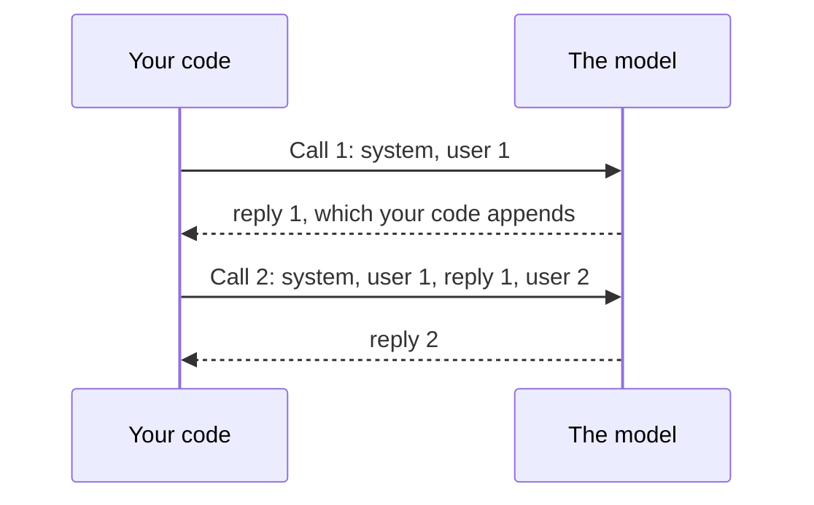
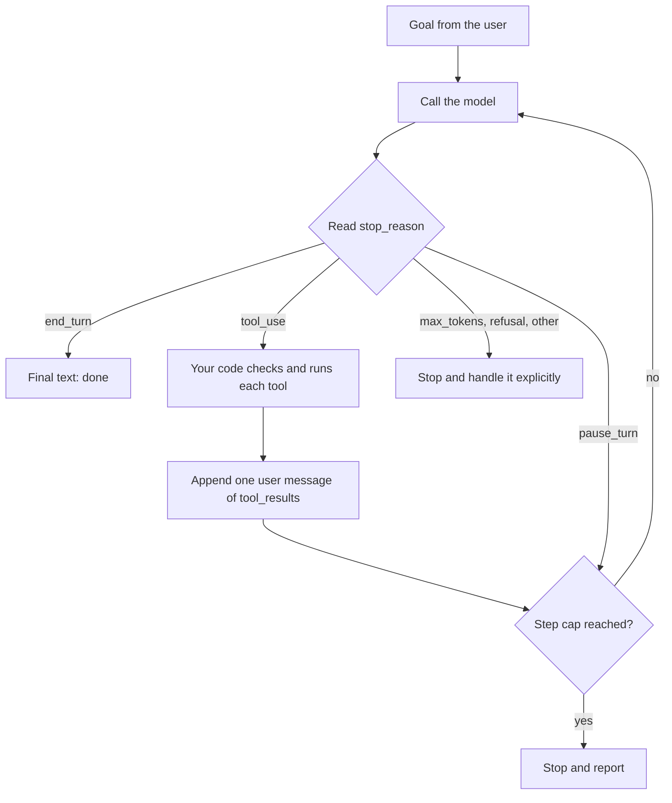

# Module 1 — How an LLM application actually works

*Every chatbot, copilot and agent you will build for Najm Bank rests on one idea: a large language model is a stateless function from a list of messages to the next message, and everything else is code around it. Lesson 1.1 teaches that idea and the vocabulary that comes with it: tokens, the context window, the messages list, the system prompt, `max_tokens`, `stop_reason`, `usage`, and what you can and cannot do about temperature. Lesson 1.2 is a lab. You build a chatbot whose memory is a Python list, break it on purpose by overflowing the context window, write `trim()`, and then take the one step that turns a chatbot into an agent: a loop in which the model asks for a tool and your code decides whether to run it. Everything runs offline against the lab kit's mock of the API, and unchanged against the real one. Najm Desk, the IT Service Desk assistant you will take from discovery to go-live, starts here with its first honest answer about a ticket.*

> **Layer:** Model, Agents — what a model call really is (messages, tokens, context, cost) and the smallest agent loop built on it, the foundation under every later layer.

---

# 1.1 — The one idea: a stateless function, tokens, the context window and the messages list
*Level: 🟢 Beginner* · *Prerequisites: 0.2* · *Layer: Model*

## ⚡ In 60 seconds
- A large language model (LLM) is a **function**: a list of messages in, the next message out. It keeps nothing between calls, so **memory is what your code resends**. Every chatbot, copilot and agent calls it in a loop and decides what goes into the list.
- The model reads and writes **tokens**. You pay for input tokens on every call (the whole history, again) and for output tokens (thinking included), so cost grows faster than the number of turns.
- Know five things on every call: `system` (a parameter, not a message), `messages`, `max_tokens` (leave room for thinking), `stop_reason` and `usage`.
- You mostly cannot set temperature on current Claude models. Get consistency from precise prompts, structured output and validation; test the shape of an answer, never its bytes.
- Decision cue: when something "forgets", "costs too much" or "gets cut off", print the list, `usage` and `stop_reason` first.

## 🧭 Why it matters
It is the second Wednesday of the Najm Desk pilot (hypothetical, with fictional numbers). Lujain's prototype has survived every demo. Then three messages arrive. Yara, the Service Desk team lead: "It forgot my laptop model two messages after I told it." Hind, the sponsor: "One answer stopped mid-sentence and one was blank." Fahad, from the usage report: "Why are input tokens twenty times output tokens when staff type one short line at a time?"

Lujain hunts for three bugs. Two ideas explain all three. The handler starts every request with `history = []`, so the model never saw the laptop model. `max_tokens=400` was spent on thinking (output) before the first word of the answer. And the report is right: in a twenty-turn chat each call resent every earlier turn. **The model is a stateless function, and everything it "knows" about the conversation is the list your code sends.** Every later module answers one question more carefully: *what should be in the list on this call?*

## 📐 How it works

### 🟢 The essentials

**A model is a function.** An LLM takes a list of messages and returns the next message. It has no memory, no state, and no idea it spoke to you a second ago.



> **Statelessness.** Every call starts from zero. "Conversation memory" is an illusion created by your code resending the history each time. It is the fact behind much of the confusion about LLMs, and much of the cost of running them.

**Tokens.** The model reads *tokens*, sub-word chunks: a common English word is often one token, while a rare word, a number or an Arabic word may be several. For English prose, 4 characters per token is a rough rule (750 words is about 1,000 tokens), not a Claude fact. Code, JSON and other languages split differently; Arabic is often quoted at "two to three times" the English count per word. Do not rely on that figure; **measure** with `client.messages.count_tokens(...)` for your model. Counts are model-specific: Anthropic's notes say some newer models count the same text as about 30% more tokens than their predecessors, so an upgrade can change your bill. Never use `tiktoken` for Claude: it is another vendor's tokenizer and undercounts.

**The context window** is the most tokens the model can handle in one call. Input and output (thinking included) must fit together.

```text
| system | turn 1 | turn 2 | ... | turn N | new message |  reply + thinking  |
|<----------- input: you pay for all of it on every call ---------->|<- output ->|
|<------------------- must fit inside the context window ------------------------>|
```

Current Claude models list 200K to 1M tokens (most list 1M; Haiku 4.5 lists 200K). Ask the API: `client.models.retrieve(MODEL)` returns `max_input_tokens` and `max_tokens` (real API only). Three facts survive any window size: you pay for every input token on every call; quality can degrade before the limit; and a prompt longer than the window is refused, so your code must manage the list. Input and reply share the window: on a nearly full prompt a long reply stops with `model_context_window_exceeded` (newer models) or the request is refused (older ones). A bigger window moves the wall, not the cost.

**The messages list.** `messages` is a list of `{"role": ..., "content": ...}` dicts with two roles, `user` and `assistant`. The first must be `user`. `content` is a string or a list of blocks (`text` now; `tool_use`, `tool_result` and `thinking` in lesson 1.2). Your code appends each reply as an `assistant` message; that is all "remembered" means. Alternate roles strictly: two same-role messages in a row may be merged into one turn or rejected, so never depend on either.

**The system prompt is not a message.** Who the model is, what it may answer and which language to use go in the separate `system=` parameter. It is sent and billed on every call, and a `{"role": "system"}` entry as the first message is an error (some models accept one later in a conversation). A complete call, run on the mock:

```python
import os

from anthropic import Anthropic

client = Anthropic()
MODEL = os.environ.get("MODEL", "claude-sonnet-5-5")
SYSTEM = "You are a helpful assistant for a bank's IT service desk. Answer briefly. If you don't know, say so."

history = []                                          # the memory: a list that YOUR code owns
for q in ["How do I request a new laptop?", "And how long does it take?", "Who approves it?"]:
    history.append({"role": "user", "content": q})
    resp = client.messages.create(model=MODEL, max_tokens=1024, output_config={"effort": "low"},
                                  system=SYSTEM, messages=history)
    reply = next(b.text for b in resp.content if b.type == "text")    # the text block, never content[0]
    history.append({"role": "assistant", "content": reply})         # write it back, or it is gone
    print(f"sent {len(history) - 1} messages | input_tokens={resp.usage.input_tokens} "
          f"output_tokens={resp.usage.output_tokens} stop={resp.stop_reason}")
```

```text
sent 1 messages | input_tokens=36 output_tokens=13 stop=end_turn
sent 3 messages | input_tokens=62 output_tokens=12 stop=end_turn
sent 5 messages | input_tokens=84 output_tokens=9 stop=end_turn
```

Input climbs although each question is one short line; real replies are longer than the mock's, so the real climb is steeper. **Read the response, not just the text.** `content` is a *list of blocks*; `stop_reason` says why it stopped; `usage` is your bill:

| `stop_reason` | Meaning | Your code should |
|---|---|---|
| `end_turn` | The model finished | Use the text |
| `max_tokens` | Hit your ceiling: the answer is cut off | Raise the limit or stream; never trust it |
| `model_context_window_exceeded` | Hit the context window (newer models) | Shorten or summarise the list; never trust it |
| `stop_sequence` | Hit a custom stop string you set | Handle like `end_turn` |
| `tool_use` | The model asks for a tool | Run it, return the result (lesson 1.2) |
| `pause_turn` | A long server-tool turn paused | Send the conversation back to resume |
| `refusal` | A safety classifier declined | Show a clear message; `stop_details` may say why (it can be `None`) |

`usage` holds `input_tokens` and `output_tokens`, plus `cache_creation_input_tokens` and `cache_read_input_tokens` once you use prompt caching (lesson 14.2); with caching on, `input_tokens` counts only the uncached part.

### 🟡 Going deeper

**The cost of a conversation.** Each turn costs more than the last because input is billed on every call. The prices are **toy numbers, $1 per million input tokens and $5 per million output tokens; they are not any model's price**. Read the current price page for real ones. Assume a 1,000-token system prompt, then a 200-token user message and a 300-token reply each turn. Call *n* sends 1,000 + (*n* − 1) × 500 + 200 input tokens, so *N* turns send 1,200*N* + 250*N*(*N* − 1) in total.

| Turn *N* | Input on this call | Input so far | Cost so far (toy) |
|---|---|---|---|
| 1 | 1,200 | 1,200 | $0.0027 |
| 10 | 5,700 | 34,500 | $0.0495 |
| 20 | 10,700 | 119,000 | $0.1490 |
| 40 | 20,700 | 438,000 | $0.4980 |

Check turn 10: input 34,500 × $1 ÷ 1,000,000 = $0.0345; output 3,000 × $5 ÷ 1,000,000 = $0.0150; total $0.0495. Doubling the turns from 10 to 20 triples the cost ($0.0495 to $0.1490): the total grows with the *square* of the turns. Of the 119,000 input tokens billed over 20 turns, only 4,000 were new user words; 95,000 were history resent and 20,000 the system prompt. Levers: one conversation per topic, trim or summarise (lesson 1.2, Module 9), cache the prefix (lesson 14.2), a cheaper model for easy steps.

**Thinking, effort and `max_tokens`.** Current models think before answering. On several it is on by default, on some it cannot be switched off, and the model decides how much. Thinking tokens are **output tokens**, billed and counted against `max_tokens`. If the budget runs out during thinking you get `stop_reason == "max_tokens"` and a short or empty text block: Lujain's bug. Set `max_tokens` to at least 1024 (the API reference's examples use about 16,000), check `stop_reason`, and steer depth and cost with `output_config={"effort": "low"}`. Levels run `low` to `max`; the default differs by model (`high` on Sonnet 5.5). The labs use `low`; `budget_tokens` is removed on the newest models.

**Errors are typed.** Catch the SDK's classes, never message strings. A 400 is `anthropic.BadRequestError`: your request is wrong, so fix it. 401, 403 and 404 mean a bad key, a missing permission or an unknown model id; 429 is `RateLimitError`; 500 and 529 are server-side. The SDK retries 408, 409, 429, 5xx and connection errors twice by default, never a 400. A prompt over the window is refused up front, usually as a 400 (a body over the byte limit is a 413, `RequestTooLargeError`). Lesson 1.2 triggers one on purpose, on a mock started with `MOCK_CONTEXT_WINDOW=8000`. The real wording differs: match the class, not the sentence.

**Temperature and the other knobs, honestly.** The model's last step turns scores into probabilities for the next token and picks one. *Temperature* rescales them first: low values let the likeliest token win almost always (plainer, repeatable); high values give unlikely tokens a chance (varied, riskier). *Top-p* and *top-k* trim the candidate list instead. Tutorials say "set temperature to 0". Three facts:

1. In the 1.x SDK `messages.create()` has **no `temperature` parameter**; passing one raises `TypeError: Messages.create() got an unexpected keyword argument 'temperature'` before any request is sent.
2. The newest models (Opus 5.5, Sonnet 5.5, Haiku 5.5, Opus and Sonnet 5, Fable 5.x, Opus 4.7 and 4.8) **reject** non-default sampling values with a 400, even through `extra_body`.
3. Older models (Sonnet 4.6, Haiku 4.5) accept `extra_body={"temperature": 0}`, but such code breaks on upgrade. Other providers and open models still expose the knob.

Instead: for the same *format*, structured output with a JSON schema (Module 3); for the same *behaviour*, a precise prompt and a pinned model id, changed only behind an eval (Modules 2 and 12); for *valid* output, validate and retry with the error as feedback (lesson 3.1); for the same *answer*, store and reuse it (a result cache, lesson 14.2). **Never test for byte-identical output.** Even where temperature 0 existed, two calls could differ; an exact-string test fails on harmless rewording, and teams then loosen it until it catches nothing. Test the shape: valid JSON, an allowed label, the ticket id, a cited policy (Module 12; see also [*Software Testing*, lesson 7.1 — Evals](../testing/index.html#/7.1)). For the laptop question the weak test is `answer == "Open a ticket under Hardware."`; the strong one is `"Hardware" in answer and len(answer) < 600`.

### 🔴 Expert view

**Where memory can live.** The Messages API is stateless, so memory is your design: a list in a process (labs), a database row per conversation (production), a summary replacing old turns (Module 9), or a platform feature (compaction, Managed Agents sessions; several are beta).

**Trimming has a hidden cost.** Prompt caching matches an exact prefix, so dropping the oldest turn on every call breaks the cached prefix of the conversation; trim in larger steps or summarise. Keep the *full log* for audit and send a trimmed *view* (lesson 1.2). The list is also data: whoever keeps it owns its privacy duties (Modules 9 and 13).

**Long contexts are not free recall.** The 2023 "Lost in the Middle" paper reported that models used the middle of a long prompt less reliably than its start or end. Newer models may do better; test with your own documents.

## 🧰 The toolkit
| Tool, practice or pattern | What it is and does | When to reach for it |
|---|---|---|
| **Messages list** | The only memory: alternating messages your code resends | Every call |
| **Token counting** | `count_tokens`: exact input tokens for a model | Cost sizing; Arabic and code |
| **Context budget** | A written plan: window, turns, `max_tokens`, trim point | Before the pilot |
| **Stop-reason check** | Branch on `stop_reason` and log `usage` before using `content` | After every call |

## 🏛️ In practice at Najm Bank
The artefact is the **Najm Desk Context Budget v1**: a one-page table Lujain fills in before the pilot and Fahad reviews. The values are fictional placeholders to replace.

| Item | Placeholder (fictional) | Real number from |
|---|---|---|
| Model and window | `claude-sonnet-5-5`; window from the Models API | `client.models.retrieve(MODEL)` |
| System prompt plus tools | 1,500 tokens | `count_tokens` with `system=` and `tools=` |
| User message, answer | 80 and 250 tokens (answer includes thinking) | 20 sampled tickets; pilot logs |
| Turns | Median 6, hard cap 40 | Pilot logs |
| Per conversation | 14,430 tokens in, 1,500 out | The cost formula |
| Per week | About 6.5M in, 0.7M out | 450 conversations (the policy-question quarter of the fictional 1,800 tickets) |
| Who holds the list | A store keyed by conversation id, deleted after N days | Decide with Sara, the Data Protection Officer |

The 14,430 is six calls of 1,500 + (*n* − 1) × 330 + 80 tokens: 1,580 + 1,910 + 2,240 + 2,570 + 2,900 + 3,230. Weekly money is 6.5 × price in + 0.7 × price out (per million), from today's price page. The trim point is window − `max_tokens` − a margin.

## 🛠️ Exercises
Grades: 🟢 offline only, 🟡 offline plus a price page, 🔴 a real API key.

- 🟢 **Draw the resend.** Write the exact `system` and `messages` sent on calls 1, 2 and 3 of a laptop-request chat and estimate the input tokens. Then run the loop above on the mock. *Done when:* three lists sit side by side, your estimates rise, and you can name what is new in call 3.
- 🟡 **Cost model.** Write `cost(system, user, reply, turns, price_in, price_out)` and reproduce the table. Find the first call that costs ten times the first (call 50 here), then rerun with prices from the current price page. *Done when:* output matches the table to four decimals and a note says whether you would trim, summarise or restart at the ten-times turn, and why.
- 🔴 **Measure, do not assume.** Against the real API: (a) read `max_input_tokens` for two models; (b) count one policy paragraph as plain text and as pretty-printed JSON; (c) run ten turns, log `usage` and compare with your cost model; (d) ask one question with `max_tokens=64` and record `stop_reason` and whether the text block is empty. *Done when:* `NOTES.md` holds model ids, the date, predicted against measured tokens with the gap explained, and (d). *Needs the real API*; set the spending cap from lesson 0.2 first.

## ⚠️ Mistakes and traps
- **A global `history`, or a new `[]` on every request.** One leaks a user's chat to others; the other forgets. Keep one list per conversation id.
- **`resp.content[0].text`.** The first block can be `thinking`. Take the block whose `type` is `"text"`.
- **A small `max_tokens`.** Thinking eats it and the answer is empty or cut off. Use 1024 or more, lower `effort`, check `stop_reason`.
- **A token ratio in your head, or `tiktoken`.** Both are guesses for Claude. Call `count_tokens`.
- **`temperature=0` and exact-text tests.** One raises a `TypeError`, the other flakes. Test the shape.

## 🧾 Recap
- A model is a stateless function of a messages list; memory is whatever your code resends.
- Tokens are the unit of cost and limits: measure them with `count_tokens`.
- Input is billed on every call, so total cost grows with the square of the turns.
- `system` is a separate parameter. Read `stop_reason` and `usage` every time; take the text block, never `content[0]`.
- Thinking tokens are output tokens: leave room in `max_tokens` and steer with `effort`.
- Temperature is a concept, not a knob: build consistency with prompts, schemas, validation and shape tests.

## ✍️ Check yourself

**1. Yara's chat "forgets" her laptop model. The web handler starts every request with `history = []`. Which change fixes it?**

- A. Lower `effort` so the model reasons less about old messages
- B. Raise `max_tokens` so more of each reply survives
- C. Keep one list per conversation id and reload it each time
- D. Repeat the full system prompt inside the first user message

<details><summary>Answer</summary>

**C.** Each request built a fresh list and the model keeps nothing, so the list must outlive the request. The others change depth or length, not the list. (🟢 A model is a function.)

</details>

**2. A conversation holds 180,000 tokens of history and the model's window is 200,000. Roughly how large can `max_tokens` safely be?**

- A. 200,000, because the whole window is available to output
- B. Under 20,000, since input and output share the window
- C. 180,000, so that it matches the input length
- D. Any value, since output is billed separately

<details><summary>Answer</summary>

**B.** Input and output share the window, so 180,000 in leaves under 20,000 for the reply. Ask for more and the request may be rejected or the reply cut off (`model_context_window_exceeded`). (🟢 The context window.)

</details>

**3. Each turn adds 200 user tokens and 300 reply tokens behind a 1,000-token system prompt. Why does a 40-turn chat cost far more than twice a 20-turn chat?**

- A. Later replies are longer and cost more per token than earlier ones
- B. The model slows down in long chats, so the per-token price rises
- C. Each call resends all history, so input grows with turns squared
- D. Cached tokens are billed at a higher rate the longer a chat runs

<details><summary>Answer</summary>

**C.** Total input is roughly quadratic: 119,000 tokens at 20 turns, 438,000 at 40. Per-token prices do not change within a chat. (🟡 The cost of a conversation.)

</details>

**4. On a current model, a chat call with `max_tokens=400` returns `stop_reason: "max_tokens"` and an empty text block. What is the best fix?**

- A. Add `temperature=0` so the model stops rambling at the limit
- B. Wrap the call in a retry loop, because the error is only transient
- C. Read `content[0].text` and ignore every other block
- D. Raise `max_tokens` to 1024+, lower `effort`, check `stop_reason`

<details><summary>Answer</summary>

**D.** Thinking tokens count as output and used up the ceiling first. A retry hits the same limit. (🟡 Thinking, effort and `max_tokens`.)

</details>

**5. Dana's test asserts that an answer equals one stored sentence. It passed Monday and fails Tuesday with no code change. What should she do?**

- A. Run it three times and accept the build if two runs pass
- B. Assert the shape: required facts, valid format, allowed label
- C. Send `temperature=0` through `extra_body` to fix the output
- D. Compare only the first sentence, which rarely changes

<details><summary>Answer</summary>

**B.** Exact strings break on harmless rewording; shape checks catch real regressions. The newest models reject non-default `temperature`. (🟡 Never test for byte-identical output.)

</details>

## 📚 References
- Claude API, Models overview (context windows, model ids): https://platform.claude.com/docs/en/about-claude/models/overview
- Claude API: Pricing https://platform.claude.com/docs/en/about-claude/pricing; Effort https://platform.claude.com/docs/en/build-with-claude/effort; Token counting https://platform.claude.com/docs/en/build-with-claude/token-counting; Adaptive thinking https://platform.claude.com/docs/en/build-with-claude/adaptive-thinking; Errors https://platform.claude.com/docs/en/api/errors
- Anthropic Python SDK: https://github.com/anthropics/anthropic-sdk-python
- **Read this week (Module 1).** Grokking AI Applications, chapters 1 and 2 (Peeking inside the black box; Building your first GenAI app): the illustrated version of this lesson, read first: https://www.manning.com/. Microsoft, *AI Agents for Beginners*, lesson 01 (15 minutes plus the video): https://github.com/microsoft/ai-agents-for-beginners. Gulli, *Agentic Design Patterns*: the introduction and "What makes an AI system an agent?" (9 pages; lesson 0.1 says where to find the draft). Anthropic, "Building effective agents": only the section "When (and when not) to use agents"; argue about it in the group: https://www.anthropic.com/engineering

---

# 1.2 — Lab: a chatbot with memory, break it on purpose, then your first agent loop
*Level: 🟢 Beginner* · *Prerequisites: 0.2, 1.1* · *Layer: Model, Agents*

## ⚡ In 60 seconds
- **Lab A.** A chatbot is a list plus one function: append your message, send the whole list, append the reply. Send less and it forgets.
- **Break it on purpose.** An over-long list is a 400. `trim()` sends a trimmed *view*; budget = window − `max_tokens` − a margin.
- **Lab B.** An agent adds one thing: the model may answer with an action; your code runs it and returns a `tool_result`. **The model proposes, your code disposes.**
- The loop must cap its steps, handle every `stop_reason`, answer every `tool_use` id in **one** user message, and flag failures with `is_error`. The mock proves mechanics, not quality.

## 🧭 Why it matters
Fahad asks Lujain to show Yara the first thing that touches her tickets. Asked "Is ticket 4471 done yet?", the Lab A chatbot can only admit it cannot look anything up, or guess fluently ("Yes, it was closed yesterday."), and a guess sounds like knowledge. The fix is not a better prompt but a loop in which the model can *ask* TicketHub: the smallest agent, and easy to build badly. Lujain's first version (hypothetical) has no step cap: when TicketHub times out, the model can keep asking, each call carrying the full history, until the spending alarm.

## 📐 How it works

### 🟢 The essentials

**Lab A: a chatbot with memory in about 40 lines.** Start the mock and point the SDK at it; against the real API the code is identical (unset `ANTHROPIC_BASE_URL` and put your real key in `ANTHROPIC_API_KEY`).

```bash
cd aiapps/labkit
python -m labkit.mock_server --port 8787 &            # the offline "API"
export ANTHROPIC_BASE_URL=http://127.0.0.1:8787 ANTHROPIC_API_KEY=mock
python labs/m01/chat.py
```

```python
# labs/m01/chat.py
"""Lab A: a chatbot with memory in about 40 lines. Read every comment: the comments are the lesson."""
import os

from anthropic import Anthropic

MODEL = os.environ.get("MODEL", "claude-sonnet-5-5")   # one place to change the model
client = Anthropic()                                    # reads ANTHROPIC_API_KEY (and ANTHROPIC_BASE_URL)

SYSTEM = "You are a helpful assistant for a bank's IT service desk. Answer briefly. If you don't know, say so."

history = []                                            # THIS is the memory: a plain list in your process


def text_of(resp) -> str:
    """The reply text: pick the text block. content can start with a thinking block, so never index content[0]."""
    return next((b.text for b in resp.content if b.type == "text"), "")


def ask(user_text: str) -> str:
    history.append({"role": "user", "content": user_text})
    try:
        resp = client.messages.create(
            model=MODEL,
            max_tokens=1024,                   # a ceiling on the reply; thinking tokens count against it too
            output_config={"effort": "low"},   # chat needs little thinking (delete this line on older models)
            system=SYSTEM,                     # a separate parameter, resent on EVERY call
            messages=history,                  # the whole conversation, every time
        )
        reply = text_of(resp)
        if not reply:                          # thinking can eat max_tokens and leave no text at all
            raise RuntimeError(f"no text in the reply (stop_reason={resp.stop_reason}): raise max_tokens")
    except Exception:
        history.pop()                          # failed or empty: take the question back out of the list
        raise
    history.append({"role": "assistant", "content": reply})   # write it back or it is gone

    # These numbers are your bill. Watch input climb: that is the history being resent.
    print(f"[in={resp.usage.input_tokens} out={resp.usage.output_tokens} stop={resp.stop_reason}]")
    return reply


if __name__ == "__main__":
    while True:
        try:
            text = input("you> ")
        except EOFError:
            break
        if text.strip() in ("exit", "quit"):
            break
        print("bot>", ask(text))
```

> **What the mock can and cannot show.** It runs the real SDK against scripted replies and estimated token counts, so it proves mechanics: the resend, token growth, the 400 on an overflow, the loop, the protocol errors. It cannot judge answer quality, tool descriptions or honesty.

The `if not reply` guard is Lujain's blank answer, handled: an empty assistant message in the list would make the *next* call a 400.

Type "My name is Rayan.", "How do I request a new laptop?", "What is my name?" and "What did I just ask?". The mock answers `Your name is Rayan.` and quotes your last question, while `in=` climbs 33, 56, 79, 95 as the history is resent.

**Prove statelessness to yourself.** In `ask`, change `messages=history,` to `messages=history[-1:],` and ask the same questions. The name answer becomes `I don't know your name. It has not come up in this conversation.` (mock wording). Only the list changed.

### 🟡 Going deeper

**Exercise 1.1: break it on purpose.** Stop the mock, restart it with `MOCK_CONTEXT_WINDOW=8000 python -m labkit.mock_server --port 8787 &` and pipe four long lines into the chatbot:

```bash
python3 -c "for _ in range(4): print('Staff connect to the corporate VPN before opening internal systems. ' * 150)" > big.txt
python labs/m01/chat.py < big.txt
```

The fourth line ends in `anthropic.BadRequestError: Error code: 400 ... prompt is too long: 10351 tokens > 8000 maximum`. Write `trim(history, max_tokens)` yourself, then compare:

```python
# labs/m01/trim.py
"""Exercise 1.1, reference answer: send a trimmed VIEW of the history so the call fits the window."""
import os

from anthropic import Anthropic

MODEL = os.environ.get("MODEL", "claude-sonnet-5-5")
client = Anthropic()
SYSTEM = "You are a helpful assistant for a bank's IT service desk. Answer briefly. If you don't know, say so."   # as in chat.py


def count(history: list[dict]) -> int:
    """Input tokens the API would see. Exact on the real API; an estimate on the mock."""
    return client.messages.count_tokens(model=MODEL, system=SYSTEM, messages=history).input_tokens


def trim(history: list[dict], max_tokens: int, count=count) -> list[dict]:
    """Drop the oldest turns until the history fits. Call it AFTER appending the new user message.
    The system prompt is a separate parameter, so it can never be trimmed; the newest message
    always stays, and the result starts with a user message, as the API requires."""
    kept = list(history)                              # never mutate the caller's list
    while len(kept) > 1 and count(kept) > max_tokens:
        del kept[0]                                   # the oldest message...
        while len(kept) > 1 and kept[0]["role"] != "user":
            del kept[0]                               # ...and its orphaned reply
    return kept
```

Wire it into `chat.py` with two edits: `from trim import trim` under `import os`, and `messages=trim(history, 6000),` for `messages=history,` (6000 is the window 8000 minus `max_tokens` 1024 and a margin). Run `big.txt` again: all four lines succeed and `in=` levels off at 5169. `history` stays the complete log; only the *view* is trimmed. Trimming forgets silently, so real products summarise (Module 9); one message bigger than the window cannot be trimmed away.

**From chatbot to agent.** A chatbot's loop is: user speaks, model answers, wait. An agent changes one thing: the model may answer with an *action*, your code performs it, and the result goes back into the list, until the model decides it is done.



> **The model proposes, your code disposes.** The model never runs code, touches a database or sends an email. It emits a structured request ("call `get_ticket_status` with `ticket_id` 4471"). Your program decides whether to honour it, runs it, and reports back. Every guardrail, permission check and audit log in this course lives in that gap.

### 🔴 Expert view

**Lab B: your first agent, one tool, no framework.** Read the numbered comments in order.

```python
# labs/m01/agent.py
"""Lab B: your first agent. One tool, a step cap, every stop_reason handled, no framework."""
import os
import sys

from anthropic import Anthropic

MODEL = os.environ.get("MODEL", "claude-sonnet-5-5")
client = Anthropic()

SYSTEM = "You help IT service desk staff at a bank. Use the tool for questions about tickets."

# 1. Describe the tool. This JSON is ALL the model sees about it: the name, the description, the schema.
TOOLS = [{
    "name": "get_ticket_status",
    "description": "Look up the status of an IT support ticket by its number. Call this whenever the user asks about a ticket.",
    "input_schema": {"type": "object",
                     "properties": {"ticket_id": {"type": "string", "description": "The ticket number, e.g. 4471"}},
                     "required": ["ticket_id"]},
}]


def get_ticket_status(ticket_id: str) -> str:
    """2. The real implementation. Fake data for now; Module 3 connects the kit's tools."""
    fake_db = {"4471": "In progress, assigned to Networks", "4472": "Closed", "4473": "Open"}
    return fake_db.get(ticket_id, f"No ticket {ticket_id} found")


IMPLEMENTATIONS = {"get_ticket_status": get_ticket_status}     # the ONLY things the model can make happen


def text_of(resp) -> str:
    return next((b.text for b in resp.content if b.type == "text"), "")


def run_tools(blocks) -> list[dict]:
    """YOUR code disposes. Permission checks, approvals and audit logs all go here, in this gap."""
    results = []
    for block in blocks:
        if block.type != "tool_use":
            continue
        print(f"  model proposes {block.name}({block.input})")
        try:
            fn = IMPLEMENTATIONS.get(block.name)
            if fn is None:
                raise LookupError(f"unknown tool {block.name!r}")
            result = {"type": "tool_result", "tool_use_id": block.id, "content": fn(**block.input)}
        except Exception as e:     # a failing tool must not crash the loop: report it to the model instead
            result = {"type": "tool_result", "tool_use_id": block.id, "content": f"Error: {e}", "is_error": True}
        results.append(result)     # every tool_use id needs a tool_result, or the next call is a 400
    return results


def run_agent(goal: str, max_steps: int = 5, max_tokens: int = 1024, tools: list = TOOLS) -> str:
    messages = [{"role": "user", "content": goal}]
    for step in range(1, max_steps + 1):                                  # 3. ALWAYS cap the loop
        resp = client.messages.create(model=MODEL, max_tokens=max_tokens, output_config={"effort": "low"},
                                      system=SYSTEM, tools=tools, messages=messages)
        print(f"[step {step}] stop_reason={resp.stop_reason} in={resp.usage.input_tokens} out={resp.usage.output_tokens}")
        messages.append({"role": "assistant", "content": resp.content})  # 4. the WHOLE content list, not just the text
        if resp.stop_reason == "end_turn":                                # 5a. final answer
            return text_of(resp) or "Stopped: the model returned no text."
        if resp.stop_reason == "tool_use":                                # 5b. the model asked; your code answers
            messages.append({"role": "user", "content": run_tools(resp.content)})   # ONE message, ALL the results
        elif resp.stop_reason == "pause_turn":                            # 5c. paused mid-turn: send it back to resume
            continue
        elif resp.stop_reason == "max_tokens":                            # 5d. cut off: never run a half-written call
            return f"Stopped: reply cut off at max_tokens={max_tokens}. {text_of(resp)}".strip()
        else:                                                             # 5e. refusal, model_context_window_exceeded, stop_sequence, or a future value
            return f"Stopped: stop_reason={resp.stop_reason} {resp.stop_details or ''}".strip()
    return f"Stopped: step cap of {max_steps} reached."                   # 6. the guard fired


if __name__ == "__main__":
    print(run_agent(" ".join(sys.argv[1:]) or "Is ticket 4471 done yet? And what about 4472?"))
```

Run it and read the trace:

```text
[step 1] stop_reason=tool_use in=115 out=20
  model proposes get_ticket_status({'ticket_id': '4471'})
  model proposes get_ticket_status({'ticket_id': '4472'})
[step 2] stop_reason=end_turn in=151 out=16
Here is what I found: In progress, assigned to Networks; Closed.
```

Two requests in one reply, both answered in one message, then the final text: the core of every agent platform, however large. On the mock, the call comes from word overlap with the tool's description; a real model decides for itself, so expect different calls.

**The protocol rules.** Append the *whole* `resp.content` as the assistant turn, not just its text: it carries the `tool_use` blocks (and any thinking blocks) the next call must match. Every `tool_use` id needs a `tool_result` with the same `tool_use_id`, all in **one** user message; miss one and the next call is a 400. Use `is_error: True` when a tool *fails* (timeout, bad arguments, unknown tool); "ticket not found" is a normal result. Never run tools from a `max_tokens` or `refusal` reply: the call may be half-written.

**A tool description is a prompt.** Weak: `does stuff`. Strong: the lab's, which says what the tool does *and when to call it*. The newest models (Sonnet 5.5, Opus 5.5, Fable 5.1) reject a forced `tool_choice`, so steer with the description, `strict: true` or structured output (Module 3). The SDK's beta tool runner can run this loop for you (it takes a `max_iterations` cap); build it by hand first, so you know what it does for you.

> **Warning: the three loops juniors write first.** Each is reproducible on the mock:
> - **No step cap.** With `[mock:loop]` in the goal the model asks for the same ticket until the cap stops it.
> - **No `stop_reason` handling.** Treat the first reply as final: `resp.content[0].text` raises `AttributeError: 'ToolUseBlock' object has no attribute 'text'`, and printing the reply shows the user raw JSON.
> - **A plain string instead of a `tool_result` block.** The next call is a 400 whose message says that `tool_use` ids were found without `tool_result` blocks (the real API's exact wording may differ).

Lab B avoids all three (comments 3, 5a to 5e, and `run_tools`).

## 🧰 The toolkit
| Tool, practice or pattern | What it is and does | When to reach for it |
|---|---|---|
| **Tool use loop** | Call, read `stop_reason`, run tools, return results, repeat | When the model must look up or do something |
| **Tool definition** | Name, description, JSON Schema: all the model knows of a tool | Every tool |
| **Tool result block** | `tool_result` with `tool_use_id`, content, optional `is_error` | Every `tool_use`, in one user message |
| **Step cap** | A hard limit on loop iterations | Every loop |
| **History trim** | Send a trimmed view; keep the full log | Long chats, until you summarise |

## 🏛️ In practice at Najm Bank
**Weekly deliverable.** Commit `chat.py` (with your `trim()`), `agent.py`, passing offline tests and a `NOTES.md` that answers the Check yourself questions of both lessons, records the Arabic-to-English token ratio, and quotes your Exercise 1.3(c) sentence.

**Group session (60 minutes).** Everyone demos Exercise 1.3(c) and their `SYSTEM` sentence, and compares Arabic ratios. Each person draws the loop from memory and points to the line that stops it. Close by arguing "When (and when not) to use agents".

**Build it with Claude Code.** Give this spec to Claude Code in an empty repository, in plan mode (check the current Claude Code documentation), and review its plan before it edits anything:

```text
Goal: chat.py (a chatbot with memory), trim.py (trim(history, max_tokens)) and
agent.py (a one-tool agent loop), plus pytest tests.
Context: Python 3.11, anthropic>=1,<2, the offline mock in aiapps/labkit (read its README).
MODEL from the environment, default claude-sonnet-5-5.
Constraints:
- max_tokens>=1024, output_config={"effort": "low"}. No temperature, top_p, top_k, prefill or
  forced tool_choice. Take the text block; never content[0].text; never store an empty reply.
- Agent loop: capped steps; handle end_turn, tool_use, max_tokens, refusal, pause_turn; ONE
  user message with a tool_result for EVERY tool_use id; is_error when a tool raises or is
  unknown; never run tools from a max_tokens reply.
- trim() never mutates its input, keeps the newest message, starts with a user message.
- No frameworks, no eval, no keys in code, no new dependencies, no other files touched.
Acceptance: pytest passes offline; a [mock:loop] goal stops at the cap; a three-ticket goal
gets one user message holding three tool_results.
```

**Verify before you accept it.**
- Run the tests, then break the code on purpose (drop the assistant append, set the cap to 1) and confirm a test fails each time.
- Search the diff for `temperature`, `content[0]`, `tool_choice`, `eval(`, hard-coded keys and model ids not read from `MODEL`.
- Read the loop yourself: a cap, every stop reason, every `tool_use` id answered in one message, failures as `is_error`.
- Confirm only the files you asked for changed. More on checking agent-written code: [*Software Testing*, lesson 6.1 — Verifying AI-generated code](../testing/index.html#/6.1).

## 🛠️ Exercises
In `NOTES.md`, say which observations came from the mock and which from a real model.
- 🟢 **Exercise 1.1: break it on purpose, then write `trim()`.** Overflow the chatbot as shown, record the error, then write `trim(history, max_tokens)` with tests (newest message kept, user message first, input never mutated). *Done when:* `big.txt` runs to the end with your trim wired in. On the real API use a small budget (2,000 tokens); never fill a real window.
- 🟡 **Exercise 1.2: Arabic cost check.** *Needs the real API* (`count_tokens`). Count a 200-word English paragraph and an Arabic version (translate with Claude Code, then check it) with your `MODEL`. *Done when:* `NOTES.md` has both counts, the ratio, the model id and date, and what the ratio does to a six-turn chat's cost. The mock's counts come from a made-up rule and mean nothing here. No key yet? Write "not measured" rather than a guess.
- 🔴 **Exercise 1.3: make it misbehave, then fix it.** (a) Offline: `max_steps=1` with three tickets, then `[mock:loop]` with a cap of 5. (b) *Needs the real API:* change only the description to `does stuff`, then also rename the tool `tool_one` and drop the property description; five runs each. (c) *Needs the real API:* ask about ticket 9999 five times: honest report or invented status? Add one `SYSTEM` sentence that prevents the invented kind and run five more (if all five were honest, say so). *Done when:* each part has a note. The mock cannot show (b) or (c): it never calls a tool whose name and description share no words with the question, and it echoes tool results, so (c) passes either way.

## ⚠️ Mistakes and traps
- **Treating the mock as a judge.** It proves the loop works, not that your prompt or tool description is good; repeat on a real model.
- **Answering only some `tool_use` ids, or splitting results across messages.** A missing id is a 400, and splitting breaks the format. Send one user message, one `tool_result` per id.
- **A loop where a function call would do.** If the steps are fixed (look up, then format), call the tool in your own code; loop only when the model must choose (Module 5).
- **Trusting `block.input`.** It is model output: validate it, and check permissions, in `run_tools` (Module 13).

## 🧾 Recap
- A chatbot is a list and a function; send less and it knows less.
- Avoid the too-long 400 with a trimmed view and a full log. Trimming forgets.
- The model proposes, your code disposes: every control belongs in that gap.
- Cap the steps, handle every stop reason, answer every id in one message, flag failures with `is_error`.

## ✍️ Check yourself

**1. A deployment restarts the chatbot process and every conversation is forgotten. Where was the memory?**

- A. In the Python `history` list inside the process
- B. In the model's short-term memory, which resets on each deploy
- C. In a server-side session tied to the API key
- D. In the system prompt that the SDK caches

<details><summary>Answer</summary>

**A.** The API is stateless; the only memory was your process's list. (🟢 Lab A.)

</details>

**2. Lujain's `trim()` deletes the oldest message until the history fits; the next call is a 400, though the history is well under the window. What most likely broke it?**

- A. The system prompt was trimmed with the oldest turn
- B. The list now starts with an assistant message
- C. `trim()` changed the caller's list and lost the log
- D. The mock and the real API count tokens differently

<details><summary>Answer</summary>

**B.** Deleting one message from a user-first list leaves an assistant message first, which the API rejects; drop the orphaned reply too. (🟡 Exercise 1.1.)

</details>

**3. A plain `messages.create()` call returns a `tool_use` block. Has the tool run, and who runs it?**

- A. No; your code runs it, or refuses to
- B. Yes; the API ran it before replying
- C. No; Anthropic's servers run it once you send a result
- D. Yes; the SDK runs it for tools you declared

<details><summary>Answer</summary>

**A.** The model only asks; your program decides whether to honour it, and even the SDK's tool runner only runs your functions. (🟡 From chatbot to agent.)

</details>

**4. One reply contains three `tool_use` blocks. How should the loop answer?**

- A. One user message with the three results joined as one string
- B. One assistant message holding the three results
- C. Only the first result, since the model will ask again
- D. One user message holding three `tool_result` blocks, one per id

<details><summary>Answer</summary>

**D.** Every id needs a matching `tool_result` block in one user message; a joined string or a missing id is a 400. (🔴 The protocol rules.)

</details>

**5. A ticket service errors on every call and the loop has no step cap. What can you rely on to end the loop?**

- A. The API rejects a repeated identical tool call as a duplicate
- B. The model always stops by itself after three failed attempts
- C. Only your own step cap; neither the API nor the SDK ends it
- D. The SDK ends it once its two default retries are used up

<details><summary>Answer</summary>

**C.** Nothing in the API or SDK ends the loop; the model decides whether to keep asking, so only your cap bounds the cost, since each step re-sends the growing history. The SDK's retries cover HTTP failures, not your loop. (🔴 The three loops.)

</details>

## 📚 References
- Claude API, Tool use overview: https://platform.claude.com/docs/en/agents-and-tools/tool-use/overview
- Claude API, Errors: https://platform.claude.com/docs/en/api/errors
- Anthropic, "Building effective agents": https://www.anthropic.com/engineering
- Lab kit README (mock, directives, environment variables): https://github.com/Tamoura/system-design-for-vibe-coders/tree/main/aiapps/labkit
