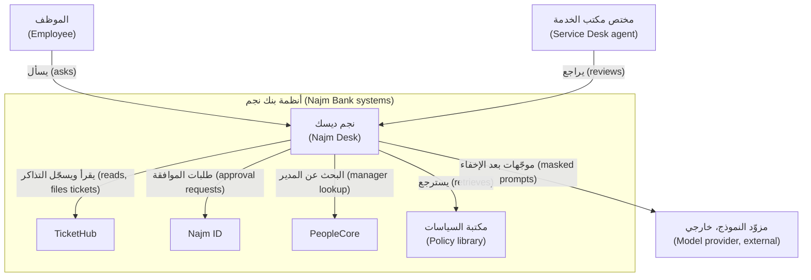
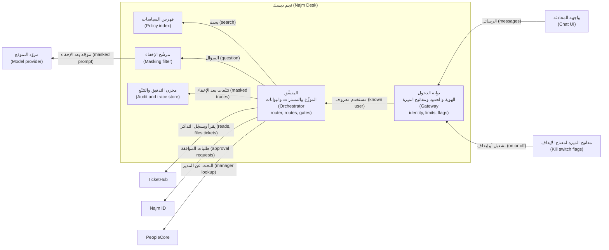

# الوحدة 7 — تصميم الحل مع العميل (Designing the solution with the customer)

*تقول المواصفة (A specification) ما يحتاجه العميل، لكنها لا تقول بعدُ كيف ستسلّمه ولا ما ستعرضه ولا ما وعدتَ به. تحوّل هذه الوحدة المواصفة إلى معمارية (an architecture) ونموذج أولي (a prototype) ومقترح (a proposal) ونطاق متفق عليه (an agreed scope). الدرس 7.1 ورشة تصميم (a design workshop) لنجم ديسك (Najm Desk): سُلَّم القرار من الموجّه الواحد إلى تعدد الوكلاء (the ladder from single prompt to multi-agent)، واستقلالية كل إجراء (the autonomy of each action)، وأنماط الإنسان في الحلقة (human-in-the-loop patterns)، وسطح أدوات مبني من مصفوفة الصلاحيات (a tool surface built from the permissions matrix)، وفحص البناء أم الشراء (a build-or-buy check) ومقارنة أسطح البناء (a comparison of build surfaces)، ومخططات C4 (C4 diagrams)، وتصميم الإخفاق (failure design)، والخصوصية وتدفق البيانات (privacy and data flow)، وميزانيات التكلفة وزمن الاستجابة (cost and latency budgets)، وسجلات القرار المعماري (architecture decision records)، ومراجعة التصميم (the design review) التي ستعقدها ليلى ونورة وحمد وسارة ومها. ويصعد الدرس 7.2 سُلَّم النماذج الأولية (the prototype ladder)، ويشغّل عرضًا تجريبيًا بالشريحة الرقيقة (a thin-slice demo) على عدّة المختبر (the lab kit)، ويعلّم العرض أمام العميل (the customer demo) وبيان العمل (the statement of work) والتقدير في ظل عدم اليقين (estimating under uncertainty) وخطة الإطلاق على مراحل (the phased rollout plan) وضبط التغيير (change control). ويعمل المختبر دون اتصال (offline) على النسخة المحاكاة (the mock) في العدّة، ودون تغيير على واجهة البرمجة الحقيقية (the real API)؛ ويقول صراحةً ما لا تستطيع النسخة المحاكاة إظهاره.*

> **الطبقة (Layer):** Delivery — تحويل مواصفة متفق عليها (an agreed specification) إلى معمارية (an architecture) ونموذج أولي (a prototype) ومقترح (a proposal) ونطاق التزم به العميل (a scope the customer has signed up to).

---

# 7.1 — المعمارية وتصميم الاستقلالية: سير العمل أم الوكيل، وسطح الأدوات، والإنسان في الحلقة، وتصميم الإخفاق، والبناء أم الشراء (Architecture and autonomy design: workflow or agent, tool surface, human-in-the-loop, failure design, build or buy)
*المستوى (Level): 🟡 متوسط (Intermediate)* · *المتطلبات (Prerequisites): 3.1، 5.1، 6.2* · *الطبقة (Layer): Delivery, Agents*

## ⚡ الدرس في دقيقة (In 60 seconds)
- **التصميم (Design)** يحوّل المواصفة (the specification) إلى قرارات يستطيع المراجع قراءتها، يرتبط كل منها بمتطلب أو خطر (traced to a requirement or risk).
- اصعد **السُّلَّم (ladder)** — موجّه، ثم سير عمل، ثم وكيل، ثم تعدد الوكلاء (prompt, workflow, agent, multi-agent) — لحاجة مسمّاة فقط (only for a named need). نجم ديسك الإصدار 1 (Najm Desk v1): سير عمل بموزِّع (a router workflow) وأدوات محددة بالمسار (route-scoped tools).
- **تُحدَّد الاستقلالية لكل إجراء (Autonomy is set per action)** بحسب أسوأ نتيجة واقعية (worst realistic outcome)، لا بحسب العرض التجريبي.
- يحتاج الإنسان في الحلقة (A human in the loop) إلى دليل (evidence) ووقت وصاحب مسؤولية (an owner)؛ والثقة المعلنة (stated confidence) ليست ضابطًا.
- صمّم حالات الإخفاق أولًا (Design failures first)؛ وسعّر المحادثة (price a conversation). **أكبر فخ (Biggest trap):** تصميم في رأس واحد (a design in one head).

## 🧭 لماذا يهم (Why it matters)
تعرض لجين أول تصميم لنجم ديسك (Najm Desk) على المراجعة (review)، في مثال افتراضي (hypothetical): وكيل واحد (one agent)، وتسع أدوات وأقوى نموذج، وكل سياسة ملصقة في الموجّه (every policy pasted into the prompt). تسأل **ليلى** أي الإجراءات تعمل وحدها (which actions run alone)، وتسأل **نورة** ماذا يحدث حين تقول تذكرة «افتح حساب المدير المالي» ("unlock the CFO's account")، ويسأل **حمد** من يستطيع إيقافه في الثانية صباحًا (who can switch it off at 02:00)، وتسأل **سارة** أي الحقول تغادر البنك (which fields leave the bank)، وتسأل **مها** ماذا يرى المستخدمون في 07:05 صباح الأحد إن كان النموذج بطيئًا (what users see at 07:05 on Sunday if the model is slow). تجيب لجين «يعتمد» ("it depends") خمس مرات: كانت القرارات في رأسها (the decisions lived in her head)، حيث لا يستطيع أحد أن يوافق عليها.

فهد: أعِدها مكتوبة على الورق (bring it back on paper)؛ فالتصميم أرخص مرحلة يمكن أن تخطئ فيها (the cheapest stage to be wrong in).

## 📐 كيف يعمل (How it works)

### 🟢 الأساسيات (The essentials)

**ما الذي ينتجه التصميم (What design produces).** من المواصفة (the specification) — الدرس 6.2 — تكتب `docs/architecture.md` و`docs/adr/`. يرتبط كل عنصر بمتطلب (requirement) — FR وGR وNFR — أو بخطر (risk): فعبارة «قاعدة بيانات متجهات لأن الجميع يملك واحدة» ("a vector database because everyone has one") تُحذف؛ وأي متطلب بلا عنصر يتحول إلى سؤال لهند (a question for Hind).

**سُلَّم القرار (The decision ladder).** تنصح مقالة Anthropic «Building effective agents» باستخدام أبسط ما ينجح (the simplest thing that works) — الدرس 5.1. اختر الدرجة (a rung) بحسب ما تعجز عنه الدرجة التي تحتها (what the one below cannot do).
- **موجّه واحد (Single prompt):** يجتاز التقييم (the eval passes). نجم ديسك: تلخيص سلسلة رسائل (summarise a thread).
- **سير العمل (Workflow):** الخطوات معروفة قبل وصول المدخل (the steps are known before the input arrives). نجم ديسك: التصنيف والتوجيه والإجابة والفحص (classify, route, answer, check).
- **وكيل واحد بأدوات (Single agent with tools):** يعتمد المسار على ما تعيده الأدوات (the path depends on what tools return). نجم ديسك: «لماذا يفشل VPN عندي؟» ⁦(why does my VPN fail?)⁩، وهذا ليس من الإصدار 1 (not v1).
- **تعدد الوكلاء (Multi-agent):** سياقات أو مالكون أو صلاحيات لا يستطيع وكيل واحد حملها (contexts, owners or permissions one agent cannot hold)؛ وتتضاعف التكاليف (costs multiply) وتتراكم الأخطاء (errors compound) — الوحدة 11.

حكم الإصدار 1 (The v1 verdict) هو **سير عمل بموزِّع (router workflow)**. يعيد نموذج رخيص تسمية واحدة من قائمة ثابتة (one label from a fixed list)، وهي مخرجات مهيكلة (a structured output) يُتحقق منها في الشيفرة (validated in code)، وتختار الشيفرة أحد خمسة مسارات (five routes): سؤال عن سياسة (policy question)، أو حالة تذكرة (ticket status)، أو الإبلاغ عن مشكلة، أو طلب فك قفل حساب (unlock request)، أو شخص أو غير ذلك. يشغّل كل مسار حلقة قصيرة ذات سقف (a short, capped loop) بـ**سطح أدوات محدد بالمسار (route-scoped tool surface)**: يرى مسار السياسات `search_policies` فقط، فلا يستطيع مقطع مسموم (a poisoned passage) أن يطلب `request_unlock`. والميزات المعروفة سلفًا (Features known in advance) لا تحتاج إلى وكيل حرّ التجوال (a free-roaming agent)، فهو يضيف تباينًا (variance) لا قدرة.

**سُلَّم الاستقلالية (The autonomy ladder)** ([*إدارة منتجات الذكاء الاصطناعي (AI Product Management)*، الدرس 4.1 — مستويات الأتمتة: اقتراح، صياغة، قرار، تنفيذ (Levels of automation: suggest, draft, decide, act)](../aipm/index.ar.html#/4.1)). **الاقتراح (Suggest) (S):** يعرض معلومات؛ ويفعل الشخص كل شيء (the person does everything). **الصياغة (Draft) (D):** يُعدّ المُخرَج (prepare the artefact)؛ ويرسله الشخص. **القرار بموافقة (Decide with approval) (A):** يقترح؛ ويوافق أولًا إنسان مسمّى (a named human approves first). **التنفيذ (Act) (X):** ينفّذ ثم يُبلغ لاحقًا (do it, tell afterwards)، ويراجع عيّنة (review a sample). حدّد المستوى لكل إجراء بحسب أسوأ نتيجة وإمكانية التراجع عنها (worst outcome and reversibility)، لا بجودة النموذج؛ ولا ترفعه إلا بدليل (only on evidence) — الدرس 7.2. والصلاحيات المفرطة للوكيل (excessive agency) في OWASP (LLM Top 10, 2025) تشمل فرط الاستقلالية (too much autonomy).

| الإجراء وأسوأ نتائجه (Action and its worst outcome) | التجربة التشغيلية (Pilot)، وهي المساعد المرافق (copilot) | الإطلاق المحدود والإتاحة العامة (Limited release and GA) |
|---|---|---|
| الإجابة عن سؤال سياسة (Answer a policy question): تصديق قاعدة خاطئة (a wrong rule is believed) | صياغة (Draft)؛ ويراجع مختص | تنفيذ (Act) إن اجتازت بوابة الاستشهاد (the citation gate passes)، وإلا فتسليم إلى شخص |
| عرض حالة تذكرة (Show ticket status): تسرّب تذكرة شخص آخر (another person's ticket leaks) | اقتراح (Suggest) | تنفيذ (Act)؛ مع فحص المالك في الشيفرة (owner check in code) |
| إنشاء تذكرة (Create a ticket): ضجيج في الطابور (noise in the queue) | صياغة (Draft) | قرار بموافقة (Decide with approval)؛ ويؤكد الموظف معاينة (the employee confirms a preview) |
| طلب فك قفل حساب (Request an account unlock): دخول مهاجم (an attacker gets in) | قرار بموافقة (Decide with approval) | الأمر نفسه؛ ولا مستوى أعلى منه في الإصدار 1 (never higher in v1) |

### 🟡 التعمق أكثر (Going deeper)

**أنماط الإنسان في الحلقة (Human-in-the-loop patterns).**
- **بوابة الموافقة (Approval gate):** ينتظر الإجراء إنسانًا مسمّى (the action waits for a named human). اعرض الدليل، وارفض عند انتهاء المهلة (deny on timeout)، وراقب معدل الموافقة (watch the approval rate): فاقتراب المعدل من 100% خلال ثوانٍ مسرحية شكلية (theatre).
- **طابور المراجعة (Review queue)** و**قاعدة التصعيد (escalation rule):** نفّذ ثم خذ عيّنة من العمل القابل للتراجع (act, then sample reversible work)؛ وتوجّه الشيفرة الحالة إلى شخص عند محفِّزات محددة (code routes to a person on set triggers).
- **عتبة الثقة (Confidence threshold):** نفّذ فقط فوق درجة معينة. والثقة المعلنة (Stated confidence) ضعيفة المعايرة (poorly calibrated)، فاستخدم إشارات يمكن فحصها (checkable signals) — درجة الاسترجاع (retrieval score) وبوابة الاستشهاد (citation gate) وصحة المخطط (schema validity) — وحدّد حدّ القطع (the cut-off) على بيانات موسومة (labelled data) — الدرس 12.1 — وسمِّ مالكًا.

**سطح الأدوات المستخلص من مصفوفة الصلاحيات (Tool surface from the permissions matrix).** يتحول كل صف في مصفوفة المواصفة (the specification's matrix) — الدرس 6.2 — إلى قرار: من يستدعي الأداة (who calls it)، وأين تقع البوابة (where the gate sits).

| الأداة (Tool) | خلية الموظفين (Staff cell) | من يستدعيها، وبأي هوية تعمل، والبوابة (Called by, runs as, and the gate) |
|---|---|---|
| `search_policies` | X | النموذج؛ هوية الخدمة (service identity)، للقراءة فقط (read-only)؛ والمقاطع بيانات (passages are data) |
| `get_ticket_status` | X، لتذاكره فقط (X own) | الشيفرة، مسار الحالة (status route)؛ الموظف؛ فحص المالك (owner check) (GR-02)؛ ويذهب السجل إلى الشاشة لا إلى نموذج (the record goes to the screen, not to a model) |
| `draft_ticket` | D | النموذج؛ الموظف؛ معاينة (a preview) ولا شيء يُسجَّل (nothing filed) |
| `request_unlock` | A، يوافق مختص (A agent) | النموذج؛ الموظف؛ يوافق مختص المكتب (a Desk agent approves) في Najm ID بعد معاودة الاتصال (after the call-back) (GR-03) |
| `create_ticket` | A، يؤكد المستخدم (A user) | الشيفرة: تسجّل التذكرة بعد أن يؤكد الموظف (files after the employee confirms) (FR-04) |
| `hand_off` | X | الشيفرة: عند قاعدة تصعيد (on an escalation rule) — حادثة أمنية (security incident) أو طلب خصوصية (privacy request) أو «دعني أتحدث إلى شخص» ("let me talk to someone") أو إخفاق ثالث (a third failure) — أو عند طلب (FR-06) |

لا يرى النموذج أكثر من ثلاث أدوات (three tools at most)، واحدة لكل مسار. ومع ذلك يرفض المُرسِل (the dispatcher) أي اسم خارج قائمة المسار. وتأتي الهوية من الجلسة (Identity comes from the session)، لا من وسيط يقدمه النموذج (never a model argument). أداة الكتابة طلب (A write tool is a request)؛ والبوابة هي التي تنفّذه (a gate commits it). أسماء مختبر الدرس 3.1: `create_ticket_draft` و`request_account_unlock`.

**البناء أم الشراء (Build or buy)** له طبقتان. أولًا: هل يكفي مساعد منتج إدارة الخدمات المدمج؟ ⁦(would the service-management product's own assistant do?)⁩ قيّمه على مواصفتك (Score it on your specification) لا على عرض المورّد التجريبي: شغّل السيناريوهات الأولية الاثني عشر (the 12 seed scenarios) (`labkit/data/m06_eval_seed.jsonl`) واسأل عن العربية والاستشهادات (citations) وفحص المالك (the owner check) والموافقات (approvals) ومفتاح الإيقاف (a kill switch) وموقع البيانات (data location). اشترِ إن اجتاز المنتج الفحص وكان الخروج منه ميسور الكلفة (Buy if it passes and leaving is affordable)؛ وابنِ حين تتطلب السياسات أو اللغات أو الأدوات أو الحوكمة أكثر (build when policies, languages, tools or governance need more)؛ أو اشترِ القناة وابنِ البوابات (or buy the channel and build the gates). ويقرر القسم القانوني وإدارة المشتريات الشروط (Legal and procurement decide terms). ثانيًا: اختر أساسًا — تتغير الإتاحة (availability changes)، فراجع التوثيق (check the documentation) وجدول إتاحة المنصات (the platform availability table).

| السطح (Surface) | لماذا صُمّم، وما الذي تزنه (Built for, and what to weigh) |
|---|---|
| حلقة SDK الخام (Raw SDK loop) | حلقتك الخاصة (Your own loop): أكبر قدر من التحكم وأكثر شيفرة (most control, most code) |
| مشغّل الأدوات التجريبي (Beta tool runner) | حلقة تديرها حزمة التطوير (SDK-run loop): شيفرة أقل؛ تجريبي (beta)؛ وتوضع الموافقات في دوال أدواتك (approvals go in your tool functions)؛ وتحقق من حدود التكرارات (iteration caps) و`pause_turn` |
| Claude Agent SDK | هيكل Claude Code التشغيلي (Claude Code's harness) في صورة مكتبة، وهي حزمة مختلفة (a different package): أكثر مما يحتاجه الإصدار 1 (more than v1 needs) |
| Managed Agents | حلقة وبيئة معزولة تستضيفهما Anthropic (Anthropic-hosted loop and sandbox)، تجريبية (beta): تشغيل أقل؛ تحقق من الإتاحة (availability) ومن إقامة البيانات (residency) |
| أطر أخرى (Other frameworks): LangGraph وCrewAI وGoogle ADK وMicrosoft Agent Framework | مخططات تنفيذ قابلة للاستئناف (resumable graphs)، وفرق قائمة على الأدوار (role-based crews)، وعُدد يدعمها المورّدون (vendor-backed kits): مناسبة إن كانت بيئتك تستخدم أحدها (fit if your estate uses one)؛ تحقق من النضج (check maturity) |

**التوصية (Recommendation):** للإصدار 1 استخدم حلقة SDK الخام (the raw SDK loop) التي في المختبرات. ترجّح إرشادات SDK من Anthropic حاليًا مشغّل الأدوات (currently leans to the tool runner) — راجع التوثيق (check the documentation) — فهذه مفاضلة (a trade): البوابات والسقوف والأدوات الخاصة بكل مسار (gates, caps and per-route tools) هي التصميم، والاعتماد على مكوّن تجريبي (a beta dependency) شيء إضافي يُراجَع (one more thing to review). سجّل ذلك في ADR.

**مخططات C4 (C4 diagrams).** يتدرج نموذج C4 لـ Simon Brown (Simon Brown's C4 model) من السياق (context) إلى الحاويات (containers) فالمكوّنات (components) فالشيفرة؛ وتحتاج المراجعات إلى الأولين فقط. أما DeviceDesk فغائب عن قصد: لأن نصيحة تجديد الأجهزة (refresh advice) خارج النطاق (out of scope).



يفتح مخطط الحاويات (The container view) الصندوق؛ وكل حاوية تُنشر وتُؤمَّن وتُراقَب (deployed, secured and monitored).



**تصميم الإخفاق (Failure design).** لكل تبعية (For each dependency) اكتب المحفِّز (the trigger) والاستجابة وما يقرؤه المستخدم (what the user reads).

| الإخفاق (Failure) | الاستجابة وما يراه المستخدم (Response and what the user sees) |
|---|---|
| النموذج بطيء أو متعطل (Model slow or down) | اضبط `timeout` و`max_retries` بحيث يتسع الناتج (retries + 1) × timeout لميزانية الدور (the turn budget)؛ أما القيم الافتراضية لحزمة التطوير (the SDK defaults) — عشر دقائق وإعادتا محاولة لأخطاء الاتصال (two retries of connection errors) والأخطاء 408 و409 و429 و5xx — فلا تستطيع تحقيق NFR-01. وتُفعِّل بضعة إخفاقات متتالية (A few failures in a row) **قاطع الدائرة (circuit breaker)**، ثم **الوضع المتدهور (degraded mode)**: أقرب مقطع ومصدره وعبارة «هذا ليس إجابة» ("not an answer") وتسليم إلى شخص (hand-off). والنموذج الاحتياطي (A fallback model) يحتاج إلى التقييم نفسه |
| لم يُسترجع شيء (Nothing retrieved)، أو فشلت بوابة (a gate fails)، أو كان `stop_reason` هو `max_tokens` أو `refusal` | لا استدعاء للنموذج أو حجب الإجابة (a withheld answer): «لا أعرف» ("I don't know") وتسليم إلى شخص (a hand-off). لا تعرض نصف إجابة أبدًا (Never show half an answer) ولا تشغّل أداة من دور مبتور أو مرفوض (a tool from a truncated or refused turn) |
| خطأ في الأداة (Tool error) | «تعذر عليّ الوصول إلى TicketHub» ("I could not reach TicketHub")، وليس «تم» ("Done") أبدًا؛ ولا إعادة محاولة للكتابة دون مفتاح عدم التأثر بالتكرار (idempotency key) |
| استلام إنسان للحالة (Human takeover) | ملخص — السؤال والمسار والسبب والمقاطع (question, route, reason, passages) — إلى طابور مسمّى (a named queue)؛ وخارج ساعات العمل (out of hours) تذكرة في الطابور (a queued ticket) |
| خلل قائم الآن (Something is wrong now) | **مفتاح إيقاف (kill switch)** جرى التدرّب عليه (drilled)، بلا نشر (no deploy): إيقاف `model_calls` يعطي الوضع المتدهور (degraded mode)، وإيقاف `write_tools` يعطي وضع القراءة فقط (read-only). وإن تعطلت الخدمة تعرض البوابة الإلكترونية مساري الهاتف والتذكرة (phone and ticket routes) (NFR-02) |

### 🔴 نظرة الخبير (Expert view)

**الخصوصية بالتصميم وتدفق البيانات (Privacy by design and data flow).** ارسم وجهة كل حقل (where each field goes) وبرّر كل سهم. والقيد (The constraint): تمنع سياسة أدوات الذكاء الاصطناعي (the AI-tools policy) البيانات السرية أو المقيَّدة (Confidential or Restricted data) وبيانات العملاء (customer data) وبيانات الاعتماد (credentials) من الوصول إلى خدمات الذكاء الاصطناعي الخارجية (external AI services).
- **السؤال والمقاطع (Question and passages)** — بيانات داخلية (Internal): تُرسل بعد إخفاء الأسرار الملصقة (masking pasted secrets) — GR-01 — والتصفية بحسب الوصول إلى المستندات (filtering by document access).
- **سجل التذكرة (Ticket record):** سري (Confidential)، فتعرضه الشيفرة ولا يراه أي نموذج (code shows it and no model sees it) — الدرس 7.2. أما جواز وصول حتى المعرّف والحالة والتصنيف إلى النموذج (whether even id, status and category may reach a model) فهو سؤال تصنيف البيانات المفتوح (the open data-class question) — ليلى وحمد وسارة.
- **هوية الموظف (Employee identity):** لا تظهر في موجّه أبدًا (never in a prompt)؛ وتحتفظ بها بوابة الدخول.
- **السجلات والتتبّعات (Logs and traces):** يُسجَّل كل استدعاء أداة (every tool call logged) — NFR-04 — ويُخزَّن بعد الإخفاء (stored masked)؛ وتقرر سارة مدة الاحتفاظ (decides retention) — NFR-03.
- **أين يعمل (Where it runs):** الاستدلال (inference) والتضمينات (embeddings) واحتفاظ المزوّد بالبيانات (provider retention): سارة وإدارة المشتريات — [*حوكمة الذكاء الاصطناعي (AI Governance)*، الدرس 4.3 — تقييمات أثر حماية البيانات وخريطة الخصوصية العالمية، من الاتحاد الأوروبي إلى دول الخليج (DPIAs and the global privacy map, from the EU to the GCC)](../aigp/index.ar.html#/4.3).

**ميزانيات التكلفة وزمن الاستجابة (Cost and latency budgets).** يكلّف الاستدعاء الواحد (One call costs) `(n_in - n_cr - n_cw)·p_in + n_cr·r·p_in + n_cw·w·p_in + n_out·p_out`: `n_in` هي كل رموز الإدخال (all input tokens) — فـ`input_tokens` في واجهة API هو الجزء غير المخزَّن مؤقتًا فقط (only the uncached part) — و`n_cr` و`n_cw` جزءا قراءة التخزين المؤقت وكتابته (the cache-read and cache-write parts)، و`r` و`w` مضاعفا صفحة الأسعار (the price page's multipliers)، و`n_out` تشمل رموز التفكير (includes thinking tokens)، فـ`effort` أيضًا مقبض للتحكم في الكلفة. وتجمع المحادثة استدعاءاتها لكل فئة (sums its calls per tier) — `S` للقوي و`H` للرخيص — مضروبة في `(1 + ρ)` لإعادات المحاولة التي تُحتسب في الفاتورة. لنأخذ أربعة أدوار بلا إعادات محاولة ولا تخزين مؤقت (no retries or caching)، بأرقام مختلقة (fictional numbers): 1,500 رمز لموجّه النظام والأدوات (system prompt and tools)، و600 للمقاطع (passages)، و60 لكل سؤال، و250 لكل إجابة، شاملة التفكير. يقرأ المُجيب (The answerer) `Σ(2,100 + 60t + 250(t-1))` = 10,500 رمز؛ ويقرأ الموزِّع (the router) موجّهًا من 300 رمز مع آخر سؤال في كل دور (1,440) ويعيد تسمية من 10 رموز (a 10-token label):

`C = 10,500·p_in^S + 1,000·p_out^S + 1,440·p_in^H + 40·p_out^H`

تخفيض كلفة الموزِّع (Cheapening the router) لا يمس إلا الحد الصغير (the small term). أما الروافع الكبرى (The big levers) فهي الرموز الـ1,500 الثابتة (the stable 1,500 tokens)، وهي قابلة للتخزين المؤقت متى تجاوزت الحد الأدنى لطول النموذج (cacheable once past the model's minimum length) — الدرس 14.2 — ورموز المقاطع الـ600 التي تتغير مع كل سؤال (the 600 passage tokens that change with each question)، وعدد الأدوار. يعيد الأمر `python labs/m00/cost.py --system 2100 --turns 4` إنتاج الفئة القوية (reproduces the strong tier). ويضع NFR-06 سقفًا للتكلفة لكل محادثة *محلولة (resolved)*، فالتسليمات إلى شخص ترفعها (hand-offs raise it). احسب الرموز لكل نموذج (Count tokens per model) باستخدام `count_tokens`، بالإنجليزية والعربية: فالجملة نفسها قد تكلّف أكثر في إحداهما (the same sentence can cost more in one).

يتراكم زمن الاستجابة (Latency sums) على طول المسار الحرج (along the critical path) — بوابة الدخول والموزِّع والاسترجاع وأول رمز (gateway, router, retrieval, first token): قسِّم أهداف NFR-01 عليه (split NFR-01's targets across it) وحدّد سقفًا للرموز والخطوات. ويقصّر البث المتدفق (Streaming) انتظار الكلمات الأولى لكنه يتعارض مع بوابة الاستشهاد (fights the citation gate): فالنص الظاهر على الشاشة لا يمكن حجبه (text on screen cannot be withheld). فإن قبلت هند سطر تقدّم (a progress line) بوصفه «الكلمات الأولى خلال 3 ثوانٍ» ("first words within 3 seconds") فاعرضه، ثم الإجابة المفحوصة كاملةً (the checked answer whole).

## 🧰 الأدوات (The toolkit)
| الأداة أو الممارسة أو النمط (Tool, practice or pattern) | ما هي وماذا تفعل (What it is and does) | متى تلجأ إليها (When to reach for it) |
|---|---|---|
| **Decision ladder** — سُلَّم القرار | موجّه، سير عمل، وكيل، تعدد الوكلاء (Prompt, workflow, agent, multi-agent) | قبل رسم أي صندوق (Before drawing a box) |
| **Autonomy table** — جدول الاستقلالية | كل إجراء عند مستوى اقتراح أو صياغة أو موافقة أو تنفيذ (Each action at suggest, draft, approve or act) | الوكلاء الذين يفعلون أكثر من الإجابة (Agents that do more than answer) |
| **C4 diagrams** (Simon Brown) — مخططات C4 | عرضا السياق والحاويات (Context and container views) | المراجعات والتهيئة (Reviews, onboarding) |
| **Failure table** — جدول الإخفاق | المحفِّز والاستجابة والرسالة (Trigger, response, message) | قبل المسار السعيد (Before the happy path) |
| **Cost model** — نموذج الكلفة | الرموز مضروبة في أسعار رمزية (Tokens times symbolic prices) | عند اختيار النماذج (Choosing models) |
| **ADR** (Michael Nygard) — سجل القرار المعماري | صفحة واحدة: السياق والقرار والنتائج (One page: context, decision, consequences) | قرار قابل للتراجع عنه (A reversible choice) |

## 🏛️ عمليًا في بنك نجم (In practice at Najm Bank)
مُخرَجاتك (Your artefacts): `docs/architecture.md` — ويضم قابلية الربط بالمتطلبات (traceability) والمخططات وجدول الاستقلالية (autonomy table) وسطح الأدوات (tool surface) وتدفق البيانات (data flow) وتصميم الإخفاق (failure design) والميزانيات — و`docs/adr/`.

**صيغة ADR (ADR format).** صيغة Michael Nygard لعام 2011 (Michael Nygard's 2011 format): **العنوان (Title)**، و**الحالة (Status)** — مقترح أو مقبول (accepted) أو مُستبدَل (superseded) — و**السياق (Context)**، و**القرار (Decision)**، و**النتائج (Consequences)**. صفحة واحدة مرقّمة؛ ولا تُعاد كتابة الـ ADR المقبول (an accepted ADR is not rewritten): بل يحل محلّه سجل جديد (a new one supersedes it) ويشير إليه سطر الحالة القديم (the old Status line points to it). نتيجة ضعيفة (Weak consequence): «جودة أفضل» ("better quality"). ونتيجة قوية: كلفة ومحفِّز لإعادة النظر (a cost and a trigger to revisit).

```markdown
# ADR 001: Route with a cheap model, answer with a strong one
Status: Accepted
Context: Every message needs a label; only some need a careful answer. Volume: about 1,800 tickets a week (fictional baseline).
Decision: The router and hand-off summary use claude-haiku-5-5; policy answers use claude-sonnet-5-5. Ids come from environment variables.
Consequences: Cheaper, faster routing; two prompts to version and evaluate. A wrong label means a wrong route, so the router gets its own eval and an "other" exit. Revisit if its eval misses target.
```

```markdown
# ADR 002: Retrieve passages instead of pasting the whole library
Status: Accepted
Context: Fifteen short policies fit in a context window today. But every token is resent each call, answers need citable passages, some documents are staff-specific, and the library will grow.
Decision: Hybrid retrieval (vector plus BM25) returns three passages; the answer must cite them.
Consequences: Fewer input tokens, auditable sources. Retrieval can miss, so recall is measured apart and a miss means "I don't know". A policy index to operate. Supersede if a cached full-library prompt wins on the eval.
```

```markdown
# ADR 003: Write tools are requests; nothing writes alone in v1
Status: Accepted
Context: Text the model reads can carry instructions. Every write needs a human or a policy gate.
Decision: draft_ticket returns a preview; code runs create_ticket, with an idempotency key, only after the employee confirms. request_unlock files a request that a Desk agent decides after the call-back. No tool changes an account.
Consequences: One more click for employees, a queue for approvers. A tricked model can at most draft or request. A tool moves up the ladder only by a new ADR with eval and rollout evidence.
```

**مراجعة التصميم (The design review).** تمرّن على الأسئلة الخمسة في قصة الافتتاح (rehearse the opening story's five questions)؛ ويجب أن يجيب قسم عن كل سؤال: جدول الاستقلالية (the autonomy table) — ليلى، والأدوات المحددة بالمسار (route-scoped tools) — نورة، ومفتاح الإيقاف (the kill switch) — حمد، وتدفق البيانات (the data flow) — سارة، وجدول الإخفاق (the failure table) — مها.

**منصتك (Your platform).** املأ هذا قبل المراجعة (Fill in before the review):

| السؤال (Question) | إجابتك (Your answer) |
|---|---|
| الهوية والأسرار (Identity and secrets): أي حسابات دخول ورموز ومفاتيح، ومن يدوّرها؟ ⁦(which logins, tokens and keys, and who rotates them?)⁩ | |
| هدف النشر (Deploy target): أين تعمل كل حاوية، وبأي هوية؟ ⁦(where does each container run, as whom?)⁩ | |
| قابلية المراقبة (Observability): إلى أين تذهب التتبّعات وسجلات التدقيق؟ ⁦(where do traces and audit logs go?)⁩ | |
| التذاكر والموافقات (Tickets and approvals): أي سير عمل يحمل طلبات فك القفل؟ ⁦(which workflow carries unlock requests?)⁩ | |
| إقامة البيانات (Data residency): أين يجوز أن توجد الموجّهات والسجلات والفهرس؟ ⁦(where may prompts, logs and the index live?)⁩ | |

**المُخرَج الأسبوعي (Weekly deliverable).** أودِع (Commit) المجلد `week-07/` ومعه `docs/architecture.md` و`docs/adr/001` إلى `003` و`NOTES.md` — وفيه إجابات الاختبار (quiz answers) والملاحظات. **الجلسة الجماعية (Group session)، ومدتها 60 دقيقة.** (1) ارسم مخطط الحاويات من الذاكرة (Draw the container diagram from memory) (10). (2) مراجعة بتمثيل الأدوار (Role-played review)، والإجابات من المستندات فقط (answers from documents only) (25). (3) تبادلوا سجلات ADR وهاجموا النتائج (Swap ADRs; attack the consequences) (15). (4) اتفقوا على جدول كلفة واحد (Agree one cost table) (10).

**ابنِه باستخدام Claude Code (Build it with Claude Code).** اطلب مراجعة لا إعادة تصميم (Ask for a review, not a redesign)، في وضع التخطيط (in plan mode) — راجع التوثيق الحالي (check the current documentation):

```text
Goal: review docs/architecture.md and docs/adr/ against docs/najm-desk-spec.md and list the gaps. Change no design file.
Context: CLAUDE.md; the spec's requirement ids and permissions matrix.
Task:
1. For each FR, GR and NFR id, find the design element that meets it. Quote both.
2. List design elements no requirement or risk justifies, and contradictions such as a tool in a diagram but not in the matrix.
3. List decisions with no ADR and questions the five reviewers would ask that the pack cannot answer.
Output: docs/design-gaps.md, a table of gap, type, evidence (file, quoted line), severity, fix.
Constraints: quote, never paraphrase; write "unclear" rather than guess; invent no requirements, prices or model ids.
```

**تحقق قبل أن تقبله (Verify before you accept it).**
- افتح كل سطر مقتبس في ملفه (Open every quoted line in its file)؛ فلا اقتباس مطابق يعني لا اعتماد (no matching quote, no credit).
- افحص عيّنة من ثلاثة ادعاءات «مغطّاة» ("covered") وثلاثة ادعاءات «ثغرة» ("gap") بالأمر `grep -rn "FR-04" docs/` (Spot-check).
- يعرض `git status --short` فقط `?? docs/design-gaps.md`: وهو منظور قارئ ثانٍ (a second reader's view)، لا موافقة نهائية (not a sign-off).

## 🛠️ التمارين (Exercises)
- 🟢 **ارسم مخططات C4 (Draw the C4 diagrams).** دون اتصال (Offline). أعد رسم المخططين في mermaid لمواصفتك. *يكتمل عندما (Done when):* يُعرض المخططان (both render)، ويحمل كل سهم تسمية (every arrow is labelled)، ويظهر كل نظام خارجي، ويستطيع زميل أن يسمّي حذفين في الإصدار 1 (can name two v1 omissions).
- 🟡 **اكتب ثلاثة سجلات ADR (Write three ADRs).** دون اتصال (Offline). تدرّج النماذج (Model tiering)، والاسترجاع في مقابل السياق الطويل (retrieval against long context)، وسياسة إجراءات الكتابة (write-action policy). *يكتمل عندما (Done when):* لكل سجل خمسة أجزاء، وكلفة بوصفها نتيجة، ومحفِّز لإعادة النظر (a trigger to revisit)، ولا أرقام غير مقيسة (no unmeasured figures).
- 🔴 **الكلفة لكل محادثة بثلاث طرق (Cost per conversation, three ways).** دون اتصال (Offline) بأسعار من صفحة الأسعار — فـ`count_tokens` الحقيقي *يحتاج إلى واجهة البرمجة الحقيقية (needs the real API)*، والنسخة المحاكاة تقدّر فقط (the mock only estimates). املأ المعادلة بافتراضات منخفضة ومتوقعة ومرتفعة (low, expected and high assumptions) — الأدوار ورموز المقاطع (passage tokens) والحصة المخزَّنة مؤقتًا (cached share) وإعادات المحاولة. *يكتمل عندما (Done when):* يُظهر جدول ما يلي: الكلفة لكل محادثة ولكل 1,000 (cost per conversation and per 1,000)، والافتراض الذي يحرّكها أكثر (the assumption that moves it most)، وتاريخ الأسعار (the price date).

## ⚠️ أخطاء وفخاخ (Mistakes and traps)
- **تصميم المسار السعيد فقط (Designing only the happy path).** يسأل المراجعون عن الإخفاق أولًا (Reviewers ask about failure first)؛ فاكتب ذلك الجدول أولًا.
- **تحديد الاستقلالية بجودة العرض التجريبي أو الثقة المعلنة (Autonomy by demo quality or stated confidence).** استخدم النتيجة وإمكانية التراجع والإشارات التي يمكن فحصها (Use outcome, reversibility and checkable signals).
- **نسخ الواجهة الخلفية قائمةً للأدوات (Copying the back end as the tool list).** تسع أدوات تكلّف رموزًا (Nine tools cost tokens) وتوسّع سطح الهجوم (widen the attack surface).
- **بوابة موافقة لا يقرؤها أحد (An approval gate nobody reads).** اعرض الدليل (Show evidence) وحدّ من الحجم.

## 🧾 الخلاصة (Recap)
- يحوّل التصميم المواصفة (the spec) إلى مخططات وجدول استقلالية (an autonomy table) وسجلات ADR.
- خذ أدنى درجة تحقق المواصفة (Take the lowest rung that meets the spec)؛ وحدّد الأدوات بحسب المسار (scope tools by route).
- حدّد الاستقلالية لكل إجراء بحسب أسوأ نتيجة (Set autonomy per action by worst outcome)؛ وتحتاج الفحوص البشرية (human checks) إلى دليل وصاحب مسؤولية (evidence and an owner).
- صمّم حالات الإخفاق أولًا (Design failures first)، وسعّر المحادثة رمزيًا (price a conversation symbolically)، وسجّل الخيارات الصعبة في سجلات ADR (record hard choices as ADRs).

## ✍️ اختبر نفسك (Check yourself)

**1. تخشى نورة أن يطلق مقطع سياسة مسموم (a poisoned policy passage) طلبَ فك قفل حساب (an unlock request). أي عنصر تصميم يزيل هذا المسار؟ ⁦(Which design element removes the path?)⁩**

- A. سطر في موجّه النظام (system prompt) يمنع فك قفل الحسابات (forbidding account unlocks)
- B. سطح أدوات محدد بالمسار (route-scoped tool surface) لا يتضمن تلك الأداة
- C. عتبة ثقة (confidence threshold) على كل استدعاء أداة (tool call)
- D. نموذج أكبر (a larger model) لمسار السياسات

<details><summary>الإجابة</summary>

**B.** الأداة التي لا تُعرض لا يمكن استدعاؤها (A tool that is not offered cannot be called)، ويرفض المُرسِل (the dispatcher) أي اسم خارج قائمة المسار؛ أما قاعدة في الموجّه فمجرد طلب (a prompt rule only asks). 🟢 سُلَّم القرار (The decision ladder).

</details>

**2. يقترح زميل: «نفّذ دون مراجعة حين تتجاوز ثقة النموذج 90%» ("Act without review when the model's confidence exceeds 90%"). ما العيب؟ ⁦(What is the flaw?)⁩**

- A. ينبغي رفع حدّ القطع (the cut-off) من 90 إلى 99 بالمئة
- B. ينبغي أن يقيّم النموذج إجابته بنفسه مرتين ويأخذ المتوسط (rate its own answer twice and average)
- C. الثقة المعلنة (Stated confidence) غير موثوقة؛ استخدم إشارات يمكن فحصها (checkable signals)
- D. مكان العتبة (The threshold) في موجّه النظام (system prompt) لا في الشيفرة

<details><summary>الإجابة</summary>

**C.** رقم النموذج الذي يعطيه عن نفسه ليس احتمالًا مقيسًا (not a measured probability)؛ ضع البوابة على إشارات يمكن فحصها (gate on checkable signals)، وحدّد حدّ القطع على بيانات موسومة (labelled data). 🟡 أنماط الإنسان في الحلقة (Human-in-the-loop patterns).

</details>

**3. في 07:05 صباح الأحد تفشل واجهة النموذج البرمجية (the model API) عشرين دقيقة. أي سلوك يناسب تصميم الإخفاق؟ ⁦(Which behaviour fits the failure design?)⁩**

- A. أعد محاولة كل طلب (Retry every request) حتى يجيب النموذج
- B. أجب من المعرفة العامة للنموذج (the model's general knowledge)
- C. ضع كل سؤال في الطابور (Queue every question) لصباح اليوم التالي
- D. اعرض أقرب مقطع سياسة (the closest policy passage) مع وسمه، وسلِّم الحالة إلى شخص (hand off)

<details><summary>الإجابة</summary>

**D.** يُبقي الوضع المتدهور (Degraded mode) الجزء المستشهَد به عاملًا ويصرّح بما هو (says what it is). 🟡 تصميم الإخفاق (Failure design).

</details>

**4. لاحقًا، يتفوق موجّه المكتبة الكاملة المخزَّن مؤقتًا (a cached full-library prompt) في التقييم. ماذا يحدث لـ ADR 002؟ ⁦(What happens to ADR 002?)⁩**

- A. عدّله في مكانه ليبقى التاريخ في ملف واحد (Edit it in place)
- B. احذفه لأن القرار لم يعد صحيحًا (Delete it)
- C. اتركه كما هو وأضف ملاحظة في الشيفرة (a note in the code)
- D. اكتب ADR جديدًا يحل محله (a new ADR that supersedes it)

<details><summary>الإجابة</summary>

**D.** لا تُعاد كتابة ADR المقبول (An accepted ADR is not rewritten)؛ بل يسجّل ADR جديد التغيير ويشير إليه سطر الحالة القديم (the old Status line). 🏛️ صيغة ADR (ADR format).

</details>

**5. يقرأ الموزِّع (The router) 1,440 رمز إدخال في المحادثة ويقرأ المُجيب (the answerer) 10,500. أي تغيير يقلل الكلفة أكثر على الأرجح؟ ⁦(Which change most likely cuts cost most?)⁩**

- A. انقل الموزِّع إلى أقوى فئة (the strongest tier)
- B. قصّر مخرج الموزِّع إلى كلمة واحدة
- C. خزّن البادئة الثابتة مؤقتًا (Cache the stable prefix)؛ وقلّص المقاطع (trim passages)
- D. احذف سجل التدقيق (the audit log) من بوابة الدخول

<details><summary>الإجابة</summary>

**C.** إدخال المُجيب المتكرر هو الغالب (The answerer's repeated input dominates)؛ وتغيير فئة نموذج الموزِّع لا يمس إلا الحد الصغير (the small term). 🔴 ميزانيات التكلفة وزمن الاستجابة (Cost and latency budgets).

</details>

## 📚 المراجع (References)
- Anthropic، «Building effective agents»: https://www.anthropic.com/engineering/building-effective-agents
- Claude API: الأسعار (Pricing) https://platform.claude.com/docs/en/about-claude/pricing ؛ والتخزين المؤقت للموجّه (Prompt caching) https://platform.claude.com/docs/en/build-with-claude/prompt-caching ؛ وManaged Agents https://platform.claude.com/docs/en/managed-agents/overview
- مشروع OWASP لأمن الذكاء الاصطناعي التوليدي (OWASP GenAI Security Project): https://genai.owasp.org/ ؛ ونموذج C4 لـ Simon Brown (Simon Brown's C4 model): https://c4model.com/
- [*الذكاء الاصطناعي الآمن وأمان التطبيقات (Secure AI & Application Security)*، الدرس 9.2 — الوكلاء والأدوات: الصلاحيات المفرطة وأدوات أقل الصلاحيات وMCP (Agents and tools: excessive agency, least-privilege tools and MCP)](../secai/index.ar.html#/9.2)
- **اقرأ هذا الأسبوع (Read this week)، الوحدة 7.** لا فصول مخصصة للوحدة 7 (No chapters are assigned to Module 7)؛ وأقربها، كما وردت: Gulli، *Agentic Design Patterns*، الفصلان 13 (Human-in-the-Loop) و16 (Resource-Aware Optimisation): المسودة المجانية (the free draft) المذكورة في الدرس 0.1. *Grokking AI Applications*، الفصل 8 (Deploying and orchestrating GenAI apps): https://www.manning.com/books/grokking-ai-applications

---

# 7.2 — النموذج الأولي والمقترح واتفاق النطاق: العروض التجريبية والمقترحات والإطلاق على مراحل وضبط التغيير (Prototype, propose and agree scope: demos, proposals, phased rollout and change control)
*المستوى (Level): 🟡 متوسط (Intermediate)* · *المتطلبات (Prerequisites): 4.2، 6.2، 7.1* · *الطبقة (Layer): Delivery*

## ⚡ الدرس في دقيقة (In 60 seconds)
- **سُلَّم النماذج الأولية (prototype ladder)** — الورق، ساحر أوز، الشريحة الرقيقة، التجربة التشغيلية (paper, Wizard of Oz, thin slice, pilot) — يشتري أرخص الأدلة أولًا (buys the cheapest evidence first).
- **العرض التجريبي (demo)** تجربة مُتمرَّن عليها (a rehearsed experiment): نص مكتوب، وإخفاقات تُعرض عمدًا (failures shown on purpose)، وحدود بكلمات العميل (limits in the customer's words).
- **بيان العمل (statement of work, SOW)** يثبّت النطاق داخلًا وخارجًا (scope in and out) والمخرجات القابلة للتسليم (deliverables) والمراحل والافتراضات (assumptions) والقبول (acceptance) وضبط التغيير (change control)؛ ويملك القسم القانوني وإدارة المشتريات الأسعار والشروط (legal and procurement own prices and terms).
- **قدِّر بنطاقات (Estimate in ranges)**؛ وأطلق **على مراحل بمعايير خروج (phases with exit criteria)**؛ وأجب عن كل طلب تغيير (change request) بنعم أو ليس بعد أو لا (yes, not yet or no).
- **أكبر فخ (Biggest trap):** عرض تجريبي لا يُظهر سوى النجاح (a demo that only succeeds)، ونطاق لا يقول «لا» أبدًا (a scope that never says "not").

## 🧭 لماذا يهم (Why it matters)
تعرض لجين نجم ديسك (Najm Desk) على هند ويارا، في مثال افتراضي (hypothetical): سبع دقائق مصقولة. تقول هند: «هل يستطيع أيضًا إعادة تعيين كلمات المرور؟ أريد فريقي كله عليه الشهر القادم.» ⁦(Can it also reset passwords? I want my whole team on it next month.)⁩ فتقول لجين: «بالتأكيد» ("Sure"). لا شيء مكتوب. بعد أسبوعين تظهر عبارة «إعادة تعيين كلمة المرور» ("password reset") على شريحة هند وعدًا (as a promise)، وتسأل نورة من وافق عليها (who approved it). وفي الأسبوع الأول من التجربة التشغيلية (In pilot week one) تصل إجابة خاطئة إلى فريق هند (a wrong answer reaches Hind's team)؛ ولم يقل أحد إن ذلك ممكن. تقول يارا: «قلتِ إنه جاهز.» ⁦(You said it was ready.)⁩

فهد: غرفة العرض التجريبي (a demo room) هي المكان الذي يُكتب فيه النطاق بهدوء (where scope is quietly written)، فاكتبه عمدًا (so write it down on purpose).

## 📐 كيف يعمل (How it works)

### 🟢 الأساسيات (The essentials)

**سُلَّم النماذج الأولية (The prototype ladder).** تكلّف كل درجة أكثر وتجيب عن سؤال مختلف (each rung costs more and answers a different question)؛ فتوقف حين يُحسم الخطر الأكبر التالي (stop when the next biggest risk is retired).
- **الورق (Paper):** محادثات مكتوبة مسبقًا على بطاقات (scripted conversations on cards) تُستعرض مع مختصي يارا (walked through with Yara's agents): هل يطابق التدفق والصياغة طريقة سؤال الموظفين؟ ⁦(do flow and words match how staff ask?)⁩
- **ساحر أوز (Wizard of Oz):** شخص خلف نافذة محادثة حقيقية (a person behind a real chat window) يؤدي دور المساعد وفق قواعد التصميم؛ ويُخبَر الموظفون بأنها تجربة (staff are told it is a trial) — اسأل سارة. هل يثقون به؟ ⁦(Do they trust it?)⁩ وماذا يسألون؟ ⁦(What do they ask?)⁩
- **الشريحة الرقيقة (Thin slice):** أصغر بناء من البداية إلى النهاية (the smallest end-to-end build)، هنا على عدّة المختبر (the lab kit): مهمتان وضوابط حقيقية (real guards). هل يمكن بناؤه؟ ⁦(Can it be built?)⁩ وما زمن الاستجابة والكلفة؟ ⁦(Latency and cost?)⁩
- **التجربة التشغيلية (Pilot):** مستخدمون وتذاكر حقيقية (real users and tickets)، بنطاق ووقت محدودين (limited scope and time)، تحت المراقبة: التبنّي (adoption) والجودة والعمليات (operations) والفائدة.

**إجراء عرض تجريبي للعميل (Running a customer demo).** العرض التجريبي تجربة بنص مكتوب. حدّد ما تريده من الغرفة (what you want from the room): قرارًا أو اسمًا أو تاريخًا (a decision, a name, a date). ثبّت السيناريوهات والنتائج المتوقعة (Fix scenarios and expected results)، وأعلن الإخفاقات أولًا (announce the failures first)، وتمرّن على البيئة نفسها (rehearse on the same environment)، وسجّل كل طلب. ويؤدي هذا النص دور فحوص القبول للشريحة (doubles as the slice's acceptance checks)؛ ويستشهد كل سيناريو بمتطلب المواصفة المُنجَزة (the worked specification's requirement) الذي يختبره — `labkit/data/m07_demo_script.json`:

| السيناريو (Scenario) | ما تقوله (What you say) |
|---|---|
| D1 سؤال عن سياسة (A policy question) (FR-01) | «كل إجابة تحمل مصدرها.» ⁦(Every answer carries its source.)⁩ |
| D2 تذكرتك أنت (Your own ticket) (FR-02) | «يعرض ما يحتفظ به TicketHub ولا يغيّر شيئًا.» ⁦(It shows what TicketHub holds and changes nothing.)⁩ |
| D3 تذكرة شخص آخر (Someone else's ticket) (AC-2) | «لن يقول حتى ما إذا كانت تلك التذكرة موجودة.» ⁦(It will not even say whether that ticket exists.)⁩ |
| D4 غير موجود في المكتبة (Not in the library) (FR-06) | «حين لا يعرف يقول ذلك ويتولى شخص الأمر.» ⁦(When it does not know, it says so and a person takes over.)⁩ |
| D5 «أرجو إعادة تعيين كلمة مروري» ("Please reset my password") (GR-03) | «ليس في هذا الإصدار، وهذا سبب عدم استعجالنا.» ⁦(Not in this version, and here is why we will not rush it.)⁩ |
| D6 إخفاق: مصدر مختلق (Failure: an invented source) (FR-01) | «شاهدوه يخطئ هنا. لقد التقط الفحص الخطأ أولًا.» ⁦(Watch it get this wrong. The check caught it first.)⁩ |
| D7 إخفاق: النموذج متعطل (Failure: the model is down) (NFR-02) | «السؤال نفسه والنموذج مطفأ: أقرب نص سياسة، مع وسمه.» ⁦(Same question, model off: closest policy text, labelled.)⁩ |

صرّح بالحدود بوضوح (State limits plainly): «سيخطئ أحيانًا؛ ولهذا تُظهر كل إجابة مصدرها.» ⁦(It will sometimes be wrong; that is why every answer shows its source.)⁩

### 🟡 التعمق أكثر (Going deeper)

**المختبر: شريحة رقيقة تستطيع تشغيلها (The lab: a thin slice you can run).** يعيد استخدام مختبر الاسترجاع في الوحدة 4 (the Module 4 retrieval lab) وأداة التذاكر في العدّة (the kit's ticket tool)؛ شغّله من `aiapps/labkit`:

```bash
python -m labkit.mock_server --port 8787 --playbook playbooks/m07_lab.json &
export ANTHROPIC_BASE_URL=http://127.0.0.1:8787 ANTHROPIC_API_KEY=mock
python labs/m07/demo.py                                  # the seven scenarios
python labs/m07/demo.py "Status of ticket 4473?" Lujain  # 4473 is Rayan's: Lujain is refused
pytest tests/test_m07_labs.py
```

على واجهة البرمجة الحقيقية (On the real API) تكون الشيفرة مطابقة (the code is identical) — سقف الإنفاق أولًا (spending cap first)، الدرس 0.2 — لكن D6 لن يفشل عند الطلب (will not fail on cue)، ويحتفظ الاسترجاع بتضمين الوحدة 4 التجريبي (Module 4's toy embedding) ما لم تضبط `EMBEDDER=default`. ينتهي التشغيل بالسطر `7/7 slice checks passed`؛ ويعرض D6 القيمة `kind=withheld` والسبب `citation gate: ['finance-budget#3']`. وأمام نسخة محاكاة (a mock) بدأت دون `--playbook` لا شيء يختلق مصدرًا (nothing invents a source): فيفشل D6 وينتهي التشغيل بـ`6/7`.

*يعمل دون اتصال (Works offline):* التوجيه الشرطي (routing) وفحص المالك (the owner check) وبوابة الاستشهاد (the citation gate) والوضع المتدهور (degraded mode) والتسليم إلى شخص (the hand-off) والاختبارات — فالنسخة المحاكاة تنسخ أفضل مقطع (the mock copies the best passage)، ولذا يثبت D1 صحة التوصيل لا الفهم (proves wiring, not understanding). *يحتاج إلى نموذج حقيقي (Needs a real model):* جودة الإجابة (answer quality)، وهل يختلق مصادر (whether it invents sources) — والسيناريو المبرمج يمثّل D6 (the playbook stages D6) — ودقة الموزِّع (router accuracy) وزمن الاستجابة (latency) والكلفة. *غير مبني (Not built):* الإخفاء (masking) — GR-01 — وسجل التدقيق (the audit log) — NFR-04: فلا تلصق سرًا حقيقيًا.

```python
# labs/m07/demo.py
"""Lab 7.2: the thin-slice Najm Desk demo: policy Q&A and ticket status, three guards, a degraded mode, one hand-off.
  python labs/m07/demo.py                                run the seven scenarios in labkit/data/m07_demo_script.json
  python labs/m07/demo.py "Who approves a laptop?" Rayan      one question, asked by one person
Reuses Module 4 and the kit's ticket tool. The router is plain keywords on purpose: a thin slice proves the shape;
the real router is a cheap-model call (ADR 001)."""
import json
import re
import sys
from dataclasses import dataclass
from pathlib import Path

import anthropic

KIT = Path(__file__).resolve().parents[2]
sys.path[:0] = [str(KIT), str(KIT / "labs" / "m04")]            # the kit and the Module 4 lab, by plain name
import rag                                                       # noqa: E402  Module 4: Chroma index, answer(), IDK
from bm25 import hybrid_search                                   # noqa: E402  Module 4: vector + BM25 fused
from labkit.tools import get_ticket_status                       # noqa: E402  the kit's read-only ticket tool

DATA = KIT / "labkit" / "data"
OWNERS = json.loads((DATA / "m07_requesters.json").read_text(encoding="utf-8"))     # ticket id -> who raised it


@dataclass
class Reply:
    kind: str                       # answer | status | idk | refused | declined | withheld | degraded
    text: str                       # exactly what the customer sees
    handoff: dict | None = None     # what a Service Desk agent receives


def hand_off(user, text, route_name, reason, hits=()):
    """Who asked, what, why the assistant stopped, and what it had retrieved."""
    return {"user": user, "asked": text, "route": route_name, "reason": reason, "retrieved": [h["id"] for h in hits]}


def route(text: str) -> str:
    low = text.lower()
    if re.match(r"(please |can you |could you )?(reset|unlock|change|disable)\b", low):
        return "action"                                          # a request to DO something: not in v1
    if re.search(r"\b\d{4}\b", low) and re.search(r"ticket|status|case", low):
        return "ticket"
    return "policy"


def policy(user: str, text: str) -> Reply:
    hits = hybrid_search(text, 3)
    try:
        answer = rag.answer(text, hits)                          # no hits: the Module 4 "I don't know", no model call
    except anthropic.APIError:                                   # degraded mode: the best passage, no generation
        return Reply("degraded", f"The assistant is offline, so this is the closest policy text, not an answer: {hits[0]['text']} [{hits[0]['id']}]",
                     hand_off(user, text, "policy", "model unavailable", hits))
    if answer.strip() == rag.IDK:
        return Reply("idk", f"{rag.IDK} I have passed your question to the Service Desk.", hand_off(user, text, "policy", "no answer in the library", hits))
    unknown = rag.check_citations(answer, hits)
    if unknown or not re.search(r"\[[\w-]+#\d+\]", answer):      # gate: cite, and only what was retrieved
        return Reply("withheld", "I could not verify that answer against the policies, so I am not showing it. A person will follow up.",
                     hand_off(user, text, "policy", f"citation gate: {unknown or 'no citation'}", hits))
    return Reply("answer", answer)


def ticket(user: str, text: str) -> Reply:
    ticket_id = re.search(r"\b\d{4}\b", text).group(0)
    if OWNERS.get(ticket_id) != user:                            # same words for 'not yours' and 'does not exist'
        return Reply("refused", f"I can't find a ticket {ticket_id} raised by you.", hand_off(user, text, "ticket", "not the requester's ticket"))
    return Reply("status", get_ticket_status(ticket_id))         # a stored record needs no model to be shown


def respond(user: str, text: str, outage: bool = False) -> tuple[str, Reply]:
    name = route(text)
    if name == "action":
        return name, Reply("declined", "That is outside this version of Najm Desk, which answers policy questions and shows ticket status. "
                           "I have asked the Service Desk to help.", hand_off(user, text, name, "action not in scope"))
    if name == "ticket":
        return name, ticket(user, text)
    live = rag.client
    if outage:                                                   # the fire drill: point the client at a dead port, no retries
        rag.client = live.with_options(base_url="http://127.0.0.1:1", max_retries=0)
    try:
        return name, policy(user, text)
    finally:
        rag.client = live                                        # always put the real client back


def run_script(path: Path = DATA / "m07_demo_script.json") -> bool:
    results = []
    for s in json.loads(path.read_text(encoding="utf-8")):
        name, reply = respond(s["user"], s["say"], s.get("outage", False))
        low, leak = reply.text.lower(), s.get("absent", "").lower()          # "absent": text that must NOT appear (a leak check)
        ok = reply.kind == s["kind"] and s["contains"].lower() in low and bool(reply.handoff) == s["handoff"] and not (leak and leak in low)
        results.append(ok)
        print(f'--- {s["id"]} {s["title"]}\n{s["user"]}> {s["say"]}\nnajm-desk> {reply.text}')
        print(f'    [route={name} kind={reply.kind}] {"PASS" if ok else "FAIL"}   hand-off: {reply.handoff or "none"}')
    print(f"\n{sum(results)}/{len(results)} slice checks passed")
    return all(results)


if __name__ == "__main__":
    if len(sys.argv) > 1:                                        # demo.py "question" [person]
        print(respond(sys.argv[2] if len(sys.argv) > 2 else "Rayan", sys.argv[1])[1].text)
    else:
        sys.exit(0 if run_script() else 1)
```

- **الموزِّع شيفرة (The router is code).** الكلمات المفتاحية توجّه جملًا حقيقية خطأً (Keywords misroute real sentences): فجملة «هل صفحة حالة VPN موثوقة في 2025؟» ⁦(Is the VPN status page reliable in 2025?)⁩ تذهب إلى مسار التذاكر، وجملة «سياسة فك القفل: كم تدوم مدة القفل؟» ⁦(Unlock policy: how long is the lockout?)⁩ إلى مسار الإجراءات. ويحل النموذج الرخيص في ADR 001 (ADR 001's cheap model) محل `route()`.
- **ثلاثة ضوابط (Three guards).** «ليست لك» ("Not yours") و«غير موجودة» ("does not exist") تنالان العبارة نفسها (get the same words). وتريد بوابة الاستشهاد استشهادًا (The citation gate wants a citation)، ولا تقبل إلا ما استُرجع. ولا نتائج يعني لا استدعاء للنموذج (No hits, no model call).
- **الوضع المتدهور (Degraded mode).** يوجّه التمرين (The drill) عميل SDK (the client) إلى منفذ ميت (a dead port)، وهو إخفاق اتصال حقيقي؛ ويعيده `finally`. وهو يبدّل متغيرًا عامًا (swaps a global): تمرين لا شيفرة إنتاج (a drill, not production code). وإمساك كل `anthropic.APIError` واسع جدًا للإنتاج (too broad for production): فالخطأ 400 علّتك أنت لا انقطاع للخدمة (a 400 is your bug, not an outage).
- **ما لا تراه الفحوص (What the checks cannot see).** الرفض (A refusal) أو `max_tokens` يعيد أيضًا عبارة «لا أعرف» ("I don't know") من الوحدة 4، فيقول ذلك التسليم «لا إجابة في المكتبة» ("no answer in the library"). ومع نموذج حقيقي (With a real model) قد يُفشل فحص `contains` ذو الصياغة الحرفية (exact-wording) إجابة صحيحة (a correct answer).

**تشريح المقترح وبيان العمل (Proposal and SOW anatomy).** الأقسام: الأهداف؛ والنطاق داخلًا وخارجًا (scope in and out)؛ والمخرجات القابلة للتسليم (deliverables)؛ والمراحل؛ والافتراضات والتبعيات (assumptions and dependencies)؛ والقبول (acceptance)؛ وضبط التغيير (change control)؛ والأدوار — RACI: مسؤول (responsible) ومحاسَب (accountable) ومستشار (consulted) ومُبلَّغ (informed)؛ والمخاطر؛ والضمان (warranty)؛ والشروط التجارية (commercials). وتعود الشروط التجارية وشروط العقد (Commercials and contract terms) إلى القسم القانوني وإدارة المشتريات. وقسمان يعملان أشد العمل (Two sections work hardest). فـ**النطاق الخارج (Scope out)** يحوّل D5 إلى قرار مرئي (a visible decision)؛ و**الافتراضات (assumptions)** — مثل «مكتبة السياسات محدّثة ولها مالك» ("the policy library is current and has an owner") — تنقل خطرًا إلى الصفحة (move a risk onto the page).

**التقدير في ظل عدم اليقين (Estimating under uncertainty).** الرقم الواحد وعد لا تستطيع الوفاء به (A single number is a promise you cannot keep). قدّم نطاقًا (a range) ودرجة ثقة (a confidence) وافتراضات، بأرقام مختلقة (fictional): «ستة إلى تسعة أسابيع للوصول إلى بناء جاهز للتجربة التشغيلية، بثقة نحو 80%، إن وصل الوصول التجريبي إلى TicketHub مبكرًا» ("six to nine weeks to a pilot-ready build, about 80% confident, if TicketHub test access arrives early"). ابدأ بـ**تجربة استكشافية قصيرة (spike)**: تجربة محددة بزمن (a time-boxed experiment) على أخطر مجهول (the riskiest unknown)، كالاسترجاع بالعربية. فإن وجدت استدعاءً ضعيفًا (weak recall) ارتفع نطاق التقدير الآن، وما زال بإمكان نطاق العمل (scope) أن يتغير (while scope can still change).

### 🔴 نظرة الخبير (Expert view)

**الإطلاق على مراحل بمعايير خروج (Phased rollout with exit criteria).** تنتهي كل مرحلة — في الجدول أدناه — عند بوابة (a gate): **معيار خروج (exit criterion)** قابل للقياس وله صاحب قرار مسمّى (a named decider). ويمكن لكل مرحلة أن ترجع إلى التي قبلها (fall back to the one before) عبر مفتاح الإيقاف في الدرس 7.1 (the kill switch). ضعيف (Weak): «أعجب الموظفين» ("staff liked it")، «مرّت أربعة أسابيع» ("four weeks passed"). قوي (Strong): «الصحة عند الهدف في تشغيلين أسبوعيين للتقييم؛ ولا حوادث أمنية؛ ونجح تمرين مفتاح الإيقاف» ("correctness at target for two weekly eval runs; zero security incidents; kill-switch drill passed"). في التجربة التشغيلية جرّب **الوضع الظلّي (shadow mode)**: يصوغ المساعد مسوداته صامتًا (the assistant drafts silently)؛ وقارن مسوداته بمسودات المختصين (compare its drafts with the agents').

**طلبات التغيير (Change requests).** سؤال «هل يستطيع أيضًا إعادة تعيين كلمات المرور؟» ⁦(Can it also reset passwords?)⁩ يستحق تحليل أثر (an impact analysis) لا ردّ فعل انعكاسيًا (not a reflex). اسأل: ما الحاجة؛ وماذا يتغير (what changes) — المتطلب والأدوات والاستقلالية وتدفق البيانات وسجلات ADR (requirement, tools, autonomy, data flow, ADRs)؛ ومن يجب أن يوافق؛ وما الدليل الذي يحتاجه (what evidence it needs)؛ وكم يكلّف جهدًا وجدولًا زمنيًا (what it costs in effort and schedule). ثم أجب بإحدى ثلاث طرق.
- **نعم (Yes):** داخل التصميم، وصغير، بلا خطر جديد (no new risk). حدّث المواصفة والاختبارات (Update specification and tests)؛ وسجّله.
- **ليس بعد (Not yet):** له قيمة، لكن ينقصه شرط مسبق (a precondition is missing). سمِّه وسمِّ مالكه وتاريخًا لإعادة النظر (a date to revisit).
- **لا (No):** يخرق قيدًا (it breaks a constraint)، أو لا تبرر فائدته الخطر (the benefit does not justify the risk). اذكر السبب.

إعادة تعيين كلمة المرور (Password reset) جوابها **ليس بعد (not yet)**. فهي تغيير في النطاق والخطر (a scope and risk change) — سجل التغييرات في الدرس 6.2 (lesson 6.2's change log): هند وفهد؛ وليلى أو نورة أو سارة. وأسوأ نتيجة هي الاستيلاء على الحساب (account takeover)؛ ويستبعدها GR-03 وقائمة الخارج (the Out list) وADR 003؛ وتتطلب سياسة كلمات المرور معاودة اتصال بالمدير (a manager call-back) حين يضيع جهاز المصادقة (when the authenticator is lost). وإلى ذلك الحين يجيب نجم ديسك (Najm Desk) عن «كيف أعيد التعيين؟» ⁦(how do I reset?)⁩ من السياسة، ويُرفض طلب «أرجو إعادة تعيين كلمة مروري» ("please reset mine") مع تسليم إلى شخص (declined with a hand-off) — D5.

**التحليل المسبق للفشل، والصفحة الواحدة، وسجل القرارات (Premortem, one-pager, decision log).** في التحليل المسبق للفشل (premortem) — Gary Klein — نفترض أننا في الأسبوع الثامن وأن التجربة التشغيلية متوقفة (it is week eight and the pilot is paused)؛ اكتب السبب — لا أحد يقرأ التسليمات، وتغيرت سياسة، والموافقون ينقرون «نعم» (nobody reads hand-offs, a policy changed, approvers click yes) — واكتب علاجًا لكل سبب. أما **الصفحة الواحدة للعميل (customer one-pager)** فتقول بكلمات هند (in Hind's words) ما يفعله نجم ديسك وما لا يفعله وكيف يُبلَّغ عن إجابة خاطئة (how to report a wrong answer)؛ وتراجعها يارا بالإنجليزية والعربية. ويسجّل **سجل القرارات (decision log)** كل قرار بتاريخه وصاحبه ورابطه (with date, decider and link) — «DEC-004: إعادة تعيين كلمة المرور، ليس بعد؛ هند؛ CR-001، ADR 003» ("DEC-004: password reset, not yet; Hind; CR-001, ADR 003").

## 🧰 الأدوات (The toolkit)
| الأداة أو الممارسة أو النمط (Tool, practice or pattern) | ما هي وماذا تفعل (What it is and does) | متى تلجأ إليها (When to reach for it) |
|---|---|---|
| **Prototype ladder** — سُلَّم النماذج الأولية | الورق، ساحر أوز، الشريحة الرقيقة، التجربة التشغيلية (Paper, Wizard of Oz, thin slice, pilot) | اختيار الدليل للخطر التالي (Choosing evidence for the next risk) |
| **Demo script** — نص العرض التجريبي | سيناريوهات ثابتة ونتائج متوقعة وإخفاقات (Fixed scenarios, expected results, failures) | كل عرض للعميل (Every customer demo) |
| **Statement of work** — بيان العمل | النطاق والمراحل والقبول وضبط التغيير (Scope, phases, acceptance, change control) | قبل بدء البناء (Before build starts) |
| **Rollout plan** — خطة الإطلاق | المراحل والاستقلالية ومعايير الخروج والتراجع (Phases, autonomy, exit criteria, rollback) | قبل التجربة التشغيلية (Before the pilot) |
| **Change request** — طلب التغيير | تحليل الأثر ثم نعم أو ليس بعد أو لا (Impact analysis, then yes, not yet or no) | بعد الاتفاق على النطاق (After scope is agreed) |
| **Decision log** — سجل القرارات | قرارات مؤرخة مع صاحب القرار والرابط (Dated decisions, decider, link) | من اليوم الأول (From day one) |

## 🏛️ عمليًا في بنك نجم (In practice at Najm Bank)
مُخرَجاتك (Your artefacts): العرض التجريبي — `labs/m07/demo.py` و`docs/demo-script.md` — و`docs/proposal.md` و`docs/rollout-plan.md`. ومخطط بيان العمل لنجم ديسك (The SOW outline for Najm Desk) مختلق (fictional)؛ وتبقى المدد توضيحية (durations stay illustrative) إلى أن تحل محلها نتائج تجاربك الاستكشافية (until your spikes replace them):

```markdown
# Najm Desk v1: statement of work (outline)
1. Objectives: the specification's targets, for example median first response from 3 h 40 to 3 h 00.
2. Scope in: policy answers; ticket status; ticket draft and creation; unlock request; hand-off. English and Arabic.
3. Scope out: changing accounts, passwords or MFA; setting priority; approving anything; refresh advice; incident detection; voice.
4. Deliverables: service; eval set and report; architecture and ADRs; runbook; training; handover.
5. Phases: build and evaluate 6 to 9 weeks; pilot 4; limited release 4; then the steering group decides.
6. Assumptions and dependencies: policy library current, with an owner; TicketHub can limit reads to the requester; an unlock-request queue in Najm ID, a PeopleCore manager lookup and an approved model service; governance reviews answered in 10 working days.
7. Acceptance: AC-1 to AC-5, the eval set and the demo script, run by Yara's team; sponsor review in 5 working days.
8. Change control: changes to scope, autonomy, model data or dates need a change request.
9. Roles: Hind accepts; Yara advises; Fahad delivers; Layla, Noura, Hamad, Sara sign off their areas.
10. Risks, warranty, commercials: premortem risks; warranty period and prices with legal and procurement.
```

خطة الإطلاق (The rollout plan) — الأرقام أهداف خيالية من المواصفة المُنجَزة (the numbers are the worked specification's fictional targets)؛ فاستخدم أرقامك:

| المرحلة (Phase) | الاستقلالية (Autonomy) | معايير الخروج (Exit criteria) |
|---|---|---|
| التجربة التشغيلية: موظفو مكتب الخدمة (Pilot: Service Desk staff) | صياغة: يراجع المختصون الإجابات (Draft: agents review answers) | الصحة والتصعيد 95% على الأقل (Correctness and escalation at least 95%) وصفر استشهادات مختلقة (zero invented citations) في تشغيلين أسبوعيين للتقييم (two weekly eval runs)؛ وصفر حوادث أمنية (zero security incidents)؛ ونجاح تمرين مفتاح الإيقاف (kill-switch drill passed) |
| الإطلاق المحدود: وحدة أعمال واحدة (Limited release: one business unit) | تنفيذ خلف بوابة الاستشهاد (Act behind the citation gate)؛ وعمليات الكتابة مقيّدة بالبوابات (writes gated) | ما سبق، إضافة إلى رضا لا يقل عن 4.0 من 5 (satisfaction at least 4.0 of 5)، وتكلفة لكل محادثة محلولة ضمن NFR-06 (cost per resolved conversation within NFR-06)، وموافقة ليلى (Layla's sign-off) |
| الإتاحة العامة: الجميع (General availability: everyone) | الأمر نفسه (Same) | مراجعة شهرية للمقاييس نفسها (Monthly review of the same measures)؛ والتغييرات بطلب تغيير (changes by change request) |

**المُخرَج الأسبوعي (Weekly deliverable).** أودِع (Commit) المجلد `week-07/` مع العرض التجريبي واختبارات ناجحة (passing tests) و`docs/demo-script.md` و`docs/proposal.md` و`docs/rollout-plan.md` و`NOTES.md`. **الجلسة الجماعية (Group session)، ومدتها 60 دقيقة.** (1) شغّلوا العرض مباشرة (Run the demo live)، بما فيه D6 وD7 (15). (2) تمثيل أدوار (Role-play): تطلب هند إعادة تعيين كلمة المرور في منتصف العرض؛ شغّلوا التحليل (run the analysis) (20). (3) هاجموا قوائم النطاق الخارج لدى بعضكم (Attack each other's scope-out lists) (15). (4) اتفقوا على معايير الخروج (Agree exit criteria) (10).

**ابنِه باستخدام Claude Code (Build it with Claude Code).** وضع التخطيط أولًا (Plan mode first) — راجع توثيق Claude Code الحالي (check the current Claude Code documentation):

```text
Goal: build labs/m07/demo.py, the thin-slice Najm Desk demo of lesson 7.2: policy Q&A and ticket status, with guards and a hand-off.
Context: Python 3.11, anthropic>=1,<2, the offline mock (labkit/README.md, playbooks/m07_lab.json), labs/m04, labkit/tools.py.
Acceptance: the seven checks D1 to D7 in labkit/data/m07_demo_script.json; pytest tests/test_m07_labs.py passes; the demo prints 7/7.
Constraints:
- Reuse rag.answer, hybrid_search, check_citations, get_ticket_status. Do not copy or edit labs/m04 or labkit/*.py.
- The router is plain code. Routing, ticket status and out-of-scope requests make no model call.
- The requester is a function argument, never read from the question.
- Guards: ticket owner, citation gate, "I don't know" with hand-off, degraded mode when a model call raises anthropic.APIError.
- No temperature, prefill, forced tool_choice or keys in code; no new dependencies; nothing beyond the seven scenarios.
Plan first; small steps; tests after each.
```

**تحقق قبل أن تقبله (Verify before you accept it).**
- شغّل السيناريوهات السبعة بنفسك (Run the seven scenarios yourself)؛ وقارن كلًّا منها بالنص (compare each with the script)، لا بملخص Claude.
- حوِّر الشيفرة (Mutate): احذف فحص المالك، ثم بوابة الاستشهاد (the citation gate)، ثم `except anthropic.APIError`. ويجب أن يفشل اختبار مع كل حذف (Each must turn a test red)، وإلا كانت الاختبارات زخرفة (the tests are decoration).
- اقرأ الفروقات (Read the diff) بحثًا عن استدعاء نموذج (a model call) في `route()`، أو مستخدم مأخوذ من السؤال (the user taken from the question)، أو `except Exception`، أو شيفرة منسوخة من الوحدة 4 (copied Module 4 code)، أو `content[0]`.
- يسرد `git status --short` فقط `labs/m07/` واختبارها وبيانات `m07_` وسيناريوها المبرمج (playbook).

## 🛠️ التمارين (Exercises)
- 🟢 **شغّل العرض واكتب الجمل (Run the demo, write the sentences).** دون اتصال (Offline). شغّل السيناريوهات السبعة كلها واكتب ما ستقوله لهند عن كل منها (what you would tell Hind for each)، دون كلمات «نموذج» ("model") أو «رمز» ("token") أو «هلوسة» ("hallucination")؛ وتقول جملة D6 كيف اكتُشفت الإجابة الخاطئة (how the wrong answer was caught). *يكتمل عندما (Done when):* يضم `NOTES.md` سبع جمل بسيطة (seven plain sentences) يستطيع زميل أن يطابقها بالسيناريوهات.
- 🟡 **اكتب المقترح وخطة الإطلاق (Write the proposal and rollout plan).** دون اتصال (Offline). املأ الاثنين، ثم حلّل «هل يستطيع أيضًا إعادة تعيين كلمات المرور؟» ⁦(can it also reset passwords?)⁩ *يكتمل عندما (Done when):* يسمّي النطاق الخارج ثلاثة أشياء منها إعادة تعيين كلمة المرور (names three things including password reset)، وتكون التقديرات نطاقات بدرجة ثقة (estimates are ranges with a confidence)، ولكل معيار خروج رقم وصاحب قرار، وينتهي الطلب بنعم أو ليس بعد أو لا (ends in yes, not yet or no).
- 🔴 **اعثر على إخفاق حقيقي (Find a real failure).** *يحتاج إلى واجهة البرمجة الحقيقية (Needs the real API)* — سقف الإنفاق أولًا (spending cap first)، الدرس 0.2. دون السيناريو المبرمج (Without the playbook) شغّل 20 سؤالًا عن السياسات من وضعك (20 policy questions of your own) — خمسة منها لا تستطيع المكتبة الإجابة عنها (five the library cannot answer) — عبر `rag.ask` في حلقة قصيرة مع `MODEL=claude-sonnet-5-5`، بحثًا عن إخفاق حقيقي. *يكتمل عندما (Done when):* يضم `NOTES.md` الأسئلة والمخرجات (the questions, outputs) والحالة الفاشلة وهل التقطتها بوابة الاستشهاد (whether the citation gate caught it) والتاريخ ومعرّف النموذج (the model id) وبديلك عن D6 (your replacement for D6).

## ⚠️ أخطاء وفخاخ (Mistakes and traps)
- **عرض تجريبي لا يُظهر سوى النجاح (A demo that only succeeds).** أظهر إخفاقًا والفحص الذي يلتقطه (Show a failure and the check that catches it).
- **قول «بالتأكيد» في الغرفة (Saying "sure" in the room).** سجّله؛ وأجب بعد التحليل (answer after analysis).
- **نطاق بلا «خارج» (A scope with no "out").** سمِّ ما لن تفعله (Name what you will not do).
- **تقدير برقم واحد (A single-number estimate).** قدّم نطاقًا ودرجة ثقة وافتراضات (Give a range, confidence, assumptions).
- **معايير خروج هي مشاعر أو تواريخ (Exit criteria that are feelings or dates).** استخدم أرقام المواصفة وصاحب قرار (Use specification numbers and a decider).

## 🧾 الخلاصة (Recap)
- اصعد سُلَّم النماذج الأولية (Climb the prototype ladder) بقدر ما يتطلبه الخطر التالي فقط (only as far as the next risk requires).
- العرض التجريبي (A demo) نص مكتوب فيه إخفاقات (a script with failures in it) وحدود بكلمات العميل (limits in the customer's words).
- النطاق الخارج (Scope-out) والافتراضات (assumptions) أشد أقسام بيان العمل اشتغالًا (the SOW's hardest-working sections).
- قدِّر بنطاقات (Estimate in ranges)، وأطلق على مراحل بمعايير خروج قابلة للقياس (roll out in phases with measurable exit criteria)، وأجب عن طلبات التغيير بنعم أو ليس بعد أو لا (answer change requests yes, not yet or no).

## ✍️ اختبر نفسك (Check yourself)

**1. في منتصف العرض التجريبي تسأل هند: «هل يستطيع أيضًا إعادة تعيين كلمات المرور؟» ⁦(Can it also reset passwords?)⁩ أي رد يناسب الدرس؟ ⁦(Which reply fits the lesson?)⁩**

- A. «نعم، سنضيفه إلى الإصدار 1.» ⁦(Yes, we will add it to version 1.)⁩
- B. «دعوني أسجّله وأجري تحليل أثر.» ⁦(Let me log it and run an impact analysis.)⁩
- C. «لا، لن يغيّر المساعد حسابًا أبدًا.» ⁦(No, the assistant will never change an account.)⁩
- D. «دعوني أريكم نموذجًا أوليًا سريعًا لذلك الآن.» ⁦(Let me show you a quick prototype of that now.)⁩

<details><summary>الإجابة</summary>

**B.** النعم أو اللا الانعكاسية (A reflex yes or no) تكتب النطاق في الغرفة (writes scope in the room)؛ والتحليل هو الذي يقرر. 🔴 طلبات التغيير (Change requests).

</details>

**2. يريد الفريق أسئلة موظفين حقيقية غير مكتوبة مسبقًا (real, unscripted staff questions) وردود فعلهم على الإجابات الخاطئة قبل كتابة أي شيفرة. أي درجة تناسب؟ ⁦(Which rung fits?)⁩**

- A. نموذج أولي ورقي من بطاقات مكتوبة مسبقًا (A paper prototype of scripted cards)
- B. شريحة رقيقة (A thin slice) مبنية على عدّة المختبر
- C. تجربة ساحر أوز (A Wizard of Oz trial) يقف خلفها شخص
- D. تجربة تشغيلية (A pilot) مع كل مختصي مكتب الخدمة

<details><summary>الإجابة</summary>

**C.** شخص خلف واجهة حية (A person behind a live interface) يحصل على أسئلة حقيقية دون بناء شيء؛ أما الورق فيستخدم نصّك أنت (paper uses your script). 🟢 سُلَّم النماذج الأولية (The prototype ladder).

</details>

**3. لماذا يتضمن نص العرض التجريبي D6، وهو مصدر مختلق؟ ⁦(Why does the demo script include D6, an invented source?)⁩**

- A. ليشاهد العميل التقاط إجابة خاطئة (watch a wrong answer get caught)
- B. ليُظهر أن معدل الإخفاق منخفض بما يكفي لتخطي التجربة التشغيلية (skip the pilot)
- C. ليثبت أن النموذج لا يخطئ أبدًا في أسئلة السياسات (never makes mistakes on policy questions)
- D. لتفادي كتابة معايير القبول (acceptance criteria) للتجربة التشغيلية

<details><summary>الإجابة</summary>

**A.** يصادف العملاء الإخفاقات في الأسبوع الأول (Customers meet failures in week one)؛ ورؤية الالتقاط تبني ثقة معايَرة (seeing the catch builds calibrated trust). 🟢 إجراء عرض تجريبي للعميل (Running a customer demo).

</details>

**4. أي تقدير يتبع الدرس؟ ⁦(Which estimate follows the lesson?)⁩**

- A. «عشرة أسابيع، مع هامش عشرة بالمئة إن اتسع النطاق» ("Ten weeks, plus a ten percent buffer if the scope grows")
- B. «ستة إلى تسعة أسابيع، بثقة نحو 80%، إن وصل الوصول التجريبي مبكرًا» ("Six to nine weeks, about 80% confident, if access comes early")
- C. «بين أربعة وسبعة أسابيع، بحسب أفضل حالاتنا السابقة» ("Between four and seven weeks, going by our best past cases")
- D. «لا تقدير، إذ لا شيء موثوقًا قبل انتهاء التجربة التشغيلية كاملةً» ("None, as nothing reliable exists before the pilot has fully finished")

<details><summary>الإجابة</summary>

**B.** نطاق ودرجة ثقة وافتراض مسمّى (A range, a confidence and a named assumption)؛ والرقم المنفوخ بهامش (a padded point) أو نطاق أفضل الحالات (a best-case range) يخفي عدم اليقين. 🟡 التقدير في ظل عدم اليقين (Estimating under uncertainty).

</details>

**5. أي مما يلي معيار خروج صحيح (a proper exit criterion) من التجربة التشغيلية إلى الإطلاق المحدود؟ ⁦(Which is a proper exit criterion from pilot to limited release?)⁩**

- A. مرّت أربعة أسابيع تقويمية منذ بدأت التجربة التشغيلية (Four calendar weeks have passed)
- B. قال لنا موظفو التجربة إنهم يحبون المساعد (Pilot staff have told us they like the assistant)
- C. أصدر مزوّد النموذج إصدارًا أحدث (The model provider has released a newer model version)
- D. بلغت الصحة هدفها في تشغيلين أسبوعيين ولا حوادث (Correctness met its target in two weekly runs, no incidents)

<details><summary>الإجابة</summary>

**D.** قابل للقياس ومرتبط بالمواصفة (It is measurable and tied to the specification)؛ أما التواريخ والآراء وأخبار المزوّد فليست كذلك (dates, opinions and provider news are not). 🔴 الإطلاق على مراحل (Phased rollout).

</details>

## 📚 المراجع (References)
- [*إدارة منتجات الذكاء الاصطناعي (AI Product Management)*، الدرس 7.1 — الجاهزية للإطلاق: الحواجز الوقائية وبوابات الحوكمة والدعم (Launch readiness: guardrails, governance gates and support)](../aipm/index.ar.html#/7.1)
- [*السحابة وDevOps (Cloud & DevOps)*، الدرس 4.2 — استراتيجيات الإصدار: المتدرج والأزرق-الأخضر والكناري ومفاتيح الميزة والتراجع (Release strategies: rolling, blue-green, canary, feature flags and rollback)](../cloud/index.ar.html#/4.2)؛ [*حوكمة الذكاء الاصطناعي (AI Governance)*، الدرس 10.1 — الجاهزية للإصدار والمطابقة (Release readiness and conformity)](../aigp/index.ar.html#/10.1)؛ [*تشغيل وكلاء الذكاء الاصطناعي في الإنتاج (Running AI Agents in Production)*، المستويات L0–L5 (levels L0–L5)](../agentic/learning-path.ar.html#level-3-production-engineer)
- عدّة مختبر الدورة (The course lab kit): https://github.com/Tamoura/system-design-for-vibe-coders/tree/main/aiapps/labkit ؛ وتوثيق Claude (Claude documentation): https://docs.anthropic.com/
