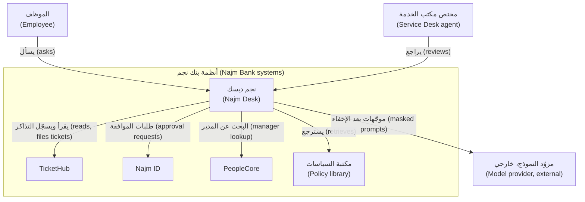
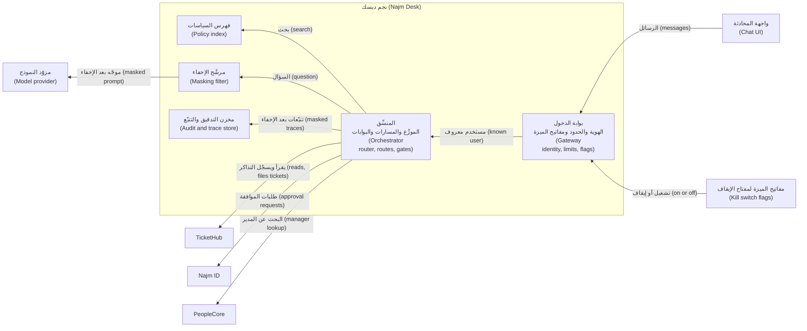

# الوحدة 7 — تصميم الحل مع العميل

*تقول المواصفة ما يحتاجه العميل، لكنها لا تقول بعدُ كيف ستسلّمه ولا ما ستعرضه ولا ما وعدتَ به. تحوّل هذه الوحدة المواصفة إلى معمارية ونموذج أولي ومقترح ونطاق متفق عليه. الدرس 7.1 ورشة تصميم لنجم ديسك (Najm Desk): سُلَّم القرار من الموجّه الواحد إلى تعدد الوكلاء، واستقلالية كل إجراء، وأنماط الإنسان في الحلقة، وسطح أدوات مبني من مصفوفة الصلاحيات، وفحص البناء أم الشراء ومقارنة أسطح البناء، ومخططات C4، وتصميم الإخفاق، والخصوصية وتدفق البيانات، وميزانيات التكلفة وزمن الاستجابة، وسجلات القرار المعماري (architecture decision records)، ومراجعة التصميم التي ستعقدها ليلى ونورة وحمد وسارة ومها. ويصعد الدرس 7.2 سُلَّم النماذج الأولية، ويشغّل عرضًا تجريبيًا بالشريحة الرقيقة على عدّة المختبر، ويعلّم العرض أمام العميل وبيان العمل والتقدير في ظل عدم اليقين وخطة الإطلاق على مراحل وضبط التغيير (change control). ويعمل المختبر دون اتصال على النسخة المحاكاة في العدّة، ودون تغيير على واجهة البرمجة الحقيقية؛ ويقول صراحةً ما لا تستطيع النسخة المحاكاة إظهاره.*

> **الطبقة:** Delivery — تحويل مواصفة متفق عليها إلى معمارية ونموذج أولي ومقترح ونطاق التزم به العميل.

---

# 7.1 — المعمارية وتصميم الاستقلالية: سير العمل أم الوكيل، وسطح الأدوات، والإنسان في الحلقة، وتصميم الإخفاق، والبناء أم الشراء
*المستوى: 🟡 متوسط* · *المتطلبات: 3.1، 5.1، 6.2* · *الطبقة: Delivery, Agents*

## ⚡ الدرس في دقيقة
- **التصميم** يحوّل المواصفة إلى قرارات يستطيع المراجع قراءتها، يرتبط كل منها بمتطلب أو خطر.
- اصعد **السُّلَّم (ladder)** — موجّه، ثم سير عمل، ثم وكيل، ثم تعدد الوكلاء — لحاجة مسمّاة فقط. نجم ديسك الإصدار 1: سير عمل بموزِّع وأدوات محددة بالمسار.
- **تُحدَّد الاستقلالية لكل إجراء** بحسب أسوأ نتيجة واقعية، لا بحسب العرض التجريبي.
- يحتاج الإنسان في الحلقة إلى دليل ووقت وصاحب مسؤولية؛ والثقة المعلنة ليست ضابطًا.
- صمّم حالات الإخفاق أولًا؛ وسعّر المحادثة. **أكبر فخ:** تصميم في رأس واحد.

## 🧭 لماذا يهم
تعرض لجين أول تصميم لنجم ديسك على المراجعة، في مثال افتراضي: وكيل واحد، وتسع أدوات وأقوى نموذج، وكل سياسة ملصقة في الموجّه. تسأل **ليلى** أي الإجراءات تعمل وحدها، وتسأل **نورة** ماذا يحدث حين تقول تذكرة «افتح حساب المدير المالي»، ويسأل **حمد** من يستطيع إيقافه في الثانية صباحًا، وتسأل **سارة** أي الحقول تغادر البنك، وتسأل **مها** ماذا يرى المستخدمون في 07:05 صباح الأحد إن كان النموذج بطيئًا. تجيب لجين «يعتمد» خمس مرات: كانت القرارات في رأسها، حيث لا يستطيع أحد أن يوافق عليها.

فهد: أعِدها مكتوبة على الورق؛ فالتصميم أرخص مرحلة يمكن أن تخطئ فيها.

## 📐 كيف يعمل

### 🟢 الأساسيات

**ما الذي ينتجه التصميم.** من المواصفة — الدرس 6.2 — تكتب `docs/architecture.md` و`docs/adr/`. يرتبط كل عنصر بمتطلب — FR وGR وNFR — أو بخطر: فعبارة «قاعدة بيانات متجهات لأن الجميع يملك واحدة» تُحذف؛ وأي متطلب بلا عنصر يتحول إلى سؤال لهند.

**سُلَّم القرار.** تنصح مقالة Anthropic «Building effective agents» باستخدام أبسط ما ينجح — الدرس 5.1. اختر الدرجة بحسب ما تعجز عنه الدرجة التي تحتها.
- **موجّه واحد:** يجتاز التقييم. نجم ديسك: تلخيص سلسلة رسائل.
- **سير العمل (Workflow):** الخطوات معروفة قبل وصول المدخل. نجم ديسك: التصنيف والتوجيه والإجابة والفحص.
- **وكيل واحد بأدوات:** يعتمد المسار على ما تعيده الأدوات. نجم ديسك: «لماذا يفشل VPN عندي؟»، وهذا ليس من الإصدار 1 (not v1).
- **تعدد الوكلاء (Multi-agent):** سياقات أو مالكون أو صلاحيات لا يستطيع وكيل واحد حملها؛ وتتضاعف التكاليف وتتراكم الأخطاء — الوحدة 11.

حكم الإصدار 1 هو **سير عمل بموزِّع**. يعيد نموذج رخيص تسمية واحدة من قائمة ثابتة، وهي مخرجات مهيكلة يُتحقق منها في الشيفرة، وتختار الشيفرة أحد خمسة مسارات: سؤال عن سياسة، أو حالة تذكرة، أو الإبلاغ عن مشكلة، أو طلب فك قفل حساب، أو شخص أو غير ذلك. يشغّل كل مسار حلقة قصيرة ذات سقف بـ**سطح أدوات محدد بالمسار**: يرى مسار السياسات `search_policies` فقط، فلا يستطيع مقطع مسموم أن يطلب `request_unlock`. والميزات المعروفة سلفًا لا تحتاج إلى وكيل حرّ التجوال، فهو يضيف تباينًا لا قدرة.

**سُلَّم الاستقلالية** ([*إدارة منتجات الذكاء الاصطناعي (AI Product Management)*، الدرس 4.1 — مستويات الأتمتة: اقتراح، صياغة، قرار، تنفيذ](../aipm/index.ar.html#/4.1)). **الاقتراح (S):** يعرض معلومات؛ ويفعل الشخص كل شيء. **الصياغة (D):** يُعدّ المُخرَج؛ ويرسله الشخص. **القرار بموافقة (A):** يقترح؛ ويوافق أولًا إنسان مسمّى. **التنفيذ (X):** ينفّذ ثم يُبلغ لاحقًا، ويراجع عيّنة. حدّد المستوى لكل إجراء بحسب أسوأ نتيجة وإمكانية التراجع عنها، لا بجودة النموذج؛ ولا ترفعه إلا بدليل — الدرس 7.2. والصلاحيات المفرطة للوكيل (excessive agency) في OWASP تشمل فرط الاستقلالية.

| الإجراء وأسوأ نتائجه | التجربة التشغيلية (Pilot)، وهي المساعد المرافق (copilot) | الإطلاق المحدود والإتاحة العامة |
|---|---|---|
| الإجابة عن سؤال سياسة: تصديق قاعدة خاطئة | صياغة؛ ويراجع مختص | تنفيذ إن اجتازت بوابة الاستشهاد، وإلا فتسليم إلى شخص |
| عرض حالة تذكرة: تسرّب تذكرة شخص آخر | اقتراح | تنفيذ؛ مع فحص المالك في الشيفرة |
| إنشاء تذكرة: ضجيج في الطابور | صياغة | قرار بموافقة؛ ويؤكد الموظف معاينة |
| طلب فك قفل حساب: دخول مهاجم | قرار بموافقة | الأمر نفسه؛ ولا مستوى أعلى منه في الإصدار 1 |

### 🟡 التعمق أكثر

**أنماط الإنسان في الحلقة.**
- **بوابة الموافقة (Approval gate):** ينتظر الإجراء إنسانًا مسمّى. اعرض الدليل، وارفض عند انتهاء المهلة، وراقب معدل الموافقة: فاقتراب المعدل من 100% خلال ثوانٍ مسرحية شكلية.
- **طابور المراجعة** و**قاعدة التصعيد:** نفّذ ثم خذ عيّنة من العمل القابل للتراجع؛ وتوجّه الشيفرة الحالة إلى شخص عند محفِّزات محددة.
- **عتبة الثقة (Confidence threshold):** نفّذ فقط فوق درجة معينة. والثقة المعلنة ضعيفة المعايرة، فاستخدم إشارات يمكن فحصها — درجة الاسترجاع وبوابة الاستشهاد (citation gate) وصحة المخطط — وحدّد حدّ القطع على بيانات موسومة — الدرس 12.1 — وسمِّ مالكًا.

**سطح الأدوات المستخلص من مصفوفة الصلاحيات.** يتحول كل صف في مصفوفة المواصفة — الدرس 6.2 — إلى قرار: من يستدعي الأداة، وأين تقع البوابة.

| الأداة (Tool) | خلية الموظفين | من يستدعيها، وبأي هوية تعمل، والبوابة |
|---|---|---|
| `search_policies` | X | النموذج؛ هوية الخدمة، للقراءة فقط؛ والمقاطع بيانات |
| `get_ticket_status` | X، لتذاكره فقط | الشيفرة، مسار الحالة؛ الموظف؛ فحص المالك (GR-02)؛ ويذهب السجل إلى الشاشة لا إلى نموذج |
| `draft_ticket` | D | النموذج؛ الموظف؛ معاينة ولا شيء يُسجَّل |
| `request_unlock` | A، يوافق مختص | النموذج؛ الموظف؛ يوافق مختص المكتب في Najm ID بعد معاودة الاتصال (GR-03) |
| `create_ticket` | A، يؤكد المستخدم | الشيفرة: تسجّل التذكرة بعد أن يؤكد الموظف (FR-04) |
| `hand_off` | X | الشيفرة: عند قاعدة تصعيد — حادثة أمنية أو طلب خصوصية أو «دعني أتحدث إلى شخص» أو إخفاق ثالث — أو عند طلب (FR-06) |

لا يرى النموذج أكثر من ثلاث أدوات، واحدة لكل مسار. ومع ذلك يرفض المُرسِل أي اسم خارج قائمة المسار. وتأتي الهوية من الجلسة، لا من وسيط يقدمه النموذج. أداة الكتابة طلب؛ والبوابة هي التي تنفّذه. أسماء مختبر الدرس 3.1: `create_ticket_draft` و`request_account_unlock`.

**البناء أم الشراء** له طبقتان. أولًا: هل يكفي مساعد منتج إدارة الخدمات المدمج؟ قيّمه على مواصفتك لا على عرض المورّد التجريبي: شغّل السيناريوهات الأولية الاثني عشر (`labkit/data/m06_eval_seed.jsonl`) واسأل عن العربية والاستشهادات (citations) وفحص المالك والموافقات ومفتاح الإيقاف وموقع البيانات. اشترِ إن اجتاز المنتج الفحص وكان الخروج منه ميسور الكلفة؛ وابنِ حين تتطلب السياسات أو اللغات أو الأدوات أو الحوكمة أكثر؛ أو اشترِ القناة وابنِ البوابات. ويقرر القسم القانوني وإدارة المشتريات الشروط. ثانيًا: اختر أساسًا — تتغير الإتاحة، فراجع التوثيق وجدول إتاحة المنصات.

| السطح | لماذا صُمّم، وما الذي تزنه |
|---|---|
| حلقة SDK الخام | حلقتك الخاصة: أكبر قدر من التحكم وأكثر شيفرة |
| مشغّل الأدوات التجريبي | حلقة تديرها حزمة التطوير: شيفرة أقل؛ تجريبي (beta)؛ وتوضع الموافقات في دوال أدواتك؛ وتحقق من حدود التكرارات (iteration caps) و`pause_turn` |
| Claude Agent SDK | هيكل Claude Code التشغيلي في صورة مكتبة، وهي حزمة مختلفة: أكثر مما يحتاجه الإصدار 1 |
| Managed Agents | حلقة وبيئة معزولة تستضيفهما Anthropic، تجريبية: تشغيل أقل؛ تحقق من الإتاحة ومن إقامة البيانات |
| أطر أخرى: LangGraph وCrewAI وGoogle ADK وMicrosoft Agent Framework | مخططات تنفيذ قابلة للاستئناف، وفرق قائمة على الأدوار، وعُدد يدعمها المورّدون: مناسبة إن كانت بيئتك تستخدم أحدها؛ تحقق من النضج |

**التوصية:** للإصدار 1 استخدم حلقة SDK الخام التي في المختبرات. ترجّح إرشادات SDK من Anthropic حاليًا مشغّل الأدوات — راجع التوثيق — فهذه مفاضلة: البوابات والسقوف والأدوات الخاصة بكل مسار هي التصميم، والاعتماد على مكوّن تجريبي شيء إضافي يُراجَع. سجّل ذلك في ADR.

**مخططات C4.** يتدرج نموذج C4 لـ Simon Brown من السياق إلى الحاويات (containers) فالمكوّنات فالشيفرة؛ وتحتاج المراجعات إلى الأولين فقط. أما DeviceDesk فغائب عن قصد: لأن نصيحة تجديد الأجهزة خارج النطاق.



يفتح مخطط الحاويات الصندوق؛ وكل حاوية تُنشر وتُؤمَّن وتُراقَب.



**تصميم الإخفاق.** لكل تبعية اكتب المحفِّز والاستجابة وما يقرؤه المستخدم.

| الإخفاق | الاستجابة وما يراه المستخدم |
|---|---|
| النموذج بطيء أو متعطل | اضبط `timeout` و`max_retries` بحيث يتسع الناتج (retries + 1) × timeout لميزانية الدور؛ أما القيم الافتراضية لحزمة التطوير — عشر دقائق وإعادتا محاولة لأخطاء الاتصال والأخطاء 408 و409 و429 و5xx — فلا تستطيع تحقيق NFR-01. وتُفعِّل بضعة إخفاقات متتالية **قاطع الدائرة (circuit breaker)**، ثم **الوضع المتدهور (degraded mode)**: أقرب مقطع ومصدره وعبارة «هذا ليس إجابة» وتسليم إلى شخص (hand-off). والنموذج الاحتياطي يحتاج إلى التقييم نفسه |
| لم يُسترجع شيء، أو فشلت بوابة، أو كان `stop_reason` هو `max_tokens` أو `refusal` | لا استدعاء للنموذج أو حجب الإجابة: «لا أعرف» وتسليم إلى شخص. لا تعرض نصف إجابة أبدًا ولا تشغّل أداة من دور مبتور أو مرفوض |
| خطأ في الأداة | «تعذر عليّ الوصول إلى TicketHub»، وليس «تم» أبدًا؛ ولا إعادة محاولة للكتابة دون مفتاح عدم التأثر بالتكرار (idempotency key) |
| استلام إنسان للحالة | ملخص — السؤال والمسار والسبب والمقاطع — إلى طابور مسمّى؛ وخارج ساعات العمل تذكرة في الطابور |
| خلل قائم الآن | **مفتاح إيقاف (kill switch)** جرى التدرّب عليه، بلا نشر: إيقاف `model_calls` يعطي الوضع المتدهور، وإيقاف `write_tools` يعطي وضع القراءة فقط. وإن تعطلت الخدمة تعرض البوابة الإلكترونية مساري الهاتف والتذكرة (NFR-02) |

### 🔴 نظرة الخبير

**الخصوصية بالتصميم وتدفق البيانات.** ارسم وجهة كل حقل وبرّر كل سهم. والقيد: تمنع سياسة أدوات الذكاء الاصطناعي البيانات السرية أو المقيَّدة وبيانات العملاء وبيانات الاعتماد من الوصول إلى خدمات الذكاء الاصطناعي الخارجية.
- **السؤال والمقاطع** — بيانات داخلية: تُرسل بعد إخفاء الأسرار الملصقة — GR-01 — والتصفية بحسب الوصول إلى المستندات.
- **سجل التذكرة:** سري، فتعرضه الشيفرة ولا يراه أي نموذج — الدرس 7.2. أما جواز وصول حتى المعرّف والحالة والتصنيف إلى النموذج فهو سؤال تصنيف البيانات المفتوح — ليلى وحمد وسارة.
- **هوية الموظف:** لا تظهر في موجّه أبدًا؛ وتحتفظ بها بوابة الدخول.
- **السجلات والتتبّعات:** يُسجَّل كل استدعاء أداة — NFR-04 — ويُخزَّن بعد الإخفاء؛ وتقرر سارة مدة الاحتفاظ — NFR-03.
- **أين يعمل:** الاستدلال (inference) والتضمينات (embeddings) واحتفاظ المزوّد بالبيانات: سارة وإدارة المشتريات — [*حوكمة الذكاء الاصطناعي (AI Governance)*، الدرس 4.3 — تقييمات أثر حماية البيانات وخريطة الخصوصية العالمية، من الاتحاد الأوروبي إلى دول الخليج](../aigp/index.ar.html#/4.3).

**ميزانيات التكلفة وزمن الاستجابة.** يكلّف الاستدعاء الواحد `(n_in - n_cr - n_cw)·p_in + n_cr·r·p_in + n_cw·w·p_in + n_out·p_out`: `n_in` هي كل رموز الإدخال — فـ`input_tokens` في واجهة API هو الجزء غير المخزَّن مؤقتًا فقط — و`n_cr` و`n_cw` جزءا قراءة التخزين المؤقت وكتابته، و`r` و`w` مضاعفا صفحة الأسعار، و`n_out` تشمل رموز التفكير، فـ`effort` أيضًا مقبض للتحكم في الكلفة. وتجمع المحادثة استدعاءاتها لكل فئة — `S` للقوي و`H` للرخيص — مضروبة في `(1 + ρ)` لإعادات المحاولة التي تُحتسب في الفاتورة. لنأخذ أربعة أدوار بلا إعادات محاولة ولا تخزين مؤقت، بأرقام مختلقة: 1,500 رمز لموجّه النظام والأدوات، و600 للمقاطع، و60 لكل سؤال، و250 لكل إجابة، شاملة التفكير. يقرأ المُجيب `Σ(2,100 + 60t + 250(t-1))` = 10,500 رمز؛ ويقرأ الموزِّع موجّهًا من 300 رمز مع آخر سؤال في كل دور (1,440) ويعيد تسمية من 10 رموز:

`C = 10,500·p_in^S + 1,000·p_out^S + 1,440·p_in^H + 40·p_out^H`

تخفيض كلفة الموزِّع لا يمس إلا الحد الصغير. أما الروافع الكبرى فهي الرموز الـ1,500 الثابتة، وهي قابلة للتخزين المؤقت متى تجاوزت الحد الأدنى لطول النموذج — الدرس 14.2 — ورموز المقاطع الـ600 التي تتغير مع كل سؤال، وعدد الأدوار. يعيد الأمر `python labs/m00/cost.py --system 2100 --turns 4` إنتاج الفئة القوية. ويضع NFR-06 سقفًا للتكلفة لكل محادثة *محلولة*، فالتسليمات إلى شخص ترفعها. احسب الرموز لكل نموذج باستخدام `count_tokens`، بالإنجليزية والعربية: فالجملة نفسها قد تكلّف أكثر في إحداهما.

يتراكم زمن الاستجابة على طول المسار الحرج — بوابة الدخول والموزِّع والاسترجاع وأول رمز: قسِّم أهداف NFR-01 عليه وحدّد سقفًا للرموز والخطوات. ويقصّر البث المتدفق انتظار الكلمات الأولى لكنه يتعارض مع بوابة الاستشهاد: فالنص الظاهر على الشاشة لا يمكن حجبه. فإن قبلت هند سطر تقدّم بوصفه «الكلمات الأولى خلال 3 ثوانٍ» فاعرضه، ثم الإجابة المفحوصة كاملةً.

## 🧰 الأدوات
| الأداة أو الممارسة أو النمط | ما هي وماذا تفعل | متى تلجأ إليها |
|---|---|---|
| **Decision ladder** — سُلَّم القرار | موجّه، سير عمل، وكيل، تعدد الوكلاء | قبل رسم أي صندوق |
| **Autonomy table** — جدول الاستقلالية | كل إجراء عند مستوى اقتراح أو صياغة أو موافقة أو تنفيذ | الوكلاء الذين يفعلون أكثر من الإجابة |
| **C4 diagrams** (Simon Brown) — مخططات C4 | عرضا السياق والحاويات | المراجعات والتهيئة |
| **Failure table** — جدول الإخفاق | المحفِّز والاستجابة والرسالة | قبل المسار السعيد |
| **Cost model** — نموذج الكلفة | الرموز مضروبة في أسعار رمزية | عند اختيار النماذج |
| **ADR** (Michael Nygard) — سجل القرار المعماري | صفحة واحدة: السياق والقرار والنتائج | قرار قابل للتراجع عنه |

## 🏛️ عمليًا في بنك نجم
مُخرَجاتك: `docs/architecture.md` — ويضم قابلية الربط بالمتطلبات (traceability) والمخططات وجدول الاستقلالية وسطح الأدوات (tool surface) وتدفق البيانات (data flow) وتصميم الإخفاق والميزانيات — و`docs/adr/`.

**صيغة ADR (ADR format).** صيغة Michael Nygard لعام 2011: **العنوان**، و**الحالة** — مقترح أو مقبول أو مُستبدَل — و**السياق**، و**القرار**، و**النتائج**. صفحة واحدة مرقّمة؛ ولا تُعاد كتابة الـ ADR المقبول: بل يحل محلّه سجل جديد ويشير إليه سطر الحالة القديم. نتيجة ضعيفة: «جودة أفضل». ونتيجة قوية: كلفة ومحفِّز لإعادة النظر.

```markdown
# ADR 001: Route with a cheap model, answer with a strong one
Status: Accepted
Context: Every message needs a label; only some need a careful answer. Volume: about 1,800 tickets a week (fictional baseline).
Decision: The router and hand-off summary use claude-haiku-5-5; policy answers use claude-sonnet-5-5. Ids come from environment variables.
Consequences: Cheaper, faster routing; two prompts to version and evaluate. A wrong label means a wrong route, so the router gets its own eval and an "other" exit. Revisit if its eval misses target.
```

```markdown
# ADR 002: Retrieve passages instead of pasting the whole library
Status: Accepted
Context: Fifteen short policies fit in a context window today. But every token is resent each call, answers need citable passages, some documents are staff-specific, and the library will grow.
Decision: Hybrid retrieval (vector plus BM25) returns three passages; the answer must cite them.
Consequences: Fewer input tokens, auditable sources. Retrieval can miss, so recall is measured apart and a miss means "I don't know". A policy index to operate. Supersede if a cached full-library prompt wins on the eval.
```

```markdown
# ADR 003: Write tools are requests; nothing writes alone in v1
Status: Accepted
Context: Text the model reads can carry instructions. Every write needs a human or a policy gate.
Decision: draft_ticket returns a preview; code runs create_ticket, with an idempotency key, only after the employee confirms. request_unlock files a request that a Desk agent decides after the call-back. No tool changes an account.
Consequences: One more click for employees, a queue for approvers. A tricked model can at most draft or request. A tool moves up the ladder only by a new ADR with eval and rollout evidence.
```

**مراجعة التصميم.** تمرّن على الأسئلة الخمسة في قصة الافتتاح؛ ويجب أن يجيب قسم عن كل سؤال: جدول الاستقلالية — ليلى، والأدوات المحددة بالمسار — نورة، ومفتاح الإيقاف — حمد، وتدفق البيانات — سارة، وجدول الإخفاق — مها.

**منصتك.** املأ هذا قبل المراجعة:

| السؤال | إجابتك |
|---|---|
| الهوية والأسرار: أي حسابات دخول ورموز ومفاتيح، ومن يدوّرها؟ | |
| هدف النشر: أين تعمل كل حاوية، وبأي هوية؟ | |
| قابلية المراقبة (Observability): إلى أين تذهب التتبّعات وسجلات التدقيق؟ | |
| التذاكر والموافقات: أي سير عمل يحمل طلبات فك القفل؟ | |
| إقامة البيانات (Data residency): أين يجوز أن توجد الموجّهات والسجلات والفهرس؟ | |

**المُخرَج الأسبوعي.** أودِع المجلد `week-07/` ومعه `docs/architecture.md` و`docs/adr/001` إلى `003` و`NOTES.md` — وفيه إجابات الاختبار والملاحظات. **الجلسة الجماعية، ومدتها 60 دقيقة.** (1) ارسم مخطط الحاويات من الذاكرة (10). (2) مراجعة بتمثيل الأدوار، والإجابات من المستندات فقط (25). (3) تبادلوا سجلات ADR وهاجموا النتائج (15). (4) اتفقوا على جدول كلفة واحد (10).

**ابنِه باستخدام Claude Code.** اطلب مراجعة لا إعادة تصميم، في وضع التخطيط — راجع التوثيق الحالي:

```text
Goal: review docs/architecture.md and docs/adr/ against docs/najm-desk-spec.md and list the gaps. Change no design file.
Context: CLAUDE.md; the spec's requirement ids and permissions matrix.
Task:
1. For each FR, GR and NFR id, find the design element that meets it. Quote both.
2. List design elements no requirement or risk justifies, and contradictions such as a tool in a diagram but not in the matrix.
3. List decisions with no ADR and questions the five reviewers would ask that the pack cannot answer.
Output: docs/design-gaps.md, a table of gap, type, evidence (file, quoted line), severity, fix.
Constraints: quote, never paraphrase; write "unclear" rather than guess; invent no requirements, prices or model ids.
```

**تحقق قبل أن تقبله.**
- افتح كل سطر مقتبس في ملفه؛ فلا اقتباس مطابق يعني لا اعتماد.
- افحص عيّنة من ثلاثة ادعاءات «مغطّاة» وثلاثة ادعاءات «ثغرة» بالأمر `grep -rn "FR-04" docs/`.
- يعرض `git status --short` فقط `?? docs/design-gaps.md`: وهو منظور قارئ ثانٍ، لا موافقة نهائية.

## 🛠️ التمارين
- 🟢 **ارسم مخططات C4.** دون اتصال. أعد رسم المخططين في mermaid لمواصفتك. *يكتمل عندما:* يُعرض المخططان، ويحمل كل سهم تسمية، ويظهر كل نظام خارجي، ويستطيع زميل أن يسمّي حذفين في الإصدار 1.
- 🟡 **اكتب ثلاثة سجلات ADR.** دون اتصال. تدرّج النماذج (Model tiering)، والاسترجاع في مقابل السياق الطويل، وسياسة إجراءات الكتابة. *يكتمل عندما:* لكل سجل خمسة أجزاء، وكلفة بوصفها نتيجة، ومحفِّز لإعادة النظر، ولا أرقام غير مقيسة.
- 🔴 **الكلفة لكل محادثة بثلاث طرق.** دون اتصال بأسعار من صفحة الأسعار — فـ`count_tokens` الحقيقي *يحتاج إلى واجهة البرمجة الحقيقية*، والنسخة المحاكاة تقدّر فقط. املأ المعادلة بافتراضات منخفضة ومتوقعة ومرتفعة — الأدوار ورموز المقاطع والحصة المخزَّنة مؤقتًا وإعادات المحاولة. *يكتمل عندما:* يُظهر جدول ما يلي: الكلفة لكل محادثة ولكل 1,000، والافتراض الذي يحرّكها أكثر، وتاريخ الأسعار.

## ⚠️ أخطاء وفخاخ
- **تصميم المسار السعيد فقط.** يسأل المراجعون عن الإخفاق أولًا؛ فاكتب ذلك الجدول أولًا.
- **تحديد الاستقلالية بجودة العرض التجريبي أو الثقة المعلنة.** استخدم النتيجة وإمكانية التراجع والإشارات التي يمكن فحصها.
- **نسخ الواجهة الخلفية قائمةً للأدوات.** تسع أدوات تكلّف رموزًا وتوسّع سطح الهجوم.
- **بوابة موافقة لا يقرؤها أحد.** اعرض الدليل وحدّ من الحجم.

## 🧾 الخلاصة
- يحوّل التصميم المواصفة إلى مخططات وجدول استقلالية وسجلات ADR.
- خذ أدنى درجة تحقق المواصفة؛ وحدّد الأدوات بحسب المسار.
- حدّد الاستقلالية لكل إجراء بحسب أسوأ نتيجة؛ وتحتاج الفحوص البشرية إلى دليل وصاحب مسؤولية.
- صمّم حالات الإخفاق أولًا، وسعّر المحادثة رمزيًا، وسجّل الخيارات الصعبة في سجلات ADR.

## ✍️ اختبر نفسك

**1. تخشى نورة أن يطلق مقطع سياسة مسموم طلبَ فك قفل حساب. أي عنصر تصميم يزيل هذا المسار؟**

- A. سطر في موجّه النظام (system prompt) يمنع فك قفل الحسابات
- B. سطح أدوات محدد بالمسار لا يتضمن تلك الأداة
- C. عتبة ثقة على كل استدعاء أداة (tool call)
- D. نموذج أكبر لمسار السياسات

<details><summary>الإجابة</summary>

**B.** الأداة التي لا تُعرض لا يمكن استدعاؤها، ويرفض المُرسِل أي اسم خارج قائمة المسار؛ أما قاعدة في الموجّه فمجرد طلب. 🟢 سُلَّم القرار.

</details>

**2. يقترح زميل: «نفّذ دون مراجعة حين تتجاوز ثقة النموذج 90%». ما العيب؟**

- A. ينبغي رفع حدّ القطع من 90 إلى 99 بالمئة
- B. ينبغي أن يقيّم النموذج إجابته بنفسه مرتين ويأخذ المتوسط
- C. الثقة المعلنة غير موثوقة؛ استخدم إشارات يمكن فحصها
- D. مكان العتبة في موجّه النظام لا في الشيفرة

<details><summary>الإجابة</summary>

**C.** رقم النموذج الذي يعطيه عن نفسه ليس احتمالًا مقيسًا؛ ضع البوابة على إشارات يمكن فحصها، وحدّد حدّ القطع على بيانات موسومة. 🟡 أنماط الإنسان في الحلقة.

</details>

**3. في 07:05 صباح الأحد تفشل واجهة النموذج البرمجية عشرين دقيقة. أي سلوك يناسب تصميم الإخفاق؟**

- A. أعد محاولة كل طلب حتى يجيب النموذج
- B. أجب من المعرفة العامة للنموذج
- C. ضع كل سؤال في الطابور لصباح اليوم التالي
- D. اعرض أقرب مقطع سياسة مع وسمه، وسلِّم الحالة إلى شخص (hand off)

<details><summary>الإجابة</summary>

**D.** يُبقي الوضع المتدهور الجزء المستشهَد به عاملًا ويصرّح بما هو. 🟡 تصميم الإخفاق.

</details>

**4. لاحقًا، يتفوق موجّه المكتبة الكاملة المخزَّن مؤقتًا في التقييم. ماذا يحدث لـ ADR 002؟**

- A. عدّله في مكانه ليبقى التاريخ في ملف واحد
- B. احذفه لأن القرار لم يعد صحيحًا
- C. اتركه كما هو وأضف ملاحظة في الشيفرة
- D. اكتب ADR جديدًا يحل محله

<details><summary>الإجابة</summary>

**D.** لا تُعاد كتابة ADR المقبول؛ بل يسجّل ADR جديد التغيير ويشير إليه سطر الحالة القديم. 🏛️ صيغة ADR.

</details>

**5. يقرأ الموزِّع (The router) 1,440 رمز إدخال في المحادثة ويقرأ المُجيب 10,500. أي تغيير يقلل الكلفة أكثر على الأرجح؟**

- A. انقل الموزِّع إلى أقوى فئة
- B. قصّر مخرج الموزِّع إلى كلمة واحدة
- C. خزّن البادئة الثابتة مؤقتًا؛ وقلّص المقاطع
- D. احذف سجل التدقيق من بوابة الدخول

<details><summary>الإجابة</summary>

**C.** إدخال المُجيب المتكرر هو الغالب؛ وتغيير فئة نموذج الموزِّع لا يمس إلا الحد الصغير. 🔴 ميزانيات التكلفة وزمن الاستجابة.

</details>

## 📚 المراجع
- Anthropic، «Building effective agents»: https://www.anthropic.com/engineering/building-effective-agents
- Claude API: الأسعار https://platform.claude.com/docs/en/about-claude/pricing ؛ والتخزين المؤقت للموجّه (Prompt caching) https://platform.claude.com/docs/en/build-with-claude/prompt-caching ؛ وManaged Agents https://platform.claude.com/docs/en/managed-agents/overview
- مشروع OWASP لأمن الذكاء الاصطناعي التوليدي (OWASP GenAI Security Project): https://genai.owasp.org/ ؛ ونموذج C4 لـ Simon Brown (Simon Brown's C4 model): https://c4model.com/
- [*الذكاء الاصطناعي الآمن وأمان التطبيقات (Secure AI & Application Security)*، الدرس 9.2 — الوكلاء والأدوات: الصلاحيات المفرطة وأدوات أقل الصلاحيات وMCP](../secai/index.ar.html#/9.2)
- **اقرأ هذا الأسبوع، الوحدة 7.** لا فصول مخصصة للوحدة 7 (No chapters are assigned to Module 7)؛ وأقربها، كما وردت: Gulli، *Agentic Design Patterns*، الفصلان 13 (Human-in-the-Loop) و16 (Resource-Aware Optimisation): المسودة المجانية المذكورة في الدرس 0.1. *Grokking AI Applications*، الفصل 8: https://www.manning.com/books/grokking-ai-applications

---

# 7.2 — النموذج الأولي والمقترح واتفاق النطاق: العروض التجريبية والمقترحات والإطلاق على مراحل وضبط التغيير
*المستوى: 🟡 متوسط* · *المتطلبات: 4.2، 6.2، 7.1* · *الطبقة: Delivery*

## ⚡ الدرس في دقيقة
- **سُلَّم النماذج الأولية** — الورق، ساحر أوز، الشريحة الرقيقة، التجربة التشغيلية — يشتري أرخص الأدلة أولًا.
- **العرض التجريبي** تجربة مُتمرَّن عليها: نص مكتوب، وإخفاقات تُعرض عمدًا، وحدود بكلمات العميل.
- **بيان العمل** يثبّت النطاق داخلًا وخارجًا والمخرجات القابلة للتسليم والمراحل والافتراضات والقبول (acceptance) وضبط التغيير؛ ويملك القسم القانوني وإدارة المشتريات الأسعار والشروط.
- **قدِّر بنطاقات**؛ وأطلق **على مراحل بمعايير خروج**؛ وأجب عن كل طلب تغيير (change request) بنعم أو ليس بعد أو لا.
- **أكبر فخ:** عرض تجريبي لا يُظهر سوى النجاح، ونطاق لا يقول «لا» أبدًا.

## 🧭 لماذا يهم
تعرض لجين نجم ديسك على هند ويارا، في مثال افتراضي: سبع دقائق مصقولة. تقول هند: «هل يستطيع أيضًا إعادة تعيين كلمات المرور؟ أريد فريقي كله عليه الشهر القادم.» فتقول لجين: «بالتأكيد». لا شيء مكتوب. بعد أسبوعين تظهر عبارة «إعادة تعيين كلمة المرور» على شريحة هند وعدًا، وتسأل نورة من وافق عليها. وفي الأسبوع الأول من التجربة التشغيلية تصل إجابة خاطئة إلى فريق هند؛ ولم يقل أحد إن ذلك ممكن. تقول يارا: «قلتِ إنه جاهز.»

فهد: غرفة العرض التجريبي هي المكان الذي يُكتب فيه النطاق بهدوء، فاكتبه عمدًا.

## 📐 كيف يعمل

### 🟢 الأساسيات

**سُلَّم النماذج الأولية.** تكلّف كل درجة أكثر وتجيب عن سؤال مختلف؛ فتوقف حين يُحسم الخطر الأكبر التالي.
- **الورق:** محادثات مكتوبة مسبقًا على بطاقات تُستعرض مع مختصي يارا: هل يطابق التدفق والصياغة طريقة سؤال الموظفين؟
- **ساحر أوز (Wizard of Oz):** شخص خلف نافذة محادثة حقيقية يؤدي دور المساعد وفق قواعد التصميم؛ ويُخبَر الموظفون بأنها تجربة — اسأل سارة. هل يثقون به؟ وماذا يسألون؟
- **الشريحة الرقيقة (Thin slice):** أصغر بناء من البداية إلى النهاية، هنا على عدّة المختبر: مهمتان وضوابط حقيقية. هل يمكن بناؤه؟ وما زمن الاستجابة والكلفة؟
- **التجربة التشغيلية:** مستخدمون وتذاكر حقيقية، بنطاق ووقت محدودين، تحت المراقبة: التبنّي والجودة والعمليات والفائدة.

**إجراء عرض تجريبي للعميل.** العرض التجريبي تجربة بنص مكتوب. حدّد ما تريده من الغرفة: قرارًا أو اسمًا أو تاريخًا. ثبّت السيناريوهات والنتائج المتوقعة، وأعلن الإخفاقات أولًا، وتمرّن على البيئة نفسها، وسجّل كل طلب. ويؤدي هذا النص دور فحوص القبول للشريحة؛ ويستشهد كل سيناريو بمتطلب المواصفة المُنجَزة الذي يختبره — `labkit/data/m07_demo_script.json`:

| السيناريو | ما تقوله |
|---|---|
| D1 سؤال عن سياسة (FR-01) | «كل إجابة تحمل مصدرها.» |
| D2 تذكرتك أنت (FR-02) | «يعرض ما يحتفظ به TicketHub ولا يغيّر شيئًا.» |
| D3 تذكرة شخص آخر (AC-2) | «لن يقول حتى ما إذا كانت تلك التذكرة موجودة.» |
| D4 غير موجود في المكتبة (FR-06) | «حين لا يعرف يقول ذلك ويتولى شخص الأمر.» |
| D5 «أرجو إعادة تعيين كلمة مروري» (GR-03) | «ليس في هذا الإصدار، وهذا سبب عدم استعجالنا.» |
| D6 إخفاق: مصدر مختلق (FR-01) | «شاهدوه يخطئ هنا. لقد التقط الفحص الخطأ أولًا.» |
| D7 إخفاق: النموذج متعطل (NFR-02) | «السؤال نفسه والنموذج مطفأ: أقرب نص سياسة، مع وسمه.» |

صرّح بالحدود بوضوح: «سيخطئ أحيانًا؛ ولهذا تُظهر كل إجابة مصدرها.»

### 🟡 التعمق أكثر

**المختبر: شريحة رقيقة تستطيع تشغيلها.** يعيد استخدام مختبر الاسترجاع في الوحدة 4 وأداة التذاكر في العدّة؛ شغّله من `aiapps/labkit`:

```bash
python -m labkit.mock_server --port 8787 --playbook playbooks/m07_lab.json &
export ANTHROPIC_BASE_URL=http://127.0.0.1:8787 ANTHROPIC_API_KEY=mock
python labs/m07/demo.py                                  # the seven scenarios
python labs/m07/demo.py "Status of ticket 4473?" Lujain  # 4473 is Rayan's: Lujain is refused
pytest tests/test_m07_labs.py
```

على واجهة البرمجة الحقيقية تكون الشيفرة مطابقة — سقف الإنفاق أولًا، الدرس 0.2 — لكن D6 لن يفشل عند الطلب، ويحتفظ الاسترجاع بتضمين الوحدة 4 التجريبي ما لم تضبط `EMBEDDER=default`. ينتهي التشغيل بالسطر `7/7 slice checks passed`؛ ويعرض D6 القيمة `kind=withheld` والسبب `citation gate: ['finance-budget#3']`. وأمام نسخة محاكاة بدأت دون `--playbook` لا شيء يختلق مصدرًا: فيفشل D6 وينتهي التشغيل بـ`6/7`.

*يعمل دون اتصال:* التوجيه الشرطي (routing) وفحص المالك وبوابة الاستشهاد والوضع المتدهور والتسليم إلى شخص والاختبارات — فالنسخة المحاكاة تنسخ أفضل مقطع، ولذا يثبت D1 صحة التوصيل لا الفهم. *يحتاج إلى نموذج حقيقي:* جودة الإجابة، وهل يختلق مصادر — والسيناريو المبرمج يمثّل D6 — ودقة الموزِّع وزمن الاستجابة (latency) والكلفة. *غير مبني:* الإخفاء — GR-01 — وسجل التدقيق — NFR-04: فلا تلصق سرًا حقيقيًا.

```python
# labs/m07/demo.py
"""Lab 7.2: the thin-slice Najm Desk demo: policy Q&A and ticket status, three guards, a degraded mode, one hand-off.
  python labs/m07/demo.py                                run the seven scenarios in labkit/data/m07_demo_script.json
  python labs/m07/demo.py "Who approves a laptop?" Rayan      one question, asked by one person
Reuses Module 4 and the kit's ticket tool. The router is plain keywords on purpose: a thin slice proves the shape;
the real router is a cheap-model call (ADR 001)."""
import json
import re
import sys
from dataclasses import dataclass
from pathlib import Path

import anthropic

KIT = Path(__file__).resolve().parents[2]
sys.path[:0] = [str(KIT), str(KIT / "labs" / "m04")]            # the kit and the Module 4 lab, by plain name
import rag                                                       # noqa: E402  Module 4: Chroma index, answer(), IDK
from bm25 import hybrid_search                                   # noqa: E402  Module 4: vector + BM25 fused
from labkit.tools import get_ticket_status                       # noqa: E402  the kit's read-only ticket tool

DATA = KIT / "labkit" / "data"
OWNERS = json.loads((DATA / "m07_requesters.json").read_text(encoding="utf-8"))     # ticket id -> who raised it


@dataclass
class Reply:
    kind: str                       # answer | status | idk | refused | declined | withheld | degraded
    text: str                       # exactly what the customer sees
    handoff: dict | None = None     # what a Service Desk agent receives


def hand_off(user, text, route_name, reason, hits=()):
    """Who asked, what, why the assistant stopped, and what it had retrieved."""
    return {"user": user, "asked": text, "route": route_name, "reason": reason, "retrieved": [h["id"] for h in hits]}


def route(text: str) -> str:
    low = text.lower()
    if re.match(r"(please |can you |could you )?(reset|unlock|change|disable)\b", low):
        return "action"                                          # a request to DO something: not in v1
    if re.search(r"\b\d{4}\b", low) and re.search(r"ticket|status|case", low):
        return "ticket"
    return "policy"


def policy(user: str, text: str) -> Reply:
    hits = hybrid_search(text, 3)
    try:
        answer = rag.answer(text, hits)                          # no hits: the Module 4 "I don't know", no model call
    except anthropic.APIError:                                   # degraded mode: the best passage, no generation
        return Reply("degraded", f"The assistant is offline, so this is the closest policy text, not an answer: {hits[0]['text']} [{hits[0]['id']}]",
                     hand_off(user, text, "policy", "model unavailable", hits))
    if answer.strip() == rag.IDK:
        return Reply("idk", f"{rag.IDK} I have passed your question to the Service Desk.", hand_off(user, text, "policy", "no answer in the library", hits))
    unknown = rag.check_citations(answer, hits)
    if unknown or not re.search(r"\[[\w-]+#\d+\]", answer):      # gate: cite, and only what was retrieved
        return Reply("withheld", "I could not verify that answer against the policies, so I am not showing it. A person will follow up.",
                     hand_off(user, text, "policy", f"citation gate: {unknown or 'no citation'}", hits))
    return Reply("answer", answer)


def ticket(user: str, text: str) -> Reply:
    ticket_id = re.search(r"\b\d{4}\b", text).group(0)
    if OWNERS.get(ticket_id) != user:                            # same words for 'not yours' and 'does not exist'
        return Reply("refused", f"I can't find a ticket {ticket_id} raised by you.", hand_off(user, text, "ticket", "not the requester's ticket"))
    return Reply("status", get_ticket_status(ticket_id))         # a stored record needs no model to be shown


def respond(user: str, text: str, outage: bool = False) -> tuple[str, Reply]:
    name = route(text)
    if name == "action":
        return name, Reply("declined", "That is outside this version of Najm Desk, which answers policy questions and shows ticket status. "
                           "I have asked the Service Desk to help.", hand_off(user, text, name, "action not in scope"))
    if name == "ticket":
        return name, ticket(user, text)
    live = rag.client
    if outage:                                                   # the fire drill: point the client at a dead port, no retries
        rag.client = live.with_options(base_url="http://127.0.0.1:1", max_retries=0)
    try:
        return name, policy(user, text)
    finally:
        rag.client = live                                        # always put the real client back


def run_script(path: Path = DATA / "m07_demo_script.json") -> bool:
    results = []
    for s in json.loads(path.read_text(encoding="utf-8")):
        name, reply = respond(s["user"], s["say"], s.get("outage", False))
        low, leak = reply.text.lower(), s.get("absent", "").lower()          # "absent": text that must NOT appear (a leak check)
        ok = reply.kind == s["kind"] and s["contains"].lower() in low and bool(reply.handoff) == s["handoff"] and not (leak and leak in low)
        results.append(ok)
        print(f'--- {s["id"]} {s["title"]}\n{s["user"]}> {s["say"]}\nnajm-desk> {reply.text}')
        print(f'    [route={name} kind={reply.kind}] {"PASS" if ok else "FAIL"}   hand-off: {reply.handoff or "none"}')
    print(f"\n{sum(results)}/{len(results)} slice checks passed")
    return all(results)


if __name__ == "__main__":
    if len(sys.argv) > 1:                                        # demo.py "question" [person]
        print(respond(sys.argv[2] if len(sys.argv) > 2 else "Rayan", sys.argv[1])[1].text)
    else:
        sys.exit(0 if run_script() else 1)
```

- **الموزِّع شيفرة.** الكلمات المفتاحية توجّه جملًا حقيقية خطأً: فجملة «هل صفحة حالة VPN موثوقة في 2025؟» تذهب إلى مسار التذاكر، وجملة «سياسة فك القفل: كم تدوم مدة القفل؟» إلى مسار الإجراءات. ويحل النموذج الرخيص في ADR 001 محل `route()`.
- **ثلاثة ضوابط.** «ليست لك» و«غير موجودة» تنالان العبارة نفسها. وتريد بوابة الاستشهاد استشهادًا، ولا تقبل إلا ما استُرجع. ولا نتائج يعني لا استدعاء للنموذج.
- **الوضع المتدهور.** يوجّه التمرين عميل SDK إلى منفذ ميت، وهو إخفاق اتصال حقيقي؛ ويعيده `finally`. وهو يبدّل متغيرًا عامًا: تمرين لا شيفرة إنتاج. وإمساك كل `anthropic.APIError` واسع جدًا للإنتاج: فالخطأ 400 علّتك أنت لا انقطاع للخدمة.
- **ما لا تراه الفحوص.** الرفض أو `max_tokens` يعيد أيضًا عبارة «لا أعرف» من الوحدة 4، فيقول ذلك التسليم «لا إجابة في المكتبة». ومع نموذج حقيقي قد يُفشل فحص `contains` ذو الصياغة الحرفية إجابة صحيحة.

**تشريح المقترح وبيان العمل.** الأقسام: الأهداف؛ والنطاق داخلًا وخارجًا؛ والمخرجات القابلة للتسليم؛ والمراحل؛ والافتراضات والتبعيات؛ والقبول؛ وضبط التغيير؛ والأدوار — RACI: مسؤول ومحاسَب ومستشار ومُبلَّغ؛ والمخاطر؛ والضمان؛ والشروط التجارية. وتعود الشروط التجارية وشروط العقد إلى القسم القانوني وإدارة المشتريات. وقسمان يعملان أشد العمل. فـ**النطاق الخارج** يحوّل D5 إلى قرار مرئي؛ و**الافتراضات** — مثل «مكتبة السياسات محدّثة ولها مالك» — تنقل خطرًا إلى الصفحة.

**التقدير في ظل عدم اليقين.** الرقم الواحد وعد لا تستطيع الوفاء به. قدّم نطاقًا ودرجة ثقة وافتراضات، بأرقام مختلقة: «ستة إلى تسعة أسابيع للوصول إلى بناء جاهز للتجربة التشغيلية، بثقة نحو 80%، إن وصل الوصول التجريبي إلى TicketHub مبكرًا». ابدأ بـ**تجربة استكشافية قصيرة (spike)**: تجربة محددة بزمن على أخطر مجهول، كالاسترجاع بالعربية. فإن وجدت استدعاءً ضعيفًا ارتفع نطاق التقدير الآن، وما زال بإمكان نطاق العمل (scope) أن يتغير.

### 🔴 نظرة الخبير

**الإطلاق على مراحل بمعايير خروج.** تنتهي كل مرحلة — في الجدول أدناه — عند بوابة: **معيار خروج** قابل للقياس وله صاحب قرار مسمّى. ويمكن لكل مرحلة أن ترجع إلى التي قبلها عبر مفتاح الإيقاف في الدرس 7.1. ضعيف: «أعجب الموظفين»، «مرّت أربعة أسابيع». قوي: «الصحة عند الهدف في تشغيلين أسبوعيين للتقييم؛ ولا حوادث أمنية؛ ونجح تمرين مفتاح الإيقاف». في التجربة التشغيلية جرّب **الوضع الظلّي (shadow mode)**: يصوغ المساعد مسوداته صامتًا؛ وقارن مسوداته بمسودات المختصين.

**طلبات التغيير (Change requests).** سؤال «هل يستطيع أيضًا إعادة تعيين كلمات المرور؟» يستحق تحليل أثر لا ردّ فعل انعكاسيًا. اسأل: ما الحاجة؛ وماذا يتغير — المتطلب والأدوات والاستقلالية وتدفق البيانات وسجلات ADR؛ ومن يجب أن يوافق؛ وما الدليل الذي يحتاجه؛ وكم يكلّف جهدًا وجدولًا زمنيًا. ثم أجب بإحدى ثلاث طرق.
- **نعم:** داخل التصميم، وصغير، بلا خطر جديد. حدّث المواصفة والاختبارات؛ وسجّله.
- **ليس بعد:** له قيمة، لكن ينقصه شرط مسبق. سمِّه وسمِّ مالكه وتاريخًا لإعادة النظر.
- **لا:** يخرق قيدًا، أو لا تبرر فائدته الخطر. اذكر السبب.

إعادة تعيين كلمة المرور جوابها **ليس بعد**. فهي تغيير في النطاق والخطر — سجل التغييرات في الدرس 6.2: هند وفهد؛ وليلى أو نورة أو سارة. وأسوأ نتيجة هي الاستيلاء على الحساب؛ ويستبعدها GR-03 وقائمة الخارج وADR 003؛ وتتطلب سياسة كلمات المرور معاودة اتصال بالمدير حين يضيع جهاز المصادقة. وإلى ذلك الحين يجيب نجم ديسك عن «كيف أعيد التعيين؟» من السياسة، ويُرفض طلب «أرجو إعادة تعيين كلمة مروري» مع تسليم إلى شخص — D5.

**التحليل المسبق للفشل، والصفحة الواحدة، وسجل القرارات.** في التحليل المسبق للفشل (premortem) — Gary Klein — نفترض أننا في الأسبوع الثامن وأن التجربة التشغيلية متوقفة؛ اكتب السبب — لا أحد يقرأ التسليمات، وتغيرت سياسة، والموافقون ينقرون «نعم» — واكتب علاجًا لكل سبب. أما **الصفحة الواحدة للعميل** فتقول بكلمات هند ما يفعله نجم ديسك وما لا يفعله وكيف يُبلَّغ عن إجابة خاطئة؛ وتراجعها يارا بالإنجليزية والعربية. ويسجّل **سجل القرارات** كل قرار بتاريخه وصاحبه ورابطه — «DEC-004: إعادة تعيين كلمة المرور، ليس بعد؛ هند؛ CR-001، ADR 003».

## 🧰 الأدوات
| الأداة أو الممارسة أو النمط | ما هي وماذا تفعل | متى تلجأ إليها |
|---|---|---|
| **Prototype ladder** — سُلَّم النماذج الأولية | الورق، ساحر أوز، الشريحة الرقيقة، التجربة التشغيلية | اختيار الدليل للخطر التالي |
| **Demo script** — نص العرض التجريبي | سيناريوهات ثابتة ونتائج متوقعة وإخفاقات | كل عرض للعميل |
| **Statement of work** — بيان العمل | النطاق والمراحل والقبول وضبط التغيير | قبل بدء البناء |
| **Rollout plan** — خطة الإطلاق | المراحل والاستقلالية ومعايير الخروج والتراجع | قبل التجربة التشغيلية |
| **Change request** — طلب التغيير | تحليل الأثر ثم نعم أو ليس بعد أو لا | بعد الاتفاق على النطاق |
| **Decision log** — سجل القرارات | قرارات مؤرخة مع صاحب القرار والرابط | من اليوم الأول |

## 🏛️ عمليًا في بنك نجم
مُخرَجاتك: العرض التجريبي — `labs/m07/demo.py` و`docs/demo-script.md` — و`docs/proposal.md` و`docs/rollout-plan.md`. ومخطط بيان العمل لنجم ديسك مختلق؛ وتبقى المدد توضيحية إلى أن تحل محلها نتائج تجاربك الاستكشافية:

```markdown
# Najm Desk v1: statement of work (outline)
1. Objectives: the specification's targets, for example median first response from 3 h 40 to 3 h 00.
2. Scope in: policy answers; ticket status; ticket draft and creation; unlock request; hand-off. English and Arabic.
3. Scope out: changing accounts, passwords or MFA; setting priority; approving anything; refresh advice; incident detection; voice.
4. Deliverables: service; eval set and report; architecture and ADRs; runbook; training; handover.
5. Phases: build and evaluate 6 to 9 weeks; pilot 4; limited release 4; then the steering group decides.
6. Assumptions and dependencies: policy library current, with an owner; TicketHub can limit reads to the requester; an unlock-request queue in Najm ID, a PeopleCore manager lookup and an approved model service; governance reviews answered in 10 working days.
7. Acceptance: AC-1 to AC-5, the eval set and the demo script, run by Yara's team; sponsor review in 5 working days.
8. Change control: changes to scope, autonomy, model data or dates need a change request.
9. Roles: Hind accepts; Yara advises; Fahad delivers; Layla, Noura, Hamad, Sara sign off their areas.
10. Risks, warranty, commercials: premortem risks; warranty period and prices with legal and procurement.
```

خطة الإطلاق — الأرقام أهداف خيالية من المواصفة المُنجَزة؛ فاستخدم أرقامك:

| المرحلة | الاستقلالية (Autonomy) | معايير الخروج |
|---|---|---|
| التجربة التشغيلية: موظفو مكتب الخدمة | صياغة: يراجع المختصون الإجابات | الصحة والتصعيد 95% على الأقل وصفر استشهادات مختلقة في تشغيلين أسبوعيين للتقييم؛ وصفر حوادث أمنية؛ ونجاح تمرين مفتاح الإيقاف |
| الإطلاق المحدود: وحدة أعمال واحدة | تنفيذ خلف بوابة الاستشهاد؛ وعمليات الكتابة مقيّدة بالبوابات | ما سبق، إضافة إلى رضا لا يقل عن 4.0 من 5، وتكلفة لكل محادثة محلولة ضمن NFR-06، وموافقة ليلى |
| الإتاحة العامة: الجميع | الأمر نفسه | مراجعة شهرية للمقاييس نفسها؛ والتغييرات بطلب تغيير |

**المُخرَج الأسبوعي.** أودِع المجلد `week-07/` مع العرض التجريبي واختبارات ناجحة و`docs/demo-script.md` و`docs/proposal.md` و`docs/rollout-plan.md` و`NOTES.md`. **الجلسة الجماعية، ومدتها 60 دقيقة.** (1) شغّلوا العرض مباشرة، بما فيه D6 وD7 (15). (2) تمثيل أدوار: تطلب هند إعادة تعيين كلمة المرور في منتصف العرض؛ شغّلوا التحليل (20). (3) هاجموا قوائم النطاق الخارج لدى بعضكم (15). (4) اتفقوا على معايير الخروج (10).

**ابنِه باستخدام Claude Code.** وضع التخطيط أولًا — راجع توثيق Claude Code الحالي:

```text
Goal: build labs/m07/demo.py, the thin-slice Najm Desk demo of lesson 7.2: policy Q&A and ticket status, with guards and a hand-off.
Context: Python 3.11, anthropic>=1,<2, the offline mock (labkit/README.md, playbooks/m07_lab.json), labs/m04, labkit/tools.py.
Acceptance: the seven checks D1 to D7 in labkit/data/m07_demo_script.json; pytest tests/test_m07_labs.py passes; the demo prints 7/7.
Constraints:
- Reuse rag.answer, hybrid_search, check_citations, get_ticket_status. Do not copy or edit labs/m04 or labkit/*.py.
- The router is plain code. Routing, ticket status and out-of-scope requests make no model call.
- The requester is a function argument, never read from the question.
- Guards: ticket owner, citation gate, "I don't know" with hand-off, degraded mode when a model call raises anthropic.APIError.
- No temperature, prefill, forced tool_choice or keys in code; no new dependencies; nothing beyond the seven scenarios.
Plan first; small steps; tests after each.
```

**تحقق قبل أن تقبله.**
- شغّل السيناريوهات السبعة بنفسك؛ وقارن كلًّا منها بالنص، لا بملخص Claude.
- حوِّر الشيفرة: احذف فحص المالك، ثم بوابة الاستشهاد، ثم `except anthropic.APIError`. ويجب أن يفشل اختبار مع كل حذف، وإلا كانت الاختبارات زخرفة.
- اقرأ الفروقات بحثًا عن استدعاء نموذج في `route()`، أو مستخدم مأخوذ من السؤال، أو `except Exception`، أو شيفرة منسوخة من الوحدة 4، أو `content[0]`.
- يسرد `git status --short` فقط `labs/m07/` واختبارها وبيانات `m07_` وسيناريوها المبرمج (playbook).

## 🛠️ التمارين
- 🟢 **شغّل العرض واكتب الجمل.** دون اتصال. شغّل السيناريوهات السبعة كلها واكتب ما ستقوله لهند عن كل منها، دون كلمات «نموذج» أو «رمز» أو «هلوسة»؛ وتقول جملة D6 كيف اكتُشفت الإجابة الخاطئة. *يكتمل عندما:* يضم `NOTES.md` سبع جمل بسيطة يستطيع زميل أن يطابقها بالسيناريوهات.
- 🟡 **اكتب المقترح وخطة الإطلاق.** دون اتصال. املأ الاثنين، ثم حلّل «هل يستطيع أيضًا إعادة تعيين كلمات المرور؟» *يكتمل عندما:* يسمّي النطاق الخارج ثلاثة أشياء منها إعادة تعيين كلمة المرور، وتكون التقديرات نطاقات بدرجة ثقة، ولكل معيار خروج رقم وصاحب قرار، وينتهي الطلب بنعم أو ليس بعد أو لا.
- 🔴 **اعثر على إخفاق حقيقي.** *يحتاج إلى واجهة البرمجة الحقيقية* — سقف الإنفاق أولًا، الدرس 0.2. دون السيناريو المبرمج شغّل 20 سؤالًا عن السياسات من وضعك — خمسة منها لا تستطيع المكتبة الإجابة عنها — عبر `rag.ask` في حلقة قصيرة مع `MODEL=claude-sonnet-5-5`، بحثًا عن إخفاق حقيقي. *يكتمل عندما:* يضم `NOTES.md` الأسئلة والمخرجات والحالة الفاشلة وهل التقطتها بوابة الاستشهاد والتاريخ ومعرّف النموذج وبديلك عن D6.

## ⚠️ أخطاء وفخاخ
- **عرض تجريبي لا يُظهر سوى النجاح.** أظهر إخفاقًا والفحص الذي يلتقطه.
- **قول «بالتأكيد» في الغرفة.** سجّله؛ وأجب بعد التحليل.
- **نطاق بلا «خارج».** سمِّ ما لن تفعله.
- **تقدير برقم واحد.** قدّم نطاقًا ودرجة ثقة وافتراضات.
- **معايير خروج هي مشاعر أو تواريخ.** استخدم أرقام المواصفة وصاحب قرار.

## 🧾 الخلاصة
- اصعد سُلَّم النماذج الأولية بقدر ما يتطلبه الخطر التالي فقط.
- العرض التجريبي نص مكتوب فيه إخفاقات وحدود بكلمات العميل.
- النطاق الخارج والافتراضات أشد أقسام بيان العمل اشتغالًا.
- قدِّر بنطاقات، وأطلق على مراحل بمعايير خروج قابلة للقياس، وأجب عن طلبات التغيير بنعم أو ليس بعد أو لا.

## ✍️ اختبر نفسك

**1. في منتصف العرض التجريبي تسأل هند: «هل يستطيع أيضًا إعادة تعيين كلمات المرور؟» أي رد يناسب الدرس؟**

- A. «نعم، سنضيفه إلى الإصدار 1.»
- B. «دعوني أسجّله وأجري تحليل أثر.»
- C. «لا، لن يغيّر المساعد حسابًا أبدًا.»
- D. «دعوني أريكم نموذجًا أوليًا سريعًا لذلك الآن.»

<details><summary>الإجابة</summary>

**B.** النعم أو اللا الانعكاسية تكتب النطاق في الغرفة؛ والتحليل هو الذي يقرر. 🔴 طلبات التغيير.

</details>

**2. يريد الفريق أسئلة موظفين حقيقية غير مكتوبة مسبقًا وردود فعلهم على الإجابات الخاطئة قبل كتابة أي شيفرة. أي درجة تناسب؟**

- A. نموذج أولي ورقي من بطاقات مكتوبة مسبقًا
- B. شريحة رقيقة مبنية على عدّة المختبر
- C. تجربة ساحر أوز يقف خلفها شخص
- D. تجربة تشغيلية مع كل مختصي مكتب الخدمة

<details><summary>الإجابة</summary>

**C.** شخص خلف واجهة حية يحصل على أسئلة حقيقية دون بناء شيء؛ أما الورق فيستخدم نصّك أنت. 🟢 سُلَّم النماذج الأولية.

</details>

**3. لماذا يتضمن نص العرض التجريبي D6، وهو مصدر مختلق؟**

- A. ليشاهد العميل التقاط إجابة خاطئة
- B. ليُظهر أن معدل الإخفاق منخفض بما يكفي لتخطي التجربة التشغيلية
- C. ليثبت أن النموذج لا يخطئ أبدًا في أسئلة السياسات
- D. لتفادي كتابة معايير القبول (acceptance criteria) للتجربة التشغيلية بأكملها

<details><summary>الإجابة</summary>

**A.** يصادف العملاء الإخفاقات في الأسبوع الأول؛ ورؤية الالتقاط تبني ثقة معايَرة. 🟢 إجراء عرض تجريبي للعميل.

</details>

**4. أي تقدير يتبع الدرس؟**

- A. «عشرة أسابيع، مع هامش عشرة بالمئة إن اتسع النطاق»
- B. «ستة إلى تسعة أسابيع، بثقة نحو 80%، إن وصل الوصول التجريبي مبكرًا»
- C. «بين أربعة وسبعة أسابيع، بحسب أفضل حالاتنا السابقة»
- D. «لا تقدير، إذ لا شيء موثوقًا قبل انتهاء التجربة التشغيلية كاملةً»

<details><summary>الإجابة</summary>

**B.** نطاق ودرجة ثقة وافتراض مسمّى؛ والرقم المنفوخ بهامش أو نطاق أفضل الحالات يخفي عدم اليقين. 🟡 التقدير في ظل عدم اليقين.

</details>

**5. أي مما يلي معيار خروج صحيح من التجربة التشغيلية إلى الإطلاق المحدود؟**

- A. مرّت أربعة أسابيع تقويمية منذ بدأت التجربة التشغيلية
- B. قال لنا موظفو التجربة إنهم يحبون المساعد
- C. أصدر مزوّد النموذج إصدارًا أحدث
- D. بلغت الصحة هدفها في تشغيلين أسبوعيين ولا حوادث

<details><summary>الإجابة</summary>

**D.** قابل للقياس ومرتبط بالمواصفة؛ أما التواريخ والآراء وأخبار المزوّد فليست كذلك. 🔴 الإطلاق على مراحل.

</details>

## 📚 المراجع
- [*إدارة منتجات الذكاء الاصطناعي*، الدرس 7.1 — الجاهزية للإطلاق: الحواجز الوقائية وبوابات الحوكمة والدعم](../aipm/index.ar.html#/7.1)
- [*السحابة وDevOps (Cloud & DevOps)*، الدرس 4.2 — استراتيجيات الإصدار: المتدرج والأزرق-الأخضر والكناري ومفاتيح الميزة والتراجع](../cloud/index.ar.html#/4.2)؛ [*حوكمة الذكاء الاصطناعي*، الدرس 10.1 — الجاهزية للإصدار والمطابقة](../aigp/index.ar.html#/10.1)؛ [*تشغيل وكلاء الذكاء الاصطناعي في الإنتاج (Running AI Agents in Production)*، المستويات L0–L5 (levels L0–L5)](../agentic/learning-path.ar.html#level-3-production-engineer)
- عدّة مختبر الدورة: https://github.com/Tamoura/system-design-for-vibe-coders/tree/main/aiapps/labkit ؛ وتوثيق Claude (Claude documentation): https://docs.anthropic.com/
