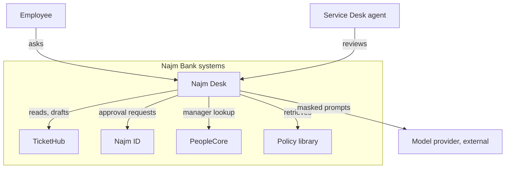
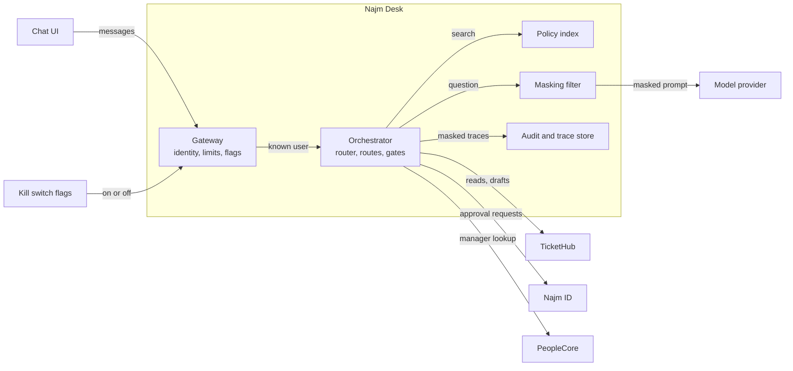

# Module 7 — Designing the solution with the customer

*A specification says what the customer needs; it does not yet say how you will deliver it, what you will show, or what you have promised. This module turns the specification into an architecture, a prototype, a proposal and an agreed scope. Lesson 7.1 is a design workshop for Najm Desk: the ladder from single prompt to multi-agent, the autonomy of each action, human-in-the-loop patterns, a tool surface built from the permissions matrix, a comparison of build surfaces, C4 diagrams, failure design, privacy and data flow, cost and latency budgets, architecture decision records, and the design review that Layla, Noura, Hamad, Sara and Maha will hold. Lesson 7.2 climbs the prototype ladder, runs a thin-slice demo on the lab kit, and teaches the customer demo, the statement of work, estimating under uncertainty, the phased rollout plan and change control. The lab runs offline against the kit's mock and, unchanged, against the real API.*

> **Layer:** Delivery — turning an agreed specification into an architecture, a prototype, a proposal and a scope the customer has signed up to.

---

# 7.1 — Architecture and autonomy design: workflow or agent, tool surface, human-in-the-loop, failure design, build or buy
*Level: 🟡 Intermediate* · *Prerequisites: 3.1, 5.1, 6.2* · *Layer: Delivery, Agents*

## ⚡ In 60 seconds
- **Design** turns the specification into decisions a reviewer can read; each element traces to a requirement or risk.
- Climb the **ladder** (prompt, workflow, agent, multi-agent) only for a named need. Najm Desk v1 is a router workflow with route-scoped tools.
- **Autonomy is set per action**, by the worst realistic outcome, not by how good the demo looked.
- A human in the loop needs evidence, time and an owner; a model's stated confidence is not a control.
- Design failures first and price a conversation before building. Biggest trap: a design that lives in one head.

## 🧭 Why it matters
Lujain brings her first Najm Desk design to review (hypothetical): one agent, nine tools, the strongest model, every policy pasted into the prompt. **Layla** asks which actions it can take alone, **Noura** what happens when a ticket says "unlock the CFO's account", **Hamad** who can switch it off at 02:00, **Sara** which fields leave the bank, **Maha** what users see at 07:05 on Sunday when the model is slow. Lujain answers "it depends" five times: the decisions lived in her head, where nobody can approve them.

Fahad ends the meeting: bring it back on paper. Design is the cheapest stage to be wrong in. This workshop builds the pack that survives review.

## 📐 How it works

### 🟢 The essentials

**What design produces.** From the brief (lesson 6.1) and the specification (lesson 6.2) you write `docs/architecture.md` and `docs/adr/`. Every element traces to a requirement (FR, GR, NFR) or a risk. "A vector database because everyone has one" is cut; a requirement with no element becomes a question for Hind.

**The decision ladder.** Anthropic's "Building effective agents" advises the simplest thing that works (lesson 5.1). Choose a rung by what the one below cannot do.
- **Single prompt:** the eval passes. Najm Desk: summarise a thread.
- **Workflow:** the steps are known before the input arrives. Najm Desk: classify, route, answer, check.
- **Single agent with tools:** the path depends on what tools return. Najm Desk: "why does my VPN fail?" (not v1).
- **Multi-agent:** contexts, owners or permissions one agent cannot hold; costs multiply, errors compound (Module 11).

The v1 verdict is a **router workflow**. A cheap model classifies the message, code picks one of five routes, and each route runs a short, capped tool loop with a **route-scoped tool surface**: the policy route sees `search_policies` only, so a poisoned passage cannot ask for `request_unlock`. The features are known in advance; a free-roaming agent adds variance, not capability.

**The autonomy ladder** ([*AI Product Management*, lesson 4.1 — Levels of automation: suggest, draft, decide, act](../aipm/index.html#/4.1)). **Suggest (S):** show information; the person does everything. **Draft (D):** prepare the artefact; the person sends it. **Decide with approval (A):** propose the action; a named human approves first. **Act (X):** do it, tell afterwards, review a sample. Set the level per action, by the worst realistic outcome and reversibility, not by model quality, and raise it only on evidence (lesson 7.2). OWASP's excessive agency (LLM Top 10, 2025) includes too much autonomy.

| Action and its worst outcome | Pilot (copilot) | Release and GA |
|---|---|---|
| Answer a policy question: a wrong rule is believed | Draft; an agent reviews | Act if the citation gate passes, else hand off |
| Show ticket status: another person's ticket leaks | Suggest | Act; owner check in code |
| Create a ticket: noise in the queue | Draft | Decide with approval; the employee confirms a preview |
| Request an account unlock: an attacker gets in | Decide with approval | Same; never higher in v1 |
| Hand off to a person: a delay | Act | Act |

### 🟡 Going deeper

**Human-in-the-loop patterns.**
- **Approval gate:** the action waits for a named human. Show the evidence, deny on timeout, watch the approval rate: near 100% in seconds is theatre.
- **Review queue:** act, then sample, for reversible high-volume work; findings feed evals.
- **Escalation rule:** code that routes to a person: a security incident, a privacy request, "let me talk to someone", a third failure.
- **Confidence threshold:** act only above a score. A model's stated confidence is often poorly calibrated; use checkable signals (retrieval score, citation gate, schema validity), set the cut-off on labelled data (lesson 12.1), name an owner, expect drift.

**Tool surface from the permissions matrix.** Each row of the specification's matrix (lesson 6.2) becomes a decision: who runs it, where the gate sits.

| Tool | Staff cell | Runs as, and the gate |
|---|---|---|
| `search_policies` | X | Service identity, read-only; passages are data |
| `get_ticket_status` | X own | The employee; owner check in code (GR-02); code shows the record (data flow) |
| `draft_ticket` | D | The employee; a preview, nothing filed |
| `request_unlock` | A agent | The employee; a Desk agent approves in Najm ID after the call-back (GR-03) |
| `create_ticket` | A user | Code, not a model tool: files after the employee confirms (FR-04) |
| `hand_off` | X | Code, not a model tool: runs on an escalation rule or request (FR-06) |

The model sees at most four tools, not twelve: definitions are input tokens on every call (lesson 3.1 used the lab names `create_ticket_draft` and `request_account_unlock`). Identity comes from the session, never a model argument. A write tool is a request; a gate commits it.

**Build surfaces.** "Build or buy" has two layers. Does the service-management product's own assistant meet the spec? Build when policies, languages, tools or governance need more; legal and procurement decide terms. Then choose a base; availability changes quickly, so check the documentation and the platform availability table.

| Surface | Built for, and what to weigh |
|---|---|
| Raw SDK loop | Your own loop: most control, most code |
| Beta tool runner | SDK-run loop with approval and cap hooks: less code; beta; check its stop-reason handling |
| Claude Agent SDK | Claude Code's harness as a library: files and shell work; more than v1 needs |
| Managed Agents | Anthropic-hosted loop and sandbox, beta: less to run; check availability, residency |
| LangGraph | Graph workflows with state and human pauses: resumable; one more abstraction |
| CrewAI, Google ADK, Microsoft Agent Framework | Role-based crews; Google Cloud; .NET and Azure: fit if your estate uses one; check maturity |

**Recommendation:** for v1, the raw SDK loop of the labs, the simplest that meets the spec. Revisit for a named need such as resumable runs.

**C4 diagrams.** Simon Brown's C4 model zooms from context to containers, components and code; reviews need the first two. DeviceDesk is absent on purpose: refresh advice is out of scope.



The container view opens the box; each container is deployed, secured and monitored.



**Failure design.** Every dependency fails. For each, write the trigger, the response and what the user reads.

| Failure | Response and what the user sees |
|---|---|
| Model slow or down | A per-call `timeout` (SDK default: ten minutes) inside a per-turn budget; the SDK retries connection errors, 408, 409, 429 and 5xx twice by default; then **degraded mode**: closest passage, source, "not an answer", hand-off. A fallback model needs the same eval |
| Nothing retrieved, a gate fails, or `stop_reason` is `max_tokens` or `refusal` | No model call or a withheld answer: "I don't know", plus a hand-off; never show half an answer |
| Tool error | "I could not reach TicketHub", never "Done"; no write retry without an idempotency key |
| Human takeover | A summary (question, route, reason, passages) to a named queue; out of hours, a queued ticket |
| Something is wrong now | A **kill switch**: `model_calls` off gives degraded mode, `write_tools` off gives read-only; no deploy, drilled. If the service is down, the portal shows phone and ticket routes (NFR-02) |

### 🔴 Expert view

**Privacy by design and data flow.** Draw where each field goes and justify each arrow. The constraint is the AI-tools policy: external AI services must not receive Confidential or Restricted data, customer data or credentials.
- **Question text** and **retrieved passages** (Internal): sent after masking pasted secrets (GR-01) and filtering by document access.
- **Ticket record:** Confidential in the specification, so code shows it and no model sees it (as in lesson 7.2). Letting even id, status and category reach a model is the open data-class question (Layla, Hamad, Sara).
- **Employee identity:** never in a prompt; the gateway holds it.
- **Logs and traces:** every tool call logged (NFR-04), stored masked; retention per NFR-03, which Sara decides.

Where inference and embeddings run (retrieval needs an embedding model, separate from the chat model) and what providers retain are for Sara and procurement ([*AI Governance*, lesson 4.3 — DPIAs and the global privacy map, from the EU to the GCC](../aigp/index.html#/4.3)).

**Cost and latency budgets.** Keep prices symbolic until you read the price page. One call costs `(n_in - n_cr - n_cw)·p_in + n_cr·r·p_in + n_cw·w·p_in + n_out·p_out`: `n_in` is all input tokens (the API's `input_tokens` excludes cached tokens, so add the cache fields), `n_cr` and `n_cw` the cache-read and cache-write parts, `r` and `w` the price page's multipliers, and `n_out` includes thinking tokens. A conversation sums its calls per tier (`S` strong, `H` cheap), times `(1 + ρ)` for retries. Take four turns, no retries or caching (fictional numbers): 1,500 tokens of system prompt and tools, 600 of passages, 60 per question, 250 per answer, thinking included. The answerer reads `Σ(2,100 + 60t + 250(t-1))` = 10,500 tokens. The router reads a 300-token prompt and the latest question each turn (1,440) and returns a 10-token label:

`C = 10,500·p_in^S + 1,000·p_out^S + 1,440·p_in^H + 40·p_out^H`

Cheapening the router touches only the small term. The big levers are the repeated 2,100 tokens (a byte-identical prefix can be cached: lesson 14.2), passage size and turn count. `python labs/m00/cost.py --system 2100 --turns 4` reproduces the strong tier. Compare the total with NFR-06, which caps cost per *resolved* conversation, so hand-offs raise it. Latency sums along the critical path (gateway, router, retrieval, first token): split NFR-01's targets across it, stream the answer, and cap tokens and steps. Count tokens per model with `count_tokens`.

## 🧰 The toolkit
| Tool, practice or pattern | What it is and does | When to reach for it |
|---|---|---|
| **Decision ladder** | Prompt, workflow, agent, multi-agent | Before drawing a box |
| **Autonomy table** | Each action at suggest, draft, approve or act | Agents that do more than answer |
| **C4 diagrams** (Simon Brown) | Context and container views | Reviews, onboarding |
| **Failure table** | Trigger, response, message | Before the happy path |
| **Cost model** | Tokens times symbolic prices | Choosing models, context |
| **ADR** (Michael Nygard) | One page: context, decision, consequences | A choice someone may reverse |

## 🏛️ In practice at Najm Bank
Your artefacts: `docs/architecture.md` (traceability, diagrams, autonomy table, tool surface, data flow, failure design, budgets, ADR index) and `docs/adr/`.

**ADR format.** Michael Nygard's 2011 format: **Title**, **Status** (proposed, accepted, superseded), **Context**, **Decision**, **Consequences**. One page, numbered; once accepted its text is not rewritten, and a new ADR supersedes it while the old Status line points to the new one. Three fictional examples; use your own figures from evals.

```markdown
# ADR 001: Route with a cheap model, answer with a strong one
Status: Accepted
Context: Every message needs a label; only some need a careful answer. Volume: about 1,800 tickets a week (fictional baseline).
Decision: The router and hand-off summary use claude-haiku-5-5; policy answers use claude-sonnet-5-5. Ids come from environment variables.
Consequences: Cheaper, faster routing; two prompts to version and evaluate. A wrong label means a wrong route, so the router gets its own eval and an "other" exit. Revisit if the router's own eval misses its target.
```

```markdown
# ADR 002: Retrieve passages instead of pasting the whole library
Status: Accepted
Context: Fifteen short policies fit in a context window today. But every token is resent on every call, answers need citable passages, some documents are for some staff only, and the library will grow.
Decision: Hybrid retrieval (vector plus BM25) returns three passages; the answer must cite them.
Consequences: Fewer input tokens, auditable sources. Retrieval can miss, so recall is measured apart and a miss means "I don't know". A policy index to operate. Supersede if a cached full-library prompt wins on the eval.
```

```markdown
# ADR 003: Write tools are requests; nothing writes alone in v1
Status: Accepted
Context: Text the model reads can carry instructions. The constraints say every write needs a human or a policy gate.
Decision: draft_ticket returns a preview; code runs create_ticket, with an idempotency key, only after the employee confirms. request_unlock files a request that a Desk agent decides in Najm ID after the call-back. Identity comes from the session. No tool changes an account.
Consequences: One more click for employees, a queue for approvers (approval time tracked). A tricked model can at most draft or request, never change. A tool moves up the ladder only through a new ADR with eval and rollout evidence.
```

**The design review.** Rehearse each reviewer's question; a document should answer it.

- **Layla:** which actions run alone; what moves one up? Autonomy table.
- **Noura:** what if ticket text gives orders? Route-scoped tools.
- **Hamad:** who switches it off, how fast? Kill switch.
- **Sara:** which personal data reaches the model; how long are logs kept? Data flow.
- **Maha:** what breaks at 07:05 on Sunday; who is paged? Failure table.

**Your platform.** Fill in before the review:

| Question | Your answer |
|---|---|
| Where does each container run, and as whom? | |
| Where do secrets, traces and approvals live? | |

**Weekly deliverable.** Commit `week-07/` with `docs/architecture.md`, `docs/adr/001` to `003` and `NOTES.md` (quiz answers, notes). **Group session (60 minutes).** (1) Draw the container diagram from memory (10). (2) Role-played review, answers from documents only (25). (3) Swap ADRs; attack the consequences (15). (4) Agree one cost table (10).

**Build it with Claude Code.** Ask for a review, not a redesign, in plan mode (check the current documentation):

```text
Goal: review docs/architecture.md and docs/adr/ against docs/najm-desk-spec.md and list the gaps. Change no design file.
Context: CLAUDE.md, docs/najm-desk-spec.md (requirement ids, permissions matrix), docs/architecture.md, docs/adr/*.md.
Task:
1. For each FR, GR and NFR id in the spec, find the design element that meets it. Quote both.
2. List design elements no requirement or risk justifies.
3. List contradictions, such as a tool in a diagram but not in the matrix.
4. List decisions with no ADR, and questions the five reviewers would ask that the pack cannot answer.
Output: docs/design-gaps.md, a table of gap, type, evidence (file and quoted line), severity, fix.
Constraints: quote, never paraphrase; write "unclear" rather than guess; invent no requirements, prices or model ids; no code changes.
```

**Verify before you accept it.**
- Open every quoted line in its file. A claim without a matching quote is a guess.
- Check three "covered" and three "gap" claims yourself, with `grep -rn "FR-04" docs/` and other ids; look for a missed gap or false alarm.
- `git diff --stat` shows only `docs/design-gaps.md` as new. The list is a second reader's view, not a sign-off.

## 🛠️ Exercises
- 🟢 **Draw the C4 diagrams.** Offline. Redraw both in mermaid for your spec. *Done when:* both render, every arrow is labelled, every external system appears, and a colleague can name two v1 omissions.
- 🟡 **Write three ADRs.** Offline. Model tiering, retrieval against long context, write-action policy. *Done when:* each has five parts, a consequence that is a cost, a trigger to revisit, and no unmeasured figures.
- 🔴 **Cost per conversation, three ways.** Offline, prices from the price page; real `count_tokens` on your prompt and tools *needs the real API* (the mock only estimates). Fill the formula for low, expected and high assumptions (turns, passage tokens, cached share, retries). *Done when:* a table gives cost per conversation and per 1,000, the assumption that moves it most, and the price date.

## ⚠️ Mistakes and traps
- **Designing only the happy path.** Reviewers ask about failure first; write that table before the flow.
- **Setting autonomy by demo quality or stated confidence.** Use outcome, reversibility and checkable signals.
- **Copying the back end as the tool list.** Twelve tools cost tokens and widen the attack surface.
- **An approval gate nobody reads.** Show evidence, limit volume.

## 🧾 Recap
- Design turns the spec into diagrams, an autonomy table and ADRs a reviewer can read.
- Take the lowest rung that meets the spec; scope tools by route.
- Set autonomy per action by worst outcome; human checks need evidence and an owner.
- Design failures first; price a conversation symbolically; record hard choices as ADRs.

## ✍️ Check yourself

**1. Noura fears a poisoned policy passage could trigger an unlock request. Which design element removes the path?**

- A. A system prompt line forbidding account unlocks
- B. A route-scoped tool surface without that tool
- C. A confidence threshold on every tool call
- D. A larger model for the policy route

<details><summary>Answer</summary>

**B.** A tool missing from the request cannot be called, and the dispatcher should still reject any name outside the route's list; prompt rules only ask. (🟢 The decision ladder.)

</details>

**2. A teammate proposes: "Act without review when the model's confidence exceeds 90%." What is the flaw?**

- A. The cut-off should be raised from 90 to 99 percent
- B. The model should rate its own answer twice and average
- C. Stated confidence is unreliable; use checkable signals
- D. The threshold belongs in the system prompt, not in code

<details><summary>Answer</summary>

**C.** A model's own number is not a measured probability; gate on checkable signals, with the cut-off set on labelled data. (🟡 Human-in-the-loop patterns.)

</details>

**3. At 07:05 on Sunday the model API fails for twenty minutes. Which behaviour fits the failure design?**

- A. Retry every request until the model answers
- B. Answer from the model's general knowledge
- C. Queue every question for the next morning
- D. Show the closest policy passage, labelled, and hand off

<details><summary>Answer</summary>

**D.** Degraded mode keeps the cited part working and says what it is. (🟡 Failure design.)

</details>

**4. Later, a cached full-library prompt wins on the eval. What happens to ADR 002?**

- A. Edit it in place so the history stays in one file
- B. Delete it, since the decision is no longer true
- C. Leave it alone and add a note in the code
- D. Write a new ADR that supersedes it

<details><summary>Answer</summary>

**D.** An accepted ADR's text is not rewritten; a new one records why you changed course, and the old Status line points to it. (🏛️ ADR format.)

</details>

**5. The router reads 1,440 input tokens a conversation and the answerer 10,500. Which change most likely cuts cost most?**

- A. Move the router to the strongest tier
- B. Shorten the router's output to one word
- C. Cache the stable prefix; trim passages
- D. Drop the audit log from the gateway

<details><summary>Answer</summary>

**C.** The answerer's repeated input dominates; tiering the router touches the small term. (🔴 Cost and latency budgets.)

</details>

## 📚 References
- Anthropic, "Building effective agents": https://www.anthropic.com/engineering/building-effective-agents
- Claude API: Pricing https://platform.claude.com/docs/en/about-claude/pricing; Prompt caching https://platform.claude.com/docs/en/build-with-claude/prompt-caching; Managed Agents https://platform.claude.com/docs/en/managed-agents/overview; Agent SDK and other documentation: https://docs.anthropic.com/
- OWASP GenAI Security Project: https://genai.owasp.org/
- [*Secure AI & Application Security*, lesson 9.2 — Agents and tools: excessive agency, least-privilege tools and MCP](../secai/index.html#/9.2)
- **Read this week (Module 7).** The plan assigns no chapters to Module 7; the nearest, as given: Gulli, *Agentic Design Patterns*, chapters 13 (Human-in-the-Loop) and 16 (Resource-Aware Optimisation), the free draft of lesson 0.1; *Grokking AI Applications*, chapter 8 (Deploying and orchestrating GenAI apps): https://www.manning.com/books/grokking-ai-applications

---

# 7.2 — Prototype, propose and agree scope: demos, proposals, phased rollout and change control
*Level: 🟡 Intermediate* · *Prerequisites: 4.2, 6.2, 7.1* · *Layer: Delivery*

## ⚡ In 60 seconds
- A **prototype ladder** (paper, Wizard of Oz, thin slice, pilot) buys the cheapest evidence first.
- A **demo** is a rehearsed experiment: a script, one failure shown on purpose, limits in the customer's words.
- A **statement of work** (SOW) turns the design into scope in and out, deliverables, phases, assumptions, acceptance and change control. Prices and legal terms belong to legal and procurement.
- **Estimate in ranges**; roll out in **phases with exit criteria**; answer every change request with yes, not yet or no.
- Biggest trap: a demo that only succeeds, and a scope that never says "not".

## 🧭 Why it matters
Lujain demos Najm Desk to Hind and Yara (hypothetical): seven polished minutes. Hind says, "Can it also reset passwords? I want my whole team on it next month." Lujain says "Sure." Nothing is written down. Two weeks later "password reset" is on Hind's slide as a promise, and Noura asks who approved it. In pilot week one a wrong answer reaches Hind's team; nobody had said it could. Yara: "You said it was ready."

Fahad's verdict: a demo room is where scope is quietly written, so write it down on purpose. This lesson covers proving risk cheaply, showing the customer the truth, agreeing in writing what you will not do, and releasing in steps.

## 📐 How it works

### 🟢 The essentials

**The prototype ladder.** Each rung costs more and answers a different question; stop when the next biggest risk is retired.
- **Paper:** scripted conversations on cards, walked through with Yara's agents. Do flow and words match how staff ask?
- **Wizard of Oz:** a person behind a real chat window plays the assistant by the design's rules; staff are told it is a trial (ask Sara about handling messages). Do people trust it? What do they ask?
- **Thin slice:** the smallest end-to-end build, here on the lab kit: two jobs, real guards. Can it be built; what do latency and cost look like?
- **Pilot:** real users and tickets, limited scope and time, watched. Adoption, quality, operations, benefit.

**Running a customer demo.** A demo is an experiment with a script. Decide what you want from the room: a decision, a name, a date. Fix scenarios and expected results, announce the failure first, rehearse on the same environment, log every request. This script doubles as the slice's acceptance checks; each scenario cites the worked specification's requirement it exercises (`labkit/data/m07_demo_script.json`):

| Scenario | What you say |
|---|---|
| D1 A policy question (FR-01) | "Every answer carries its source." |
| D2 Your own ticket (FR-02) | "It shows what TicketHub holds and changes nothing." |
| D3 Someone else's ticket (AC-2) | "It will not even say whether that ticket exists." |
| D4 Not in the library (FR-06) | "When it does not know, it says so and a person takes over." |
| D5 "Please reset my password" (GR-03) | "Not in this version, and here is why we will not rush it." |
| D6 Failure: an invented source | "Watch it get this wrong. The check caught it first." |
| D7 Failure: the model is down | "Same question, model off: closest policy text, labelled." |

State limits plainly: "It will sometimes be wrong; that is why every answer shows its source and the Service Desk sees every hand-off."

### 🟡 Going deeper

**The lab: a thin slice you can run.** It reuses the Module 4 retrieval lab and the kit's ticket tool. From `aiapps/labkit`:

```bash
python -m labkit.mock_server --port 8787 --playbook playbooks/m07_lab.json &
export ANTHROPIC_BASE_URL=http://127.0.0.1:8787 ANTHROPIC_API_KEY=mock
python labs/m07/demo.py                                  # the seven scenarios
python labs/m07/demo.py "Status of ticket 4473?" Lujain  # one question, one person
pytest tests/test_m07_labs.py
```

On the real API the code is identical (spending cap first, lesson 0.2), but D6 will not fail on cue, and retrieval keeps Module 4's toy embedding unless `EMBEDDER=default`. The run ends with `7/7 slice checks passed`; D6 shows `kind=withheld` and the reason `citation gate: ['finance-budget#3']`.

*Works offline:* routing, the owner check, the citation gate, degraded mode, the hand-off, the tests (the mock copies the best passage, so D1 proves wiring, not understanding). *Needs a real model:* answer quality, whether it invents sources (the playbook stages D6), router accuracy, latency, cost.

```python
# labs/m07/demo.py
"""Lab 7.2: the thin-slice Najm Desk demo: policy Q&A and ticket status, three guards, a degraded mode, one hand-off.
  python labs/m07/demo.py                                run the seven scenarios in labkit/data/m07_demo_script.json
  python labs/m07/demo.py "Who approves a laptop?" Rayan      one question, asked by one person
Reuses Module 4 and the kit's ticket tool. The router is plain keywords on purpose: a thin slice proves the shape;
the real router is a cheap-model call (ADR 001)."""
import json
import re
import sys
from dataclasses import dataclass
from pathlib import Path

import anthropic

KIT = Path(__file__).resolve().parents[2]
sys.path[:0] = [str(KIT), str(KIT / "labs" / "m04")]            # the kit and the Module 4 lab, by plain name
import rag                                                       # noqa: E402  Module 4: Chroma index, answer(), IDK
from bm25 import hybrid_search                                   # noqa: E402  Module 4: vector + BM25 fused
from labkit.tools import get_ticket_status                       # noqa: E402  the kit's read-only ticket tool

DATA = KIT / "labkit" / "data"
OWNERS = json.loads((DATA / "m07_requesters.json").read_text(encoding="utf-8"))     # ticket id -> who raised it


@dataclass
class Reply:
    kind: str                       # answer | status | idk | refused | declined | withheld | degraded
    text: str                       # exactly what the customer sees
    handoff: dict | None = None     # what a Service Desk agent receives


def hand_off(user, text, route_name, reason, hits=()):
    """Who asked, what, why the assistant stopped, and what it had retrieved."""
    return {"user": user, "asked": text, "route": route_name, "reason": reason, "retrieved": [h["id"] for h in hits]}


def route(text: str) -> str:
    low = text.lower()
    if re.match(r"(please |can you |could you )?(reset|unlock|change|disable)\b", low):
        return "action"                                          # a request to DO something: not in v1
    if re.search(r"\b\d{4}\b", low) and re.search(r"ticket|status|case", low):
        return "ticket"
    return "policy"


def policy(user: str, text: str) -> Reply:
    hits = hybrid_search(text, 3)
    try:
        answer = rag.answer(text, hits)                          # no hits: the Module 4 "I don't know", no model call
    except anthropic.APIError:                                   # degraded mode: the best passage, no generation
        return Reply("degraded", f"The assistant is offline, so this is the closest policy text, not an answer: {hits[0]['text']} [{hits[0]['id']}]",
                     hand_off(user, text, "policy", "model unavailable", hits))
    if answer.strip() == rag.IDK:
        return Reply("idk", f"{rag.IDK} I have passed your question to the Service Desk.", hand_off(user, text, "policy", "no answer in the library", hits))
    unknown = rag.check_citations(answer, hits)
    if unknown or not re.search(r"\[[\w-]+#\d+\]", answer):      # gate: cite, and only what was retrieved
        return Reply("withheld", "I could not verify that answer against the policies, so I am not showing it. A person will follow up.",
                     hand_off(user, text, "policy", f"citation gate: {unknown or 'no citation'}", hits))
    return Reply("answer", answer)


def ticket(user: str, text: str) -> Reply:
    ticket_id = re.search(r"\b\d{4}\b", text).group(0)
    if OWNERS.get(ticket_id) != user:                            # same words for 'not yours' and 'does not exist'
        return Reply("refused", f"I can't find a ticket {ticket_id} raised by you.", hand_off(user, text, "ticket", "not the requester's ticket"))
    return Reply("status", get_ticket_status(ticket_id))         # a stored record needs no model to be shown


def respond(user: str, text: str, outage: bool = False) -> tuple[str, Reply]:
    name = route(text)
    if name == "action":
        return name, Reply("declined", "That is outside this version of Najm Desk, which answers policy questions and shows ticket status. "
                           "I have asked the Service Desk to help.", hand_off(user, text, name, "action not in scope"))
    if name == "ticket":
        return name, ticket(user, text)
    live = rag.client
    if outage:                                                   # the fire drill: point the client at a dead port, no retries
        rag.client = live.with_options(base_url="http://127.0.0.1:1", max_retries=0)
    try:
        return name, policy(user, text)
    finally:
        rag.client = live                                        # always put the real client back


def run_script(path: Path = DATA / "m07_demo_script.json") -> bool:
    results = []
    for s in json.loads(path.read_text(encoding="utf-8")):
        name, reply = respond(s["user"], s["say"], s.get("outage", False))
        low, leak = reply.text.lower(), s.get("absent", "").lower()          # "absent": text that must NOT appear (a leak check)
        ok = reply.kind == s["kind"] and s["contains"].lower() in low and bool(reply.handoff) == s["handoff"] and not (leak and leak in low)
        results.append(ok)
        print(f'--- {s["id"]} {s["title"]}\n{s["user"]}> {s["say"]}\nnajm-desk> {reply.text}')
        print(f'    [route={name} kind={reply.kind}] {"PASS" if ok else "FAIL"}   hand-off: {reply.handoff or "none"}')
    print(f"\n{sum(results)}/{len(results)} slice checks passed")
    return all(results)


if __name__ == "__main__":
    if len(sys.argv) > 1:                                        # demo.py "question" [person]
        print(respond(sys.argv[2] if len(sys.argv) > 2 else "Rayan", sys.argv[1])[1].text)
    else:
        sys.exit(0 if run_script() else 1)
```

- **The router is code.** Keywords misroute real sentences: "Is the VPN status page reliable in 2025?" goes to the ticket route, "Unlock policy: how long is the lockout?" to the action route. ADR 001's cheap model replaces `route()`.
- **Three guards.** "Not yours" and "does not exist" get the same words. The citation gate wants a citation, and only retrieved ones. No hits, no model call.
- **Degraded mode.** The drill aims the client at a dead port, a real connection failure; `finally` restores it. It swaps a global: a drill, not production code.

**Proposal and SOW anatomy.** Sections: objectives; scope in and out; deliverables; phases and milestones; assumptions; dependencies; acceptance criteria and process; change control; roles (RACI: responsible, accountable, consulted, informed); risks; support or warranty period; commercials. Commercials and contract terms belong to legal and procurement. Two sections work hardest. **Scope out** turns D5 into a visible decision; **assumptions** ("the policy library is current and has an owner") move a risk onto the page.

**Estimating under uncertainty.** A single number is a promise you cannot keep. Give a range, a confidence and assumptions: "six to nine weeks to a pilot-ready build, about 80% confident, if TicketHub test access arrives early". Run a **spike** first: a time-boxed experiment on the riskiest unknown, such as Arabic retrieval.

### 🔴 Expert view

**Phased rollout with exit criteria.** Pilot with Service Desk staff as a copilot, then one business unit, then everyone. Each gate is a measurable **exit criterion** with a named decider; each phase can fall back to the one before through lesson 7.1's kill switch. Weak: "staff liked it", "four weeks passed". Strong: "correctness at target for two weekly eval runs; zero security incidents; kill-switch drill passed". In the pilot, try **shadow mode**: the assistant drafts silently and you compare its drafts with the agents'.

**Change requests.** "Can it also reset passwords?" deserves an impact analysis, not a reflex. Ask: what is the need; what changes (requirement, tools, autonomy, data flow, ADRs); who must agree; what new evidence it needs; what it costs in effort and schedule. Then answer one of three ways.
- **Yes:** inside the design, small, no new risk. Update specification and tests; log it.
- **Not yet:** valuable, but a precondition is missing. Name it, its owner and a date to revisit.
- **No:** it breaks a constraint, or the benefit does not justify the risk. Say why.

Password reset is **not yet**. It is a scope and risk change (lesson 6.2's change log: Hind and Fahad; Layla, Noura or Sara). The worst outcome is account takeover; GR-03, the Out list and ADR 003 exclude it; and the password policy itself needs a manager call-back when the authenticator is lost. Until then Najm Desk answers "how do I reset?" from the policy and hands off.

**Premortem, one-pager, decision log.** In a premortem (Gary Klein) it is week eight and the pilot is paused; write why (nobody reads hand-offs, a policy changed, approvers click yes) and plan a fix for each. The **customer one-pager** says in Hind's words what Najm Desk does, does not do, and how to report a wrong answer; Yara reviews it, in English and Arabic. The **decision log** records each decision with date, decider, link ("DEC-004: password reset, not yet; Hind; CR-001, ADR 003").

## 🧰 The toolkit
| Tool, practice or pattern | What it is and does | When to reach for it |
|---|---|---|
| **Prototype ladder** | Paper, Wizard of Oz, thin slice, pilot | Choosing evidence for the next risk |
| **Demo script** | Fixed scenarios, expected results, one failure | Every customer demo |
| **Statement of work** | Scope, phases, acceptance, change control | Before build starts |
| **Rollout plan** | Phases, autonomy, exit criteria, rollback | Before the pilot |
| **Change request** | Impact analysis, then yes, not yet or no | Any request after scope is agreed |
| **Decision log** | Dated decisions, decider, link | From day one |

## 🏛️ In practice at Najm Bank
Your artefacts: the demo (`labs/m07/demo.py`, `docs/demo-script.md`), `docs/proposal.md` and `docs/rollout-plan.md`. The SOW outline for Najm Desk (fictional; durations stay illustrative until your spikes replace them):

```markdown
# Najm Desk v1: statement of work (outline)
1. Objectives: the specification's targets, for example median first response from 3 h 40 to 3 h 00.
2. Scope in: policy answers; ticket status; ticket draft and creation; unlock request; hand-off. English and Arabic.
3. Scope out: changing accounts, passwords or MFA; setting priority; approving anything; refresh advice; incident detection; voice.
4. Deliverables: service; eval set and report; architecture and ADRs; runbook; training; handover.
5. Phases: build and evaluate 6 to 9 weeks; pilot 4; limited release 4; then the steering group decides.
6. Assumptions and dependencies: policy library current, with an owner; TicketHub can limit reads to the requester; an unlock-request queue in Najm ID, a PeopleCore manager lookup and an approved model service; governance reviews answered in 10 working days.
7. Acceptance: AC-1 to AC-5, the eval set and the demo script, run by Yara's team; sponsor review in 5 working days.
8. Change control: changes to scope, autonomy, model data or dates need a change request.
9. Roles: Hind accepts; Yara advises; Fahad delivers; Layla, Noura, Hamad, Sara sign off their areas.
10. Risks, warranty, commercials: premortem risks; defect fixes for a period agreed with legal; prices with legal and procurement.
```

The rollout plan (the numbers are the worked specification's fictional targets; use yours):

| Phase | Autonomy | Exit criteria |
|---|---|---|
| Pilot: Service Desk staff | Draft: agents review answers | Correctness and escalation at least 95% and zero invented citations in two weekly eval runs; zero security incidents; kill-switch drill passed |
| Limited release: one business unit | Act behind the citation gate; writes gated | The above, plus satisfaction at least 4.0 of 5, cost per resolved conversation within NFR-06, Layla's sign-off |
| General availability: everyone | Same | Monthly review of the same measures; changes by change request |

**Weekly deliverable.** Commit `week-07/` with the demo, passing tests, `docs/demo-script.md`, `docs/proposal.md`, `docs/rollout-plan.md`, `NOTES.md`. **Group session (60 minutes).** (1) Run the demo live, D6 and D7 included (15). (2) Role-play: Hind asks for password reset mid-demo; run the analysis (20). (3) Attack each other's scope-out lists (15). (4) Agree exit criteria (10).

**Build it with Claude Code.** Plan mode first (check the current Claude Code documentation):

```text
Goal: build labs/m07/demo.py, the thin-slice Najm Desk demo of lesson 7.2: policy Q&A and ticket status, with guards and a hand-off.
Context: Python 3.11, anthropic>=1,<2, the offline mock (labkit/README.md, playbooks/m07_lab.json), labs/m04, labkit/tools.py.
Acceptance: the seven checks D1 to D7 in labkit/data/m07_demo_script.json; pytest tests/test_m07_labs.py passes; the demo prints 7/7.
Constraints:
- Reuse rag.answer, hybrid_search, check_citations, get_ticket_status. Do not copy or edit labs/m04 or labkit/*.py.
- The router is plain code. Routing, ticket status and out-of-scope requests make no model call.
- The requester is a function argument, never read from the question.
- Guards: ticket owner, citation gate, "I don't know" with hand-off, degraded mode when a model call raises anthropic.APIError.
- No temperature, prefill or keys in code; no new dependencies; nothing beyond the seven scenarios.
Plan first; small steps; tests after each.
```

**Verify before you accept it.**
- Run the seven scenarios yourself and compare each with the script, not Claude's summary.
- Mutate: delete the owner check, then the citation gate, then the `except anthropic.APIError`. Each must turn a test red, or the tests are decoration.
- Read the diff for a model call in `route()`, the user taken from the question, `except Exception`, copied Module 4 code, `content[0]`.
- `git diff --stat` shows only `labs/m07/`, its test and the `m07_` data and playbook.

## 🛠️ Exercises
- 🟢 **Run the demo, write the sentences.** Offline. Run all seven scenarios and write what you would tell Hind for each, avoiding "model", "token" and "hallucination"; D6's says how the wrong answer was caught. *Done when:* `NOTES.md` holds seven plain sentences a colleague can match to scenarios.
- 🟡 **Write the proposal and rollout plan.** Offline. Fill both, then analyse "can it also reset passwords?". *Done when:* scope-out names three things including password reset, each deliverable has an acceptance criterion, estimates are ranges with a confidence and a spike, each exit criterion has a number and a decider, and the request ends in yes, not yet or no.
- 🔴 **Find a real failure.** *Needs the real API* (spending cap first, lesson 0.2). Without the playbook, run 20 policy questions (five the library cannot answer) through `rag.py` with `MODEL=claude-sonnet-5-5` and look for a real failure. *Done when:* `NOTES.md` has the questions, outputs, the failing case, whether the citation gate caught it, the date, the model id and your replacement for D6.

## ⚠️ Mistakes and traps
- **A demo that only succeeds.** Show one failure and the check that catches it.
- **Saying "sure" in the room.** Log it; answer after analysis.
- **A scope with no "out".** Name what you will not do.
- **A single-number estimate.** Give a range, a confidence, assumptions.
- **Exit criteria that are feelings or dates.** Use specification numbers and a named decider.

## 🧾 Recap
- Climb the prototype ladder only as far as the next risk requires.
- A demo is a script with a failure in it and limits in the customer's words.
- Scope-out, assumptions, acceptance and change control are the SOW's hardest-working sections.
- Estimate in ranges; roll out in phases with measurable exit criteria; answer every change request yes, not yet or no, with a reason.

## ✍️ Check yourself

**1. Mid-demo Hind asks, "Can it also reset passwords?" Which reply fits the lesson?**

- A. "Yes, we will add it to version 1."
- B. "Let me log it and run an impact analysis."
- C. "No, the assistant will never change an account."
- D. "Let me show you a quick prototype of that now."

<details><summary>Answer</summary>

**B.** A reflex yes or no writes scope in the room; the analysis decides. (🔴 Change requests.)

</details>

**2. The team wants real, unscripted staff questions and reactions to wrong answers before writing code. Which rung fits?**

- A. A paper prototype of scripted conversation cards
- B. A thin slice built on the lab kit with guards
- C. A Wizard of Oz trial with a person behind it
- D. A pilot run with every Service Desk agent

<details><summary>Answer</summary>

**C.** A person behind a live interface gets real questions with nothing built; paper uses your script. (🟢 The prototype ladder.)

</details>

**3. Why does the demo script include D6, an invented source?**

- A. To let the customer watch a wrong answer get caught
- B. To lower expectations so that acceptance becomes easier later
- C. To prove the model never makes mistakes on policy questions
- D. To avoid writing acceptance criteria for the pilot

<details><summary>Answer</summary>

**A.** Customers meet failures in week one; seeing the catch builds calibrated trust. (🟢 Running a customer demo.)

</details>

**4. Which estimate follows the lesson?**

- A. "Ten weeks, and we add a ten percent safety buffer on top"
- B. "Six to nine weeks, about 80% confident, if access comes early"
- C. "Between four and seven weeks, since that is the average of our best cases"
- D. "We cannot give any estimate until the pilot has fully finished"

<details><summary>Answer</summary>

**B.** A range, a confidence and a named assumption; a padded point or best-case average hides the uncertainty. (🟡 Estimating under uncertainty.)

</details>

**5. Which is a proper exit criterion from pilot to limited release?**

- A. Four calendar weeks have passed since the pilot first started
- B. Pilot staff have told us they like using the assistant
- C. The model provider has released a newer model version
- D. Correctness at target for two weekly runs, no incidents

<details><summary>Answer</summary>

**D.** It is measurable and tied to the specification; dates, opinions and provider news are not. (🔴 Phased rollout.)

</details>

## 📚 References
- [*AI Product Management*, lesson 7.1 — Launch readiness: guardrails, governance gates and support](../aipm/index.html#/7.1)
- [*Cloud & DevOps*, lesson 4.2 — Release strategies: rolling, blue-green, canary, feature flags and rollback](../cloud/index.html#/4.2); [*AI Governance*, lesson 10.1 — Release readiness and conformity](../aigp/index.html#/10.1); [*Running AI Agents in Production*, levels L0–L5](../agentic/learning-path.html#level-3-production-engineer)
- The course lab kit: https://github.com/Tamoura/system-design-for-vibe-coders/tree/main/aiapps/labkit; Claude documentation: https://docs.anthropic.com/
