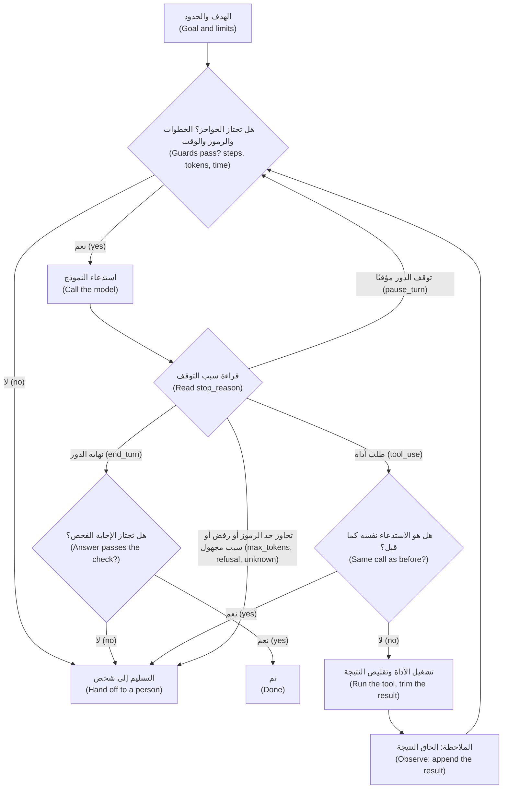

# الوحدة 8 — حلقة الوكيل بإتقان (The agent loop, properly)

*خطِّط ونفِّذ ولاحِظ وكرِّر (Plan, act, observe, repeat): هذا كل ما يفعله الوكيل (an agent)، وفي الحلقة نفسها يخطئ الوكلاء. قدّمت لك الوحدة 1 أصغر حلقة (the smallest loop) وقدّمت الوحدة 3 بروتوكول الأدوات (the tool protocol) الذي تقوم عليه. وهذه الوحدة هي الفرق بين حلقة تنجح في عرض تجريبي (a demo) وحلقة تستطيع تركها تعمل في الثانية صباحًا. الدرس 8.1 هو الدرس المفاهيمي (the concept lesson): تشريح الحلقة (the anatomy of the loop) وفق نمط ReAct، وطرق التوقف الست (the six ways it should stop)، وما يُفعل مع كل `stop_reason`، والتأمل الذاتي والتخطيط (reflection and planning) — متى يُجديان ومتى يضيفان كلفة فحسب — وأخطاء الأدوات (tool errors)، وكيف ينمو السياق مع الحساب (how context grows, with the arithmetic)، وأنماط الإخفاق التي يصادفها المبتدئون أولًا (the failure modes juniors meet first)، وقابلية المراقبة (the observability) التي تحتاجها الحلقة، ومتى تستخدم مشغّل الأدوات في حزمة التطوير (the SDK's tool runner) أو Claude Agent SDK بدلًا من حلقتك الخاصة (your own loop)، وقائمة فحص الحلقة الآمنة (a safe-loop checklist). أما الدرس 8.2 فهو المختبر (the lab): حلقة من الصفر (a loop from scratch) بحدّ صارم للخطوات (a hard step cap)، وميزانية رموز (a token budget)، وأجل بالساعة الفعلية (a wall-clock deadline)، وكشف انعدام التقدم (no-progress detection)، وسجل تتبّع JSONL (a JSONL trace)، وأداة إعادة تشغيل (a replay tool)، وتسليم إلى شخص (a hand-off to a person) حين ينطلق أحد الحواجز (a guard fires)، واختبار يجعل كل حاجز ينطلق (a test that makes each guard fire). يعمل المختبر دون اتصال (offline) على النسخة المحاكاة (the mock) في عدّة المختبر (the lab kit) وعلى واجهة البرمجة الحقيقية (the real API) دون أي تغيير. وتحصل استعلامات التذاكر والزملاء في نجم ديسك (Najm Desk) على أول حواجزها (their first guards).*

> **الطبقة (Layer):** Agents — الحلقة التي تتيح للنموذج أن يتصرف بنفسه (the loop that lets a model act on its own)، والحدود والفحوص وعمليات التسليم التي تُبقيه آمنًا (the limits, checks and hand-offs that keep it safe).

---

# 8.1 — خطِّط ونفِّذ ولاحِظ وكرِّر: التأمل الذاتي وشروط التوقف وأولى أنماط الإخفاق (Plan, act, observe, repeat: reflection, stopping conditions and the first failure modes)
*المستوى (Level): 🟡 متوسط (Intermediate)* · *المتطلبات (Prerequisites): 1.2، 3.2* · *الطبقة (Layer): Agents*

## ⚡ الدرس في دقيقة (In 60 seconds)
- **حلقة الوكيل (agent loop)** تسأل النموذج، وتقرأ `stop_reason`، وتنفّذ الأداة التي طلبها، وتعيد النتيجة، ثم تكرر (asks the model, reads stop_reason, runs the tool it asked for, returns the result and repeats; ReAct, Yao et al., 2022). النموذج يقترح (the model proposes)؛ و**شيفرتك أنت تقرر متى تتوقف (your code decides when to stop).**
- **ستة مخارج (Six exits):** نجاح متحقَّق منه (verified success)، وحدّ الخطوات (step cap)، وميزانية الرموز (token budget)، وأجل الساعة الفعلية (deadline)، وكشف انعدام التقدم (no-progress detection)، وتسليم إلى شخص (hand-off to a person). وكل حاجز ينتهي بتسليم لا بانهيار (Every guard ends in a hand-off, never a crash).
- عالِج **كل `stop_reason`** (Handle every stop_reason)؛ وتوقف عند القيم المجهولة (stop on unknown values)؛ ولا تنفّذ أي أداة من دور مقطوع أو مرفوض (run no tools from a cut-off or refused turn).
- تنمو كلفة الإدخال (Input cost) مع **مربّع عدد الخطوات (the square of the steps)**. قلّص نتائج الأدوات (Trim tool results).
- **التأمل الذاتي (Reflection)** لا يُجدي إلا بمعلومة جديدة (new information)؛ و**التخطيط أولًا (planning first)** يُجدي حين تكون الخطوات متوقعة (steps are predictable).
- إشارة القرار (Decision cue): خطوات ثابتة (fixed steps) فسير عمل (a workflow) — الدرس 5.1؛ ومسار تحدده نتائج الأدوات (path set by tool results) فحلقة محدودة (a bounded loop).

## 🧭 لماذا يهم (Why it matters)
في الأسبوع الخامس من التجربة التشغيلية لنجم ديسك (the Najm Desk pilot) ترتّب مها، قائدة فريق هندسة الموثوقية (the SRE lead)، محادثات الأسبوع الماضي بحسب الكلفة، وهذا افتراضي (hypothetical). إحداها خارج المألوف تمامًا: 50 استدعاءً للنموذج (50 model calls)، وقرابة مليون رمز إدخال (about a million input tokens)، أي نحو 75 ضعف المحادثة العادية (roughly 75 times a normal one). وكانت إجابتها صحيحة: «التذكرة 4471 قيد المعالجة.» ⁦(Ticket 4471 is in progress.)⁩ لم يشتكِ أحد، فلم ينظر أحد (Nobody complained, so nobody looked). وحلقة لجين لم تسجّل إلا النص النهائي (logged only the final text)، فالسبب تخمين: كان TicketHub بطيئًا وظل النموذج يطلب التذكرة نفسها (TicketHub was slow and the model kept asking for the same ticket). وكان حدّ الخطوات (step cap) عندها 50 «للاحتياط» (to be safe). وقد صمد الحدّ، وكان أغلى رقم في الملف (It held, and it was the most expensive number in the file).

يقول فهد: «حدّ الخمسين أمنية وُضع عليها رقم.» ⁦(A cap of 50 is a hope with a number on it.)⁩ قبل أن تُطلَق أي حلقة (Before a loop ships) تجيب على الورق عن أربعة أسئلة: كم من الوقت يجوز أن تعمل (how long may it run)، وكم يجوز أن تنفق (how much may it spend)، وهل تتجه إلى مكان ما (is it going anywhere)، ومن يتسلّم الأمر حين تتوقف (who takes over when it stops)؟ يقدّم هذا الدرس الحساب (the arithmetic)، ويبني الدرس 8.2 الحلقة.

## 📐 كيف يعمل (How it works)

### 🟢 الأساسيات (The essentials)

**الحلقة (The loop).** تستدعي *حلقة الوكيل (agent loop)* النموذج مرة بعد مرة (calls a model again and again)، وفي كل مرة تُرفق نتائج الطلب الذي صدر في الاستدعاء السابق (the results of the last call's request)، إلى أن يتحقق شرط التوقف (a stop condition). وقد سمّى Yao وزملاؤه (Yao et al., 2022) هذا النمط *ReAct*: يتناوب النموذج بين التفكير والفعل عبر الأدوات (alternates between reasoning and acting through tools)، ويقرأ *الملاحظة (observation)* التي ينتجها كل فعل. الدورة الواحدة (One lap) هي **التخطيط (plan)** — أي تقرير الإجراء التالي (decide the next action)، و**الفعل (act)** — يُصدر النموذج `tool_use` وتنفّذه شيفرتك، و**الملاحظة (observe)** — يعود `tool_result`، و**التكرار (repeat)**. وتُسمّى الدورة *خطوة (step)*، وتسلسل الخطوات *مسار التنفيذ (trajectory)*، والشيفرة المحيطة بالنموذج *إطار التشغيل (harness)*.



**تُنفَّذ الحواجز قبل كل استدعاء (Guards run before each call)**، لأن الاستدعاء الخاطئ يكون ثمنه قد دُفع بالفعل (a wrong call is already paid for)، و**كل مسار عدا «تم» ينتهي عند تسليم إلى شخص (every path except "Done" ends at a hand-off)**.

**ست طرق للتوقف (Six ways to stop).** الحلقة التي لا تملك سوى الأولى فاتورة بلا سقف (A loop with only the first is a bill without a ceiling).

| الشرط (Condition) | السؤال (Question) | كيف تحدد حجمه (How to size it) |
|---|---|---|
| **النجاح (Success)** | هل تحقق الهدف؟ ⁦(Is the goal met?)⁩ | `end_turn` **و** فحص في الشيفرة (a check in code): معرّفات التذاكر الواردة في الهدف تظهر في الإجابة (the ticket ids in the goal appear in the answer)؛ ويجتاز JSON التحقق (the JSON validates) |
| **حدّ الخطوات (Step cap)** | كم استدعاءً للنموذج؟ ⁦(How many model calls?)⁩ | قاعدة عملية (A rule of thumb): من 1.5 إلى 2 ضعف عدد الخطوات عند المئين 95 (the 95th-percentile step count) في تشغيلات التقييم الناجحة (passing eval runs) |
| **ميزانية الرموز (Token budget)** | كم يجوز أن ينفق التشغيل الواحد؟ ⁦(How much may one run spend?)⁩ | الحساب أدناه (The arithmetic below)؛ ويُفحص قبل كل استدعاء (checked before each call) |
| **أجل الساعة الفعلية (Wall-clock deadline)** | كم سينتظر الشخص؟ ⁦(How long will the person wait?)⁩ | وعد الواجهة (The interface's promise)، مضافًا إليه مهلة على كل استدعاء وكل أداة (a timeout on every call and tool) |
| **كشف انعدام التقدم (No-progress detection)** | هل تتجه إلى مكان ما؟ ⁦(Is it going anywhere?)⁩ | الأداة نفسها بالمدخل نفسه مرتين (The same tool with the same input twice)؛ والخطأ نفسه مرتين (the same error twice) |
| **التسليم (Hand-off)** | من يتسلّم الأمر؟ ⁦(Who takes over?)⁩ | طابور مسمّى (A named queue) وحزمة (a packet): الهدف وسبب التوقف وما جُرِّب (goal, why it stopped, what was tried) |

الحدّ الذي لا ينطلق أبدًا لم يُختبر (A limit that never fires is untested)؛ والذي ينطلق في كثير من التشغيلات العادية حجمه خاطئ (one that fires on many normal runs is sized wrong).

**كل `stop_reason`.** يمكن أن ينتهي الدور بخمس طرق (A turn can end in five ways):

| `stop_reason` | ما تفعله الحلقة (The loop does) |
|---|---|
| `end_turn` | اقرأ كتلة النص وشغّل الفحص (Read the text block and run the check). **النص الفارغ استسلام صامت: إخفاق (Empty text is a silent give-up: a failure).** |
| `tool_use` | نفّذ **كل** كتلة `tool_use` (Run every tool_use block)؛ وأجب في رسالة مستخدم **واحدة** (answer in one user message) |
| `max_tokens` | الرد مقطوع (Cut off). **لا تنفّذ** آخر استدعاء أداة: فقد يكون مدخله نصف مكتوب (Do not run the last tool call: its input may be half-written). ارفع الحدّ أو سلّم إلى شخص (Raise the limit or hand off) |
| `refusal` | رفض مصنِّف أمان أو النموذج نفسه الإجابة (A safety classifier or the model declined). لا تعد إرساله دون تغيير (Do not resend unchanged)؛ سجّل `stop_details` (`category` و`explanation`)؛ وقد يكون null (may be null)؛ ولا تنفّذ أي أداة وسلّم إلى شخص (run no tools; hand off) |
| `pause_turn` | توقف دور أداة على الخادم مؤقتًا (A server-side tool turn paused)، كالبحث في الويب مثلًا (web search, say). أعد إرسال المحادثة والدور الموقوف في آخرها (Send the conversation back, paused turn last)؛ ويُحتسب خطوة (it counts as a step) |
| أي قيمة أخرى (anything else) | توقف وسلّم إلى شخص (Stop and hand off). ويسرد نوع حزمة التطوير (The SDK's type) أيضًا `stop_sequence` — فقط إن ضبطتَ تسلسلات توقف (only if you set them) — و`model_context_window_exceeded` — السياق ممتلئ، فاضغطه أو سلّم (the context is full: compact or hand off) |

### 🟡 التعمق أكثر (Going deeper)

**ينمو السياق وتنمو الكلفة أسرع (Context grows, and cost grows faster).** يعيد كل استدعاء إرسال موجّه النظام (the system prompt) وتعريفات الأدوات (the tool definitions) وكل دور سابق (every earlier turn) — الدرس 1.1. لنأخذ أحجامًا خيالية (fictional sizes): *S* = 1,500 رمز لموجّه النظام والأدوات (tokens of system prompt and tools)، و*g* = 100 للهدف (the goal)، و*o* = 150 رمز إخراج في الخطوة (output tokens a step)، و*r* = عدد الرموز في كل نتيجة أداة (tokens per tool result). يقرأ الاستدعاء *n* ما مقداره *S* + *g* + (*n* − 1)(*o* + *r*)، فتقرأ *N* خطوة *N*(*S* + *g*) + (*o* + *r*)·*N*(*N* − 1)/2.

| الخطوات *N* (Steps) | رموز الإدخال (Input tokens) عند *r* = 600 — مقلَّصة (trimmed) | رموز الإدخال (Input tokens) عند *r* = 6,000 — خام (raw) |
|---|---|---|
| 4 | 10,900 | 43,300 |
| 10 | 49,750 | 292,750 |
| 20 | 174,500 | 1,200,500 |
| 50 | 998,750 | 7,613,750 |

تحقق من *N* = 10 و*r* = 600: 10 × 1,600 + 750 × 45 = 49,750. وبأسعار لعبة كما في الدرس 1.1 (lesson 1.1's toy prices) — دولار واحد لكل مليون رمز إدخال و5 دولارات لكل مليون رمز إخراج ($1 per million input tokens, $5 per million output)؛ وليست سعر أي نموذج (not any model's price) — يساوي ذلك 0.057 دولار، مقابل 0.300 دولار مع النتائج الخام (raw results): أي 5.2 أضعاف لعشر الخطوات نفسها. ومضاعفة الخطوات من 10 إلى 20 تضرب الإدخال في 3.5 (Doubling the steps from 10 to 20 multiplies the input by 3.5)، ويكلّف التشغيل ذو الخمسين خطوة (a 50-step run) 1.04 دولار مقابل 0.014 دولار للتشغيل العادي ذي الأربع خطوات (a normal 4-step one)، أي نحو 75 ضعفًا. وتلك كانت محادثة مها.

**النتائج الكبيرة (Big results).** قلّص النتيجة *قبل* أن تدخل السجل (Shrink a result before it enters the history): اقتطعها وقل ذلك صراحة (truncate and say so) مثل `[cut: 4,812 characters in all]`، أو أعِد حقولًا لا سجلات كاملة (return fields, not records)، أو لخِّصها بنموذج رخيص (summarise with a cheap model) — وهو استدعاء مدفوع قد يُسقط التفصيل الأهم (a paid call that may drop the key detail) — أو أعِد معرّفًا للصفحة الثانية (return an id for page two). ثم اترك السجل بحاله (leave the history alone): ففي النماذج الحالية قد يُبطل تعديل الأدوار السابقة كتل التفكير فيها (invalidate their thinking blocks) — خطأ 400 حيث يُفرض ذلك (a 400 where enforced) — ويُعيد بدء التخزين المؤقت للموجّه (restart the prompt cache)؛ ولمسح النتائج القديمة (to clear stale results) استخدم الإصدارات التجريبية على الخادم (the server-side betas): تحرير السياق (context editing) والضغط (compaction). ويخفّض التخزين المؤقت (Caching) — الدرس 14.2 — سعر البادئة المُعاد إرسالها (the price of the re-sent prefix) لا السياق ولا الخطوات.

**التأمل الذاتي والتصحيح الذاتي (Reflection and self-correction)** ثلاثة أمور مختلفة. (1) *تصحيح استدعاء أداة (Correcting a tool call)* انطلاقًا من `is_error`: رخيص، لذا ينبغي أن تقول الأخطاء ما هو الصالح (errors should say what is valid) — الدرس 3.1. (2) *فحص الإجابة بشيء خارج النموذج (Checking the answer against something outside the model)*: مخطط (a schema) أو بحث عن استشهاد (a citation lookup) أو اختبار (a test). (3) *أن تطلب من النموذج أن يفكر مرة أخرى دون أي جديد (Asking the model to think again with nothing new).* وقد استكشفت Self-Refine (Madaan et al., 2023) وReflexion (Shinn et al., 2023) النقد ثم المراجعة (critique-and-revise)؛ أما التصحيح الذاتي للاستدلال دون عون خارجي (unaided self-correction of reasoning) فلم يُجدِ بصورة موثوقة في دراسة لاحقة (Huang et al., 2023). **لا يستحق التأمل الذاتي كلفته إلا حين يأتي بمعلومة جديدة (Reflection is worth its cost only when it brings new information).** ضع له سقف جولة واحدة وقِسه (Cap it at one round and measure it) — الدرس 12.1.

**التخطيط (Planning).** *التخطيط المتداخل (Interleaved)* — أي ReAct — يقرر كل خطوة بعد آخر ملاحظة (decides each step after the last observation): يتكيّف، لكن المسار والكلفة يتفاوتان (path and cost vary). أما *التخطيط ثم التنفيذ (Plan-then-execute)* فيكتب الخطوات أولًا وينفّذها بالترتيب ولا يعيد التخطيط إلا عند الإخفاق (writes the steps first, runs them in order and re-plans only on failure)، مع سقف لإعادات التخطيط (with a cap on re-plans): فالكلفة متوقعة ويستطيع شخص اعتماد الخطة أولًا (cost is predictable and a person can approve the plan first)، لكنه هشّ حين يختلف الواقع عن الخطة (brittle when the world differs from the plan). «أعد ضبط وصولي إلى VPN» (Reset my VPN access) له شكل ثابت: سير عمل (a workflow) — الدرس 5.1. و«لماذا ينقطع VPN عندي باستمرار؟» ⁦(Why does my VPN keep dropping?)⁩ يتوقف على ما تعيده الأدوات (depends on what tools return): حلقة متداخلة بسقف (an interleaved loop with a cap). و«جهّز تسليم الأحد» (Prepare the Sunday handover) يناسبه التخطيط ثم التنفيذ، فتقرأ يارا الخطة أولًا. ويخطط التفكير التكيفي (Adaptive thinking) داخل الاستدعاء أصلًا؛ فأضف استدعاء تخطيط (a planning call) فقط ليقرأه شخص (for a person to read).

**أخطاء الأدوات والتعافي منها (Tool errors and recovery).**

| الخطأ (Error) | من يتعافى (Who recovers) | كيف (How) |
|---|---|---|
| مدخل غير صالح من النموذج (Invalid input from the model) | النموذج (The model) | `is_error` يسمّي الصالح (naming what is valid) — ضعيف (weak): `Error`؛ وقوي (strong): `ticket_id must be four digits, like "4471"; you sent "ticket 4471"`؛ وحاجز انعدام التقدم يوقف التكرار (the no-progress guard stops a repeat) |
| لا شيء موجود (Nothing found) | لا أحد: إنها بيانات (Nobody: it is data) | `No ticket 9999 found` نتيجة عادية (is a normal result) |
| عابر: انتهاء مهلة أو 503 (Transient: timeout, 503) | **شيفرتك (Your code)** | أعِد المحاولة بتراجع أسي (backoff) — أي انتظار متزايد (growing waits) — وبعشوائية (jitter) — أي إزاحة عشوائية (a random offset) — ضمن الأجل (inside the deadline)؛ ثم قل «غير متاح، لا تعد المحاولة» (unavailable, do not retry) |
| رفض الصلاحية (Permission denied) | شخص (A person) | دون إعادة محاولة؛ وسلّم إلى شخص (No retry; hand off) |
| فشل كتابة (A write fails) | شيفرتك (Your code) | لا تكرار بلا مفتاح عدم التأثر بالتكرار (No repeat without an idempotency key) |

لا ينبغي أن يكون النموذج آلية إعادة المحاولة عندك (The model should not be your retry mechanism): فكل إعادة محاولة استدعاء كامل (each retry is a full call). وبعد *k* إخفاقات متتالية (k failures in a row) يوقف **قاطع الدائرة (circuit breaker)** استدعاء تلك الأداة (stops calling that tool)، ويتدهور التشغيل أو يسلّم إلى شخص (the run degrades or hands off) — الدرس 7.1.

### 🔴 نظرة الخبير (Expert view)

**أولى أنماط الإخفاق (The first failure modes).** يظهر كل منها في سجل التتبّع ويوقفه حاجز (Each is visible in a trace and stopped by a guard).

| الإخفاق (Failure) | ما يظهره التتبّع (What the trace shows) | الحاجز أو الإصلاح (Guard or fix) |
|---|---|---|
| **حلقة لا نهائية (Infinite loop)** | الخطوات تتصاعد حتى السقف؛ والمدخلات تكبر (Steps climb to the cap; inputs grow) | حدّ الخطوات (Step cap) وميزانية الرموز (token budget) والأجل (deadline) |
| **إغراق الأدوات بالاستدعاءات (Tool spam)** | أداة واحدة تُستدعى عشرين مرة (One tool called twenty times) | سقف لاستدعاءات الأدوات؛ وأداة قائمة (A cap on tool calls; a list tool) |
| **استسلام صامت (Silent give-up)** | `end_turn` ونص فارغ؛ والواجهة تقول «تم» (end_turn, empty text; the interface says "Done") | النص الفارغ يفشل؛ وسلّم إلى شخص (Empty text fails; hand off) |
| **وسائط أدوات مختلَقة (Hallucinated tool arguments)** | `is_error` ومعرّفات أو أسماء أدوات مخترعة (invented ids or tool names) | تحقق في الشيفرة (Validate in code) — `strict: true` يضبط الشكل لا المعرّف (fixes the shape, not the id) |
| **إنهاء مبكر (Premature finish)** | `end_turn` بعد استعلام واحد من ثلاثة (after one of three lookups) | فحص في الشيفرة يتأكد من تغطية كل جزء (A code check that every part is covered) |
| **الإفراط في الفعل (Over-action)** | كتابة لم يطلبها أحد (A write nobody asked for) | لا أداة لها؛ وموافقة على الكتابات (No tool for it; approval for writes) — الوحدة 13. وكما أُفيد في يوليو 2025، حذف وكيل برمجة (a coding agent) قاعدة بيانات إنتاج (a production database) |
| **تجاهل `is_error` (Ignoring is_error)** | الاستدعاء الفاشل نفسه مرة أخرى (The same failing call again) | حاجز انعدام التقدم (The no-progress guard) |

**قابلية المراقبة التي تحتاجها الحلقة (Observability the loop needs).** لكل خطوة (Per step): رقم الخطوة، و`stop_reason`، ورموز الإدخال والإخراج والمخزَّنة مؤقتًا (input, output and cached tokens)، وزمن الاستجابة (latency)، ومعرّف الطلب (request id) وهو `resp._request_id`، واسم الأداة ومدخلها (tool name and input)، وحجم النتيجة (result size)، و`is_error`، والحاجز الذي انطلق (the guard that fired). سجّل استدعاء الأداة *قبل* تنفيذه (Log the tool call before running it) كي يترك أي تجمّد أثرًا (so a hang leaves a record). ولكل تشغيل (Per run): معرّف التشغيل (run id)، والهدف بعد إخفاء البيانات (masked goal)، والخطوات والرموز والزمن الفعلي (steps, tokens, wall time)، والسبب النهائي (final reason). راقب **الذيل (the tail)** — الخطوات عند المئين 95 (95th-percentile steps) وخليط أسباب التوقف (stop-reason mix) ومعدل انطلاق الحواجز (guard-fire rate) والرموز لكل محادثة محلولة (tokens per resolved conversation) — ونبّه على المعدلات لا على تشغيل منفرد (alert on rates, not single runs). قد تحمل النتائج بيانات شخصية (personal data): سجّل الأحجام (log sizes)، أو أخفِ البيانات قبل الاقتطاع (mask before clipping) — الوحدة 13؛ وتحدد سارة مدة الاحتفاظ (retention). ويمكن أن تُصدر حزمة التطوير (The SDK) امتدادات OpenTelemetry (spans) — إصدار تجريبي (beta)، وما تزال اصطلاحات GenAI تتطور (the GenAI conventions are still evolving). وكل تشغيل فاشل حالة تقييم مستقبلية (Every failed run is a future eval case) — الوحدة 12.

**حلقتك الخاصة أم مشغّل الأدوات أم حزمة تطوير؟ ⁦(Your own loop, the tool runner, or an SDK?)⁩**
- **حلقتك الخاصة (Your own loop)** (الدرس 8.2): كل حاجز في شيفرة بسيطة تستطيع اختبارها سطرًا سطرًا (every guard in plain code you can test line by line)، دون اعتماد على إصدار تجريبي (no beta dependency)؛ وهي نحو مئة سطر تتولى صيانتها (about a hundred lines to maintain).
- **مشغّل الأدوات التجريبي (The beta tool runner)** (`client.beta.messages.tool_runner` و`@beta_tool`): المسار الذي توصي به حزمة التطوير (the SDK's recommended route) لوكلاء الأدوات المخصصة (custom-tool agents). يُنتج كل رسالة (yields each message) قبل تنفيذ أدواتها، فتستطيع أن تسجّل وأن تقيّد الآثار الجانبية داخل دالة الأداة وأن تحدّ الحلقة بـ `max_iterations` (so you can log, gate side effects inside the tool function and bound the loop with max_iterations) — تحقق من حزمة التطوير الحالية (check the current SDK). ويستأنف مشغّل Python في الإصدار 1.15 الدور `pause_turn` بنفسه (resumes pause_turn itself)؛ أما إصدارات 0.x فكانت تنهي التشغيل بصمت (ended the run silently). وتبقى الميزانية والمهلة وانعدام التقدم والتسليم على عاتقك (Budget, deadline, no-progress and hand-off remain yours).
- **Claude Agent SDK:** إطار تشغيل Claude Code (Claude Code's harness) على هيئة مكتبة (as a library)، وهي حزمة منفصلة عن `anthropic` (a separate package)، فيها أدوات ملفات وصدفة (file and shell tools) وصلاحيات (permissions) وخطافات (hooks) ووكلاء فرعيون (subagents)؛ وتناسب الوكلاء الذين يعدّلون الملفات وينفّذون الشيفرة في صندوق رملي (agents that edit files and run code in a sandbox).
- **Managed Agents** (تجريبي) (beta): تستضيف Anthropic الحلقة والصندوق الرملي (hosts the loop and sandbox). تحقق من التوفر وإقامة البيانات (Check availability and data residency). وأيًّا اخترت، تعلّم الحلقة اليدوية أولًا (learn the manual loop first).

**قائمة فحص الحلقة الآمنة (The safe-loop checklist).**
1. حدّ للخطوات (A step cap) وميزانية رموز (a token budget) تُفحص قبل كل استدعاء (checked before each call) وأجل للتشغيل (a run deadline)، بأحجام مستمدة من تشغيلات مقيسة (sized from measured runs)؛ ومهلة على كل استدعاء وأداة (a timeout on every call and tool).
2. كشف انعدام التقدم (No-progress detection): الاستدعاء نفسه والخطأ نفسه (the same call, the same error).
3. معالجة كل `stop_reason` (Every stop_reason handled)؛ ولا أدوات من دور مقطوع أو مرفوض (no tools from a cut-off or refused turn).
4. التحقق من النجاح في الشيفرة (Success verified in code)؛ والإجابة الفارغة تفشل (an empty answer fails).
5. قصّ النتائج قبل دخولها سجلًّا يقبل الإلحاق فقط (Results trimmed before they enter an append-only history)؛ والأدوات لا ترفع استثناءات أبدًا (tools never raise)؛ وإعادات المحاولة العابرة في الشيفرة (transient retries in code)؛ والكتابات مقيَّدة ببوابة (writes gated)، ولا أداة لما يجب ألا يحدث أبدًا (no tool for what must never happen).
6. سطر تتبّع لكل خطوة (A trace line per step)، وسطر توقف لكل تشغيل (a stop line per run)، والبيانات الشخصية مخفاة أو محذوفة (personal data masked or left out).
7. كل حاجز ينتهي بتسليم إلى شخص (Every guard ends in a hand-off)، واختبار يجعل كلًّا منها ينطلق (a test makes each fire).

## 🧰 الأدوات (The toolkit)
| الأداة أو الممارسة أو النمط (Tool, practice or pattern) | ما هي وماذا تفعل (What it is and does) | متى تلجأ إليها (When to reach for it) |
|---|---|---|
| **Step cap** — حدّ الخطوات | حدّ صارم للتكرارات؛ ويقيّد أيضًا إعادات المحاولة (A hard limit on iterations; it also bounds retries) | كل حلقة (Every loop) |
| **Token budget** — ميزانية الرموز | سقف رموز لكل تشغيل يُفحص قبل كل استدعاء (A per-run token ceiling, checked before each call) | كل حلقة (Every loop) |
| **Wall-clock deadline** — أجل الساعة الفعلية | حدّ زمني للتشغيل مع مهلة لكل استدعاء وأداة (A time limit for the run, plus a timeout per call and tool) | أي شيء ينتظره شخص (Anything a person waits for) |
| **No-progress detector** — كاشف انعدام التقدم | يتوقف حين يعود الاستدعاء نفسه أو الخطأ نفسه (Stops when the same call or error comes back) | كل حلقة فيها أدوات قراءة (Every loop with read tools) |
| **Human hand-off** — التسليم إلى إنسان | حزمة (A packet): الهدف والسبب وما جُرِّب (goal, reason, what was tried) إلى طابور مسمّى (to a named queue) | كل حاجز (Every guard) |
| **Loop card** — بطاقة الحلقة | صفحة واحدة لكل حلقة (One page per loop): الحدود وجدول التوقف والطابور والاختبارات (limits, stop table, queue, tests) | قبل إطلاق الحلقة (Before the loop ships) |

## 🏛️ عمليًا في بنك نجم (In practice at Najm Bank)
المُخرَج (The artefact) هو **بطاقة الحلقة (Loop card)** لمسار التذاكر والزملاء في نجم ديسك (the Najm Desk ticket-and-colleague route)، تملكها لجين ويراجعها فهد. ولا تُطلَق حلقة دونها (No loop ships without one). وهي تحلّ محل حلقة لجين ذات حدّ الخمسين (cap-of-50 loop). ومتطلب هند: أن تجيب خلال 30 ثانية أو تسلّم إلى شخص (answer within 30 seconds or hand off). وكل القيم أدناه خيالية (All values below are fictional).

| الحدّ (Limit) | القيمة (Value) | السبب (Why) |
|---|---|---|
| حدّ الخطوات (Step cap) | 6 | التشغيلات العادية تأخذ خطوتين أو ثلاثًا (Normal runs take 2 or 3 steps)؛ وأبطأ تشغيل تقييم ناجح أخذ 4 (the slowest passing eval run took 4)؛ 1.5 × 4 = 6 |
| ميزانية الرموز (Token budget) | 25,000 | ست خطوات بنتائج من 600 رمز تقرأ 20,850 رمز إدخال، مع نحو 900 رمز إخراج (Six steps with 600-token results read 20,850 input tokens, plus about 900 output) |
| الأجل (Deadline) | 30 ثانية | وعد نافذة المحادثة (The chat window's promise)؛ ولكل استدعاء مهلته أيضًا (each call also has a timeout) |
| التكرارات (Repeats) | 2 | يُرفض استدعاء القراءة المطابق الثاني (The second identical read call is refused): فهو لا يضيف شيئًا (it adds nothing) |
| حجم النتيجة (Result size) | 2,000 حرف | سجل التذكرة نحو 120 (A ticket record is about 120) |

| سبب التوقف (Stop reason) | ما يقرؤه الشخص (The person reads) | وجهة الحزمة (Packet goes to) |
|---|---|---|
| `done` | الإجابة (The answer) | لا أحد (Nobody) |
| `iteration_cap` و`token_budget` و`timeout` و`no_progress` و`failed_check` و`empty_answer` | «لم أستطع إنهاء هذا. مررته إلى مكتب الخدمة (Service Desk) مع كل ما جرّبته: المرجع 3f2a9c01» (I could not finish this. I passed it to the Service Desk with everything I tried: ref 3f2a9c01) | طابور مكتب الخدمة (Service Desk queue) |
| `refusal` و`max_tokens` و`unknown_stop` | الرسالة نفسها (The same message) | طابور مكتب الخدمة (Service Desk queue)؛ ويراجعه فريق نورة أسبوعيًا (Noura's team reviews weekly) |
| `model_error` | رسالة الوضع المتدهور (The degraded-mode message) في الدرس 7.1 | طابور مكتب الخدمة (Service Desk queue) |

**منصتك (Your platform).** قبل أن تُطلَق حلقة على منصتك الخاصة (Before a loop ships on your own platform)، املأ ما يلي:

| السؤال (Question) | إجابتك (Your answer) |
|---|---|
| إلى أين يذهب التسليم، ومن المناوب له؟ ⁦(Where does a hand-off go, and who is on call for it?)⁩ | |
| أين تُحفظ سجلات التتبّع، ومن يحق له قراءتها، ولكم من الوقت؟ ⁦(Where do traces live, who may read them, for how long?)⁩ | |
| أي مفتاح إيقاف طارئ يوقف كل الحلقات دون نشر؟ ⁦(Which kill switch stops every loop without a deploy?)⁩ | |

## 🛠️ التمارين (Exercises)
- 🟢 **دقّق حلقة (Audit a loop).** دون اتصال (Offline). اقرأ `labs/m01/agent.py`. لكل شرط من شروط التوقف الستة (the six stopping conditions) اكتب موجود أو مفقود مع رقم السطر (write present or missing, with the line)؛ ولكل `stop_reason` اكتب ما يفعله (what it does). *يكتمل عندما (Done when):* يسرد جدول الأمرين معًا، وتسمّي جملة واحدة الحاجز المفقود الذي كان سيكلّف مها أكثر من غيره (the missing guard that would have cost Maha most).
- 🟡 **حدّد حجم الحدود (Size the limits).** دون اتصال (Offline). بالصيغة (With the formula) احسب رموز الإدخال (input tokens) لـ 3 و6 و12 خطوة مع نتائج من 300 رمز و3,000 رمز. اختر حدًّا للخطوات وميزانية؛ واكتب جدول التوقف (Choose a cap and budget; write the stop table). *يكتمل عندما (Done when):* ستة أرقام (six numbers)، وحدّان مع أسبابهما (two limits with reasons)، وجدول توقف يعيد فيه سبب واحد المحاولة بدل التسليم (a stop table where one reason retries instead of handing off).
- 🔴 **قِس ولا تخمّن (Measure, do not guess).** *يحتاج إلى واجهة البرمجة الحقيقية (Needs the real API)* وسقف الإنفاق (the spending cap) من الدرس 0.2. شغّل `labs/m03/tools_agent.py` على اثني عشر هدفًا (twelve goals) — أربعة تحتاج أداة واحدة وأربعة أداتين وأربعة لا تحتاج شيئًا (four needing one tool, four two, four none) — بالنموذجين `claude-sonnet-5-5` و`claude-haiku-5-5` مع ضبط `TRACE_FILE`. *يكتمل عندما (Done when):* يحتوي `NOTES.md`، لكل نموذج، على الوسيط والحد الأقصى للخطوات (median and maximum steps) — اثنا عشر تشغيلًا قليلة جدًا لحساب مئين (twelve runs are too few for a percentile) — والرموز مقابل الصيغة، وحدّ مقترح للخطوات، والتاريخ ومعرّفات النماذج (tokens against the formula, a proposed cap, the date and the model ids).

## ⚠️ أخطاء وفخاخ (Mistakes and traps)
- **حدّ الخمسين «للاحتياط» (A cap of 50 "to be safe").** خمسون خطوة تكلّف نحو 75 تشغيلًا عاديًا (Fifty steps cost about 75 normal runs). حدّد حجم الحدّ من الخطوات المقيسة (Size the cap from measured steps).
- **اعتبار `end_turn` نجاحًا (Treating end_turn as success).** فالإجابة الفارغة أو الجزئية تنتهي بالطريقة نفسها (An empty or partial answer also ends that way). افحص في الشيفرة (Check in code).
- **تنفيذ أدوات من دور مقطوع أو مرفوض (Running tools from a cut-off or refused turn).** فالمدخل نصف المكتوب يظل مدخلًا (Half-written input is still input).
- **تسجيل الإجابة النهائية وحدها (Logging only the final answer).** تتبّع كل خطوة (Trace every step).

## 🧾 الخلاصة (Recap)
- خطِّط ونفِّذ ولاحِظ وكرِّر (Plan, act, observe, repeat): النموذج يقترح، وشيفرتك تقرر متى تتوقف، عبر ستة مخارج تنتهي كلها بتسليم إلى شخص (the model proposes, your code decides when to stop, through six exits that all end in a hand-off).
- عالِج كل `stop_reason` (Handle every stop_reason)؛ ولا تنفّذ أداة من دور مقطوع أو مرفوض (run no tools from a cut-off or refused turn).
- ينمو الإدخال مع مربّع عدد الخطوات؛ فقلّص نتائج الأدوات (Input grows with the square of the steps; trim tool results).
- يحتاج التأمل الذاتي (Reflection) إلى معلومة جديدة (new information)؛ وتزيل حزمة التطوير شيفرة لا مسؤولية (an SDK removes code, not responsibility).

## ✍️ اختبر نفسك (Check yourself)

**1. يُظهر تتبّع مها أن `get_ticket_status` استُدعيت سبع مرات متتالية بالمدخل نفسه (seven times in a row with the same input). حدّ الخطوات 50 وميزانية الرموز 200,000 (Cap 50 steps, budget 200,000 tokens). أي حاجز يوقفها أبكر وأرخص؟ ⁦(Which guard stops it earliest and cheapest?)⁩**

- A. حدّ الخطوات (The step cap)، مخفَّضًا من 50 إلى 40 خطوة (lowered from 50 to 40 steps)
- B. أجل الساعة الفعلية (The wall-clock deadline) البالغ 30 ثانية لكل تشغيل (of 30 seconds per run)
- C. فحص انعدام التقدم (A no-progress check) على الاستدعاءات المتطابقة (on identical calls)
- D. ميزانية الرموز (The token budget) البالغة 200,000 رمز لكل تشغيل (of 200,000 tokens per run)

<details><summary>الإجابة</summary>

**C.** يدل الاستدعاء المطابق الثاني على أنه لن يأتي جديد (the second identical call shows nothing new is coming)، فيتوقف التشغيل عند الخطوة 2. أما الحواجز الأخرى فتنطلق بعد إنفاق المال (The others fire after the money is spent). 🟢 ست طرق للتوقف (Six ways to stop).

</details>

**2. يحمل رد `stop_reason: "max_tokens"` وينتهي بكتلة `tool_use` يتوقف مدخلها في منتصف قيمة (whose input stops mid-value). ماذا ينبغي أن تفعل الحلقة؟ ⁦(What should the loop do?)⁩**

- A. توقف دون تنفيذها (Stop without running it)؛ وارفع الحدّ أو سلّم إلى شخص (raise the limit or hand off)
- B. نفّذ الأداة بالمدخل الجزئي (Run the tool with the partial input) وانظر ماذا يحدث (see what happens)
- C. أصلح JSON في الشيفرة (Repair the JSON in code) ثم نفّذ الأداة (then run the tool)
- D. أعد الرد دون تغيير (Send the reply back unchanged) ليكمله النموذج (so the model finishes it)

<details><summary>الإجابة</summary>

**A.** قد يُحلَّل المدخل المقطوع (A truncated input) مع ذلك على أنه كائن جزئي صالح (can still parse as a valid partial object)، فتنفيذه تصرّف على تخمين (acts on a guess). أما إعادة إرساله فتخص `pause_turn` (Sending it back is pause_turn). 🟢 كل `stop_reason`.

</details>

**3. تعيد حلقة إرسال سجلها في كل استدعاء (re-sends its history on every call). مع نتائج من 600 رمز (600-token results)، تقرأ 10 خطوات نحو 50,000 رمز إدخال (input tokens). فكم تقرأ 20 خطوة تقريبًا؟ ⁦(About how many do 20 steps read?)⁩**

- A. نحو 100,000، لأن عدد الخطوات تضاعف (the number of steps doubled)
- B. نحو 175,000، لأن كل استدعاء أطول (each call is longer)
- C. نحو 250,000، لأن الكلفة تنمو كالمكعّب (the cost grows as a cube)
- D. نحو 50,000، لأن التخزين المؤقت يغطيه (the cache covers it)

<details><summary>الإجابة</summary>

**B.** ينمو الإدخال مع مربّع عدد الخطوات (Input grows with the square of the steps): 174,500 مقابل 49,750، أي نحو 3.5 أضعاف. ويغيّر التخزين المؤقت (Caching) السعر لا العدد (changes the price, not the count). 🟡 ينمو السياق (Context grows).

</details>

**4. تضيف نجم ديسك (Najm Desk) استدعاء «راجع إجابتك» (review your answer) إلى كل تشغيل. درجة التقييم (The eval score) لم تتغير، وكلفة التشغيل (cost per run) ارتفعت بمقدار الثلث (up by a third). ماذا يقترح الدرس؟ ⁦(What does the lesson suggest?)⁩**

- A. شغّل المراجعة على نموذج أكبر (on a larger model) في كل تشغيل (for every run)
- B. شغّل المراجعة مرتين (Run the review twice) ليُلتقط مزيد من الأخطاء (so more mistakes get caught)
- C. أبقِها لأن فحصًا إضافيًا لا يمكن إلا أن يفيد (an extra check can only help)
- D. أبقِها (Keep it) فقط حيث يستطيع فحص في الشيفرة (a code check) تقديم تغذية راجعة (supply feedback)

<details><summary>الإجابة</summary>

**D.** يُجدي التأمل الذاتي (Reflection) حين يأتي بمعلومة جديدة (brings new information) كمخطط أو بحث أو اختبار (such as a schema, a lookup or a test). أما المرور الأعمى (A blind pass) فيضيف استدعاءً كاملًا دونها. 🟡 التأمل الذاتي والتصحيح الذاتي (Reflection and self-correction).

</details>

**5. تريد هند وكيلًا يعدّل مجلدًا من أدلة التشغيل (a folder of runbooks) وينفّذ سكربتًا في صندوق رملي (a script in a sandbox). تبدأ لجين بكتابة أدوات ملفات وصدفة (file and shell tools) لحلقتها الخاصة. ما الذي ينبغي أن تنظر فيه أولًا؟ ⁦(What should she consider first?)⁩**

- A. مشغّل الأدوات التجريبي (The beta tool runner) كي لا تكتب الحلقة (so she need not write the loop)
- B. حدّ خطوات أعلى (A higher step cap) كي تنتهي التعديلات (so the edits can finish)
- C. Claude Agent SDK الذي يضم إطار تشغيله (whose harness) هذه الأدوات أصلًا (already has them)
- D. `tool_choice` إجباري (A forced tool_choice) كي تستدعي كل خطوة أداة (so every step calls a tool)

<details><summary>الإجابة</summary>

**C.** تحزم Agent SDK إطار تشغيل Claude Code (packages Claude Code's harness) بما فيه أدوات الملفات والصدفة (file and shell tools included). أما مشغّل الأدوات فيوفر عليك الحلقة لا الأدوات (would save the loop, not the tools)؛ وأحدث النماذج ترفض `tool_choice` الإجباري (the newest models reject forced tool_choice). 🔴 حلقتك الخاصة أم مشغّل الأدوات أم حزمة تطوير؟ ⁦(Your own loop, the tool runner, or an SDK?)⁩

</details>

## 📚 المراجع (References)
- Anthropic، «Building effective agents»: https://www.anthropic.com/engineering/building-effective-agents
- Claude API، التعامل مع أسباب التوقف (Handling stop reasons): https://platform.claude.com/docs/en/build-with-claude/handling-stop-reasons؛ ونظرة عامة على استخدام الأدوات (Tool use overview): https://platform.claude.com/docs/en/agents-and-tools/tool-use/overview؛ والأخطاء (Errors): https://platform.claude.com/docs/en/api/errors
- Claude API، التفكير المحفوظ (Preserved thinking): https://platform.claude.com/docs/en/build-with-claude/preserved-thinking؛ وتحرير السياق (Context editing): https://platform.claude.com/docs/en/build-with-claude/context-editing؛ والضغط (Compaction): https://platform.claude.com/docs/en/build-with-claude/compaction؛ وOpenTelemetry: https://platform.claude.com/docs/en/manage-claude/opentelemetry
- Managed Agents: https://platform.claude.com/docs/en/managed-agents/overview؛ وحزمة Anthropic Python SDK، ومنها مشغّل الأدوات (tool runner): https://github.com/anthropics/anthropic-sdk-python؛ وClaude Agent SDK: ابدأ من (start at) https://docs.anthropic.com/
- الأوراق البحثية المذكورة أعلاه (Papers named above)، وتُعثر عليها بالعنوان (found by title): Yao et al., "ReAct: Synergizing Reasoning and Acting in Language Models" (2022)؛ Madaan et al., "Self-Refine" (2023)؛ Shinn et al., "Reflexion" (2023)؛ Huang et al., "Large Language Models Cannot Self-Correct Reasoning Yet" (2023).
- [*اختبار البرمجيات (Software Testing)*، الدرس 7.2 — اختبار RAG واستخدام الأدوات والوكلاء (Testing RAG, tool use and agents)](../testing/index.ar.html#/7.2)؛ [*أمن الذكاء الاصطناعي وأمن التطبيقات (Secure AI & Application Security)*، الدرس 9.2 — الوكلاء والأدوات: الصلاحيات المفرطة وأدوات أقل الصلاحيات وMCP (Agents and tools: excessive agency, least-privilege tools and MCP)](../secai/index.ar.html#/9.2)
- **اقرأ هذا الأسبوع (Read this week)، الوحدة 8.** Grokking AI Applications، الفصل 6 (Implementing agentic structures): https://www.manning.com/ (ابحث بالعنوان (search the title)). Gulli، *Agentic Design Patterns*، الفصل 4 (Reflection) والفصل 6 (Planning): المسودة المجانية (the free draft) المذكورة في الدرس 0.1. Microsoft، *AI Agents for Beginners*، الدرسان 06-07: https://github.com/microsoft/ai-agents-for-beginners

---

# 8.2 — المختبر: حلقة وكيل من الصفر في نحو 80 سطرًا، بحدّ صارم وتسجيل كامل للتتبّع (Lab: an agent loop from scratch in about 80 lines, with a hard cap and full trace logging)
*المستوى (Level): 🟡 متوسط (Intermediate)* · *المتطلبات (Prerequisites): 3.2، 8.1* · *الطبقة (Layer): Agents, Production*

## ⚡ الدرس في دقيقة (In 60 seconds)
- تبني حلقة الدرس 8.1 في ملف واحد دون أي إطار عمل (in one file, no framework)، في نحو 80 سطرًا: **حدّ الخطوات (step cap)** و**ميزانية الرموز (token budget)** و**الأجل (deadline)** و**كشف انعدام التقدم (no-progress detection)** وكل `stop_reason`، والنجاح تفحصه الشيفرة (success checked by code).
- يكتب كل تشغيل **سجل تتبّع JSONL (JSONL trace)** — الخطوة والأداة والمدخل وحجم النتيجة والرموز وزمن الاستجابة (step, tool, input, result size, tokens, latency)؛ وتحكيه أداة **إعادة التشغيل (replay)** كقصة (tells it as a story).
- ينتهي كل حاجز (guard) بـ**حزمة تسليم (hand-off packet)**: الهدف وسبب التوقف وما جُرِّب (goal, why it stopped, what was tried).
- توجيهات النسخة المحاكاة (Mock directives) تجعل الإخفاقات تقع عند الطلب (on demand)؛ و**اختبار لكل حاجز (one test per guard)** يثبت أنه ينطلق (proves it fires).
- تحاكي النسخة المحاكاة (The mock) الإخفاقات؛ أما النماذج الحقيقية (real models) فتخفق بطرق مختلفة (fail differently).

## 🧭 لماذا يهم (Why it matters)
بعد محادثة الخمسين خطوة (After the 50-step conversation) تطلب مها من لجين أمرًا واحدًا: أن تُظهر ما فعله الوكيل ولماذا توقف (show what the agent did and why it stopped)، وهذا افتراضي (hypothetical). كانت الحلقة القديمة تحتفظ بالنص النهائي فقط (kept only the final text). وبعد أسبوعين يلصق أحد الموظفين «ref 3f2a9c01» في رسالة إلى يارا. فتشغّل أداة إعادة التشغيل (the replay tool) وتستطيع أن تقول: طلب الوكيل التذكرة 4471 مرتين، وأُوقف، ولدى مكتب الخدمة (the Service Desk) الحزمة (the packet). وهذا ما يبنيه هذا المختبر.

## 📐 كيف يعمل (How it works)

### 🟢 الأساسيات (The essentials)

**شغّله (Run it).** ابدأ النسخة المحاكاة (Start the mock) بسيناريو هذا المختبر (this lab's playbook). وللواجهة الحقيقية (For the real API) تبقى الشيفرة نفسها: أوقف النسخة المحاكاة، وألغِ ضبط `ANTHROPIC_BASE_URL` (unset)، وصدِّر مفتاحك الحقيقي (export your real key) — سقف الإنفاق أولًا (spending cap first)، الدرس 0.2.

```bash
cd aiapps/labkit
python -m labkit.mock_server --port 8787 --playbook playbooks/m08_lab.json &
export ANTHROPIC_BASE_URL=http://127.0.0.1:8787 ANTHROPIC_API_KEY=mock TRACE_FILE=m08_trace.jsonl
python labs/m08/agent_loop.py "Is ticket 4471 done yet? And what about 4472?"
python labs/m08/replay.py m08_trace.jsonl
pytest tests/test_m08_labs.py
```

**اقرأ تشغيلًا أولًا (Read a run first).** يجمّع `labs/m08/replay.py` (42 سطرًا، ومختبَر) أسطر JSONL بحسب معرّف التشغيل (groups the JSONL lines by run id) ويطبع سطرًا لكل حدث (one line per event): وهو الأداة التي استخدمتها يارا (the tool Yara used). ويضع علامة على أي تشغيل بلا سطر `stop` (flags a run with no stop line)، أي عملية ماتت (a process that died). اقرأ شيفرته لاحقًا (Read it later). ومخرجاته (Its output):

```text
run de885b3e: Is ticket 4471 done yet? And what about 4472?   (limits: 6 steps, 25000 tokens, 30.0 s)
  step 1  model tool_use  in=159 out=20 total=179  20 ms
          tool  get_ticket_status {"ticket_id": "4471"} -> 113 chars, ok, 0 ms
          tool  get_ticket_status {"ticket_id": "4472"} -> 72 chars, ok, 0 ms
  step 2  model end_turn  in=232 out=53 total=464  3 ms
  DONE
  2 steps, 464 tokens, 0.0 s
```

طلبت الخطوة 1 أداتين؛ وأُجيب عنهما في رسالة واحدة (both were answered in one message). وقرأت الخطوة 2 ما مقداره 232 رمز إدخال مقابل 159 (232 input tokens against 159) لأنها أعادت إرسال النتائج (re-sent the results) — وهو النمو الذي شرحه الدرس 8.1 (lesson 8.1's growth).

### 🟡 التعمق أكثر (Going deeper)

**الحلقة جزءًا جزءًا (The loop, part by part).** تضم الأسطر من 59 إلى 133 (75 سطرًا) الدالة `run_tool` وفحص الاكتمال (the completion check) والدالة `run`؛ والباقي إعدادات (configuration) وتتبّع (the trace) وسطر أوامر (a command line).

```python
# labs/m08/agent_loop.py
"""Lab 8.2: an agent loop from scratch: four guards, every stop_reason, a JSONL trace, a hand-off to a person.
  python labs/m08/agent_loop.py "Is ticket 4471 done yet?"     (environment: MAX_STEPS, TOKEN_BUDGET, TIMEOUT_S, TRACE_FILE)"""
import json
import os
import re
import sys
import time
import uuid
from collections import Counter, namedtuple
from dataclasses import asdict, dataclass
from pathlib import Path

import anthropic

sys.path.insert(0, str(Path(__file__).resolve().parents[2]))
from labkit.tools import get_ticket_status, lookup_employee      # noqa: E402  the kit's fake, read-only tools

MODEL = os.environ.get("MODEL", "claude-sonnet-5-5")
SYSTEM = "You help IT service desk staff. Use the tools for tickets and colleagues; never guess them."
TOOLS = {   # name -> (description, its one argument, function): all the model can make happen
    "get_ticket_status": ("Look up one IT ticket by number. Call this whenever asked about a ticket.", "ticket_id", get_ticket_status),
    "lookup_employee": ("Look up a colleague by first name: team and email. Call this for any question about a colleague.", "name", lookup_employee),
}
DEFINITIONS = [{"name": n, "description": d, "input_schema": {"type": "object", "properties": {k: {"type": "string"}}, "required": [k]}}
               for n, (d, k, _) in TOOLS.items()]


@dataclass(frozen=True)
class Limits:                                                   # every number is a decision
    max_steps: int = int(os.environ.get("MAX_STEPS", 6))        # guard 1: model calls
    token_budget: int = int(os.environ.get("TOKEN_BUDGET", 25_000))     # guard 2: input + output tokens, all calls
    timeout_s: float = float(os.environ.get("TIMEOUT_S", 30))   # guard 3: wall clock for the whole run
    max_repeats: int = 2                                        # guard 4: the same tool call this often = no progress
    result_chars: int = 2_000                                   # most a tool result may add to the context


Result = namedtuple("Result", "ok reason answer steps tokens handoff")      # handoff: what a person receives


class Trace:
    """One JSON object per line. Strings are clipped: tool output can hold personal data."""

    def __init__(self, path=None):
        self.path, self.run_id, self.events = path, uuid.uuid4().hex[:8], []

    def log(self, event, **fields):
        fields = {k: v[:300] if isinstance(v, str) else v for k, v in fields.items()}
        self.events.append({"run": self.run_id, "seq": len(self.events) + 1, "ts": round(time.time(), 3), "event": event, **fields})
        if self.path:
            with open(self.path, "a", encoding="utf-8") as f:
                f.write(json.dumps(self.events[-1], ensure_ascii=False, default=str) + "\n")


def ms(since):
    return round((time.monotonic() - since) * 1000)


def run_tool(name, args):
    """The gap: the model proposes, this function disposes. It never raises: every outcome is text."""
    if name not in TOOLS:
        return f"unknown tool {name!r}; the tools are: {', '.join(TOOLS)}", True
    _, key, fn = TOOLS[name]
    if set(args) != {key} or not isinstance(args[key], str):
        return f"{name} takes exactly one string argument named {key!r}; got {json.dumps(args)[:80]}", True
    try:
        return str(fn(args[key])), False
    except Exception as e:                                      # a raising tool must not end the run
        return f"{name} failed: {e}", True


def mentions_every_ticket(goal, answer):
    """A completion check in plain code. Returns a problem, or None."""
    missing = [t for t in re.findall(r"\b\d{4}\b", goal) if t not in answer]
    return f"the answer never mentions {', '.join(missing)}" if missing else None


def run(goal, lim=Limits(), client=None, trace=None, check=None):
    client, trace = client or anthropic.Anthropic(timeout=30.0), trace or Trace()      # the SDK retries transient errors twice
    t0, spent, last_in, seen = time.monotonic(), 0, 0, Counter()
    messages = [{"role": "user", "content": goal}]
    trace.log("start", goal=goal, model=MODEL, **asdict(lim))

    def stop(reason, step, text="", why=""):                                     # the only exit: one "stop" line per run
        ok, secs = reason == "done", round(time.monotonic() - t0, 1)
        tried = [{k: e[k] for k in ("step", "tool", "input", "result", "refused") if k in e} for e in trace.events if e["event"] == "tool"]
        packet = None if ok else {"run": trace.run_id, "reason": reason, "why": why, "goal": goal, "steps": step, "tokens": spent,
                                  "seconds": secs, "tried": tried, "last_text": text[:300]}
        trace.log("stop", step=step, reason=reason, why=why, tokens=spent, seconds=secs, answer=text, handoff=packet)
        shown = text if ok else f"I could not finish this ({reason}). I passed it to the Service Desk with everything I tried: ref {trace.run_id}."
        return Result(ok, reason, shown, step, spent, packet)

    for step in range(1, lim.max_steps + 1):                                       # guard 1: the hard cap
        if time.monotonic() - t0 > lim.timeout_s:                                   # guard 3: before every call
            return stop("timeout", step - 1, why=f"more than {lim.timeout_s} s on the clock")
        if spent + last_in > lim.token_budget:                                      # guard 2: the next call re-sends at least this much
            return stop("token_budget", step - 1, why=f"{spent} spent, and the next call needs {last_in}+ of {lim.token_budget}")
        t1 = time.monotonic()
        try:
            resp = client.messages.create(model=MODEL, max_tokens=1024, output_config={"effort": "low"},
                                          system=SYSTEM, tools=DEFINITIONS, messages=messages)
        except anthropic.APIError as e:                                             # the SDK's retries are spent: hand off
            trace.log("model_error", step=step, error=type(e).__name__, status=getattr(e, "status_code", None), ms=ms(t1))
            return stop("model_error", step - 1, why=f"{type(e).__name__} after the SDK's retries")
        last_in, spent = resp.usage.input_tokens, spent + resp.usage.input_tokens + resp.usage.output_tokens
        trace.log("model", step=step, stop_reason=resp.stop_reason, input_tokens=resp.usage.input_tokens,
                  output_tokens=resp.usage.output_tokens, total_tokens=spent, ms=ms(t1), request_id=resp._request_id)
        messages.append({"role": "assistant", "content": resp.content})            # the WHOLE content list
        text = next((b.text for b in resp.content if b.type == "text"), "")
        if resp.stop_reason == "end_turn":
            if not text.strip():
                return stop("empty_answer", step, why="end_turn with no text: a silent give-up")
            problem = check(goal, text) if check else None                          # "done" needs the code to agree
            return stop("failed_check" if problem else "done", step, text, why=problem or "")
        if resp.stop_reason == "pause_turn":                                        # paused: send it back; the cap counts it
            continue
        if resp.stop_reason != "tool_use":                                          # max_tokens, refusal, or a value never seen before
            return stop(resp.stop_reason if resp.stop_reason in ("max_tokens", "refusal") else "unknown_stop", step, text,
                        why=f"stop_reason={resp.stop_reason} {resp.stop_details or ''}".strip())
        results = []                                                                # cut-off and refused turns never get here
        for block in (b for b in resp.content if b.type == "tool_use"):
            call = (block.name, json.dumps(block.input, sort_keys=True))
            seen[call] += 1
            if seen[call] >= lim.max_repeats:                                       # guard 4: the same call again is no progress
                trace.log("tool", step=step, tool=block.name, input=block.input, refused="same call again")
                return stop("no_progress", step, text, why=f"{block.name} asked for again with the same input")
            t2 = time.monotonic()
            out, is_error = run_tool(block.name, block.input)
            trace.log("tool", step=step, tool=block.name, input=block.input, result_chars=len(out), result=out, is_error=is_error, ms=ms(t2))
            shown = out if len(out) <= lim.result_chars else out[:lim.result_chars] + f" [cut: {len(out)} characters in all]"
            results.append({"type": "tool_result", "tool_use_id": block.id, "content": shown, "is_error": is_error})
        messages.append({"role": "user", "content": results})                      # ONE message, a result for EVERY tool_use id
    return stop("iteration_cap", lim.max_steps, why=f"{lim.max_steps} steps used and no final answer")


if __name__ == "__main__":
    res = run(" ".join(sys.argv[1:]) or "Is ticket 4471 done yet? And what about 4472?",
              trace=Trace(os.environ.get("TRACE_FILE", "m08_trace.jsonl")), check=mentions_every_ticket)
    print(res.answer)
    if res.handoff:
        print(json.dumps(res.handoff, indent=2, ensure_ascii=False))
```

1. **`run_tool`** هي الفجوة (the gap). لا ترفع استثناءً أبدًا (It never raises)، ولا تعرف سوى أداتي قراءة (two read tools only) — بديلان عن TicketHub وPeopleCore — فالنموذج *لا يستطيع* إغلاق تذكرة (the model cannot close a ticket).
2. **`stop`** هي المخرج الوحيد (the only exit)؛ والتشغيل الفاشل يبني حزمة التسليم (its hand-off packet) من التتبّع (from the trace).
3. **تُنفَّذ الحواجز قبل الاستدعاء (Guards run before the call)**: الحدّ الأقصى هو حلقة `for` نفسها (the cap is the for loop)، ثم الأجل (the deadline)، ثم ميزانية الرموز (the token budget)، مع اعتبار مدخل الاستدعاء الأخير حدًّا أدنى (using the last call's input as a floor) لأن السجل لا يفعل سوى أن ينمو (history only grows). ويُفحص الأجل *بين* الخطوات (between steps)، فقد يتجاوزه استدعاء بطيء واحد (one slow call can overshoot). و`timeout=30.0` الخاص بالعميل (The client's) يحدّ محاولة واحدة (bounds one attempt)، وتعيد حزمة التطوير المحاولة مرتين افتراضيًا عند انتهاء المهلة (retries a timeout twice by default)، فقد تستغرق الخطوة نحو ثلاثة أمثال ذلك؛ ولتشديده مرّر عميلك الخاص (pass your own client): `run(goal, client=anthropic.Anthropic(timeout=10.0, max_retries=1))`.
4. **لكل `stop_reason` فرع (Every stop_reason has a branch).** غياب النص (No text) هو `empty_answer`؛ وفشل فحص الشيفرة (a failed code check) هو `failed_check`؛ و`pause_turn` يكرر الحلقة (loops again)؛ أما `max_tokens` و`refusal` والقيم المجهولة (unknown values) فتتوقف *قبل* أن تعمل أي أداة (before any tool runs).
5. **كشف انعدام التقدم (No-progress)** يعدّ الأزواج المتطابقة من (الأداة، المدخل) (counts identical tool and input pairs) ويرفض الثاني *قبل* تنفيذه (refuses the second before running it). وتُقتطع النتائج الطويلة قبل دخولها السياق (Long results are cut before they enter the context)؛ ويحتفظ التتبّع بالحجم الحقيقي (the trace keeps the true size). ويُكتب سطر الأداة بعد عودتها (The tool line is written after the tool returns)؛ فإن كانت الأدوات قد تتجمّد (if tools can hang) فسجّل سطرًا قبل الاستدعاء (log one before the call).

### 🔴 نظرة الخبير (Expert view)

**اجعله يفشل عند الطلب (Make it fail, on demand).** يبرمج السيناريو (The playbook) حركات النموذج للأهداف الخاصة بـ Noura و`close` و`handover` و`4479` و`4480` (scripts the model's moves)؛ أما التوجيهات (the directives) فلا تحتاج سكربتًا (need no script). ثم عُدّ أسباب التوقف (count the stop reasons) — ويحتوي الملف أيضًا على التشغيل الأول أعلاه (the file also holds the first run above):

```bash
for g in "Check ticket 4474, then find the colleague Noura so I can forward it." "Please close ticket 4472." \
         "Are tickets 4471 and 4473 resolved? [mock:loop]" "Is ticket 4471 done yet? [mock:giveup]" \
         "Summarise tickets 4477 and 4478 for the shift handover." "What is the status of ticket 4479?" \
         "What is the status of ticket 4480?" "Is ticket 4471 done yet? [mock:overloaded]"; do
  python labs/m08/agent_loop.py "$g" > /dev/null
done
TIMEOUT_S=2 python labs/m08/agent_loop.py "Is ticket 4471 done yet? [mock:slow]" > /dev/null
MAX_STEPS=1 python labs/m08/agent_loop.py "Is ticket 4471 done yet?" > /dev/null
TOKEN_BUDGET=300 python labs/m08/agent_loop.py "Is ticket 4471 done yet?" > /dev/null
python -c "import json, collections; print(collections.Counter(e['reason'] for e in map(json.loads, open('m08_trace.jsonl')) if e['event'] == 'stop'))"
```

```text
Counter({'done': 4, 'no_progress': 2, 'empty_answer': 1, 'failed_check': 1, 'model_error': 1, 'timeout': 1, 'iteration_cap': 1, 'token_budget': 1})
```

| الهدف أو الإعداد (Goal or setting) | ما يحاكيه (Simulates) | يتوقف بوصفه (Stops as) |
|---|---|---|
| الهدف الأول؛ وسلسلة Noura (The first goal; the Noura chain) | تشغيلات عادية (Normal runs) | `done` |
| `close ticket 4472` | **الإفراط في الفعل (Over-action)**: لا أداة كهذه (no such tool) | `done` مع `is_error` واحد (one is_error) |
| `[mock:loop]` | نموذج عالق (A stuck model) | `no_progress` |
| `[mock:giveup]` | **استسلام صامت (Silent give-up)** | `empty_answer` |
| `shift handover` | **إنهاء مبكر (Premature finish)**: تذكرة واحدة من اثنتين (one ticket of two) | `failed_check` |
| `4479` | **وسيط مختلَق (Hallucinated argument)** ثم إصلاح (then a fix) | `done` مع `is_error` واحد (one is_error) |
| `4480` | **تجاهل `is_error` (Ignoring is_error)** | `no_progress` |
| `[mock:overloaded]` | خطأ 5xx (529) في كل مرة (every time) | `model_error` |
| `TIMEOUT_S=2` و`[mock:slow]` | استدعاء مدته 3 ثوانٍ (A 3-second call) | `timeout` |
| `MAX_STEPS=1`؛ `TOKEN_BUDGET=300` | حدود منخفضة جدًا (Limits too low) | `iteration_cap`؛ `token_budget` |

ابدأ النسخة المحاكاة بـ `MOCK_FAIL_EVERY=3` بدلًا من ذلك فيفشل كل طلب ثالث (every third request fails): تخفي إعادات المحاولة في حزمة التطوير ذلك (the SDK's retries hide it) ولا يكشفه إلا زمن الاستجابة (only the latency shows it). وهذه حزمة التسليم الخاصة بتشغيل `[mock:loop]`، مقتطعة بعد `tried` (The packet for the mock:loop run, cut after tried):

```bash
python labs/m08/agent_loop.py "Are tickets 4471 and 4473 resolved? [mock:loop]" | head -10
```

```text
I could not finish this (no_progress). I passed it to the Service Desk with everything I tried: ref 8e654913.
{
  "run": "8e654913",
  "reason": "no_progress",
  "why": "get_ticket_status asked for again with the same input",
  "goal": "Are tickets 4471 and 4473 resolved? [mock:loop]",
  "steps": 2,
  "tokens": 383,
  "seconds": 0.0,
  "tried": [
```

يسرد `tried` كل استدعاء ومدخله ونتيجته (each call, its input and result) والتكرار المرفوض (the refused repeat). ويخزّن سطر `stop` الحزمة أيضًا (stores the packet too).

التشغيل نفسه كما تقرؤه يارا، من `replay.py`، دون أي استدعاء للنموذج لإنتاجه (with no model call to produce it):

```text
run 8e654913: Are tickets 4471 and 4473 resolved? [mock:loop]   (limits: 6 steps, 25000 tokens, 30.0 s)
  step 1  model tool_use  in=159 out=10 total=169  23 ms
          tool  get_ticket_status {"ticket_id": "4471"} -> 113 chars, ok, 0 ms
  step 2  model tool_use  in=204 out=10 total=383  4 ms
          tool  get_ticket_status {"ticket_id": "4471"} -> REFUSED (same call again)
  STOPPED by no_progress: get_ticket_status asked for again with the same input -> handed to a person
  2 steps, 383 tokens, 0.0 s
```

اقرأه من الأعلى إلى الأسفل (Read it top to bottom): طلب النموذج 4471، وحصل على الجواب، وطلبه ثانيةً، فرفض الحاجز التكرار قبل أن تعمل الأداة (the model asked for 4471, got the answer, asked again, and the guard refused the repeat before the tool ran).

**اختبار لكل حاجز (One test per guard).** يجعل `tests/test_m08_labs.py` كل حاجز ينطلق أمام النسخة المحاكاة (makes each guard fire against the mock)، مع عميل مزيّف (a fake client) لما لا تستطيع النسخة المحاكاة إنتاجه: `refusal` و`pause_turn` و`stop_reason` غير معروف (an unknown stop_reason).

**تحفظات صادقة (Honest caveats).** *يعمل دون اتصال (Works offline):* كل حاجز، والتتبّع، وإعادة التشغيل، والحزمة، والاختبارات (every guard, the trace, the replay, the packet, the tests). *يحتاج إلى واجهة البرمجة الحقيقية (Needs the real API):* هل يكرر النموذج الاستدعاء حرفيًا (whether it repeats a call exactly) — فقد يغيّر النموذج الحقيقي المدخل، وهو ما يفوّته حاجز المطابقة التامة (a real model can vary the input, which an exact-match guard misses) — وهل يتعافى من `is_error`، وهل تجتاز إجابته فحصك (whether it recovers from an is_error, whether its answer passes your check)، وزمن الاستجابة والرموز الحقيقيان (real latency and tokens) — فأعداد النسخة المحاكاة تقديرية (the mock's counts are estimates). التوجيهات (Directives) *تحاكي* الإخفاقات، والسيناريو (the playbook) *يبرمج* حالات التعافي (scripts recoveries): فالأخضر دون اتصال يثبت شيفرتك وحدها (green offline proves your code only). وفخ آخر في الواجهة الحقيقية (One more real-API trap): حين يكون التخزين المؤقت للموجّه (prompt caching) مفعّلًا، يعدّ `usage.input_tokens` الذيل غير المخزَّن مؤقتًا فقط (counts just the uncached tail)، فأضف حقلي التخزين المؤقت إلى الميزانية (add the two cache fields to the budget).

## 🧰 الأدوات (The toolkit)
| الأداة أو الممارسة أو النمط (Tool, practice or pattern) | ما هي وماذا تفعل (What it is and does) | متى تلجأ إليها (When to reach for it) |
|---|---|---|
| **Tool trace** — سجل تتبّع الأدوات | سجل JSONL لاستدعاءات النموذج والأدوات، وسطر توقف واحد لكل تشغيل (A JSONL log of model and tool calls, one stop line per run)؛ وتحكيه إعادة التشغيل كقصة (replay tells it as a story) | كل تشغيل وكل حادثة (Every run, every incident) |
| **Hand-off packet** — حزمة التسليم | الهدف والسبب وما جُرِّب ومعرّف التشغيل إلى طابور مسمّى (Goal, reason, what was tried and the run id, for a named queue) | كل حاجز ينطلق (Every guard that fires) |
| **Guard test** — اختبار الحاجز | حقن الأخطاء (Error injection) — توجيهات وسيناريوهات وعملاء مزيّفون (directives, playbooks, fake clients) — يجعل الحاجز ينطلق، ويثبت ذلك بإزالة الحاجز (proven by removing the guard) | كل حلقة (Every loop) |

## 🏛️ عمليًا في بنك نجم (In practice at Najm Bank)
**المُسلَّم الأسبوعي (Weekly deliverable).** أودِع المجلد `week-08/` ومعه `labs/m08/` واختبارات ناجحة (passing tests)؛ وأعداد الأسباب وحزمة لكل إخفاق من الإخفاقات أعلاه (the reason counts and a packet per failure above)؛ وبطاقة الحلقة (the Loop card) من الدرس 8.1؛ و`NOTES.md` وفيه إجاباتك عن الاختبار وملاحظات «اقرأ هذا الأسبوع» (Read this week notes).

**جلسة المجموعة (Group session) — 60 دقيقة.** (1) تبادلوا سجل تتبّع (Swap a trace)؛ ويشرح زميلك التشغيل باستخدام `replay.py` وحده (15). (2) «اهزم الحاجز» (Beat the guard): جِد هدفًا يفوّته كشف انعدام التقدم (find a goal no-progress misses) (15). (3) قارنوا نتائج الواجهة الحقيقية (Compare real-API results) (15). (4) اتفقوا على حزمة واحدة (Agree one packet) (15).

**ابنه باستخدام Claude Code (Build it with Claude Code).** أعطِ هذه المواصفة (this spec) إلى Claude Code في وضع التخطيط (in plan mode) — راجع وثائق Claude Code الحالية (check the current Claude Code documentation) — وراجع الخطة قبل أن يعدّل أي شيء (review the plan before it edits anything):

```text
Goal: refactor labs/m08/agent_loop.py into a small package, labs/m08/agentkit/, with Limits, Trace,
run_tool and run in separate modules; agent_loop.py stays the command line and re-exports every
name the tests use.
Context: Python 3.11, anthropic>=1,<2, the mock in aiapps/labkit (read its README), labs/m08/*.py and
tests/test_m08_labs.py.
Constraints:
- Behaviour must not change: guards, stop reasons, trace fields, the hand-off packet.
- Guards run BEFORE the model call. Only anthropic.APIError is caught around it.
- ONE user message with a tool_result for EVERY tool_use id. No tools run from max_tokens, refusal
  or unknown stops. No temperature, prefill, forced tool_choice, new dependencies or keys.
- Do NOT edit the tests, weaken a guard or delete a branch to make anything pass.
Acceptance: pytest passes unchanged; replay.py reads traces written before and after.
Plan first; move one module at a time; run the tests after each move.
```

**تحقق قبل أن تقبله (Verify before you accept it).**
- شغّل الاختبارات (Run the tests)، ثم **أزل كل حاجز بدوره (remove each guard in turn)** — الحدّ الأقصى والأجل والميزانية وانعدام التقدم وفحص الإجابة الفارغة وكل فرع من فروع `stop_reason` (cap, deadline, budget, no-progress, empty-answer check, each stop_reason branch) — وتأكد من أن اختبارًا يفشل في كل مرة (confirm a test fails every time). والحاجز الذي لا يلاحظه أي اختبار ليس حاجزًا (A guard no test notices is not a guard).
- اقرأ الفرق (Read the diff) بحثًا عن حاجز نُقل إلى ما بعد الاستدعاء، و`except Exception` حوله، وحقول تتبّع أُعيدت تسميتها (for a guard moved after the call, except Exception around it, renamed trace fields). وأعد تشغيل مصفوفة الإخفاقات وقارن الأعداد (Re-run the failure matrix and compare the counts).

## 🛠️ التمارين (Exercises)
- 🟢 **اجعل كل حاجز ينطلق (Make each guard fire).** دون اتصال (Offline). باستخدام الجدول (Using the table)، تسبّب في `done` وستة أسباب توقف مختلفة (six different stop reasons) واقرأ كلًّا منها في `replay.py`. *يكتمل عندما (Done when):* يحتوي `NOTES.md` على أعداد الأسباب (the reason counts)، ولكل سبب الأمر والسطر الذي أوقفه (the command and the line that stopped it).
- 🟡 **سُدّ ثغرة إغراق الأدوات (Close the tool-spam hole).** دون اتصال (Offline). أضف `max_tool_calls` إلى `Limits` بقيمة افتراضية (default) هي 8؛ وتوقف بالسبب `tool_budget` عند تجاوزها (stop with reason tool_budget beyond it). *يكتمل عندما (Done when):* يفشل اختبار بعميل مزيّف يطلب عشر تذاكر في رد واحد دون تغييرك وينجح معه (a test with a fake client asking for ten tickets in one reply fails without your change and passes with it).
- 🔴 **هل ينجو مع نموذج حقيقي؟ ⁦(Does it survive a real model?)⁩** *يحتاج إلى واجهة البرمجة الحقيقية (Needs the real API)* وسقف الإنفاق (the spending cap). شغّل عشرة أهداف (ten goals) — منها التذكرة 9999 وتذكرتان وعبارة «close ticket 4472» (include ticket 9999, two tickets, "close ticket 4472") — بالنموذجين `claude-sonnet-5-5` و`claude-haiku-5-5`. *يكتمل عندما (Done when):* يحتوي `NOTES.md`، لكل نموذج، على أسباب التوقف والخطوات والرموز الفعلية وزمن الاستجابة (stop reasons, steps, real tokens and latency)، وتتبّع واحد مفاجئ، والتاريخ ومعرّفات النماذج (one surprising trace, the date and the model ids).

## ⚠️ أخطاء وفخاخ (Mistakes and traps)
- **فحص الحاجز بعد الاستدعاء (Checking a guard after the call).** تدفع أولًا وتتوقف ثانيًا (You pay first, stop second).
- **`except Exception` حول استدعاء النموذج (around the model call).** فهي تخفي أخطاءك البرمجية (It hides your bugs). التقط `anthropic.APIError`، ونبّه على `status` بقيمة 400 أو 401 (alert on a status of 400 or 401): فذلك خطؤك أو مفتاحك لا انقطاع في الخدمة (that is your bug or your key, not an outage).
- **الوثوق بالتعافي دون اتصال (Trusting the offline recovery).** فالسيناريو برمج الإصلاح (The playbook scripted the fix)؛ وقد لا يجده نموذج حقيقي (a real model may not find it).
- **تسمية الاقتطاع «تنقيحًا» (Calling clipping "redaction").** الاقتطاع إلى 300 حرف ليس إخفاءً للبيانات (Cutting to 300 characters is not masking).

## 🧾 الخلاصة (Recap)
- ملف واحد دون إطار عمل (One file, no framework): حواجز قبل كل استدعاء، ومخرج واحد، وسطر توقف واحد لكل تشغيل (guards before each call, one exit, one stop line per run).
- لكل `stop_reason` فرع (Every stop_reason has a branch)؛ والدور المقطوع أو المرفوض لا ينفّذ أي أداة (a cut-off or refused turn runs no tool).
- يسجل التتبّع الخطوة والأداة والمدخل وحجم النتيجة والرموز وزمن الاستجابة (The trace records step, tool, input, result size, tokens, latency)؛ وتحكي إعادة التشغيل القصة (replay tells the story).
- ينتهي كل حاجز بحزمة تسليم (Every guard ends in a hand-off packet)؛ وتثبت الاختبارات أن كل حاجز ينطلق (tests prove each guard fires).

## ✍️ اختبر نفسك (Check yourself)

**1. الميزانية 20,000 رمز (The budget is 20,000 tokens). بعد الخطوة 3 أنفقت الحلقة 14,000، وقرأ الاستدعاء الأخير 7,000 رمز إدخال (the last call read 7,000 input tokens). ماذا يحدث في بداية الخطوة 4؟ ⁦(What happens at the start of step 4?)⁩**

- A. يُنفَّذ الاستدعاء لأن 14,000 دون 20,000 (since 14,000 is under 20,000)
- B. تتوقف الحلقة بالسبب `token_budget` دون استدعاء (no call)
- C. تقلّص الحلقة السجل ليلائم (trims the history to fit) ثم تستدعي (then calls)
- D. يُنفَّذ الاستدعاء ثم يُفحص المجموع (then the total is checked)

<details><summary>الإجابة</summary>

**B.** يعيد الاستدعاء التالي إرسال 7,000 رمز على الأقل (re-sends at least 7,000 tokens)، و14,000 + 7,000 يتجاوز 20,000، فيُوقَف دون أن يُدفع ثمنه (stopped unpaid). 🟡 الحلقة جزءًا جزءًا (The loop, part by part).

</details>

**2. ينتهي تشغيل بـ `[mock:giveup]` بالقيمة `stop_reason: "end_turn"` وقائمة `content` فارغة (an empty content list). ماذا يعيد المختبر؟ ⁦(What does the lab return?)⁩**

- A. `done`، فيمرّر إجابة فارغة (passing on an empty answer)
- B. `failed_check`، يرفعه فحص الشيفرة (raised by the code check)
- C. `iteration_cap`، حين تنفد الخطوات (once the steps run out)
- D. `empty_answer` مع حزمة تسليم (and a hand-off packet)

<details><summary>الإجابة</summary>

**D.** `end_turn` بلا نص هو استسلام صامت (a silent give-up): إخفاق مع حزمة (a failure with a packet). 🟡 الحلقة جزءًا جزءًا (The loop, part by part).

</details>

**3. مع `TIMEOUT_S=2` و`[mock:slow]` تُظهر إعادة التشغيل (the replay) استدعاءً مدته نحو 3,000 ms ثم `STOPPED by timeout`. لماذا لم يُقطع الاستدعاء عند ثانيتين؟ ⁦(Why was the call not cut off at 2 seconds?)⁩**

- A. يُفحص الأجل بين الخطوات فقط (The deadline is checked between steps only)
- B. تتجاهل النسخة المحاكاة (The mock) إعداد `TIMEOUT_S`
- C. رفعت حزمة التطوير المهلة لتلائم الاستدعاء (The SDK raised the timeout to fit the call)
- D. يعدّ الأجل الرموز لا الثواني (The deadline counts tokens, not seconds)

<details><summary>الإجابة</summary>

**A.** تُقرأ الساعة قبل كل استدعاء (The clock is read before each call)؛ ولا يحدّ الاستدعاء الواحد إلا `timeout` الخاص بالعميل (bounded only by the client's timeout). 🟡 الحلقة جزءًا جزءًا (The loop, part by part).

</details>

**4. يعيد Claude Code هيكلة الحلقة (refactors the loop) وما زالت كل الاختبارات تنجح (every test still passes). أي فحص يُظهر على أفضل وجه أن الحواجز ما زالت تنطلق؟ ⁦(Which check best shows the guards still fire?)⁩**

- A. شغّل هدفًا واحدًا على المسار السعيد (Run one happy-path goal) واقرأ الإجابة
- B. عُدّ الأسطر وتحقق من أنها نقصت (check they went down)
- C. أزل كل حاجز بدوره (Remove each guard in turn) وانظر اختبارًا يفشل (see a test fail)
- D. اقرأ أسماء الملفات الجديدة (the new file names) وسلاسل التوثيق (docstrings)

<details><summary>الإجابة</summary>

**C.** نجاح الاختبارات لا يثبت أن الحواجز مختبَرة (Passing tests do not show the guards are tested)؛ أما إزالة حاجز ومشاهدة اختبار يفشل فيثبت ذلك (removing a guard and watching a test fail does). 🏛️ تحقق قبل أن تقبله (Verify before you accept it).

</details>

**5. لا تتلقى يارا سوى «ref 3f2a9c01». ماذا ينبغي أن تحمل الحزمة (the packet) كي تواصل دون أن يبدأ المستخدم من جديد (without making the user start over) ودون بيانات شخصية أكثر مما تحتاجه الحالة (without more personal data than the case needs)؟**

- A. السبب وآخر جملة للنموذج فقط (The reason and the model's last sentence only)
- B. الهدف والسبب واستدعاءات الأدوات التي جُرّبت (The goal, the reason and the tool calls tried)
- C. المحادثة كاملة (The full conversation) مع كل نتيجة أداة دون اقتطاع (every tool result unclipped)
- D. ملخص يكتبه النموذج بعد الإخفاق (A summary the model writes after the failure)

<details><summary>الإجابة</summary>

**B.** الهدف وسبب التوقف وما جُرِّب تأتي مباشرة من التتبّع (come straight from the trace). أما التفريغ الكامل (A full dump) فينسخ بيانات شخصية بلا فائدة (copies personal data for no gain)؛ والملخص الذي يكتبه النموذج ادعاء جديد غير موثَّق (a model-written summary is a new, unverified claim). 🔴 اجعله يفشل عند الطلب (Make it fail, on demand).

</details>

## 📚 المراجع (References)
- Claude API، التعامل مع أسباب التوقف (Handling stop reasons): https://platform.claude.com/docs/en/build-with-claude/handling-stop-reasons؛ والأخطاء (Errors): https://platform.claude.com/docs/en/api/errors؛ ونظرة عامة على استخدام الأدوات (Tool use overview): https://platform.claude.com/docs/en/agents-and-tools/tool-use/overview
- حزمة Anthropic Python SDK — إعادات المحاولة والمهل والأخطاء المنمّطة (retries, timeouts, typed errors): https://github.com/anthropics/anthropic-sdk-python
- Python، `dataclasses`: https://docs.python.org/3/library/dataclasses.html؛ و`time.monotonic`: https://docs.python.org/3/library/time.html
- README عدّة المختبر (Lab kit README)، وفيه النسخة المحاكاة والتوجيهات والسيناريوهات (mock, directives, playbooks): https://github.com/Tamoura/system-design-for-vibe-coders/tree/main/aiapps/labkit
- [*اختبار البرمجيات (Software Testing)*، الدرس 7.2 — اختبار RAG واستخدام الأدوات والوكلاء (Testing RAG, tool use and agents)](../testing/index.ar.html#/7.2)
