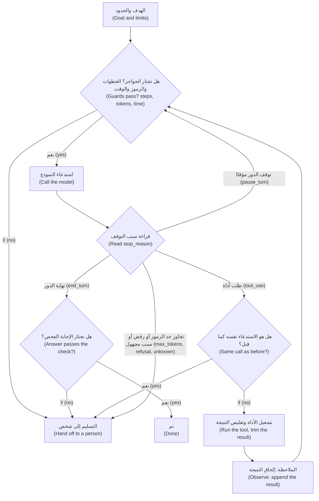

# الوحدة 8 — حلقة الوكيل بإتقان

*خطِّط ونفِّذ ولاحِظ وكرِّر: هذا كل ما يفعله الوكيل، وفي الحلقة نفسها يخطئ الوكلاء. قدّمت لك الوحدة 1 أصغر حلقة وقدّمت الوحدة 3 بروتوكول الأدوات الذي تقوم عليه. وهذه الوحدة هي الفرق بين حلقة تنجح في عرض تجريبي وحلقة تستطيع تركها تعمل في الثانية صباحًا. الدرس 8.1 هو الدرس المفاهيمي: تشريح الحلقة وفق نمط ReAct، وطرق التوقف الست، وما يُفعل مع كل `stop_reason`، والتأمل الذاتي والتخطيط — متى يُجديان ومتى يضيفان كلفة فحسب — وأخطاء الأدوات (tool errors)، وكيف ينمو السياق مع الحساب، وأنماط الإخفاق التي يصادفها المبتدئون أولًا، وقابلية المراقبة التي تحتاجها الحلقة، ومتى تستخدم مشغّل الأدوات في حزمة التطوير أو Claude Agent SDK بدلًا من حلقتك الخاصة، وقائمة فحص الحلقة الآمنة. أما الدرس 8.2 فهو المختبر: حلقة من الصفر بحدّ صارم للخطوات، وميزانية رموز، وأجل بالساعة الفعلية، وكشف انعدام التقدم (no-progress detection)، وسجل تتبّع JSONL، وأداة إعادة تشغيل، وتسليم إلى شخص حين ينطلق أحد الحواجز، واختبار يجعل كل حاجز ينطلق. يعمل المختبر دون اتصال (offline) على النسخة المحاكاة في عدّة المختبر وعلى واجهة البرمجة الحقيقية دون أي تغيير. وتحصل استعلامات التذاكر والزملاء في نجم ديسك (Najm Desk) على أول حواجزها.*

> **الطبقة (Layer):** Agents — الحلقة التي تتيح للنموذج أن يتصرف بنفسه، والحدود والفحوص وعمليات التسليم التي تُبقيه آمنًا.

---

# 8.1 — خطِّط ونفِّذ ولاحِظ وكرِّر: التأمل الذاتي وشروط التوقف وأولى أنماط الإخفاق
*المستوى (Level): 🟡 متوسط (Intermediate)* · *المتطلبات (Prerequisites): 1.2، 3.2* · *الطبقة: Agents*

## ⚡ الدرس في دقيقة (In 60 seconds)
- **حلقة الوكيل (agent loop)** تسأل النموذج، وتقرأ `stop_reason`، وتنفّذ الأداة التي طلبها، وتعيد النتيجة، ثم تكرر (asks the model, reads stop_reason, runs the tool it asked for, returns the result and repeats; ReAct, Yao et al., 2022). النموذج يقترح؛ و**شيفرتك أنت تقرر متى تتوقف (your code decides when to stop).**
- **ستة مخارج (Six exits):** نجاح متحقَّق منه (verified success)، وحدّ الخطوات (step cap)، وميزانية الرموز (token budget)، وأجل الساعة الفعلية (deadline)، وكشف انعدام التقدم، وتسليم إلى شخص. وكل حاجز ينتهي بتسليم لا بانهيار.
- عالِج **كل `stop_reason`**؛ وتوقف عند القيم المجهولة؛ ولا تنفّذ أي أداة من دور مقطوع أو مرفوض.
- تنمو كلفة الإدخال (Input cost) مع **مربّع عدد الخطوات (the square of the steps)**. قلّص نتائج الأدوات.
- **التأمل الذاتي (Reflection)** لا يُجدي إلا بمعلومة جديدة (new information)؛ و**التخطيط أولًا (planning first)** يُجدي حين تكون الخطوات متوقعة.
- إشارة القرار (Decision cue): خطوات ثابتة (fixed steps) فسير عمل — الدرس 5.1؛ ومسار تحدده نتائج الأدوات فحلقة محدودة.

## 🧭 لماذا يهم
في الأسبوع الخامس من التجربة التشغيلية لنجم ديسك ترتّب مها، قائدة فريق هندسة الموثوقية، محادثات الأسبوع الماضي بحسب الكلفة، وهذا افتراضي (hypothetical). إحداها خارج المألوف تمامًا: 50 استدعاءً للنموذج (50 model calls)، وقرابة مليون رمز إدخال، أي نحو 75 ضعف المحادثة العادية (roughly 75 times a normal one). وكانت إجابتها صحيحة: «التذكرة 4471 قيد المعالجة.» ⁦(Ticket 4471 is in progress.)⁩ لم يشتكِ أحد، فلم ينظر أحد. وحلقة لجين لم تسجّل إلا النص النهائي، فالسبب تخمين: كان TicketHub بطيئًا وظل النموذج يطلب التذكرة نفسها. وكان حدّ الخطوات عندها 50 «للاحتياط». وقد صمد الحدّ، وكان أغلى رقم في الملف.

يقول فهد: «حدّ الخمسين أمنية وُضع عليها رقم.» ⁦(A cap of 50 is a hope with a number on it.)⁩ قبل أن تُطلَق أي حلقة تجيب على الورق عن أربعة أسئلة: كم من الوقت يجوز أن تعمل، وكم يجوز أن تنفق، وهل تتجه إلى مكان ما، ومن يتسلّم الأمر حين تتوقف؟ يقدّم هذا الدرس الحساب، ويبني الدرس 8.2 الحلقة.

## 📐 كيف يعمل

### 🟢 الأساسيات

**الحلقة (The loop).** تستدعي *حلقة الوكيل* النموذج مرة بعد مرة، وفي كل مرة تُرفق نتائج الطلب الذي صدر في الاستدعاء السابق، إلى أن يتحقق شرط التوقف. وقد سمّى Yao وزملاؤه (Yao et al., 2022) هذا النمط *ReAct*: يتناوب النموذج بين التفكير والفعل عبر الأدوات، ويقرأ *الملاحظة (observation)* التي ينتجها كل فعل. الدورة الواحدة (One lap) هي **التخطيط (plan)** — أي تقرير الإجراء التالي، و**الفعل (act)** — يُصدر النموذج `tool_use` وتنفّذه شيفرتك، و**الملاحظة (observe)** — يعود `tool_result`، و**التكرار (repeat)**. وتُسمّى الدورة *خطوة (step)*، وتسلسل الخطوات *مسار التنفيذ (trajectory)*، والشيفرة المحيطة بالنموذج *إطار التشغيل (harness)*.



**تُنفَّذ الحواجز قبل كل استدعاء (Guards run before each call)**، لأن الاستدعاء الخاطئ يكون ثمنه قد دُفع بالفعل، و**كل مسار عدا «تم» ينتهي عند تسليم إلى شخص (every path except "Done" ends at a hand-off)**.

**ست طرق للتوقف (Six ways to stop).** الحلقة التي لا تملك سوى الأولى فاتورة بلا سقف.

| الشرط (Condition) | السؤال (Question) | كيف تحدد حجمه |
|---|---|---|
| **النجاح (Success)** | هل تحقق الهدف؟ ⁦⁩ | `end_turn` **و** فحص في الشيفرة: معرّفات التذاكر الواردة في الهدف تظهر في الإجابة؛ ويجتاز JSON التحقق |
| **حدّ الخطوات (Step cap)** | كم استدعاءً للنموذج؟ ⁦⁩ | قاعدة عملية: من 1.5 إلى 2 ضعف عدد الخطوات عند المئين 95 (the 95th-percentile step count) في تشغيلات التقييم الناجحة |
| **ميزانية الرموز (Token budget)** | كم يجوز أن ينفق التشغيل الواحد؟ ⁦⁩ | الحساب أدناه؛ ويُفحص قبل كل استدعاء (checked before each call) |
| **أجل الساعة الفعلية (Wall-clock deadline)** | كم سينتظر الشخص؟ ⁦⁩ | وعد الواجهة، مضافًا إليه مهلة على كل استدعاء وكل أداة |
| **كشف انعدام التقدم (No-progress detection)** | هل تتجه إلى مكان ما؟ ⁦⁩ | الأداة نفسها بالمدخل نفسه مرتين؛ والخطأ نفسه مرتين |
| **التسليم (Hand-off)** | من يتسلّم الأمر؟ ⁦⁩ | طابور مسمّى وحزمة: الهدف وسبب التوقف وما جُرِّب |

الحدّ الذي لا ينطلق أبدًا لم يُختبر؛ والذي ينطلق في كثير من التشغيلات العادية حجمه خاطئ.

**كل `stop_reason`.** يمكن أن ينتهي الدور بخمس طرق:

| `stop_reason` | ما تفعله الحلقة |
|---|---|
| `end_turn` | اقرأ كتلة النص وشغّل الفحص. **النص الفارغ استسلام صامت: إخفاق (Empty text is a silent give-up: a failure).** |
| `tool_use` | نفّذ **كل** كتلة `tool_use`؛ وأجب في رسالة مستخدم **واحدة** |
| `max_tokens` | الرد مقطوع (Cut off). **لا تنفّذ** آخر استدعاء أداة: فقد يكون مدخله نصف مكتوب. ارفع الحدّ أو سلّم إلى شخص |
| `refusal` | رفض مصنِّف أمان أو النموذج نفسه الإجابة. لا تعد إرساله دون تغيير؛ سجّل `stop_details` (`category` و`explanation`)؛ وقد يكون null؛ ولا تنفّذ أي أداة وسلّم إلى شخص |
| `pause_turn` | توقف دور أداة على الخادم مؤقتًا، كالبحث في الويب مثلًا. أعد إرسال المحادثة والدور الموقوف في آخرها؛ ويُحتسب خطوة |
| أي قيمة أخرى (anything else) | توقف وسلّم إلى شخص. ويسرد نوع حزمة التطوير أيضًا `stop_sequence` — فقط إن ضبطتَ تسلسلات توقف — و`model_context_window_exceeded` — السياق ممتلئ، فاضغطه أو سلّم |

### 🟡 التعمق أكثر (Going deeper)

**ينمو السياق وتنمو الكلفة أسرع (Context grows, and cost grows faster).** يعيد كل استدعاء إرسال موجّه النظام وتعريفات الأدوات وكل دور سابق — الدرس 1.1. لنأخذ أحجامًا خيالية (fictional sizes): *S* = 1,500 رمز لموجّه النظام والأدوات، و*g* = 100 للهدف، و*o* = 150 رمز إخراج في الخطوة، و*r* = عدد الرموز في كل نتيجة أداة. يقرأ الاستدعاء *n* ما مقداره *S* + *g* + (*n* − 1)(*o* + *r*)، فتقرأ *N* خطوة *N*(*S* + *g*) +·*N*(*N* − 1)/2.

| الخطوات *N* (Steps) | رموز الإدخال (Input tokens) عند *r* = 600 — مقلَّصة (trimmed) | رموز الإدخال عند *r* = 6,000 — خام (raw) |
|---|---|---|
| 4 | 10,900 | 43,300 |
| 10 | 49,750 | 292,750 |
| 20 | 174,500 | 1,200,500 |
| 50 | 998,750 | 7,613,750 |

تحقق من *N* = 10 و*r* = 600: 10 × 1,600 + 750 × 45 = 49,750. وبأسعار لعبة كما في الدرس 1.1 (lesson 1.1's toy prices) — دولار واحد لكل مليون رمز إدخال و5 دولارات لكل مليون رمز إخراج ($1 per million input tokens, $5 per million output)؛ وليست سعر أي نموذج — يساوي ذلك 0.057 دولار، مقابل 0.300 دولار مع النتائج الخام (raw results): أي 5.2 أضعاف لعشر الخطوات نفسها. ومضاعفة الخطوات من 10 إلى 20 تضرب الإدخال في 3.5 (Doubling the steps from 10 to 20 multiplies the input by 3.5)، ويكلّف التشغيل ذو الخمسين خطوة (a 50-step run) 1.04 دولار مقابل 0.014 دولار للتشغيل العادي ذي الأربع خطوات (a normal 4-step one)، أي نحو 75 ضعفًا. وتلك كانت محادثة مها.

**النتائج الكبيرة (Big results).** قلّص النتيجة *قبل* أن تدخل السجل: اقتطعها وقل ذلك صراحة مثل `[cut: 4,812 characters in all]`، أو أعِد حقولًا لا سجلات كاملة، أو لخِّصها بنموذج رخيص — وهو استدعاء مدفوع قد يُسقط التفصيل الأهم — أو أعِد معرّفًا للصفحة الثانية. ثم اترك السجل بحاله: ففي النماذج الحالية قد يُبطل تعديل الأدوار السابقة كتل التفكير فيها — خطأ 400 حيث يُفرض ذلك (a 400 where enforced) — ويُعيد بدء التخزين المؤقت للموجّه؛ ولمسح النتائج القديمة استخدم الإصدارات التجريبية على الخادم: تحرير السياق (context editing) والضغط (compaction). ويخفّض التخزين المؤقت (Caching) — الدرس 14.2 — سعر البادئة المُعاد إرسالها لا السياق ولا الخطوات.

**التأمل الذاتي والتصحيح الذاتي (Reflection and self-correction)** ثلاثة أمور مختلفة. (1) *تصحيح استدعاء أداة* انطلاقًا من `is_error`: رخيص، لذا ينبغي أن تقول الأخطاء ما هو الصالح — الدرس 3.1. (2) *فحص الإجابة بشيء خارج النموذج*: مخطط أو بحث عن استشهاد أو اختبار. (3) *أن تطلب من النموذج أن يفكر مرة أخرى دون أي جديد.* وقد استكشفت Self-Refine (Madaan et al., 2023) وReflexion (Shinn et al., 2023) النقد ثم المراجعة (critique-and-revise)؛ أما التصحيح الذاتي للاستدلال دون عون خارجي فلم يُجدِ بصورة موثوقة في دراسة لاحقة (Huang et al., 2023). **لا يستحق التأمل الذاتي كلفته إلا حين يأتي بمعلومة جديدة (Reflection is worth its cost only when it brings new information).** ضع له سقف جولة واحدة وقِسه — الدرس 12.1.

**التخطيط (Planning).** *التخطيط المتداخل (Interleaved)* — أي ReAct — يقرر كل خطوة بعد آخر ملاحظة: يتكيّف، لكن المسار والكلفة يتفاوتان. أما *التخطيط ثم التنفيذ (Plan-then-execute)* فيكتب الخطوات أولًا وينفّذها بالترتيب ولا يعيد التخطيط إلا عند الإخفاق، مع سقف لإعادات التخطيط: فالكلفة متوقعة ويستطيع شخص اعتماد الخطة أولًا، لكنه هشّ حين يختلف الواقع عن الخطة. «أعد ضبط وصولي إلى VPN» له شكل ثابت: سير عمل — الدرس 5.1. و«لماذا ينقطع VPN عندي باستمرار؟» ⁦⁩ يتوقف على ما تعيده الأدوات: حلقة متداخلة بسقف. و«جهّز تسليم الأحد» يناسبه التخطيط ثم التنفيذ، فتقرأ يارا الخطة أولًا. ويخطط التفكير التكيفي (Adaptive thinking) داخل الاستدعاء أصلًا؛ فأضف استدعاء تخطيط فقط ليقرأه شخص.

**أخطاء الأدوات والتعافي منها (Tool errors and recovery).**

| الخطأ (Error) | من يتعافى | كيف |
|---|---|---|
| مدخل غير صالح من النموذج | النموذج | `is_error` يسمّي الصالح — ضعيف (weak): `Error`؛ وقوي (strong): `ticket_id must be four digits, like "4471"; you sent "ticket 4471"`؛ وحاجز انعدام التقدم يوقف التكرار |
| لا شيء موجود (Nothing found) | لا أحد: إنها بيانات | `No ticket 9999 found` نتيجة عادية |
| عابر: انتهاء مهلة أو 503 (Transient: timeout, 503) | **شيفرتك (Your code)** | أعِد المحاولة بتراجع أسي (backoff) — أي انتظار متزايد (growing waits) — وبعشوائية (jitter) — أي إزاحة عشوائية — ضمن الأجل (inside the deadline)؛ ثم قل «غير متاح، لا تعد المحاولة» |
| رفض الصلاحية (Permission denied) | شخص | دون إعادة محاولة؛ وسلّم إلى شخص |
| فشل كتابة | شيفرتك | لا تكرار بلا مفتاح عدم التأثر بالتكرار |

لا ينبغي أن يكون النموذج آلية إعادة المحاولة عندك: فكل إعادة محاولة استدعاء كامل. وبعد *k* إخفاقات متتالية يوقف **قاطع الدائرة (circuit breaker)** استدعاء تلك الأداة، ويتدهور التشغيل أو يسلّم إلى شخص — الدرس 7.1.

### 🔴 نظرة الخبير (Expert view)

**أولى أنماط الإخفاق (The first failure modes).** يظهر كل منها في سجل التتبّع ويوقفه حاجز.

| الإخفاق (Failure) | ما يظهره التتبّع | الحاجز أو الإصلاح |
|---|---|---|
| **حلقة لا نهائية (Infinite loop)** | الخطوات تتصاعد حتى السقف؛ والمدخلات تكبر | حدّ الخطوات وميزانية الرموز والأجل |
| **إغراق الأدوات بالاستدعاءات (Tool spam)** | أداة واحدة تُستدعى عشرين مرة | سقف لاستدعاءات الأدوات؛ وأداة قائمة |
| **استسلام صامت (Silent give-up)** | `end_turn` ونص فارغ؛ والواجهة تقول «تم» | النص الفارغ يفشل؛ وسلّم إلى شخص |
| **وسائط أدوات مختلَقة (Hallucinated tool arguments)** | `is_error` ومعرّفات أو أسماء أدوات مخترعة | تحقق في الشيفرة — `strict: true` يضبط الشكل لا المعرّف |
| **إنهاء مبكر (Premature finish)** | `end_turn` بعد استعلام واحد من ثلاثة | فحص في الشيفرة يتأكد من تغطية كل جزء |
| **الإفراط في الفعل (Over-action)** | كتابة لم يطلبها أحد | لا أداة لها؛ وموافقة على الكتابات — الوحدة 13. وكما أُفيد في يوليو 2025، حذف وكيل برمجة قاعدة بيانات إنتاج |
| **تجاهل `is_error` (Ignoring is_error)** | الاستدعاء الفاشل نفسه مرة أخرى | حاجز انعدام التقدم |

**قابلية المراقبة التي تحتاجها الحلقة (Observability the loop needs).** لكل خطوة (Per step): رقم الخطوة، و`stop_reason`، ورموز الإدخال والإخراج والمخزَّنة مؤقتًا، وزمن الاستجابة (latency)، ومعرّف الطلب (request id) وهو `resp._request_id`، واسم الأداة ومدخلها، وحجم النتيجة (result size)، و`is_error`، والحاجز الذي انطلق. سجّل استدعاء الأداة *قبل* تنفيذه كي يترك أي تجمّد أثرًا. ولكل تشغيل (Per run): معرّف التشغيل (run id)، والهدف بعد إخفاء البيانات (masked goal)، والخطوات والرموز والزمن الفعلي، والسبب النهائي (final reason). راقب **الذيل (the tail)** — الخطوات عند المئين 95 (95th-percentile steps) وخليط أسباب التوقف (stop-reason mix) ومعدل انطلاق الحواجز (guard-fire rate) والرموز لكل محادثة محلولة — ونبّه على المعدلات لا على تشغيل منفرد. قد تحمل النتائج بيانات شخصية (personal data): سجّل الأحجام (log sizes)، أو أخفِ البيانات قبل الاقتطاع — الوحدة 13؛ وتحدد سارة مدة الاحتفاظ (retention). ويمكن أن تُصدر حزمة التطوير امتدادات OpenTelemetry (spans) — إصدار تجريبي (beta)، وما تزال اصطلاحات GenAI تتطور. وكل تشغيل فاشل حالة تقييم مستقبلية — الوحدة 12.

**حلقتك الخاصة أم مشغّل الأدوات أم حزمة تطوير؟ ⁦(Your own loop, the tool runner, or an SDK?)⁩**
- **حلقتك الخاصة (Your own loop)** (الدرس 8.2): كل حاجز في شيفرة بسيطة تستطيع اختبارها سطرًا سطرًا، دون اعتماد على إصدار تجريبي؛ وهي نحو مئة سطر تتولى صيانتها.
- **مشغّل الأدوات التجريبي (The beta tool runner)** (`client.beta.messages.tool_runner` و`@beta_tool`): المسار الذي توصي به حزمة التطوير لوكلاء الأدوات المخصصة (custom-tool agents). يُنتج كل رسالة قبل تنفيذ أدواتها، فتستطيع أن تسجّل وأن تقيّد الآثار الجانبية داخل دالة الأداة وأن تحدّ الحلقة بـ `max_iterations` — تحقق من حزمة التطوير الحالية. ويستأنف مشغّل Python في الإصدار 1.15 الدور `pause_turn` بنفسه؛ أما إصدارات 0.x فكانت تنهي التشغيل بصمت. وتبقى الميزانية والمهلة وانعدام التقدم والتسليم على عاتقك.
- **Claude Agent SDK:** إطار تشغيل Claude Code على هيئة مكتبة، وهي حزمة منفصلة عن `anthropic`، فيها أدوات ملفات وصدفة وصلاحيات (permissions) وخطافات (hooks) ووكلاء فرعيون (subagents)؛ وتناسب الوكلاء الذين يعدّلون الملفات وينفّذون الشيفرة في صندوق رملي.
- **Managed Agents** (تجريبي): تستضيف Anthropic الحلقة والصندوق الرملي. تحقق من التوفر وإقامة البيانات. وأيًّا اخترت، تعلّم الحلقة اليدوية أولًا.

**قائمة فحص الحلقة الآمنة (The safe-loop checklist).**
1. حدّ للخطوات وميزانية رموز تُفحص قبل كل استدعاء وأجل للتشغيل، بأحجام مستمدة من تشغيلات مقيسة؛ ومهلة على كل استدعاء وأداة.
2. كشف انعدام التقدم: الاستدعاء نفسه والخطأ نفسه.
3. معالجة كل `stop_reason`؛ ولا أدوات من دور مقطوع أو مرفوض.
4. التحقق من النجاح في الشيفرة؛ والإجابة الفارغة تفشل.
5. قصّ النتائج قبل دخولها سجلًّا يقبل الإلحاق فقط؛ والأدوات لا ترفع استثناءات أبدًا؛ وإعادات المحاولة العابرة في الشيفرة؛ والكتابات مقيَّدة ببوابة (writes gated)، ولا أداة لما يجب ألا يحدث أبدًا.
6. سطر تتبّع لكل خطوة، وسطر توقف لكل تشغيل، والبيانات الشخصية مخفاة أو محذوفة.
7. كل حاجز ينتهي بتسليم إلى شخص، واختبار يجعل كلًّا منها ينطلق.

## 🧰 الأدوات
| الأداة أو الممارسة أو النمط (Tool, practice or pattern) | ما هي وماذا تفعل | متى تلجأ إليها |
|---|---|---|
| **Step cap** — حدّ الخطوات | حدّ صارم للتكرارات؛ ويقيّد أيضًا إعادات المحاولة | كل حلقة (Every loop) |
| **Token budget** — ميزانية الرموز | سقف رموز لكل تشغيل يُفحص قبل كل استدعاء | كل حلقة |
| **Wall-clock deadline** — أجل الساعة الفعلية | حدّ زمني للتشغيل مع مهلة لكل استدعاء وأداة | أي شيء ينتظره شخص |
| **No-progress detector** — كاشف انعدام التقدم | يتوقف حين يعود الاستدعاء نفسه أو الخطأ نفسه | كل حلقة فيها أدوات قراءة |
| **Human hand-off** — التسليم إلى إنسان | حزمة: الهدف والسبب وما جُرِّب إلى طابور مسمّى | كل حاجز (Every guard) |
| **Loop card** — بطاقة الحلقة | صفحة واحدة لكل حلقة: الحدود وجدول التوقف والطابور والاختبارات | قبل إطلاق الحلقة |

## 🏛️ عمليًا في بنك نجم
المُخرَج هو **بطاقة الحلقة (Loop card)** لمسار التذاكر والزملاء في نجم ديسك، تملكها لجين ويراجعها فهد. ولا تُطلَق حلقة دونها. وهي تحلّ محل حلقة لجين ذات حدّ الخمسين (cap-of-50 loop). ومتطلب هند: أن تجيب خلال 30 ثانية أو تسلّم إلى شخص (answer within 30 seconds or hand off). وكل القيم أدناه خيالية.

| الحدّ (Limit) | القيمة (Value) | السبب |
|---|---|---|
| حدّ الخطوات | 6 | التشغيلات العادية تأخذ خطوتين أو ثلاثًا (Normal runs take 2 or 3 steps)؛ وأبطأ تشغيل تقييم ناجح أخذ 4 (the slowest passing eval run took 4)؛ 1.5 × 4 = 6 |
| ميزانية الرموز | 25,000 | ست خطوات بنتائج من 600 رمز تقرأ 20,850 رمز إدخال، مع نحو 900 رمز إخراج (Six steps with 600-token results read 20,850 input tokens, plus about 900 output) |
| الأجل | 30 ثانية | وعد نافذة المحادثة؛ ولكل استدعاء مهلته أيضًا |
| التكرارات (Repeats) | 2 | يُرفض استدعاء القراءة المطابق الثاني: فهو لا يضيف شيئًا |
| حجم النتيجة | 2,000 حرف | سجل التذكرة نحو 120 (A ticket record is about 120) |

| سبب التوقف (Stop reason) | ما يقرؤه الشخص | وجهة الحزمة |
|---|---|---|
| `done` | الإجابة | لا أحد (Nobody) |
| `iteration_cap` و`token_budget` و`timeout` و`no_progress` و`failed_check` و`empty_answer` | «لم أستطع إنهاء هذا. مررته إلى مكتب الخدمة (Service Desk) مع كل ما جرّبته: المرجع 3f2a9c01» (I could not finish this. I passed it to the Service Desk with everything I tried: ref 3f2a9c01) | طابور مكتب الخدمة (Service Desk queue) |
| `refusal` و`max_tokens` و`unknown_stop` | الرسالة نفسها | طابور مكتب الخدمة؛ ويراجعه فريق نورة أسبوعيًا |
| `model_error` | رسالة الوضع المتدهور في الدرس 7.1 | طابور مكتب الخدمة |

**منصتك (Your platform).** قبل أن تُطلَق حلقة على منصتك الخاصة، املأ ما يلي:

| السؤال | إجابتك |
|---|---|
| إلى أين يذهب التسليم، ومن المناوب له؟ ⁦⁩ | |
| أين تُحفظ سجلات التتبّع، ومن يحق له قراءتها، ولكم من الوقت؟ ⁦⁩ | |
| أي مفتاح إيقاف طارئ يوقف كل الحلقات دون نشر؟ ⁦⁩ | |

## 🛠️ التمارين (Exercises)
- 🟢 **دقّق حلقة (Audit a loop).** دون اتصال. اقرأ `labs/m01/agent.py`. لكل شرط من شروط التوقف الستة اكتب موجود أو مفقود مع رقم السطر؛ ولكل `stop_reason` اكتب ما يفعله. *يكتمل عندما (Done when):* يسرد جدول الأمرين معًا، وتسمّي جملة واحدة الحاجز المفقود الذي كان سيكلّف مها أكثر من غيره.
- 🟡 **حدّد حجم الحدود (Size the limits).** دون اتصال. بالصيغة احسب رموز الإدخال لـ 3 و6 و12 خطوة مع نتائج من 300 رمز و3,000 رمز. اختر حدًّا للخطوات وميزانية؛ واكتب جدول التوقف. *يكتمل عندما:* ستة أرقام (six numbers)، وحدّان مع أسبابهما، وجدول توقف يعيد فيه سبب واحد المحاولة بدل التسليم.
- 🔴 **قِس ولا تخمّن (Measure, do not guess).** *يحتاج إلى واجهة البرمجة الحقيقية (Needs the real API)* وسقف الإنفاق من الدرس 0.2. شغّل `labs/m03/tools_agent.py` على اثني عشر هدفًا (twelve goals) — أربعة تحتاج أداة واحدة وأربعة أداتين وأربعة لا تحتاج شيئًا — بالنموذجين `claude-sonnet-5-5` و`claude-haiku-5-5` مع ضبط `TRACE_FILE`. *يكتمل عندما:* يحتوي `NOTES.md`، لكل نموذج، على الوسيط والحد الأقصى للخطوات — اثنا عشر تشغيلًا قليلة جدًا لحساب مئين — والرموز مقابل الصيغة، وحدّ مقترح للخطوات، والتاريخ ومعرّفات النماذج.

## ⚠️ أخطاء وفخاخ (Mistakes and traps)
- **حدّ الخمسين «للاحتياط» (A cap of 50 "to be safe").** خمسون خطوة تكلّف نحو 75 تشغيلًا عاديًا (Fifty steps cost about 75 normal runs). حدّد حجم الحدّ من الخطوات المقيسة.
- **اعتبار `end_turn` نجاحًا (Treating end_turn as success).** فالإجابة الفارغة أو الجزئية تنتهي بالطريقة نفسها. افحص في الشيفرة.
- **تنفيذ أدوات من دور مقطوع أو مرفوض (Running tools from a cut-off or refused turn).** فالمدخل نصف المكتوب يظل مدخلًا.
- **تسجيل الإجابة النهائية وحدها (Logging only the final answer).** تتبّع كل خطوة.

## 🧾 الخلاصة (Recap)
- خطِّط ونفِّذ ولاحِظ وكرِّر: النموذج يقترح، وشيفرتك تقرر متى تتوقف، عبر ستة مخارج تنتهي كلها بتسليم إلى شخص.
- عالِج كل `stop_reason`؛ ولا تنفّذ أداة من دور مقطوع أو مرفوض.
- ينمو الإدخال مع مربّع عدد الخطوات؛ فقلّص نتائج الأدوات.
- يحتاج التأمل الذاتي إلى معلومة جديدة؛ وتزيل حزمة التطوير شيفرة لا مسؤولية.

## ✍️ اختبر نفسك (Check yourself)

**1. يُظهر تتبّع مها أن `get_ticket_status` استُدعيت سبع مرات متتالية بالمدخل نفسه (seven times in a row with the same input). حدّ الخطوات 50 وميزانية الرموز 200,000 (Cap 50 steps, budget 200,000 tokens). أي حاجز يوقفها أبكر وأرخص؟ ⁦(Which guard stops it earliest and cheapest?)⁩**

- A. حدّ الخطوات، مخفَّضًا من 50 إلى 40 خطوة (lowered from 50 to 40 steps)
- B. أجل الساعة الفعلية البالغ 30 ثانية لكل تشغيل (of 30 seconds per run)
- C. فحص انعدام التقدم على الاستدعاءات المتطابقة
- D. ميزانية الرموز البالغة 200,000 رمز لكل تشغيل (of 200,000 tokens per run)

<details><summary>الإجابة</summary>

**C.** يدل الاستدعاء المطابق الثاني على أنه لن يأتي جديد، فيتوقف التشغيل عند الخطوة 2. أما الحواجز الأخرى فتنطلق بعد إنفاق المال. 🟢 ست طرق للتوقف.

</details>

**2. يحمل رد `stop_reason: "max_tokens"` وينتهي بكتلة `tool_use` يتوقف مدخلها في منتصف قيمة (whose input stops mid-value). ماذا ينبغي أن تفعل الحلقة؟ ⁦(What should the loop do?)⁩**

- A. توقف دون تنفيذها؛ وارفع الحدّ أو سلّم إلى شخص
- B. نفّذ الأداة بالمدخل الجزئي على أي حال وانظر ماذا يحدث فعلًا (anyway)
- C. أصلح JSON في الشيفرة ثم نفّذ الأداة
- D. أعد الرد دون تغيير ليكمله النموذج

<details><summary>الإجابة</summary>

**A.** قد يُحلَّل المدخل المقطوع مع ذلك على أنه كائن جزئي صالح، فتنفيذه تصرّف على تخمين. أما إعادة إرساله فتخص `pause_turn`. 🟢 كل `stop_reason`.

</details>

**3. تعيد حلقة إرسال سجلها في كل استدعاء (re-sends its history on every call). مع نتائج من 600 رمز (600-token results)، تقرأ 10 خطوات نحو 50,000 رمز إدخال (input tokens). فكم تقرأ 20 خطوة تقريبًا؟ ⁦(About how many do 20 steps read?)⁩**

- A. نحو 100,000، لأن عدد الخطوات تضاعف
- B. نحو 175,000، لأن كل استدعاء أطول
- C. نحو 250,000، لأن الكلفة تنمو كالمكعّب
- D. نحو 50,000، لأن التخزين المؤقت يغطيه

<details><summary>الإجابة</summary>

**B.** ينمو الإدخال مع مربّع عدد الخطوات: 174,500 مقابل 49,750، أي نحو 3.5 أضعاف. ويغيّر التخزين المؤقت (Caching) السعر لا العدد. 🟡 ينمو السياق (Context grows).

</details>

**4. تضيف نجم ديسك (Najm Desk) استدعاء «راجع إجابتك» (review your answer) إلى كل تشغيل. درجة التقييم (The eval score) لم تتغير، وكلفة التشغيل (cost per run) ارتفعت بمقدار الثلث (up by a third). ماذا يقترح الدرس؟ ⁦(What does the lesson suggest?)⁩**

- A. شغّل المراجعة على نموذج أكبر في كل تشغيل
- B. شغّل المراجعة مرتين ليُلتقط مزيد من الأخطاء بالفعل
- C. أبقِها لأن فحصًا إضافيًا لا يمكن إلا أن يفيد
- D. أبقِها (Keep it) فقط حيث يستطيع فحص في الشيفرة تقديم تغذية راجعة (supply feedback)

<details><summary>الإجابة</summary>

**D.** يُجدي التأمل الذاتي (Reflection) حين يأتي بمعلومة جديدة كمخطط أو بحث أو اختبار. أما المرور الأعمى فيضيف استدعاءً كاملًا دونها. 🟡 التأمل الذاتي والتصحيح الذاتي.

</details>

**5. تريد هند وكيلًا يعدّل مجلدًا من أدلة التشغيل (a folder of runbooks) وينفّذ سكربتًا في صندوق رملي (a script in a sandbox). تبدأ لجين بكتابة أدوات ملفات وصدفة (file and shell tools) لحلقتها الخاصة. ما الذي ينبغي أن تنظر فيه أولًا؟ ⁦(What should she consider first?)⁩**

- A. مشغّل الأدوات التجريبي كي لا تكتب الحلقة
- B. حدّ خطوات أعلى كي تنتهي التعديلات
- C. Claude Agent SDK الذي يضم إطار تشغيله (whose harness) هذه الأدوات أصلًا
- D. `tool_choice` إجباري كي تستدعي كل خطوة أداة

<details><summary>الإجابة</summary>

**C.** تحزم Agent SDK إطار تشغيل Claude Code بما فيه أدوات الملفات والصدفة. أما مشغّل الأدوات فيوفر عليك الحلقة لا الأدوات؛ وأحدث النماذج ترفض `tool_choice` الإجباري. 🔴 حلقتك الخاصة أم مشغّل الأدوات أم حزمة تطوير؟ ⁦⁩

</details>

## 📚 المراجع (References)
- Anthropic، «Building effective agents»: https://www.anthropic.com/engineering/building-effective-agents
- Claude API، التعامل مع أسباب التوقف (Handling stop reasons): https://platform.claude.com/docs/en/build-with-claude/handling-stop-reasons؛ ونظرة عامة على استخدام الأدوات (Tool use overview): https://platform.claude.com/docs/en/agents-and-tools/tool-use/overview؛ والأخطاء (Errors): https://platform.claude.com/docs/en/api/errors
- Claude API، التفكير المحفوظ (Preserved thinking): https://platform.claude.com/docs/en/build-with-claude/preserved-thinking؛ وتحرير السياق: https://platform.claude.com/docs/en/build-with-claude/context-editing؛ والضغط: https://platform.claude.com/docs/en/build-with-claude/compaction؛ وOpenTelemetry: https://platform.claude.com/docs/en/manage-claude/opentelemetry
- Managed Agents: https://platform.claude.com/docs/en/managed-agents/overview؛ وحزمة Anthropic Python SDK، ومنها مشغّل الأدوات (tool runner): https://github.com/anthropics/anthropic-sdk-python؛ وClaude Agent SDK: ابدأ من (start at) https://docs.anthropic.com/
- الأوراق البحثية المذكورة أعلاه، وتُعثر عليها بالعنوان (found by title): Yao et al., "ReAct: Synergizing Reasoning and Acting in Language Models" (2022)؛ Madaan et al., "Self-Refine" (2023)؛ Shinn et al., "Reflexion" (2023)؛ Huang et al., "Large Language Models Cannot Self-Correct Reasoning Yet" (2023).
- [*اختبار البرمجيات (Software Testing)*، الدرس 7.2 — اختبار RAG واستخدام الأدوات والوكلاء](../testing/index.ar.html#/7.2)؛ [*أمن الذكاء الاصطناعي وأمن التطبيقات (Secure AI & Application Security)*، الدرس 9.2 — الوكلاء والأدوات: الصلاحيات المفرطة وأدوات أقل الصلاحيات وMCP](../secai/index.ar.html#/9.2)
- **اقرأ هذا الأسبوع (Read this week)، الوحدة 8.** Grokking AI Applications، الفصل 6: https://www.manning.com/ (ابحث بالعنوان). Gulli، *Agentic Design Patterns*، الفصل 4 والفصل 6: المسودة المجانية المذكورة في الدرس 0.1. Microsoft، *AI Agents for Beginners*، الدرسان 06-07: https://github.com/microsoft/ai-agents-for-beginners

---

# 8.2 — المختبر: حلقة وكيل من الصفر في نحو 80 سطرًا، بحدّ صارم وتسجيل كامل للتتبّع (Lab: an agent loop from scratch in about 80 lines, with a hard cap and full trace logging)
*المستوى: 🟡 متوسط* · *المتطلبات: 3.2، 8.1* · *الطبقة: Agents, Production*

## ⚡ الدرس في دقيقة (In 60 seconds)
- تبني حلقة الدرس 8.1 في ملف واحد دون أي إطار عمل، في نحو 80 سطرًا: **حدّ الخطوات (step cap)** و**ميزانية الرموز (token budget)** و**الأجل (deadline)** و**كشف انعدام التقدم (no-progress detection)** وكل `stop_reason`، والنجاح تفحصه الشيفرة.
- يكتب كل تشغيل **سجل تتبّع JSONL (JSONL trace)** — الخطوة والأداة والمدخل وحجم النتيجة والرموز وزمن الاستجابة؛ وتحكيه أداة **إعادة التشغيل (replay)** كقصة.
- ينتهي كل حاجز (guard) بـ**حزمة تسليم (hand-off packet)**: الهدف وسبب التوقف وما جُرِّب.
- توجيهات النسخة المحاكاة (Mock directives) تجعل الإخفاقات تقع عند الطلب؛ و**اختبار لكل حاجز (one test per guard)** يثبت أنه ينطلق.
- تحاكي النسخة المحاكاة الإخفاقات؛ أما النماذج الحقيقية (real models) فتخفق بطرق مختلفة (fail differently).

## 🧭 لماذا يهم
بعد محادثة الخمسين خطوة (After the 50-step conversation) تطلب مها من لجين أمرًا واحدًا: أن تُظهر ما فعله الوكيل ولماذا توقف، وهذا افتراضي. كانت الحلقة القديمة تحتفظ بالنص النهائي فقط. وبعد أسبوعين يلصق أحد الموظفين «ref 3f2a9c01» في رسالة إلى يارا. فتشغّل أداة إعادة التشغيل وتستطيع أن تقول: طلب الوكيل التذكرة 4471 مرتين، وأُوقف، ولدى مكتب الخدمة الحزمة. وهذا ما يبنيه هذا المختبر.

## 📐 كيف يعمل

### 🟢 الأساسيات

**شغّله (Run it).** ابدأ النسخة المحاكاة بسيناريو هذا المختبر. وللواجهة الحقيقية تبقى الشيفرة نفسها: أوقف النسخة المحاكاة، وألغِ ضبط `ANTHROPIC_BASE_URL` (unset)، وصدِّر مفتاحك الحقيقي — سقف الإنفاق أولًا (spending cap first)، الدرس 0.2.

```bash
cd aiapps/labkit
python -m labkit.mock_server --port 8787 --playbook playbooks/m08_lab.json &
export ANTHROPIC_BASE_URL=http://127.0.0.1:8787 ANTHROPIC_API_KEY=mock TRACE_FILE=m08_trace.jsonl
python labs/m08/agent_loop.py "Is ticket 4471 done yet? And what about 4472?"
python labs/m08/replay.py m08_trace.jsonl
pytest tests/test_m08_labs.py
```

**اقرأ تشغيلًا أولًا (Read a run first).** يجمّع `labs/m08/replay.py` (42 سطرًا، ومختبَر) أسطر JSONL بحسب معرّف التشغيل ويطبع سطرًا لكل حدث: وهو الأداة التي استخدمتها يارا. ويضع علامة على أي تشغيل بلا سطر `stop`، أي عملية ماتت. اقرأ شيفرته لاحقًا. ومخرجاته:

```text
run de885b3e: Is ticket 4471 done yet? And what about 4472?   (limits: 6 steps, 25000 tokens, 30.0 s)
  step 1  model tool_use  in=159 out=20 total=179  20 ms
          tool  get_ticket_status {"ticket_id": "4471"} -> 113 chars, ok, 0 ms
          tool  get_ticket_status {"ticket_id": "4472"} -> 72 chars, ok, 0 ms
  step 2  model end_turn  in=232 out=53 total=464  3 ms
  DONE
  2 steps, 464 tokens, 0.0 s
```

طلبت الخطوة 1 أداتين؛ وأُجيب عنهما في رسالة واحدة. وقرأت الخطوة 2 ما مقداره 232 رمز إدخال مقابل 159 (232 input tokens against 159) لأنها أعادت إرسال النتائج — وهو النمو الذي شرحه الدرس 8.1 (lesson 8.1's growth).

### 🟡 التعمق أكثر

**الحلقة جزءًا جزءًا (The loop, part by part).** تضم الأسطر من 59 إلى 133 (75 سطرًا) الدالة `run_tool` وفحص الاكتمال والدالة `run`؛ والباقي إعدادات (configuration) وتتبّع وسطر أوامر.

```python
# labs/m08/agent_loop.py
"""Lab 8.2: an agent loop from scratch: four guards, every stop_reason, a JSONL trace, a hand-off to a person.
  python labs/m08/agent_loop.py "Is ticket 4471 done yet?"     (environment: MAX_STEPS, TOKEN_BUDGET, TIMEOUT_S, TRACE_FILE)"""
import json
import os
import re
import sys
import time
import uuid
from collections import Counter, namedtuple
from dataclasses import asdict, dataclass
from pathlib import Path

import anthropic

sys.path.insert(0, str(Path(__file__).resolve().parents[2]))
from labkit.tools import get_ticket_status, lookup_employee      # noqa: E402  the kit's fake, read-only tools

MODEL = os.environ.get("MODEL", "claude-sonnet-5-5")
SYSTEM = "You help IT service desk staff. Use the tools for tickets and colleagues; never guess them."
TOOLS = {   # name -> (description, its one argument, function): all the model can make happen
    "get_ticket_status": ("Look up one IT ticket by number. Call this whenever asked about a ticket.", "ticket_id", get_ticket_status),
    "lookup_employee": ("Look up a colleague by first name: team and email. Call this for any question about a colleague.", "name", lookup_employee),
}
DEFINITIONS = [{"name": n, "description": d, "input_schema": {"type": "object", "properties": {k: {"type": "string"}}, "required": [k]}}
               for n, (d, k, _) in TOOLS.items()]


@dataclass(frozen=True)
class Limits:                                                   # every number is a decision
    max_steps: int = int(os.environ.get("MAX_STEPS", 6))        # guard 1: model calls
    token_budget: int = int(os.environ.get("TOKEN_BUDGET", 25_000))     # guard 2: input + output tokens, all calls
    timeout_s: float = float(os.environ.get("TIMEOUT_S", 30))   # guard 3: wall clock for the whole run
    max_repeats: int = 2                                        # guard 4: the same tool call this often = no progress
    result_chars: int = 2_000                                   # most a tool result may add to the context


Result = namedtuple("Result", "ok reason answer steps tokens handoff")      # handoff: what a person receives


class Trace:
    """One JSON object per line. Strings are clipped: tool output can hold personal data."""

    def __init__(self, path=None):
        self.path, self.run_id, self.events = path, uuid.uuid4().hex[:8], []

    def log(self, event, **fields):
        fields = {k: v[:300] if isinstance(v, str) else v for k, v in fields.items()}
        self.events.append({"run": self.run_id, "seq": len(self.events) + 1, "ts": round(time.time(), 3), "event": event, **fields})
        if self.path:
            with open(self.path, "a", encoding="utf-8") as f:
                f.write(json.dumps(self.events[-1], ensure_ascii=False, default=str) + "\n")


def ms(since):
    return round((time.monotonic() - since) * 1000)


def run_tool(name, args):
    """The gap: the model proposes, this function disposes. It never raises: every outcome is text."""
    if name not in TOOLS:
        return f"unknown tool {name!r}; the tools are: {', '.join(TOOLS)}", True
    _, key, fn = TOOLS[name]
    if set(args) != {key} or not isinstance(args[key], str):
        return f"{name} takes exactly one string argument named {key!r}; got {json.dumps(args)[:80]}", True
    try:
        return str(fn(args[key])), False
    except Exception as e:                                      # a raising tool must not end the run
        return f"{name} failed: {e}", True


def mentions_every_ticket(goal, answer):
    """A completion check in plain code. Returns a problem, or None."""
    missing = [t for t in re.findall(r"\b\d{4}\b", goal) if t not in answer]
    return f"the answer never mentions {', '.join(missing)}" if missing else None


def run(goal, lim=Limits(), client=None, trace=None, check=None):
    client, trace = client or anthropic.Anthropic(timeout=30.0), trace or Trace()      # the SDK retries transient errors twice
    t0, spent, last_in, seen = time.monotonic(), 0, 0, Counter()
    messages = [{"role": "user", "content": goal}]
    trace.log("start", goal=goal, model=MODEL, **asdict(lim))

    def stop(reason, step, text="", why=""):                                     # the only exit: one "stop" line per run
        ok, secs = reason == "done", round(time.monotonic() - t0, 1)
        tried = [{k: e[k] for k in ("step", "tool", "input", "result", "refused") if k in e} for e in trace.events if e["event"] == "tool"]
        packet = None if ok else {"run": trace.run_id, "reason": reason, "why": why, "goal": goal, "steps": step, "tokens": spent,
                                  "seconds": secs, "tried": tried, "last_text": text[:300]}
        trace.log("stop", step=step, reason=reason, why=why, tokens=spent, seconds=secs, answer=text, handoff=packet)
        shown = text if ok else f"I could not finish this ({reason}). I passed it to the Service Desk with everything I tried: ref {trace.run_id}."
        return Result(ok, reason, shown, step, spent, packet)

    for step in range(1, lim.max_steps + 1):                                       # guard 1: the hard cap
        if time.monotonic() - t0 > lim.timeout_s:                                   # guard 3: before every call
            return stop("timeout", step - 1, why=f"more than {lim.timeout_s} s on the clock")
        if spent + last_in > lim.token_budget:                                      # guard 2: the next call re-sends at least this much
            return stop("token_budget", step - 1, why=f"{spent} spent, and the next call needs {last_in}+ of {lim.token_budget}")
        t1 = time.monotonic()
        try:
            resp = client.messages.create(model=MODEL, max_tokens=1024, output_config={"effort": "low"},
                                          system=SYSTEM, tools=DEFINITIONS, messages=messages)
        except anthropic.APIError as e:                                             # the SDK's retries are spent: hand off
            trace.log("model_error", step=step, error=type(e).__name__, status=getattr(e, "status_code", None), ms=ms(t1))
            return stop("model_error", step - 1, why=f"{type(e).__name__} after the SDK's retries")
        last_in, spent = resp.usage.input_tokens, spent + resp.usage.input_tokens + resp.usage.output_tokens
        trace.log("model", step=step, stop_reason=resp.stop_reason, input_tokens=resp.usage.input_tokens,
                  output_tokens=resp.usage.output_tokens, total_tokens=spent, ms=ms(t1), request_id=resp._request_id)
        messages.append({"role": "assistant", "content": resp.content})            # the WHOLE content list
        text = next((b.text for b in resp.content if b.type == "text"), "")
        if resp.stop_reason == "end_turn":
            if not text.strip():
                return stop("empty_answer", step, why="end_turn with no text: a silent give-up")
            problem = check(goal, text) if check else None                          # "done" needs the code to agree
            return stop("failed_check" if problem else "done", step, text, why=problem or "")
        if resp.stop_reason == "pause_turn":                                        # paused: send it back; the cap counts it
            continue
        if resp.stop_reason != "tool_use":                                          # max_tokens, refusal, or a value never seen before
            return stop(resp.stop_reason if resp.stop_reason in ("max_tokens", "refusal") else "unknown_stop", step, text,
                        why=f"stop_reason={resp.stop_reason} {resp.stop_details or ''}".strip())
        results = []                                                                # cut-off and refused turns never get here
        for block in (b for b in resp.content if b.type == "tool_use"):
            call = (block.name, json.dumps(block.input, sort_keys=True))
            seen[call] += 1
            if seen[call] >= lim.max_repeats:                                       # guard 4: the same call again is no progress
                trace.log("tool", step=step, tool=block.name, input=block.input, refused="same call again")
                return stop("no_progress", step, text, why=f"{block.name} asked for again with the same input")
            t2 = time.monotonic()
            out, is_error = run_tool(block.name, block.input)
            trace.log("tool", step=step, tool=block.name, input=block.input, result_chars=len(out), result=out, is_error=is_error, ms=ms(t2))
            shown = out if len(out) <= lim.result_chars else out[:lim.result_chars] + f" [cut: {len(out)} characters in all]"
            results.append({"type": "tool_result", "tool_use_id": block.id, "content": shown, "is_error": is_error})
        messages.append({"role": "user", "content": results})                      # ONE message, a result for EVERY tool_use id
    return stop("iteration_cap", lim.max_steps, why=f"{lim.max_steps} steps used and no final answer")


if __name__ == "__main__":
    res = run(" ".join(sys.argv[1:]) or "Is ticket 4471 done yet? And what about 4472?",
              trace=Trace(os.environ.get("TRACE_FILE", "m08_trace.jsonl")), check=mentions_every_ticket)
    print(res.answer)
    if res.handoff:
        print(json.dumps(res.handoff, indent=2, ensure_ascii=False))
```

1. **`run_tool`** هي الفجوة. لا ترفع استثناءً أبدًا، ولا تعرف سوى أداتي قراءة — بديلان عن TicketHub وPeopleCore — فالنموذج *لا يستطيع* إغلاق تذكرة.
2. **`stop`** هي المخرج الوحيد؛ والتشغيل الفاشل يبني حزمة التسليم من التتبّع.
3. **تُنفَّذ الحواجز قبل الاستدعاء (Guards run before the call)**: الحدّ الأقصى هو حلقة `for` نفسها، ثم الأجل، ثم ميزانية الرموز، مع اعتبار مدخل الاستدعاء الأخير حدًّا أدنى لأن السجل لا يفعل سوى أن ينمو. ويُفحص الأجل *بين* الخطوات (between steps)، فقد يتجاوزه استدعاء بطيء واحد. و`timeout=30.0` الخاص بالعميل يحدّ محاولة واحدة، وتعيد حزمة التطوير المحاولة مرتين افتراضيًا عند انتهاء المهلة، فقد تستغرق الخطوة نحو ثلاثة أمثال ذلك؛ ولتشديده مرّر عميلك الخاص: `run(goal, client=anthropic.Anthropic(timeout=10.0, max_retries=1))`.
4. **لكل `stop_reason` فرع (Every stop_reason has a branch).** غياب النص هو `empty_answer`؛ وفشل فحص الشيفرة هو `failed_check`؛ و`pause_turn` يكرر الحلقة (loops again)؛ أما `max_tokens` و`refusal` والقيم المجهولة (unknown values) فتتوقف *قبل* أن تعمل أي أداة.
5. **كشف انعدام التقدم (No-progress)** يعدّ الأزواج المتطابقة من (الأداة، المدخل) ويرفض الثاني *قبل* تنفيذه. وتُقتطع النتائج الطويلة قبل دخولها السياق؛ ويحتفظ التتبّع بالحجم الحقيقي. ويُكتب سطر الأداة بعد عودتها؛ فإن كانت الأدوات قد تتجمّد فسجّل سطرًا قبل الاستدعاء.

### 🔴 نظرة الخبير

**اجعله يفشل عند الطلب (Make it fail, on demand).** يبرمج السيناريو حركات النموذج للأهداف الخاصة بـ Noura و`close` و`handover` و`4479` و`4480`؛ أما التوجيهات فلا تحتاج سكربتًا. ثم عُدّ أسباب التوقف — ويحتوي الملف أيضًا على التشغيل الأول أعلاه:

```bash
for g in "Check ticket 4474, then find the colleague Noura so I can forward it." "Please close ticket 4472." \
         "Are tickets 4471 and 4473 resolved? [mock:loop]" "Is ticket 4471 done yet? [mock:giveup]" \
         "Summarise tickets 4477 and 4478 for the shift handover." "What is the status of ticket 4479?" \
         "What is the status of ticket 4480?" "Is ticket 4471 done yet? [mock:overloaded]"; do
  python labs/m08/agent_loop.py "$g" > /dev/null
done
TIMEOUT_S=2 python labs/m08/agent_loop.py "Is ticket 4471 done yet? [mock:slow]" > /dev/null
MAX_STEPS=1 python labs/m08/agent_loop.py "Is ticket 4471 done yet?" > /dev/null
TOKEN_BUDGET=300 python labs/m08/agent_loop.py "Is ticket 4471 done yet?" > /dev/null
python -c "import json, collections; print(collections.Counter(e['reason'] for e in map(json.loads, open('m08_trace.jsonl')) if e['event'] == 'stop'))"
```

```text
Counter({'done': 4, 'no_progress': 2, 'empty_answer': 1, 'failed_check': 1, 'model_error': 1, 'timeout': 1, 'iteration_cap': 1, 'token_budget': 1})
```

| الهدف أو الإعداد | ما يحاكيه (Simulates) | يتوقف بوصفه (Stops as) |
|---|---|---|
| الهدف الأول؛ وسلسلة Noura | تشغيلات عادية (Normal runs) | `done` |
| `close ticket 4472` | **الإفراط في الفعل (Over-action)**: لا أداة كهذه | `done` مع `is_error` واحد |
| `[mock:loop]` | نموذج عالق | `no_progress` |
| `[mock:giveup]` | **استسلام صامت (Silent give-up)** | `empty_answer` |
| `shift handover` | **إنهاء مبكر (Premature finish)**: تذكرة واحدة من اثنتين | `failed_check` |
| `4479` | **وسيط مختلَق (Hallucinated argument)** ثم إصلاح | `done` مع `is_error` واحد |
| `4480` | **تجاهل `is_error` (Ignoring is_error)** | `no_progress` |
| `[mock:overloaded]` | خطأ 5xx (529) في كل مرة (every time) | `model_error` |
| `TIMEOUT_S=2` و`[mock:slow]` | استدعاء مدته 3 ثوانٍ (A 3-second call) | `timeout` |
| `MAX_STEPS=1`؛ `TOKEN_BUDGET=300` | حدود منخفضة جدًا | `iteration_cap`؛ `token_budget` |

ابدأ النسخة المحاكاة بـ `MOCK_FAIL_EVERY=3` بدلًا من ذلك فيفشل كل طلب ثالث: تخفي إعادات المحاولة في حزمة التطوير ذلك ولا يكشفه إلا زمن الاستجابة. وهذه حزمة التسليم الخاصة بتشغيل `[mock:loop]`، مقتطعة بعد `tried`:

```bash
python labs/m08/agent_loop.py "Are tickets 4471 and 4473 resolved? [mock:loop]" | head -10
```

```text
I could not finish this (no_progress). I passed it to the Service Desk with everything I tried: ref 8e654913.
{
  "run": "8e654913",
  "reason": "no_progress",
  "why": "get_ticket_status asked for again with the same input",
  "goal": "Are tickets 4471 and 4473 resolved? [mock:loop]",
  "steps": 2,
  "tokens": 383,
  "seconds": 0.0,
  "tried": [
```

يسرد `tried` كل استدعاء ومدخله ونتيجته والتكرار المرفوض. ويخزّن سطر `stop` الحزمة أيضًا.

التشغيل نفسه كما تقرؤه يارا، من `replay.py`، دون أي استدعاء للنموذج لإنتاجه:

```text
run 8e654913: Are tickets 4471 and 4473 resolved? [mock:loop]   (limits: 6 steps, 25000 tokens, 30.0 s)
  step 1  model tool_use  in=159 out=10 total=169  23 ms
          tool  get_ticket_status {"ticket_id": "4471"} -> 113 chars, ok, 0 ms
  step 2  model tool_use  in=204 out=10 total=383  4 ms
          tool  get_ticket_status {"ticket_id": "4471"} -> REFUSED (same call again)
  STOPPED by no_progress: get_ticket_status asked for again with the same input -> handed to a person
  2 steps, 383 tokens, 0.0 s
```

اقرأه من الأعلى إلى الأسفل: طلب النموذج 4471، وحصل على الجواب، وطلبه ثانيةً، فرفض الحاجز التكرار قبل أن تعمل الأداة (the model asked for 4471, got the answer, asked again, and the guard refused the repeat before the tool ran).

**اختبار لكل حاجز (One test per guard).** يجعل `tests/test_m08_labs.py` كل حاجز ينطلق أمام النسخة المحاكاة، مع عميل مزيّف لما لا تستطيع النسخة المحاكاة إنتاجه: `refusal` و`pause_turn` و`stop_reason` غير معروف.

**تحفظات صادقة (Honest caveats).** *يعمل دون اتصال (Works offline):* كل حاجز، والتتبّع، وإعادة التشغيل، والحزمة، والاختبارات. *يحتاج إلى واجهة البرمجة الحقيقية:* هل يكرر النموذج الاستدعاء حرفيًا — فقد يغيّر النموذج الحقيقي المدخل، وهو ما يفوّته حاجز المطابقة التامة — وهل يتعافى من `is_error`، وهل تجتاز إجابته فحصك، وزمن الاستجابة والرموز الحقيقيان — فأعداد النسخة المحاكاة تقديرية. التوجيهات (Directives) *تحاكي* الإخفاقات، والسيناريو *يبرمج* حالات التعافي (scripts recoveries): فالأخضر دون اتصال يثبت شيفرتك وحدها. وفخ آخر في الواجهة الحقيقية: حين يكون التخزين المؤقت للموجّه (prompt caching) مفعّلًا، يعدّ `usage.input_tokens` الذيل غير المخزَّن مؤقتًا فقط، فأضف حقلي التخزين المؤقت إلى الميزانية.

## 🧰 الأدوات
| الأداة أو الممارسة أو النمط | ما هي وماذا تفعل | متى تلجأ إليها |
|---|---|---|
| **Tool trace** — سجل تتبّع الأدوات | سجل JSONL لاستدعاءات النموذج والأدوات، وسطر توقف واحد لكل تشغيل؛ وتحكيه إعادة التشغيل كقصة | كل تشغيل وكل حادثة |
| **Hand-off packet** — حزمة التسليم | الهدف والسبب وما جُرِّب ومعرّف التشغيل إلى طابور مسمّى | كل حاجز ينطلق |
| **Guard test** — اختبار الحاجز | حقن الأخطاء (Error injection) — توجيهات وسيناريوهات وعملاء مزيّفون — يجعل الحاجز ينطلق، ويثبت ذلك بإزالة الحاجز | كل حلقة |

## 🏛️ عمليًا في بنك نجم
**المُسلَّم الأسبوعي (Weekly deliverable).** أودِع المجلد `week-08/` ومعه `labs/m08/` واختبارات ناجحة (passing tests)؛ وأعداد الأسباب وحزمة لكل إخفاق من الإخفاقات أعلاه؛ وبطاقة الحلقة من الدرس 8.1؛ و`NOTES.md` وفيه إجاباتك عن الاختبار وملاحظات «اقرأ هذا الأسبوع».

**جلسة المجموعة (Group session) — 60 دقيقة.** (1) تبادلوا سجل تتبّع؛ ويشرح زميلك التشغيل باستخدام `replay.py` وحده (15). (2) «اهزم الحاجز»: جِد هدفًا يفوّته كشف انعدام التقدم (15). (3) قارنوا نتائج الواجهة الحقيقية (15). (4) اتفقوا على حزمة واحدة (15).

**ابنه باستخدام Claude Code (Build it with Claude Code).** أعطِ هذه المواصفة إلى Claude Code في وضع التخطيط — راجع وثائق Claude Code الحالية — وراجع الخطة قبل أن يعدّل أي شيء:

```text
Goal: refactor labs/m08/agent_loop.py into a small package, labs/m08/agentkit/, with Limits, Trace,
run_tool and run in separate modules; agent_loop.py stays the command line and re-exports every
name the tests use.
Context: Python 3.11, anthropic>=1,<2, the mock in aiapps/labkit (read its README), labs/m08/*.py and
tests/test_m08_labs.py.
Constraints:
- Behaviour must not change: guards, stop reasons, trace fields, the hand-off packet.
- Guards run BEFORE the model call. Only anthropic.APIError is caught around it.
- ONE user message with a tool_result for EVERY tool_use id. No tools run from max_tokens, refusal
  or unknown stops. No temperature, prefill, forced tool_choice, new dependencies or keys.
- Do NOT edit the tests, weaken a guard or delete a branch to make anything pass.
Acceptance: pytest passes unchanged; replay.py reads traces written before and after.
Plan first; move one module at a time; run the tests after each move.
```

**تحقق قبل أن تقبله (Verify before you accept it).**
- شغّل الاختبارات (Run the tests)، ثم **أزل كل حاجز بدوره (remove each guard in turn)** — الحدّ الأقصى والأجل والميزانية وانعدام التقدم وفحص الإجابة الفارغة وكل فرع من فروع `stop_reason` — وتأكد من أن اختبارًا يفشل في كل مرة. والحاجز الذي لا يلاحظه أي اختبار ليس حاجزًا.
- اقرأ الفرق (Read the diff) بحثًا عن حاجز نُقل إلى ما بعد الاستدعاء، و`except Exception` حوله، وحقول تتبّع أُعيدت تسميتها. وأعد تشغيل مصفوفة الإخفاقات وقارن الأعداد.

## 🛠️ التمارين
- 🟢 **اجعل كل حاجز ينطلق (Make each guard fire).** دون اتصال. باستخدام الجدول، تسبّب في `done` وستة أسباب توقف مختلفة واقرأ كلًّا منها في `replay.py`. *يكتمل عندما:* يحتوي `NOTES.md` على أعداد الأسباب، ولكل سبب الأمر والسطر الذي أوقفه.
- 🟡 **سُدّ ثغرة إغراق الأدوات (Close the tool-spam hole).** دون اتصال. أضف `max_tool_calls` إلى `Limits` بقيمة افتراضية (default) هي 8؛ وتوقف بالسبب `tool_budget` عند تجاوزها. *يكتمل عندما:* يفشل اختبار بعميل مزيّف يطلب عشر تذاكر في رد واحد دون تغييرك وينجح معه.
- 🔴 **هل ينجو مع نموذج حقيقي؟ ⁦(Does it survive a real model?)⁩** *يحتاج إلى واجهة البرمجة الحقيقية* وسقف الإنفاق. شغّل عشرة أهداف (ten goals) — منها التذكرة 9999 وتذكرتان وعبارة «close ticket 4472» (include ticket 9999, two tickets, "close ticket 4472") — بالنموذجين `claude-sonnet-5-5` و`claude-haiku-5-5`. *يكتمل عندما:* يحتوي `NOTES.md`، لكل نموذج، على أسباب التوقف والخطوات والرموز الفعلية وزمن الاستجابة، وتتبّع واحد مفاجئ، والتاريخ ومعرّفات النماذج.

## ⚠️ أخطاء وفخاخ
- **فحص الحاجز بعد الاستدعاء (Checking a guard after the call).** تدفع أولًا وتتوقف ثانيًا.
- **`except Exception` حول استدعاء النموذج (around the model call).** فهي تخفي أخطاءك البرمجية. التقط `anthropic.APIError`، ونبّه على `status` بقيمة 400 أو 401 (alert on a status of 400 or 401): فذلك خطؤك أو مفتاحك لا انقطاع في الخدمة.
- **الوثوق بالتعافي دون اتصال (Trusting the offline recovery).** فالسيناريو برمج الإصلاح؛ وقد لا يجده نموذج حقيقي.
- **تسمية الاقتطاع «تنقيحًا» (Calling clipping "redaction").** الاقتطاع إلى 300 حرف ليس إخفاءً للبيانات (Cutting to 300 characters is not masking).

## 🧾 الخلاصة
- ملف واحد دون إطار عمل: حواجز قبل كل استدعاء، ومخرج واحد، وسطر توقف واحد لكل تشغيل.
- لكل `stop_reason` فرع؛ والدور المقطوع أو المرفوض لا ينفّذ أي أداة.
- يسجل التتبّع الخطوة والأداة والمدخل وحجم النتيجة والرموز وزمن الاستجابة؛ وتحكي إعادة التشغيل القصة.
- ينتهي كل حاجز بحزمة تسليم؛ وتثبت الاختبارات أن كل حاجز ينطلق.

## ✍️ اختبر نفسك

**1. الميزانية 20,000 رمز (The budget is 20,000 tokens). بعد الخطوة 3 أنفقت الحلقة 14,000، وقرأ الاستدعاء الأخير 7,000 رمز إدخال (the last call read 7,000 input tokens). ماذا يحدث في بداية الخطوة 4؟ ⁦(What happens at the start of step 4?)⁩**

- A. يُنفَّذ الاستدعاء لأن 14,000 دون 20,000 (since 14,000 is under 20,000)
- B. تتوقف الحلقة بالسبب `token_budget` دون استدعاء
- C. تقلّص الحلقة السجل ليلائم ثم تستدعي (then calls)
- D. يُنفَّذ الاستدعاء ثم يُفحص المجموع

<details><summary>الإجابة</summary>

**B.** يعيد الاستدعاء التالي إرسال 7,000 رمز على الأقل (re-sends at least 7,000 tokens)، و14,000 + 7,000 يتجاوز 20,000، فيُوقَف دون أن يُدفع ثمنه (stopped unpaid). 🟡 الحلقة جزءًا جزءًا.

</details>

**2. ينتهي تشغيل بـ `[mock:giveup]` بالقيمة `stop_reason: "end_turn"` وقائمة `content` فارغة (an empty content list). ماذا يعيد المختبر؟ ⁦(What does the lab return?)⁩**

- A. `done`، فيمرّر إجابة فارغة
- B. `failed_check`، يرفعه فحص الشيفرة
- C. `iteration_cap`، حين تنفد الخطوات
- D. `empty_answer` مع حزمة تسليم

<details><summary>الإجابة</summary>

**D.** `end_turn` بلا نص هو استسلام صامت: إخفاق مع حزمة. 🟡 الحلقة جزءًا جزءًا.

</details>

**3. مع `TIMEOUT_S=2` و`[mock:slow]` تُظهر إعادة التشغيل (the replay) استدعاءً مدته نحو 3,000 ms ثم `STOPPED by timeout`. لماذا لم يُقطع الاستدعاء عند ثانيتين؟ ⁦(Why was the call not cut off at 2 seconds?)⁩**

- A. يُفحص الأجل بين الخطوات فقط
- B. تتجاهل النسخة المحاكاة إعداد `TIMEOUT_S`
- C. رفعت حزمة التطوير المهلة لتلائم الاستدعاء
- D. يعدّ الأجل الرموز لا الثواني

<details><summary>الإجابة</summary>

**A.** تُقرأ الساعة قبل كل استدعاء؛ ولا يحدّ الاستدعاء الواحد إلا `timeout` الخاص بالعميل. 🟡 الحلقة جزءًا جزءًا.

</details>

**4. يعيد Claude Code هيكلة الحلقة (refactors the loop) وما زالت كل الاختبارات تنجح (every test still passes). أي فحص يُظهر على أفضل وجه أن الحواجز ما زالت تنطلق؟ ⁦(Which check best shows the guards still fire?)⁩**

- A. شغّل هدفًا واحدًا على المسار السعيد واقرأ الإجابة
- B. عُدّ الأسطر وتحقق من أنها نقصت
- C. أزل كل حاجز بدوره وانظر اختبارًا يفشل
- D. اقرأ أسماء الملفات الجديدة وسلاسل التوثيق (docstrings)

<details><summary>الإجابة</summary>

**C.** نجاح الاختبارات لا يثبت أن الحواجز مختبَرة؛ أما إزالة حاجز ومشاهدة اختبار يفشل فيثبت ذلك. 🏛️ تحقق قبل أن تقبله (Verify before you accept it).

</details>

**5. لا تتلقى يارا سوى «ref 3f2a9c01». ماذا ينبغي أن تحمل الحزمة (the packet) كي تواصل دون أن يبدأ المستخدم من جديد (without making the user start over) ودون بيانات شخصية أكثر مما تحتاجه الحالة (without more personal data than the case needs)؟**

- A. السبب وآخر جملة للنموذج فقط
- B. الهدف والسبب واستدعاءات الأدوات التي جُرّبت
- C. المحادثة كاملة مع كل نتيجة أداة دون اقتطاع
- D. ملخص يكتبه النموذج بعد الإخفاق

<details><summary>الإجابة</summary>

**B.** الهدف وسبب التوقف وما جُرِّب تأتي مباشرة من التتبّع. أما التفريغ الكامل فينسخ بيانات شخصية بلا فائدة؛ والملخص الذي يكتبه النموذج ادعاء جديد غير موثَّق. 🔴 اجعله يفشل عند الطلب.

</details>

## 📚 المراجع
- Claude API، التعامل مع أسباب التوقف: https://platform.claude.com/docs/en/build-with-claude/handling-stop-reasons؛ والأخطاء: https://platform.claude.com/docs/en/api/errors؛ ونظرة عامة على استخدام الأدوات: https://platform.claude.com/docs/en/agents-and-tools/tool-use/overview
- حزمة Anthropic Python SDK — إعادات المحاولة والمهل والأخطاء المنمّطة: https://github.com/anthropics/anthropic-sdk-python
- Python، `dataclasses`: https://docs.python.org/3/library/dataclasses.html؛ و`time.monotonic`: https://docs.python.org/3/library/time.html
- README عدّة المختبر (Lab kit README)، وفيه النسخة المحاكاة والتوجيهات والسيناريوهات (mock, directives, playbooks): https://github.com/Tamoura/system-design-for-vibe-coders/tree/main/aiapps/labkit
- [*اختبار البرمجيات*، الدرس 7.2 — اختبار RAG واستخدام الأدوات والوكلاء](../testing/index.ar.html#/7.2)
