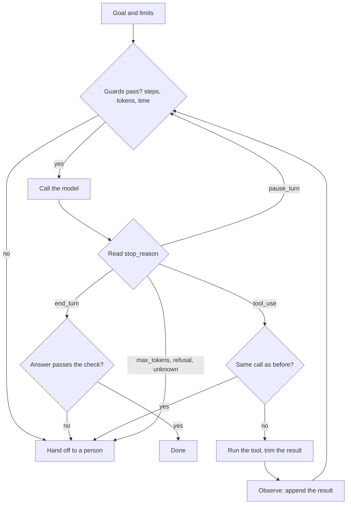

# Module 8 — The agent loop, properly

*Plan, act, observe, repeat: that is all an agent does, and the loop is also where agents go wrong. Module 1 gave you the smallest loop and Module 3 the tool protocol under it. This module is the difference between a loop that works in a demo and one you can leave running at 02:00. Lesson 8.1 is the concept lesson: the anatomy of the loop (ReAct), the six ways it should stop, what to do with every `stop_reason`, reflection and planning (when they pay and when they only add cost), tool errors, how context grows (with the arithmetic), the failure modes juniors meet first, the observability a loop needs, when to use the SDK's tool runner or the Claude Agent SDK instead of your own loop, and a safe-loop checklist. Lesson 8.2 is the lab: a loop from scratch with a hard step cap, a token budget, a wall-clock deadline, no-progress detection, a JSONL trace, a replay tool, a hand-off to a person when a guard fires, and a test that makes each guard fire. It runs offline against the lab kit's mock and, unchanged, against the real API. Najm Desk's ticket and colleague lookups get their first guards.*

> **Layer:** Agents — the loop that lets a model act on its own, and the limits, checks and hand-offs that keep it safe.

---

# 8.1 — Plan, act, observe, repeat: reflection, stopping conditions and the first failure modes
*Level: 🟡 Intermediate* · *Prerequisites: 1.2, 3.2* · *Layer: Agents*

## ⚡ In 60 seconds
- An **agent loop** asks the model, reads `stop_reason`, runs the tool it asked for, returns the result and repeats (ReAct, Yao et al., 2022). The model proposes; **your code decides when to stop.**
- **Six exits:** verified success, step cap, token budget, deadline, no-progress detection, hand-off to a person. Every guard ends in a hand-off, never a crash.
- Handle **every `stop_reason`**; stop on unknown values; run no tools from a cut-off or refused turn.
- Input cost grows with the **square of the steps**. Trim tool results.
- **Reflection** pays only with new information; **planning first** pays when steps are predictable.
- Decision cue: fixed steps, a workflow (lesson 5.1); path set by tool results, a bounded loop.

## 🧭 Why it matters
In week five of the Najm Desk pilot, Maha, the SRE lead, sorts last week's conversations by cost (hypothetical). One is off the chart: 50 model calls, about a million input tokens, roughly 75 times a normal one. Its answer was right: "Ticket 4471 is in progress." Nobody complained, so nobody looked. Lujain's loop logged only the final text, so the cause is a guess: TicketHub was slow and the model asked for the same ticket again and again. Her step cap was 50, "to be safe". It held, and it was the most expensive number in the file.

Fahad: "A cap of 50 is a hope with a number on it." Before a loop ships it answers four questions on paper: how long may it run, how much may it spend, is it going anywhere, and who takes over when it stops? This lesson gives the vocabulary and the arithmetic; lesson 8.2 builds the loop.

## 📐 How it works

### 🟢 The essentials

**The loop.** An *agent loop* calls a model again and again, each time with the results of what the last call asked for, until a stop condition is met. Yao et al. (2022) named the pattern *ReAct*: the model alternates between reasoning and acting through tools, and reads the *observation* each action produces. One lap is **plan** (decide the next action), **act** (the model emits a `tool_use`, your code runs it), **observe** (the `tool_result` goes back), **repeat**. A lap is a *step*, the sequence a *trajectory*, the code around the model the *harness*.



**Guards run before each call**, since a wrong call is already paid for, and **every path except "Done" ends at a hand-off**.

**Six ways to stop.** A loop with only the first is a bill without a ceiling.

| Condition | Question | How to size it |
|---|---|---|
| **Success** | Is the goal met? | `end_turn` **and** a check in code: the ticket ids in the goal appear in the answer; the JSON validates |
| **Step cap** | How many model calls? | About 1.5 to 2 times the 95th-percentile step count of passing eval runs |
| **Token budget** | How much may one run spend? | The arithmetic below; checked before each call |
| **Wall-clock deadline** | How long will the person wait? | The interface's promise, plus a timeout on every call and tool |
| **No-progress detection** | Is it going anywhere? | The same tool with the same input twice; the same error twice |
| **Hand-off** | Who takes over? | A named queue and a packet: goal, why it stopped, what was tried |

A limit that never fires is untested; one that fires on one run in ten is probably sized wrong.

**Every `stop_reason`.** A turn can end in five ways:

| `stop_reason` | The loop does |
|---|---|
| `end_turn` | Read the text block and run the check. **Empty text is a silent give-up: a failure.** |
| `tool_use` | Run **every** `tool_use` block; answer in **one** user message |
| `max_tokens` | Cut off. **Do not run** the last tool call: its input may be half-written. Raise the limit or hand off |
| `refusal` | A safety classifier or the model declined. Do not resend unchanged; log `stop_details` if present (`category`, `explanation`; it can be null); run no tools; hand off |
| `pause_turn` | A server-side tool turn paused (web search, say). Send the conversation back, paused turn last, to resume; it counts as a step |
| anything else | Stop and hand off. The SDK's type also lists `stop_sequence` (only if you set stop sequences) and `model_context_window_exceeded` (the context is full: compact or hand off) |

### 🟡 Going deeper

**Context grows, and cost grows faster.** Each call re-sends the system prompt, the tool definitions and every earlier turn (lesson 1.1). Take fictional sizes: *S* = 1,500 tokens of system prompt and tools, *g* = 100 for the goal, *o* = 150 output tokens a step, *r* = tokens per tool result. Call *n* reads *S* + *g* + (*n* − 1)(*o* + *r*), so *N* steps read *N*(*S* + *g*) + (*o* + *r*)·*N*(*N* − 1)/2.

| Steps *N* | Input tokens, *r* = 600 (trimmed) | Input tokens, *r* = 6,000 (raw) |
|---|---|---|
| 4 | 10,900 | 43,300 |
| 10 | 49,750 | 292,750 |
| 20 | 174,500 | 1,200,500 |
| 50 | 998,750 | 7,613,750 |

Check *N* = 10, *r* = 600: 10 × 1,600 + 750 × 45 = 49,750. At lesson 1.1's toy prices ($1 per million input tokens, $5 per million output; not any model's price) that is $0.057, against $0.300 with raw results: 5.2 times more for the same ten steps. Doubling the steps from 10 to 20 multiplies the input by 3.5, and a 50-step run costs $1.04 against $0.014 for a normal 4-step one, about 75 times. That was Maha's conversation.

**Big results.** Truncate and say so (`[cut: 4,812 characters in all]`); return fields, not records; summarise with a cheap model (a paid call that may drop the key detail); clear stale results (context editing and compaction are betas); or return an id and let the model ask for page two. Prompt caching (lesson 14.2) bills a byte-identical re-sent prefix, history included, at a lower rate once cached; the context, the steps and the latency still grow.

**Reflection and self-correction** are three different things. (1) *Correcting a tool call* from an `is_error`: cheap, and the reason errors should say what is valid (lesson 3.1). (2) *Checking the answer against something outside the model*: a schema, a citation lookup, a test. Prefer checks in code. (3) *Asking the model to think again with nothing new.* Self-Refine (Madaan et al., 2023) and Reflexion (Shinn et al., 2023) explored critique-and-revise; a later study found that unaided self-correction of reasoning did not help and could make answers worse (Huang et al., 2023). **Reflection is worth its cost only when it brings new information.** Cap it at one round and measure it (lesson 12.1).

**Planning.** *Interleaved* (ReAct) decides each step after the last observation: it adapts, but path and cost vary. *Plan-then-execute* writes the steps first, runs them in order and re-plans only on failure, with a cap on re-plans: cost is predictable and a person can approve the plan first, but it is brittle when the world differs from the plan. At Najm Desk, "reset my VPN access" has a fixed shape: a workflow (lesson 5.1). "Why does my VPN keep dropping?" depends on what tools return: an interleaved loop with a cap. "Prepare the Sunday handover" suits plan-then-execute, so Yara can read the plan first. Adaptive thinking already plans inside a call; add a planning call only for a person to read.

**Tool errors and recovery.**

| Error | Who recovers | How |
|---|---|---|
| Invalid input from the model | The model | `is_error` naming what is valid; the no-progress guard stops a repeat |
| Nothing found | Nobody: it is data | `No ticket 9999 found` is a normal result |
| Transient: timeout, 503 | **Your code** | Retry with backoff (growing waits) and jitter (a random offset) inside the deadline; then say "unavailable, do not retry" |
| Permission denied | A person | No retry; hand off |
| A write fails | Your code | No repeat without an idempotency key |

The model should not be your retry mechanism: each retry is a full call. After *k* failures in a row, a **circuit breaker** stops calling that tool and the run degrades or hands off (lesson 7.1).

### 🔴 Expert view

**The first failure modes.** Each is visible in a trace and stopped by a guard.

| Failure | What the trace shows | Guard or fix |
|---|---|---|
| **Infinite loop** | Steps climb to the cap; inputs grow | Step cap, token budget, deadline |
| **Tool spam** | One tool called twenty times | A cap on tool calls; a list tool |
| **Silent give-up** | `end_turn`, empty text; the interface says "Done" | Empty text fails; hand off |
| **Hallucinated tool arguments** | `is_error`, invented ids or tool names | Validate in code (`strict: true` fixes the shape, not the id); errors that say what is valid |
| **Premature finish** | `end_turn` after one of three lookups | A code check that every part is covered |
| **Over-action** | A write nobody asked for | No tool for it; approval for writes (Module 13). As reported in July 2025, a coding agent deleted a production database |
| **Ignoring `is_error`** | The same failing call again | The no-progress guard |

**Observability the loop needs.** Per step: step number, `stop_reason`, input, output and cached tokens, latency, request id (`resp._request_id`), tool name and input, result size, `is_error`, the guard that fired. Log the tool call *before* running it, so a hang leaves a record. Per run: run id, goal (masked, Module 13), steps, tokens, wall time, final reason. Watch the **tail**: 95th-percentile steps, stop-reason mix, guard-fire rate, tokens per resolved conversation; alert on a rise in a rate, not on single runs. Results can hold personal data: clip them; Sara sets retention. The SDK can emit OpenTelemetry spans (beta; the GenAI conventions are still evolving). Every failed run is a future eval case (Module 12).

**Your own loop, the tool runner, or an SDK?**
- **Your own loop** (lesson 8.2): every guard, trace line and hand-off in plain code you can test line by line, with no beta dependency; about a hundred lines to maintain.
- **The beta tool runner** (`client.beta.messages.tool_runner`, `@beta_tool`): the SDK's recommended route for simple agents. It yields each message, so you can log, gate side effects inside the tool function and bound the iterations (check the current option). At the time of writing the Python runner does not resume `pause_turn` (server tools only). Budget, deadline, no-progress and hand-off remain yours.
- **The Claude Agent SDK:** Claude Code's harness as a library, a separate package from `anthropic`, with file and shell tools, permissions, hooks and subagents. It suits agents that edit files and run code in a sandbox.
- **Managed Agents** (beta): Anthropic hosts the loop and sandbox. Check availability and data residency. Whichever you pick, learn the manual loop first.

**The safe-loop checklist.**
1. A step cap, a token budget (checked before each call) and a run deadline, sized from measured runs; a timeout on every call and tool.
2. No-progress detection: the same call, the same error.
3. Every `stop_reason` handled; no tools from a cut-off or refused turn.
4. Success verified in code; an empty answer fails.
5. Results trimmed; tools never raise; transient retries in code; writes gated, with no tool for what must never happen.
6. A trace line per step, a stop line per run, personal data clipped.
7. Every guard ends in a hand-off, and a test makes each fire.

## 🧰 The toolkit
| Tool, practice or pattern | What it is and does | When to reach for it |
|---|---|---|
| **Step cap** | A hard limit on iterations; it also bounds retries | Every loop, always |
| **Token budget** | A ceiling on tokens per run, checked before each call | Every loop |
| **Wall-clock deadline** | A time limit for the run, plus a timeout per call and tool | Anything a person waits for |
| **No-progress detector** | Stops when the same call or error comes back | Every loop with read tools |
| **Human hand-off** | A packet (goal, reason, what was tried) to a named queue | Every guard |
| **Loop card** | One page per loop: limits, stop table, queue, tests | Before the loop ships |

## 🏛️ In practice at Najm Bank
The artefact is the **Loop Card** for the Najm Desk ticket-and-colleague route, owned by Lujain, reviewed by Fahad. No loop ships without one; it replaces Lujain's loop, which had only a cap of 50. Hind's requirement: answer within 30 seconds or hand off. All values below are fictional.

| Limit | Value | Why |
|---|---|---|
| Step cap | 6 | Normal runs take 2 or 3 steps; the slowest passing eval run took 4; 1.5 × 4 = 6 |
| Token budget | 25,000 | Six steps with 600-token results read 20,850 input tokens, plus about 900 output |
| Deadline | 30 s | The chat window's promise; each call also has a timeout |
| Repeats | 2 | The second identical read call is refused: it adds nothing |
| Result size | 2,000 characters | A ticket record is about 120 |

| Stop reason | The person reads | Packet goes to |
|---|---|---|
| `done` | The answer | Nobody |
| `iteration_cap`, `token_budget`, `timeout`, `no_progress`, `failed_check`, `empty_answer` | "I could not finish this. I passed it to the Service Desk with everything I tried: ref 3f2a9c01" | Service Desk queue |
| `refusal`, `max_tokens`, `unknown_stop` | The same message | Service Desk queue; Noura's team reviews weekly |
| `model_error` | The degraded-mode message of lesson 7.1 | Service Desk queue |

**Your platform.** Before a loop ships on your own platform, fill in:

| Question | Your answer |
|---|---|
| Where does a hand-off go, and who is on call for it? | |
| Where do traces live, who may read them, for how long? | |
| Which kill switch stops every loop without a deploy? | |

## 🛠️ Exercises
- 🟢 **Audit a loop.** Offline. Read `labs/m01/agent.py`. For each of the six stopping conditions write present or missing, with the line; for each `stop_reason`, what it does. *Done when:* a table lists both, and a sentence names the missing guard that would have cost Maha most.
- 🟡 **Size the limits.** Offline. With the formula, compute input tokens for 3, 6 and 12 steps with 300-token and 3,000-token results. Choose a cap and budget; write the stop table. *Done when:* six numbers, two limits with reasons, and a stop table where one reason retries instead of handing off.
- 🔴 **Measure, do not guess.** *Needs the real API* and the spending cap of lesson 0.2. Run `labs/m03/tools_agent.py` on twelve goals (four needing one tool, four two, four none) with `claude-sonnet-5-5` and `claude-haiku-5-5`, `TRACE_FILE` set. *Done when:* `NOTES.md` has, per model, median and maximum steps (twelve runs are too few for a percentile), tokens against the formula, a proposed cap, the date and the model ids.

## ⚠️ Mistakes and traps
- **A cap of 50 "to be safe".** Fifty steps cost about 75 normal runs. Size the cap from measured steps.
- **Treating `end_turn` as success.** An empty or partial answer also ends that way. Check in code.
- **Running tools from a cut-off or refused turn.** Half-written input is still input.
- **Logging only the final answer.** Trace every step.

## 🧾 Recap
- Plan, act, observe, repeat: the model proposes, your code decides when to stop, through six exits that all end in a hand-off.
- Handle every `stop_reason`; run no tools from a cut-off or refused turn.
- Input grows with the square of the steps; trim tool results.
- Reflection needs new information; an SDK removes code, not responsibility.

## ✍️ Check yourself

**1. Maha's trace shows `get_ticket_status` called seven times in a row with the same input. Cap 50 steps, budget 200,000 tokens. Which guard stops it earliest and cheapest?**

- A. The step cap, lowered from 50 to 40 steps
- B. The wall-clock deadline of 30 seconds per run
- C. A no-progress check on identical calls
- D. The token budget of 200,000 tokens per run

<details><summary>Answer</summary>

**C.** The second identical call shows nothing new is coming, so the run stops at step 2. The others fire after the money is spent. (🟢 Six ways to stop.)

</details>

**2. A reply has `stop_reason: "max_tokens"` and ends in a `tool_use` whose input stops mid-value. What should the loop do?**

- A. Stop without running it; raise the limit or hand off
- B. Run the tool with the partial input and see what happens
- C. Repair the JSON in code, then run the tool
- D. Send the reply back unchanged so the model finishes it

<details><summary>Answer</summary>

**A.** A truncated input can still parse as a valid partial object, so running it acts on a guess. Sending it back is `pause_turn`. (🟢 Every `stop_reason`.)

</details>

**3. A loop re-sends its history on every call. With 600-token results, 10 steps read about 50,000 input tokens. About how many do 20 steps read?**

- A. About 100,000, because the number of steps doubled
- B. About 175,000, because each call is longer
- C. About 250,000, because the cost grows as a cube
- D. About 50,000, because the cache covers it

<details><summary>Answer</summary>

**B.** Input grows with the square of the steps: 174,500 against 49,750, about 3.5 times. Caching changes the price, not the count. (🟡 Context grows.)

</details>

**4. Najm Desk adds a "review your answer" call to every run. A week later the eval score is unchanged and cost per run is up by a third. What does the lesson suggest?**

- A. Run the review on a larger model, for every run
- B. Run the review twice, so more mistakes get caught
- C. Keep it, because an extra check can only help
- D. Keep it only where a code check can supply feedback

<details><summary>Answer</summary>

**D.** Reflection pays when it brings new information, such as a schema, a lookup or a test. A blind pass adds a full call without it. (🟡 Reflection and self-correction.)

</details>

**5. Hind wants an agent that edits a folder of runbooks and runs a script in a sandbox. Lujain starts writing file and shell tools for her own loop. What should she consider first?**

- A. The beta tool runner, which includes file and shell tools
- B. A higher step cap, so the edits can finish
- C. The Claude Agent SDK, whose harness already has them
- D. A forced `tool_choice`, so every step calls a tool

<details><summary>Answer</summary>

**C.** The Agent SDK packages Claude Code's harness, file and shell tools included. The tool runner runs your functions but ships none; the newest models reject forced `tool_choice`. (🔴 Your own loop, the tool runner, or an SDK?)

</details>

## 📚 References
- Anthropic, "Building effective agents": https://www.anthropic.com/engineering/building-effective-agents
- Claude API, Handling stop reasons: https://platform.claude.com/docs/en/build-with-claude/handling-stop-reasons; Tool use overview: https://platform.claude.com/docs/en/agents-and-tools/tool-use/overview; Errors: https://platform.claude.com/docs/en/api/errors
- Claude API, Context editing: https://platform.claude.com/docs/en/build-with-claude/context-editing; Compaction: https://platform.claude.com/docs/en/build-with-claude/compaction; OpenTelemetry: https://platform.claude.com/docs/en/manage-claude/opentelemetry
- Managed Agents: https://platform.claude.com/docs/en/managed-agents/overview; Anthropic Python SDK (tool runner): https://github.com/anthropics/anthropic-sdk-python; Claude Agent SDK: start at https://docs.anthropic.com/
- Papers named above, found by title: Yao et al., "ReAct: Synergizing Reasoning and Acting in Language Models" (2022); Madaan et al., "Self-Refine" (2023); Shinn et al., "Reflexion" (2023); Huang et al., "Large Language Models Cannot Self-Correct Reasoning Yet" (2023).
- [*Software Testing*, lesson 7.2 — Testing RAG, tool use and agents](../testing/index.html#/7.2); [*Secure AI & Application Security*, lesson 9.2 — Agents and tools: excessive agency, least-privilege tools and MCP](../secai/index.html#/9.2)
- **Read this week (Module 8).** Grokking AI Applications, chapter 6 (Implementing agentic structures): https://www.manning.com/books/grokking-ai-applications. Gulli, *Agentic Design Patterns*, chapter 4 (Reflection) and chapter 6 (Planning): the free draft listed in lesson 0.1. Microsoft, *AI Agents for Beginners*, lessons 06-07: https://github.com/microsoft/ai-agents-for-beginners

---

# 8.2 — Lab: an agent loop from scratch in about 80 lines, with a hard cap and full trace logging
*Level: 🟡 Intermediate* · *Prerequisites: 3.2, 8.1* · *Layer: Agents, Production*

## ⚡ In 60 seconds
- You build lesson 8.1's loop in one file, no framework, in about 80 lines: **step cap**, **token budget**, **deadline**, **no-progress detection**, every `stop_reason`, success checked by code.
- Every run writes a **JSONL trace** (step, tool, input, result size, tokens, latency); a **replay** tool tells it as a story.
- Every guard ends in a **hand-off packet**: goal, why it stopped, what was tried.
- Mock directives make failures happen on demand; **one test per guard** proves it fires.
- The mock simulates failures; real models fail differently.

## 🧭 Why it matters
After the 50-step conversation, Maha asks Lujain for one thing: show what the agent did and why it stopped (hypothetical). The old loop kept only the final text. Two weeks later a staff member pastes "ref 3f2a9c01" to Yara. She runs the replay tool and in half a minute can say: the agent asked for ticket 4471 twice, was stopped, and the Service Desk has the packet. This lab builds that.

## 📐 How it works

### 🟢 The essentials

**Run it.** Start the mock with this lab's playbook. For the real API the code is identical: stop the mock, unset `ANTHROPIC_BASE_URL`, export your real key (spending cap first, lesson 0.2).

```bash
cd aiapps/labkit
python -m labkit.mock_server --port 8787 --playbook playbooks/m08_lab.json &
export ANTHROPIC_BASE_URL=http://127.0.0.1:8787 ANTHROPIC_API_KEY=mock TRACE_FILE=m08_trace.jsonl
python labs/m08/agent_loop.py "Is ticket 4471 done yet? And what about 4472?"
python labs/m08/replay.py m08_trace.jsonl
pytest tests/test_m08_labs.py
```

**Read a run first.** `labs/m08/replay.py` (42 lines, tested) groups the JSONL lines by run id and prints one line per event: the tool Yara used. It flags a run with no `stop` line, a process that died. Read the file after this lesson; first, what it prints:

```text
run de885b3e: Is ticket 4471 done yet? And what about 4472?   (limits: 6 steps, 25000 tokens, 30.0 s)
  step 1  model tool_use  in=159 out=20 total=179  20 ms
          tool  get_ticket_status {"ticket_id": "4471"} -> 113 chars, ok, 0 ms
          tool  get_ticket_status {"ticket_id": "4472"} -> 72 chars, ok, 0 ms
  step 2  model end_turn  in=232 out=53 total=464  3 ms
  DONE
  2 steps, 464 tokens, 0.0 s
```

Step 1 asked for two tools; both were answered in one message. Step 2 read 232 input tokens against 159 because it re-sent the results (lesson 8.1's growth).

### 🟡 Going deeper

**The loop, part by part.** Lines 59 to 133 hold the loop proper, `run_tool` and `run`: about 80 lines. The rest is configuration, the trace and a command line.

```python
# labs/m08/agent_loop.py
"""Lab 8.2: an agent loop from scratch: four guards, every stop_reason, a JSONL trace, a hand-off to a person.
  python labs/m08/agent_loop.py "Is ticket 4471 done yet?"     (environment: MAX_STEPS, TOKEN_BUDGET, TIMEOUT_S, TRACE_FILE)"""
import json
import os
import re
import sys
import time
import uuid
from collections import Counter, namedtuple
from dataclasses import asdict, dataclass
from pathlib import Path

import anthropic

sys.path.insert(0, str(Path(__file__).resolve().parents[2]))
from labkit.tools import get_ticket_status, lookup_employee      # noqa: E402  the kit's fake, read-only tools

MODEL = os.environ.get("MODEL", "claude-sonnet-5-5")
SYSTEM = "You help IT service desk staff. Use the tools for tickets and colleagues; never guess them."
TOOLS = {   # name -> (description, its one argument, function): all the model can make happen
    "get_ticket_status": ("Look up one IT ticket by number. Call this whenever asked about a ticket.", "ticket_id", get_ticket_status),
    "lookup_employee": ("Look up a colleague by first name: team and email. Call this for any question about a colleague.", "name", lookup_employee),
}
DEFINITIONS = [{"name": n, "description": d, "input_schema": {"type": "object", "properties": {k: {"type": "string"}}, "required": [k]}}
               for n, (d, k, _) in TOOLS.items()]


@dataclass(frozen=True)
class Limits:                                                   # every number is a decision
    max_steps: int = int(os.environ.get("MAX_STEPS", 6))        # guard 1: model calls
    token_budget: int = int(os.environ.get("TOKEN_BUDGET", 25_000))     # guard 2: input + output tokens, all calls
    timeout_s: float = float(os.environ.get("TIMEOUT_S", 30))   # guard 3: wall clock for the whole run
    max_repeats: int = 2                                        # guard 4: the same tool call this often = no progress
    result_chars: int = 2_000                                   # most a tool result may add to the context


Result = namedtuple("Result", "ok reason answer steps tokens handoff")      # handoff: what a person receives


class Trace:
    """One JSON object per line. Strings are clipped: tool output can hold personal data."""

    def __init__(self, path=None):
        self.path, self.run_id, self.events = path, uuid.uuid4().hex[:8], []

    def log(self, event, **fields):
        fields = {k: v[:300] if isinstance(v, str) else v for k, v in fields.items()}
        self.events.append({"run": self.run_id, "seq": len(self.events) + 1, "ts": round(time.time(), 3), "event": event, **fields})
        if self.path:
            with open(self.path, "a", encoding="utf-8") as f:
                f.write(json.dumps(self.events[-1], ensure_ascii=False, default=str) + "\n")


def ms(since):
    return round((time.monotonic() - since) * 1000)


def run_tool(name, args):
    """The gap: the model proposes, this function disposes. It never raises: every outcome is text."""
    if name not in TOOLS:
        return f"unknown tool {name!r}; the tools are: {', '.join(TOOLS)}", True
    _, key, fn = TOOLS[name]
    if set(args) != {key} or not isinstance(args[key], str):
        return f"{name} takes exactly one string argument named {key!r}; got {json.dumps(args)[:80]}", True
    try:
        return str(fn(args[key])), False
    except Exception as e:                                      # a raising tool must not end the run
        return f"{name} failed: {e}", True


def mentions_every_ticket(goal, answer):
    """A completion check in plain code. Returns a problem, or None."""
    missing = [t for t in re.findall(r"\b\d{4}\b", goal) if t not in answer]
    return f"the answer never mentions {', '.join(missing)}" if missing else None


def run(goal, lim=Limits(), client=None, trace=None, check=None):
    client, trace = client or anthropic.Anthropic(timeout=30.0), trace or Trace()      # the SDK retries 429 and 5xx twice
    t0, spent, last_in, seen = time.monotonic(), 0, 0, Counter()
    messages = [{"role": "user", "content": goal}]
    trace.log("start", goal=goal, model=MODEL, **asdict(lim))

    def stop(reason, step, text="", why=""):                                     # the only exit: one "stop" line per run
        ok, secs = reason == "done", round(time.monotonic() - t0, 1)
        tried = [{k: e[k] for k in ("step", "tool", "input", "result", "refused") if k in e} for e in trace.events if e["event"] == "tool"]
        packet = None if ok else {"run": trace.run_id, "reason": reason, "why": why, "goal": goal, "steps": step, "tokens": spent,
                                  "seconds": secs, "tried": tried, "last_text": text[:300]}
        trace.log("stop", step=step, reason=reason, why=why, tokens=spent, seconds=secs, answer=text, handoff=packet)
        shown = text if ok else f"I could not finish this ({reason}). I passed it to the Service Desk with everything I tried: ref {trace.run_id}."
        return Result(ok, reason, shown, step, spent, packet)

    for step in range(1, lim.max_steps + 1):                                       # guard 1: the hard cap
        if time.monotonic() - t0 > lim.timeout_s:                                   # guard 3: before every call
            return stop("timeout", step - 1, why=f"more than {lim.timeout_s} s on the clock")
        if spent + last_in > lim.token_budget:                                      # guard 2: the next call re-sends at least this much
            return stop("token_budget", step - 1, why=f"{spent} spent, and the next call needs {last_in}+ of {lim.token_budget}")
        t1 = time.monotonic()
        try:
            resp = client.messages.create(model=MODEL, max_tokens=1024, output_config={"effort": "low"},
                                          system=SYSTEM, tools=DEFINITIONS, messages=messages)
        except anthropic.APIError as e:                                             # the SDK's retries are spent: hand off
            trace.log("model_error", step=step, error=type(e).__name__, status=getattr(e, "status_code", None), ms=ms(t1))
            return stop("model_error", step - 1, why=f"{type(e).__name__} after the SDK's retries")
        last_in, spent = resp.usage.input_tokens, spent + resp.usage.input_tokens + resp.usage.output_tokens
        trace.log("model", step=step, stop_reason=resp.stop_reason, input_tokens=resp.usage.input_tokens,
                  output_tokens=resp.usage.output_tokens, total_tokens=spent, ms=ms(t1), request_id=resp._request_id)
        messages.append({"role": "assistant", "content": resp.content})            # the WHOLE content list
        text = next((b.text for b in resp.content if b.type == "text"), "")
        if resp.stop_reason == "end_turn":
            if not text.strip():
                return stop("empty_answer", step, why="end_turn with no text: a silent give-up")
            problem = check(goal, text) if check else None                          # "done" needs the code to agree
            return stop("failed_check" if problem else "done", step, text, why=problem or "")
        if resp.stop_reason == "pause_turn":                                        # paused: send it back; the cap counts it
            continue
        if resp.stop_reason != "tool_use":                                          # max_tokens, refusal, or a value never seen before
            return stop(resp.stop_reason if resp.stop_reason in ("max_tokens", "refusal") else "unknown_stop", step, text,
                        why=f"stop_reason={resp.stop_reason} {resp.stop_details or ''}".strip())
        results = []                                                                # cut-off and refused turns never get here
        for block in (b for b in resp.content if b.type == "tool_use"):
            call = (block.name, json.dumps(block.input, sort_keys=True))
            seen[call] += 1
            if seen[call] >= lim.max_repeats:                                       # guard 4: the same call again is no progress
                trace.log("tool", step=step, tool=block.name, input=block.input, refused="same call again")
                return stop("no_progress", step, text, why=f"{block.name} asked for again with the same input")
            t2 = time.monotonic()
            out, is_error = run_tool(block.name, block.input)
            trace.log("tool", step=step, tool=block.name, input=block.input, result_chars=len(out), result=out, is_error=is_error, ms=ms(t2))
            shown = out if len(out) <= lim.result_chars else out[:lim.result_chars] + f" [cut: {len(out)} characters in all]"
            results.append({"type": "tool_result", "tool_use_id": block.id, "content": shown, "is_error": is_error})
        messages.append({"role": "user", "content": results})                      # ONE message, a result for EVERY tool_use id
    return stop("iteration_cap", lim.max_steps, why=f"{lim.max_steps} steps used and no final answer")


if __name__ == "__main__":
    res = run(" ".join(sys.argv[1:]) or "Is ticket 4471 done yet? And what about 4472?",
              trace=Trace(os.environ.get("TRACE_FILE", "m08_trace.jsonl")), check=mentions_every_ticket)
    print(res.answer)
    if res.handoff:
        print(json.dumps(res.handoff, indent=2, ensure_ascii=False))
```

1. **`run_tool`** is the gap. It never raises, and it knows two read tools only (TicketHub and PeopleCore stand-ins), so the model *cannot* close a ticket: there is nothing to call.
2. **`stop`** is the only exit; a failed run builds its hand-off packet from the trace and prints the reason code.
3. **Guards run before the call**: the cap is the `for` loop, then the deadline, then the token budget, using the last call's input as a floor because history only grows. The deadline is checked *between* steps, so one slow call can overshoot. The client's `timeout=30.0` bounds one attempt and the SDK retries a timeout twice by default, so a step can take about three times that; to tighten it, pass your own client: `run(goal, client=anthropic.Anthropic(timeout=10.0, max_retries=1))`.
4. **Every `stop_reason` has a branch.** No text is `empty_answer`; a failed code check is `failed_check`; `pause_turn` loops again; `max_tokens`, `refusal` and unknown values stop *before* any tool runs.
5. **No-progress** counts identical (tool, input) pairs and refuses the second *before* running it. Long results are cut before they enter the context; the trace keeps the true size.

### 🔴 Expert view

**Make it fail, on demand.** Run these. The playbook scripts the model's moves for the Noura, `close`, `handover`, `4479` and `4480` goals; the directives need no script. Then count the stop reasons:

```bash
for g in "Check ticket 4474, then find the colleague Noura so I can forward it." "Please close ticket 4472." \
         "Are tickets 4471 and 4473 resolved? [mock:loop]" "Is ticket 4471 done yet? [mock:giveup]" \
         "Summarise tickets 4477 and 4478 for the shift handover." "What is the status of ticket 4479?" \
         "What is the status of ticket 4480?" "Is ticket 4471 done yet? [mock:overloaded]"; do
  python labs/m08/agent_loop.py "$g" > /dev/null
done
TIMEOUT_S=2 python labs/m08/agent_loop.py "Is ticket 4471 done yet? [mock:slow]" > /dev/null
MAX_STEPS=1 python labs/m08/agent_loop.py "Is ticket 4471 done yet?" > /dev/null
TOKEN_BUDGET=300 python labs/m08/agent_loop.py "Is ticket 4471 done yet?" > /dev/null
python -c "import json, collections; print(collections.Counter(e['reason'] for e in map(json.loads, open('m08_trace.jsonl')) if e['event'] == 'stop'))"
```

```text
Counter({'done': 4, 'no_progress': 2, 'empty_answer': 1, 'failed_check': 1, 'model_error': 1, 'timeout': 1, 'iteration_cap': 1, 'token_budget': 1})
```

| Goal or setting | Simulates | Stops as |
|---|---|---|
| The first goal; the Noura chain | Normal runs | `done` |
| `close ticket 4472` | **Over-action**: no such tool | `done`, one `is_error` |
| `[mock:loop]` | A stuck model | `no_progress` |
| `[mock:giveup]` | **Silent give-up** | `empty_answer` |
| `shift handover` | **Premature finish**: one ticket of two | `failed_check` |
| `4479` | **Hallucinated argument**, then a fix | `done`, one `is_error` |
| `4480` | **Ignoring `is_error`** | `no_progress` |
| `[mock:overloaded]` | A 5xx (529) every time | `model_error` |
| `TIMEOUT_S=2`, `[mock:slow]` | A 3-second call | `timeout` |
| `MAX_STEPS=1`; `TOKEN_BUDGET=300` | Limits too low | `iteration_cap`; `token_budget` |

`MOCK_FAIL_EVERY=3` fails every third request instead: the SDK's retries hide it, and only the latency shows it. The packet for the `[mock:loop]` run, cut after `tried`:

```bash
python labs/m08/agent_loop.py "Are tickets 4471 and 4473 resolved? [mock:loop]" | head -10
```

```text
I could not finish this (no_progress). I passed it to the Service Desk with everything I tried: ref 8e654913.
{
  "run": "8e654913",
  "reason": "no_progress",
  "why": "get_ticket_status asked for again with the same input",
  "goal": "Are tickets 4471 and 4473 resolved? [mock:loop]",
  "steps": 2,
  "tokens": 383,
  "seconds": 0.0,
  "tried": [
```

`tried` lists each call, its input and result, and the refused repeat. The `stop` line stores the packet too.

The same run as Yara reads it, from `replay.py`, with no model call to produce it:

```text
run 8e654913: Are tickets 4471 and 4473 resolved? [mock:loop]   (limits: 6 steps, 25000 tokens, 30.0 s)
  step 1  model tool_use  in=159 out=10 total=169  23 ms
          tool  get_ticket_status {"ticket_id": "4471"} -> 113 chars, ok, 0 ms
  step 2  model tool_use  in=204 out=10 total=383  4 ms
          tool  get_ticket_status {"ticket_id": "4471"} -> REFUSED (same call again)
  STOPPED by no_progress: get_ticket_status asked for again with the same input -> handed to a person
  2 steps, 383 tokens, 0.0 s
```

Read it top to bottom: the model asked for 4471, got the answer, asked for 4471 again, and the guard refused the repeat before the tool ran. That is the diagnosis.

**One test per guard.** `tests/test_m08_labs.py` makes each guard fire against the mock, with a fake client for what the mock cannot produce: a `refusal`, a `pause_turn`, an unknown `stop_reason`.

**Honest caveats.** *Works offline:* every guard, the trace, the replay, the packet, the tests. *Needs a real model:* whether it repeats a call exactly (a real model can vary the input, which an exact-match guard misses), whether it recovers from an `is_error`, whether its answer passes your check, and real latency and tokens (the mock's counts are estimates). Directives *simulate* failures and the playbook *scripts* recoveries: green offline proves your code only. One more real-API trap: with prompt caching on, `usage.input_tokens` counts just the uncached tail, so add the two cache fields to the budget.

## 🧰 The toolkit
| Tool, practice or pattern | What it is and does | When to reach for it |
|---|---|---|
| **Tool trace** | A JSONL log of model and tool calls, one stop line per run; replay tells it as a story | Every run, every incident |
| **Hand-off packet** | Goal, reason, what was tried and the run id, for a named queue | Every guard that fires |
| **Guard test** | Error injection (directives, playbooks, fake clients) that makes a guard fire, proven by removing the guard | Every loop |

## 🏛️ In practice at Najm Bank
**Weekly deliverable.** Commit `week-08/` with `labs/m08/` and passing tests; the reason counts and a packet per failure above; the Loop Card of lesson 8.1; and `NOTES.md` with your quiz answers and Read this week notes.

**Group session (60 minutes).** (1) Swap a trace; your partner explains the run using only `replay.py` (15). (2) "Beat the guard": find a goal no-progress misses (15). (3) Compare real-API results (15). (4) Agree one packet (15).

**Build it with Claude Code.** Give this spec to Claude Code in plan mode (check the current Claude Code documentation); review the plan before it edits anything:

```text
Goal: refactor labs/m08/agent_loop.py into a small package, labs/m08/agentkit/, with Limits, Trace,
run_tool and run in separate modules; agent_loop.py stays the command line and re-exports every
name the tests use.
Context: Python 3.11, anthropic>=1,<2, the mock in aiapps/labkit (read its README), labs/m08/*.py and
tests/test_m08_labs.py.
Constraints:
- Behaviour must not change: guards, stop reasons, trace fields, the hand-off packet.
- Guards run BEFORE the model call. Only anthropic.APIError is caught around it.
- ONE user message with a tool_result for EVERY tool_use id. No tools run from max_tokens, refusal
  or unknown stops. No temperature, prefill, forced tool_choice, new dependencies or keys.
- Do NOT edit the tests, weaken a guard or delete a branch to make anything pass.
Acceptance: pytest passes unchanged; replay.py reads traces written before and after.
Plan first; move one module at a time; run the tests after each move.
```

**Verify before you accept it.**
- Run the tests, then **remove each guard in turn** (cap, deadline, budget, no-progress, empty-answer check, each `stop_reason` branch) and confirm a test fails every time. A guard no test notices is not a guard.
- Read the diff for a guard moved after the call, `except Exception` around it, renamed trace fields. Re-run the failure matrix and compare the counts.

## 🛠️ Exercises
- 🟢 **Make each guard fire.** Offline. Using the table, cause `done` and six different stop reasons and read each in `replay.py`. *Done when:* `NOTES.md` has the reason counts and, per reason, the command and the line that stopped it.
- 🟡 **Close the tool-spam hole.** Offline. Add `max_tool_calls` to `Limits` (default 8); stop with reason `tool_budget` beyond it. *Done when:* a test with a fake client asking for ten tickets in one reply fails without your change and passes with it.
- 🔴 **Does it survive a real model?** *Needs the real API* and the spending cap. Run ten goals (include ticket 9999, two tickets, "close ticket 4472") with `claude-sonnet-5-5` and `claude-haiku-5-5`. *Done when:* `NOTES.md` has, per model, stop reasons, steps, real tokens and latency, one surprising trace, the date and the model ids.

## ⚠️ Mistakes and traps
- **Checking a guard after the call.** You pay first, stop second.
- **`except Exception` around the model call.** It hides your bugs. Catch `anthropic.APIError`, and alert on 4xx `status`: a 400 or 401 is your bug, not an outage.
- **Trusting the offline recovery.** The playbook scripted the fix; a real model may not find it.
- **Calling clipping "redaction".** Cutting to 300 characters is not masking.

## 🧾 Recap
- One file, no framework: guards before each call, one exit, one stop line per run.
- Every `stop_reason` has a branch; a cut-off or refused turn runs no tool.
- The trace records step, tool, input, result size, tokens, latency; replay tells the story.
- Every guard ends in a hand-off packet; tests prove each guard fires.

## ✍️ Check yourself

**1. The budget is 20,000 tokens. After step 3 the loop has spent 14,000, and the last call read 7,000 input tokens. What happens at the start of step 4?**

- A. The call runs, since 14,000 is under 20,000
- B. The loop stops with `token_budget`, no call
- C. The loop trims the history to fit, then calls
- D. The call runs, then the total is checked

<details><summary>Answer</summary>

**B.** The next call re-sends at least 7,000 tokens, and 14,000 + 7,000 is over 20,000, so it is stopped unpaid. (🟡 The loop, part by part.)

</details>

**2. A run with `[mock:giveup]` ends with `stop_reason: "end_turn"` and an empty `content` list. What does the lab return?**

- A. `done`, passing on an empty answer
- B. `failed_check`, raised by the code check
- C. `iteration_cap`, once the steps run out
- D. `empty_answer`, and a hand-off packet

<details><summary>Answer</summary>

**D.** An `end_turn` with no text is a silent give-up: a failure with a packet. (🟡 The loop, part by part.)

</details>

**3. With `TIMEOUT_S=2` and `[mock:slow]`, the replay shows a call of about 3,000 ms, then `STOPPED by timeout`. Why was the call not cut off at 2 seconds?**

- A. The deadline is checked between steps only
- B. The mock ignores the `TIMEOUT_S` setting
- C. The SDK raised the timeout to fit the call
- D. The deadline counts tokens, not seconds

<details><summary>Answer</summary>

**A.** The clock is read before each call; one call is bounded only by the client's `timeout`. (🟡 The loop, part by part.)

</details>

**4. Claude Code refactors the loop and every test still passes. Which check best shows the guards still fire?**

- A. Run one happy-path goal and read the answer
- B. Count the lines and check they went down
- C. Remove each guard in turn; see a test fail
- D. Read the new file names and docstrings

<details><summary>Answer</summary>

**C.** Passing tests do not show the guards are tested; removing a guard and watching a test fail does. (🏛️ Verify before you accept it.)

</details>

**5. Yara receives only "ref 3f2a9c01". What should the packet carry so she can continue without making the user start over, and without more personal data than the case needs?**

- A. The reason and the model's last sentence only
- B. The goal, the reason and the tool calls tried
- C. The full conversation, with every tool result unclipped
- D. A summary the model writes after the failure

<details><summary>Answer</summary>

**B.** The goal, why it stopped and what was tried come straight from the trace. A full dump copies personal data for no gain; a model-written summary is a new, unverified claim. (🔴 Make it fail, on demand.)

</details>

## 📚 References
- Claude API, Handling stop reasons: https://platform.claude.com/docs/en/build-with-claude/handling-stop-reasons; Errors: https://platform.claude.com/docs/en/api/errors; Tool use overview: https://platform.claude.com/docs/en/agents-and-tools/tool-use/overview
- Anthropic Python SDK (retries, timeouts, typed errors): https://github.com/anthropics/anthropic-sdk-python
- Python, `dataclasses`: https://docs.python.org/3/library/dataclasses.html; `time.monotonic`: https://docs.python.org/3/library/time.html
- Lab kit README (mock, directives, playbooks): https://github.com/Tamoura/system-design-for-vibe-coders/tree/main/aiapps/labkit
- [*Software Testing*, lesson 7.2 — Testing RAG, tool use and agents](../testing/index.html#/7.2)
