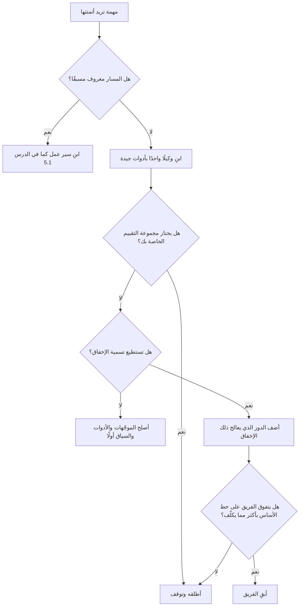

# الوحدة 11 — أنظمة تعدد الوكلاء (Multi-agent systems)

*فريق الوكلاء (a team of agents) هو أكثر الأفكار إغراءً في هندسة الوكلاء (agent engineering)، وهو في أغلب الأحيان الفكرة الخاطئة. وتعلّمك هذه الوحدة النصفين معًا: كيف تبني فريقًا بالطريقة الصحيحة (how to build a team properly)، وكيف تعرف هل ينبغي لك أن تبنيه أصلًا (whether you should). يغطي الدرس 11.1 الأنماط (the patterns) — المشرف والعمّال (supervisor and workers)، والمنسِّق والعمّال (orchestrator-workers)، وخطوط المعالجة (pipelines)، وحلقات الناقد (critic loops)، والتسليم بين الوكلاء (hand-offs) — وما يجلبه الفريق من تكاليف وإخفاقات جديدة (the costs and new failures a team brings)، والأسباب الثلاثة التي تبرر وجوده (the three reasons that justify one) وهي العمل المستقل المتوازي (parallel independent work) وعزل السياق (context isolation) واختلاف الصلاحيات لكل دور (different permissions per role)، وعقود التسليم المنمّطة (typed hand-off contracts)، وصلاحيات الأدوات الخاصة بكل دور (role-specific tool permissions)، والحالة المشتركة (shared state)، والميزانيات والإنهاء للفريق كله (budgets and termination for the whole team)، والتتبّع عبر الوكلاء (tracing across agents)، وجولة صريحة في خمسة أطر عمل (an honest tour of five frameworks)، وقاعدة قرار (a decision rule): جرّب وكيلًا واحدًا بأدوات جيدة أولًا (try one agent with good tools first). أما الدرس 11.2 فهو المختبر (the lab): باحث وكاتب ومراجع (a researcher, a writer and a reviewer) يديرهم مشرف في شيفرة عادية (a supervisor in plain code)، مع عقد Pydantic يُفحص عند كل تسليم (a Pydantic contract checked at every hand-off)، وميزانية للفريق وحدّ للجولات (a team budget and a round cap)، وتدريبات تجعل كل حاجز يعمل (drills that make each guard fire)، ومقارنة بوكيل منفرد على خمسة أسئلة (a comparison against a single agent on five questions)، وقائمة صريحة بما تستطيع النسخة المحاكاة دون اتصال (the offline mock) إظهاره وما لا تستطيع (can and cannot show).*

> **الطبقة (Layer):** Agents — متى ينبغي أن يصبح الوكيل الواحد عدة وكلاء (when one agent should become several)، وكيف يسلّم بعضهم العمل إلى بعض (how they hand work to each other)، والحدود التي تمنع الفريق من الخروج عن السيطرة (the limits that keep a team from running away).

---

# 11.1 — المشرفون والعمّال وعمليات التسليم: متى يكون تعدد الوكلاء هو الجواب الخاطئ (Supervisors, workers and hand-offs: when multi-agent is the wrong answer)
*المستوى (Level): 🟡 متوسط (Intermediate)* · *المتطلبات (Prerequisites): 3.1، 5.1، 8.1* · *الطبقة (Layer): Agents*

## ⚡ الدرس في دقيقة (In 60 seconds)
- **الفريق (team)** هو عدة وكلاء (several agents)، لكل منهم موجّهه (prompt) وأدواته (tools) وسياقه (context) الخاص، ويضاف إليهم **مشرف (supervisor)** يقرر من يتكلم بعد ذلك (decides who goes next)، و**عمليات تسليم (hand-offs)** بينهم.
- الفريق تكلفة لا ميزة (A team is a cost, not a feature): مزيد من الاستدعاءات (calls) والرموز (tokens) وزمن الاستجابة (latency)، وأخطاء متراكمة (compounding errors)، وسياق مفقود (lost context).
- ثلاثة أسباب تبرر ثمنه (Three reasons pay for it): **العمل المستقل المتوازي (parallel independent work)**، و**عزل السياق (context isolation)**، و**اختلاف الصلاحيات لكل دور (different permissions per role)**.
- التسليم **عقد (contract)**: رسالة Pydantic منمّطة (a typed message) يتحقق منها المشرف (validates)، مع فحوص بالشيفرة (code checks). والصلاحيات تنتمي إلى الدور (Permissions belong to the role).
- قاعدة عملية (Rule of thumb): ابنِ وكيلًا واحدًا بأدوات جيدة أولًا (build one agent with good tools first)؛ ولا تضف ثانيًا إلا لإخفاق مسمّى يعالجه (only for a named failure it fixes).

## 🧭 لماذا يهم (Why it matters)
قرأت لجين (Lujain) عن «أطقم الوكلاء» ("agent crews"). ولمسار إجابات السياسات (policy-answer route) في نجم ديسك (Najm Desk) تقترح ستة وكلاء (six agents): مخططًا (a planner) وباحثًا (a searcher) ومدقق حقائق (a fact-checker) وكاتبًا (a writer) ومحررًا (an editor) ومديرًا يختار من يتكلم (a manager who picks who speaks) — وهذا افتراضي (hypothetical). يجيب العرض التجريبي (The demo) عن «كيف أطلب حاسوبًا محمولًا جديدًا؟» ⁦("How do I request a new laptop?")⁩ جيدًا. ويطرح فهد (Fahad) ثلاثة أسئلة. كم استدعاءً للنموذج (model calls) كان ذلك؟ أحد عشر. وكيف يسجّل وكيل واحد بأداة البحث نفسها (one agent with the same search tool) في الأسئلة العشرين نفسها (the same twenty questions)؟ لم تشغّل ذلك بعد (She has not run it). وإن لم يتفق وكيلان أبدًا (If two agents never agree)، فمن يوقفهما؟ لا أحد (Nobody).

التتبّع (The trace) ستة سجلات منفصلة (six separate logs). كان مدقق الحقائق (The fact-checker) قد نبّه إلى «يُسلَّم خلال 3 أيام عمل» ("delivered within 3 business days")؛ والسياسة (the policy) تقول 5. ومرّر المدير (The manager) عبارة «اجتاز التحقق من الحقائق، تعديلات طفيفة» ("fact-check passed, minor edits")، فأبقى المحرر (the editor) الرقم الخاطئ (the wrong number). ماتت الملاحظة عند عملية تسليم (The finding died at a hand-off)، ولم يُظهر ذلك أي سجل (no log showed it).

تختلف الكتابات المنشورة (Write-ups) لأن المهام مختلفة (tasks differ). وصفت Anthropic نظام بحث (a research system) يوزّع الأسئلة على عمّال متوازين (fans questions out to parallel workers) وأبلغت عن استهلاك رموز (token use) يعادل أضعاف استهلاك محادثة عادية (many times that of a chat). ويرى مقال Cognition «لا تبنِ أنظمة متعددة الوكلاء» ("Don't Build Multi-Agents") أنه حين يعتمد كل قرار على سابقه (when each decision depends on the last)، كما في البرمجة (as in coding)، ينتج السياق المنقسم (split context) قرارات متعارضة (conflicting decisions). للفريق ثمن (A team has a price)؛ ويجب أن يشتري شيئًا (it must buy something).

## 📐 كيف يعمل (How it works)

### 🟢 الأساسيات (The essentials)

**المصطلحات (Terms).** يضم *نظام تعدد الوكلاء (multi-agent system)* أكثر من وكيل واحد (more than one agent) — الوحدة 8. و*التسليم بين الوكلاء (hand-off)* هو الرسالة التي تنقل العمل من وكيل إلى التالي (moves work from one agent to the next). أما *المشرف (supervisor)* فيقرر من يتكلم بعد ذلك (decides who speaks next): شيفرة عادية (plain code)، أو نموذج يختار من قائمة قصيرة (a model choosing from a short list)، أو نموذج يقترح بينما تفحص الشيفرة الخطوة (a model that proposes while code checks the move). فضّل الشيفرة (Prefer code): فهي رخيصة (cheap) وقابلة للاختبار (testable) ولا «تقرر» أبدًا أن تستدعي نفسها خمسين مرة (never "decides" to call itself fifty times). ولا تدع نموذجًا يوجّه (route) إلا حين تعتمد الخطوة التالية على محتوى لا تستطيع سرده سلفًا (content you cannot list in advance)، وافحص اختياره بقائمة سماح (check its choice against an allow-list). الفريق ذو المشرف المكتوب بالشيفرة (A team with a code supervisor) هو سير عمل (workflow) — الدرس 5.1 — خطواته وكلاء (whose steps are agents).

| النمط (Pattern) | من يقرر ما يحدث بعد ذلك (Who decides what happens next) | مثال من نجم ديسك (Najm Desk example) |
|---|---|---|
| المشرف والعمّال (Supervisor and workers) | يوجّه المشرف (The supervisor) المهام إلى المتخصصين (routes tasks to specialists) ويدمج النتائج (merges results) | متخصصو الوصول والعتاد والسياسات (Access, hardware and policy specialists) |
| المنسِّق والعمّال (Orchestrator-workers) | يخطط نموذج للمهام الفرعية (plans subtasks) أثناء التشغيل (at run time)؛ وينفذها العمّال (workers)، غالبًا بالتوازي (in parallel) | إشعار يعدّل N سياسة (A notice amends N policies): عامل لكل واحدة (one worker each) |
| خط المعالجة (Pipeline) وهو تسلسل الموجّهات (prompt chaining) | ترتيب ثابت (A fixed order)؛ كل مخرج يغذي التالي (each output feeds the next) | بحث وكتابة ومراجعة (Research, write, review) |
| حلقة الناقد (Critic loop) أو المقيِّم والمحسِّن (evaluator-optimiser) | ينتج منتِج (A producer) ويحكم حَكَم (a judge) ويتكرران حتى القبول أو بلوغ الحد (repeat until accepted or capped) | مسودة ومراجع (A draft and a reviewer) |
| التسليم بين الوكلاء (Hand-off) | ينتقل التحكم إلى وكيل يملك المحادثة الآن (Control moves to an agent that now owns the conversation) | تذهب حالة إلى وكيل الوصول (A case goes to the access agent)، أو إلى شخص (or to a person) |
| المحادثة الجماعية (Group chat) | يتحدث الوكلاء بأدوار حرة (Agents talk in free turns) | لا شيء (None): يصعب تقييدها واختبارها (hard to bound and test) |

**الثمن (The price).**
- *الاستدعاءات والرموز وزمن الاستجابة (Calls, tokens, latency).* يعيد كل وكيل قراءة موجّهه ومدخلاته (Each agent re-reads its prompt and its input): إن مرّرت 3,000 رمز من نتائج البحث (3,000 tokens of search results) إلى كاتب ومراجع (a writer and a reviewer) دفعت ثمنها مدخلاتٍ (as input) ثلاث مرات (three times). الوكلاء المتتابعون (Sequential agents) تتراكم تأخيراتهم (add their delays)؛ أما المتوازون (parallel ones) فيكلّفون زمن أبطئهم (cost the slowest).
- *الأخطاء تتراكم (Errors compound).* أربع مراحل (Four stages)، كل منها صحيحة 95% من الوقت (right 95% of the time) مع إخفاقات مستقلة (independent failures)، تعطي سلسلة صحيحة بمقدار 0.95 أُسّ أربعة (0.95 to the fourth power)، أي نحو 81%؛ وبنسبة 90% لكل مرحلة (at 90% each) نحو 66%. هذه النسب توضيحية (These rates are illustrative)؛ ونسبك أنت تأتي من تقييم (yours come from an eval).
- *تصحيح الأخطاء وفقدان السياق (Debugging and context loss).* يظهر الإخفاق على بعد ثلاثة وكلاء من سببه (A failure surfaces three agents from its cause)، ويُسقط الملخص (a summary) الحقيقة التي كانت مهمة (drops the fact that mattered).
- *إخفاقات جديدة (New failures).* التراشق (Ping-pong)، و«مراجع» يبدأ بإعادة الكتابة (a "reviewer" that starts rewriting)، وافتراضات متعارضة (conflicting assumptions)، وحقن ينتقل (injection that travels): نص قرأه الباحث في مستند (text a researcher read in a document) يصل إلى الوكيل التالي بوصفه تعليمة (reaches the next agent as an instruction) — الوحدة 13.

**ثلاثة أسباب تبرر وجود فريق (Three reasons that justify a team).**
1. *العمل المستقل المتوازي (Parallel independent work).* اثنا عشر مستندًا للتلخيص (Twelve documents to summarise)، لا يحتاج أي منها إلى مخرجات غيره (none needing another's output). وإن كانت المهام الفرعية (subtasks) ثابتة مسبقًا (are fixed in advance) فإن التوازي البسيط (plain parallelisation) — الدرس 5.1 — لا يحتاج إلى وكلاء (needs no agents).
2. *عزل السياق (Context isolation).* يقرأ عامل (A worker) 40 صفحة من تاريخ التذاكر (40 pages of ticket history) في سياق يُرمى بعد الاستخدام (a throwaway context) ويعيد 200 كلمة في ملخص منمّط (returns 200 words as a typed summary). يبقى سياق المشرف صغيرًا (The supervisor's context stays small)؛ ويمكن أن تعود البيانات الشخصية (personal data) محجوبة (redacted).
3. *اختلاف الصلاحيات لكل دور (Different permissions per role).* الوكيل الذي يقرأ نصًّا كتبه غرباء (reads text strangers wrote) لا يحصل على أدوات كتابة (gets no write tools)؛ والوكيل الذي يستطيع طلب فتح قفل حساب (request an unlock) لا يقرؤه أبدًا. وتوزيع البيانات الخاصة (private data) والمحتوى غير الموثوق (untrusted content) والاتصال الخارجي (external communication) على أدوار مختلفة هو أحد أشكال الدفاع ضد «الثلاثية القاتلة» ("lethal trifecta") عند Simon Willison — وهي صياغة ممارس واحد (one practitioner's framing) — بشرط أن يكون التسليم بيانات مُتحقَّقًا منها (validated data) لا نصًّا حرًّا (free text).

**قاعدة القرار: وكيل واحد أولًا (The decision rule: one agent first).**



الوكيل المنفرد (The single agent) هو خط الأساس (baseline) الذي يجب أن يتفوق عليه كل فريق في التقييم نفسه (on the same eval)، مع احتساب التكلفة وزمن الاستجابة (cost and latency counted).

### 🟡 التعمق أكثر (Going deeper)

**التسليم عقد (A hand-off is a contract).** وهو القناة الوحيدة بين وكيلين (the only channel between two agents)، فاجعله رسالة منمّطة (a typed message): نموذج Pydantic بأنواع (types) وحدود (limits) ومفردات مغلقة (closed vocabularies) و`extra="forbid"`، يتحقق منه المشرف في الاتجاهين (validated by the supervisor in both directions). حقل واحد من عقد الباحث (One field of the researcher's contract)، مع رد مهمل (given a sloppy reply):

```python
# one field of a hand-off contract: what the researcher owes the writer
from pydantic import BaseModel, ConfigDict, Field, ValidationError


class Finding(BaseModel):
    model_config = ConfigDict(extra="forbid")      # a field nobody agreed on is a breach
    source: str = Field(pattern=r"^[a-z0-9-]+$")    # a policy id, such as laptop-requests
    quote: str = Field(min_length=10)               # copied word for word


try:   # a sloppy reply: a title instead of an id, a two-letter "quote", an extra field
    Finding.model_validate_json('{"source": "Laptop policy", "quote": "ok", "confidence": 0.9}')
except ValidationError as e:
    for err in sorted(e.errors(), key=lambda err: err["loc"]):    # sorted: pydantic versions order the errors differently
        print(err["loc"][0], "->", err["msg"])
```

```text
confidence -> Extra inputs are not permitted
quote -> String should have at least 10 characters
source -> String should match pattern '^[a-z0-9-]+$'
```

تقيّد المخرجات المهيكلة (Structured outputs) — الدرس 3.1 — الشكل (the shape)، لكن المجموعة الجزئية من المخطط (the schema subset) التي تقبلها الواجهة (the API) لا تستطيع فرض حدود مثل `max_length`، وقد لا يطابق المخطط ردٌّ قُطع بسبب `max_tokens` أو `refusal`، فتحقق على أي حال (validate anyway). والمخطط (A schema) لا يستطيع حمل قاعدتين، فتفحصهما الشيفرة (code checks them): *الإسناد (grounding)*، أي هل الاقتباس موجود فعلًا فيما أعادته الأداة (is the quote really in what the tool returned)؟ و*الاتساق (consistency)*، أي هل تستشهد المسودة بالمصادر الموجودة في الملاحظات وحدها (does the draft cite only sources in the notes)؟ وعند الإخفاق، أصلح مرة واحدة بنص الخطأ (repair once with the error text)؛ ثم سلّم حزمة (hand a packet) إلى شخص (to a person) — الدرس 8.1.

**الصلاحيات تنتمي إلى الدور (Permissions belong to the role).** اكتب الجدول قبل الموجّهات (Write the table before the prompts)؛ وافرضه ثلاث مرات (enforce it three times): يسرد الطلب (the request) أدوات الدور وحدها (lists only the role's tools)؛ ويرفض المُرسِل (the dispatcher) أي استدعاء خارج قائمة السماح (any call outside its allow-list)؛ وتمرّ الكتابة (a write) عبر بوابة (a gate) أو شخص (a person) — الوحدتان 7 و13. وعبارة «يجب ألا تبحث» ("You must not search") في موجّه ليست سوى طلب (only a request). اجعل الرفض هو الافتراضي (Default to deny)؛ ولا تعطِ أي دور مدخلًا غير موثوق وأداة كتابة معًا (both untrusted input and a write tool). العقد يضيّق القناة (A contract narrows the channel)، لكن حقل النص (a string field) ما زال يستطيع حمل تعليمة (carry an instruction): قيّده (bound it)، وأسنده إلى المصدر (ground it in the source)، ولا تضعه أبدًا بين تعليمات الوكيل التالي (the next agent's instructions) ([*أمن الذكاء الاصطناعي وأمن التطبيقات (Secure AI & Application Security)*، الدرس 9.2 — الوكلاء والأدوات: الصلاحيات المفرطة وأدوات أقل الصلاحيات وMCP (Agents and tools: excessive agency, least-privilege tools and MCP)](../secai/index.ar.html#/9.2)).

| الدور (Role) | الأدوات (Tools) | ما يراه (What it sees) |
|---|---|---|
| الباحث (Researcher) | بحث في السياسات للقراءة فقط (Read-only policy search) | نتائج البحث الخام (Raw search results) |
| الكاتب (Writer) | لا شيء (None) | الملاحظات المنمّطة وحدها (The typed notes only) |
| المراجع (Reviewer) | لا شيء (None) | الملاحظات والمسودة (The notes and the draft) |

**الحالة المشتركة والمراسلة (Shared state and messaging).** في *تمرير الرسائل (message passing)* يرسل المشرف عقدًا إلى عامل ويستلم عقدًا في المقابل (sends a contract to a worker and gets one back). وفي *الحالة المشتركة (shared state)*، أي اللوح المشترك (a blackboard)، يقرأ الوكلاء كائنًا واحدًا ويكتبون فيه (read and write one object). فضّل كاتبًا واحدًا (Prefer one writer): يملك المشرف الحالة (owns the state)، والوكلاء دوال (functions) من عقد إلى العقد التالي، وتُدمج النتائج المتوازية في الشيفرة (parallel results merge in code) وفق قاعدة تعارض معلنة (under a stated conflict rule). كاتبان يتسابقان (Two writers race)؛ وقارئ كل شيء يدفع ثمن التلوث (a reader of everything pays for pollution) — الوحدة 9.

**الميزانيات والإنهاء للفريق (Budgets and termination for the team).** تنطبق حواجز الوحدة 8 (The Module 8 guards) على كل وكيل وعلى الفريق: حدّ للخطوات (a step cap) لكل وكيل؛ وميزانية رموز (a token budget) تُجمع على كل الوكلاء وتُفحص قبل كل استدعاء (checked before each call)؛ وحدّ للجولات (a round cap) على كل حلقة ناقد (critic loop)؛ وحدّ لعدد العمّال الذين يبدأون (a cap on workers started) مع التحقق من الخطة بوصفها عقدًا قبل أن يعمل أي عامل (the plan validated as a contract before any worker runs)؛ وأجل أقصى (a deadline)؛ وقاعدة انعدام التقدم (a no-progress rule): أن يصدر المراجع نفسه الملاحظات ذاتها مرتين (the same reviewer issues twice)؛ وحزمة إلى شخص (a packet to a person) متى انطلق أي منها (when any fires). احسب أسوأ حالة (Compute the worst case): 4 خطوات لكل دور وكيل (4 steps per agent turn) وجولتا مراجعة (2 review rounds) تسمحان بـ 4 + 2 × (4 + 4) = 20 استدعاءً (calls). وإن لم يناسبك ذلك، فاخفض الحدود (lower the caps).

**التتبّع عبر الوكلاء (Tracing across agents).** أعطِ التشغيل (the run) معرّفًا واحدًا (one id) وسجّل كل استدعاء نموذج (model call) — الوكيل والخطوة والرموز وسبب التوقف ومعرّف الطلب (agent, step, tokens, stop reason, request id) — وكل استدعاء أداة (tool call) سواء سُمح به أو رُفض (allowed or refused)، وكل تسليم (hand-off) مع عقده وصلاحيته (contract, valid or not)، والتوقف مع حزمته (the stop with its packet). وبمصطلحات OpenTelemetry: امتداد جذري (a root span) للتشغيل، وامتداد فرعي (a child span) لكل دور وكيل (per agent turn)، وتحتها استدعاءات النموذج والأدوات (model and tool calls beneath)؛ ويستطيع Anthropic SDK إصدار امتدادات (spans)، وهي في الإصدار التجريبي (beta) وقت الكتابة (at the time of writing). ويجب أن يقول التتبّع (A trace must say) أي وكيل أدخل ادعاءً (which agent introduced a claim) وأين ذهبت الرموز (where the tokens went) ([*السحابة وDevOps (Cloud & DevOps)*، الدرس 5.1 — القياس عن بُعد: السجلات والمقاييس والتتبّعات وOpenTelemetry (Telemetry: logs, metrics, traces and OpenTelemetry)](../cloud/index.ar.html#/5.1)).

### 🔴 نظرة الخبير (Expert view)

**خمسة أطر عمل (Five frameworks).** تغلّف الأنماط نفسها بصياغات مختلفة (wrap the same patterns in different syntax)، فيستطيع المطوّر الذي بنى هذا الفريق يدويًا (built this team by hand) قراءة أي منها. ولا تعرض هذه الدورة شيفرتها (This course shows none of their code) لأنها تتغير بين الإصدارات (changes between releases). وما يقوم عليه كل منها كما يصفه صانعوه (What each is built around, as its makers describe it) وقت الكتابة (at the time of writing) — 2026؛ راجع التوثيق الحالي (check the current documentation):

| إطار العمل (Framework) | ما يقوم عليه (Built around) |
|---|---|
| LangGraph | رسم بياني من العُقد (A graph of nodes) فوق حالة مشتركة (over a shared state)، مع نقاط تحقق (checkpoints) وإيقافات مؤقتة لإنسان (pauses for a human) |
| CrewAI | أطقم قائمة على الأدوار (Role-based crews): وكلاء بدور وهدف (agents with a role and goal)، ومهام (tasks)، وعملية متسلسلة أو هرمية (a sequential or hierarchical process) |
| Google ADK | أشجار من الوكلاء الفرعيين (Trees of sub-agents)، مع وكلاء سير عمل (workflow agents) يشغّلونهم بالتتابع أو بالتوازي أو في حلقة (in sequence, in parallel or in a loop) |
| Microsoft Agent Framework | وكلاء وسير عمل لـ .NET وPython (Agents and workflows for .NET and Python)، يُقدَّم خلفًا لـ Semantic Kernel وAutoGen (positioned as the successor) |
| OpenAI Agents SDK | قليل من اللبنات الأساسية (Few primitives): الوكلاء والتسليم بين الوكلاء والحواجز الوقائية والتتبّع (agents, hand-offs, guardrails, tracing) |

ومن جهة Claude (On the Claude side)، يتضمن Claude Agent SDK وكلاء فرعيين (subagents)، وتتيح Managed Agents، وهي تجريبية (beta)، لمنسِّق (a coordinator) أن يفوّض إلى وكلاء يعملون في خيوط معزولة السياق (their own context-isolated threads)؛ تحقق من التوفر (check availability).

**ما الذي يجب تقييمه (What to evaluate).** هل أستطيع وضع حدود (cap) للخطوات (steps) والرموز (tokens) والجولات (rounds) والوقت (time) للتشغيل كله (the whole run)؟ هل يُظهر تتبّع واحد (one trace) كل استدعاء وكل تسليم (every call and hand-off)؟ هل أستطيع اختبار فريق مقابل نموذج مزيّف (test a team against a fake model)؟ كيف تبقى الحالة وتُستأنف (How does state persist and resume)؟ هل التسليمات منمّطة ومتحقَّق منها (typed and validated)؟ هل أستطيع ضبط الأدوات والموافقات لكل وكيل (set tools and approvals per agent)؟ هل أستطيع التحكم في الموجّهات بدقة (control the exact prompts)؟ هل يناسب هويتنا وأسرارنا ونشرنا (identity, secrets and deployment) — أي منصتك (your platform)؟ الاختبار الحاسم (The decisive test): انقل مشرف الدرس 11.2 إليه في يوم واحد (port the supervisor of lesson 11.2 into it in a day). فإن لم تستطع الإبقاء على الحدود والعقود والتتبّع (keep the caps, contracts and trace)، فقد استولى على ما يجب أن تملكه أنت (it has taken over what you must own). ولا توحّد معايير المجموعة (Do not standardise the group) قبل أن تشغّل ذلك المختبر (before you have run that lab).

**كيف تفشل الفرق، وكيف تختبر فريقًا (How teams fail, and how to test one).** صنّفت دراسة من عام 2025 (A 2025 study) بعنوان «لماذا تفشل أنظمة النماذج اللغوية متعددة الوكلاء؟» ⁦("Why Do Multi-Agent LLM Systems Fail?")⁩ لـ Cemri وآخرين ⁦(Cemri et al.)⁩ الإخفاقات في عدة أطر مفتوحة (several open frameworks) إلى: مواصفات وتصميم معيبان (flawed specification and design)، وعدم اتساق بين الوكلاء (misalignment between agents)، وتحقق وإنهاء ضعيفان (weak verification and termination): قائمة فحص لكل تسليم (a checklist for every hand-off). اختبر الفريق من طرف إلى طرف (Test a team end to end) مقابل خط أساس الوكيل المنفرد (the single-agent baseline) على المجموعة نفسها (on the same set) — الوحدة 12 — ثم جزءًا جزءًا (then by part): استدعاء الباحث (the researcher's recall)، وإسناد الكاتب (the writer's groundedness)، ومعدل التقاط المراجع (the reviewer's catch rate) في مسودات فيها خطأ واحد مزروع (drafts with one planted error)، بما في ذلك الإنذارات الكاذبة (false alarms included). والمراجع الذي هو النموذج نفسه بالسياق نفسه يشارك الكاتب بقعه العمياء (shares the writer's blind spots)، ويميل الحُكّام إلى تفضيل نص يشبه نصّهم (judges tend to favour text like their own) ([*اختبار البرمجيات (Software Testing)*، الدرس 7.1 — التقييمات (Evals)](../testing/index.ar.html#/7.1)). وقبل إضافة مراجع (Before adding one)، جرّب أدوات أفضل (better tools)، وتعليمة «افحص عملك بنفسك» ("check your own work")، وجهدًا أعلى (higher effort)، وفحوصًا بالشيفرة (code checks).

## 🧰 الأدوات (The toolkit)
| الأداة أو الممارسة أو النمط (Tool, practice or pattern) | ما هي وماذا تفعل (What it is and does) | متى تلجأ إليها (When to reach for it) |
|---|---|---|
| **Supervisor** — المشرف | آلة حالات بالشيفرة (A state machine in code) تقرر من يعمل (decides who runs) وتملك الحالة (owns the state) وتفرض الحدود (enforces the caps) | كل فريق (Every team) |
| **Hand-off contract** — عقد التسليم | نموذج Pydantic لكل رسالة (A Pydantic model per message) يتحقق منه المشرف (validated by the supervisor)، مع فحوص بالشيفرة للإسناد والاتساق (code checks for grounding and consistency) | كل تسليم (Every hand-off) |
| **Role permission table** — جدول صلاحيات الأدوار | لكل دور (Per role): الأدوات والبيانات وحقوق الكتابة (tools, data and write rights)، تُفرض في المُرسِل (enforced in the dispatcher) | قبل أن يوجد الوكيل الثاني (Before the second agent exists) |
| **Team budget** — ميزانية الفريق | ميزانية الرموز (Token budget) وحدود الجولات والخطوات والتفرّع (round, step and fan-out caps) وأجل أقصى (a deadline)، تُفحص قبل كل استدعاء (checked before each call) | كل فريق (Every team) |
| **Cross-agent trace** — التتبّع عبر الوكلاء | معرّف تشغيل واحد (One run id)؛ وسجل لكل استدعاء نموذج واستدعاء أداة وتسليم وتوقف (a record per model call, tool call, hand-off and stop) | كل تشغيل (Every run) |
| **Single-agent baseline** — خط أساس الوكيل المنفرد | المهمة والعقد والفحوص نفسها بوكيل واحد (The same task, contract and checks with one agent) | قبل إضافة وكيل وبعدها (Before and after adding an agent) |

## 🏛️ عمليًا في بنك نجم (In practice at Najm Bank)
المُخرَج (The artefact) هو **سجل تصميم الفريق (Team Design Record)**: صفحة واحدة (one page)، تُكتب قبل أن يوجد وكيل ثانٍ (written before a second agent exists) ويراجعها فهد (Fahad)، ونورة (Noura) حيث تقسم الأدوار الصلاحيات (where roles split permissions). وهذا هو السجل لطاقم لجين (Lujain's crew) — وهو مقترح خيالي (a fictional proposal):

| السؤال (Question) | إجابات السياسات في نجم ديسك (Najm Desk policy answers) |
|---|---|
| القرار (Decision) | سير عمل موزِّع (A router workflow)، ووكيل واحد محدود (one bounded agent) على مسار السياسات، وفحص استشهاد بالشيفرة (a citation check in code). لا فريق في الإصدار 1 (No team in v1). |
| الإخفاق المسمّى لخط الأساس (Named failure of the baseline) | لا شيء بعد (None yet)؛ نعود إليه حين تُظهر مجموعة التقييم (eval set) واحدًا (shows one) — الوحدة 12 |
| ما الذي يبرر فريقًا؟ ⁦(What would justify a team?)⁩ | عمل متواز (Parallel work): إشعار يعدّل مستندات كثيرة (a notice amending many documents)؛ عزل (isolation): قارئ لكل مستند طويل (one reader per long document)؛ صلاحيات (permissions): قارئ للنص الخارجي بلا أدوات كتابة (a reader of outside text, no write tools) |
| خط الأساس والفريق (Baseline and team) | الدرجة والتكلفة وزمن الاستجابة على المجموعة نفسها (Score, cost and latency on the same set)، تُملأ قبل أن يرسم أحد فريقًا (filled in before anyone draws a team) |
| الأدوار والعقود والحدود (Roles, contracts, caps) | جدول الصلاحيات (The permission table)؛ وعقد Pydantic لكل تسليم (a Pydantic contract per hand-off)؛ وحدود الرموز والجولات والخطوات والوقت (token, round, step and time caps) |
| معيار الخروج (Exit criterion) | تخلَّ عن الفريق إن لم يتفوق على خط الأساس بأكثر مما يكلّف (Drop the team if it does not beat the baseline by more than it costs) |

لا تحتاج هند (Hind) إلى أي من هذا المعجم (needs none of the vocabulary): فهي تسأل هل الإجابات صحيحة وسريعة ورخيصة (whether answers are right, fast and cheap).

**منصتك (Your platform).** قبل أن يُشحن فريق (Before a team ships):

| السؤال (Question) | إجابتك (Your answer) |
|---|---|
| هل يحصل كل دور على هويته ونطاقاته الخاصة (its own identity and scopes)، أم حساب خدمة واحد للجميع (one service account for all)؟ | |
| أين يذهب تتبّع التشغيل (a run's trace)، ومن يستطيع قراءته (who can read it)؟ | |
| أين تُضبط الحدود (the caps)، وكيف تُعتمد كتابة أي دور وتُدقَّق (approved and audited)؟ | |

## 🛠️ التمارين (Exercises)
- 🟢 **هل هو فريق؟ ⁦(Is it a team?)⁩** دون اتصال (Offline)، على الورق (on paper). صنّف خمسة رسوم تخطيطية (five sketches) على أنها موجّه (prompt) أو سير عمل (workflow) أو وكيل منفرد (single agent) أو تعدد وكلاء (multi-agent)، وسمِّ النمط (name the pattern): (a) موجّه واحد يلخّص سلسلة تذاكر (one prompt that summarises a ticket thread)؛ (b) موزِّع بخمسة مسارات (a router with five routes)، لكل منها حلقة أدوات (a tool loop)؛ (c) مخطِّط يبدأ عاملًا لكل سياسة تغيّرت (a planner that starts one worker per changed policy)؛ (d) كاتب ومراجع في حلقة (a writer and a reviewer in a loop)؛ (e) «مدير» يتحدث بحرية إلى ستة نظراء (a "manager" talking freely to six peers). *يكتمل عندما (Done when):* يكون لكل منها صنف ونمط وبناء أول (a class, a pattern and a first build)، وقد سمّيت الرسم الذي لا ينبغي أن يوجد (named the sketch that should not exist).
- 🟡 **اكتب عقدين (Write two contracts).** دون اتصال (Offline). لوكيل فرز (a triage agent) يسلّم حالة إلى متخصص وصول (an access specialist)، اكتب نموذجي التسليم (both hand-off models) بـ Pydantic — مفردات مغلقة (closed vocabulary) وحدود (limits) و`extra="forbid"` — وفحصين بالشيفرة لا يستطيع المخطط حملهما (two code checks a schema cannot hold). *يكتمل عندما (Done when):* تتصرف ستة مدخلات (six inputs)، ثلاثة صالحة وثلاثة غير صالحة (three valid and three invalid)، كما تنبأت (behave as predicted).
- 🔴 **هل يستطيع مراجع التقاط الأخطاء المزروعة؟ ⁦(Can a reviewer catch planted errors?)⁩** *يحتاج إلى واجهة البرمجة الحقيقية (Needs the real API)*، مع سقف الإنفاق (the spending cap) من الدرس 0.2. اكتب عشر إجابات قصيرة عن السياسات (ten short policy answers): خمسًا صحيحة (five correct)، وخمسًا فيها خطأ واحد مزروع (one planted error) — رقم خاطئ (a wrong number)، أو ادعاء بلا سند (an unsupported claim)، أو جملة بلا استشهاد (an uncited sentence). مع `MODEL=claude-sonnet-5-5`، اطلب من موجّه مراجع (a reviewer prompt)، معطًى نص السياسة (given the policy text)، أن يوافق على كل إجابة أو يطلب تعديلها (approve or revise each)؛ وكرّر مع `claude-haiku-5-5`. عشر إجابات هي تجربة تشغيلية (a pilot) لا قياس (not a measurement). *يكتمل عندما (Done when):* يحوي `NOTES.md` الأخطاء الملتقطة والإنذارات الكاذبة (caught errors and false alarms) لكل نموذج، والتاريخ (the date)، والمعرّفات (the ids)، وهل كنت ستدفع ثمن المراجع (whether you would pay for the reviewer).

## ⚠️ أخطاء وفخاخ (Mistakes and traps)
- **فريق لأن الأدوار تبدو مرتبة (A team because the roles look tidy).** الهيكل التنظيمي (An org chart) ليس إخفاقًا (not a failure). سمِّ الإخفاق الذي يعانيه وكيل واحد (Name the failure one agent has)، أو ابنِ وكيلًا واحدًا (or build one agent).
- **تسليمات بنص حر (Free-text hand-offs).** تُسقط الحقيقة المهمة (They drop the fact that mattered). مرّر عقدًا مُتحقَّقًا منه (Pass a validated contract) مع الأدلة (with the evidence): الاقتباسات والمعرّفات (quotes, ids).
- **مراجع له البقع العمياء نفسها للكاتب (A reviewer with the writer's blind spots).** النموذج نفسه والسياق نفسه بلا أدلة (Same model, same context, no evidence): فيوافق على ما يعتقده الكاتب (it approves what the writer believes). أعطه المصادر (Give it the sources)، وافحص بالشيفرة أولًا (check in code first)، وضع حدًّا للجولات (cap the rounds).
- **حدود لكل وكيل ولا حدّ للفريق (Caps per agent and none for the team).** يستطيع خمسة وكلاء يلتزمون بحدودهم الخاصة (Five agents obeying their own limits) أن يتراشقوا أربعين استدعاءً (still ping-pong for forty calls). ضع الميزانية والجولات والأجل الأقصى في المشرف (Put budget, rounds and deadline in the supervisor).
- **إطار العمل أولًا (The framework first).** عندئذ يقرر هو أنماطك (It then decides your patterns)؛ فابنِ النمط خامًا (build the pattern raw).

## 🧾 الخلاصة (Recap)
- الفريق وكلاء ومشرف وعمليات تسليم (A team is agents, a supervisor and hand-offs)؛ وينبغي أن يكون المشرف في الغالب شيفرة (the supervisor should usually be code).
- تكلّف الفرق مزيدًا من الاستدعاءات والرموز وزمن الاستجابة (Teams cost more calls, tokens and latency)، وتراكم الأخطاء (compound errors)، ويصعب تصحيحها (harder to debug).
- ثلاثة أسباب تبرر الفريق (Three reasons justify one): العمل المتوازي (parallel work)، وعزل السياق (context isolation)، واختلاف الصلاحيات لكل دور (different permissions per role).
- العقود المتحقَّق منها (Validated contracts)، ومُرسِل يفرض القواعد (an enforcing dispatcher)، وحدود على مستوى الفريق (team-wide caps)، وتتبّع واحد (one trace) تُبقي الفريق آمنًا.
- جرّب وكيلًا واحدًا أولًا (Try one agent first)؛ واجعل كل فريق يتفوق عليه في التقييم نفسه (make every team beat it on the same eval).

## ✍️ اختبر نفسك (Check yourself)

**1. يجيب طاقم لجين (Lujain) المؤلف من ستة وكلاء (six-agent crew) عن أسئلة السياسات جيدًا في عرض تجريبي (a demo). ما الذي ينبغي أن يطلبه فهد (Fahad) أولًا؟ ⁦(What should Fahad ask for first?)⁩**

- A. وكيل مراجع ثالث (A third reviewer agent) يدقق عمل المحرر مرة أخرى (to double-check the editor)
- B. مقارنة بين أطر العمل (A comparison of frameworks) لاختيار مكتبة الطاقم (to choose the crew's library)
- C. وكيل واحد بالأداة نفسها (One agent with the same tool)، يُقيَّم على المجموعة نفسها (scored on the same set)
- D. موجّه نظام (system prompt) أطول لوكيل المدير (for the manager agent)

<details><summary>الإجابة</summary>

**C.** الوكيل المنفرد (The single agent) هو خط الأساس (baseline) الذي يجب أن يتفوق عليه كل فريق في التقييم نفسه (on the same eval). ولا يجيب مزيد من الوكلاء أو مكتبة عن شيء من ذلك (More agents or a library answer none of that). 🟢 قاعدة القرار (The decision rule).

</details>

**2. لخط معالجة (A pipeline) أربع مراحل (four stages). كل منها صحيحة 90% من الوقت (right 90% of the time)، والإخفاقات مستقلة (failures are independent). كم مرة تقريبًا تكون السلسلة كلها صحيحة؟ ⁦(About how often is the whole chain right?)⁩**

- A. نحو 90% (About 90%)
- B. نحو 81% (About 81%)
- C. نحو 66% (About 66%)
- D. نحو 36% (About 36%)

<details><summary>الإجابة</summary>

**C.** اضرب (Multiply): 0.9 أُسّ أربعة (to the fourth power) يساوي نحو 0.66. الأخطاء تتراكم (Errors compound)، فمرحلة غير لازمة (a needless stage) تكلّف الدقة (costs accuracy). 🟢 الثمن (The price).

</details>

**3. يقرأ وكيل واحد تعليقات تذاكر كتبها مرسلون من الخارج (ticket comments written by outside senders)، ويستطيع أيضًا تقديم طلبات فتح قفل حساب (file unlock requests). أي تغيير يناسب الدرس أكثر؟ ⁦(Which change best fits the lesson?)⁩**

- A. إضافة سطر في الموجّه (Add a prompt line) يأمره بتجاهل أي تعليمات في التعليقات (to ignore any instructions in comments)
- B. تقسيمه (Split it): قارئ بلا صلاحية كتابة (a no-write reader) يمرر بيانات متحقَّقًا منها (validated data) إلى مقدِّم طلب (a requester)
- C. إضافة وكيل مراجع (Add a reviewer agent) يقرأ هو أيضًا كل تعليق (that also reads every comment)
- D. إعطاء وكيلين الأدوات نفسها (Give two agents the same tools) ليتحقق كل منهما من الآخر (so that they cross-check)

<details><summary>الإجابة</summary>

**B.** اختلاف الصلاحيات لكل دور (Different permissions per role)، يربط بينها عقد بيانات متحقَّق منه (joined by a validated contract of data)، يزيل اقتران المدخل غير الموثوق بأداة الكتابة (remove the pairing of untrusted input and a write tool). وسطر الموجّه طلب (A prompt line is a request)؛ والقارئ الثاني يرث التعرّض نفسه (a second reader inherits the exposure). 🟢 الأسباب الثلاثة (Three reasons).

</details>

**4. تستشهد مسودة الكاتب (The writer's draft cites) بـ `remote-work`، وهي سياسة لم يعدها الباحث أبدًا (a policy the researcher never returned)، ويوافق عليها المراجع (the reviewer approves it). أين كان ينبغي أن يُلتقط ذلك؟ ⁦(Where should this have been caught?)⁩**

- A. في موجّه نظام المراجع (In the reviewer's system prompt)، بتحذير أقوى (with a stronger warning)
- B. في موجّه الكاتب (In the writer's prompt)، بطلب الاستشهاد بعناية (by asking it to cite carefully)
- C. في الإجابة النهائية (In the final answer)، على يد شخص في مكتب الخدمة (by a person at the Service Desk)
- D. في شيفرة المشرف (In the supervisor's code)، عند التسليم (at the hand-off)

<details><summary>الإجابة</summary>

**D.** كون الاستشهادات من مصادر الملاحظات قاعدة تفحصها الشيفرة بدقة (Whether citations are among the notes' sources is a rule code checks exactly)، قبل أن تكلّف المسودة استدعاء مراجع (before the draft costs a reviewer call). أما الموجّهات والمراجعة البشرية المتأخرة (Prompts and late human review) فأضعف. 🟡 التسليم عقد (A hand-off is a contract).

</details>

**5. تريد المجموعة اعتماد إطار عمل متعدد الوكلاء (a multi-agent framework). ما أكثر اختبار أول حسمًا؟ ⁦(What is the most decisive first test?)⁩**

- A. عدّ كم نوع وكيل تقول وثائقه إنه يدعمه (Count how many agent types its documentation says it supports)
- B. نقل مشرف المختبر إليه (Port the lab supervisor into it)؛ وفحص الحدود والعقود والتتبّع (check caps, contracts, trace)
- C. مقارنة النجوم والإيداعات الأخيرة في مستودعه (Compare the stars and recent commits on its repository)
- D. سؤال المورّد هل يدعم كل نموذج قد تريده (Ask the vendor whether it supports every model you might want)

<details><summary>الإجابة</summary>

**B.** الحدود والعقود والتتبّع (Caps, contracts and the trace) هي ما يجب أن تظل تملكه أنت؛ وإطار العمل الذي يستولي عليها خطر (a framework that takes them over is a risk). أما الأعداد والشعبية (Counts and popularity) فلا تقول شيئًا عن ذلك. 🔴 ما الذي يجب تقييمه (What to evaluate).

</details>

## 📚 المراجع (References)
- Anthropic، «Building effective agents»: https://www.anthropic.com/engineering/building-effective-agents ؛ و«How we built our multi-agent research system»، يُعثر عليه بالعنوان (found by title) في https://www.anthropic.com/engineering
- Claude API، Managed Agents، وهي تجريبية (beta) وتدعم جلسات متعددة الوكلاء (multi-agent sessions): https://platform.claude.com/docs/en/managed-agents/multiagent-orchestration ؛ المخرجات المهيكلة (Structured outputs): https://platform.claude.com/docs/en/build-with-claude/structured-outputs ؛ OpenTelemetry: https://platform.claude.com/docs/en/manage-claude/opentelemetry
- Pydantic: https://docs.pydantic.dev/ ؛ OpenTelemetry: https://opentelemetry.io/docs/
- يُعثر عليها بالعنوان (Found by title): Cemri et al.، «Why Do Multi-Agent LLM Systems Fail?» (2025)؛ Cognition، «Don't Build Multi-Agents» (2025).
- [*اختبار البرمجيات (Software Testing)*، الدرس 7.2 — اختبار RAG واستخدام الأدوات والوكلاء (Testing RAG, tool use and agents)](../testing/index.ar.html#/7.2)
- **اقرأ هذا الأسبوع (Read this week)، الوحدة 11.** Grokking AI Applications، الفصل 6 مرة أخرى («Implementing agentic structures»)، قسم المشرف (the supervisor section): https://www.manning.com/books/grokking-ai-applications . Gulli، *Agentic Design Patterns*، الفصل 7 («Multi-Agent») والفصل 15 («Inter-Agent Communication»): المسودة المجانية (the free draft) المذكورة في الدرس 0.1. Microsoft، *AI Agents for Beginners*، الدرس 08: https://github.com/microsoft/ai-agents-for-beginners . LangChain Academy، دورة LangGraph المجانية (the free LangGraph course): https://academy.langchain.com/

---

# 11.2 — المختبر: فريق من ثلاثة وكلاء بعقود تسليم صريحة (Lab: a three-agent team with explicit hand-off contracts)
*المستوى (Level): 🟡 متوسط (Intermediate)* · *المتطلبات (Prerequisites): 3.2، 8.2، 11.1* · *الطبقة (Layer): Agents*

## ⚡ الدرس في دقيقة (In 60 seconds)
- باحث وكاتب ومراجع (A researcher, writer and reviewer) يديرهم مشرف في شيفرة عادية (a supervisor in plain code)، لكل منهم موجّهه (prompt) وأدواته (tools) وعقده (contract) الخاص.
- الباحث وحده لديه أداة (Only the researcher has a tool)، وهي بحث للقراءة فقط (read-only search)، يفرضها مُرسِل (enforced by a dispatcher).
- الحواجز (Guards): حدّ الخطوات (step cap)، وميزانية رموز للفريق (team token budget)، وحدّ الجولات (round cap)، وإصلاح واحد لكل عقد مكسور (one repair per broken contract)، ثم حزمة تسليم (a hand-off packet).
- دون اتصال (Offline)، يجري الفريق نحو 2.3 ضعف استدعاءات وكيل واحد (about 2.3 times one agent's calls) للإجابات المبرمجة نفسها (the same scripted answers): تكلفة لا جودة (cost, not quality).

## 🧭 لماذا يهم (Why it matters)
شرط فهد (Fahad) لطاقم لجين (Lujain's crew) — وهو افتراضي (hypothetical): أن يُفحص كل تسليم (every hand-off checked)، وأن يكون هناك توقف لا يحتاج إلى أحد (a stop that needs nobody)، وتكلفته إلى جانب تكلفة وكيل واحد (its cost beside one agent's). كانت نسختها الأولى تمرر نصًّا حرًّا (passed free text): كتب الباحث «وجدت بعض السياسات ذات الصلة، انظر أعلاه» ("found some relevant policies, see above")، فسدّ الكاتب الفجوة من الذاكرة بعبارة «3 أيام عمل» ("3 business days")، ووافق المراجع، وهو النموذج نفسه (the same model). ولم يعرف أحد أي وكيل اخترع الرقم (which agent invented the number).

## 📐 كيف يعمل (How it works)

### 🟢 الأساسيات (The essentials)

**شغّله (Run it).** السيناريو (The playbook) `playbooks/m11_lab.json` هو الذي يبرمج المحاكي (scripts the mock): تطابق قواعده الدور في كل موجّه نظام (its rules match the role in each system prompt)، أي `ROLE: researcher`، وترد بـ JSON ثابت أو باستدعاء أداة (reply with fixed JSON or a tool call). وعلى واجهة البرمجة الحقيقية (Against the real API) تكون الشيفرة نفسها (the code is identical).

```bash
cd aiapps/labkit
python -m labkit.mock_server --port 8787 --playbook playbooks/m11_lab.json &
export ANTHROPIC_BASE_URL=http://127.0.0.1:8787 ANTHROPIC_API_KEY=mock TRACE_FILE=m11_trace.jsonl
python labs/m11/team.py "How do I request a new laptop?"
```

```text
Staff can request a new laptop through the IT Service Desk portal under Hardware > New device. ['laptop-requests']
[done: 4 calls, 633 tokens; per role (calls, in, out): {'researcher': [2, 333, 56], 'writer': [1, 82, 36], 'reviewer': [1, 117, 9]}]
```

استغرق استدعاء الكاتب الوحيد 82 رمز إدخال (The writer's one call took 82 input tokens)، واستدعاءا الباحث 333: الكاتب يرى الملاحظات لا نتائج البحث (the writer sees the notes, not the search results). ويحوي `m11_trace.jsonl` سطر JSON واحدًا لكل استدعاء نموذج واستدعاء أداة وتسليم وحكم مراجعة وتوقف (one JSON line per model call, tool call, hand-off, review verdict and stop)، موسومًا كل منها بمعرّف التشغيل (each tagged with the run id)؛ ويُلحَق بالملف (the file is appended to)، فتتشاركه عدة تشغيلات (so several runs share it).

**contracts.py.** اقرأ `check_notes` أولًا (Read check_notes first): يستطيع المخطط (a schema) أن يقول إن الاقتباس نص (a quote is a string)؛ والشيفرة وحدها تستطيع أن تقول إنه صحيح (only code can say it is true).

```python
# labs/m11/contracts.py
"""Lab 11.2: the hand-off contracts. Every message between two agents is one of these models, validated by the supervisor."""
from typing import Literal

from pydantic import BaseModel, ConfigDict, Field, ValidationError, model_validator


class Contract(BaseModel):
    model_config = ConfigDict(extra="forbid")         # a field nobody agreed on is a breach


class Brief(Contract):                                # supervisor -> researcher
    question: str = Field(min_length=10, max_length=300)


class Finding(Contract):
    source: str = Field(pattern=r"^[a-z0-9-]+$")      # a policy id, such as laptop-requests
    quote: str = Field(min_length=10, max_length=600)  # copied word for word from that policy


class Notes(Contract):                                # researcher -> writer
    findings: list[Finding] = Field(max_length=5)
    gaps: list[str]                                   # what the policies do not say; often empty


class Draft(Contract):                                # writer -> reviewer (the solo agent too)
    answer: str = Field(min_length=20, max_length=1200)
    citations: list[str] = Field(min_length=1)        # an answer with no source is not an answer


class Review(Contract):                               # reviewer -> supervisor
    verdict: Literal["approve", "revise"]
    issues: list[str]

    @model_validator(mode="after")
    def revise_needs_reasons(self):
        if self.verdict == "revise" and not self.issues:
            raise ValueError("a revise verdict must list at least one issue")
        return self


def check_notes(notes: Notes, seen: dict[str, str]) -> None:
    """What a schema cannot hold. `seen` is what the search tool really returned: the ground truth for every quote."""
    for f in notes.findings:
        if " ".join(f.quote.split()) not in " ".join(seen.get(f.source, "").split()):
            raise ValueError(f"the quote for {f.source!r} is not word for word in a policy the search returned")


def check_citations(draft: Draft, allowed: set[str]) -> None:
    stray = sorted(set(draft.citations) - allowed)
    if stray:
        raise ValueError(f"the draft cites {stray}, which are not among the sources it was given")


def describe(e: ValueError) -> str:
    """A broken contract as one line the offending agent can act on (a pydantic ValidationError is a ValueError)."""
    if isinstance(e, ValidationError):
        return "; ".join(f"{'.'.join(map(str, x['loc'])) or 'reply'}: {x['msg']}" for x in e.errors())
    return str(e)
```

### 🟡 التعمق أكثر (Going deeper)

**team.py.** يحمل `Team` الحالة المشتركة (holds the shared state)، ولا يكتبها إلا المشرف (which only the supervisor writes). اقرأ `Team.tool`، وفيه تأتي قائمة السماح أولًا (the allow-list comes first)، ثم `Team.agent`، وفيه حدّان قبل الاستدعاء (two caps before the call) ثم التحليل والفحص وإصلاح واحد (parse, check, one repair)، ثم `run`: المشرف كله (the whole supervisor).

```python
# labs/m11/team.py
"""Lab 11.2: a researcher, a writer and a reviewer, run by a supervisor that is plain code.
  Environment: MODEL, TEAM_TOKEN_BUDGET, MAX_ROUNDS, TRACE_FILE."""
import json
import os
import re
import sys
import uuid
from collections import namedtuple
from pathlib import Path

import anthropic
from anthropic import transform_schema
from pydantic import ValidationError

from contracts import Brief, Draft, Notes, Review, check_citations, check_notes, describe

MODEL = os.environ.get("MODEL", "claude-sonnet-5-5")
POLICIES = Path(__file__).resolve().parents[2] / "labkit" / "data" / "policies"
BUDGET, ROUNDS, STEPS = int(os.environ.get("TEAM_TOKEN_BUDGET", 20_000)), int(os.environ.get("MAX_ROUNDS", 2)), 4
SEARCH = {"name": "search_policies", "description": "Search the IT policy library; returns matching policies, ids and full text.",
          "input_schema": {"type": "object", "properties": {"query": {"type": "string"}}, "required": ["query"]}}
ROLES = {   # role -> (system prompt, the tools it may use, the contract it must return). Nothing else reaches the model.
    "researcher": ("ROLE: researcher. Call search_policies, then quote the policies word for word with their ids. "
                   "If they are silent, return no findings and say what is missing.", {"search_policies"}, Notes),
    "writer": ("ROLE: writer. Answer in two or three sentences using ONLY the notes, citing ids. Fix every reviewer issue.", set(), Draft),
    "reviewer": ("ROLE: reviewer. Approve only if every claim in the draft is in the notes; else list each problem.", set(), Review),
    "solo": ("ROLE: solo. Call search_policies, then answer in two or three sentences from its results, citing ids.", {"search_policies"}, Draft),
}
Result = namedtuple("Result", "ok reason answer citations calls tokens packet")


def search_policies(query: str) -> str:
    """Read-only. The best two policies by words shared with the query (at least two)."""
    words = lambda text: {w.rstrip("s") for w in re.findall(r"[a-z]{4,}", text.lower())}
    hits = sorted(((len(words(query) & words(p.read_text())), p.stem, p.read_text().strip()) for p in POLICIES.glob("*.md")), reverse=True)
    return f"Results for '{query}':\n" + ("\n".join(f"[{i}] {t}" for n, i, t in hits[:2] if n >= 2) or "No policies matched.")


class Escalate(Exception):
    """A guard fired or a contract broke twice: stop for a person. args = (reason, why)."""


class Team:
    """One run. Its attributes are the shared state: only the supervisor writes them; an agent sees only its own contract."""

    def __init__(self, question, client=None, budget=BUDGET, max_rounds=ROUNDS, trace_file=None):
        self.question, self.budget, self.max_rounds, self.trace_file = question, budget, max_rounds, trace_file
        self.client, self.run_id = client or anthropic.Anthropic(timeout=60.0), uuid.uuid4().hex[:8]
        self.tokens = self.calls = 0
        self.by_role: dict[str, list[int]] = {}      # role -> [calls, input tokens, output tokens]
        self.seen: dict[str, str] = {}               # policy id -> the text the search tool really returned
        self.events, self.draft, self.review = [], None, None

    def log(self, event, **fields):                  # one JSON line per event, one run id on all of them
        self.events.append({"run": self.run_id, "seq": len(self.events) + 1, "event": event, **fields})
        if self.trace_file:
            with open(self.trace_file, "a", encoding="utf-8") as f:
                f.write(json.dumps(self.events[-1], default=str) + "\n")

    def tool(self, role, name, args):
        """The gate between a request and a run: the role's allow-list first, then the tool. Never raises."""
        if name not in ROLES[role][1]:
            self.log("tool_refused", agent=role, tool=name)
            return f"tool {name!r} is not available to the {role}", True
        out = search_policies(str(args.get("query", "")))
        found = dict(re.findall(r"^\[([a-z0-9-]+)\] (.+?)(?=\n\[[a-z0-9-]+\] |\Z)", out, re.M | re.S))
        self.seen.update(found)
        self.log("tool", agent=role, tool=name, query=args.get("query"))
        return out, False

    def agent(self, role, payload, check=None):
        """One agent turn: returns a validated contract object, or raises Escalate."""
        system, allowed, contract = ROLES[role]
        extra = {"tools": [SEARCH]} if allowed else {}
        out_config = {"effort": "low", "format": {"type": "json_schema", "schema": transform_schema(contract)}}
        messages, repaired = [{"role": "user", "content": payload}], False
        for step in range(1, STEPS + 1):                                        # cap 1: model calls inside one agent turn
            if self.tokens >= self.budget:                                      # cap 2: the team's tokens, checked BEFORE the call
                raise Escalate("token_budget", f"{self.tokens} of {self.budget} tokens spent before the {role} call")
            try:
                resp = self.client.messages.create(model=MODEL, max_tokens=2048, system=system, messages=messages, output_config=out_config, **extra)
            except anthropic.APIError as e:                                     # the SDK has already retried 429 and 5xx twice
                raise Escalate("model_error", f"{type(e).__name__} in the {role} call") from e
            used = [resp.usage.input_tokens, resp.usage.output_tokens]
            self.tokens, self.calls = self.tokens + sum(used), self.calls + 1
            self.by_role[role] = [a + b for a, b in zip(self.by_role.get(role, [0, 0, 0]), [1, *used])]
            self.log("model", agent=role, step=step, stop_reason=resp.stop_reason, input_tokens=used[0], output_tokens=used[1], request_id=resp._request_id)
            messages.append({"role": "assistant", "content": resp.content})
            if resp.stop_reason == "tool_use":                                  # ONE user message, a result for EVERY tool_use id
                results = []
                for b in (b for b in resp.content if b.type == "tool_use"):
                    out, bad = self.tool(role, b.name, b.input)
                    results.append({"type": "tool_result", "tool_use_id": b.id, "content": out, "is_error": bad})
                messages.append({"role": "user", "content": results})
                continue
            if resp.stop_reason != "end_turn":                                  # max_tokens, refusal, pause_turn: no contract to read
                raise Escalate("stop_reason", f"the {role} stopped with {resp.stop_reason}")
            try:
                obj = contract.model_validate_json(next((b.text for b in resp.content if b.type == "text"), ""))     # the hand-off
                if check:
                    check(obj)                                                  # rules a schema cannot hold
            except ValueError as e:
                problem = describe(e)
                self.log("contract_broken", agent=role, contract=contract.__name__, problem=problem[:300])
                if repaired:                                                    # one repair per agent turn, then a person
                    raise Escalate("contract", f"the {role} broke the {contract.__name__} contract twice: {problem[:200]}")
                repaired = True
                messages.append({"role": "user", "content": f"Your reply broke the hand-off contract: {problem}. Reply with corrected JSON only."})
                continue
            self.log("handoff", agent=role, contract=contract.__name__, ok=True)
            return obj
        raise Escalate("step_cap", f"the {role} used {STEPS} model calls without a valid reply")

    def run(self):
        """The supervisor: a fixed state machine in plain code. It decides who speaks next; no model does."""
        try:
            brief = Brief(question=self.question)                               # even the user's question passes a contract
            notes = self.agent("researcher", brief.model_dump_json(), lambda n: check_notes(n, self.seen))
            if not notes.findings:                                              # stop error compounding: nothing to write from
                raise Escalate("no_sources", "; ".join(notes.gaps) or "the policies do not cover this")
            sources = {f.source for f in notes.findings}
            context, issues = f"QUESTION: {self.question}\nNOTES: {notes.model_dump_json()}", ""
            for round_no in range(1, self.max_rounds + 1):                      # the reviewer loop has a cap
                self.draft = self.agent("writer", context + issues, lambda d: check_citations(d, sources))
                self.review = self.agent("reviewer", f"{context}\nDRAFT: {self.draft.model_dump_json()}")
                self.log("review", round=round_no, verdict=self.review.verdict, issues=self.review.issues)
                if self.review.verdict == "approve":
                    return self.finish("done")
                issues = f"\nREVIEWER ISSUES: {json.dumps(self.review.issues)}\nPREVIOUS DRAFT: {self.draft.model_dump_json()}"
            raise Escalate("max_rounds", f"{self.max_rounds} reviews and no approval")
        except Escalate as e:
            return self.finish(*e.args)
        except ValidationError as e:                                            # only the user's own question can fail here
            return self.finish("bad_brief", describe(e))

    def run_solo(self):
        """The baseline: one agent, one tool, the same Draft contract and guards."""
        try:
            self.draft = self.agent("solo", f"QUESTION: {self.question}", lambda d: check_citations(d, set(self.seen)))
            return self.finish("done")
        except Escalate as e:
            return self.finish(*e.args)

    def finish(self, reason, why=""):
        ok = reason == "done"
        packet = None if ok else {"run": self.run_id, "reason": reason, "why": why, "question": self.question, "calls": self.calls,
                                  "last_draft": self.draft and self.draft.model_dump(), "last_issues": self.review.issues if self.review else []}
        self.log("stop", reason=reason, calls=self.calls, tokens=self.tokens, handoff=packet)
        answer = self.draft.answer if ok else f"I could not finish this ({reason}). A Service Desk agent has the case: ref {self.run_id}."
        return Result(ok, reason, answer, self.draft.citations if ok else [], self.calls, self.tokens, packet)


if __name__ == "__main__":
    team = Team(" ".join(sys.argv[1:]) or "How do I request a new laptop?", trace_file=os.environ.get("TRACE_FILE", "m11_trace.jsonl"))
    res = team.run()
    print(res.answer, res.citations or "")
    print(f"[{res.reason}: {res.calls} calls, {res.tokens} tokens; per role (calls, in, out): {team.by_role}]")
    if res.packet:
        print(json.dumps(res.packet, indent=2, ensure_ascii=False))
```

يمرّر **compare.py** كل سؤال عبر `Team.run`، ثم عبر `Team.run_solo` (runs each question through):

```python
# labs/m11/compare.py
"""Lab 11.2: does the team earn its extra calls? Five questions through the team, then one agent.
  python labs/m11/compare.py    (for money, set PRICE_IN_PER_MTOK and PRICE_OUT_PER_MTOK from the price page)"""
import os

from team import Team

TASKS = [("How do I request a new laptop?", "Hardware > New device"), ("I lost my phone: what do I do about MFA?", "Service Desk immediately"),
         ("What is the response time for a P2 ticket?", "within 4 hours"), ("When is the Service Desk open?", "7:00 to 17:00"),
         ("Can I paste customer data into an external AI tool?", "must not")]      # (question, a phrase a right answer contains)
PRICE = [float(os.environ.get(k, 0)) for k in ("PRICE_IN_PER_MTOK", "PRICE_OUT_PER_MTOK")]


def compare():
    total = {"team": [0, 0, 0], "solo": [0, 0, 0]}                              # calls, input tokens, output tokens
    for question, expect in TASKS:
        for mode in total:
            t = Team(question)
            r = t.run() if mode == "team" else t.run_solo()
            row = [t.calls, sum(v[1] for v in t.by_role.values()), sum(v[2] for v in t.by_role.values())]
            total[mode] = [a + b for a, b in zip(total[mode], row)]
            print(f"{question:<54}{mode:<5}{('right' if expect in r.answer else 'wrong') if r.ok else r.reason:<8}calls={row[0]} in={row[1]} out={row[2]}")
    for mode, (calls, tin, tout) in total.items():
        print(f"{mode}: {calls} calls, {tin + tout} tokens" + (f", cost {(tin * PRICE[0] + tout * PRICE[1]) / 1e6:.4f}" if all(PRICE) else ""))
    t, s = total["team"], total["solo"]
    print(f"team / solo: calls x{t[0] / s[0]:.1f}, tokens x{(t[1] + t[2]) / (s[1] + s[2]):.1f}")


if __name__ == "__main__":
    compare()
```

```text
...
What is the response time for a P2 ticket?            team right   calls=6 in=746 out=147
What is the response time for a P2 ticket?            solo right   calls=2 in=298 out=47
...
team: 23 calls, 3955 tokens
solo: 10 calls, 1902 tokens
team / solo: calls x2.3, tokens x2.1
```

هذا 2.3 ضعف الاستدعاءات (2.3 times the calls) و2.1 ضعف الرموز (2.1 times the tokens)؛ والمال هو الرموز مضروبة في الأسعار الحالية (money is tokens times the current prices). وتسمح الحدود (The caps allow) بما لا يزيد على (at most) 4 + 2 × (4 + 4) = 20 استدعاءً (calls).

**التدريبات (The drills).** شغّل `python labs/m11/team.py "<question>"`. الوسم `[drill:...]` يُلحَق بنهاية سؤال الحاسوب المحمول (ends the laptop question) ولا يتصرف بناءً عليه إلا السيناريو (only the playbook acts on it).

| السؤال (Question) | ما الذي يحدث (What happens) | الحاجز (Guard) |
|---|---|---|
| زمن الاستجابة لتذكرة P2 (P2 response time) | تُرفض المسودة الأولى وتُعتمد الثانية (Draft one rejected, draft two approved) — 6 استدعاءات (6 calls) | حلقة المراجع (Reviewer loop) |
| ساعات عمل مكتب الخدمة (Service Desk opening hours) | المسودة الأولى لا تستشهد بشيء (Draft one cites nothing)؛ ويصلحها إصلاح واحد (one repair fixes it) — 5 استدعاءات (5 calls) | العقد، وإصلاح واحد (Contract, one repair) |
| الحاسوب المحمول `[drill:never-approve]` (Laptop) | `max_rounds` بعد 6 استدعاءات (after 6 calls)؛ وفي الحزمة آخر مسودة (the packet has the last draft) | حدّ الجولات (Round cap) |
| الحاسوب المحمول `[drill:fabricate]` (Laptop) | `contract` بعد 3 استدعاءات (after 3 calls)؛ ولا كاتب (no writer) | فحص الإسناد (Grounding check) |
| الحاسوب المحمول `[drill:overreach]` (Laptop) | يُرفض بحث الكاتب (The writer's search is refused)؛ ويكتمل التشغيل (the run finishes) | قائمة السماح (Allow-list) |
| الحاسوب المحمول مع `TEAM_TOKEN_BUDGET=300` (Laptop with) | `token_budget` بعد استدعاءين و389 رمزًا (after 2 calls, 389 tokens) | ميزانية الفريق (Team budget) |

تُفحص الميزانية قبل الاستدعاء (The budget is checked before a call)، فقد يتجاوزها استدعاء واحد (so one call can cross it).

### 🔴 نظرة الخبير (Expert view)

**تحفظات صادقة (Honest caveats).** يغطي `pytest tests/test_m11_team.py` كل حاجز وكل تدريب وكل شكل طلب (every guard, drill and request shape)، لكنه يتشارك مع السيناريو نصَّه (shares the playbook's script): فهو يثبت السباكة لا الفريق (it proves the plumbing, not the team). *يعمل دون اتصال (Works offline):* العقود والحدود وقائمة السماح وأسباب التوقف والحزم والتتبّع (contracts, caps, allow-list, stop reasons, packets and the trace)؛ وأعداد الرموز تقديرية (token counts are estimates). *يحتاج إلى واجهة البرمجة الحقيقية (Needs the real API):* هل يقتبس الباحث السياسة الصحيحة (the researcher quotes the right policy)، وهل يبقى الكاتب داخل الملاحظات (the writer stays in the notes)، وهل يلتقط المراجع الأخطاء الحقيقية (the reviewer catches real errors)؛ وزمن الاستجابة والتكلفة (latency, cost)، وكيف تتضافر الأدوات والمخرجات المهيكلة (how tools and structured outputs combine). و`right` في `compare.py` مجرد مطابقة عبارة (only a phrase match). وفي تدريب تجاوز الصلاحيات (the overreach drill) يطلب المحاكي (the mock) أداة لم تكن لدى الكاتب أصلًا (a tool the writer never had)؛ والنموذج الحقيقي نادرًا ما يفعل ذلك (a real model rarely would)، ولم يُختبر هنا رد فعل الواجهة الحقيقية على `tool_result` في طلب لا يعلن أي أدوات (the real API's reaction to a tool_result in a request that declares no tools is untested here)، فإن أعادت خطأً انتهى التشغيل بـ `model_error` (if it returns an error, the run ends in model_error). والمكتبة نص موثوق (The library is trusted text)، فلا شيء يختبر الحقن (nothing tests injection)، وتبقى `gaps` و`issues` نصًّا حرًّا (stay free text).

## 🧰 الأدوات (The toolkit)
| الأداة أو الممارسة أو النمط (Tool, practice or pattern) | ما هي وماذا تفعل (What it is and does) | متى تلجأ إليها (When to reach for it) |
|---|---|---|
| **Hand-off contract** — عقد التسليم | نموذج Pydantic لكل رسالة (A Pydantic model per message)، مع فحوص بالشيفرة (plus code checks) | كل تسليم (Every hand-off) |
| **Team budget** — ميزانية الفريق | ميزانية رموز وحدّ جولات وحدّ خطوات (A token budget, round cap and step cap)، تُفحص قبل كل استدعاء (checked before each call) | كل فريق (Every team) |
| **Hand-off packet** — حزمة التسليم | معرّف التشغيل والسبب وآخر مسودة والملاحظات (Run id, reason, last draft, issues)، لطابور مسمّى (for a named queue) | كل حاجز ينطلق (Every guard that fires) |

## 🏛️ عمليًا في بنك نجم (In practice at Najm Bank)
**المُسلَّم الأسبوعي (Weekly deliverable).** أودِع (Commit) المجلد `week-11/` مع `labs/m11/` واختبارات ناجحة (passing tests)؛ وجدول `compare.py` مع فقرة (table with a paragraph)؛ والحزمة (the packet) من كل تدريب ينتهي بحزمة (from each drill that ends in one)؛ وسجل تصميم الفريق (Team Design Record) — الدرس 11.1 — لميزة من تصميمك (for a feature of your own)؛ و`NOTES.md` مع إجاباتك عن الاختبار (quiz answers).

**جلسة المجموعة (Group session)، 60 دقيقة (60 minutes).** (1) تبادلوا جداول `compare` (Swap compare tables)؛ واشرحوا النسب (explain the ratios) (15). (2) شغّلوا التدريبات (Run the drills)؛ وسمّوا كل حاجز (name each guard) وحقل الحزمة الذي يحتاج إليه موظف مكتب الخدمة (the packet field a Service Desk agent needs) (20). (3) اكتبوا تسليمًا يجتاز المخطط لكنه خاطئ (a hand-off that passes the schema yet is wrong) (15). (4) فريق أم وكيل واحد للإصدار 1؟ ⁦(Team or one agent for v1?)⁩ (10)

**ابنِه مع Claude Code (Build it with Claude Code).** أعطِ Claude Code هذه المواصفة (spec) في وضع التخطيط (plan mode) — وتحقق من توثيق Claude Code الحالي (check the current Claude Code documentation) — وراجع الخطة (review the plan) قبل أي تعديل (before any edit):

```text
Goal: build labs/m11/contracts.py, team.py and compare.py as in lesson 11.2, with pytest tests in
labkit/tests/test_m11_team.py. Context: Python 3.11, anthropic>=1,<2, pydantic 2, the offline mock in
aiapps/labkit (read its README and playbooks/m11_lab.json). MODEL comes from the environment.
Constraints:
- The supervisor is a fixed state machine in code; no model picks the next agent.
- Each role has its own prompt, tools and Pydantic contract. Only the researcher gets a tool (read-only
  search); the dispatcher refuses any tool outside the calling role's allow-list.
- Validate every hand-off (model_validate_json, extra="forbid"), then check in code: quotes word for word
  from what search returned, citations among the notes' sources. One repair, then a hand-off packet.
- Check the step cap and the team token budget BEFORE each call; cap the reviewer loop.
- ONE user message with a tool_result for EVERY tool_use id. Never read content[0].
- No temperature, prefill or forced tool_choice. No new dependencies. Touch no other files.
Acceptance: pytest passes offline; each drill ends in its stated reason.
One file at a time; run the tests after each step.
```

**تحقق قبل أن تقبله (Verify before you accept it).**
- شغّل الاختبارات (Run the tests)، ثم اكسر حاجزًا واحدًا في كل مرة (break one guard at a time): يجب أن يفشل اختبار مسمّى (a named test must fail). شغّل `compare.py`: عشرة صفوف، كلها `right` (ten rows, all right).
- ابحث في الفرق (diff) عن `temperature` و`tool_choice` و`eval(` و`content[0]` وكاتب مُنح أداة (a writer given a tool). اقرأ `Team.tool` و`Team.agent`؛ وتأكد من أن الاختبارات لم تُمَس (confirm the tests are untouched).

## 🛠️ التمارين (Exercises)
- 🟢 **اكسر كل حاجز (Break each guard).** دون اتصال (Offline). واحدًا تلو الآخر (In turn)، أزل فحوص قائمة السماح والإسناد والميزانية (remove the allow-list, grounding and budget checks) وشغّل الاختبارات (run the tests). *يكتمل عندما (Done when):* يسمّي `NOTES.md` الاختبارات الفاشلة لكل تغيير (names the failing tests per change)، وتُستعاد الشيفرة (the code is restored).
- 🟡 **أضف أجلًا أقصى وقاعدة انعدام التقدم (Add a deadline and a no-progress rule).** دون اتصال (Offline). صعّد `timeout` (Escalate) متى انقضى `TEAM_DEADLINE_S` (has passed) — زيّف الساعة (fake the clock) — و`no_progress` متى كرر المراجع ملاحظاته (when the reviewer repeats its issues). *يكتمل عندما (Done when):* يفشل اختبار جديد لكل منهما دون تغييرك ويجتاز معه (a new test for each fails without your change and passes with it).
- 🔴 **هل يتفوق الفريق على وكيل واحد؟ ⁦(Does the team beat one agent?)⁩** *يحتاج إلى واجهة البرمجة الحقيقية (Needs the real API)*، مع سقف الإنفاق (the spending cap) من الدرس 0.2. اكتب 15 سؤالًا بإجابات معروفة (15 questions with known answers) في `labkit/data/policies/` وخمسة لا تغطيها أي سياسة (five that no policy covers). مع `MODEL=claude-sonnet-5-5`، شغّل `run` و`run_solo` ثلاث مرات لكل منهما (three times each). *يكتمل عندما (Done when):* يعدّ `NOTES.md` الصحيح والخاطئ والمُصعَّد (counts right, wrong and escalated)، مع الاستدعاءات والرموز والتكلفة والتاريخ ومعرّف النموذج وحكمك (calls, tokens, cost, date, model id and your verdict).

## ⚠️ أخطاء وفخاخ (Mistakes and traps)
- **تمرير الحالة كلها إلى كل وكيل (Passing the whole state to every agent).** يكلّف رموزًا (It costs tokens). أرسل إلى كل دور عقده وحده (Send each role its contract).
- **مراجع لا يرى إلا المسودة (A reviewer that sees only the draft).** لا يستطيع فحص ما لا يراه (It cannot check what it cannot see). أعطه الملاحظات (Give it the notes).
- **الوثوق بالمخطط في الحقيقة (Trusting the schema for truth).** قد يحوي JSON صالح اقتباسًا مخترعًا (Valid JSON can hold an invented quote). افحص الإسناد بالشيفرة (Check grounding in code).
- **وصف النجاح دون اتصال بأنه «أفضل» (Calling green offline "better").** كانت الإجابات مبرمجة (The answers were scripted).

## 🧾 الخلاصة (Recap)
- مشرف بشيفرة عادية (A supervisor in plain code)، وثلاثة أدوار (three roles)، وعقد متحقَّق منه عند كل تسليم (a validated contract at every hand-off).
- الصلاحيات تعيش في المُرسِل (Permissions live in the dispatcher)؛ وكل دور يرى عقده وحده (each role sees only its own contract).
- الحدود والميزانية وإصلاح واحد تنهي كل تشغيل بسبب وحزمة (Caps, budget and one repair end every run in a reason and a packet).
- المقارنة دون اتصال تُظهر التكلفة لا الجودة (The offline comparison shows cost, not quality).

## ✍️ اختبر نفسك (Check yourself)

**1. ينتهي تشغيل بالسبب `contract` بعد 3 استدعاءات؛ ولم يعمل الكاتب قط (the writer never ran). ماذا حدث؟ ⁦(What happened?)⁩**

- A. رفض المراجع مسودتين وبلغ حدّ الجولات (The reviewer rejected two drafts and hit the round cap)
- B. فشل اقتباس الباحث في فحص الإسناد مرتين (The researcher's quote failed the grounding check twice)
- C. نفدت ميزانية رموز الفريق قبل أن يبدأ الكاتب (The team's token budget ran out before the writer began)
- D. طلب الكاتب أداة لم تُمنح له (The writer asked for a tool it was not given)

<details><summary>الإجابة</summary>

**B.** البحث والملاحظات وإصلاح واحد تصنع ثلاثة استدعاءات (Search, notes and one repair make three calls)؛ وفشل الإسناد الثاني يُصعِّد قبل الكاتب (a second grounding failure escalates before the writer). 🟡 التدريبات (The drills).

</details>

**2. مع `TEAM_TOKEN_BUDGET=300`، يتوقف تشغيل بعد 389 رمزًا. هل هذا خلل؟ ⁦(Is that a bug?)⁩**

- A. لا: تُفحص قبل الاستدعاء، فقد يتجاوزها استدعاء واحد (No: it is checked before a call, so one call can cross it)
- B. نعم: ينبغي فحصها بعد الاستدعاء لميزانية دقيقة (Yes: it should be checked after the call, for an exact budget)
- C. نعم: تتجاهل SDK الميزانيات التي يضعها التطبيق (Yes: the SDK ignores budgets set by the application)
- D. لا: تعدّ الميزانية رموز الإخراج وحدها لا الإدخال (No: the budget counts only output tokens, not input)

<details><summary>الإجابة</summary>

**A.** يعمل الحاجز قبل الاستدعاء (The guard runs before a call)، فيكتمل الاستدعاء الذي يتخطى الخط (so the call that crosses the line completes). 🟡 التدريبات (The drills).

</details>

**3. دون اتصال، يطبع `compare.py` عشرة صفوف `right` وفريقًا بـ 2.3 ضعف الاستدعاءات. ماذا يدعم ذلك؟ ⁦(What does that support?)⁩**

- A. الفريق ترقية آمنة، لأن كل إجابة كانت صحيحة (The team is a safe upgrade, because every answer was right)
- B. الفريق أدق، ولو على هذه الأسئلة الخمسة فقط (The team is more accurate, if only on these five questions)
- C. الفريق أرخص، لأن كل وكيل يقرأ سياقًا أقل (The team is cheaper, because each agent reads less context)
- D. الفريق يكلّف نحو الضعف؛ والدقة لم تُختبر (The team costs about twice as much; accuracy is untested)

<details><summary>الإجابة</summary>

**D.** الاستدعاءات دقيقة (Calls are exact)، والرموز تقديرية (tokens are estimates)، وكلا التصميمين يعيد إجابات مبرمجة (both designs return scripted answers)، فلا يقول الجدول شيئًا عن الجودة (so the table says nothing about quality). 🔴 تحفظات صادقة (Honest caveats).

</details>

**4. يطلب الكاتب المبرمج، وقد أُعطي بلا أدوات (The scripted writer, given no tools)، الأداة `search_policies`. ماذا يحدث؟ ⁦(What happens?)⁩**

- A. يوقف التشغيل كله ويسلّمه إلى شخص (Stops the whole run and hands it to a person)
- B. ينفّذ البحث على أي حال، فالمُرسِل مشترك (Runs the search anyway, as the dispatcher is shared)
- C. يرفض بنتيجة خطأ؛ ويتابع الكاتب (Refuses with an error result; the writer goes on)
- D. لا يرسل `tool_result`، وترفض الواجهة ذلك (Sends no tool_result, which the API rejects)

<details><summary>الإجابة</summary>

**C.** يفحص المُرسِل قائمة السماح أولًا (The dispatcher checks the allow-list first) ويرد بـ `is_error`، فيستطيع النموذج التعافي (so the model can recover). 🟡 التدريبات (The drills).

</details>

**5. مع ضبط `MAX_ROUNDS` على 3 و4 خطوات لكل دور وكيل (4 steps per agent turn)، ما أكبر عدد استدعاءات قد يجريه تشغيل واحد؟ ⁦(What is the most calls one run may make?)⁩**

- A. 12
- B. 20
- C. 28
- D. 36

<details><summary>الإجابة</summary>

**C.** أربعة استدعاءات للباحث، ثم في كل جولة أربعة للكاتب وأربعة للمراجع (Four researcher calls, then per round four writer and four reviewer calls): 4 + 3 × (4 + 4) = 28. 🟡 التعمق أكثر (Going deeper).

</details>

## 📚 المراجع (References)
- Claude API، المخرجات المهيكلة (Structured outputs): https://platform.claude.com/docs/en/build-with-claude/structured-outputs ؛ الأسعار (Pricing): https://platform.claude.com/docs/en/about-claude/pricing
- Pydantic: https://docs.pydantic.dev/
- عدّة المختبر (Lab kit) — المحاكي والتوجيهات والسيناريوهات (mock, directives, playbooks): https://github.com/Tamoura/system-design-for-vibe-coders/tree/main/aiapps/labkit
