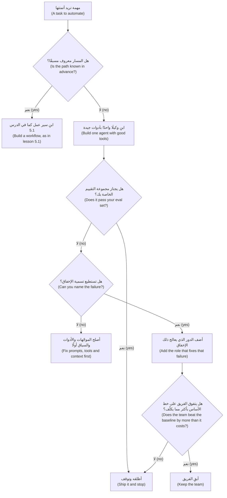

# الوحدة 11 — أنظمة تعدد الوكلاء (Multi-agent systems)

*فريق الوكلاء هو أكثر الأفكار إغراءً في هندسة الوكلاء، وهو في أغلب الأحيان الفكرة الخاطئة. وتعلّمك هذه الوحدة النصفين معًا: كيف تبني فريقًا بالطريقة الصحيحة، وكيف تعرف هل ينبغي لك أن تبنيه أصلًا. يغطي الدرس 11.1 الأنماط — المشرف والعمّال، والمنسِّق والعمّال (orchestrator-workers)، وخطوط المعالجة، وحلقات الناقد (critic loops)، والتسليم بين الوكلاء (hand-offs) — وما يجلبه الفريق من تكاليف وإخفاقات جديدة، والأسباب الثلاثة التي تبرر وجوده وهي العمل المستقل المتوازي وعزل السياق (context isolation) واختلاف الصلاحيات لكل دور، وعقود التسليم المنمّطة، وصلاحيات الأدوات الخاصة بكل دور، والحالة المشتركة، والميزانيات والإنهاء للفريق كله، والتتبّع عبر الوكلاء، وجولة صريحة في خمسة أطر عمل، وقاعدة قرار: جرّب وكيلًا واحدًا بأدوات جيدة أولًا. أما الدرس 11.2 فهو المختبر: باحث وكاتب ومراجع يديرهم مشرف في شيفرة عادية، مع عقد Pydantic يُفحص عند كل تسليم، وميزانية للفريق وحدّ للجولات، وتدريبات تجعل كل حاجز يعمل، ومقارنة بوكيل منفرد على خمسة أسئلة، وقائمة صريحة بما تستطيع النسخة المحاكاة دون اتصال إظهاره وما لا تستطيع.*

> **الطبقة:** Agents — متى ينبغي أن يصبح الوكيل الواحد عدة وكلاء، وكيف يسلّم بعضهم العمل إلى بعض، والحدود التي تمنع الفريق من الخروج عن السيطرة.

---

# 11.1 — المشرفون والعمّال وعمليات التسليم: متى يكون تعدد الوكلاء هو الجواب الخاطئ
*المستوى: 🟡 متوسط* · *المتطلبات: 3.1، 5.1، 8.1* · *الطبقة: Agents*

**بعد هذا الدرس تستطيع** أن تقرّر هل يحتاج تصميم إلى وكيل واحد أم إلى عدة وكلاء وتعلّل قرارك، وأن تكتب عقود تسليم بـ Pydantic تقبل ثلاثة مدخلات صحيحة وترفض ثلاثة خاطئة كما توقعت. *مدة الدراسة: نحو 110 دقيقة (تقدير).*

## ⚡ الدرس في دقيقة
- **الفريق** هو عدة وكلاء، لكل منهم موجّهه (prompt) وأدواته وسياقه الخاص، ويضاف إليهم **مشرف (supervisor)** يقرر من يتكلم بعد ذلك، و**عمليات تسليم** بينهم.
- الفريق تكلفة لا ميزة: مزيد من الاستدعاءات والرموز وزمن الاستجابة (latency)، وأخطاء متراكمة وسياق مفقود.
- ثلاثة أسباب تبرر ثمنه: **العمل المستقل المتوازي**، و**عزل السياق**، و**اختلاف الصلاحيات لكل دور**.
- التسليم **عقد**: رسالة Pydantic منمّطة يتحقق منها المشرف، مع فحوص بالشيفرة. والصلاحيات تنتمي إلى الدور.
- قاعدة عملية: ابنِ وكيلًا واحدًا بأدوات جيدة أولًا؛ ولا تضف ثانيًا إلا لإخفاق مسمّى يعالجه.

## 🧭 لماذا يهم
قرأت لجين عن «أطقم الوكلاء». ولمسار إجابات السياسات في نجم ديسك (Najm Desk) تقترح ستة وكلاء: مخططًا وباحثًا ومدقق حقائق وكاتبًا ومحررًا ومديرًا يختار من يتكلم — وهذا افتراضي. يجيب العرض التجريبي عن «كيف أطلب حاسوبًا محمولًا جديدًا؟» جيدًا. ويطرح فهد ثلاثة أسئلة. كم استدعاءً للنموذج كان ذلك؟ أحد عشر. وما الدرجة التي يحصل عليها وكيل واحد بأداة البحث نفسها في الأسئلة العشرين نفسها؟ لم تشغّل ذلك بعد. وإن لم يتفق وكيلان أبدًا، فمن يوقفهما؟ لا أحد.

التتبّع (trace) عبارة عن ستة سجلات منفصلة. كان مدقق الحقائق قد نبّه إلى «يُسلَّم خلال 3 أيام عمل»؛ والسياسة تقول 5. ومرّر المدير عبارة «اجتاز التحقق من الحقائق، تعديلات طفيفة»، فأبقى المحرر الرقم الخاطئ. ضاعت الملاحظة عند عملية تسليم، ولم يُظهر ذلك أي سجل.

تتضارب الكتابات المنشورة لأن المهام تختلف. وصفت Anthropic نظام بحث يوزّع الأسئلة على عمّال متوازين وأبلغت عن استهلاك رموز يعادل أضعاف استهلاك محادثة عادية. ويرى مقال Cognition «لا تبنِ أنظمة متعددة الوكلاء» أنه حين يعتمد كل قرار على سابقه، كما في البرمجة، ينتج السياق المنقسم قرارات متعارضة. للفريق ثمن؛ ويجب أن يشتري شيئًا.

## 📐 كيف يعمل

### 🟢 الأساسيات

**المصطلحات.** يضم *نظام تعدد الوكلاء (multi-agent system)* أكثر من وكيل واحد — الوحدة 8. و*التسليم بين الوكلاء (hand-off)* هو الرسالة التي تنقل العمل من وكيل إلى التالي. أما *المشرف* فيقرر من يتكلم بعد ذلك: شيفرة عادية، أو نموذج يختار من قائمة قصيرة، أو نموذج يقترح بينما تفحص الشيفرة الخطوة. فضّل الشيفرة: فهي رخيصة وقابلة للاختبار ولا «تقرر» أبدًا أن تستدعي نفسها خمسين مرة. ولا تدع نموذجًا يوجّه إلا حين تعتمد الخطوة التالية على محتوى لا تستطيع سرده سلفًا، وافحص اختياره بقائمة سماح. الفريق ذو المشرف المكتوب بالشيفرة هو سير عمل (workflow) — الدرس 5.1 — خطواته وكلاء.

| النمط | من يقرر ما يحدث بعد ذلك | مثال من نجم ديسك |
|---|---|---|
| المشرف والعمّال | يوجّه المشرف المهام إلى المتخصصين ويدمج النتائج | متخصصو الوصول والعتاد والسياسات |
| المنسِّق والعمّال | يخطط نموذج للمهام الفرعية أثناء التشغيل؛ وينفذها العمّال غالبًا بالتوازي | إشعار يعدّل N سياسة: عامل لكل واحدة |
| خط المعالجة وهو تسلسل الموجّهات (prompt chaining) | ترتيب ثابت؛ كل مخرج يغذي التالي | بحث وكتابة ومراجعة |
| حلقة الناقد (Critic loop) أو المقيِّم والمحسِّن (evaluator-optimiser) | يتكرر عمل منتِج وحَكَم حتى القبول أو بلوغ الحد | مسودة ومراجع |
| التسليم بين الوكلاء | ينتقل التحكم إلى وكيل يملك المحادثة الآن | تذهب حالة إلى وكيل الوصول أو إلى شخص |
| المحادثة الجماعية | يتحدث الوكلاء بالتناوب الحر | لا شيء: يصعب تقييدها واختبارها |

**الثمن.**
- *الاستدعاءات والرموز وزمن الاستجابة.* يعيد كل وكيل قراءة موجّهه ومدخلاته: إن مرّرت 3,000 رمز من نتائج البحث إلى كاتب ومراجع دفعت ثمنها بوصفها مدخلات ثلاث مرات. الوكلاء المتتابعون تتراكم تأخيراتهم؛ أما المتوازون فزمنهم زمن أبطئهم.
- *الأخطاء تتراكم.* أربع مراحل، كل منها صحيحة 95% من الوقت مع إخفاقات مستقلة، تعطي سلسلة صحيحة بنسبة 0.95 أُسّ أربعة، أي نحو 81%؛ وبنسبة 90% لكل مرحلة نحو 66%. هذه النسب توضيحية؛ ونسبك أنت تأتي من تقييم.
- *تصحيح الأخطاء وفقدان السياق.* يظهر الإخفاق على بعد ثلاثة وكلاء من سببه، ويُسقط الملخص الحقيقة التي كانت مهمة.
- *إخفاقات جديدة.* التراشق، و«مراجع» يبدأ بإعادة الكتابة، وافتراضات متعارضة، وحقن ينتقل: نص قرأه الباحث في مستند يصل إلى الوكيل التالي بوصفه تعليمة — الوحدة 13.

**ثلاثة أسباب تبرر وجود فريق.**
1. *العمل المستقل المتوازي.* اثنا عشر مستندًا للتلخيص، لا يحتاج أي منها إلى مخرجات غيره. وإن كانت المهام الفرعية ثابتة مسبقًا فإن التوازي البسيط — الدرس 5.1 — لا يحتاج إلى وكلاء.
2. *عزل السياق.* يقرأ عامل 40 صفحة من تاريخ التذاكر في سياق مؤقت يُتخلص منه بعد الاستخدام ويعيد 200 كلمة في ملخص منمّط. يبقى سياق المشرف صغيرًا؛ ويمكن أن تعود البيانات الشخصية محجوبة.
3. *اختلاف الصلاحيات لكل دور.* الوكيل الذي يقرأ نصًّا كتبه غرباء لا يحصل على أدوات كتابة؛ والوكيل الذي يستطيع طلب فتح قفل حساب لا يقرؤه أبدًا. وتوزيع البيانات الخاصة والمحتوى غير الموثوق والاتصال الخارجي على أدوار مختلفة هو أحد أشكال الدفاع ضد «الثلاثية القاتلة» عند Simon Willison — وهي صياغة ممارس واحد — بشرط أن يكون التسليم بيانات مُتحقَّقًا منها لا نصًّا حرًّا.

**قاعدة القرار: وكيل واحد أولًا.**



الوكيل المنفرد هو خط الأساس (baseline) الذي يجب أن يتفوق عليه كل فريق في التقييم نفسه، مع احتساب التكلفة وزمن الاستجابة.

### 🟡 التعمق أكثر

**التسليم عقد.** وهو القناة الوحيدة بين وكيلين، فاجعله رسالة منمّطة: نموذج Pydantic بأنواع وحدود ومفردات مغلقة و`extra="forbid"`، يتحقق منه المشرف في الاتجاهين. حقل واحد من عقد الباحث، مع رد غير منضبط:

```python
# one field of a hand-off contract: what the researcher owes the writer
from pydantic import BaseModel, ConfigDict, Field, ValidationError


class Finding(BaseModel):
    model_config = ConfigDict(extra="forbid")      # a field nobody agreed on is a breach
    source: str = Field(pattern=r"^[a-z0-9-]+$")    # a policy id, such as laptop-requests
    quote: str = Field(min_length=10)               # copied word for word


try:   # a sloppy reply: a title instead of an id, a two-letter "quote", an extra field
    Finding.model_validate_json('{"source": "Laptop policy", "quote": "ok", "confidence": 0.9}')
except ValidationError as e:
    for err in sorted(e.errors(), key=lambda err: err["loc"]):    # sorted: pydantic versions order the errors differently
        print(err["loc"][0], "->", err["msg"])
```

```text
confidence -> Extra inputs are not permitted
quote -> String should have at least 10 characters
source -> String should match pattern '^[a-z0-9-]+$'
```

تقيّد المخرجات المهيكلة (Structured outputs) — الدرس 3.1 — الشكل، لكن المجموعة الجزئية من المخطط التي تقبلها الواجهة لا تستطيع فرض حدود مثل `max_length`، وقد لا يطابق المخطط ردٌّ قُطع بسبب `max_tokens` أو ردٌّ من نوع `refusal`، فتحقق على أي حال. والمخطط لا يستطيع التعبير عن قاعدتين، فتفحصهما الشيفرة: *الإسناد (grounding)*، أي هل الاقتباس موجود فعلًا فيما أعادته الأداة؟ و*الاتساق*، أي هل تستشهد المسودة بالمصادر الموجودة في الملاحظات وحدها؟ وعند الإخفاق، أصلح مرة واحدة بنص الخطأ؛ ثم سلّم حزمة إلى شخص — الدرس 8.1.

**الصلاحيات تنتمي إلى الدور.** اكتب الجدول قبل الموجّهات؛ وافرضه ثلاث مرات: يسرد الطلب أدوات الدور وحدها؛ ويرفض المُرسِل أي استدعاء خارج قائمة السماح؛ وتمرّ الكتابة عبر بوابة أو شخص — الوحدتان 7 و13. وعبارة «يجب ألا تبحث» في موجّه ليست سوى طلب. اجعل الرفض هو الافتراضي؛ ولا تعطِ أي دور مدخلًا غير موثوق وأداة كتابة معًا. العقد يضيّق القناة، لكن حقل النص ما زال يستطيع حمل تعليمة: قيّده وأسنده إلى المصدر، ولا تضعه أبدًا بين تعليمات الوكيل التالي ([*أمن الذكاء الاصطناعي وأمن التطبيقات (Secure AI & Application Security)*، الدرس 9.2 — الوكلاء والأدوات: الصلاحيات المفرطة للوكيل وأدوات أقل الصلاحيات وMCP](../secai/index.ar.html#/9.2)).

| الدور | الأدوات | ما يراه |
|---|---|---|
| الباحث | بحث في السياسات للقراءة فقط | نتائج البحث الخام |
| الكاتب | لا شيء | الملاحظات المنمّطة وحدها |
| المراجع | لا شيء | الملاحظات والمسودة |

**الحالة المشتركة والمراسلة.** في *تمرير الرسائل* يرسل المشرف عقدًا إلى عامل ويستلم عقدًا في المقابل. وفي *الحالة المشتركة*، أي اللوح المشترك، يقرأ الوكلاء كائنًا واحدًا ويكتبون فيه. فضّل كاتبًا واحدًا: يملك المشرف الحالة، والوكلاء دوال من عقد إلى العقد التالي، وتُدمج النتائج المتوازية في الشيفرة وفق قاعدة تعارض معلنة. كاتبان يتسابقان؛ وقارئ كل شيء يدفع ثمن التلوث — الوحدة 9.

**الميزانيات والإنهاء للفريق.** تنطبق حواجز الوحدة 8 على كل وكيل وعلى الفريق: حدّ للخطوات لكل وكيل؛ وميزانية رموز تُجمع على كل الوكلاء وتُفحص قبل كل استدعاء؛ وحدّ للجولات على كل حلقة ناقد؛ وحدّ لعدد العمّال الذين يبدأون مع التحقق من الخطة بوصفها عقدًا قبل أن يعمل أي عامل؛ وأجل أقصى؛ وقاعدة انعدام التقدم: أن يصدر المراجع نفسه الملاحظات ذاتها مرتين؛ وحزمة إلى شخص متى انطلق أي منها. احسب أسوأ حالة: 4 خطوات لكل نوبة وكيل وجولتا مراجعة تسمحان بـ 4 + 2 × (4 + 4) = 20 استدعاءً. وإن لم يناسبك ذلك، فاخفض الحدود.

**التتبّع عبر الوكلاء.** أعطِ التشغيل معرّفًا واحدًا وسجّل كل استدعاء نموذج — الوكيل والخطوة والرموز وسبب التوقف ومعرّف الطلب — وكل استدعاء أداة (tool call) سواء سُمح به أو رُفض، وكل تسليم مع عقده وصلاحيته، والتوقف مع حزمته. وبمصطلحات OpenTelemetry: امتداد جذري للتشغيل، وامتداد فرعي لكل نوبة وكيل، وتحتها استدعاءات النموذج والأدوات؛ ويستطيع Anthropic SDK إصدار امتدادات، وهي في الإصدار التجريبي (beta) وقت الكتابة. ويجب أن يقول التتبّع أي وكيل أدخل ادعاءً وأين ذهبت الرموز ([*السحابة وDevOps (Cloud & DevOps)*، الدرس 5.1 — القياس عن بُعد: السجلات والمقاييس والتتبّعات وOpenTelemetry](../cloud/index.ar.html#/5.1)).

### 🔴 نظرة الخبير

**خمسة أطر عمل.** تغلّف الأنماط نفسها بصياغات مختلفة، فيستطيع المطوّر الذي بنى هذا الفريق يدويًا قراءة أي منها. ولا تعرض هذه الدورة شيفرتها لأنها تتغير بين الإصدارات. وما يقوم عليه كل منها كما يصفه صانعوه وقت الكتابة — 2026؛ راجع التوثيق الحالي:

| إطار العمل | ما يقوم عليه |
|---|---|
| LangGraph | رسم بياني من العُقد فوق حالة مشتركة، مع نقاط تحقق وإيقافات مؤقتة لإنسان |
| CrewAI | أطقم قائمة على الأدوار: وكلاء بدور وهدف، ومهام، وعملية متسلسلة أو هرمية |
| Google ADK | أشجار من الوكلاء الفرعيين، مع وكلاء سير عمل يشغّلونهم بالتتابع أو بالتوازي أو في حلقة |
| Microsoft Agent Framework | وكلاء وسير عمل لـ .NET وPython، يُقدَّم خلفًا لـ Semantic Kernel وAutoGen |
| OpenAI Agents SDK | قليل من اللبنات الأساسية (Few primitives): الوكلاء والتسليم بين الوكلاء والحواجز الوقائية والتتبّع |

ومن جهة Claude، يتضمن Claude Agent SDK وكلاء فرعيين (subagents)، وتتيح Managed Agents، وهي تجريبية، لمنسِّق أن يفوّض إلى وكلاء يعملون في خيوط معزولة السياق؛ تحقق من التوفر.

**ما الذي يجب تقييمه.** هل أستطيع وضع حدود للخطوات والرموز والجولات والوقت للتشغيل كله؟ هل يُظهر تتبّع واحد كل استدعاء وكل تسليم؟ هل أستطيع اختبار فريق مقابل نموذج مزيّف؟ كيف تبقى الحالة وتُستأنف؟ هل التسليمات منمّطة ومتحقَّق منها؟ هل أستطيع ضبط الأدوات والموافقات لكل وكيل؟ هل أستطيع التحكم في الموجّهات بدقة؟ هل يناسب هويتنا وأسرارنا ونشرنا — أي منصتك؟ الاختبار الحاسم: انقل مشرف الدرس 11.2 إليه في يوم واحد. فإن لم تستطع الإبقاء على الحدود والعقود والتتبّع، فقد استولى على ما يجب أن تملكه أنت. ولا تعتمد إطارًا موحّدًا للمجموعة قبل أن تشغّل ذلك المختبر.

**كيف تفشل الفرق، وكيف تختبر فريقًا.** صنّفت دراسة من عام 2025 بعنوان «لماذا تفشل أنظمة النماذج اللغوية متعددة الوكلاء؟» لـ Cemri وآخرين الإخفاقات في عدة أطر عمل مفتوحة إلى: مواصفات وتصميم معيبة، وعدم اتساق بين الوكلاء، وتحقق وإنهاء ضعيفان: قائمة فحص لكل تسليم. اختبر الفريق من طرف إلى طرف مقابل خط أساس الوكيل المنفرد على المجموعة نفسها — الوحدة 12 — ثم جزءًا جزءًا: استرجاع الباحث، وإسناد الكاتب، ومعدل التقاط المراجع في مسودات فيها خطأ واحد مزروع، بما في ذلك الإنذارات الكاذبة. والمراجع الذي هو النموذج نفسه بالسياق نفسه يشارك الكاتب بقعه العمياء، وتميل النماذج الحَكَم إلى تفضيل النصوص الشبيهة بنصوصها ([*اختبار البرمجيات (Software Testing)*، الدرس 7.1 — التقييمات](../testing/index.ar.html#/7.1)). وقبل إضافة مراجع، جرّب أدوات أفضل، وتعليمة «افحص عملك بنفسك»، وجهدًا أعلى، وفحوصًا بالشيفرة.

## 🧰 الأدوات
| الأداة أو الممارسة أو النمط | ما هي وماذا تفعل | متى تلجأ إليها |
|---|---|---|
| **Supervisor** — المشرف | آلة حالات بالشيفرة تقرر من يعمل وتملك الحالة وتفرض الحدود | كل فريق |
| **Hand-off contract** — عقد التسليم | نموذج Pydantic لكل رسالة يتحقق منه المشرف، مع فحوص بالشيفرة للإسناد والاتساق | كل تسليم |
| **Role permission table** — جدول صلاحيات الأدوار | لكل دور: الأدوات والبيانات وحقوق الكتابة، تُفرض في المُرسِل | قبل أن يوجد الوكيل الثاني |
| **Team budget** — ميزانية الفريق | ميزانية الرموز وحدود الجولات والخطوات والتفرّع وأجل أقصى، تُفحص قبل كل استدعاء | كل فريق |
| **Cross-agent trace** — التتبّع عبر الوكلاء | معرّف تشغيل واحد؛ وسجل لكل استدعاء نموذج واستدعاء أداة وتسليم وتوقف | كل تشغيل |
| **Single-agent baseline** — خط أساس الوكيل المنفرد | المهمة والعقد والفحوص نفسها بوكيل واحد | قبل إضافة وكيل وبعدها |

## 🏛️ عمليًا في بنك نجم
المُخرَج هو **سجل تصميم الفريق**: صفحة واحدة، تُكتب قبل أن يوجد وكيل ثانٍ ويراجعها فهد، ونورة حيث تقسم الأدوار الصلاحيات. وهذا هو السجل لطاقم لجين — وهو مقترح خيالي:

| السؤال | إجابات السياسات في نجم ديسك |
|---|---|
| القرار | سير عمل موزِّع، ووكيل واحد محدود على مسار السياسات، وفحص استشهاد بالشيفرة. لا فريق في الإصدار 1. |
| الإخفاق المسمّى لخط الأساس | لا شيء بعد؛ نعود إليه حين تُظهر مجموعة التقييم (eval set) واحدًا — الوحدة 12 |
| ما الذي يبرر فريقًا؟ | عمل متواز: إشعار يعدّل مستندات كثيرة؛ عزل: قارئ لكل مستند طويل؛ صلاحيات: قارئ للنص الخارجي بلا أدوات كتابة |
| خط الأساس والفريق | الدرجة والتكلفة وزمن الاستجابة على المجموعة نفسها، تُملأ قبل أن يرسم أحد فريقًا |
| الأدوار والعقود والحدود | جدول الصلاحيات؛ وعقد Pydantic لكل تسليم؛ وحدود الرموز والجولات والخطوات والوقت |
| معيار الخروج | تخلَّ عن الفريق إن لم يتفوق على خط الأساس بأكثر مما يكلّف |

لا تحتاج هند إلى أي من هذا المعجم: فهي تسأل هل الإجابات صحيحة وسريعة ورخيصة.

**منصتك.** قبل أن يُطلَق فريق:

| السؤال | إجابتك |
|---|---|
| هل يحصل كل دور على هويته ونطاقاته الخاصة، أم حساب خدمة واحد للجميع؟ | |
| أين يذهب تتبّع التشغيل، ومن يستطيع قراءته؟ | |
| أين تُضبط الحدود، وكيف تُعتمد كتابة أي دور وتُدقَّق؟ | |

## 🛠️ التمارين
- 🟢 **هل هو فريق؟** دون اتصال، على الورق. صنّف خمسة رسوم تخطيطية على أنها موجّه أو سير عمل أو وكيل منفرد (single agent) أو تعدد وكلاء (multi-agent)، وسمِّ النمط: (a) موجّه واحد يلخّص سلسلة تذاكر؛ (b) موزِّع بخمسة مسارات، لكل منها حلقة أدوات؛ (c) مخطِّط يبدأ عاملًا لكل سياسة تغيّرت؛ (d) كاتب ومراجع في حلقة؛ (e) «مدير» يتحدث بحرية إلى ستة نظراء. *يكتمل عندما:* يكون لكل منها صنف ونمط وبناء أول، وقد سمّيت الرسم الذي لا ينبغي أن يوجد.
- 🟡 **اكتب عقدين.** دون اتصال. لوكيل فرز يسلّم حالة إلى متخصص وصول، اكتب نموذجي التسليم بـ Pydantic — مفردات مغلقة وحدود و`extra="forbid"` — وفحصين بالشيفرة لا يستطيع المخطط التعبير عنهما. *يكتمل عندما:* تتصرف ستة مدخلات، ثلاثة صالحة وثلاثة غير صالحة، كما تنبأت.
- 🔴 **هل يستطيع مراجع التقاط الأخطاء المزروعة؟** *يحتاج إلى واجهة البرمجة الحقيقية*، مع سقف الإنفاق من الدرس 0.2. اكتب عشر إجابات قصيرة عن السياسات: خمسًا صحيحة، وخمسًا فيها خطأ واحد مزروع — رقم خاطئ، أو ادعاء بلا سند، أو جملة بلا استشهاد. مع `MODEL=claude-sonnet-5-5`، اطلب من موجّه مراجع، بعد إعطائه نص السياسة، أن يوافق على كل إجابة أو يطلب تعديلها؛ وكرّر مع `claude-haiku-5-5`. عشر إجابات هي تجربة تشغيلية لا قياس. *يكتمل عندما:* يحوي `NOTES.md` الأخطاء الملتقطة والإنذارات الكاذبة لكل نموذج، والتاريخ والمعرّفات، وهل كنت ستدفع ثمن المراجع.

## ⚠️ أخطاء وفخاخ
- **فريق لأن الأدوار تبدو مرتبة.** الهيكل التنظيمي ليس إخفاقًا. سمِّ الإخفاق الذي يعانيه وكيل واحد، أو ابنِ وكيلًا واحدًا.
- **تسليمات بنص حر.** تُسقط الحقيقة المهمة. مرّر عقدًا مُتحقَّقًا منه مع الأدلة: الاقتباسات والمعرّفات.
- **مراجع يشارك الكاتب بقعه العمياء.** النموذج نفسه والسياق نفسه بلا أدلة: فيوافق على ما يعتقده الكاتب. أعطه المصادر، وافحص بالشيفرة أولًا، وضع حدًّا للجولات.
- **حدود لكل وكيل ولا حدّ للفريق.** يستطيع خمسة وكلاء يلتزمون بحدودهم الخاصة أن يتراشقوا أربعين استدعاءً. ضع الميزانية والجولات والأجل الأقصى في المشرف.
- **إطار العمل أولًا.** عندئذ يقرر هو أنماطك؛ فابنِ النمط خامًا.

## 🧾 الخلاصة
- الفريق وكلاء ومشرف وعمليات تسليم؛ وينبغي أن يكون المشرف في الغالب شيفرة.
- تكلّف الفرق مزيدًا من الاستدعاءات والرموز وزمن الاستجابة، وتراكم الأخطاء ويصعب تصحيحها.
- ثلاثة أسباب تبرر الفريق: العمل المتوازي، وعزل السياق، واختلاف الصلاحيات لكل دور.
- العقود المتحقَّق منها، ومُرسِل يفرض القواعد، وحدود على مستوى الفريق، وتتبّع واحد تُبقي الفريق آمنًا.
- جرّب وكيلًا واحدًا أولًا؛ واجعل كل فريق يتفوق عليه في التقييم نفسه.

## ✍️ اختبر نفسك

**1. يجيب طاقم لجين المؤلف من ستة وكلاء عن أسئلة السياسات جيدًا في عرض تجريبي. ما الذي ينبغي أن يطلبه فهد أولًا؟**

- A. وكيل مراجع ثالث يدقق عمل المحرر مرة أخرى
- B. مقارنة بين أطر العمل لاختيار مكتبة الطاقم
- C. وكيل واحد بالأداة نفسها، يُقيَّم على المجموعة نفسها
- D. موجّه نظام (system prompt) أطول لوكيل المدير

<details><summary>الإجابة</summary>

**C.** الوكيل المنفرد هو خط الأساس الذي يجب أن يتفوق عليه كل فريق في التقييم نفسه. ولا يجيب مزيد من الوكلاء أو مكتبة عن شيء من ذلك. 🟢 قاعدة القرار.

</details>

**2. لخط معالجة أربع مراحل. كل منها صحيحة 90% من الوقت، والإخفاقات مستقلة. كم مرة تقريبًا تكون السلسلة كلها صحيحة؟**

- A. نحو 90%
- B. نحو 81%
- C. نحو 66%
- D. نحو 36%

<details><summary>الإجابة</summary>

**C.** اضرب: 0.9 أُسّ أربعة يساوي نحو 0.66. الأخطاء تتراكم، فمرحلة غير لازمة تكلّف الدقة. 🟢 الثمن.

</details>

**3. يقرأ وكيل واحد تعليقات تذاكر كتبها مرسلون من الخارج، ويستطيع أيضًا تقديم طلبات فتح قفل حساب. أي تغيير يناسب الدرس أكثر؟**

- A. إضافة سطر في الموجّه يأمره بتجاهل أي تعليمات في التعليقات
- B. تقسيمه: قارئ بلا صلاحية كتابة يمرر بيانات متحقَّقًا منها إلى مقدِّم طلب
- C. إضافة وكيل مراجع يقرأ هو أيضًا كل تعليق
- D. إعطاء وكيلين الأدوات نفسها ليتحقق كل منهما من الآخر

<details><summary>الإجابة</summary>

**B.** اختلاف الصلاحيات من دور إلى آخر، مع ربط الأدوار بعقد بيانات متحقَّق منه، يزيل اقتران المدخل غير الموثوق بأداة الكتابة. وسطر الموجّه طلب؛ والقارئ الثاني يرث التعرّض نفسه. 🟢 الأسباب الثلاثة.

</details>

**4. تستشهد مسودة الكاتب بـ `remote-work`، وهي سياسة لم يعدها الباحث أبدًا، ويوافق عليها المراجع. أين كان ينبغي أن يُلتقط ذلك؟**

- A. في موجّه نظام المراجع، بتحذير أقوى
- B. في موجّه الكاتب، بطلب الاستشهاد بعناية
- C. في الإجابة النهائية، على يد شخص في مكتب الخدمة
- D. في شيفرة المشرف، عند التسليم

<details><summary>الإجابة</summary>

**D.** كون الاستشهادات من مصادر الملاحظات قاعدة تفحصها الشيفرة بدقة، قبل أن تكلّف المسودة استدعاء مراجع. أما الموجّهات والمراجعة البشرية المتأخرة فأضعف. 🟡 التسليم عقد.

</details>

**5. تريد المجموعة اعتماد إطار عمل متعدد الوكلاء. ما أكثر اختبار أول حسمًا؟**

- A. عدّ كم نوع وكيل تقول وثائقه إنه يدعمه
- B. نقل مشرف المختبر إليه؛ وفحص الحدود والعقود والتتبّع
- C. مقارنة النجوم والإيداعات الأخيرة في مستودعه
- D. سؤال المورّد هل يدعم كل نموذج قد تريده

<details><summary>الإجابة</summary>

**B.** الحدود والعقود والتتبّع هي ما يجب أن تظل تملكه أنت؛ وإطار العمل الذي يستولي عليها خطر. أما الأعداد والشعبية فلا تقول شيئًا عن ذلك. 🔴 ما الذي يجب تقييمه.

</details>

## 📚 المراجع
- Anthropic، «Building effective agents»: https://www.anthropic.com/engineering/building-effective-agents ؛ و«How we built our multi-agent research system»، يُعثر عليه بالعنوان في https://www.anthropic.com/engineering
- Claude API، Managed Agents، وهي تجريبية وتدعم جلسات متعددة الوكلاء (multi-agent sessions): https://platform.claude.com/docs/en/managed-agents/multiagent-orchestration ؛ المخرجات المهيكلة: https://platform.claude.com/docs/en/build-with-claude/structured-outputs ؛ OpenTelemetry: https://platform.claude.com/docs/en/manage-claude/opentelemetry
- Pydantic: https://docs.pydantic.dev/ ؛ OpenTelemetry: https://opentelemetry.io/docs/
- يُعثر عليها بالعنوان: Cemri et al.، «Why Do Multi-Agent LLM Systems Fail?» (2025)؛ Cognition، «Don't Build Multi-Agents» (2025).
- [*اختبار البرمجيات*، الدرس 7.2 — اختبار RAG واستخدام الأدوات والوكلاء](../testing/index.ar.html#/7.2)
- **اقرأ هذا الأسبوع، الوحدة 11.** Grokking AI Applications، الفصل 6 مرة أخرى، قسم المشرف: https://www.manning.com/books/grokking-ai-applications . Gulli، *Agentic Design Patterns*، الفصل 7 («Multi-Agent») والفصل 15 («Inter-Agent Communication»): المسودة المجانية المذكورة في الدرس 0.1. Microsoft، *AI Agents for Beginners*، الدرس 08: https://github.com/microsoft/ai-agents-for-beginners . LangChain Academy، دورة LangGraph المجانية: https://academy.langchain.com/

---

# 11.2 — المختبر: فريق من ثلاثة وكلاء بعقود تسليم صريحة
*المستوى: 🟡 متوسط* · *المتطلبات: 3.2، 8.2، 11.1* · *الطبقة: Agents*

**بعد هذا الدرس تستطيع** أن تبني فريقًا من ثلاثة وكلاء بحرّاس لقائمة السماح والاستناد إلى المصادر والميزانية، وتضيف تصعيدًا عند تجاوز المهلة وعند انعدام التقدم مع اختبارات تفشل دون تعديلك. *مدة الدراسة: نحو 110 دقيقة (تقدير).*

## ⚡ الدرس في دقيقة
- باحث وكاتب ومراجع يديرهم مشرف في شيفرة عادية، لكل منهم موجّهه وأدواته وعقده الخاص.
- الباحث وحده لديه أداة، وهي بحث للقراءة فقط، يفرضها مُرسِل.
- الحواجز (Guards): حدّ الخطوات (step cap)، وميزانية رموز للفريق، وحدّ الجولات (round cap)، وإصلاح واحد لكل عقد مكسور، ثم حزمة تسليم.
- دون اتصال، يجري الفريق نحو 2.3 ضعف استدعاءات وكيل واحد للإجابات المبرمجة نفسها: تكلفة لا جودة.

## 🧭 لماذا يهم
شرط فهد لطاقم لجين — وهو افتراضي: أن يُفحص كل تسليم، وأن يكون هناك توقف لا يحتاج إلى أحد، وتكلفته إلى جانب تكلفة وكيل واحد. كانت نسختها الأولى تمرر نصًّا حرًّا: كتب الباحث «وجدت بعض السياسات ذات الصلة، انظر أعلاه»، فسدّ الكاتب الفجوة من الذاكرة بعبارة «3 أيام عمل»، ووافق المراجع، وهو النموذج نفسه. ولم يعرف أحد أي وكيل اخترع الرقم.

## 📐 كيف يعمل

### 🟢 الأساسيات

**شغّله.** السيناريو `playbooks/m11_lab.json` هو الذي يبرمج المحاكي: تطابق قواعده الدور في كل موجّه نظام، أي `ROLE: researcher`، وترد بـ JSON ثابت أو باستدعاء أداة. وعلى واجهة البرمجة الحقيقية تكون الشيفرة نفسها.

```bash
cd aiapps/labkit
python -m labkit.mock_server --port 8787 --playbook playbooks/m11_lab.json &
export ANTHROPIC_BASE_URL=http://127.0.0.1:8787 ANTHROPIC_API_KEY=mock TRACE_FILE=m11_trace.jsonl
python labs/m11/team.py "How do I request a new laptop?"
```

```text
Staff can request a new laptop through the IT Service Desk portal under Hardware > New device. ['laptop-requests']
[done: 4 calls, 633 tokens; per role (calls, in, out): {'researcher': [2, 333, 56], 'writer': [1, 82, 36], 'reviewer': [1, 117, 9]}]
```

استهلك استدعاء الكاتب الوحيد 82 رمزًا في الإدخال، واستدعاءا الباحث 333: الكاتب يرى الملاحظات لا نتائج البحث. ويحوي `m11_trace.jsonl` سطر JSON واحدًا لكل استدعاء نموذج واستدعاء أداة وتسليم وحكم مراجعة وتوقف، موسومًا كل منها بمعرّف التشغيل؛ ويُلحَق بالملف، فتتشاركه عدة تشغيلات.

**contracts.py.** اقرأ `check_notes` أولًا: يستطيع المخطط أن يقول إن الاقتباس نص؛ والشيفرة وحدها تستطيع أن تقول إنه صحيح.

```python
# labs/m11/contracts.py
"""Lab 11.2: the hand-off contracts. Every message between two agents is one of these models, validated by the supervisor."""
from typing import Literal

from pydantic import BaseModel, ConfigDict, Field, ValidationError, model_validator


class Contract(BaseModel):
    model_config = ConfigDict(extra="forbid")         # a field nobody agreed on is a breach


class Brief(Contract):                                # supervisor -> researcher
    question: str = Field(min_length=10, max_length=300)


class Finding(Contract):
    source: str = Field(pattern=r"^[a-z0-9-]+$")      # a policy id, such as laptop-requests
    quote: str = Field(min_length=10, max_length=600)  # copied word for word from that policy


class Notes(Contract):                                # researcher -> writer
    findings: list[Finding] = Field(max_length=5)
    gaps: list[str]                                   # what the policies do not say; often empty


class Draft(Contract):                                # writer -> reviewer (the solo agent too)
    answer: str = Field(min_length=20, max_length=1200)
    citations: list[str] = Field(min_length=1)        # an answer with no source is not an answer


class Review(Contract):                               # reviewer -> supervisor
    verdict: Literal["approve", "revise"]
    issues: list[str]

    @model_validator(mode="after")
    def revise_needs_reasons(self):
        if self.verdict == "revise" and not self.issues:
            raise ValueError("a revise verdict must list at least one issue")
        return self


def check_notes(notes: Notes, seen: dict[str, str]) -> None:
    """What a schema cannot hold. `seen` is what the search tool really returned: the ground truth for every quote."""
    for f in notes.findings:
        if " ".join(f.quote.split()) not in " ".join(seen.get(f.source, "").split()):
            raise ValueError(f"the quote for {f.source!r} is not word for word in a policy the search returned")


def check_citations(draft: Draft, allowed: set[str]) -> None:
    stray = sorted(set(draft.citations) - allowed)
    if stray:
        raise ValueError(f"the draft cites {stray}, which are not among the sources it was given")


def describe(e: ValueError) -> str:
    """A broken contract as one line the offending agent can act on (a pydantic ValidationError is a ValueError)."""
    if isinstance(e, ValidationError):
        return "; ".join(f"{'.'.join(map(str, x['loc'])) or 'reply'}: {x['msg']}" for x in e.errors())
    return str(e)
```

### 🟡 التعمق أكثر

**team.py.** يحتفظ `Team` بالحالة المشتركة، ولا يكتبها إلا المشرف. اقرأ `Team.tool`، وفيه تأتي قائمة السماح أولًا، ثم `Team.agent`، وفيه حدّان قبل الاستدعاء ثم التحليل والفحص وإصلاح واحد، ثم `run`: المشرف كله.

```python
# labs/m11/team.py
"""Lab 11.2: a researcher, a writer and a reviewer, run by a supervisor that is plain code.
  Environment: MODEL, TEAM_TOKEN_BUDGET, MAX_ROUNDS, TRACE_FILE."""
import json
import os
import re
import sys
import uuid
from collections import namedtuple
from pathlib import Path

import anthropic
from anthropic import transform_schema
from pydantic import ValidationError

from contracts import Brief, Draft, Notes, Review, check_citations, check_notes, describe

MODEL = os.environ.get("MODEL", "claude-sonnet-5-5")
POLICIES = Path(__file__).resolve().parents[2] / "labkit" / "data" / "policies"
BUDGET, ROUNDS, STEPS = int(os.environ.get("TEAM_TOKEN_BUDGET", 20_000)), int(os.environ.get("MAX_ROUNDS", 2)), 4
SEARCH = {"name": "search_policies", "description": "Search the IT policy library; returns matching policies, ids and full text.",
          "input_schema": {"type": "object", "properties": {"query": {"type": "string"}}, "required": ["query"]}}
ROLES = {   # role -> (system prompt, the tools it may use, the contract it must return). Nothing else reaches the model.
    "researcher": ("ROLE: researcher. Call search_policies, then quote the policies word for word with their ids. "
                   "If they are silent, return no findings and say what is missing.", {"search_policies"}, Notes),
    "writer": ("ROLE: writer. Answer in two or three sentences using ONLY the notes, citing ids. Fix every reviewer issue.", set(), Draft),
    "reviewer": ("ROLE: reviewer. Approve only if every claim in the draft is in the notes; else list each problem.", set(), Review),
    "solo": ("ROLE: solo. Call search_policies, then answer in two or three sentences from its results, citing ids.", {"search_policies"}, Draft),
}
Result = namedtuple("Result", "ok reason answer citations calls tokens packet")


def search_policies(query: str) -> str:
    """Read-only. The best two policies by words shared with the query (at least two)."""
    words = lambda text: {w.rstrip("s") for w in re.findall(r"[a-z]{4,}", text.lower())}
    hits = sorted(((len(words(query) & words(p.read_text())), p.stem, p.read_text().strip()) for p in POLICIES.glob("*.md")), reverse=True)
    return f"Results for '{query}':\n" + ("\n".join(f"[{i}] {t}" for n, i, t in hits[:2] if n >= 2) or "No policies matched.")


class Escalate(Exception):
    """A guard fired or a contract broke twice: stop for a person. args = (reason, why)."""


class Team:
    """One run. Its attributes are the shared state: only the supervisor writes them; an agent sees only its own contract."""

    def __init__(self, question, client=None, budget=BUDGET, max_rounds=ROUNDS, trace_file=None):
        self.question, self.budget, self.max_rounds, self.trace_file = question, budget, max_rounds, trace_file
        self.client, self.run_id = client or anthropic.Anthropic(timeout=60.0), uuid.uuid4().hex[:8]
        self.tokens = self.calls = 0
        self.by_role: dict[str, list[int]] = {}      # role -> [calls, input tokens, output tokens]
        self.seen: dict[str, str] = {}               # policy id -> the text the search tool really returned
        self.events, self.draft, self.review = [], None, None

    def log(self, event, **fields):                  # one JSON line per event, one run id on all of them
        self.events.append({"run": self.run_id, "seq": len(self.events) + 1, "event": event, **fields})
        if self.trace_file:
            with open(self.trace_file, "a", encoding="utf-8") as f:
                f.write(json.dumps(self.events[-1], default=str) + "\n")

    def tool(self, role, name, args):
        """The gate between a request and a run: the role's allow-list first, then the tool. Never raises."""
        if name not in ROLES[role][1]:
            self.log("tool_refused", agent=role, tool=name)
            return f"tool {name!r} is not available to the {role}", True
        out = search_policies(str(args.get("query", "")))
        found = dict(re.findall(r"^\[([a-z0-9-]+)\] (.+?)(?=\n\[[a-z0-9-]+\] |\Z)", out, re.M | re.S))
        self.seen.update(found)
        self.log("tool", agent=role, tool=name, query=args.get("query"))
        return out, False

    def agent(self, role, payload, check=None):
        """One agent turn: returns a validated contract object, or raises Escalate."""
        system, allowed, contract = ROLES[role]
        extra = {"tools": [SEARCH]} if allowed else {}
        out_config = {"effort": "low", "format": {"type": "json_schema", "schema": transform_schema(contract)}}
        messages, repaired = [{"role": "user", "content": payload}], False
        for step in range(1, STEPS + 1):                                        # cap 1: model calls inside one agent turn
            if self.tokens >= self.budget:                                      # cap 2: the team's tokens, checked BEFORE the call
                raise Escalate("token_budget", f"{self.tokens} of {self.budget} tokens spent before the {role} call")
            try:
                resp = self.client.messages.create(model=MODEL, max_tokens=2048, system=system, messages=messages, output_config=out_config, **extra)
            except anthropic.APIError as e:                                     # the SDK has already retried 429 and 5xx twice
                raise Escalate("model_error", f"{type(e).__name__} in the {role} call") from e
            used = [resp.usage.input_tokens, resp.usage.output_tokens]
            self.tokens, self.calls = self.tokens + sum(used), self.calls + 1
            self.by_role[role] = [a + b for a, b in zip(self.by_role.get(role, [0, 0, 0]), [1, *used])]
            self.log("model", agent=role, step=step, stop_reason=resp.stop_reason, input_tokens=used[0], output_tokens=used[1], request_id=resp._request_id)
            messages.append({"role": "assistant", "content": resp.content})
            if resp.stop_reason == "tool_use":                                  # ONE user message, a result for EVERY tool_use id
                results = []
                for b in (b for b in resp.content if b.type == "tool_use"):
                    out, bad = self.tool(role, b.name, b.input)
                    results.append({"type": "tool_result", "tool_use_id": b.id, "content": out, "is_error": bad})
                messages.append({"role": "user", "content": results})
                continue
            if resp.stop_reason != "end_turn":                                  # max_tokens, refusal, pause_turn: no contract to read
                raise Escalate("stop_reason", f"the {role} stopped with {resp.stop_reason}")
            try:
                obj = contract.model_validate_json(next((b.text for b in resp.content if b.type == "text"), ""))     # the hand-off
                if check:
                    check(obj)                                                  # rules a schema cannot hold
            except ValueError as e:
                problem = describe(e)
                self.log("contract_broken", agent=role, contract=contract.__name__, problem=problem[:300])
                if repaired:                                                    # one repair per agent turn, then a person
                    raise Escalate("contract", f"the {role} broke the {contract.__name__} contract twice: {problem[:200]}")
                repaired = True
                messages.append({"role": "user", "content": f"Your reply broke the hand-off contract: {problem}. Reply with corrected JSON only."})
                continue
            self.log("handoff", agent=role, contract=contract.__name__, ok=True)
            return obj
        raise Escalate("step_cap", f"the {role} used {STEPS} model calls without a valid reply")

    def run(self):
        """The supervisor: a fixed state machine in plain code. It decides who speaks next; no model does."""
        try:
            brief = Brief(question=self.question)                               # even the user's question passes a contract
            notes = self.agent("researcher", brief.model_dump_json(), lambda n: check_notes(n, self.seen))
            if not notes.findings:                                              # stop error compounding: nothing to write from
                raise Escalate("no_sources", "; ".join(notes.gaps) or "the policies do not cover this")
            sources = {f.source for f in notes.findings}
            context, issues = f"QUESTION: {self.question}\nNOTES: {notes.model_dump_json()}", ""
            for round_no in range(1, self.max_rounds + 1):                      # the reviewer loop has a cap
                self.draft = self.agent("writer", context + issues, lambda d: check_citations(d, sources))
                self.review = self.agent("reviewer", f"{context}\nDRAFT: {self.draft.model_dump_json()}")
                self.log("review", round=round_no, verdict=self.review.verdict, issues=self.review.issues)
                if self.review.verdict == "approve":
                    return self.finish("done")
                issues = f"\nREVIEWER ISSUES: {json.dumps(self.review.issues)}\nPREVIOUS DRAFT: {self.draft.model_dump_json()}"
            raise Escalate("max_rounds", f"{self.max_rounds} reviews and no approval")
        except Escalate as e:
            return self.finish(*e.args)
        except ValidationError as e:                                            # only the user's own question can fail here
            return self.finish("bad_brief", describe(e))

    def run_solo(self):
        """The baseline: one agent, one tool, the same Draft contract and guards."""
        try:
            self.draft = self.agent("solo", f"QUESTION: {self.question}", lambda d: check_citations(d, set(self.seen)))
            return self.finish("done")
        except Escalate as e:
            return self.finish(*e.args)

    def finish(self, reason, why=""):
        ok = reason == "done"
        packet = None if ok else {"run": self.run_id, "reason": reason, "why": why, "question": self.question, "calls": self.calls,
                                  "last_draft": self.draft and self.draft.model_dump(), "last_issues": self.review.issues if self.review else []}
        self.log("stop", reason=reason, calls=self.calls, tokens=self.tokens, handoff=packet)
        answer = self.draft.answer if ok else f"I could not finish this ({reason}). A Service Desk agent has the case: ref {self.run_id}."
        return Result(ok, reason, answer, self.draft.citations if ok else [], self.calls, self.tokens, packet)


if __name__ == "__main__":
    team = Team(" ".join(sys.argv[1:]) or "How do I request a new laptop?", trace_file=os.environ.get("TRACE_FILE", "m11_trace.jsonl"))
    res = team.run()
    print(res.answer, res.citations or "")
    print(f"[{res.reason}: {res.calls} calls, {res.tokens} tokens; per role (calls, in, out): {team.by_role}]")
    if res.packet:
        print(json.dumps(res.packet, indent=2, ensure_ascii=False))
```

يمرّر **compare.py** كل سؤال عبر `Team.run`، ثم عبر `Team.run_solo`:

```python
# labs/m11/compare.py
"""Lab 11.2: does the team earn its extra calls? Five questions through the team, then one agent.
  python labs/m11/compare.py    (for money, set PRICE_IN_PER_MTOK and PRICE_OUT_PER_MTOK from the price page)"""
import os

from team import Team

TASKS = [("How do I request a new laptop?", "Hardware > New device"), ("I lost my phone: what do I do about MFA?", "Service Desk immediately"),
         ("What is the response time for a P2 ticket?", "within 4 hours"), ("When is the Service Desk open?", "7:00 to 17:00"),
         ("Can I paste customer data into an external AI tool?", "must not")]      # (question, a phrase a right answer contains)
PRICE = [float(os.environ.get(k, 0)) for k in ("PRICE_IN_PER_MTOK", "PRICE_OUT_PER_MTOK")]


def compare():
    total = {"team": [0, 0, 0], "solo": [0, 0, 0]}                              # calls, input tokens, output tokens
    for question, expect in TASKS:
        for mode in total:
            t = Team(question)
            r = t.run() if mode == "team" else t.run_solo()
            row = [t.calls, sum(v[1] for v in t.by_role.values()), sum(v[2] for v in t.by_role.values())]
            total[mode] = [a + b for a, b in zip(total[mode], row)]
            print(f"{question:<54}{mode:<5}{('right' if expect in r.answer else 'wrong') if r.ok else r.reason:<8}calls={row[0]} in={row[1]} out={row[2]}")
    for mode, (calls, tin, tout) in total.items():
        print(f"{mode}: {calls} calls, {tin + tout} tokens" + (f", cost {(tin * PRICE[0] + tout * PRICE[1]) / 1e6:.4f}" if all(PRICE) else ""))
    t, s = total["team"], total["solo"]
    print(f"team / solo: calls x{t[0] / s[0]:.1f}, tokens x{(t[1] + t[2]) / (s[1] + s[2]):.1f}")


if __name__ == "__main__":
    compare()
```

```text
...
What is the response time for a P2 ticket?            team right   calls=6 in=746 out=147
What is the response time for a P2 ticket?            solo right   calls=2 in=298 out=47
...
team: 23 calls, 3955 tokens
solo: 10 calls, 1902 tokens
team / solo: calls x2.3, tokens x2.1
```

هذا 2.3 ضعف الاستدعاءات و2.1 ضعف الرموز؛ والتكلفة المالية هي الرموز مضروبة في الأسعار الحالية. وتسمح الحدود بما لا يزيد على 4 + 2 × (4 + 4) = 20 استدعاءً.

**التدريبات.** شغّل `python labs/m11/team.py "<question>"`. الوسم `[drill:...]` يُلحَق بنهاية سؤال الحاسوب المحمول ولا يتصرف بناءً عليه إلا السيناريو.

| السؤال | ما الذي يحدث | الحاجز (Guard) |
|---|---|---|
| زمن الاستجابة لتذكرة P2 | تُرفض المسودة الأولى وتُعتمد الثانية — 6 استدعاءات | حلقة المراجع |
| ساعات عمل مكتب الخدمة | المسودة الأولى لا تستشهد بشيء؛ ويصلحها إصلاح واحد — 5 استدعاءات | العقد، وإصلاح واحد |
| الحاسوب المحمول `[drill:never-approve]` | `max_rounds` بعد 6 استدعاءات؛ وفي الحزمة آخر مسودة | حدّ الجولات |
| الحاسوب المحمول `[drill:fabricate]` | `contract` بعد 3 استدعاءات؛ ولا كاتب | فحص الإسناد |
| الحاسوب المحمول `[drill:overreach]` | يُرفض بحث الكاتب ويكتمل التشغيل | قائمة السماح (Allow-list) |
| الحاسوب المحمول مع `TEAM_TOKEN_BUDGET=300` | `token_budget` بعد استدعاءين و389 رمزًا | ميزانية الفريق |

تُفحص الميزانية قبل الاستدعاء، فقد يتجاوزها استدعاء واحد.

### 🔴 نظرة الخبير

**تحفظات صادقة.** يغطي `pytest tests/test_m11_team.py` كل حاجز وكل تدريب وكل شكل طلب، لكنه يتشارك مع السيناريو نصَّه: فهو يثبت سلامة التوصيلات الداخلية لا جودة الفريق. *يعمل دون اتصال:* العقود والحدود وقائمة السماح وأسباب التوقف والحزم والتتبّع؛ وأعداد الرموز تقديرية. *يحتاج إلى واجهة البرمجة الحقيقية:* هل يقتبس الباحث السياسة الصحيحة، وهل يبقى الكاتب داخل الملاحظات، وهل يلتقط المراجع الأخطاء الحقيقية؛ وزمن الاستجابة والتكلفة، وكيف تتضافر الأدوات والمخرجات المهيكلة. و`right` في `compare.py` مجرد مطابقة عبارة. وفي تدريب تجاوز الصلاحيات يطلب المحاكي أداة لم تكن لدى الكاتب أصلًا؛ والنموذج الحقيقي نادرًا ما يفعل ذلك، ولم يُختبر هنا رد فعل الواجهة الحقيقية على `tool_result` في طلب لا يعلن أي أدوات، فإن أعادت خطأً انتهى التشغيل بـ `model_error`. والمكتبة نص موثوق، فلا شيء يختبر الحقن، وتبقى `gaps` و`issues` نصًّا حرًّا.

## 🧰 الأدوات
| الأداة أو الممارسة أو النمط | ما هي وماذا تفعل | متى تلجأ إليها |
|---|---|---|
| **Hand-off contract** — عقد التسليم | نموذج Pydantic لكل رسالة، مع فحوص بالشيفرة | كل تسليم |
| **Team budget** — ميزانية الفريق | ميزانية رموز وحدّ جولات وحدّ خطوات، تُفحص قبل كل استدعاء | كل فريق |
| **Hand-off packet** — حزمة التسليم | معرّف التشغيل والسبب وآخر مسودة والملاحظات، لطابور مسمّى | كل حاجز ينطلق |

## 🏛️ عمليًا في بنك نجم
**المُسلَّم الأسبوعي.** أودِع المجلد `week-11/` مع `labs/m11/` واختبارات ناجحة؛ وجدول `compare.py` مع فقرة؛ والحزمة من كل تدريب ينتهي بحزمة؛ وسجل تصميم الفريق — الدرس 11.1 — لميزة من تصميمك؛ و`NOTES.md` مع إجاباتك عن الاختبار.

**جلسة المجموعة، 60 دقيقة.** (1) تبادلوا جداول `compare`؛ واشرحوا النسب (15). (2) شغّلوا التدريبات؛ وسمّوا كل حاجز وحقل الحزمة الذي يحتاج إليه موظف مكتب الخدمة (20). (3) اكتبوا تسليمًا يجتاز المخطط لكنه خاطئ (15). (4) فريق أم وكيل واحد للإصدار 1؟ (10)

**ابنِه مع Claude Code.** أعطِ Claude Code هذه المواصفة (spec) في وضع التخطيط — وتحقق من توثيق Claude Code الحالي — وراجع الخطة قبل أي تعديل:

```text
Goal: build labs/m11/contracts.py, team.py and compare.py as in lesson 11.2, with pytest tests in
labkit/tests/test_m11_team.py. Context: Python 3.11, anthropic>=1,<2, pydantic 2, the offline mock in
aiapps/labkit (read its README and playbooks/m11_lab.json). MODEL comes from the environment.
Constraints:
- The supervisor is a fixed state machine in code; no model picks the next agent.
- Each role has its own prompt, tools and Pydantic contract. Only the researcher gets a tool (read-only
  search); the dispatcher refuses any tool outside the calling role's allow-list.
- Validate every hand-off (model_validate_json, extra="forbid"), then check in code: quotes word for word
  from what search returned, citations among the notes' sources. One repair, then a hand-off packet.
- Check the step cap and the team token budget BEFORE each call; cap the reviewer loop.
- ONE user message with a tool_result for EVERY tool_use id. Never read content[0].
- No temperature, prefill or forced tool_choice. No new dependencies. Touch no other files.
Acceptance: pytest passes offline; each drill ends in its stated reason.
One file at a time; run the tests after each step.
```

**تحقق قبل أن تقبله.**
- شغّل الاختبارات، ثم اكسر حاجزًا واحدًا في كل مرة: يجب أن يفشل اختبار مسمّى. شغّل `compare.py`: عشرة صفوف، كلها `right`.
- ابحث في التغييرات عن `temperature` و`tool_choice` و`eval(` و`content[0]` وكاتب مُنح أداة. اقرأ `Team.tool` و`Team.agent`؛ وتأكد من أن الاختبارات لم تُمَس.

## 🛠️ التمارين
- 🟢 **اكسر كل حاجز.** دون اتصال. واحدًا تلو الآخر، أزل فحوص قائمة السماح والإسناد والميزانية وشغّل الاختبارات. *يكتمل عندما:* يسمّي `NOTES.md` الاختبارات الفاشلة لكل تغيير، وتُستعاد الشيفرة.
- 🟡 **أضف أجلًا أقصى وقاعدة انعدام التقدم.** دون اتصال. صعّد بالسبب `timeout` متى انقضى `TEAM_DEADLINE_S` — زيّف الساعة — و`no_progress` متى كرر المراجع ملاحظاته. *يكتمل عندما:* يفشل اختبار جديد لكل منهما دون تغييرك ويجتاز معه.
- 🔴 **هل يتفوق الفريق على وكيل واحد؟** *يحتاج إلى واجهة البرمجة الحقيقية*، مع سقف الإنفاق من الدرس 0.2. اكتب 15 سؤالًا بإجابات معروفة في `labkit/data/policies/` وخمسة لا تغطيها أي سياسة. مع `MODEL=claude-sonnet-5-5`، شغّل `run` و`run_solo` ثلاث مرات لكل منهما. *يكتمل عندما:* يعدّ `NOTES.md` الصحيح والخاطئ والمُصعَّد، مع الاستدعاءات والرموز والتكلفة والتاريخ ومعرّف النموذج وحكمك.

## ⚠️ أخطاء وفخاخ
- **تمرير الحالة كلها إلى كل وكيل.** يكلّف رموزًا. أرسل إلى كل دور عقده وحده.
- **مراجع لا يرى إلا المسودة.** لا يستطيع فحص ما لا يراه. أعطه الملاحظات.
- **الوثوق بالمخطط في الحقيقة.** قد يحوي JSON صالح اقتباسًا مخترعًا. افحص الإسناد بالشيفرة.
- **وصف النجاح دون اتصال بأنه «أفضل».** كانت الإجابات مبرمجة.

## 🧾 الخلاصة
- مشرف بشيفرة عادية، وثلاثة أدوار، وعقد متحقَّق منه عند كل تسليم.
- الصلاحيات تعيش في المُرسِل؛ وكل دور يرى عقده وحده.
- الحدود والميزانية وإصلاح واحد تنهي كل تشغيل بسبب وحزمة.
- المقارنة دون اتصال تُظهر التكلفة لا الجودة.

## ✍️ اختبر نفسك

**1. ينتهي تشغيل بالسبب `contract` بعد 3 استدعاءات؛ ولم يعمل الكاتب قط. ماذا حدث؟**

- A. رفض المراجع مسودتين وبلغ حدّ الجولات
- B. فشل اقتباس الباحث في فحص الإسناد مرتين
- C. نفدت ميزانية رموز الفريق قبل أن يبدأ الكاتب
- D. طلب الكاتب أداة لم تُمنح له

<details><summary>الإجابة</summary>

**B.** البحث والملاحظات وإصلاح واحد تشكّل ثلاثة استدعاءات؛ وفشل الإسناد الثاني يُصعِّد قبل الكاتب. 🟡 التدريبات.

</details>

**2. مع `TEAM_TOKEN_BUDGET=300`، يتوقف تشغيل بعد 389 رمزًا. هل هذا خلل؟**

- A. لا: تُفحص قبل الاستدعاء، فقد يتجاوزها استدعاء واحد
- B. نعم: ينبغي فحصها بعد الاستدعاء للحصول على ميزانية دقيقة تمامًا
- C. نعم: تتجاهل SDK الميزانيات التي يضعها التطبيق
- D. لا: تعدّ الميزانية رموز الإخراج وحدها لا الإدخال

<details><summary>الإجابة</summary>

**A.** يعمل الحاجز قبل الاستدعاء، فيكتمل الاستدعاء الذي يتخطى الخط. 🟡 التدريبات.

</details>

**3. دون اتصال، يطبع `compare.py` عشرة صفوف `right` ويُظهر أن الفريق يجري 2.3 ضعف الاستدعاءات. ماذا يدعم ذلك؟**

- A. الفريق ترقية آمنة، لأن كل إجابة كانت صحيحة
- B. الفريق أدق، ولو على هذه الأسئلة الخمسة فقط
- C. الفريق أرخص، لأن كل وكيل يقرأ سياقًا أقل
- D. الفريق يكلّف نحو الضعف؛ والدقة لم تُختبر

<details><summary>الإجابة</summary>

**D.** الاستدعاءات دقيقة، والرموز تقديرية، وكلا التصميمين يعيد إجابات مبرمجة، فلا يقول الجدول شيئًا عن الجودة. 🔴 تحفظات صادقة.

</details>

**4. يطلب الكاتب المبرمج، وقد أُعطي بلا أدوات، الأداة `search_policies`. ماذا يحدث؟**

- A. يوقف التشغيل كله ويسلّم الحالة إلى شخص
- B. ينفّذ البحث على أي حال، فالمُرسِل مشترك
- C. يرفض بنتيجة خطأ؛ ويتابع الكاتب
- D. لا يرسل `tool_result`، وترفض الواجهة ذلك

<details><summary>الإجابة</summary>

**C.** يفحص المُرسِل قائمة السماح أولًا ويرد بـ `is_error`، فيستطيع النموذج التعافي. 🟡 التدريبات.

</details>

**5. مع ضبط `MAX_ROUNDS` على 3 و4 خطوات لكل نوبة وكيل، ما أكبر عدد استدعاءات قد يجريه تشغيل واحد؟**

- A. 12
- B. 20
- C. 28
- D. 36

<details><summary>الإجابة</summary>

**C.** أربعة استدعاءات للباحث، ثم في كل جولة أربعة للكاتب وأربعة للمراجع: 4 + 3 × (4 + 4) = 28. 🟡 التعمق أكثر.

</details>

## 📚 المراجع
- Claude API، المخرجات المهيكلة: https://platform.claude.com/docs/en/build-with-claude/structured-outputs ؛ الأسعار: https://platform.claude.com/docs/en/about-claude/pricing
- Pydantic: https://docs.pydantic.dev/
- عدّة المختبر (Lab kit) — المحاكي والتوجيهات والسيناريوهات (mock, directives, playbooks): https://github.com/Tamoura/system-design-for-vibe-coders/tree/main/aiapps/labkit
