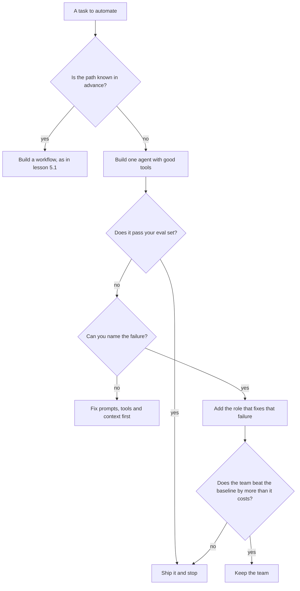

# Module 11 — Multi-agent systems

*A team of agents is the most tempting idea in agent engineering and, more often than not, the wrong one. This module teaches both halves: how to build a team properly, and how to tell whether you should. Lesson 11.1 covers the patterns (supervisor and workers, orchestrator-workers, pipelines, critic loops, hand-offs), the costs and new failures a team brings, the three reasons that justify one (parallel independent work, context isolation, different permissions per role), typed hand-off contracts, role-specific tool permissions, shared state, budgets and termination for the whole team, tracing across agents, an honest tour of five frameworks, and a decision rule: try one agent with good tools first. Lesson 11.2 is the lab: a researcher, a writer and a reviewer run by a supervisor in plain code, with a Pydantic contract checked at every hand-off, a team budget and a round cap, drills that make each guard fire, a comparison against a single agent on five questions, and an honest list of what the offline mock can and cannot show.*

> **Layer:** Agents — when one agent should become several, how they hand work to each other, and the limits that keep a team from running away.

---

# 11.1 — Supervisors, workers and hand-offs: when multi-agent is the wrong answer
*Level: 🟡 Intermediate* · *Prerequisites: 3.1, 5.1, 8.1* · *Layer: Agents*

## ⚡ In 60 seconds
- A **team** is several agents, each with its own prompt, tools and context, plus a **supervisor** that decides who goes next and **hand-offs** between them.
- A team is a cost, not a feature: more calls, tokens and latency, compounding errors, lost context.
- Three reasons pay for it: **parallel independent work**, **context isolation**, **different permissions per role**.
- A hand-off is a **contract**: a typed Pydantic message the supervisor validates, plus code checks. Permissions belong to the role.
- Rule of thumb: build one agent with good tools first; add a second only for a named failure it fixes.

## 🧭 Why it matters
Lujain has read about "agent crews". For Najm Desk's policy-answer route she proposes six agents: a planner, a searcher, a fact-checker, a writer, an editor and a manager who picks who speaks (hypothetical). The demo answers "How do I request a new laptop?" well. Fahad asks three questions. How many model calls was that? Eleven. How does one agent with the same search tool score on the same twenty questions? She has not run it. If two agents never agree, who stops them? Nobody.

The trace is six separate logs. The fact-checker had flagged "delivered within 3 business days"; the policy says 5. The manager forwarded "fact-check passed, minor edits", and the editor kept the wrong number. The finding died at a hand-off, and no log showed it.

Write-ups disagree because tasks differ. Anthropic described a research system that fans questions out to parallel workers and reported token use many times that of a chat. Cognition's "Don't Build Multi-Agents" argues that when each decision depends on the last, as in coding, split context produces conflicting decisions. A team has a price; it must buy something.

## 📐 How it works

### 🟢 The essentials

**Terms.** A *multi-agent system* has more than one agent (Module 8). A *hand-off* is the message that moves work from one agent to the next. The *supervisor* decides who speaks next: plain code, a model choosing from a short list, or a model that proposes while code checks the move. Prefer code: it is cheap, testable and never "decides" to call itself fifty times. Let a model route only when the next step depends on content you cannot list in advance, and check its choice against an allow-list. A team with a code supervisor is a workflow (lesson 5.1) whose steps are agents.

| Pattern | Who decides what happens next | Najm Desk example |
|---|---|---|
| Supervisor and workers | The supervisor routes tasks to specialists and merges results | Access, hardware and policy specialists |
| Orchestrator-workers | A model plans subtasks at run time; workers run them, often in parallel | A notice amends N policies: one worker each |
| Pipeline (prompt chaining) | A fixed order; each output feeds the next | Research, write, review |
| Critic loop (evaluator-optimiser) | A producer and a judge repeat until accepted or capped | A draft and a reviewer |
| Hand-off | Control moves to an agent that now owns the conversation | A case goes to the access agent, or to a person |
| Group chat | Agents talk in free turns | None: hard to bound and test |

**The price.**
- *Calls, tokens, latency.* Each agent re-reads its prompt and its input: forward 3,000 tokens of search results to a writer and a reviewer and you pay for them as input three times. Sequential agents add their delays; parallel ones cost the slowest.
- *Errors compound.* Four stages, each right 95% of the time with independent failures, give a chain right 0.95 to the fourth power, about 81%; at 90% each, about 66%. These rates are illustrative; yours come from an eval.
- *Debugging and context loss.* A failure surfaces three agents from its cause, and a summary drops the fact that mattered.
- *New failures.* Ping-pong, a "reviewer" that starts rewriting, conflicting assumptions, and injection that travels: text a researcher read in a document reaches the next agent as an instruction (Module 13).

**Three reasons that justify a team.**
1. *Parallel independent work.* Twelve documents to summarise, none needing another's output. If the subtasks are fixed in advance, plain parallelisation (lesson 5.1) needs no agents.
2. *Context isolation.* A worker reads 40 pages of ticket history in a throwaway context and returns 200 words as a typed summary. The supervisor's context stays small; personal data can come back redacted.
3. *Different permissions per role.* The agent that reads text strangers wrote gets no write tools; the agent that can request an unlock never reads it. Splitting private data, untrusted content and external communication across roles is one defence against Simon Willison's "lethal trifecta" (one practitioner's framing), if the hand-off is validated data and not free text.

**The decision rule: one agent first.**



The single agent is the baseline every team must beat on the same eval, cost and latency counted.

### 🟡 Going deeper

**A hand-off is a contract.** It is the only channel between two agents, so make it a typed message: a Pydantic model with types, limits, closed vocabularies and `extra="forbid"`, validated by the supervisor in both directions. One field of the researcher's contract, given a sloppy reply:

```python
# one field of a hand-off contract: what the researcher owes the writer
from pydantic import BaseModel, ConfigDict, Field, ValidationError


class Finding(BaseModel):
    model_config = ConfigDict(extra="forbid")      # a field nobody agreed on is a breach
    source: str = Field(pattern=r"^[a-z0-9-]+$")    # a policy id, such as laptop-requests
    quote: str = Field(min_length=10)               # copied word for word


try:   # a sloppy reply: a title instead of an id, a two-letter "quote", an extra field
    Finding.model_validate_json('{"source": "Laptop policy", "quote": "ok", "confidence": 0.9}')
except ValidationError as e:
    for err in sorted(e.errors(), key=lambda err: err["loc"]):    # sorted: pydantic versions order the errors differently
        print(err["loc"][0], "->", err["msg"])
```

```text
confidence -> Extra inputs are not permitted
quote -> String should have at least 10 characters
source -> String should match pattern '^[a-z0-9-]+$'
```

Structured outputs (lesson 3.1) constrain the shape, but the schema subset the API accepts cannot enforce limits such as `max_length`, and a reply cut off by `max_tokens` or a `refusal` may not match, so validate anyway. A schema cannot hold two rules, so code checks them: *grounding* (is the quote really in what the tool returned?) and *consistency* (does the draft cite only sources in the notes?). On a failure, repair once with the error text; then hand a packet to a person (lesson 8.1).

**Permissions belong to the role.** Write the table before the prompts; enforce it three times: the request lists only the role's tools; the dispatcher refuses any call outside its allow-list; a write passes a gate or a person (Modules 7 and 13). "You must not search" in a prompt is only a request. Default to deny; give no role both untrusted input and a write tool. A contract narrows the channel, but a string field can still carry an instruction: bound it, ground it in the source and never place it among the next agent's instructions ([*Secure AI & Application Security*, lesson 9.2 — Agents and tools: excessive agency, least-privilege tools and MCP](../secai/index.html#/9.2)).

| Role | Tools | What it sees |
|---|---|---|
| Researcher | Read-only policy search | Raw search results |
| Writer | None | The typed notes only |
| Reviewer | None | The notes and the draft |

**Shared state and messaging.** With *message passing* the supervisor sends a contract to a worker and gets one back. With *shared state*, a blackboard, agents read and write one object. Prefer one writer: the supervisor owns the state, agents are functions from one contract to the next, and parallel results merge in code under a stated conflict rule. Two writers race; a reader of everything pays for pollution (Module 9).

**Budgets and termination for the team.** The Module 8 guards apply to each agent and to the team: a step cap per agent; a token budget summed over every agent and checked before each call; a round cap on every critic loop; a cap on workers started and the plan validated as a contract before any worker runs; a deadline; a no-progress rule (the same reviewer issues twice); and a packet to a person when any fires. Compute the worst case: 4 steps per agent turn and 2 review rounds allow 4 + 2 × (4 + 4) = 20 calls. If that does not fit, lower the caps.

**Tracing across agents.** Give the run one id and record each model call (agent, step, tokens, stop reason, request id), tool call (allowed or refused), hand-off (contract, valid or not) and the stop with its packet. In OpenTelemetry terms: a root span for the run, a child span per agent turn, model and tool calls beneath (the Anthropic SDK can emit spans, in beta at the time of writing). A trace must say which agent introduced a claim and where the tokens went ([*Cloud & DevOps*, lesson 5.1 — Telemetry: logs, metrics, traces and OpenTelemetry](../cloud/index.html#/5.1)).

### 🔴 Expert view

**Five frameworks.** They wrap the same patterns in different syntax, so a developer who has built this team by hand can read any of them. This course shows none of their code, which changes between releases. What each is built around, as its makers describe it at the time of writing (2026; check the current documentation):

| Framework | Built around |
|---|---|
| LangGraph | A graph of nodes over a shared state, with checkpoints and pauses for a human |
| CrewAI | Role-based crews: agents with a role and goal, tasks, a sequential or hierarchical process |
| Google ADK | Trees of sub-agents, plus workflow agents that run them in sequence, in parallel or in a loop |
| Microsoft Agent Framework | Agents and workflows for .NET and Python, positioned as the successor to Semantic Kernel and AutoGen |
| OpenAI Agents SDK | Few primitives: agents, hand-offs, guardrails, tracing |

On the Claude side, the Claude Agent SDK has subagents, and Managed Agents (beta) lets a coordinator delegate to agents that run in their own context-isolated threads; check availability.

**What to evaluate.** Can I cap steps, tokens, rounds and time for the whole run? Does one trace show every call and hand-off? Can I test a team against a fake model? How does state persist and resume? Are hand-offs typed and validated? Can I set tools and approvals per agent? Can I control the exact prompts? Does it fit our identity, secrets and deployment (your platform)? The decisive test: port the supervisor of lesson 11.2 into it in a day. If you cannot keep the caps, contracts and trace, it has taken over what you must own. Do not standardise the group before you have run that lab.

**How teams fail, and how to test one.** A 2025 study, "Why Do Multi-Agent LLM Systems Fail?" (Cemri et al.), sorted failures in several open frameworks into flawed specification and design, misalignment between agents, and weak verification and termination: a checklist for every hand-off. Test a team end to end against the single-agent baseline on the same set (Module 12), then by part: the researcher's recall, the writer's groundedness, the reviewer's catch rate on drafts with one planted error, false alarms included. A reviewer that is the same model with the same context shares the writer's blind spots, and judges tend to favour text like their own ([*Software Testing*, lesson 7.1 — Evals](../testing/index.html#/7.1)). Before adding one, try better tools, a "check your own work" instruction, higher effort, and code checks.

## 🧰 The toolkit
| Tool, practice or pattern | What it is and does | When to reach for it |
|---|---|---|
| **Supervisor** | A state machine in code that decides who runs, owns the state and enforces the caps | Every team |
| **Hand-off contract** | A Pydantic model per message, validated by the supervisor, plus code checks for grounding and consistency | Every hand-off |
| **Role permission table** | Per role: tools, data and write rights, enforced in the dispatcher | Before the second agent exists |
| **Team budget** | Token budget, round, step and fan-out caps and a deadline, checked before each call | Every team |
| **Cross-agent trace** | One run id; a record per model call, tool call, hand-off and stop | Every run |
| **Single-agent baseline** | The same task, contract and checks with one agent | Before and after adding an agent |

## 🏛️ In practice at Najm Bank
The artefact is the **Team Design Record**: one page, written before a second agent exists and reviewed by Fahad, and by Noura where roles split permissions. Here it is for Lujain's crew (a fictional proposal):

| Question | Najm Desk policy answers |
|---|---|
| Decision | A router workflow, one bounded agent on the policy route, a citation check in code. No team in v1. |
| Named failure of the baseline | None yet; revisit when the eval set (Module 12) shows one |
| What would justify a team? | Parallel work (a notice amending many documents); isolation (one reader per long document); permissions (a reader of outside text, no write tools) |
| Baseline and team | Score, cost and latency on the same set, filled in before anyone draws a team |
| Roles, contracts, caps | The permission table; a Pydantic contract per hand-off; token, round, step and time caps |
| Exit criterion | Drop the team if it does not beat the baseline by more than it costs |

Hind needs none of the vocabulary: she asks whether answers are right, fast and cheap.

**Your platform.** Before a team ships:

| Question | Your answer |
|---|---|
| Does each role get its own identity and scopes, or one service account for all? | |
| Where does a run's trace go, and who can read it? | |
| Where are the caps set, and how is any role's write approved and audited? | |

## 🛠️ Exercises
- 🟢 **Is it a team?** Offline, on paper. Classify five sketches as prompt, workflow, single agent or multi-agent, and name the pattern: (a) one prompt that summarises a ticket thread; (b) a router with five routes, each with a tool loop; (c) a planner that starts one worker per changed policy; (d) a writer and a reviewer in a loop; (e) a "manager" talking freely to six peers. *Done when:* each has a class, a pattern and a first build, and you have named the sketch that should not exist.
- 🟡 **Write two contracts.** Offline. For a triage agent handing a case to an access specialist, write both hand-off models in Pydantic (closed vocabulary, limits, `extra="forbid"`) and two code checks a schema cannot hold. *Done when:* six inputs, three valid and three invalid, behave as predicted.
- 🔴 **Can a reviewer catch planted errors?** *Needs the real API*, with the spending cap from lesson 0.2. Write ten short policy answers: five correct, five with one planted error (a wrong number, an unsupported claim, an uncited sentence). With `MODEL=claude-sonnet-5-5`, ask a reviewer prompt, given the policy text, to approve or revise each; repeat with `claude-haiku-5-5`. Ten answers is a pilot, not a measurement. *Done when:* `NOTES.md` has caught errors and false alarms per model, the date, the ids, and whether you would pay for the reviewer.

## ⚠️ Mistakes and traps
- **A team because the roles look tidy.** An org chart is not a failure. Name the failure one agent has, or build one agent.
- **Free-text hand-offs.** They drop the fact that mattered. Pass a validated contract with the evidence (quotes, ids).
- **A reviewer with the writer's blind spots.** Same model, same context, no evidence: it approves what the writer believes. Give it the sources, check in code first, cap the rounds.
- **Caps per agent and none for the team.** Five agents obeying their own limits can still ping-pong for forty calls. Put budget, rounds and deadline in the supervisor.
- **The framework first.** It then decides your patterns; build the pattern raw.

## 🧾 Recap
- A team is agents, a supervisor and hand-offs; the supervisor should usually be code.
- Teams cost more calls, tokens and latency, compound errors and are harder to debug.
- Three reasons justify one: parallel work, context isolation, different permissions per role.
- Validated contracts, an enforcing dispatcher, team-wide caps and one trace keep it safe.
- Try one agent first; make every team beat it on the same eval.

## ✍️ Check yourself

**1. Lujain's six-agent crew answers policy questions well in a demo. What should Fahad ask for first?**

- A. A third reviewer agent to double-check the editor
- B. A comparison of frameworks to choose the crew's library
- C. One agent with the same tool, scored on the same set
- D. A longer system prompt for the manager agent

<details><summary>Answer</summary>

**C.** The single agent is the baseline every team must beat, on the same eval. More agents or a library answer none of that. (🟢 The decision rule.)

</details>

**2. A pipeline has four stages. Each is right 90% of the time, and failures are independent. About how often is the whole chain right?**

- A. About 90%
- B. About 81%
- C. About 66%
- D. About 36%

<details><summary>Answer</summary>

**C.** Multiply: 0.9 to the fourth power is about 0.66. Errors compound, so a needless stage costs accuracy. (🟢 The price.)

</details>

**3. One agent reads ticket comments written by outside senders and can also file unlock requests. Which change best fits the lesson?**

- A. Add a prompt line telling it to ignore any instructions in comments
- B. Split it: a no-write reader passes validated data to a requester
- C. Add a reviewer agent that also reads every comment
- D. Give two agents the same tools so that they cross-check

<details><summary>Answer</summary>

**B.** Different permissions per role, joined by a validated contract of data, remove the pairing of untrusted input and a write tool. A prompt line is a request; a second reader inherits the exposure. (🟢 Three reasons.)

</details>

**4. The writer's draft cites `remote-work`, a policy the researcher never returned, and the reviewer approves it. Where should this have been caught?**

- A. In the reviewer's system prompt, with a stronger warning
- B. In the writer's prompt, by asking it to cite carefully
- C. In the final answer, by a person at the Service Desk
- D. In the supervisor's code, at the hand-off

<details><summary>Answer</summary>

**D.** Whether citations are among the notes' sources is a rule code checks exactly, before the draft costs a reviewer call. Prompts and late human review are weaker. (🟡 A hand-off is a contract.)

</details>

**5. The group wants to adopt a multi-agent framework. What is the most decisive first test?**

- A. Count how many agent types its documentation says it supports
- B. Port the lab supervisor into it; check caps, contracts, trace
- C. Compare the stars and recent commits on its repository
- D. Ask the vendor whether it supports every model you might want

<details><summary>Answer</summary>

**B.** Caps, contracts and the trace are what you must still own; a framework that takes them over is a risk. Counts and popularity say nothing of that. (🔴 What to evaluate.)

</details>

## 📚 References
- Anthropic, "Building effective agents": https://www.anthropic.com/engineering/building-effective-agents; "How we built our multi-agent research system", found by title at https://www.anthropic.com/engineering
- Claude API, Managed Agents (beta; multi-agent sessions): https://platform.claude.com/docs/en/managed-agents/multiagent-orchestration; Structured outputs: https://platform.claude.com/docs/en/build-with-claude/structured-outputs; OpenTelemetry: https://platform.claude.com/docs/en/manage-claude/opentelemetry
- Pydantic: https://docs.pydantic.dev/; OpenTelemetry: https://opentelemetry.io/docs/
- Found by title: Cemri et al., "Why Do Multi-Agent LLM Systems Fail?" (2025); Cognition, "Don't Build Multi-Agents" (2025).
- [*Software Testing*, lesson 7.2 — Testing RAG, tool use and agents](../testing/index.html#/7.2)
- **Read this week (Module 11).** Grokking AI Applications, chapter 6 again (Implementing agentic structures), the supervisor section: https://www.manning.com/books/grokking-ai-applications. Gulli, *Agentic Design Patterns*, chapter 7 (Multi-Agent) and chapter 15 (Inter-Agent Communication): the free draft listed in lesson 0.1. Microsoft, *AI Agents for Beginners*, lesson 08: https://github.com/microsoft/ai-agents-for-beginners. LangChain Academy, the free LangGraph course: https://academy.langchain.com/

---

# 11.2 — Lab: a three-agent team with explicit hand-off contracts
*Level: 🟡 Intermediate* · *Prerequisites: 3.2, 8.2, 11.1* · *Layer: Agents*

## ⚡ In 60 seconds
- A researcher, writer and reviewer run by a supervisor in plain code, each with its own prompt, tools and contract.
- Only the researcher has a tool (read-only search), enforced by a dispatcher.
- Guards: step cap, team token budget, round cap, one repair per broken contract, then a hand-off packet.
- Offline, the team makes about 2.3 times one agent's calls for the same scripted answers: cost, not quality.

## 🧭 Why it matters
Fahad's condition for Lujain's crew (hypothetical): every hand-off checked, a stop that needs nobody, its cost beside one agent's. Her first version passed free text: the researcher wrote "found some relevant policies, see above", the writer filled the gap from memory ("3 business days") and the reviewer, the same model, approved. Nobody knew which agent invented the number.

## 📐 How it works

### 🟢 The essentials

**Run it.** The playbook (`playbooks/m11_lab.json`) scripts the mock: its rules match the role in each system prompt (`ROLE: researcher`) and reply with fixed JSON or a tool call. Against the real API the code is identical.

```bash
cd aiapps/labkit
python -m labkit.mock_server --port 8787 --playbook playbooks/m11_lab.json &
export ANTHROPIC_BASE_URL=http://127.0.0.1:8787 ANTHROPIC_API_KEY=mock TRACE_FILE=m11_trace.jsonl
python labs/m11/team.py "How do I request a new laptop?"
```

```text
Staff can request a new laptop through the IT Service Desk portal under Hardware > New device. ['laptop-requests']
[done: 4 calls, 633 tokens; per role (calls, in, out): {'researcher': [2, 333, 56], 'writer': [1, 82, 36], 'reviewer': [1, 117, 9]}]
```

The writer's one call took 82 input tokens, the researcher's two 333: the writer sees the notes, not the search results. `m11_trace.jsonl` holds one JSON line per model call, tool call, hand-off, review verdict and stop, each tagged with the run id (the file is appended to, so several runs share it).

**contracts.py.** Read `check_notes` first: a schema can say a quote is a string; only code can say it is true.

```python
# labs/m11/contracts.py
"""Lab 11.2: the hand-off contracts. Every message between two agents is one of these models, validated by the supervisor."""
from typing import Literal

from pydantic import BaseModel, ConfigDict, Field, ValidationError, model_validator


class Contract(BaseModel):
    model_config = ConfigDict(extra="forbid")         # a field nobody agreed on is a breach


class Brief(Contract):                                # supervisor -> researcher
    question: str = Field(min_length=10, max_length=300)


class Finding(Contract):
    source: str = Field(pattern=r"^[a-z0-9-]+$")      # a policy id, such as laptop-requests
    quote: str = Field(min_length=10, max_length=600)  # copied word for word from that policy


class Notes(Contract):                                # researcher -> writer
    findings: list[Finding] = Field(max_length=5)
    gaps: list[str]                                   # what the policies do not say; often empty


class Draft(Contract):                                # writer -> reviewer (the solo agent too)
    answer: str = Field(min_length=20, max_length=1200)
    citations: list[str] = Field(min_length=1)        # an answer with no source is not an answer


class Review(Contract):                               # reviewer -> supervisor
    verdict: Literal["approve", "revise"]
    issues: list[str]

    @model_validator(mode="after")
    def revise_needs_reasons(self):
        if self.verdict == "revise" and not self.issues:
            raise ValueError("a revise verdict must list at least one issue")
        return self


def check_notes(notes: Notes, seen: dict[str, str]) -> None:
    """What a schema cannot hold. `seen` is what the search tool really returned: the ground truth for every quote."""
    for f in notes.findings:
        if " ".join(f.quote.split()) not in " ".join(seen.get(f.source, "").split()):
            raise ValueError(f"the quote for {f.source!r} is not word for word in a policy the search returned")


def check_citations(draft: Draft, allowed: set[str]) -> None:
    stray = sorted(set(draft.citations) - allowed)
    if stray:
        raise ValueError(f"the draft cites {stray}, which are not among the sources it was given")


def describe(e: ValueError) -> str:
    """A broken contract as one line the offending agent can act on (a pydantic ValidationError is a ValueError)."""
    if isinstance(e, ValidationError):
        return "; ".join(f"{'.'.join(map(str, x['loc'])) or 'reply'}: {x['msg']}" for x in e.errors())
    return str(e)
```

### 🟡 Going deeper

**team.py.** `Team` holds the shared state, which only the supervisor writes. Read `Team.tool` (the allow-list comes first), then `Team.agent` (two caps before the call; parse, check, one repair), then `run`: the whole supervisor.

```python
# labs/m11/team.py
"""Lab 11.2: a researcher, a writer and a reviewer, run by a supervisor that is plain code.
  Environment: MODEL, TEAM_TOKEN_BUDGET, MAX_ROUNDS, TRACE_FILE."""
import json
import os
import re
import sys
import uuid
from collections import namedtuple
from pathlib import Path

import anthropic
from anthropic import transform_schema
from pydantic import ValidationError

from contracts import Brief, Draft, Notes, Review, check_citations, check_notes, describe

MODEL = os.environ.get("MODEL", "claude-sonnet-5-5")
POLICIES = Path(__file__).resolve().parents[2] / "labkit" / "data" / "policies"
BUDGET, ROUNDS, STEPS = int(os.environ.get("TEAM_TOKEN_BUDGET", 20_000)), int(os.environ.get("MAX_ROUNDS", 2)), 4
SEARCH = {"name": "search_policies", "description": "Search the IT policy library; returns matching policies, ids and full text.",
          "input_schema": {"type": "object", "properties": {"query": {"type": "string"}}, "required": ["query"]}}
ROLES = {   # role -> (system prompt, the tools it may use, the contract it must return). Nothing else reaches the model.
    "researcher": ("ROLE: researcher. Call search_policies, then quote the policies word for word with their ids. "
                   "If they are silent, return no findings and say what is missing.", {"search_policies"}, Notes),
    "writer": ("ROLE: writer. Answer in two or three sentences using ONLY the notes, citing ids. Fix every reviewer issue.", set(), Draft),
    "reviewer": ("ROLE: reviewer. Approve only if every claim in the draft is in the notes; else list each problem.", set(), Review),
    "solo": ("ROLE: solo. Call search_policies, then answer in two or three sentences from its results, citing ids.", {"search_policies"}, Draft),
}
Result = namedtuple("Result", "ok reason answer citations calls tokens packet")


def search_policies(query: str) -> str:
    """Read-only. The best two policies by words shared with the query (at least two)."""
    words = lambda text: {w.rstrip("s") for w in re.findall(r"[a-z]{4,}", text.lower())}
    hits = sorted(((len(words(query) & words(p.read_text())), p.stem, p.read_text().strip()) for p in POLICIES.glob("*.md")), reverse=True)
    return f"Results for '{query}':\n" + ("\n".join(f"[{i}] {t}" for n, i, t in hits[:2] if n >= 2) or "No policies matched.")


class Escalate(Exception):
    """A guard fired or a contract broke twice: stop for a person. args = (reason, why)."""


class Team:
    """One run. Its attributes are the shared state: only the supervisor writes them; an agent sees only its own contract."""

    def __init__(self, question, client=None, budget=BUDGET, max_rounds=ROUNDS, trace_file=None):
        self.question, self.budget, self.max_rounds, self.trace_file = question, budget, max_rounds, trace_file
        self.client, self.run_id = client or anthropic.Anthropic(timeout=60.0), uuid.uuid4().hex[:8]
        self.tokens = self.calls = 0
        self.by_role: dict[str, list[int]] = {}      # role -> [calls, input tokens, output tokens]
        self.seen: dict[str, str] = {}               # policy id -> the text the search tool really returned
        self.events, self.draft, self.review = [], None, None

    def log(self, event, **fields):                  # one JSON line per event, one run id on all of them
        self.events.append({"run": self.run_id, "seq": len(self.events) + 1, "event": event, **fields})
        if self.trace_file:
            with open(self.trace_file, "a", encoding="utf-8") as f:
                f.write(json.dumps(self.events[-1], default=str) + "\n")

    def tool(self, role, name, args):
        """The gate between a request and a run: the role's allow-list first, then the tool. Never raises."""
        if name not in ROLES[role][1]:
            self.log("tool_refused", agent=role, tool=name)
            return f"tool {name!r} is not available to the {role}", True
        out = search_policies(str(args.get("query", "")))
        found = dict(re.findall(r"^\[([a-z0-9-]+)\] (.+?)(?=\n\[[a-z0-9-]+\] |\Z)", out, re.M | re.S))
        self.seen.update(found)
        self.log("tool", agent=role, tool=name, query=args.get("query"))
        return out, False

    def agent(self, role, payload, check=None):
        """One agent turn: returns a validated contract object, or raises Escalate."""
        system, allowed, contract = ROLES[role]
        extra = {"tools": [SEARCH]} if allowed else {}
        out_config = {"effort": "low", "format": {"type": "json_schema", "schema": transform_schema(contract)}}
        messages, repaired = [{"role": "user", "content": payload}], False
        for step in range(1, STEPS + 1):                                        # cap 1: model calls inside one agent turn
            if self.tokens >= self.budget:                                      # cap 2: the team's tokens, checked BEFORE the call
                raise Escalate("token_budget", f"{self.tokens} of {self.budget} tokens spent before the {role} call")
            try:
                resp = self.client.messages.create(model=MODEL, max_tokens=2048, system=system, messages=messages, output_config=out_config, **extra)
            except anthropic.APIError as e:                                     # the SDK has already retried 429 and 5xx twice
                raise Escalate("model_error", f"{type(e).__name__} in the {role} call") from e
            used = [resp.usage.input_tokens, resp.usage.output_tokens]
            self.tokens, self.calls = self.tokens + sum(used), self.calls + 1
            self.by_role[role] = [a + b for a, b in zip(self.by_role.get(role, [0, 0, 0]), [1, *used])]
            self.log("model", agent=role, step=step, stop_reason=resp.stop_reason, input_tokens=used[0], output_tokens=used[1], request_id=resp._request_id)
            messages.append({"role": "assistant", "content": resp.content})
            if resp.stop_reason == "tool_use":                                  # ONE user message, a result for EVERY tool_use id
                results = []
                for b in (b for b in resp.content if b.type == "tool_use"):
                    out, bad = self.tool(role, b.name, b.input)
                    results.append({"type": "tool_result", "tool_use_id": b.id, "content": out, "is_error": bad})
                messages.append({"role": "user", "content": results})
                continue
            if resp.stop_reason != "end_turn":                                  # max_tokens, refusal, pause_turn: no contract to read
                raise Escalate("stop_reason", f"the {role} stopped with {resp.stop_reason}")
            try:
                obj = contract.model_validate_json(next((b.text for b in resp.content if b.type == "text"), ""))     # the hand-off
                if check:
                    check(obj)                                                  # rules a schema cannot hold
            except ValueError as e:
                problem = describe(e)
                self.log("contract_broken", agent=role, contract=contract.__name__, problem=problem[:300])
                if repaired:                                                    # one repair per agent turn, then a person
                    raise Escalate("contract", f"the {role} broke the {contract.__name__} contract twice: {problem[:200]}")
                repaired = True
                messages.append({"role": "user", "content": f"Your reply broke the hand-off contract: {problem}. Reply with corrected JSON only."})
                continue
            self.log("handoff", agent=role, contract=contract.__name__, ok=True)
            return obj
        raise Escalate("step_cap", f"the {role} used {STEPS} model calls without a valid reply")

    def run(self):
        """The supervisor: a fixed state machine in plain code. It decides who speaks next; no model does."""
        try:
            brief = Brief(question=self.question)                               # even the user's question passes a contract
            notes = self.agent("researcher", brief.model_dump_json(), lambda n: check_notes(n, self.seen))
            if not notes.findings:                                              # stop error compounding: nothing to write from
                raise Escalate("no_sources", "; ".join(notes.gaps) or "the policies do not cover this")
            sources = {f.source for f in notes.findings}
            context, issues = f"QUESTION: {self.question}\nNOTES: {notes.model_dump_json()}", ""
            for round_no in range(1, self.max_rounds + 1):                      # the reviewer loop has a cap
                self.draft = self.agent("writer", context + issues, lambda d: check_citations(d, sources))
                self.review = self.agent("reviewer", f"{context}\nDRAFT: {self.draft.model_dump_json()}")
                self.log("review", round=round_no, verdict=self.review.verdict, issues=self.review.issues)
                if self.review.verdict == "approve":
                    return self.finish("done")
                issues = f"\nREVIEWER ISSUES: {json.dumps(self.review.issues)}\nPREVIOUS DRAFT: {self.draft.model_dump_json()}"
            raise Escalate("max_rounds", f"{self.max_rounds} reviews and no approval")
        except Escalate as e:
            return self.finish(*e.args)
        except ValidationError as e:                                            # only the user's own question can fail here
            return self.finish("bad_brief", describe(e))

    def run_solo(self):
        """The baseline: one agent, one tool, the same Draft contract and guards."""
        try:
            self.draft = self.agent("solo", f"QUESTION: {self.question}", lambda d: check_citations(d, set(self.seen)))
            return self.finish("done")
        except Escalate as e:
            return self.finish(*e.args)

    def finish(self, reason, why=""):
        ok = reason == "done"
        packet = None if ok else {"run": self.run_id, "reason": reason, "why": why, "question": self.question, "calls": self.calls,
                                  "last_draft": self.draft and self.draft.model_dump(), "last_issues": self.review.issues if self.review else []}
        self.log("stop", reason=reason, calls=self.calls, tokens=self.tokens, handoff=packet)
        answer = self.draft.answer if ok else f"I could not finish this ({reason}). A Service Desk agent has the case: ref {self.run_id}."
        return Result(ok, reason, answer, self.draft.citations if ok else [], self.calls, self.tokens, packet)


if __name__ == "__main__":
    team = Team(" ".join(sys.argv[1:]) or "How do I request a new laptop?", trace_file=os.environ.get("TRACE_FILE", "m11_trace.jsonl"))
    res = team.run()
    print(res.answer, res.citations or "")
    print(f"[{res.reason}: {res.calls} calls, {res.tokens} tokens; per role (calls, in, out): {team.by_role}]")
    if res.packet:
        print(json.dumps(res.packet, indent=2, ensure_ascii=False))
```

**compare.py** runs each question through `Team.run`, then `Team.run_solo`:

```python
# labs/m11/compare.py
"""Lab 11.2: does the team earn its extra calls? Five questions through the team, then one agent.
  python labs/m11/compare.py    (for money, set PRICE_IN_PER_MTOK and PRICE_OUT_PER_MTOK from the price page)"""
import os

from team import Team

TASKS = [("How do I request a new laptop?", "Hardware > New device"), ("I lost my phone: what do I do about MFA?", "Service Desk immediately"),
         ("What is the response time for a P2 ticket?", "within 4 hours"), ("When is the Service Desk open?", "7:00 to 17:00"),
         ("Can I paste customer data into an external AI tool?", "must not")]      # (question, a phrase a right answer contains)
PRICE = [float(os.environ.get(k, 0)) for k in ("PRICE_IN_PER_MTOK", "PRICE_OUT_PER_MTOK")]


def compare():
    total = {"team": [0, 0, 0], "solo": [0, 0, 0]}                              # calls, input tokens, output tokens
    for question, expect in TASKS:
        for mode in total:
            t = Team(question)
            r = t.run() if mode == "team" else t.run_solo()
            row = [t.calls, sum(v[1] for v in t.by_role.values()), sum(v[2] for v in t.by_role.values())]
            total[mode] = [a + b for a, b in zip(total[mode], row)]
            print(f"{question:<54}{mode:<5}{('right' if expect in r.answer else 'wrong') if r.ok else r.reason:<8}calls={row[0]} in={row[1]} out={row[2]}")
    for mode, (calls, tin, tout) in total.items():
        print(f"{mode}: {calls} calls, {tin + tout} tokens" + (f", cost {(tin * PRICE[0] + tout * PRICE[1]) / 1e6:.4f}" if all(PRICE) else ""))
    t, s = total["team"], total["solo"]
    print(f"team / solo: calls x{t[0] / s[0]:.1f}, tokens x{(t[1] + t[2]) / (s[1] + s[2]):.1f}")


if __name__ == "__main__":
    compare()
```

```text
...
What is the response time for a P2 ticket?            team right   calls=6 in=746 out=147
What is the response time for a P2 ticket?            solo right   calls=2 in=298 out=47
...
team: 23 calls, 3955 tokens
solo: 10 calls, 1902 tokens
team / solo: calls x2.3, tokens x2.1
```

That is 2.3 times the calls and 2.1 times the tokens; money is tokens times the current prices. The caps allow at most 4 + 2 × (4 + 4) = 20 calls.

**The drills.** Run `python labs/m11/team.py "<question>"`. A `[drill:...]` tag ends the laptop question and only the playbook acts on it.

| Question | What happens | Guard |
|---|---|---|
| P2 response time | Draft one rejected, draft two approved (6 calls) | Reviewer loop |
| Service Desk opening hours | Draft one cites nothing; one repair fixes it (5 calls) | Contract, one repair |
| Laptop `[drill:never-approve]` | `max_rounds` after 6 calls; the packet has the last draft | Round cap |
| Laptop `[drill:fabricate]` | `contract` after 3 calls; no writer | Grounding check |
| Laptop `[drill:overreach]` | The writer's search is refused; the run finishes | Allow-list |
| Laptop with `TEAM_TOKEN_BUDGET=300` | `token_budget` after 2 calls, 389 tokens | Team budget |

The budget is checked before a call, so one call can cross it.

### 🔴 Expert view

**Honest caveats.** `pytest tests/test_m11_team.py` covers every guard, drill and request shape, but it shares the playbook's script: it proves the plumbing, not the team. *Works offline:* contracts, caps, allow-list, stop reasons, packets and the trace; token counts are estimates. *Needs the real API:* whether the researcher quotes the right policy, the writer stays in the notes and the reviewer catches real errors; latency, cost, and how tools and structured outputs combine. The `right` in `compare.py` is only a phrase match. In the overreach drill the mock asks for a tool the writer never had; a real model rarely would, and the real API's reaction to a `tool_result` in a request that declares no tools is untested here (if it returns an error, the run ends in `model_error`). The library is trusted text, so nothing tests injection, and `gaps` and `issues` stay free text.

## 🧰 The toolkit
| Tool, practice or pattern | What it is and does | When to reach for it |
|---|---|---|
| **Hand-off contract** | A Pydantic model per message, plus code checks | Every hand-off |
| **Team budget** | A token budget, round cap and step cap, checked before each call | Every team |
| **Hand-off packet** | Run id, reason, last draft, issues, for a named queue | Every guard that fires |

## 🏛️ In practice at Najm Bank
**Weekly deliverable.** Commit `week-11/` with `labs/m11/` and passing tests; the `compare.py` table with a paragraph; the packet from each drill that ends in one; a Team Design Record (lesson 11.1) for a feature of your own; and `NOTES.md` with quiz answers.

**Group session (60 minutes).** (1) Swap `compare` tables; explain the ratios (15). (2) Run the drills; name each guard and the packet field a Service Desk agent needs (20). (3) Write a hand-off that passes the schema yet is wrong (15). (4) Team or one agent for v1 (10)?

**Build it with Claude Code.** Give this spec to Claude Code in plan mode (check the current Claude Code documentation) and review the plan before any edit:

```text
Goal: build labs/m11/contracts.py, team.py and compare.py as in lesson 11.2, with pytest tests in
labkit/tests/test_m11_team.py. Context: Python 3.11, anthropic>=1,<2, pydantic 2, the offline mock in
aiapps/labkit (read its README and playbooks/m11_lab.json). MODEL comes from the environment.
Constraints:
- The supervisor is a fixed state machine in code; no model picks the next agent.
- Each role has its own prompt, tools and Pydantic contract. Only the researcher gets a tool (read-only
  search); the dispatcher refuses any tool outside the calling role's allow-list.
- Validate every hand-off (model_validate_json, extra="forbid"), then check in code: quotes word for word
  from what search returned, citations among the notes' sources. One repair, then a hand-off packet.
- Check the step cap and the team token budget BEFORE each call; cap the reviewer loop.
- ONE user message with a tool_result for EVERY tool_use id. Never read content[0].
- No temperature, prefill or forced tool_choice. No new dependencies. Touch no other files.
Acceptance: pytest passes offline; each drill ends in its stated reason.
One file at a time; run the tests after each step.
```

**Verify before you accept it.**
- Run the tests, then break one guard at a time: a named test must fail. Run `compare.py`: ten rows, all `right`.
- Search the diff for `temperature`, `tool_choice`, `eval(`, `content[0]` and a writer given a tool. Read `Team.tool` and `Team.agent`; confirm the tests are untouched.

## 🛠️ Exercises
- 🟢 **Break each guard.** Offline. In turn, remove the allow-list, grounding and budget checks and run the tests. *Done when:* `NOTES.md` names the failing tests per change and the code is restored.
- 🟡 **Add a deadline and a no-progress rule.** Offline. Escalate `timeout` once `TEAM_DEADLINE_S` has passed (fake the clock) and `no_progress` when the reviewer repeats its issues. *Done when:* a new test for each fails without your change and passes with it.
- 🔴 **Does the team beat one agent?** *Needs the real API*, with the spending cap from lesson 0.2. Write 15 questions with known answers in `labkit/data/policies/` and five that no policy covers. With `MODEL=claude-sonnet-5-5`, run `run` and `run_solo` three times each. *Done when:* `NOTES.md` counts right, wrong and escalated, with calls, tokens, cost, date, model id and your verdict.

## ⚠️ Mistakes and traps
- **Passing the whole state to every agent.** It costs tokens. Send each role its contract.
- **A reviewer that sees only the draft.** It cannot check what it cannot see. Give it the notes.
- **Trusting the schema for truth.** Valid JSON can hold an invented quote. Check grounding in code.
- **Calling green offline "better".** The answers were scripted.

## 🧾 Recap
- A supervisor in plain code, three roles, a validated contract at every hand-off.
- Permissions live in the dispatcher; each role sees only its own contract.
- Caps, budget and one repair end every run in a reason and a packet.
- The offline comparison shows cost, not quality.

## ✍️ Check yourself

**1. A run ends with reason `contract` after 3 calls; the writer never ran. What happened?**

- A. The reviewer rejected two drafts and hit the round cap
- B. The researcher's quote failed the grounding check twice
- C. The team's token budget ran out before the writer began
- D. The writer asked for a tool it was not given

<details><summary>Answer</summary>

**B.** Search, notes and one repair make three calls; a second grounding failure escalates before the writer. (🟡 The drills.)

</details>

**2. With `TEAM_TOKEN_BUDGET=300`, a run stops after 389 tokens. Is that a bug?**

- A. No: it is checked before a call, so one call can cross it
- B. Yes: it should be checked after the call, for an exact budget
- C. Yes: the SDK ignores budgets set by the application
- D. No: the budget counts only output tokens, not input

<details><summary>Answer</summary>

**A.** The guard runs before a call, so the call that crosses the line completes. (🟡 The drills.)

</details>

**3. Offline, `compare.py` prints ten `right` rows and a team at 2.3 times the calls. What does that support?**

- A. The team is a safe upgrade, because every answer was right
- B. The team is more accurate, if only on these five questions
- C. The team is cheaper, because each agent reads less context
- D. The team costs about twice as much; accuracy is untested

<details><summary>Answer</summary>

**D.** Calls are exact, tokens are estimates, and both designs return scripted answers, so the table says nothing about quality. (🔴 Honest caveats.)

</details>

**4. The scripted writer, given no tools, asks for `search_policies`. What happens?**

- A. Stops the whole run and hands it to a person
- B. Runs the search anyway, as the dispatcher is shared
- C. Refuses with an error result; the writer goes on
- D. Sends no `tool_result`, which the API rejects

<details><summary>Answer</summary>

**C.** The dispatcher checks the allow-list first and answers with `is_error`, so the model can recover. (🟡 The drills.)

</details>

**5. With `MAX_ROUNDS` at 3 and 4 steps per agent turn, what is the most calls one run may make?**

- A. 12
- B. 20
- C. 28
- D. 36

<details><summary>Answer</summary>

**C.** Four researcher calls, then per round four writer and four reviewer calls: 4 + 3 × (4 + 4) = 28. (🟡 Going deeper.)

</details>

## 📚 References
- Claude API, Structured outputs: https://platform.claude.com/docs/en/build-with-claude/structured-outputs; Pricing: https://platform.claude.com/docs/en/about-claude/pricing
- Pydantic: https://docs.pydantic.dev/
- Lab kit (mock, directives, playbooks): https://github.com/Tamoura/system-design-for-vibe-coders/tree/main/aiapps/labkit
