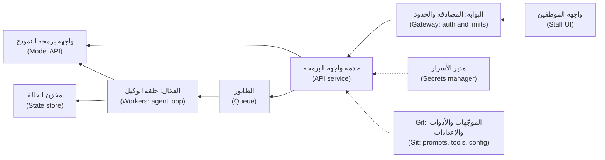

# الوحدة 14 — الشحن إلى بيئة الإنتاج

*الوكيل الذي يعمل على حاسوبك المحمول لم يُشحن بعد. تنقل هذه الوحدة نجم ديسك (Najm Desk) من الحاسوب المحمول إلى يد العميل بأمان، بحيث يُكتشف الإصدار السيئ ويُتراجع عنه في دقائق، وبتكلفة معقولة، بحيث يمكن إخبار هند (Hind) بتكلفة التذكرة المحلولة. يغطي الدرس 14.1 النشر: البنية المرجعية، والحاويات (containers)، والبيئات والأسرار، والطوابير والتنفيذ المتين (durable execution) للتشغيلات الطويلة، ومفاتيح عدم التأثر بالتكرار (idempotency keys)، والبث والمهلات، وتحديد إصدار الموجّه والأدوات والنموذج معًا، والإطلاق الكناري والظلّي، والتراجع (rollback)، وخط أنابيب فيه بوابة التقييم. ستغلّف نجم ديسك بوصفها خدمة FastAPI مع فحوص الصحة والجاهزية، وملفات موجّه ذات إصدارات، وسجلات مهيكلة، واختبار دخان. ويغطي الدرس 14.2 التكلفة وزمن الاستجابة والموثوقية: نموذج التكلفة، والتخزين المؤقت (caching)، وتوجيه النماذج (routing)، وواجهة الدُّفعات، وإعادة المحاولة والتراجع الأسي، وقواطع الدائرة (circuit breakers)، والبدائل الاحتياطية، وأهداف مستوى الخدمة وميزانيات الأخطاء، والسعة. ستبني طبقة للتكلفة وزمن الاستجابة حول عميل الـSDK، وموزِّعًا للنماذج مع اختباراته، واختبارات إعادة المحاولة مقابل مقابض الإخفاق في المحاكي، وتقريرًا للتكلفة. ويذكر كل مختبر ما يعمل دون اتصال وما يحتاج إلى بيئة تشغيل حاويات أو نموذج حقيقي.*

> **الطبقة:** Delivery, Production — إخراج الوكيل من حاسوبك المحمول ووضعه في يد العميل، بأمان وبتكلفة معقولة.

---

# 14.1 — نشر وكيل: الحاويات والبيئات والطوابير والتنفيذ المتين واستراتيجيات الإصدار والتراجع
*المستوى: 🔴 متقدم* · *المتطلبات: 2.2، 8.2، 12.2، 13.2* · *الطبقة: Delivery, Production*

## ⚡ الدرس في دقيقة
- الوكيل المنشور خدمة تحيط باستدعاء نموذج لا تتحكم فيه: توقّعه بطيئًا أو خاطئًا أو متوقفًا أو مكلفًا.
- ابنِ مرة واحدة واضبط لكل بيئة: صورة أساس مثبّتة، ومستخدم غير جذري، وبناء متعدد المراحل، ولا سر في أي طبقة.
- العمل الطويل يغادر الطلب: ضعه في طابور، وأنشئ له نقاط حفظ، وأعطِ كل كتابة مفتاح عدم التأثر بالتكرار.
- الإصدار هو الصورة والموجّه والأدوات ومعرّف النموذج وخط أساس التقييم كلًّا واحدًا: بوابة (gate)، ثم إطلاق كناري (canary)، وتدرّب على التراجع.
- أكبر فخ: فحوص خضراء ووكيل خاطئ.

## 🧭 لماذا يهم
تعمل التجربة التشغيلية على حاسوب لجين المحمول. يسأل فهد (Fahad) ماذا سيحدث صباح الأحد عند 07:00 حين يفتح أربعة عشر موظف دعم نجم ديسك في وقت واحد، وكيف يُتراجَع عن موجّه سيئ بحلول 07:05. خطة لجين (افتراضية، hypothetical): تنفيذ `git pull` على جهاز واحد، وتعديل الموجّه في مكانه، ثم إعادة التشغيل. يحتفظ جهاز ثانٍ بالموجّه القديم: فيحصل الموظفون على جوابين لسؤال واحد ولا شيء يسجّل أي موجّه كتب أي جواب. وفي عام 2012 خسرت شركة Knight Capital مئات الملايين من الدولارات خلال ساعة بعد أن وصل إصدار إلى بعض خوادمها فقط.

الانضباط قديم. الجديد أن «الشيفرة» تشمل موجّهًا ومعرّف نموذج، وأن الإصدار السيئ نادرًا ما يكون *متوقفًا*؛ بل يكون *خاطئًا*.

## 📐 كيف يعمل

### 🟢 الأساسيات
يجيب الإصدار الأول من نجم ديسك داخل الطلب نفسه، فيحتاج إلى الصناديق الأربعة الأولى؛ ويأتي الباقي حين تعيش المهمة أطول من الطلب.



**الحاويات.** تُبنى الصورة مرة واحدة وتعمل دون تغيير في كل مكان. ثبّت الأساس، وابنِ على مراحل، وشغّل بمستخدم رقمي غير جذري، وأبقِ الأسرار خارج كل طبقة لأن الطبقات يمكن قراءتها. ولا يعني التثبيت ترك الثغرات دون ترقيع: حدّث الأساس وفق جدول وثبّت إصدارات الاعتماديات بدقة. تقرأ الاختبارات هذه الملفات فقط؛ وأنت من يشغّل hadolint و`docker compose config`، وفي التمرين 🔴 تشغّل البناء.

يحتوي `labs/m14/Dockerfile` على ثلاث مراحل. تصنع `build` بيئة افتراضية من `requirements.txt`. و`mock` بديل النموذج دون اتصال، للتطوير فقط: لا تنشره أبدًا. أما `runtime`، وهي المرحلة الأخيرة وبالتالي ما يشحنه `docker build`، فتنسخ البيئة الافتراضية ووثائق السياسات وملفات الموجّه و`app.py`، وتنشئ المستخدم ذا المعرّف 10001 وتشغّل `uvicorn`. وأساسها `python:3.11.9-slim-bookworm` مثال على التثبيت: اختر أساسك وحدّثه، وفي الإنتاج ثبّت البصمة. يشغّل `docker-compose.yml` المرحلة `runtime` بجانب `mock`: متغيرات البيئة فقط، ونظام ملفات للقراءة فقط، ودون قدرات، و`no-new-privileges`؛ ومفتاح `mock` فيه عنصر نائب. انظر [*السحابة وDevOps (Cloud & DevOps)*، الدرس 2.1 — الحاويات بالشكل الصحيح](../cloud/index.ar.html#/2.1).

**الإعدادات وفحوص الصحة.** تعمل صورة واحدة في كل مكان بمتغيرات بيئة مختلفة. تقرؤها `Settings` مرة واحدة وترفض ما لا معنى له، مثل الإنتاج مع مفتاح المحاكي؛ وتأتي الأسرار من مخزن المنصة، بمفتاح واحد لكل بيئة في مساحة عمل لها حد للإنفاق. *فحص الحياة* لا يلمس أي اعتمادية، وإلا أعاد تشغيل كل نسخة عند أي تعثر من المزوِّد. و*فحص الجاهزية* لا يفحص إلا ما تملكه الخدمة، ولا يجري أبدًا استدعاءً مدفوعًا لكل فحص، ويقول ما الذي يعمل.

```python
# labs/m14/app.py
"""Lab 14.1: Najm Desk as a service.  ANTHROPIC_BASE_URL=http://127.0.0.1:9014 ANTHROPIC_API_KEY=mock uvicorn --app-dir labs/m14 app:app"""
import hashlib
import json
import os
import time
from pathlib import Path

import anthropic
from fastapi import FastAPI, Header, HTTPException
from pydantic import BaseModel, Field

HERE = Path(__file__).resolve().parent


class Settings:
    """Twelve-factor: what differs per environment comes from the environment, checked once at start-up. The key stays with the SDK."""

    def __init__(self, env=os.environ):
        self.app_env = env.get("APP_ENV", "dev")
        self.model = env.get("MODEL", "claude-sonnet-5-5")
        self.prompt, self.canary_prompt = env.get("PROMPT_VERSION", "najm_desk_v1"), env.get("CANARY_PROMPT", "")
        self.canary_pct = int(env.get("CANARY_PERCENT", "0"))            # rollback = set this to 0
        self.timeout_s = float(env.get("REQUEST_TIMEOUT_S", "20"))
        self.prompt_dir = Path(env.get("PROMPT_DIR", HERE / "prompts"))
        self.policy_dir = Path(env.get("POLICY_DIR", HERE.parents[1] / "labkit" / "data" / "policies"))
        self.release = env.get("GIT_SHA", "dev")
        if not 0 <= self.canary_pct <= 100:
            raise ValueError("CANARY_PERCENT must be 0 to 100")
        if self.app_env == "prod" and (env.get("ANTHROPIC_API_KEY", "mock") == "mock" or "127.0.0.1" in env.get("ANTHROPIC_BASE_URL", "")):
            raise ValueError("prod must not start with the mock key or a local base URL")


def load_prompt(name: str, folder: Path) -> tuple[str, str]:
    """A prompt is a file in Git. Its version is name@hash: one changed character is a new version."""
    lines = (folder / f"{name}.txt").read_text(encoding="utf-8").splitlines()
    text = "\n".join(line for line in lines if not line.startswith("#")).strip() + "\n"
    return f"{name}@{hashlib.sha256(text.encode()).hexdigest()[:8]}", text


def pick_prompt(cfg: Settings, user: str) -> str:
    """Canary: a stable hash puts each user in one bucket of 100, so nobody flips between versions mid-conversation."""
    bucket = int(hashlib.sha256(user.encode()).hexdigest(), 16) % 100
    return cfg.canary_prompt if cfg.canary_prompt and bucket < cfg.canary_pct else cfg.prompt


def load_docs(folder: Path) -> str:
    """The whole policy library (about 800 tokens), identical on every request: a stable prefix. Bigger libraries need Module 4."""
    return "".join(f'<document id="{p.stem}">{p.read_text(encoding="utf-8").strip()}</document>\n' for p in sorted(folder.glob("*.md")))


class Ask(BaseModel):
    question: str = Field(min_length=1, max_length=2000)
    user: str = "anonymous"               # in production the verified token says who this is


def create_app(cfg: Settings | None = None, client=None) -> FastAPI:
    cfg = cfg or Settings()
    client = client or anthropic.Anthropic(timeout=cfg.timeout_s, max_retries=2)
    prompts = {n: load_prompt(n, cfg.prompt_dir) for n in {cfg.prompt, cfg.canary_prompt} - {""}}      # a missing file stops the start-up
    docs, done = load_docs(cfg.policy_dir), {}          # done: idempotency store. In memory here; shared behind several replicas
    app = FastAPI(title="Najm Desk")

    def log(**fields):                    # one JSON line on stdout; never the question
        print(json.dumps({"ts": round(time.time(), 3), "env": cfg.app_env, "release": cfg.release, **fields}), flush=True)

    @app.get("/health")
    def health():                         # liveness: the process is up, no dependencies
        return {"status": "ok"}

    @app.get("/ready")
    def ready():                          # readiness: check what you own, never the paid model
        problems = [p for p, bad in [("no policy documents", not docs), ("no API key", "ANTHROPIC_API_KEY" not in os.environ)] if bad]
        if problems:
            raise HTTPException(503, {"ready": False, "problems": problems})
        return {"ready": True, "release": cfg.release, "model": cfg.model, "prompts": {n: v for n, (v, _) in prompts.items()}}

    @app.post("/v1/ask")
    def ask(body: Ask, idempotency_key: str | None = Header(default=None)):
        slot = (body.user, idempotency_key)                              # a key belongs to one user
        if idempotency_key and slot in done:                            # a client retry replays the first answer and costs nothing
            return {**done[slot], "replayed": True}
        version, text = prompts[pick_prompt(cfg, body.user)]
        system = [{"type": "text", "text": docs, "cache_control": {"type": "ephemeral"}}, {"type": "text", "text": text}]   # stable first
        t0 = time.monotonic()
        try:
            resp = client.messages.create(model=cfg.model, max_tokens=1024, output_config={"effort": "low"}, system=system,
                                          messages=[{"role": "user", "content": body.question}])
        except anthropic.APIError as e:
            log(event="model_error", error=type(e).__name__, prompt_version=version, ms=round((time.monotonic() - t0) * 1000))
            raise HTTPException(503, "Najm Desk cannot answer right now. Please use the Service Desk.")      # no provider detail leaks out
        u = resp.usage
        answer = next((b.text for b in resp.content if b.type == "text"), "")
        if resp.stop_reason != "end_turn":         # max_tokens: cut off. refusal: declined. Neither is an answer: hand off instead
            log(event="no_answer", stop=resp.stop_reason, prompt_version=version, request_id=resp._request_id)
            answer = "HANDOFF: Najm Desk could not finish this answer. A Service Desk agent will take it."
        out = {"answer": answer, "prompt_version": version, "model": resp.model, "request_id": resp._request_id}
        log(event="ask", prompt_version=version, model=resp.model, input_tokens=u.input_tokens, output_tokens=u.output_tokens,
            cache_read=u.cache_read_input_tokens, ms=round((time.monotonic() - t0) * 1000), request_id=resp._request_id)
        if idempotency_key:
            done[slot] = out              # requests racing on one key both run: claim the key first if that matters
        return out

    return app


app = create_app()
```

الموجّهات ملفات في `labs/m14/prompts/`: يعمل `najm_desk_v1.txt` في الإنتاج، و`v2` هو المرشَّح، والإصدار هو اسم الملف مع تجزئة لنصه. في `ask` تأتي مكتبة السياسات أولًا في `system` ومعها علامة التخزين المؤقت، فلا يُبطل إصدار جديد الذاكرة المؤقتة: الدرس 14.2.

### 🟡 التعمق أكثر
**الطوابير والتنفيذ المتين.** كثيرًا ما تقطع البوابات الطلبات عند 30 إلى 60 ثانية، لذا تضع الواجهة مهمة في الطابور وتردّ بالحالة 202 مع معرّف مهمة تستطلعه الشاشة. أما العامل الذي يموت عند الخطوة 7 من 9 ثم يعيد البدء من الخطوة 1 فيكرر ستة استدعاءات للنموذج وكتابات الأدوات. يحفظ محرك التنفيذ المتين نتيجة كل خطوة ويستأنف بعدها؛ وبداية أرخص تنشئ نقطة حفظ للرسائل ولرقم الخطوة. ويناسب الموافقات أيضًا: فطلب فك القفل قد ينتظر شخصًا ساعات دون أي تكلفة. أبقِ البيان مع المهمة، حتى يُكمل التشغيل الذي بدأ بالموجّه v1 تحت v1، وأنهِ عمل العمّال بسلاسة عند SIGTERM. انظر [*لبنات بناء SaaS (SaaS Building Blocks)*، الدرس 5.4 — محركات سير العمل](../saas/index.ar.html#/5.4).

**مفاتيح عدم التأثر بالتكرار.** يختار العميل مفتاحًا لكل فعل مقصود؛ ويخزّن الخادم أول نتيجة تحت الزوج ويعيد عرضها. فبدون مفتاح يؤدي انقضاء المهلة ثم إعادة المحاولة إلى فتح تذكرتين. مرّر المفتاح إلى النظام الذي يكتب (TicketHub)، وإلا حمت إعادة العرض واجهتك وحدها. ويقوم مخزن الإنتاج أيضًا بتجزئة الجسم ويرفض مفتاحًا أُعيد استخدامه مع سؤال مختلف؛ والمختبر يتجاوز هذا.

**البث والمهلات.** يُظهر `client.messages.stream` الكلمة الأولى للموظفين مبكرًا. وكل مهلة أقصر من المهلة التي تحيط بها: المتصفح، والبوابة، والواجهة (API)، واستدعاء الـSDK، والأدوات.

**بيان واحد.** بصمة الصورة (Image digest) وإصدار الموجّه (prompt version) وبصمة مخطط الأدوات ومعرّف النموذج (model id) وخط أساس التقييم: غيّر واحدًا منها فتعمل البوابة من جديد. والأدوات البعيدة قد تتغير دون إصدارك، فاحسب تجزئة مخططاتها عند البدء وقارنها.

### 🔴 نظرة الخبير
| الاستراتيجية | الكيفية | المحذور الخاص بالوكلاء |
|---|---|---|
| **Canary** — الإطلاق الكناري | تجزئة مستقرة ترسل قلة من المستخدمين إلى المرشَّح | أربعة عشر موظفًا عدد قليل جدًا لرؤية إخفاق نادر: أضف التشغيل الظلّي |
| **Shadow** — التشغيل الظلّي | يتلقى المرشَّح الطلبات الحية أيضًا دون أن يراه أحد | يضاعف التكلفة؛ والأدوات للقراءة فقط أو مستبدَلة بمحاكيات |
| **Feature flag** — مفتاح الميزة | مفتاح وقت التشغيل لقدرة واحدة | المفاتيح تتقادم وتتعفّن؛ اختبر الحالتين؛ وهي أيضًا مفتاح إيقاف |
| **Blue-green** — الأزرق-الأخضر | تبديل بيئات كاملة | لا يقول شيئًا عن جودة الموجّه |

يحتاج الإطلاق الكناري إلى قاعدة إيقافه أولًا. ضعيف: «كناري صغير لمدة ساعة، ثم ننظر إلى لوحة المتابعة». قوي: «v2 لثلاثة من موظفي التجربة الأربعة عشر لمدة يومي عمل؛ يتوقف إذا تجاوز p95 الـ15 ثانية، أو تجاوزت التكلفة لكل محادثة 1.3 ضعف v1، أو وجدت المراجعة بالعيّنة تسليمًا خاطئًا». العتبات خيالية؛ وتضع يارا (Yara) ومها (Maha) العتبات الحقيقية.

**التراجع** يستعيد البيان كله: التراجع عن الموجّه قيمة واحدة (`CANARY_PERCENT=0`)، والتراجع عن الصورة يعيد نشر البصمة السابقة. تدرّب على الاثنين. تراجع تلقائيًا عند معدل الخطأ أو زمن استجابة p95 أو تكلفة المحادثة أو معدل التصعيد. وعند إشارة تتعلق بالسلامة، أوقف الوكيل أولًا (مفتاح الإيقاف في الدرس 15.1) ودع شخصًا يقرر. انظر [*السحابة وDevOps*، الدرس 4.2 — استراتيجيات الإصدار](../cloud/index.ar.html#/4.2).

**خط الأنابيب** يتحقق من كل طلب سحب دون أسرار ويبني الصورة مرة واحدة.

```yaml
# labs/m14/release.yml
# Copy to .github/workflows/; set working-directory to where labkit lives
name: najm-desk-release
on:
  pull_request: {paths: ["aiapps/labkit/labs/**"]}      # prove a change first
  push: {branches: [main]}
  workflow_dispatch:
    inputs:
      canary_percent: {description: "Share on the candidate", default: "5"}
permissions: {contents: read}
concurrency: {group: release, cancel-in-progress: false}   # never two rollouts at once
defaults: {run: {working-directory: aiapps/labkit}}
jobs:
  verify:                               # free, no secrets, every pull request
    runs-on: ubuntu-latest
    timeout-minutes: 15
    steps:
      - uses: actions/checkout@v4
      - uses: actions/setup-python@v5
        with: {python-version: "3.11"}
      - run: pip install -r requirements.txt
      - run: pytest tests/test_m14_*.py
      - name: Smoke test and eval gate against the mock
        env: {ANTHROPIC_BASE_URL: "http://127.0.0.1:8787", ANTHROPIC_API_KEY: mock}
        run: |
          python -m labkit.mock_server --port 8787 &
          for i in $(seq 1 30); do curl -sf http://127.0.0.1:8787/health && break; sleep 1; done
          python labs/m14/smoke.py
          python labs/m12/run_eval.py --mode mock --out results.json
          python labs/m12/gate.py results.json --baseline labs/m12/baseline_mock.json
  image:                                # main only: build once, promote that image
    needs: verify
    if: github.event_name != 'pull_request'
    runs-on: ubuntu-latest
    steps:
      - uses: actions/checkout@v4
      - run: docker build -f labs/m14/Dockerfile --target runtime --build-arg GIT_SHA=${{ github.sha }} -t najm-desk:${{ github.sha }} .
  canary:                               # a person starts it and approves it, after reading the real-model eval
    needs: image
    if: github.event_name == 'workflow_dispatch'
    runs-on: ubuntu-latest
    environment: canary
    steps:
      - run: echo "deploy najm-desk:${{ github.sha }} with CANARY_PERCENT=${{ inputs.canary_percent }} on your platform"
```

البوابة دون اتصال (الدرس 12.2) تثبت التوصيلات لا الإجابات؛ أما التقييم بنموذج حقيقي فهو دليل R2. الاختبارات تحلّل هذا الملف فقط ولم يُشغَّل على GitHub: توقّع إصلاحات عند أول تشغيل وثبّت إصدارات إجراءات GitHub الحالية. تبني المهمة `image` الصورة فحسب؛ فالدفع والتوقيع من شأن منصتك. ولا تنتظر المهمة `canary` شخصًا إلا بعد أن تضيف مراجعين مطلوبين إلى تلك البيئة. انظر [*السحابة وDevOps*، الدرس 4.1 — التكامل المستمر (Continuous integration)](../cloud/index.ar.html#/4.1).

## 🧰 الأدوات
| الأداة أو الممارسة أو النمط | ما هي وماذا تفعل | متى تلجأ إليها |
|---|---|---|
| **Multi-stage image** — صورة متعددة المراحل | أساس مثبّت، وبيئة تشغيل نظيفة، ومستخدم غير جذري | كل خدمة |
| **Idempotency key** — مفتاح عدم التأثر بالتكرار | معرّف يختاره العميل؛ تُخزَّن أول نتيجة وتُعاد | أي كتابة تُعاد محاولتها |
| **Durable execution** — التنفيذ المتين | نتائج خطوات محفوظة؛ والانهيار يستأنف | تشغيلات طويلة لها آثار جانبية |
| **Release manifest** — بيان الإصدار | الصورة والموجّه والأدوات والنموذج وخط الأساس كلًّا واحدًا | كل إصدار |
| **Canary release** — الإطلاق الكناري | تجزئة مستقرة ترسل قلة من المستخدمين إلى المرشَّح | بعد البوابة |

## 🏛️ عمليًا في بنك نجم
**القطعة المُنتَجة** هي **حزمة إصدار نجم ديسك**: الصورة والبيان وخط الأنابيب وقائمة التحقق (`labs/m14/release_checklist.yaml`). كل صف من R1 إلى R9 يحتاج إلى دليل لا إلى علامة: R1 اختبارات ودخان وبوابة دون اتصال خضراء؛ R2 تقييم بنموذج حقيقي دون انحدار حرج؛ R3 صورة غير جذرية ومثبّتة وخالية من الأسرار؛ R4 مفتاح لكل بيئة بسقف إنفاق؛ R5 جاهزية ثبت أنها تفشل؛ R6 إشارات إيقاف الكناري مكتوبة أولًا؛ R7 تراجع جرى التدرب عليه؛ R8 مفتاح إيقاف يعمل؛ R9 موافقات التوقيع (sign-offs) (نورة (Noura) للأمن، for security، وليلى (Layla) للحوكمة، for governance).

```text
$ ANTHROPIC_BASE_URL=http://127.0.0.1:9014 ANTHROPIC_API_KEY=mock python labs/m14/smoke.py
PASS  liveness answers
PASS  readiness answers
PASS  readiness names the prompt versions
PASS  an answer arrives with a citation
PASS  the same key replays and does not pay twice
PASS  bad input is refused, not crashed
```

`smoke.py` يشغّل التطبيق بـTestClient الخاص بـFastAPI؛ و`SMOKE_URL` يفحص خدمة منشورة. الواجهة الحقيقية: يتغير العنوان والمفتاح فقط. دون اتصال يثبت الآليات؛ ويحتاج إلى الواجهة الحقيقية: جودة الإجابات وإصابة الذاكرة المؤقتة وتقييم R2.

> **منصتك.** املأ العمود الأخير بمسؤولي منصتك.

| الاهتمام | في هذا المختبر | على منصتك |
|---|---|---|
| الصورة والسجل | `Dockerfile` واحد | |
| الإعدادات والأسرار | `Settings`؛ مفتاح المحاكي في compose | |
| الهوية | `user` حقل في الجسم | |
| الفحوص وهدف النشر | `/health` و`/ready`؛ compose | |
| الطابور ومخزن الحالة | لا شيء؛ المفاتيح في الذاكرة | |
| التحكم في الإصدار | `CANARY_PERCENT` و`release.yml` | |
| السجلات والاتصال الصادر | JSON على stdout؛ المحاكي فقط | |

**المُسلَّم الأسبوعي** (النصف الأول من الأسبوع 14). أودِع المجلد `week-14/` مع `labs/m14/` واختبارات ناجحة، ومخرجات اختبار الدخان، وقائمة تحقق معبّأة لكناري v2، وجدول المنصة، و`NOTES.md` وفيه إجابات الاختبارات وملاحظات القراءة.

**جلسة المجموعة** (45 دقيقة). (1) ضع كل صندوق من المخطط على منصتك (10). (2) قِس زمن التراجع (10). (3) قارن Dockerfile وملف compose بالصفين R3 وR4 (15). (4) اكتب إشارات إيقاف لكناري (10).

**ابنِه باستخدام Claude Code.** أعطِ Claude Code هذه المواصفة في وضع التخطيط:

```text
Goal: package the Najm Desk answer path as a FastAPI service (lesson 14.1): labs/m14/app.py, smoke.py, Dockerfile, docker-compose.yml,
release.yml, release_checklist.yaml, with pytest tests in labkit/tests/test_m14_service.py.
Context: Python 3.11, anthropic>=1,<2, the offline mock in aiapps/labkit.
Constraints: config only from the environment; refuse prod with the mock key; prompt version is name@hash; /health touches no dependency, /ready
never calls the model; logs hold ids and counts, never the question; Idempotency-Key scoped per user; pinned base, multi-stage, numeric
non-root USER; no secret in ENV, ARG or compose; no temperature, prefill or forced tool_choice.
Acceptance: pytest passes; smoke.py prints six PASS lines; hadolint and docker compose config pass.
Do not: build images, add dependencies or touch other modules. Plan first; one file at a time; test after each.
```

**تحقق قبل أن تقبله.**
- شغّل الاختبارات وبوابة التقييم دون اتصال، ثم اكسر خاصية واحدة في كل مرة (`USER root`، وأساس `:latest`، ومفتاح في `ENV`، و`/health` يستدعي النموذج): يجب أن يفشل اختبار مسمّى.
- اقرأ الفرق بحثًا عن `--privileged` و`docker.sock` وأجسام الطلبات في السجلات وتفريغ `os.environ`.

## 🛠️ التمارين
- 🟢 **شغّله واقرأ السجلات.** دون اتصال. شغّل المحاكي و`uvicorn`، ونفّذ `curl` على نقاط النهاية الثلاث، واسأل سؤالًا واحدًا مرتين بمفتاح `Idempotency-Key` واحد ومرة دونه. *يكتمل عندما:* جدول بالحالة، وهل أُعيد العرض أم لا، وعدد استدعاءات النموذج، مع الحقل الذي يجد شكوى واحدة.
- 🟡 **تمرين الكناري والتراجع.** دون اتصال. اضبط `PROMPT_VERSION=najm_desk_v1` و`CANARY_PROMPT=najm_desk_v2` و`CANARY_PERCENT=20`؛ أرسل أسئلة 100 مستخدم وعُدّ الإصدارات؛ ثم اضبطه على 0 وأثبت أن لا أحد يرى v2. *يكتمل عندما:* العدّان معًا، وثواني التراجع، وسبب أن `hash()` في Python كانت ستكسر الدلو (why Python's hash() would break the bucket).
- 🔴 **ابنِ واكسر وانشر إلى بيئة ما قبل الإنتاج.** يحتاج إلى بيئة تشغيل حاويات وبيئة ما قبل الإنتاج في منصتك، وللعنصر R2 الواجهة الحقيقية. ابنِ الصورة، وشغّل compose، واقرأ `docker history`، وانشر بمفتاح من مخزن الأسرار، وشغّل `SMOKE_URL`. *يكتمل عندما:* تعمل العملية بالمعرّف UID 10001، ولا طبقة تحمل مفتاحًا، ويمرّ الدخان على العنوان المنشور، ولكل من R1 إلى R9 دليل.

## ⚠️ أخطاء وفخاخ
- **صورة أساس عائمة أو سر مدمج فيها.** تتغير `latest` من تحتك، ويُظهر سجل الصورة مفتاح `ENV`: ثبّت الوسم، واحقن الأسرار وقت التشغيل.
- **فحص صحة يستدعي النموذج.** يكلّف مالًا ويعيد تشغيل نسخ سليمة أثناء العطل.
- **موجّه يُعدَّل على جهاز قيد التشغيل.** لا أحد يعرف أي إصدار أجاب: أصدِر الموجّهات ملفاتٍ.
- **إطلاق كناري بلا قاعدة إيقاف.** اكتب الإشارات والعتبات أولًا.

## 🧾 الخلاصة
- الوكيل المنشور خدمة: طابور وعمّال وحالة وأسرار.
- صورة واحدة مثبّتة وغير جذرية ومتعددة المراحل؛ والإعدادات من البيئة.
- التشغيلات الطويلة تحتاج إلى طابور ونقاط حفظ ومفاتيح عدم التأثر بالتكرار.
- أصدِر الصورة والموجّه والأدوات والنموذج بيانًا واحدًا: بوابة وكناري وتدرّب.

## ✍️ اختبر نفسك

**1. تشغّل بيئة ما قبل الإنتاج وبيئة الإنتاج بصمة الصورة نفسها لكنهما تجيبان بشكل مختلف. ماذا تفحص أولًا؟**

- A. هل تغيّر وسم صورة الأساس منذ آخر بناء
- B. هل تختلف متغيرات البيئة
- C. هل في Dockerfile عدة مراحل بناء
- D. هل تعمل الحاوية بمستخدم غير جذري

<details><summary>الإجابة</summary>

**B.** الصورة نفسها مع سلوك مختلف تشير إلى الإعدادات: النموذج أو إصدار الموجّه أو حصة الكناري.

</details>

**2. يستدعي فحص الحياة (A liveness probe) النموذج كل خمس ثوانٍ «ليثبت أن المسار كله يعمل». ويقع عطل قصير عند المزوِّد. ماذا يحدث؟**

- A. تُعاد النسخ السليمة إلى التشغيل مرارًا وتكرارًا
- B. تغادر النسخ موزّع الأحمال لكنها تواصل العمل
- C. لا شيء، لأن الـSDK يعيد محاولة كل فحص
- D. يتراجع المنسّق إلى الصورة السابقة

<details><summary>الإجابة</summary>

**A.** فحص الحياة الفاشل يعيد تشغيل الحاوية، فيصير تعثر المزوِّد حلقة إعادة تشغيل؛ أما الجاهزية فتُخرج النسخة من حركة المرور فقط.

</details>

**3. ينهار عامل عند الخطوة 7 من 9، بعد إنشاء تذكرة في الخطوة 3. أي تصميم يتجنب تذكرة مكررة واستدعاءات نموذج متكررة؟**

- A. أعد البدء من الخطوة 1 بمهلة أطول
- B. ارفع max_retries في الـSDK من 2 إلى 5
- C. احفظ نقطة عند كل خطوة وأضف مفتاح عدم التأثر بالتكرار
- D. شغّل عاملين واحتفظ بمن ينتهي أولًا

<details><summary>الإجابة</summary>

**C.** تستأنف نقطة الحفظ بعد الخطوة 6 والمفتاح يجعل أي تكرار غير ضار؛ أما البقية فتعيد عملًا مدفوعًا أو ذا أثر جانبي.

</details>

**4. تريد تجربة موجّه جديد على حركة مرور حية دون فتح تذاكر حقيقية. أي استراتيجية تناسب؟**

- A. إطلاق كناري مع تشغيل أدوات الكتابة
- B. تحديث متدرج للصورة
- C. تبديل أزرق-أخضر للبيئة كلها
- D. تشغيل ظلّي بأدوات للقراءة فقط

<details><summary>الإجابة</summary>

**D.** يسجّل التشغيل الظلّي الإجابات دون أن يراها أحد، لذا يجب ألا تكتب أدواته؛ أما الكناري فيعرض الإجابات على مستخدمين حقيقيين. (🔴 نظرة الخبير)

</details>

**5. بعد تغيير في الموجّه، صارت الإجابات أسوأ لكن كل الفحوص خضراء. ماذا تفعل أولًا؟**

- A. انتظر فشل الجاهزية قبل التصرف
- B. استعد البيان السابق ثم حقّق
- C. أعد بناء الصورة من نسخة نظيفة وأعد النشر
- D. ارفع مستوى الجهد للتعويض

<details><summary>الإجابة</summary>

**B.** الفحوص ترى العملية لا جودة الإجابات: تراجع بالبيان كله، ثم أعد إنتاج الانحدار. (🔴 نظرة الخبير)

</details>

## 📚 المراجع
- واجهة Claude البرمجية (Claude API): البث (Streaming) https://platform.claude.com/docs/en/build-with-claude/streaming؛ الأخطاء https://platform.claude.com/docs/en/api/errors
- [*السحابة وDevOps*، الدرس 2.3 — Kubernetes عمليًا](../cloud/index.ar.html#/2.3)؛ [*تصميم الأنظمة لمبرمجي الفايب (System Design for Vibe Coders)*، الدرس 4.4 — التراجع وبيئة ما قبل الإنتاج وبوابات الإصدار](../vibe/index.ar.html#l4-4)
- يمكن العثور عليها بالعنوان: *The Twelve-Factor App*؛ وثائق GitHub Actions وDocker وFastAPI وhadolint (documentation). عدّة المختبر (Lab kit): https://github.com/Tamoura/system-design-for-vibe-coders/tree/main/aiapps/labkit
- **اقرأ هذا الأسبوع، الوحدة 14.** Grokking AI Applications، الفصل 8: https://www.manning.com/books/grokking-ai-applications. Gulli، *Agentic Design Patterns*، الفصل 16 (Resource-Aware Optimisation): المسودة المجانية المذكورة في الدرس 0.1. Microsoft، *AI Agents for Beginners*، الدروس 15-17: https://github.com/microsoft/ai-agents-for-beginners

---

# 14.2 — هندسة التكلفة وزمن الاستجابة والموثوقية: الميزانيات والتخزين المؤقت والتوجيه وإعادة المحاولة وأهداف مستوى الخدمة
*المستوى: 🔴 متقدم* · *المتطلبات: 0.2، 12.2، 14.1* · *الطبقة: Production, Delivery*

## ⚡ الدرس في دقيقة
- التكلفة هي الرموز مضروبة في السعر الحالي على أربعة عدّادات: الإدخال والإخراج وكتابة الذاكرة المؤقتة وقراءتها. احكم عليها لكل تذكرة محلولة.
- المكاسب المجانية أولًا؛ والمقايضات أخيرًا، وكل منها يُفحص مقابل التقييم.
- أعد المحاولة بعشوائية وسقف وطبقة واحدة؛ ولا تعد المحاولة أبدًا بعد خطأ 400. أضف قاطع دائرة وبديلًا احتياطيًا مختبَرًا.
- أربعة أهداف لمستوى الخدمة: نجاح المهمة (task success)، وزمن استجابة p95 (p95 latency)، والتكلفة لكل محادثة (cost per conversation)، ومعدل التصعيد (escalation rate). وتقول ميزانية الخطأ متى نتوقف عن الشحن.
- أكبر فخ: سعر أقل لكل رمز وتكلفة أعلى لكل تذكرة محلولة.

## 🧭 لماذا يهم
تسأل هند كم تكلّف التذكرة المحلولة الواحدة، وماذا تصبح الفاتورة لو استخدم كل موظف نجم ديسك. جواب لجين الأول (افتراضي، hypothetical) هو الفاتورة مقسومة على المحادثات، بما فيها تشغيلات التقييم والاستدعاءات المتروكة والتسليمات إلى البشر. ثم، في يوم أحد عند 07:02، يردّ المزوِّد بالخطأ 529 «محمَّل فوق طاقته». يعيد غلافها المحاولة خمس مرات بلا انتظار، فيصير كل سؤال ستة استدعاءات، وتضرب الدفقة حد المعدّل، ويتحول فرط تحميل قصير إلى عطل مدته عشرون دقيقة. لم يقس أحد، ولم يختبر أحد شيفرة إعادة المحاولة مقابل مزوِّد يسيء التصرف.

## 📐 كيف يعمل

### 🟢 الأساسيات
**نموذج التكلفة.** يكلّف الاستدعاء أربعة عدّادات بأربعة أسعار لكل مليون رمز، من صفحة الأسعار الحالية.

| العدّاد في `resp.usage` | يُسعَّر بـ | ملاحظة |
|---|---|---|
| `input_tokens` | P_in | إدخال غير مخزّن مؤقتًا |
| `output_tokens` | P_out | يشمل التفكير |
| `cache_creation_input_tokens` | P_in × w | w نحو 1.25 للذاكرة المؤقتة الافتراضية ذات الخمس دقائق، ونحو 2 لخيار الساعة |
| `cache_read_input_tokens` | P_in × r | r كسر، نحو 0.1 في نماذج كثيرة: افحص نموذجك |

تجمع المحادثة استدعاءاتها؛ ويكبر الإدخال في كل دور لأن السجل يُعاد إرساله (الدرس 0.2). التكلفة لكل تذكرة محلولة هي كل الإنفاق مقسومًا على التذاكر المحلولة دون تدخل شخص: وتبقى المحادثات غير المحلولة والتسليمات إلى البشر داخل الحساب.

**مثال محلول.** محادثة من ستة أدوار بموجّه نظام من 1,500 رمز ترسل 14,010 رمز إدخال وتستقبل 1,500. كل خلية رموز × سعر مخترع (الإدخال 1، والإخراج 5، والكتابة 1.25، والقراءة 0.1):

| | الإدخال | الكتابة | القراءة | الإخراج | المجموع |
|---|---|---|---|---|---|
| بلا ذاكرة مؤقتة | 14,010 | 0 | 0 | 7,500 | 21,510 |
| موجّه النظام مخزَّن مؤقتًا | 5,010 | 1,875 | 750 | 7,500 | 15,135 |

تنخفض الفاتورة 30%، ونصفها الخاص بالإدخال 45%. ويتحقق اختبار من ذلك.

**قِس كل مكالمة.** يغلّف `Tracked` عميل الـSDK: سطر JSON واحد لكل استدعاء، وسقف يرفض الاستدعاء التالي متى أُنفق. ويسعّر كل كتابة في الذاكرة المؤقتة بسعر الخمس دقائق: وسّع `cost_of` لخيار الساعة.

```python
# labs/m14/cost.py
"""Lab 14.2: a thin layer around the SDK client. Every call becomes one JSON line (four token meters, latency, cost) and a budget
stops runaway spend. Prices come from prices.json, which YOU fill in."""
import json
import os
import sys
import time
from pathlib import Path

import anthropic

HERE = Path(__file__).resolve().parent


class BudgetExceeded(RuntimeError):
    pass


def load_prices(path=HERE / "prices.json") -> dict:
    prices = json.loads(Path(path).read_text(encoding="utf-8"))
    if not prices.get("checked"):
        print("warning: prices.json has no 'checked' date: totals are lab units, not money", file=sys.stderr)
    return prices


def cost_of(usage, model: str, prices: dict) -> float | None:
    """Four meters, four prices. input_tokens EXCLUDES cached tokens, so the input meters add up without overlap.
    An unpriced model gives None: a pricing gap never fails a customer's request."""
    p = prices["per_million_tokens"].get(model)
    if p is None:
        return None
    return (usage.input_tokens * p["input"] + usage.output_tokens * p["output"]
            + (usage.cache_creation_input_tokens or 0) * p["cache_write"] + (usage.cache_read_input_tokens or 0) * p["cache_read"]) / 1_000_000


class Tracked:
    """client.messages.create plus labels `tag` (feature) and `convo` (conversation), and a spending cap."""

    def __init__(self, client=None, prices=None, log=None, budget=None):
        self.client, self.prices, self.budget, self.spent = client or anthropic.Anthropic(), prices or load_prices(), budget, 0.0
        self.log = Path(log or os.environ.get("USAGE_LOG", "usage.jsonl"))

    def create(self, *, tag="najm-desk", convo=None, **kw):
        if self.budget is not None and self.spent >= self.budget:            # before the call: fail closed
            raise BudgetExceeded(f"{self.spent:.4f} spent of {self.budget}")
        rec, t0 = {"ts": round(time.time(), 3), "tag": tag, "convo": convo, "model": kw["model"]}, time.monotonic()
        try:
            resp = self.client.messages.create(**kw)
        except anthropic.APIError as e:                                       # failures are data: the error rate is an SLI
            self._write({**rec, "ms": round((time.monotonic() - t0) * 1000), "error": type(e).__name__})
            raise
        u, cost = resp.usage, cost_of(resp.usage, kw["model"], self.prices)
        self.spent += cost or 0.0
        self._write({**rec, "ms": round((time.monotonic() - t0) * 1000), "input": u.input_tokens, "output": u.output_tokens,
                     "cache_write": u.cache_creation_input_tokens or 0, "cache_read": u.cache_read_input_tokens or 0,
                     "cost": cost, "stop": resp.stop_reason, "request_id": resp._request_id})
        return resp

    def _write(self, rec: dict):
        with self.log.open("a", encoding="utf-8") as f:
            f.write(json.dumps(rec) + "\n")
```

تحتوي `prices.json` أربعة أسعار لكل مليون رمز لكل معرّف نموذج وتاريخ `checked`؛ والأرقام المشحونة عناصر نائبة.

**الميزانيات والتنبيهات.** ثلاث طبقات: سقف في الشيفرة، وحد وتنبيه على المفتاح أو مساحة العمل في لوحة المزوِّد (الدرس 0.2)، وعرض لكل ميزة من `tag`. نبّه دون السقف؛ وسمِّ من ينظر.

### 🟡 التعمق أكثر
**التخزين المؤقت للموجّه (Prompt caching)** مطابقة بادئة على الأدوات ثم موجّه النظام ثم الرسائل: بايت واحد متغيّر يُبطل كل ما بعده. علّم نهاية الجزء الثابت بـ`cache_control`، وضع ما يتغير بعده، كما يفعل `app.py`. تحقق بـ`cache_read_input_tokens`. فإن بقيت صفرًا بينما `cache_creation_input_tokens` كبيرة في كل استدعاء، فثمة مُبطِل صامت يعمل: طابع زمني أو معرّف طلب أو JSON غير مرتب في البادئة، أو سطر لكل مستخدم في موجّه النظام، أو قائمة أدوات متغيرة، أو نموذج أو جهد مختلف. وإن بقيت كلتاهما صفرًا، فالبادئة دون الحد الأدنى للنموذج ولا تُخزَّن مؤقتًا بصمت. يعتمد الحد الأدنى على النموذج، فقد تُخزَّن مكتبة المختبر البالغة نحو 800 رمز مؤقتًا على نموذج دون آخر. العمر الافتراضي خمس دقائق، يتجدد بكل قراءة. يخرج `probe.py` برمز الخروج 1 ما لم تُقرأ بادئة متكررة من الذاكرة المؤقتة. دون اتصال تبقى حقول الذاكرة المؤقتة صفرًا دائمًا: وهذا يحتاج إلى الواجهة الحقيقية.

| الرافعة | النوع | المحذور |
|---|---|---|
| **Response cache** — ذاكرة الاستجابات المؤقتة: إجابات مطابقة تحت مفتاح ذي إصدار | مجاني | لا تستخدمها أبدًا لإجابات تعتمد على بيانات المستخدم نفسه؛ وامسحها عند تغيير السياسة |
| **Trim tool output** — قلّص مخرجات الأداة: حدّد الصفوف واختر الحقول | مجاني | إن قصصت أكثر من اللازم عاد الوكيل يستدعي من جديد |
| **Summarise history** — لخّص السجل | مقايضة | يعيد كتابة البادئة: فتبدأ الذاكرة المؤقتة من جديد |
| **Batch API** — واجهة الدُّفعات: نحو نصف السعر؛ والنتائج بـ`custom_id`، معظمها خلال ساعة وكلها خلال 24 | مجاني إن لم ينتظر أحد | التقييمات والمهام الليلية؛ طلب واحد لا حلقة |
| **Lower effort** و**cheaper model** — جهد أقل ونموذج أرخص | مقايضة | اختبر الحالات الصعبة؛ وغيّر شيئًا واحدًا في كل مرة |

**توجيه النماذج.** ابدأ بـ`claude-haiku-5-5`؛ وصعِّد إلى `claude-sonnet-5-5` أو `claude-opus-5-5` للحالات الصعبة أو الثقة المنخفضة. اجعل الإشارة قابلة للفحص: فثقة النموذج المعلنة كثيرًا ما تكون معايَرة بصورة سيئة. يجدي التوجيه فقط حين e < 1 − c/s، حيث e حصة ما يُصعَّد وc وs تكلفة الاستدعاء الواحد في الطبقتين الرخيصة والقوية على حركة مرورك؛ وكل تصعيد يضيف أيضًا زمن استجابة استدعاء ثانٍ. تحقق منه بالتقييم (الدرس 12.2): بتوجيه ودونه، لكل فئة.

```python
# labs/m14/router.py
"""Lab 14.2: cheap model first, and escalate on signals you can check in code."""
import re

TIERS = ("claude-haiku-5-5", "claude-sonnet-5-5", "claude-opus-5-5")     # cheap, middle, strongest: config in production


def route(question: str, turns: int = 0) -> tuple[str, str]:
    """The first tier to try: a pure function, so a test pins every rule."""
    if len(re.findall(r"\b\d{4}\b", question)) >= 3 or len(question) > 1500 or turns >= 6:
        return TIERS[1], "long, many tickets or a long chat"
    if re.match(r"\s*(please |can you |could you )?(create|open|unlock|reset)\b", question, re.I):
        return TIERS[1], "an action request: the arguments must be right"
    return TIERS[0], "short question"


def confident(answer: str) -> bool:
    """The escalation signal: checkable beats self-reported. Cited, and not a HANDOFF or I-don't-know."""
    return bool(re.search(r"\[[\w#-]+\]", answer)) and not answer.startswith(("HANDOFF", "I don't know"))


def answer_with_escalation(ask, question: str, turns: int = 0):
    """Try the routed tier, then ONE stronger tier, then stop. ask(model) -> text; returns (text, tried)."""
    first, tried = TIERS.index(route(question, turns)[0]), []
    for model in TIERS[first:first + 2]:
        tried.append(model)
        text = ask(model)
        if confident(text):
            break
    return text, tried
```

### 🔴 نظرة الخبير
**حدود المعدّل وإعادة المحاولة.** يحمل الخطأ 429 الترويسة `retry-after`؛ والأخطاء 5xx و529 عابرة. ويعيد الـSDK محاولتها مرتين بتراجع أسي، فأضف طبقة لما ينقصه فقط: انتظار أطول بميزانية، وقاطع دائرة، وبديل احتياطي. انتظر بعشوائية كاملة حتى لا يعيد العملاء المحاولة بخطى متزامنة؛ واحترم `retry-after` (ينتظر المختبر 8 ثوانٍ كحد أقصى؛ وما كان أطول ينتهي إلى البديل الاحتياطي)؛ وأعد محاولة العابر فقط؛ وضع مهلة لكل استدعاء؛ وابنِ العميل بـ`max_retries=0` تحت طبقتك؛ وابقَ ضمن الموعد النهائي للتشغيل؛ واجعل كتابات الأدوات عديمة التأثر بالتكرار (الدرس 14.1)، لأن تكرار استدعاء النموذج لا يكلّف إلا مالًا.

```python
# labs/m14/reliable.py
"""Lab 14.2: survive a bad day at the provider: jittered backoff, a circuit breaker and a fallback model."""
import random
import time

import anthropic


def retryable(e: Exception) -> bool:
    """The SDK's policy: network trouble, 408, 409, 429 and any 5xx. A 400 is a bug: never retry it."""
    return isinstance(e, anthropic.APIConnectionError) or (isinstance(e, anthropic.APIStatusError) and (e.status_code in (408, 409, 429) or e.status_code >= 500))


class CircuitOpen(RuntimeError):
    pass


class Reliable:
    """Wraps `inner.create`. Build the client with max_retries=0: the SDK's own retries would multiply with ours (3 x 3 = 9 calls)."""

    def __init__(self, inner, fallback=None, tries=3, base=0.5, cap=8.0, open_after=5, cool=30.0,
                 sleep=time.sleep, rand=random.random, clock=time.monotonic):
        self.inner, self.fallback, self.tries, self.base, self.cap = inner, fallback, tries, base, cap
        self.open_after, self.cool, self.sleep, self.rand, self.clock = open_after, cool, sleep, rand, clock
        self.fails, self.opened_at = 0, None

    def delay(self, attempt: int, err) -> float:
        """The server's retry-after if sent, else exponential backoff with full jitter; both capped."""
        sent = getattr(getattr(err, "response", None), "headers", {}).get("retry-after")
        return min(self.cap, float(sent)) if sent else self.rand() * min(self.cap, self.base * 2 ** attempt)

    def create(self, **kw):
        if self.opened_at is not None and self.clock() - self.opened_at < self.cool:     # open: leave the provider alone
            return self._fallback(kw, CircuitOpen("circuit open"))
        err = None
        for attempt in range(self.tries):
            try:
                resp = self.inner.create(**kw)
                self.fails, self.opened_at = 0, None                    # a success closes the circuit
                return resp
            except anthropic.APIError as e:
                if not retryable(e):
                    raise
                err, self.fails = e, self.fails + 1
                if self.fails >= self.open_after:
                    self.opened_at = self.clock()
                    break
                if attempt < self.tries - 1:
                    self.sleep(self.delay(attempt, e))
        return self._fallback(kw, err)

    def _fallback(self, kw, err):
        if self.fallback is None:
            raise err
        return self.inner.create(**{**kw, "model": self.fallback})      # another model: its cache starts cold
```

*قاطع الدائرة* يتوقف عن استدعاء مزوِّد يفشل طوال فترة تبريد، ثم يسمح بمحاولة واحدة؛ ولكل نسخة قاطعها. و*النموذج الاحتياطي* يجيب في الأثناء؛ ضعه تحت التقييم لأن الجودة تتغير وذاكرته المؤقتة تبدأ باردة. تشغّل الاختبارات المحاكي بـ`MOCK_FAIL_EVERY=2` (كل طلب ثانٍ يعيد 529) و`MOCK_RATE_LIMIT_EVERY` (الخطأ 429 مع `retry-after: 1`): فالـSDK وحده يخفي فرط التحميل، وبدون إعادة محاولة يفشل نصف الطلبات بالضبط، و`Reliable` يتجاوز الحالتين؛ ويعمل القاطع على ساعة مزيفة.

**أهداف مستوى الخدمة للوكيل.** الأهداف خيالية؛ وتضع هند ويارا الأهداف الحقيقية، وتضع مها ترتيبات نداء التنبيه.

| مؤشر مستوى الخدمة (SLI) | القياس | الهدف |
|---|---|---|
| نجاح المهمة | حُلّت أو سُلّمت بشكل صحيح | 90% خلال 28 يومًا |
| زمن استجابة p95 | من السؤال إلى الإجابة النهائية | 15 ث (15 s) |
| التكلفة لكل محادثة | الإنفاق ÷ المحادثات | ميزانية هند |
| معدل التصعيد | التسليمات ÷ المحادثات؛ نبّه في الاتجاهين | 15% إلى 35% |

*ميزانية الخطأ* هي ما يسمح به الهدف: 90% خلال 28 يومًا تتيح لـ10% من المحادثات أن تُخفق. و*معدل الاحتراق* هو الميزانية المنفقة مقسومة على المدة المنقضية من النافذة: فإذا ذهب نصف الميزانية بعد يومين من 28 فمعدل الاحتراق 0.5 ÷ (2/28) = 7، وتفرغ الميزانية في أربعة أيام. الاحتراق السريع يعني أن توقف الإصدارات وتتراجع. انظر [*السحابة وDevOps*، الدرس 5.2 — أهداف مستوى الخدمة وميزانيات الأخطاء](../cloud/index.ar.html#/5.2).

**السعة** (خيالية، fictional). 1,800 تذكرة أسبوعيًا، 40% منها يصل إلى نجم ديسك، تساوي 720 محادثة، أي 14.4 في الساعة على أسبوع من 50 ساعة؛ خطّط لذروة بثلاثة أضعاف: 43 في الساعة، و0.012 في الثانية. المحادثة ستة استدعاءات بنحو 12 ثانية لكل منها: 72 ثانية من زمن النموذج. قانون ليتل (Little's law)، أي التزامن = معدل الوصول × الزمن في النظام، يعطي 0.012 × 72 ≈ 0.9: عامل واحد. الرموز (Tokens): 43 × 14,010 ≈ 10,000 إدخال في الدقيقة، مقابل حد معدّلك.

## 🧰 الأدوات
| الأداة أو الممارسة أو النمط | ما هي وماذا تفعل | متى تلجأ إليها |
|---|---|---|
| **Cost record** — سجل التكلفة | سطر JSON واحد لكل استدعاء: أربعة عدّادات وزمن استجابة وتكلفة | كل استدعاء نموذج |
| **Prompt caching** — التخزين المؤقت للموجّه | بادئة ثابتة أولًا، فتعيد الاستدعاءات المتكررة استخدامها بسعر أقل | الموجّهات الطويلة التي تُستدعى كثيرًا |
| **Model router** — موزِّع النماذج | قواعد تختار الطبقة الأولى؛ وإشارة قابلة للفحص تصعّد مرة واحدة | حركة مرور مختلطة من السهل والصعب |
| **Batch API** — واجهة الدُّفعات | طلبات غير متزامنة بنحو نصف السعر | التقييمات دون اتصال والمهام الليلية |
| **Retry with backoff** — إعادة المحاولة بتراجع أسي | عشوائية وسقف و`retry-after` وطبقة واحدة، ولا خطأ 400 أبدًا | كل استدعاء للمزوِّد |
| **Circuit breaker** — قاطع الدائرة | يتوقف عن استدعاء مزوِّد فاشل طوال فترة تبريد | انقطاعات المزوِّد |
| **SLO and error budget** — هدف مستوى الخدمة وميزانية الخطأ | أهداف مع قاعدة احتراق | كل وكيل في الإنتاج |

## 🏛️ عمليًا في بنك نجم
**القطعة المُنتَجة** هي **ورقة تكلفة نجم ديسك وموثوقيته**، صفحة واحدة لهند: تكلفة الوحدة، والميزانية ومستويات التنبيه، وقواعد توجيه النماذج، وإعدادات إعادة المحاولة والمهلة والقاطع والبديل الاحتياطي، وجدول أهداف مستوى الخدمة، وحساب السعة.

يقرأ `report.py` السجل ويطبع التكلفة لكل نموذج ومحادثة وتذكرة محلولة، ثم يفحص زمن استجابة p95 ومعدل الخطأ والتكلفة مقابل الأهداف (`--slo-p95-ms` و`--slo-error-rate` و`--slo-convo-cost`) ويخرج برمز الخروج 1 عند الخرق.

```text
$ python labs/m14/demo.py > /dev/null && python labs/m14/report.py usage.jsonl --resolved 9
warning: prices.json has no 'checked' date: totals are lab units, not money
claude-haiku-5-5    11 calls    816 in   232 out cost 0.00198  p95 26 ms
claude-sonnet-5-5    4 calls    271 in    57 out cost 0.00167  p95 2 ms
total 0.00364 over 6 conversations = 0.00061 each; 0.00040 per resolved ticket; 0 errors
SLO: all inside their targets
$ python labs/m14/report.py usage.jsonl --slo-convo-cost 0.0005 | tail -n 1
SLO: BREACH of cost per conversation
```

في الأسطر الاثني عشر التي طبعها `demo.py` (المخفية أعلاه)، تعلّم `tried 2` الأسئلة الثلاثة التي صُعِّدت؛ ولم يتحسن أي منها لأن المحاكي يجيب بالمثل أيًّا كان النموذج. وكان اثنان منها من فجوات مفردات الدرس 4.2: إذ يتعثر مطابق الكلمات في المحاكي كما يتعثر المسترجِع، ولا يستطيع نموذج أقوى أن يستشهد بوثيقة لم يرها. كلّف التصعيد 0.00095 من 0.00364، أي 26%؛ وكانت اثنتا عشرة محاولة أولى على الطبقة الوسطى ستكلف نحو 0.0066. الأسعار مخترعة والأزمنة تتفاوت؛ والأسعار الحقيقية وزمن الاستجابة وإصابات الذاكرة المؤقتة وجودة الإجابات تحتاج إلى الواجهة الحقيقية.

**المُسلَّم الأسبوعي** (النصف الثاني من الأسبوع 14). أودِع ملفات التكلفة في `labs/m14/` مع اختبارات ناجحة، و`prices.json` مؤرَّخًا، ومخرجات العرض والتقرير، والورقة ذات الصفحة الواحدة، و`NOTES.md`.

**جلسة المجموعة** (45 دقيقة). (1) قارنوا التكلفة لكل تذكرة محلولة واعثروا على أكبر رافعة (15). (2) اكسروا الموزِّع بصياغات يفوّتها، منها العربية (10). (3) تجادلوا في أهداف مستوى الخدمة ومن يتلقى نداء التنبيه، كما ستفعل هند ويارا ومها (20).

**ابنِه باستخدام Claude Code.** أعطِ Claude Code هذه المواصفة في وضع التخطيط:

```text
Goal: add a cost and reliability layer around the Anthropic client (lesson 14.2): labs/m14/cost.py, router.py, reliable.py, report.py,
prices.json, with pytest tests in labkit/tests/test_m14_cost.py.
Context: Python 3.11, anthropic>=1,<2, the offline mock (MOCK_FAIL_EVERY, MOCK_RATE_LIMIT_EVERY).
Constraints: prices only from prices.json; log four token meters, never the prompt; budget checked before the call; retries with jitter,
retry-after, never a 400, under max_retries=0; routing a pure function; no temperature, prefill or forced tool_choice.
Acceptance: pytest passes; report.py exits 1 on a breached SLO. No new dependencies.
```

**تحقق قبل أن تقبله.**
- شغّل الاختبارات والعرض، ثم اكسر قاعدة واحدة في كل مرة (احذف بند كتابة الذاكرة المؤقتة؛ وأعد محاولة خطأ 400؛ واحذف العشوائية): يجب أن يفشل اختبار.
- اقرأ الفرق بحثًا عن سعر في الشيفرة وانتظار بلا سقف وإعادة محاولة داخل إعادة محاولة وموجّه في السجل.

## 🛠️ التمارين
- 🟢 **املأ الأسعار.** دون اتصال. انسخ الأسعار الحالية من صفحة الأسعار العامة إلى `prices.json`، وأرِّخها، وشغّل العرض والتقرير. *يكتمل عندما:* يختفي التحذير، ويطابق التقرير حسابك اليدوي لمحادثة واحدة إلى خمس منازل عشرية.
- 🟡 **تصعيد أذكى.** دون اتصال. اجعل «لا أعرف استنادًا إلى الوثائق المقدَّمة» إجابة نهائية لا تصعيدًا؛ واكتب الاختبار الفاشل أولًا. *يكتمل عندما:* تنجح الاختبارات، وتنخفض التصعيدات من ثلاثة إلى واحد، وتُظهر حالة واحدة متى يكون ذلك خاطئًا.
- 🔴 **أثبته على الواجهة الحقيقية.** يحتاج إلى الواجهة الحقيقية والسقف من الدرس 0.2. شغّل `probe.py`، ثم أسئلتك العشرين موجَّهة وكلها على الطبقة الوسطى. *يكتمل عندما:* يحتوي `NOTES.md` على مخرجات المسبار، والتكلفتين لكل سؤال مؤرَّختين، وحكمًا على كل إجابة مختلفة، وقرارك مع عتبة.

## ⚠️ أخطاء وفخاخ
- **التكلفة لكل استدعاء لا لكل تذكرة محلولة.** التسليمات إلى البشر والمحادثات غير المحلولة تكلّف أيضًا.
- **بادئة متقلبة.** الطابع الزمني يدفع علاوة الكتابة ولا يقرأ شيئًا: افحص `cache_read_input_tokens`.
- **إعادات محاولة متراكمة أو بلا حد.** الطبقات تتضاعف وانعدام الانتظار يصنع عاصفة: طبقة واحدة وعشوائية وسقف.
- **تصعيد ما لا يصلحه نموذج أقوى.** الإخفاق في الاسترجاع يبقى إخفاقًا، والتسليم الصحيح HANDOFF لا يحتاج إلى ترقية.

## 🧾 الخلاصة
- التكلفة أربعة عدّادات مضروبة بالأسعار الحالية، يُحكم عليها لكل تذكرة محلولة.
- المكاسب المجانية أولًا؛ والمقايضات واحدة في كل مرة مقابل التقييم.
- أعد المحاولة بعشوائية وطبقة واحدة ولا خطأ 400 أبدًا؛ وأضف قاطعًا وبديلًا احتياطيًا.
- أربعة أهداف لمستوى الخدمة وميزانية خطأ تحدد متى نتوقف عن الشحن.

## ✍️ اختبر نفسك

**1. يكلّف استدعاء الطبقة الرخيصة 40% من استدعاء الطبقة الوسطى، لكن 90% من الأسئلة تُصعَّد إلى الطبقة الوسطى. مقارنةً بالاستخدام الدائم للطبقة الوسطى، ماذا يحدث للتكلفة لكل سؤال مُجاب؟**

- A. تنخفض بنحو 60% كما يوحي الخصم
- B. ترتفع بنحو 30% لأن معظم الأسئلة تدفع مرتين
- C. تنخفض بنحو 10% لأن تلك الحصة لا تُصعَّد
- D. تبقى كما هي لأن كل سؤال يُجاب مرة واحدة

<details><summary>الإجابة</summary>

**B.** كل سؤال يدفع الاستدعاء الرخيص و90% منها يدفع أيضًا استدعاء الطبقة الوسطى: 0.4 + 0.9 = 1.3 ضعف الطبقة الوسطى وحدها. لا يجدي التوجيه إلا دون 1 − c/s = 0.6 مُصعَّدًا. (🟡 توجيه النماذج)

</details>

**2. تصل الاستدعاءات كل بضع ثوانٍ بموجّه نظام مطابق، ومع ذلك يبلّغ كل استدعاء عن قيمة كبيرة في `cache_creation_input_tokens` وصفرًا في `cache_read_input_tokens`. ماذا تفحص أولًا؟**

- A. طابع زمني أو معرّف طلب داخل بادئة الموجّه
- B. هل البادئة أقصر من الحد الأدنى للنموذج
- C. هل يترك `max_tokens` مساحة للرد كله
- D. هل تُبثّ الردود إلى العميل

<details><summary>الإجابة</summary>

**A.** البادئة الأقصر من الحد الأدنى لن تُظهر أي كتابات إطلاقًا؛ أما الكتابات الكبيرة بلا قراءات فتعني أن البايتات تتغير في كل استدعاء. (🟡 التخزين المؤقت للموجّه)

</details>

**3. أثناء فرط تحميل، يجرّب غلاف كل استدعاء خمس مرات بلا انتظار، فوق إعادات محاولة الـSDK نفسها. ما الخطأ؟**

- A. لا شيء: المزيد من المحاولات يرفع نسبة النجاح دائمًا
- B. ينبغي أن يعيد محاولة أخطاء 400 أيضًا
- C. ينبغي رفع إعادات محاولة الـSDK إلى عشر
- D. الطبقات تضاعف الاستدعاءات وانعدام الانتظار يصنع عاصفة

<details><summary>الإجابة</summary>

**D.** خمس محاولات مضروبة في ثلاث محاولات تساوي خمسة عشر استدعاءً بلا توقف، وهذا يعمّق فرط التحميل.

</details>

**4. ميزانية الخطأ (The error budget) لهدف نجاح المهمة 90% أُنفق نصفها بعد يومين من نافذة 28 يومًا. ماذا تفعل؟**

- A. خفّف الهدف إلى 85% ليبدو الاحتراق أصغر
- B. واصل الشحن لأن نصف الميزانية لا يزال باقيًا
- C. أوقف الإصدارات ثم حقّق أو تراجع
- D. انتظر انتهاء النافذة كلها قبل التصرف بشأنه

<details><summary>الإجابة</summary>

**C.** نصف الميزانية في يومين من 28 احتراق أسرع بنحو سبع مرات من اللازم؛ وبهذا المعدل تفرغ في أربعة أيام. (🔴 أهداف مستوى الخدمة)

</details>

**5. كل ليلة يجب إعادة تصنيف 20,000 تذكرة قديمة، ولا أحد ينتظر النتيجة. أي رافعة تناسب؟**

- A. ذاكرة استجابات بمفتاح هو نص السؤال
- B. بثّ كل رد أثناء توليده
- C. خفض `max_tokens` في كل طلب
- D. واجهة الدُّفعات بطلب واحد لكل تذكرة

<details><summary>الإجابة</summary>

**D.** الدُّفعات تكلّف نحو النصف وتناسب عملًا لا ينتظره أحد؛ أما البقية فتستهدف التكرار أو السرعة أو الطول.

</details>

## 📚 المراجع
- واجهة Claude البرمجية: الأسعار https://platform.claude.com/docs/en/about-claude/pricing. التخزين المؤقت للموجّه https://platform.claude.com/docs/en/build-with-claude/prompt-caching. المعالجة بالدُّفعات (Batch processing) https://platform.claude.com/docs/en/build-with-claude/batch-processing
- [*السحابة وDevOps*، الدرس 6.2 — إدارة التكاليف السحابية (FinOps)](../cloud/index.ar.html#/6.2)؛ [*إدارة منتجات الذكاء الاصطناعي (AI Product Management)*، الدرس 8.2 — اقتصاديات الوحدة (Unit economics)](../aipm/index.ar.html#/8.2). عدّة المختبر: https://github.com/Tamoura/system-design-for-vibe-coders/tree/main/aiapps/labkit
