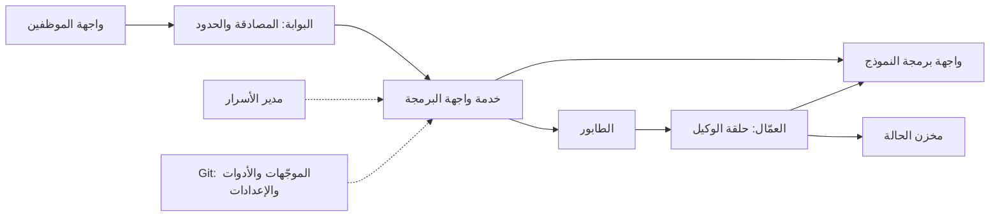

# الوحدة 14 — الشحن إلى بيئة الإنتاج (Shipping to production)

*الوكيل (agent) الذي يعمل على حاسوبك المحمول لم يُشحن بعد (has not shipped). تنقل هذه الوحدة نجم ديسك (Najm Desk) من الحاسوب المحمول إلى يد العميل (the customer's hands) بأمان (safely)، بحيث يُكتشف الإصدار السيئ (a bad release) ويُتراجع عنه (undone) في دقائق، وبتكلفة معقولة (affordably)، بحيث يمكن إخبار هند (Hind) بتكلفة التذكرة المحلولة (what a resolved ticket costs). يغطي الدرس 14.1 النشر (deployment): البنية المرجعية (the reference architecture)، والحاويات (containers)، والبيئات والأسرار (environments and secrets)، والطوابير (queues) والتنفيذ المتين (durable execution) للتشغيلات الطويلة (long runs)، ومفاتيح عدم التأثر بالتكرار (idempotency keys)، والبث والمهلات (streaming and timeouts)، وتحديد إصدار الموجّه والأدوات والنموذج معًا (versioning the prompt, tools and model together)، والإطلاق الكناري والظلّي (canary and shadow releases)، والتراجع (rollback)، وخط أنابيب فيه بوابة التقييم (a pipeline with the eval gate). ستغلّف نجم ديسك بوصفها خدمة FastAPI (a FastAPI service) مع فحوص الصحة والجاهزية (health and readiness checks)، وملفات موجّه ذات إصدارات (versioned prompt files)، وسجلات مهيكلة (structured logs)، واختبار دخان (a smoke test). ويغطي الدرس 14.2 التكلفة وزمن الاستجابة والموثوقية (cost, latency and reliability): نموذج التكلفة (the cost model)، والتخزين المؤقت (caching)، وتوجيه النماذج (routing)، وواجهة الدُّفعات (the Batch API)، وإعادة المحاولة والتراجع الأسي (retries and backoff)، وقواطع الدائرة (circuit breakers)، والبدائل الاحتياطية (fallbacks)، وأهداف مستوى الخدمة وميزانيات الأخطاء (SLOs and error budgets)، والسعة (capacity). ستبني طبقة للتكلفة وزمن الاستجابة حول عميل الـSDK (a cost and latency layer around the SDK client)، وموزِّعًا للنماذج مع اختباراته (a router with tests)، واختبارات إعادة المحاولة مقابل مقابض الإخفاق في المحاكي (retry tests against the mock's failure knobs)، وتقريرًا للتكلفة (a cost report). ويذكر كل مختبر ما يعمل دون اتصال (what runs offline) وما يحتاج إلى بيئة تشغيل حاويات أو نموذج حقيقي (what needs a container runtime or a real model).*

> **الطبقة (Layer):** Delivery, Production — إخراج الوكيل من حاسوبك المحمول ووضعه في يد العميل (taking the agent off your laptop and into the customer's hands)، بأمان وبتكلفة معقولة (safely and affordably).

---

# 14.1 — نشر وكيل: الحاويات والبيئات والطوابير والتنفيذ المتين واستراتيجيات الإصدار والتراجع (Deploying an agent: containers, environments, queues, durable execution, release strategies and rollback)
*المستوى (Level): 🔴 متقدم (Advanced)* · *المتطلبات (Prerequisites): 2.2، 8.2، 12.2، 13.2* · *الطبقة (Layer): Delivery, Production*

## ⚡ الدرس في دقيقة (In 60 seconds)
- الوكيل المنشور (A deployed agent) خدمة (service) تحيط باستدعاء نموذج لا تتحكم فيه (a model call you do not control): توقّعه بطيئًا أو خاطئًا أو متوقفًا أو مكلفًا (expect it slow, wrong, down or costly).
- ابنِ مرة واحدة واضبط لكل بيئة (Build once, configure per environment): صورة أساس مثبّتة (pinned base)، ومستخدم غير جذري (non-root user)، وبناء متعدد المراحل (multi-stage build)، ولا سر في أي طبقة (no secret in a layer).
- العمل الطويل يغادر الطلب (Long work leaves the request): ضعه في طابور (queue it)، وأنشئ له نقاط حفظ (checkpoint it)، وأعطِ كل كتابة مفتاح عدم التأثر بالتكرار (give every write an idempotency key).
- الإصدار (A release) هو الصورة والموجّه والأدوات ومعرّف النموذج وخط أساس التقييم كلًّا واحدًا (image, prompt, tools, model id and eval baseline as one): بوابة (gate)، ثم إطلاق كناري (canary)، وتدرّب على التراجع (rehearse the rollback).
- أكبر فخ (Biggest trap): فحوص خضراء ووكيل خاطئ (green probes, wrong agent).

## 🧭 لماذا يهم (Why it matters)
تعمل التجربة التشغيلية (The pilot) على حاسوب لجين المحمول (Lujain's laptop). يسأل فهد (Fahad) ماذا سيحدث صباح الأحد عند 07:00 حين يفتح أربعة عشر موظف دعم (fourteen agents) نجم ديسك في وقت واحد (at once)، وكيف يُتراجَع عن موجّه سيئ (undo a bad prompt) بحلول 07:05. خطة لجين (Lujain's plan) (افتراضية، hypothetical): تنفيذ `git pull` على جهاز واحد، وتعديل الموجّه في مكانه (edit the prompt in place)، ثم إعادة التشغيل (restart). يحتفظ جهاز ثانٍ بالموجّه القديم (A second machine keeps the old prompt): فيحصل الموظفون على جوابين لسؤال واحد (staff get two answers to one question) ولا شيء يسجّل أي موجّه كتب أي جواب (nothing records which prompt wrote which). وفي عام 2012 خسرت شركة Knight Capital مئات الملايين من الدولارات خلال ساعة بعد أن وصل إصدار إلى بعض خوادمها فقط (a release reached only some of its servers) (كما أُفيد على نطاق واسع، as widely reported).

الانضباط قديم (The discipline is old). الجديد (New) أن «الشيفرة» ("code") تشمل موجّهًا ومعرّف نموذج (a prompt and a model id)، وأن الإصدار السيئ نادرًا ما يكون *متوقفًا* (down)؛ بل يكون *خاطئًا* (wrong).

## 📐 كيف يعمل (How it works)

### 🟢 الأساسيات (The essentials)
يجيب الإصدار الأول من نجم ديسك (Najm Desk v1) داخل الطلب نفسه (answers inline)، فيحتاج إلى الصناديق الأربعة الأولى (the first four boxes)؛ ويأتي الباقي حين تعيش المهمة أطول من الطلب (when a task outlives a request).



**الحاويات (Containers).** تُبنى الصورة (An image) مرة واحدة وتعمل دون تغيير في كل مكان (is built once and runs unchanged everywhere). ثبّت الأساس (Pin the base) (بوسم دقيق، an exact tag، وفي الإنتاج ببصمته، in production its digest)، وابنِ على مراحل (build in stages)، وشغّل بمستخدم رقمي غير جذري (run as a numeric non-root user)، وأبقِ الأسرار خارج كل طبقة (keep secrets out of every layer) لأن الطبقات يمكن قراءتها (which can be read). ولا يعني التثبيت ترك الثغرات دون ترقيع (Pinned must not mean unpatched): حدّث الأساس وفق جدول (refresh the base on a schedule) وثبّت إصدارات الاعتماديات بدقة (lock exact dependency versions) (يستخدم المختبر نطاقات، the lab uses ranges). تقرأ الاختبارات هذه الملفات فقط (The tests only read these files)؛ وأنت من يشغّل hadolint (مدقّق لملفات Dockerfile، a Dockerfile linter) و`docker compose config`، وفي التمرين 🔴 تشغّل البناء (the build).

يحتوي `labs/m14/Dockerfile` على ثلاث مراحل (three stages). تصنع `build` بيئة افتراضية (a virtualenv) من `requirements.txt`. و`mock` بديل النموذج دون اتصال (the offline model stand-in)، للتطوير فقط (for development only): لا تنشره أبدًا (never deploy it). أما `runtime`، وهي المرحلة الأخيرة وبالتالي ما يشحنه `docker build` (the last stage and so what docker build ships)، فتنسخ البيئة الافتراضية ووثائق السياسات (the policy documents) وملفات الموجّه (the prompt files) و`app.py` (بلا اختبارات ولا محاكٍ ولا مفتاح، no tests, mock or key)، وتنشئ المستخدم ذا المعرّف 10001 (creates user ID 10001) وتشغّل `uvicorn`. وأساسها `python:3.11.9-slim-bookworm` مثال على التثبيت (an example pin): اختر أساسك وحدّثه، وفي الإنتاج ثبّت البصمة (pin the digest). يشغّل `docker-compose.yml` المرحلة `runtime` بجانب `mock`: متغيرات البيئة فقط (environment variables only)، ونظام ملفات للقراءة فقط (a read-only filesystem)، ودون قدرات (no capabilities)، و`no-new-privileges`؛ ومفتاح `mock` فيه عنصر نائب (a placeholder). انظر [*السحابة وDevOps (Cloud & DevOps)*، الدرس 2.1 — الحاويات بالشكل الصحيح (Containers done right)](../cloud/index.ar.html#/2.1).

**الإعدادات وفحوص الصحة (Configuration and probes).** تعمل صورة واحدة في كل مكان بمتغيرات بيئة مختلفة (One image runs everywhere with different environment variables) (قاعدة العوامل الاثني عشر، the twelve-factor rule). تقرؤها `Settings` مرة واحدة وترفض ما لا معنى له (refuses nonsense)، مثل الإنتاج مع مفتاح المحاكي (such as production with the mock key)؛ وتأتي الأسرار من مخزن المنصة (secrets come from the platform's store)، بمفتاح واحد لكل بيئة (one key per environment) في مساحة عمل لها حد للإنفاق (in a workspace with a spend limit). *فحص الحياة (Liveness)* لا يلمس أي اعتمادية (touches no dependency)، وإلا أعاد تشغيل كل نسخة عند أي تعثر من المزوِّد (or a provider blip restarts every replica). و*فحص الجاهزية (Readiness)* لا يفحص إلا ما تملكه الخدمة (checks only what the service owns)، ولا يجري أبدًا استدعاءً مدفوعًا لكل فحص (never makes a paid call per probe)، ويقول ما الذي يعمل (says what is running).

```python
# labs/m14/app.py
"""Lab 14.1: Najm Desk as a service.  ANTHROPIC_BASE_URL=http://127.0.0.1:9014 ANTHROPIC_API_KEY=mock uvicorn --app-dir labs/m14 app:app"""
import hashlib
import json
import os
import time
from pathlib import Path

import anthropic
from fastapi import FastAPI, Header, HTTPException
from pydantic import BaseModel, Field

HERE = Path(__file__).resolve().parent


class Settings:
    """Twelve-factor: what differs per environment comes from the environment, checked once at start-up. The key stays with the SDK."""

    def __init__(self, env=os.environ):
        self.app_env = env.get("APP_ENV", "dev")
        self.model = env.get("MODEL", "claude-sonnet-5-5")
        self.prompt, self.canary_prompt = env.get("PROMPT_VERSION", "najm_desk_v1"), env.get("CANARY_PROMPT", "")
        self.canary_pct = int(env.get("CANARY_PERCENT", "0"))            # rollback = set this to 0
        self.timeout_s = float(env.get("REQUEST_TIMEOUT_S", "20"))
        self.prompt_dir = Path(env.get("PROMPT_DIR", HERE / "prompts"))
        self.policy_dir = Path(env.get("POLICY_DIR", HERE.parents[1] / "labkit" / "data" / "policies"))
        self.release = env.get("GIT_SHA", "dev")
        if not 0 <= self.canary_pct <= 100:
            raise ValueError("CANARY_PERCENT must be 0 to 100")
        if self.app_env == "prod" and (env.get("ANTHROPIC_API_KEY", "mock") == "mock" or "127.0.0.1" in env.get("ANTHROPIC_BASE_URL", "")):
            raise ValueError("prod must not start with the mock key or a local base URL")


def load_prompt(name: str, folder: Path) -> tuple[str, str]:
    """A prompt is a file in Git. Its version is name@hash: one changed character is a new version."""
    lines = (folder / f"{name}.txt").read_text(encoding="utf-8").splitlines()
    text = "\n".join(line for line in lines if not line.startswith("#")).strip() + "\n"
    return f"{name}@{hashlib.sha256(text.encode()).hexdigest()[:8]}", text


def pick_prompt(cfg: Settings, user: str) -> str:
    """Canary: a stable hash puts each user in one bucket of 100, so nobody flips between versions mid-conversation."""
    bucket = int(hashlib.sha256(user.encode()).hexdigest(), 16) % 100
    return cfg.canary_prompt if cfg.canary_prompt and bucket < cfg.canary_pct else cfg.prompt


def load_docs(folder: Path) -> str:
    """The whole policy library (about 800 tokens), identical on every request: a stable prefix. Bigger libraries need Module 4."""
    return "".join(f'<document id="{p.stem}">{p.read_text(encoding="utf-8").strip()}</document>\n' for p in sorted(folder.glob("*.md")))


class Ask(BaseModel):
    question: str = Field(min_length=1, max_length=2000)
    user: str = "anonymous"               # in production the verified token says who this is


def create_app(cfg: Settings | None = None, client=None) -> FastAPI:
    cfg = cfg or Settings()
    client = client or anthropic.Anthropic(timeout=cfg.timeout_s, max_retries=2)
    prompts = {n: load_prompt(n, cfg.prompt_dir) for n in {cfg.prompt, cfg.canary_prompt} - {""}}      # a missing file stops the start-up
    docs, done = load_docs(cfg.policy_dir), {}          # done: idempotency store. In memory here; shared behind several replicas
    app = FastAPI(title="Najm Desk")

    def log(**fields):                    # one JSON line on stdout; never the question
        print(json.dumps({"ts": round(time.time(), 3), "env": cfg.app_env, "release": cfg.release, **fields}), flush=True)

    @app.get("/health")
    def health():                         # liveness: the process is up, no dependencies
        return {"status": "ok"}

    @app.get("/ready")
    def ready():                          # readiness: check what you own, never the paid model
        problems = [p for p, bad in [("no policy documents", not docs), ("no API key", "ANTHROPIC_API_KEY" not in os.environ)] if bad]
        if problems:
            raise HTTPException(503, {"ready": False, "problems": problems})
        return {"ready": True, "release": cfg.release, "model": cfg.model, "prompts": {n: v for n, (v, _) in prompts.items()}}

    @app.post("/v1/ask")
    def ask(body: Ask, idempotency_key: str | None = Header(default=None)):
        slot = (body.user, idempotency_key)                              # a key belongs to one user
        if idempotency_key and slot in done:                            # a client retry replays the first answer and costs nothing
            return {**done[slot], "replayed": True}
        version, text = prompts[pick_prompt(cfg, body.user)]
        system = [{"type": "text", "text": docs, "cache_control": {"type": "ephemeral"}}, {"type": "text", "text": text}]   # stable first
        t0 = time.monotonic()
        try:
            resp = client.messages.create(model=cfg.model, max_tokens=1024, output_config={"effort": "low"}, system=system,
                                          messages=[{"role": "user", "content": body.question}])
        except anthropic.APIError as e:
            log(event="model_error", error=type(e).__name__, prompt_version=version, ms=round((time.monotonic() - t0) * 1000))
            raise HTTPException(503, "Najm Desk cannot answer right now. Please use the Service Desk.")      # no provider detail leaks out
        u = resp.usage
        answer = next((b.text for b in resp.content if b.type == "text"), "")
        if resp.stop_reason != "end_turn":         # max_tokens: cut off. refusal: declined. Neither is an answer: hand off instead
            log(event="no_answer", stop=resp.stop_reason, prompt_version=version, request_id=resp._request_id)
            answer = "HANDOFF: Najm Desk could not finish this answer. A Service Desk agent will take it."
        out = {"answer": answer, "prompt_version": version, "model": resp.model, "request_id": resp._request_id}
        log(event="ask", prompt_version=version, model=resp.model, input_tokens=u.input_tokens, output_tokens=u.output_tokens,
            cache_read=u.cache_read_input_tokens, ms=round((time.monotonic() - t0) * 1000), request_id=resp._request_id)
        if idempotency_key:
            done[slot] = out              # requests racing on one key both run: claim the key first if that matters
        return out

    return app


app = create_app()
```

الموجّهات ملفات في `labs/m14/prompts/` (Prompts are files): يعمل `najm_desk_v1.txt` في الإنتاج (is in production)، و`v2` هو المرشَّح (the candidate)، والإصدار هو اسم الملف مع تجزئة لنصه (a version is the file name plus a hash of its text). في `ask` تأتي مكتبة السياسات (the policy library) أولًا في `system` ومعها علامة التخزين المؤقت (with the cache marker)، فلا يُبطل إصدار جديد الذاكرة المؤقتة (so a new version leaves the cache intact) (وهل تُخزَّن مكتبة بهذا القصر مؤقتًا يتوقف على النموذج، whether a library this short is cached depends on the model): الدرس 14.2.

### 🟡 التعمق أكثر (Going deeper)
**الطوابير والتنفيذ المتين (Queues and durable execution).** كثيرًا ما تقطع البوابات الطلبات عند 30 إلى 60 ثانية (Gateways often cut requests at 30 to 60 seconds)، لذا تضع الواجهة مهمة في الطابور (the API enqueues a job) وتردّ بالحالة 202 مع معرّف مهمة (answers 202 with a job id) تستطلعه الشاشة (the screen polls). أما العامل (A worker) الذي يموت عند الخطوة 7 من 9 ثم يعيد البدء من الخطوة 1 فيكرر ستة استدعاءات للنموذج وكتابات الأدوات (repeats six model calls and tool writes). يحفظ محرك التنفيذ المتين (A durable-execution engine) (Temporal وAWS Step Functions وما شابههما، and similar) نتيجة كل خطوة ويستأنف بعدها (saves each step's result and resumes after it)؛ وبداية أرخص تنشئ نقطة حفظ للرسائل ولرقم الخطوة (a cheaper start checkpoints the messages and step number). ويناسب الموافقات أيضًا (It also suits approvals): فطلب فك القفل (an unlock request) قد ينتظر شخصًا ساعات دون أي تكلفة (may wait hours for a person, at no cost). أبقِ البيان مع المهمة (Keep the manifest with the job)، حتى يُكمل التشغيل الذي بدأ بالموجّه v1 تحت v1 (so a run that began under prompt v1 finishes under v1)، وأنهِ عمل العمّال بسلاسة عند SIGTERM (drain workers on SIGTERM). انظر [*لبنات بناء SaaS (SaaS Building Blocks)*، الدرس 5.4 — محركات سير العمل (Workflow engines)](../saas/index.ar.html#/5.4).

**مفاتيح عدم التأثر بالتكرار (Idempotency keys).** يختار العميل مفتاحًا لكل فعل مقصود (The client picks a key per intended action)؛ ويخزّن الخادم أول نتيجة تحت الزوج (user, key) ويعيد عرضها (stores the first result and replays it). فبدون مفتاح يؤدي انقضاء المهلة ثم إعادة المحاولة إلى فتح تذكرتين (a timeout and a retry file two tickets). مرّر المفتاح إلى النظام الذي يكتب (Pass the key on to the system that writes) (TicketHub)، وإلا حمت إعادة العرض واجهتك وحدها (or a replay protects only your own API). ويقوم مخزن الإنتاج أيضًا بتجزئة الجسم ويرفض مفتاحًا أُعيد استخدامه مع سؤال مختلف (A production store also hashes the body and refuses a reused key with a different question)؛ والمختبر يتجاوز هذا (the lab skips this).

**البث والمهلات (Streaming and timeouts).** يُظهر `client.messages.stream` الكلمة الأولى للموظفين مبكرًا (shows staff the first word early). وكل مهلة أقصر من المهلة التي تحيط بها (Each timeout is shorter than the one around it): المتصفح (browser)، والبوابة (gateway)، والواجهة (API)، واستدعاء الـSDK (SDK call) (الافتراضي عشر دقائق، default ten minutes: اضبطه، وكل إعادة محاولة تعيد بدءه، set it, and each retry restarts it)، والأدوات (tools).

**بيان واحد (One manifest).** بصمة الصورة (Image digest) وإصدار الموجّه (prompt version) وبصمة مخطط الأدوات (tool-schema hash) ومعرّف النموذج (model id) وخط أساس التقييم (eval baseline): غيّر واحدًا منها فتعمل البوابة من جديد (change one and the gate runs again). والأدوات البعيدة (Remote tools) (خادم MCP أو واجهة داخلية، an MCP server, an internal API) قد تتغير دون إصدارك (can change without your release)، فاحسب تجزئة مخططاتها عند البدء وقارنها (so hash their schemas at start-up and compare).

### 🔴 نظرة الخبير (Expert view)
| الاستراتيجية (Strategy) | الكيفية (How) | المحذور الخاص بالوكلاء (The agent-specific catch) |
|---|---|---|
| **Canary** — الإطلاق الكناري | تجزئة مستقرة ترسل قلة من المستخدمين إلى المرشَّح (A stable hash sends a few users to the candidate) | أربعة عشر موظفًا عدد قليل جدًا لرؤية إخفاق نادر (Fourteen agents are too few to see a rare failure): أضف التشغيل الظلّي (add shadow) |
| **Shadow** — التشغيل الظلّي | يتلقى المرشَّح الطلبات الحية أيضًا دون أن يراه أحد (The candidate also gets live requests, unseen) | يضاعف التكلفة (Doubles cost)؛ والأدوات للقراءة فقط أو مستبدَلة بمحاكيات (tools read-only or stubbed) |
| **Feature flag** — مفتاح الميزة | مفتاح وقت التشغيل لقدرة واحدة (A runtime switch for one capability) | المفاتيح تتقادم وتتعفّن (Flags rot)؛ اختبر الحالتين (test both states)؛ وهي أيضًا مفتاح إيقاف (also a kill switch) |
| **Blue-green** — الأزرق-الأخضر | تبديل بيئات كاملة (Swap whole environments) | لا يقول شيئًا عن جودة الموجّه (Says nothing about prompt quality) |

يحتاج الإطلاق الكناري (A canary) إلى قاعدة إيقافه أولًا (needs its stop rule first). ضعيف (Weak): «كناري صغير (a small canary) لمدة ساعة (for an hour)، ثم ننظر إلى لوحة المتابعة (then look at the dashboard)». قوي (Strong): «v2 لثلاثة من موظفي التجربة الأربعة عشر (v2 to three of the fourteen pilot agents) لمدة يومي عمل (for two working days)؛ يتوقف إذا تجاوز p95 الـ15 ثانية (stop if p95 passes 15 s)، أو تجاوزت التكلفة لكل محادثة 1.3 ضعف v1 (cost per conversation passes 1.3 times v1)، أو وجدت المراجعة بالعيّنة تسليمًا خاطئًا (sampled review finds a wrong hand-off)». العتبات خيالية (The thresholds are fictional)؛ وتضع يارا (Yara) ومها (Maha) العتبات الحقيقية.

**التراجع (Rollback)** يستعيد البيان كله (restores the whole manifest): التراجع عن الموجّه قيمة واحدة (a prompt rollback is one value) (`CANARY_PERCENT=0`)، والتراجع عن الصورة يعيد نشر البصمة السابقة (an image rollback redeploys the previous digest). تدرّب على الاثنين (Rehearse both). تراجع تلقائيًا (Roll back automatically) عند معدل الخطأ أو زمن استجابة p95 أو تكلفة المحادثة أو معدل التصعيد (on error rate, p95 latency, cost per conversation or escalation rate). وعند إشارة تتعلق بالسلامة (On a safety signal)، أوقف الوكيل أولًا (stop the agent first) (مفتاح الإيقاف في الدرس 15.1، the kill switch of lesson 15.1) ودع شخصًا يقرر (let a person decide). انظر [*السحابة وDevOps (Cloud & DevOps)*، الدرس 4.2 — استراتيجيات الإصدار (Release strategies)](../cloud/index.ar.html#/4.2).

**خط الأنابيب (The pipeline)** يتحقق من كل طلب سحب دون أسرار (verifies every pull request without secrets) ويبني الصورة مرة واحدة (builds the image once).

```yaml
# labs/m14/release.yml
# Copy to .github/workflows/; set working-directory to where labkit lives
name: najm-desk-release
on:
  pull_request: {paths: ["aiapps/labkit/labs/**"]}      # prove a change first
  push: {branches: [main]}
  workflow_dispatch:
    inputs:
      canary_percent: {description: "Share on the candidate", default: "5"}
permissions: {contents: read}
concurrency: {group: release, cancel-in-progress: false}   # never two rollouts at once
defaults: {run: {working-directory: aiapps/labkit}}
jobs:
  verify:                               # free, no secrets, every pull request
    runs-on: ubuntu-latest
    timeout-minutes: 15
    steps:
      - uses: actions/checkout@v4
      - uses: actions/setup-python@v5
        with: {python-version: "3.11"}
      - run: pip install -r requirements.txt
      - run: pytest tests/test_m14_*.py
      - name: Smoke test and eval gate against the mock
        env: {ANTHROPIC_BASE_URL: "http://127.0.0.1:8787", ANTHROPIC_API_KEY: mock}
        run: |
          python -m labkit.mock_server --port 8787 &
          for i in $(seq 1 30); do curl -sf http://127.0.0.1:8787/health && break; sleep 1; done
          python labs/m14/smoke.py
          python labs/m12/run_eval.py --mode mock --out results.json
          python labs/m12/gate.py results.json --baseline labs/m12/baseline_mock.json
  image:                                # main only: build once, promote that image
    needs: verify
    if: github.event_name != 'pull_request'
    runs-on: ubuntu-latest
    steps:
      - uses: actions/checkout@v4
      - run: docker build -f labs/m14/Dockerfile --target runtime --build-arg GIT_SHA=${{ github.sha }} -t najm-desk:${{ github.sha }} .
  canary:                               # a person starts it and approves it, after reading the real-model eval
    needs: image
    if: github.event_name == 'workflow_dispatch'
    runs-on: ubuntu-latest
    environment: canary
    steps:
      - run: echo "deploy najm-desk:${{ github.sha }} with CANARY_PERCENT=${{ inputs.canary_percent }} on your platform"
```

البوابة دون اتصال (The offline gate) (الدرس 12.2) تثبت التوصيلات لا الإجابات (proves the plumbing, not the answers)؛ أما التقييم بنموذج حقيقي (a real-model eval) فهو دليل R2 (R2's evidence). الاختبارات تحلّل هذا الملف فقط ولم يُشغَّل على GitHub (Tests only parse this file and it has not run on GitHub): توقّع إصلاحات عند أول تشغيل (expect first-run fixes) وثبّت إصدارات إجراءات GitHub الحالية (pin current action versions). تبني المهمة `image` الصورة فحسب (only builds)؛ فالدفع والتوقيع من شأن منصتك (pushing and signing are your platform's). ولا تنتظر المهمة `canary` شخصًا إلا بعد أن تضيف مراجعين مطلوبين إلى تلك البيئة (waits for a person only once you add required reviewers to that environment). انظر [*السحابة وDevOps (Cloud & DevOps)*، الدرس 4.1 — التكامل المستمر (Continuous integration)](../cloud/index.ar.html#/4.1).

## 🧰 الأدوات (The toolkit)
| الأداة أو الممارسة أو النمط (Tool, practice or pattern) | ما هي وماذا تفعل (What it is and does) | متى تلجأ إليها (When to reach for it) |
|---|---|---|
| **Multi-stage image** — صورة متعددة المراحل | أساس مثبّت (Pinned base)، وبيئة تشغيل نظيفة (clean runtime)، ومستخدم غير جذري (non-root) | كل خدمة (Every service) |
| **Idempotency key** — مفتاح عدم التأثر بالتكرار | معرّف يختاره العميل (Client-chosen id)؛ تُخزَّن أول نتيجة وتُعاد (first result stored and replayed) | أي كتابة تُعاد محاولتها (Any retried write) |
| **Durable execution** — التنفيذ المتين | نتائج خطوات محفوظة (Saved step results)؛ والانهيار يستأنف (a crash resumes) | تشغيلات طويلة لها آثار جانبية (Long runs with side effects) |
| **Release manifest** — بيان الإصدار | الصورة والموجّه والأدوات والنموذج وخط الأساس كلًّا واحدًا (Image, prompt, tools, model, baseline as one) | كل إصدار (Every release) |
| **Canary release** — الإطلاق الكناري | تجزئة مستقرة ترسل قلة من المستخدمين إلى المرشَّح (A stable hash sends a few users to the candidate) | بعد البوابة (After the gate) |

## 🏛️ عمليًا في بنك نجم (In practice at Najm Bank)
**القطعة المُنتَجة (The artefact)** هي **حزمة إصدار نجم ديسك (Najm Desk release pack)**: الصورة والبيان وخط الأنابيب وقائمة التحقق (image, manifest, pipeline and checklist) (`labs/m14/release_checklist.yaml`). كل صف من R1 إلى R9 يحتاج إلى دليل لا إلى علامة (Rows R1 to R9 each need evidence, not a tick): R1 اختبارات ودخان وبوابة دون اتصال خضراء (tests, smoke and offline gate green)؛ R2 تقييم بنموذج حقيقي دون انحدار حرج (a real-model eval with no critical regression)؛ R3 صورة غير جذرية ومثبّتة وخالية من الأسرار (an image that is non-root, pinned and secret-free)؛ R4 مفتاح لكل بيئة بسقف إنفاق (a per-environment key with a spend cap)؛ R5 جاهزية ثبت أنها تفشل (readiness proven to fail)؛ R6 إشارات إيقاف الكناري مكتوبة أولًا (canary stop signals written first)؛ R7 تراجع جرى التدرب عليه (a rehearsed rollback)؛ R8 مفتاح إيقاف يعمل (a working kill switch)؛ R9 موافقات التوقيع (sign-offs) (نورة (Noura) للأمن، for security، وليلى (Layla) للحوكمة، for governance).

```text
$ ANTHROPIC_BASE_URL=http://127.0.0.1:9014 ANTHROPIC_API_KEY=mock python labs/m14/smoke.py
PASS  liveness answers
PASS  readiness answers
PASS  readiness names the prompt versions
PASS  an answer arrives with a citation
PASS  the same key replays and does not pay twice
PASS  bad input is refused, not crashed
```

`smoke.py` (غير مطبوع، not printed) يشغّل التطبيق بـTestClient الخاص بـFastAPI (boots the app with FastAPI's TestClient)؛ و`SMOKE_URL` يفحص خدمة منشورة (checks a deployed service). الواجهة الحقيقية (Real API): يتغير العنوان والمفتاح فقط (only the URL and key change). دون اتصال يثبت الآليات (Offline proves mechanics)؛ ويحتاج إلى الواجهة الحقيقية (needs the real API): جودة الإجابات وإصابة الذاكرة المؤقتة وتقييم R2 (answer quality, a cache hit, R2's eval).

> **منصتك (Your platform).** املأ العمود الأخير بمسؤولي منصتك (Fill the right column with your platform's owners).

| الاهتمام (Concern) | في هذا المختبر (In this lab) | على منصتك (On your platform) |
|---|---|---|
| الصورة والسجل (Image, registry) | `Dockerfile` واحد (One Dockerfile) | |
| الإعدادات والأسرار (Config, secrets) | `Settings`؛ مفتاح المحاكي في compose (mock key in compose) | |
| الهوية (Identity) | `user` حقل في الجسم (is a body field) | |
| الفحوص وهدف النشر (Probes, deploy target) | `/health` و`/ready`؛ compose | |
| الطابور ومخزن الحالة (Queue, state store) | لا شيء؛ المفاتيح في الذاكرة (None; keys in memory) | |
| التحكم في الإصدار (Release control) | `CANARY_PERCENT` و`release.yml` | |
| السجلات والاتصال الصادر (Logs, egress) | JSON على stdout؛ المحاكي فقط (mock only) | |

**المُسلَّم الأسبوعي (Weekly deliverable)** (النصف الأول من الأسبوع 14، first half of week 14). أودِع (Commit) المجلد `week-14/` مع `labs/m14/` واختبارات ناجحة (passing tests)، ومخرجات اختبار الدخان (the smoke output)، وقائمة تحقق معبّأة لكناري v2 (a filled checklist for the v2 canary)، وجدول المنصة (the platform table)، و`NOTES.md` وفيه إجابات الاختبارات وملاحظات القراءة (quiz answers and reading notes).

**جلسة المجموعة (Group session)** (45 دقيقة، 45 minutes). (1) ضع كل صندوق من المخطط على منصتك (Place each diagram box on your platform) (10). (2) قِس زمن التراجع (Time a rollback) (10). (3) قارن Dockerfile وملف compose بالصفين R3 وR4 (Check the Dockerfile and compose file against R3 and R4) (15). (4) اكتب إشارات إيقاف لكناري (Write a canary's stop signals) (10).

**ابنِه باستخدام Claude Code (Build it with Claude Code).** أعطِ Claude Code هذه المواصفة (this spec) في وضع التخطيط (in plan mode) (راجع وثائق Claude Code الحالية، check the current Claude Code documentation):

```text
Goal: package the Najm Desk answer path as a FastAPI service (lesson 14.1): labs/m14/app.py, smoke.py, Dockerfile, docker-compose.yml,
release.yml, release_checklist.yaml, with pytest tests in labkit/tests/test_m14_service.py.
Context: Python 3.11, anthropic>=1,<2, the offline mock in aiapps/labkit.
Constraints: config only from the environment; refuse prod with the mock key; prompt version is name@hash; /health touches no dependency, /ready
never calls the model; logs hold ids and counts, never the question; Idempotency-Key scoped per user; pinned base, multi-stage, numeric
non-root USER; no secret in ENV, ARG or compose; no temperature, prefill or forced tool_choice.
Acceptance: pytest passes; smoke.py prints six PASS lines; hadolint and docker compose config pass.
Do not: build images, add dependencies or touch other modules. Plan first; one file at a time; test after each.
```

**تحقق قبل أن تقبله (Verify before you accept it).**
- شغّل الاختبارات (Run the tests) وبوابة التقييم دون اتصال (the offline eval gate)، ثم اكسر خاصية واحدة في كل مرة (then break one property at a time) (`USER root`، وأساس `:latest`، ومفتاح في `ENV`، و`/health` يستدعي النموذج، a /health that calls the model): يجب أن يفشل اختبار مسمّى (a named test must fail).
- اقرأ الفرق (Read the diff) بحثًا عن `--privileged` و`docker.sock` وأجسام الطلبات في السجلات (request bodies in logs) وتفريغ `os.environ` (a dumped os.environ).

## 🛠️ التمارين (Exercises)
- 🟢 **شغّله واقرأ السجلات (Run it and read the logs).** دون اتصال (Offline). شغّل المحاكي و`uvicorn` (Start the mock and uvicorn)، ونفّذ `curl` على نقاط النهاية الثلاث (the three endpoints)، واسأل سؤالًا واحدًا مرتين بمفتاح `Idempotency-Key` واحد ومرة دونه (ask one question twice with one Idempotency-Key and once without). *يكتمل عندما (Done when):* جدول بالحالة، وهل أُعيد العرض أم لا، وعدد استدعاءات النموذج (status, replayed or not, and model calls) (عُدّ أسطر السجل، count the log lines)، مع الحقل الذي يجد شكوى واحدة (plus the field that finds one complaint).
- 🟡 **تمرين الكناري والتراجع (Canary and rollback drill).** دون اتصال (Offline). اضبط `PROMPT_VERSION=najm_desk_v1` و`CANARY_PROMPT=najm_desk_v2` و`CANARY_PERCENT=20`؛ أرسل أسئلة 100 مستخدم (send 100 users' questions) وعُدّ الإصدارات (count versions)؛ ثم اضبطه على 0 وأثبت أن لا أحد يرى v2 (set 0 and prove nobody sees v2). *يكتمل عندما (Done when):* العدّان معًا (both counts)، وثواني التراجع (the rollback's seconds)، وسبب أن `hash()` في Python كانت ستكسر الدلو (why Python's hash() would break the bucket).
- 🔴 **ابنِ واكسر وانشر إلى بيئة ما قبل الإنتاج (Build, break, ship to staging).** يحتاج إلى بيئة تشغيل حاويات (Needs a container runtime) وبيئة ما قبل الإنتاج في منصتك (your platform's staging)، وللعنصر R2 الواجهة الحقيقية (for R2, the real API). ابنِ الصورة (Build the image)، وشغّل compose، واقرأ `docker history`، وانشر بمفتاح من مخزن الأسرار (deploy with a key from the secret store)، وشغّل `SMOKE_URL`. *يكتمل عندما (Done when):* تعمل العملية بالمعرّف UID 10001 (the process runs as UID 10001)، ولا طبقة تحمل مفتاحًا (no layer holds a key)، ويمرّ الدخان على العنوان المنشور (smoke passes on the deployed URL)، ولكل من R1 إلى R9 دليل (have evidence).

## ⚠️ أخطاء وفخاخ (Mistakes and traps)
- **صورة أساس عائمة أو سر مدمج فيها (A floating base image or a baked-in secret).** تتغير `latest` من تحتك، ويُظهر سجل الصورة (image history) مفتاح `ENV` (latest changes under you and image history shows an ENV key): ثبّت الوسم (pin the tag)، واحقن الأسرار وقت التشغيل (inject secrets at run time).
- **فحص صحة يستدعي النموذج (A health check that calls the model).** يكلّف مالًا (It costs money) ويعيد تشغيل نسخ سليمة أثناء العطل (restarts healthy replicas in an outage).
- **موجّه يُعدَّل على جهاز قيد التشغيل (A prompt edited on a live machine).** لا أحد يعرف أي إصدار أجاب (Nobody can say which version answered): أصدِر الموجّهات ملفاتٍ (release prompts as files).
- **إطلاق كناري بلا قاعدة إيقاف (A canary with no stop rule).** اكتب الإشارات والعتبات أولًا (Write signals and thresholds first).

## 🧾 الخلاصة (Recap)
- الوكيل المنشور خدمة (A deployed agent is a service): طابور وعمّال وحالة وأسرار (queue, workers, state, secrets).
- صورة واحدة مثبّتة وغير جذرية ومتعددة المراحل (One pinned, non-root, multi-stage image)؛ والإعدادات من البيئة (configuration from the environment).
- التشغيلات الطويلة تحتاج إلى طابور ونقاط حفظ ومفاتيح عدم التأثر بالتكرار (Long runs need a queue, checkpoints and idempotency keys).
- أصدِر الصورة والموجّه والأدوات والنموذج بيانًا واحدًا (Release image, prompt, tools and model as one manifest): بوابة وكناري وتدرّب (gate, canary, rehearse).

## ✍️ اختبر نفسك (Check yourself)

**1. تشغّل بيئة ما قبل الإنتاج (Staging) وبيئة الإنتاج (production) بصمة الصورة نفسها (the same image digest) لكنهما تجيبان بشكل مختلف (answer differently). ماذا تفحص أولًا؟ ⁦(What do you check first?)⁩**

- A. هل تغيّر وسم صورة الأساس (Whether the base image tag changed)
- B. هل تختلف متغيرات البيئة (Whether the environment variables differ)
- C. هل في Dockerfile عدة مراحل (Whether the Dockerfile has several stages)
- D. هل تعمل الحاوية بمستخدم غير جذري (Whether the container runs as non-root)

<details><summary>الإجابة</summary>

**B.** الصورة نفسها مع سلوك مختلف (Same image, different behaviour) تشير إلى الإعدادات (points to configuration): النموذج (model) أو إصدار الموجّه (prompt version) أو حصة الكناري (canary share). (🟢 الإعدادات وفحوص الصحة، Configuration and probes.)

</details>

**2. يستدعي فحص الحياة (A liveness probe) النموذج كل خمس ثوانٍ «ليثبت أن المسار كله يعمل» ("prove the whole path works"). ويقع عطل قصير عند المزوِّد (The provider has a short outage). ماذا يحدث؟ ⁦(What happens?)⁩**

- A. تُعاد النسخ السليمة إلى التشغيل مرارًا وتكرارًا (Healthy replicas restart again and again)
- B. تغادر النسخ موزّع الأحمال لكنها تواصل العمل (Replicas leave the load balancer but keep running)
- C. لا شيء، لأن الـSDK يعيد محاولة كل فحص (Nothing, because the SDK retries every probe)
- D. يتراجع المنسّق إلى الصورة السابقة (The orchestrator rolls back to the previous image)

<details><summary>الإجابة</summary>

**A.** فحص الحياة الفاشل (A failing liveness probe) يعيد تشغيل الحاوية (restarts the container)، فيصير تعثر المزوِّد (a provider blip) حلقة إعادة تشغيل (a restart loop)؛ أما الجاهزية (readiness) فتُخرج النسخة من حركة المرور فقط (only removes a replica from traffic). (🟢 الإعدادات وفحوص الصحة، Configuration and probes.)

</details>

**3. ينهار عامل (A worker crashes) عند الخطوة 7 من 9، بعد إنشاء تذكرة في الخطوة 3 (after creating a ticket at step 3). أي تصميم يتجنب تذكرة مكررة واستدعاءات نموذج متكررة؟ ⁦(Which design avoids a duplicate ticket and repeated model calls?)⁩**

- A. أعد البدء من الخطوة 1 بمهلة أطول (Restart from step 1 with a longer timeout)
- B. ارفع max_retries في الـSDK من 2 إلى 5 (Raise the SDK's max_retries from 2 to 5)
- C. احفظ نقطة عند كل خطوة وأضف مفتاح عدم التأثر بالتكرار (Checkpoint each step and add an idempotency key)
- D. شغّل عاملين واحتفظ بمن ينتهي أولًا (Run two workers and keep whichever finishes first)

<details><summary>الإجابة</summary>

**C.** تستأنف نقطة الحفظ (The checkpoint) بعد الخطوة 6 (resumes after step 6) والمفتاح (the key) يجعل أي تكرار غير ضار (makes any repeat harmless)؛ أما البقية (the others) فتعيد عملًا مدفوعًا أو ذا أثر جانبي (redo paid or side-effecting work). (🟡 الطوابير والتنفيذ المتين، Queues and durable execution.)

</details>

**4. تريد تجربة موجّه جديد (try a new prompt) على حركة مرور حية (on live traffic) دون فتح تذاكر حقيقية (without filing real tickets). أي استراتيجية تناسب؟ ⁦(Which strategy fits?)⁩**

- A. إطلاق كناري مع تشغيل أدوات الكتابة (A canary with write tools switched on)
- B. تحديث متدرج للصورة (A rolling update of the image)
- C. تبديل أزرق-أخضر للبيئة كلها (A blue-green swap of the whole environment)
- D. تشغيل ظلّي بأدوات للقراءة فقط (A shadow run with read-only tools)

<details><summary>الإجابة</summary>

**D.** يسجّل التشغيل الظلّي (A shadow run) الإجابات دون أن يراها أحد (records answers unseen)، لذا يجب ألا تكتب أدواته (so its tools must not write)؛ أما الكناري (a canary) فيعرض الإجابات على مستخدمين حقيقيين (shows answers to real users). (🔴 نظرة الخبير، Expert view.)

</details>

**5. بعد تغيير في الموجّه (After a prompt change)، صارت الإجابات أسوأ لكن كل الفحوص خضراء (answers are worse but every probe is green). ماذا تفعل أولًا؟ ⁦(What first?)⁩**

- A. انتظر فشل الجاهزية قبل التصرف (Wait for readiness to fail before acting)
- B. استعد البيان السابق ثم حقّق (Restore the previous manifest, then investigate)
- C. أعد بناء الصورة من نسخة نظيفة وأعد النشر (Rebuild the image from a clean checkout and redeploy)
- D. ارفع مستوى الجهد للتعويض (Raise the effort level to compensate)

<details><summary>الإجابة</summary>

**B.** الفحوص ترى العملية لا جودة الإجابات (Probes see the process, not answer quality): تراجع بالبيان كله (roll the whole manifest back)، ثم أعد إنتاج الانحدار (then reproduce the regression). (🔴 نظرة الخبير، Expert view.)

</details>

## 📚 المراجع (References)
- واجهة Claude البرمجية (Claude API): البث (Streaming) https://platform.claude.com/docs/en/build-with-claude/streaming؛ الأخطاء (Errors) https://platform.claude.com/docs/en/api/errors
- [*السحابة وDevOps (Cloud & DevOps)*، الدرس 2.3 — Kubernetes عمليًا (Kubernetes in practice)](../cloud/index.ar.html#/2.3)؛ [*تصميم الأنظمة لمبرمجي الفايب (System Design for Vibe Coders)*، الدرس 4.4 — التراجع وبيئة ما قبل الإنتاج وبوابات الإصدار (Rollback, staging, and release gates)](../vibe/index.ar.html#l4-4)
- يمكن العثور عليها بالعنوان (Found by title): *The Twelve-Factor App*؛ وثائق GitHub Actions وDocker وFastAPI وhadolint (documentation). عدّة المختبر (Lab kit): https://github.com/Tamoura/system-design-for-vibe-coders/tree/main/aiapps/labkit
- **اقرأ هذا الأسبوع (Read this week)، الوحدة 14.** Grokking AI Applications، الفصل 8 (Deploying and orchestrating GenAI apps): https://www.manning.com/books/grokking-ai-applications. Gulli، *Agentic Design Patterns*، الفصل 16 (Resource-Aware Optimisation): المسودة المجانية (the free draft) المذكورة في الدرس 0.1. Microsoft، *AI Agents for Beginners*، الدروس 15-17 (Deployment, Local agents): https://github.com/microsoft/ai-agents-for-beginners

---

# 14.2 — هندسة التكلفة وزمن الاستجابة والموثوقية: الميزانيات والتخزين المؤقت والتوجيه وإعادة المحاولة وأهداف مستوى الخدمة (Cost, latency and reliability engineering: budgets, caching, routing, retries and SLOs)
*المستوى (Level): 🔴 متقدم (Advanced)* · *المتطلبات (Prerequisites): 0.2، 12.2، 14.1* · *الطبقة (Layer): Production, Delivery*

## ⚡ الدرس في دقيقة (In 60 seconds)
- التكلفة (Cost) هي الرموز مضروبة في السعر الحالي على أربعة عدّادات (tokens times the current price on four meters): الإدخال والإخراج وكتابة الذاكرة المؤقتة وقراءتها (input, output, cache write, cache read). احكم عليها لكل تذكرة محلولة (Judge it per resolved ticket).
- المكاسب المجانية أولًا (Free wins first) (خزّن البادئة مؤقتًا، cache the prefix؛ وقلّص مخرجات الأدوات، trim tool output؛ وجمّع العمل دون اتصال في دُفعات، batch offline work)؛ والمقايضات أخيرًا (trade-offs last) (جهد أقل، lower effort؛ ونموذج أرخص، a cheaper model)، وكل منها يُفحص مقابل التقييم (each checked against the eval).
- أعد المحاولة بعشوائية (Retry with jitter) وسقف وطبقة واحدة (a cap and one layer)؛ ولا تعد المحاولة أبدًا بعد خطأ 400 (never a 400). أضف قاطع دائرة (a circuit breaker) وبديلًا احتياطيًا مختبَرًا (a tested fallback).
- أربعة أهداف لمستوى الخدمة (Four SLOs): نجاح المهمة (task success)، وزمن استجابة p95 (p95 latency)، والتكلفة لكل محادثة (cost per conversation)، ومعدل التصعيد (escalation rate). وتقول ميزانية الخطأ (The error budget) متى نتوقف عن الشحن (when to stop shipping).
- أكبر فخ (Biggest trap): سعر أقل لكل رمز (a lower price per token) وتكلفة أعلى لكل تذكرة محلولة (a higher cost per resolved ticket).

## 🧭 لماذا يهم (Why it matters)
تسأل هند (Hind) كم تكلّف التذكرة المحلولة الواحدة (what one resolved ticket costs)، وماذا تصبح الفاتورة لو استخدم كل موظف نجم ديسك (if every employee uses Najm Desk). جواب لجين الأول (Lujain's first answer) (افتراضي، hypothetical) هو الفاتورة مقسومة على المحادثات (the invoice divided by conversations)، بما فيها تشغيلات التقييم والاستدعاءات المتروكة والتسليمات إلى البشر (eval runs, abandoned calls and hand-offs included). ثم، في يوم أحد عند 07:02، يردّ المزوِّد بالخطأ 529 «محمَّل فوق طاقته» (answers 529 overloaded). يعيد غلافها (Her wrapper) المحاولة خمس مرات بلا انتظار (retries five times with no wait)، فيصير كل سؤال ستة استدعاءات (each question becomes six calls)، وتضرب الدفقة حد المعدّل (the burst hits the rate limit)، ويتحول فرط تحميل قصير إلى عطل مدته عشرون دقيقة (a brief overload becomes a twenty-minute outage). لم يقس أحد، ولم يختبر أحد شيفرة إعادة المحاولة (tested the retry code) مقابل مزوِّد يسيء التصرف (against a provider that misbehaves).

## 📐 كيف يعمل (How it works)

### 🟢 الأساسيات (The essentials)
**نموذج التكلفة (The cost model).** يكلّف الاستدعاء أربعة عدّادات بأربعة أسعار لكل مليون رمز (four meters at four prices per million tokens)، من صفحة الأسعار الحالية (from the current price page).

| العدّاد (Meter) في `resp.usage` | يُسعَّر بـ (Priced at) | ملاحظة (Note) |
|---|---|---|
| `input_tokens` | P_in | إدخال غير مخزّن مؤقتًا (Uncached input) |
| `output_tokens` | P_out | يشمل التفكير (Includes thinking) |
| `cache_creation_input_tokens` | P_in × w | w نحو 1.25 للذاكرة المؤقتة الافتراضية ذات الخمس دقائق (the default five-minute cache)، ونحو 2 لخيار الساعة (the one-hour option) (وقت كتابة الدرس، at the time of writing) |
| `cache_read_input_tokens` | P_in × r | r كسر (a fraction)، نحو 0.1 في نماذج كثيرة: افحص نموذجك (about 0.1 on many models: check yours) |

تجمع المحادثة (A conversation) استدعاءاتها (sums its calls)؛ ويكبر الإدخال في كل دور لأن السجل يُعاد إرساله (input grows each turn as history is resent) (الدرس 0.2). التكلفة لكل تذكرة محلولة (Cost per resolved ticket) هي كل الإنفاق مقسومًا على التذاكر المحلولة دون تدخل شخص (all spend divided by tickets resolved without a person): وتبقى المحادثات غير المحلولة والتسليمات إلى البشر داخل الحساب (unresolved conversations and hand-offs stay in).

**مثال محلول (Worked example).** محادثة من ستة أدوار (A six-turn chat) بموجّه نظام من 1,500 رمز (with a 1,500-token system prompt) ترسل 14,010 رمز إدخال وتستقبل 1,500 (sends 14,010 input tokens and receives 1,500). كل خلية رموز × سعر مخترع (Each cell is tokens × invented price) (الإدخال 1، والإخراج 5، والكتابة 1.25، والقراءة 0.1، input 1, output 5, write 1.25, read 0.1):

| | الإدخال (Input) | الكتابة (Write) | القراءة (Read) | الإخراج (Output) | المجموع (Total) |
|---|---|---|---|---|---|
| بلا ذاكرة مؤقتة (No cache) | 14,010 | 0 | 0 | 7,500 | 21,510 |
| موجّه النظام مخزَّن مؤقتًا (System prompt cached) | 5,010 | 1,875 | 750 | 7,500 | 15,135 |

تنخفض الفاتورة 30%، ونصفها الخاص بالإدخال 45% (The bill falls 30%, its input half 45%). ويتحقق اختبار من ذلك (A test checks this).

**قِس كل مكالمة (Measure every call).** يغلّف `Tracked` عميل الـSDK (wraps the SDK client): سطر JSON واحد لكل استدعاء (one JSON line per call)، وسقف يرفض الاستدعاء التالي متى أُنفق (a cap that refuses the next call once spent). ويسعّر كل كتابة في الذاكرة المؤقتة بسعر الخمس دقائق (It prices every cache write at the five-minute rate): وسّع `cost_of` لخيار الساعة (extend cost_of for the one-hour option).

```python
# labs/m14/cost.py
"""Lab 14.2: a thin layer around the SDK client. Every call becomes one JSON line (four token meters, latency, cost) and a budget
stops runaway spend. Prices come from prices.json, which YOU fill in."""
import json
import os
import sys
import time
from pathlib import Path

import anthropic

HERE = Path(__file__).resolve().parent


class BudgetExceeded(RuntimeError):
    pass


def load_prices(path=HERE / "prices.json") -> dict:
    prices = json.loads(Path(path).read_text(encoding="utf-8"))
    if not prices.get("checked"):
        print("warning: prices.json has no 'checked' date: totals are lab units, not money", file=sys.stderr)
    return prices


def cost_of(usage, model: str, prices: dict) -> float | None:
    """Four meters, four prices. input_tokens EXCLUDES cached tokens, so the input meters add up without overlap.
    An unpriced model gives None: a pricing gap never fails a customer's request."""
    p = prices["per_million_tokens"].get(model)
    if p is None:
        return None
    return (usage.input_tokens * p["input"] + usage.output_tokens * p["output"]
            + (usage.cache_creation_input_tokens or 0) * p["cache_write"] + (usage.cache_read_input_tokens or 0) * p["cache_read"]) / 1_000_000


class Tracked:
    """client.messages.create plus labels `tag` (feature) and `convo` (conversation), and a spending cap."""

    def __init__(self, client=None, prices=None, log=None, budget=None):
        self.client, self.prices, self.budget, self.spent = client or anthropic.Anthropic(), prices or load_prices(), budget, 0.0
        self.log = Path(log or os.environ.get("USAGE_LOG", "usage.jsonl"))

    def create(self, *, tag="najm-desk", convo=None, **kw):
        if self.budget is not None and self.spent >= self.budget:            # before the call: fail closed
            raise BudgetExceeded(f"{self.spent:.4f} spent of {self.budget}")
        rec, t0 = {"ts": round(time.time(), 3), "tag": tag, "convo": convo, "model": kw["model"]}, time.monotonic()
        try:
            resp = self.client.messages.create(**kw)
        except anthropic.APIError as e:                                       # failures are data: the error rate is an SLI
            self._write({**rec, "ms": round((time.monotonic() - t0) * 1000), "error": type(e).__name__})
            raise
        u, cost = resp.usage, cost_of(resp.usage, kw["model"], self.prices)
        self.spent += cost or 0.0
        self._write({**rec, "ms": round((time.monotonic() - t0) * 1000), "input": u.input_tokens, "output": u.output_tokens,
                     "cache_write": u.cache_creation_input_tokens or 0, "cache_read": u.cache_read_input_tokens or 0,
                     "cost": cost, "stop": resp.stop_reason, "request_id": resp._request_id})
        return resp

    def _write(self, rec: dict):
        with self.log.open("a", encoding="utf-8") as f:
            f.write(json.dumps(rec) + "\n")
```

تحتوي `prices.json` أربعة أسعار لكل مليون رمز لكل معرّف نموذج وتاريخ `checked` (holds four per-million-token prices per model id and a checked date)؛ والأرقام المشحونة عناصر نائبة (the shipped numbers are placeholders).

**الميزانيات والتنبيهات (Budgets and alerts).** ثلاث طبقات (Three layers): سقف في الشيفرة (a cap in code)، وحد وتنبيه على المفتاح أو مساحة العمل في لوحة المزوِّد (a limit and alert on the key or workspace in the provider console) (الدرس 0.2)، وعرض لكل ميزة من `tag` (a per-feature view from tag). نبّه دون السقف (Alert below the cap)؛ وسمِّ من ينظر (name who looks).

### 🟡 التعمق أكثر (Going deeper)
**التخزين المؤقت للموجّه (Prompt caching)** مطابقة بادئة على الأدوات ثم موجّه النظام ثم الرسائل (a prefix match over tools, system, then messages): بايت واحد متغيّر يُبطل كل ما بعده (one changed byte invalidates everything after it). علّم نهاية الجزء الثابت بـ`cache_control` (Mark the end of the stable part with cache_control)، وضع ما يتغير بعده (put what varies after it)، كما يفعل `app.py` (as app.py does). تحقق بـ`cache_read_input_tokens` (Verify with cache_read_input_tokens). فإن بقيت صفرًا بينما `cache_creation_input_tokens` كبيرة في كل استدعاء (If it stays zero while cache_creation_input_tokens is large on every call)، فثمة مُبطِل صامت يعمل (a silent invalidator is at work): طابع زمني أو معرّف طلب أو JSON غير مرتب في البادئة (a timestamp, request id or unsorted JSON in the prefix)، أو سطر لكل مستخدم في موجّه النظام (a per-user line in the system prompt)، أو قائمة أدوات متغيرة (a changing tool list)، أو نموذج أو جهد مختلف (a different model or effort). وإن بقيت كلتاهما صفرًا (If both stay zero)، فالبادئة دون الحد الأدنى للنموذج ولا تُخزَّن مؤقتًا بصمت (the prefix is under the model's minimum and is silently not cached). يعتمد الحد الأدنى على النموذج (The minimum depends on the model) (مئات الرموز في الأحدث، وآلاف في بعض الأقدم، وقت كتابة الدرس: افحص نموذجك، hundreds of tokens on the newest, thousands on some older ones, at the time of writing: check yours)، فقد تُخزَّن مكتبة المختبر البالغة نحو 800 رمز مؤقتًا على نموذج دون آخر (so the lab's roughly 800-token library may cache on one model and not another). العمر الافتراضي خمس دقائق، يتجدد بكل قراءة (The default lifetime is five minutes, renewed by each read). يخرج `probe.py` (غير مطبوع، not printed) برمز الخروج 1 ما لم تُقرأ بادئة متكررة من الذاكرة المؤقتة (exits 1 unless a repeated prefix is read from the cache). دون اتصال تبقى حقول الذاكرة المؤقتة صفرًا دائمًا (Offline the cache fields are always zero): وهذا يحتاج إلى الواجهة الحقيقية (this needs the real API).

| الرافعة (Lever) | النوع (Kind) | المحذور (The catch) |
|---|---|---|
| **Response cache** — ذاكرة الاستجابات المؤقتة: إجابات مطابقة تحت مفتاح ذي إصدار (exact answers under a versioned key) | مجاني (Free) | لا تستخدمها أبدًا لإجابات تعتمد على بيانات المستخدم نفسه (Never for answers using the user's own data)؛ وامسحها عند تغيير السياسة (flush on a policy change) |
| **Trim tool output** — قلّص مخرجات الأداة: حدّد الصفوف واختر الحقول (cap rows, select fields) | مجاني (Free) | إن قصصت أكثر من اللازم عاد الوكيل يستدعي من جديد (Cut too much and the agent calls again) |
| **Summarise history** — لخّص السجل | مقايضة (Trade-off) | يعيد كتابة البادئة: فتبدأ الذاكرة المؤقتة من جديد (Rewrites the prefix: the cache restarts) |
| **Batch API** — واجهة الدُّفعات: نحو نصف السعر؛ والنتائج بـ`custom_id`، معظمها خلال ساعة وكلها خلال 24 (about half price; results by custom_id, most within an hour, all within 24) | مجاني إن لم ينتظر أحد (Free if nobody waits) | التقييمات والمهام الليلية؛ طلب واحد لا حلقة (Evals and nightly jobs; one request, not a loop) |
| **Lower effort** و**cheaper model** — جهد أقل ونموذج أرخص | مقايضة (Trade-off) | اختبر الحالات الصعبة (Test the hard cases)؛ وغيّر شيئًا واحدًا في كل مرة (one change at a time) |

**توجيه النماذج (Routing).** ابدأ بـ`claude-haiku-5-5`؛ وصعِّد إلى `claude-sonnet-5-5` أو `claude-opus-5-5` للحالات الصعبة أو الثقة المنخفضة (for hard cases or low confidence). اجعل الإشارة قابلة للفحص (Make the signal checkable) (إجابة مستشهَد بها، a cited answer): فثقة النموذج المعلنة كثيرًا ما تكون معايَرة بصورة سيئة (a model's stated confidence is often poorly calibrated). يجدي التوجيه فقط حين e < 1 − c/s (Routing pays only when e < 1 − c/s)، حيث e حصة ما يُصعَّد (the share escalated) وc وs تكلفة الاستدعاء الواحد في الطبقتين الرخيصة والقوية على حركة مرورك (the cost per call of the cheap and strong tiers on your traffic)؛ وكل تصعيد يضيف أيضًا زمن استجابة استدعاء ثانٍ (each escalation also adds a second call's latency). تحقق منه بالتقييم (Validate it with the eval) (الدرس 12.2): بتوجيه ودونه، لكل فئة (with and without routing, per category).

```python
# labs/m14/router.py
"""Lab 14.2: cheap model first, and escalate on signals you can check in code."""
import re

TIERS = ("claude-haiku-5-5", "claude-sonnet-5-5", "claude-opus-5-5")     # cheap, middle, strongest: config in production


def route(question: str, turns: int = 0) -> tuple[str, str]:
    """The first tier to try: a pure function, so a test pins every rule."""
    if len(re.findall(r"\b\d{4}\b", question)) >= 3 or len(question) > 1500 or turns >= 6:
        return TIERS[1], "long, many tickets or a long chat"
    if re.match(r"\s*(please |can you |could you )?(create|open|unlock|reset)\b", question, re.I):
        return TIERS[1], "an action request: the arguments must be right"
    return TIERS[0], "short question"


def confident(answer: str) -> bool:
    """The escalation signal: checkable beats self-reported. Cited, and not a HANDOFF or I-don't-know."""
    return bool(re.search(r"\[[\w#-]+\]", answer)) and not answer.startswith(("HANDOFF", "I don't know"))


def answer_with_escalation(ask, question: str, turns: int = 0):
    """Try the routed tier, then ONE stronger tier, then stop. ask(model) -> text; returns (text, tried)."""
    first, tried = TIERS.index(route(question, turns)[0]), []
    for model in TIERS[first:first + 2]:
        tried.append(model)
        text = ask(model)
        if confident(text):
            break
    return text, tried
```

### 🔴 نظرة الخبير (Expert view)
**حدود المعدّل وإعادة المحاولة (Rate limits and retries).** يحمل الخطأ 429 الترويسة `retry-after` (A 429 carries retry-after)؛ والأخطاء 5xx و529 عابرة (transient). ويعيد الـSDK محاولتها مرتين بتراجع أسي (The SDK already retries them twice with backoff)، فأضف طبقة لما ينقصه فقط (so add a layer only for what it lacks): انتظار أطول بميزانية (a longer budgeted wait)، وقاطع دائرة (a breaker)، وبديل احتياطي (a fallback). انتظر بعشوائية كاملة (Wait with full jitter) حتى لا يعيد العملاء المحاولة بخطى متزامنة (so clients do not retry in step)؛ واحترم `retry-after` (honour retry-after) (ينتظر المختبر 8 ثوانٍ كحد أقصى؛ وما كان أطول ينتهي إلى البديل الاحتياطي، the lab waits at most 8 s; a longer one ends in the fallback)؛ وأعد محاولة العابر فقط (retry only the transient)؛ وضع مهلة لكل استدعاء (time out every call)؛ وابنِ العميل بـ`max_retries=0` تحت طبقتك (build the client with max_retries=0 beneath your layer)؛ وابقَ ضمن الموعد النهائي للتشغيل (stay inside the run deadline)؛ واجعل كتابات الأدوات عديمة التأثر بالتكرار (make tool writes idempotent) (الدرس 14.1)، لأن تكرار استدعاء النموذج لا يكلّف إلا مالًا (since repeating a model call only costs money).

```python
# labs/m14/reliable.py
"""Lab 14.2: survive a bad day at the provider: jittered backoff, a circuit breaker and a fallback model."""
import random
import time

import anthropic


def retryable(e: Exception) -> bool:
    """The SDK's policy: network trouble, 408, 409, 429 and any 5xx. A 400 is a bug: never retry it."""
    return isinstance(e, anthropic.APIConnectionError) or (isinstance(e, anthropic.APIStatusError) and (e.status_code in (408, 409, 429) or e.status_code >= 500))


class CircuitOpen(RuntimeError):
    pass


class Reliable:
    """Wraps `inner.create`. Build the client with max_retries=0: the SDK's own retries would multiply with ours (3 x 3 = 9 calls)."""

    def __init__(self, inner, fallback=None, tries=3, base=0.5, cap=8.0, open_after=5, cool=30.0,
                 sleep=time.sleep, rand=random.random, clock=time.monotonic):
        self.inner, self.fallback, self.tries, self.base, self.cap = inner, fallback, tries, base, cap
        self.open_after, self.cool, self.sleep, self.rand, self.clock = open_after, cool, sleep, rand, clock
        self.fails, self.opened_at = 0, None

    def delay(self, attempt: int, err) -> float:
        """The server's retry-after if sent, else exponential backoff with full jitter; both capped."""
        sent = getattr(getattr(err, "response", None), "headers", {}).get("retry-after")
        return min(self.cap, float(sent)) if sent else self.rand() * min(self.cap, self.base * 2 ** attempt)

    def create(self, **kw):
        if self.opened_at is not None and self.clock() - self.opened_at < self.cool:     # open: leave the provider alone
            return self._fallback(kw, CircuitOpen("circuit open"))
        err = None
        for attempt in range(self.tries):
            try:
                resp = self.inner.create(**kw)
                self.fails, self.opened_at = 0, None                    # a success closes the circuit
                return resp
            except anthropic.APIError as e:
                if not retryable(e):
                    raise
                err, self.fails = e, self.fails + 1
                if self.fails >= self.open_after:
                    self.opened_at = self.clock()
                    break
                if attempt < self.tries - 1:
                    self.sleep(self.delay(attempt, e))
        return self._fallback(kw, err)

    def _fallback(self, kw, err):
        if self.fallback is None:
            raise err
        return self.inner.create(**{**kw, "model": self.fallback})      # another model: its cache starts cold
```

*قاطع الدائرة (A circuit breaker)* يتوقف عن استدعاء مزوِّد يفشل طوال فترة تبريد (stops calling a failing provider for a cool-down)، ثم يسمح بمحاولة واحدة (then allows one trial)؛ ولكل نسخة قاطعها (each replica keeps its own). و*النموذج الاحتياطي (A fallback model)* يجيب في الأثناء (answers meanwhile)؛ ضعه تحت التقييم (put it under the eval) لأن الجودة تتغير وذاكرته المؤقتة تبدأ باردة (since quality changes and its cache starts cold). تشغّل الاختبارات المحاكي (The tests drive the mock) بـ`MOCK_FAIL_EVERY=2` (كل طلب ثانٍ يعيد 529، every second request a 529) و`MOCK_RATE_LIMIT_EVERY` (الخطأ 429 مع `retry-after: 1`، a 429 with retry-after: 1): فالـSDK وحده يخفي فرط التحميل (the SDK alone hides the overloads)، وبدون إعادة محاولة يفشل نصف الطلبات بالضبط (without retries exactly half fail)، و`Reliable` يتجاوز الحالتين (rides out both)؛ ويعمل القاطع على ساعة مزيفة (the breaker runs on a fake clock).

**أهداف مستوى الخدمة للوكيل (SLOs for an agent).** الأهداف خيالية (Targets are fictional)؛ وتضع هند ويارا الأهداف الحقيقية (Hind and Yara set real ones)، وتضع مها ترتيبات نداء التنبيه (Maha the paging).

| مؤشر مستوى الخدمة (SLI) | القياس (Measure) | الهدف (Target) |
|---|---|---|
| نجاح المهمة (Task success) | حُلّت أو سُلّمت بشكل صحيح (Resolved or handed off correctly) (تقييم ومراجعة بالعيّنة، eval, sampled review) | 90% خلال 28 يومًا (over 28 days) |
| زمن استجابة p95 (p95 latency) | من السؤال إلى الإجابة النهائية (Question to final answer) | 15 ث (15 s) |
| التكلفة لكل محادثة (Cost per conversation) | الإنفاق ÷ المحادثات (Spend ÷ conversations) | ميزانية هند (Hind's budget) |
| معدل التصعيد (Escalation rate) | التسليمات ÷ المحادثات؛ نبّه في الاتجاهين (Hand-offs ÷ conversations; alert both ways) | 15% إلى 35% |

*ميزانية الخطأ (The error budget)* هي ما يسمح به الهدف (what the target allows): 90% خلال 28 يومًا تتيح لـ10% من المحادثات أن تُخفق (lets 10% of conversations miss). و*معدل الاحتراق (The burn rate)* هو الميزانية المنفقة مقسومة على المدة المنقضية من النافذة (budget spent over window elapsed): فإذا ذهب نصف الميزانية بعد يومين من 28 (half gone after 2 of 28 days) فمعدل الاحتراق 0.5 ÷ (2/28) = 7، وتفرغ الميزانية في أربعة أيام (the budget is empty in four days). الاحتراق السريع (A fast burn) يعني أن توقف الإصدارات وتتراجع (means stop releases, roll back). انظر [*السحابة وDevOps (Cloud & DevOps)*، الدرس 5.2 — أهداف مستوى الخدمة وميزانيات الأخطاء (SLOs and error budgets)](../cloud/index.ar.html#/5.2).

**السعة (Capacity)** (خيالية، fictional). 1,800 تذكرة أسبوعيًا (a week)، 40% منها يصل إلى نجم ديسك، تساوي 720 محادثة، أي 14.4 في الساعة على أسبوع من 50 ساعة (over a 50-hour week)؛ خطّط لذروة بثلاثة أضعاف (plan for a 3× peak): 43 في الساعة، و0.012 في الثانية. المحادثة ستة استدعاءات بنحو 12 ثانية لكل منها (six calls of about 12 seconds): 72 ثانية من زمن النموذج (model time). قانون ليتل (Little's law)، أي التزامن = معدل الوصول × الزمن في النظام (concurrency = arrival rate × time in system)، يعطي 0.012 × 72 ≈ 0.9: عامل واحد (one worker). الرموز (Tokens): 43 × 14,010 ≈ 10,000 إدخال في الدقيقة (input a minute)، مقابل حد معدّلك (against your rate limit).

## 🧰 الأدوات (The toolkit)
| الأداة أو الممارسة أو النمط (Tool, practice or pattern) | ما هي وماذا تفعل (What it is and does) | متى تلجأ إليها (When to reach for it) |
|---|---|---|
| **Cost record** — سجل التكلفة | سطر JSON واحد لكل استدعاء (One JSON line per call): أربعة عدّادات وزمن استجابة وتكلفة (four meters, latency, cost) | كل استدعاء نموذج (Every model call) |
| **Prompt caching** — التخزين المؤقت للموجّه | بادئة ثابتة أولًا (A stable prefix first)، فتعيد الاستدعاءات المتكررة استخدامها بسعر أقل (so repeated calls reuse it at a lower price) | الموجّهات الطويلة التي تُستدعى كثيرًا (Long prompts called often) |
| **Model router** — موزِّع النماذج | قواعد تختار الطبقة الأولى (Rules pick the first tier)؛ وإشارة قابلة للفحص تصعّد مرة واحدة (a checkable signal escalates once) | حركة مرور مختلطة من السهل والصعب (Mixed easy and hard traffic) |
| **Batch API** — واجهة الدُّفعات | طلبات غير متزامنة بنحو نصف السعر (Asynchronous requests at about half price) | التقييمات دون اتصال والمهام الليلية (Offline evals, nightly jobs) |
| **Retry with backoff** — إعادة المحاولة بتراجع أسي | عشوائية وسقف و`retry-after` وطبقة واحدة، ولا خطأ 400 أبدًا (Jitter, cap, retry-after, one layer, never a 400) | كل استدعاء للمزوِّد (Every provider call) |
| **Circuit breaker** — قاطع الدائرة | يتوقف عن استدعاء مزوِّد فاشل طوال فترة تبريد (Stop calling a failing provider for a cool-down) | انقطاعات المزوِّد (Provider outages) |
| **SLO and error budget** — هدف مستوى الخدمة وميزانية الخطأ | أهداف مع قاعدة احتراق (Targets with a burn rule) | كل وكيل في الإنتاج (Every production agent) |

## 🏛️ عمليًا في بنك نجم (In practice at Najm Bank)
**القطعة المُنتَجة (The artefact)** هي **ورقة تكلفة نجم ديسك وموثوقيته (Najm Desk cost and reliability sheet)**، صفحة واحدة لهند (one page for Hind): تكلفة الوحدة (unit costs)، والميزانية ومستويات التنبيه (budget and alert levels)، وقواعد توجيه النماذج (routing rules)، وإعدادات إعادة المحاولة والمهلة والقاطع والبديل الاحتياطي (retry, timeout, breaker and fallback settings)، وجدول أهداف مستوى الخدمة (the SLO table)، وحساب السعة (the capacity arithmetic).

يقرأ `report.py` (غير مطبوع، not printed) السجل ويطبع التكلفة لكل نموذج ومحادثة وتذكرة محلولة (reads the log and prints cost per model, conversation and resolved ticket)، ثم يفحص زمن استجابة p95 ومعدل الخطأ والتكلفة مقابل الأهداف (checks p95 latency, error rate and cost against targets) (`--slo-p95-ms` و`--slo-error-rate` و`--slo-convo-cost`) ويخرج برمز الخروج 1 عند الخرق (exits 1 on a breach).

```text
$ python labs/m14/demo.py > /dev/null && python labs/m14/report.py usage.jsonl --resolved 9
warning: prices.json has no 'checked' date: totals are lab units, not money
claude-haiku-5-5    11 calls    816 in   232 out cost 0.00198  p95 26 ms
claude-sonnet-5-5    4 calls    271 in    57 out cost 0.00167  p95 2 ms
total 0.00364 over 6 conversations = 0.00061 each; 0.00040 per resolved ticket; 0 errors
SLO: all inside their targets
$ python labs/m14/report.py usage.jsonl --slo-convo-cost 0.0005 | tail -n 1
SLO: BREACH of cost per conversation
```

في الأسطر الاثني عشر (In the twelve lines) التي طبعها `demo.py` (المخفية أعلاه، hidden above)، تعلّم `tried 2` الأسئلة الثلاثة التي صُعِّدت (marks the three questions that escalated)؛ ولم يتحسن أي منها (none improved) لأن المحاكي (the mock) يجيب بالمثل أيًّا كان النموذج (answers alike whatever the model). وكان اثنان منها من فجوات مفردات الدرس 4.2 (two were lesson 4.2's vocabulary gaps) («العمل من المنزل» مقابل «العمل عن بُعد»، "working from home" against "remote work"): إذ يتعثر مطابق الكلمات في المحاكي (the mock's word matching stumbles) كما يتعثر المسترجِع (as a retriever would)، ولا يستطيع نموذج أقوى (no stronger model) أن يستشهد بوثيقة لم يرها (can cite a document it never saw). كلّف التصعيد 0.00095 من 0.00364، أي 26% (Escalation cost 0.00095 of 0.00364, 26%)؛ وكانت اثنتا عشرة محاولة أولى على الطبقة الوسطى (twelve first attempts on the middle tier) ستكلف نحو 0.0066 (would cost about 0.0066). الأسعار مخترعة والأزمنة تتفاوت (Prices are invented and times vary)؛ والأسعار الحقيقية وزمن الاستجابة وإصابات الذاكرة المؤقتة وجودة الإجابات (real prices, latency, cache hits and answer quality) تحتاج إلى الواجهة الحقيقية (need the real API).

**المُسلَّم الأسبوعي (Weekly deliverable)** (النصف الثاني من الأسبوع 14، second half of week 14). أودِع (Commit) ملفات التكلفة في `labs/m14/` مع اختبارات ناجحة (passing tests)، و`prices.json` مؤرَّخًا (dated)، ومخرجات العرض والتقرير (the demo and report output)، والورقة ذات الصفحة الواحدة (the one-page sheet)، و`NOTES.md` (إجابات الاختبارات وملاحظات القراءة، quiz answers, reading notes).

**جلسة المجموعة (Group session)** (45 دقيقة، 45 minutes). (1) قارنوا التكلفة لكل تذكرة محلولة (Compare costs per resolved ticket) واعثروا على أكبر رافعة (find the biggest lever) (15). (2) اكسروا الموزِّع بصياغات يفوّتها (Break the router with phrasings it misses)، منها العربية (Arabic included) (10). (3) تجادلوا في أهداف مستوى الخدمة ومن يتلقى نداء التنبيه (Argue the SLO targets and who is paged)، كما ستفعل هند ويارا ومها (as Hind, Yara and Maha would) (20).

**ابنِه باستخدام Claude Code (Build it with Claude Code).** أعطِ Claude Code هذه المواصفة (this spec) في وضع التخطيط (in plan mode) (راجع وثائق Claude Code الحالية، check the current Claude Code documentation):

```text
Goal: add a cost and reliability layer around the Anthropic client (lesson 14.2): labs/m14/cost.py, router.py, reliable.py, report.py,
prices.json, with pytest tests in labkit/tests/test_m14_cost.py.
Context: Python 3.11, anthropic>=1,<2, the offline mock (MOCK_FAIL_EVERY, MOCK_RATE_LIMIT_EVERY).
Constraints: prices only from prices.json; log four token meters, never the prompt; budget checked before the call; retries with jitter,
retry-after, never a 400, under max_retries=0; routing a pure function; no temperature, prefill or forced tool_choice.
Acceptance: pytest passes; report.py exits 1 on a breached SLO. No new dependencies.
```

**تحقق قبل أن تقبله (Verify before you accept it).**
- شغّل الاختبارات (Run the tests) والعرض (the demo)، ثم اكسر قاعدة واحدة في كل مرة (then break one rule at a time) (احذف بند كتابة الذاكرة المؤقتة، drop the cache-write term؛ وأعد محاولة خطأ 400، retry a 400؛ واحذف العشوائية، drop the jitter): يجب أن يفشل اختبار (a test must fail).
- اقرأ الفرق (Read the diff) بحثًا عن سعر في الشيفرة (a price in code) وانتظار بلا سقف (an uncapped sleep) وإعادة محاولة داخل إعادة محاولة (a retry inside a retry) وموجّه في السجل (a prompt in the log).

## 🛠️ التمارين (Exercises)
- 🟢 **املأ الأسعار (Fill the prices).** دون اتصال (Offline). انسخ الأسعار الحالية من صفحة الأسعار العامة إلى `prices.json` (Copy current prices from the public price page into prices.json)، وأرِّخها (date them)، وشغّل العرض والتقرير (run the demo and report). *يكتمل عندما (Done when):* يختفي التحذير (the warning is gone)، ويطابق التقرير حسابك اليدوي لمحادثة واحدة إلى خمس منازل عشرية (the report matches your hand arithmetic for one conversation to five decimals).
- 🟡 **تصعيد أذكى (Smarter escalation).** دون اتصال (Offline). اجعل «لا أعرف استنادًا إلى الوثائق المقدَّمة» ("I don't know based on the provided documents") إجابة نهائية لا تصعيدًا (a final answer, not an escalation)؛ واكتب الاختبار الفاشل أولًا (write the failing test first). *يكتمل عندما (Done when):* تنجح الاختبارات (tests pass)، وتنخفض التصعيدات من ثلاثة إلى واحد (escalations fall from three to one)، وتُظهر حالة واحدة متى يكون ذلك خاطئًا (one case shows when that is wrong).
- 🔴 **أثبته على الواجهة الحقيقية (Prove it on the real API).** يحتاج إلى الواجهة الحقيقية (Needs the real API) والسقف من الدرس 0.2 (the cap from lesson 0.2). شغّل `probe.py`، ثم أسئلتك العشرين موجَّهة وكلها على الطبقة الوسطى (your 20 questions routed and all on the middle tier). *يكتمل عندما (Done when):* يحتوي `NOTES.md` على مخرجات المسبار (the probe output)، والتكلفتين لكل سؤال (both costs per question) مؤرَّختين (dated)، وحكمًا على كل إجابة مختلفة (a verdict on each differing answer)، وقرارك مع عتبة (your decision with a threshold).

## ⚠️ أخطاء وفخاخ (Mistakes and traps)
- **التكلفة لكل استدعاء لا لكل تذكرة محلولة (Cost per call, not per resolved ticket).** التسليمات إلى البشر والمحادثات غير المحلولة تكلّف أيضًا (Hand-offs and unresolved conversations still cost).
- **بادئة متقلبة (A volatile prefix).** الطابع الزمني يدفع علاوة الكتابة ولا يقرأ شيئًا (A timestamp pays the write premium and reads nothing): افحص `cache_read_input_tokens` (check cache_read_input_tokens).
- **إعادات محاولة متراكمة أو بلا حد (Stacked or unbounded retries).** الطبقات تتضاعف وانعدام الانتظار يصنع عاصفة (Layers multiply and no wait makes a storm): طبقة واحدة وعشوائية وسقف (one layer, jitter, a cap).
- **تصعيد ما لا يصلحه نموذج أقوى (Escalating what a stronger model cannot fix).** الإخفاق في الاسترجاع يبقى إخفاقًا (A retrieval miss stays a miss)، والتسليم الصحيح HANDOFF لا يحتاج إلى ترقية (a correct HANDOFF needs no upgrade).

## 🧾 الخلاصة (Recap)
- التكلفة أربعة عدّادات مضروبة بالأسعار الحالية (Cost is four meters times current prices)، يُحكم عليها لكل تذكرة محلولة (judged per resolved ticket).
- المكاسب المجانية أولًا (Free wins first)؛ والمقايضات واحدة في كل مرة مقابل التقييم (trade-offs one at a time against the eval).
- أعد المحاولة بعشوائية وطبقة واحدة ولا خطأ 400 أبدًا (Retry with jitter, one layer, never a 400)؛ وأضف قاطعًا وبديلًا احتياطيًا (add a breaker and a fallback).
- أربعة أهداف لمستوى الخدمة وميزانية خطأ تحدد متى نتوقف عن الشحن (Four SLOs and an error budget decide when to stop shipping).

## ✍️ اختبر نفسك (Check yourself)

**1. يكلّف استدعاء الطبقة الرخيصة (A cheap-tier call) 40% من استدعاء الطبقة الوسطى (a middle-tier call)، لكن 90% من الأسئلة تُصعَّد إلى الطبقة الوسطى (escalate to the middle tier). مقارنةً بالاستخدام الدائم للطبقة الوسطى (Compared with always using the middle tier)، ماذا يحدث للتكلفة لكل سؤال مُجاب؟ ⁦(what happens to cost per answered question?)⁩**

- A. تنخفض بنحو 60% كما يوحي الخصم (It falls by about 60%, as the discount suggests)
- B. ترتفع بنحو 30% لأن معظم الأسئلة تدفع مرتين (It rises by about 30%, as most questions pay twice)
- C. تنخفض بنحو 10% لأن تلك الحصة لا تُصعَّد (It falls by about 10%, as that share does not escalate)
- D. تبقى كما هي لأن كل سؤال يُجاب مرة واحدة (It stays the same, as each question is answered once)

<details><summary>الإجابة</summary>

**B.** كل سؤال يدفع الاستدعاء الرخيص و90% منها يدفع أيضًا استدعاء الطبقة الوسطى (Every question pays the cheap call and 90% also the middle call): 0.4 + 0.9 = 1.3 ضعف الطبقة الوسطى وحدها (times the middle tier alone). لا يجدي التوجيه إلا دون 1 − c/s = 0.6 مُصعَّدًا (Routing pays only below 1 − c/s = 0.6 escalated). (🟡 توجيه النماذج، Routing.)

</details>

**2. تصل الاستدعاءات كل بضع ثوانٍ (Calls arrive every few seconds) بموجّه نظام مطابق (with an identical system prompt)، ومع ذلك يبلّغ كل استدعاء عن قيمة كبيرة في `cache_creation_input_tokens` وصفرًا في `cache_read_input_tokens` (yet every call reports a large cache_creation_input_tokens and a cache_read_input_tokens of zero). ماذا تفحص أولًا؟ ⁦(What do you check first?)⁩**

- A. طابع زمني أو معرّف طلب داخل بادئة الموجّه (A timestamp or request id inside the prompt prefix)
- B. هل البادئة أقصر من الحد الأدنى للنموذج (Whether the prefix is shorter than the model's minimum)
- C. هل يترك `max_tokens` مساحة للرد كله (Whether max_tokens leaves room for the whole reply)
- D. هل تُبثّ الردود إلى العميل (Whether the replies are streamed to the client)

<details><summary>الإجابة</summary>

**A.** البادئة الأقصر من الحد الأدنى (A prefix under the minimum) لن تُظهر أي كتابات إطلاقًا (would show no writes at all)؛ أما الكتابات الكبيرة بلا قراءات (large writes and no reads) فتعني أن البايتات تتغير في كل استدعاء (the bytes change on every call). (🟡 التخزين المؤقت للموجّه، Prompt caching.)

</details>

**3. أثناء فرط تحميل (During an overload)، يجرّب غلاف (a wrapper) كل استدعاء خمس مرات بلا انتظار (tries each call five times with no wait)، فوق إعادات محاولة الـSDK نفسها (on top of the SDK's own retries). ما الخطأ؟ ⁦(What is wrong?)⁩**

- A. لا شيء: المزيد من المحاولات يرفع نسبة النجاح دائمًا (Nothing: more attempts always raise the success rate)
- B. ينبغي أن يعيد محاولة أخطاء 400 أيضًا (It should retry 400 errors too)
- C. ينبغي رفع إعادات محاولة الـSDK إلى عشر (The SDK's retries should be raised to ten)
- D. الطبقات تضاعف الاستدعاءات وانعدام الانتظار يصنع عاصفة (Layers multiply calls and no wait makes a storm)

<details><summary>الإجابة</summary>

**D.** خمس محاولات مضروبة في ثلاث محاولات (Five tries times three attempts) تساوي خمسة عشر استدعاءً بلا توقف (is fifteen calls with no pause)، وهذا يعمّق فرط التحميل (which deepens the overload). (🔴 حدود المعدّل وإعادة المحاولة، Rate limits and retries.)

</details>

**4. ميزانية الخطأ (The error budget) لهدف نجاح المهمة 90% (the 90% task-success SLO) أُنفق نصفها بعد يومين من نافذة 28 يومًا (half spent two days into a 28-day window). ماذا تفعل؟ ⁦(What do you do?)⁩**

- A. خفّف الهدف إلى 85% ليبدو الاحتراق أصغر (Loosen the SLO to 85% so the burn looks smaller)
- B. واصل الشحن لأن نصف الميزانية باقٍ (Keep shipping, because half the budget is left)
- C. أوقف الإصدارات ثم حقّق أو تراجع (Pause releases, then investigate or roll back)
- D. انتظر انتهاء النافذة قبل التصرف (Wait for the window to end before acting)

<details><summary>الإجابة</summary>

**C.** نصف الميزانية في يومين من 28 (Half the budget in 2 of 28 days) احتراق أسرع بنحو سبع مرات من اللازم (is a burn about seven times too fast)؛ وبهذا المعدل (at that rate) تفرغ في أربعة أيام (it is empty in four days). (🔴 أهداف مستوى الخدمة، SLOs.)

</details>

**5. كل ليلة يجب إعادة تصنيف 20,000 تذكرة قديمة (Every night 20,000 old tickets must be re-classified)، ولا أحد ينتظر النتيجة (nobody waits for the result). أي رافعة تناسب؟ ⁦(Which lever fits?)⁩**

- A. ذاكرة استجابات بمفتاح هو نص السؤال (A response cache keyed by the question text)
- B. بثّ كل رد أثناء توليده (Streaming each reply as it is generated)
- C. خفض `max_tokens` في كل طلب (A lower max_tokens on every request)
- D. واجهة الدُّفعات بطلب واحد لكل تذكرة (The Batch API, with one request per ticket)

<details><summary>الإجابة</summary>

**D.** الدُّفعات (Batches) تكلّف نحو النصف (cost about half) وتناسب عملًا لا ينتظره أحد (suit work nobody waits for)؛ أما البقية (the others) فتستهدف التكرار أو السرعة أو الطول (target repeats, speed or length). (🟡 الرافعات، The levers.)

</details>

## 📚 المراجع (References)
- واجهة Claude البرمجية (Claude API): الأسعار (Pricing) https://platform.claude.com/docs/en/about-claude/pricing. التخزين المؤقت للموجّه (Prompt caching) https://platform.claude.com/docs/en/build-with-claude/prompt-caching. المعالجة بالدُّفعات (Batch processing) https://platform.claude.com/docs/en/build-with-claude/batch-processing
- [*السحابة وDevOps (Cloud & DevOps)*، الدرس 6.2 — إدارة التكاليف السحابية (FinOps)](../cloud/index.ar.html#/6.2)؛ [*إدارة منتجات الذكاء الاصطناعي (AI Product Management)*، الدرس 8.2 — اقتصاديات الوحدة (Unit economics)](../aipm/index.ar.html#/8.2). عدّة المختبر (Lab kit): https://github.com/Tamoura/system-design-for-vibe-coders/tree/main/aiapps/labkit
