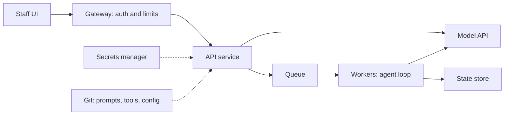

# Module 14 — Shipping to production

*An agent that works on your laptop has not shipped. This module takes Najm Desk from the laptop to the customer's hands: safely, so that a bad release is caught and undone in minutes, and affordably, so that Hind can be told what a resolved ticket costs. Lesson 14.1 covers deployment: the reference architecture, containers, environments and secrets, queues and durable execution for long runs, idempotency keys, streaming and timeouts, versioning the prompt, tools and model together, canary and shadow releases, rollback, and a pipeline with the eval gate. You package Najm Desk as a FastAPI service with health and readiness checks, versioned prompt files, structured logs and a smoke test. Lesson 14.2 covers cost, latency and reliability: the cost model, caching, routing, the Batch API, retries and backoff, circuit breakers, fallbacks, SLOs and error budgets, and capacity. You build a cost and latency layer around the SDK client, a router with tests, retry tests against the mock's failure knobs, and a cost report. Docker and the real API are not available to the course's verification, so each lab says what runs offline and what needs a container runtime or a real model.*

> **Layer:** Delivery, Production — taking the agent off your laptop and into the customer's hands, safely and affordably.

---

# 14.1 — Deploying an agent: containers, environments, queues, durable execution, release strategies and rollback
*Level: 🔴 Advanced* · *Prerequisites: 2.2, 8.2, 12.2, 13.2* · *Layer: Delivery, Production*

## ⚡ In 60 seconds
- A deployed agent is a service around a model call you do not control: expect it slow, wrong, down or costly.
- Build once, configure per environment: pinned base, non-root user, multi-stage build, no secret in a layer.
- Long work leaves the request: queue it, checkpoint it, give every write an idempotency key.
- A release is image, prompt, tools, model id and eval baseline as one: gate it, canary it, rehearse the rollback.
- Biggest trap: green probes, wrong agent.

## 🧭 Why it matters
The pilot works on Lujain's laptop. Fahad asks what happens on Sunday at 07:00 when fourteen agents open Najm Desk at once, and how to undo a bad prompt by 07:05. Lujain's plan (hypothetical): `git pull` on one virtual machine, edit the prompt in place, restart. A second machine keeps the old prompt. Staff get two answers to one question and nothing records which prompt wrote which. In 2012 Knight Capital lost hundreds of millions of dollars within an hour after a release reached only some of its servers (as widely reported).

The discipline is old. New: the "code" includes a prompt and a model id, and a bad release is rarely *down*. It is *wrong*.

## 📐 How it works

### 🟢 The essentials
Najm Desk v1 answers inline, so it needs the first four boxes; the rest arrive when a task outlives a request.



**Containers.** An image holds code, dependencies and a runtime, built once and run unchanged everywhere. Pin the base (an exact tag, in production its digest), build in stages, run as a numeric non-root user, and keep secrets out of every layer, which can be read. Pinned must not mean unpatched: refresh the base on a schedule, and lock exact dependency versions (the lab's `requirements.txt` uses ranges to stay short). No image was built for this lesson. Tests read these files; you run hadolint (a Dockerfile linter) and `docker compose config`.

```dockerfile
# labs/m14/Dockerfile
# From aiapps/labkit: docker build -f labs/m14/Dockerfile --target runtime -t najm-desk:dev .
# Pin the base: an exact tag, in production its digest (image@sha256:...).
ARG PYTHON_IMAGE=python:3.11.9-slim-bookworm

FROM ${PYTHON_IMAGE} AS build
WORKDIR /build
COPY labs/m14/requirements.txt .
RUN python -m venv /venv && /venv/bin/pip install --no-cache-dir -r requirements.txt

# Development only: the offline stand-in for the model API. Never deploy this stage.
FROM ${PYTHON_IMAGE} AS mock
WORKDIR /app
COPY --from=build /venv /venv
COPY labkit ./labkit
ENV PATH="/venv/bin:$PATH"
CMD ["python", "-m", "labkit.mock_server", "--host", "0.0.0.0", "--port", "8787"]

# The last stage is what `docker build` ships: no compiler, no tests, no mock, no key.
FROM ${PYTHON_IMAGE} AS runtime
WORKDIR /app
RUN useradd --system --uid 10001 app
COPY --from=build /venv /venv
COPY labkit/data/policies ./labkit/data/policies
COPY labs/m14/prompts ./labs/m14/prompts
COPY labs/m14/app.py ./labs/m14/app.py
ARG GIT_SHA=dev
ENV PATH="/venv/bin:$PATH" PYTHONUNBUFFERED=1 GIT_SHA=${GIT_SHA}
# Numeric, so an orchestrator can check that the process is not root.
USER 10001
EXPOSE 8000
CMD ["uvicorn", "--app-dir", "labs/m14", "app:app", "--host", "0.0.0.0", "--port", "8000"]
```

```yaml
# labs/m14/docker-compose.yml
# From aiapps/labkit: docker compose -f labs/m14/docker-compose.yml up --build
name: najm-desk
services:
  mock:                                 # offline stand-in for the model API: not in staging or production
    build: {context: ../.., dockerfile: labs/m14/Dockerfile, target: mock}
  api:
    build: {context: ../.., dockerfile: labs/m14/Dockerfile, target: runtime, args: {GIT_SHA: "${GIT_SHA:-dev}"}}
    ports: ["8000:8000"]
    environment:                        # configuration, not code: one image for every environment
      APP_ENV: dev
      ANTHROPIC_BASE_URL: http://mock:8787
      ANTHROPIC_API_KEY: mock           # offline only: a real key comes from the secret store, never a file in Git
      PROMPT_VERSION: ${PROMPT_VERSION:-najm_desk_v2}
      CANARY_PROMPT: ${CANARY_PROMPT:-}
      CANARY_PERCENT: ${CANARY_PERCENT:-0}
    depends_on: [mock]
    read_only: true                     # nothing can write to the container's filesystem
    cap_drop: ["ALL"]
    security_opt: ["no-new-privileges:true"]
```

**Configuration and probes.** One image runs everywhere with different environment variables (the twelve-factor rule). `Settings` reads them once and refuses nonsense, such as production with the mock key; secrets come from the platform's store, one key per environment with a spend cap. *Liveness* touches no dependency, or a provider blip restarts every replica. *Readiness* checks only what the service owns, never makes a paid call per probe, and says what is running.

```python
# labs/m14/app.py
"""Lab 14.1: Najm Desk as a service.  ANTHROPIC_BASE_URL=http://127.0.0.1:9014 ANTHROPIC_API_KEY=mock uvicorn --app-dir labs/m14 app:app"""
import hashlib
import json
import os
import time
from pathlib import Path

import anthropic
from fastapi import FastAPI, Header, HTTPException
from pydantic import BaseModel, Field

HERE = Path(__file__).resolve().parent


class Settings:
    """Twelve-factor: what differs per environment comes from the environment, checked once at start-up. The key stays with the SDK."""

    def __init__(self, env=os.environ):
        self.app_env = env.get("APP_ENV", "dev")
        self.model = env.get("MODEL", "claude-sonnet-5-5")
        self.prompt, self.canary_prompt = env.get("PROMPT_VERSION", "najm_desk_v2"), env.get("CANARY_PROMPT", "")
        self.canary_pct = int(env.get("CANARY_PERCENT", "0"))            # rollback = set this to 0
        self.timeout_s = float(env.get("REQUEST_TIMEOUT_S", "20"))
        self.prompt_dir = Path(env.get("PROMPT_DIR", HERE / "prompts"))
        self.policy_dir = Path(env.get("POLICY_DIR", HERE.parents[1] / "labkit" / "data" / "policies"))
        self.release = env.get("GIT_SHA", "dev")
        if not 0 <= self.canary_pct <= 100:
            raise ValueError("CANARY_PERCENT must be 0 to 100")
        if self.app_env == "prod" and (env.get("ANTHROPIC_API_KEY", "mock") == "mock" or "127.0.0.1" in env.get("ANTHROPIC_BASE_URL", "")):
            raise ValueError("prod must not start with the mock key or a local base URL")


def load_prompt(name: str, folder: Path) -> tuple[str, str]:
    """A prompt is a file in Git. Its version is name@hash: one changed character is a new version."""
    lines = (folder / f"{name}.txt").read_text(encoding="utf-8").splitlines()
    text = "\n".join(line for line in lines if not line.startswith("#")).strip() + "\n"
    return f"{name}@{hashlib.sha256(text.encode()).hexdigest()[:8]}", text


def pick_prompt(cfg: Settings, user: str) -> str:
    """Canary: a stable hash puts each user in one bucket of 100, so nobody flips between versions mid-conversation."""
    bucket = int(hashlib.sha256(user.encode()).hexdigest(), 16) % 100
    return cfg.canary_prompt if cfg.canary_prompt and bucket < cfg.canary_pct else cfg.prompt


def load_docs(folder: Path) -> str:
    """The whole policy library (about 800 tokens), identical on every request: a cacheable prefix. Bigger libraries need Module 4."""
    return "".join(f'<document id="{p.stem}">{p.read_text(encoding="utf-8").strip()}</document>\n' for p in sorted(folder.glob("*.md")))


class Ask(BaseModel):
    question: str = Field(min_length=1, max_length=2000)
    user: str = "anonymous"               # in production the verified token says who this is


def create_app(cfg: Settings | None = None, client=None) -> FastAPI:
    cfg = cfg or Settings()
    client = client or anthropic.Anthropic(timeout=cfg.timeout_s, max_retries=2)
    prompts = {n: load_prompt(n, cfg.prompt_dir) for n in {cfg.prompt, cfg.canary_prompt} - {""}}      # a missing file stops the start-up
    docs, done = load_docs(cfg.policy_dir), {}          # done: idempotency store. In memory here; shared behind several replicas
    app = FastAPI(title="Najm Desk")

    def log(**fields):                    # one JSON line on stdout; never the question
        print(json.dumps({"ts": round(time.time(), 3), "env": cfg.app_env, "release": cfg.release, **fields}), flush=True)

    @app.get("/health")
    def health():                         # liveness: the process is up. No dependencies, or a provider blip restarts every replica.
        return {"status": "ok"}

    @app.get("/ready")
    def ready():                          # readiness: may traffic come? Check what you own; never call the paid model per probe.
        problems = [p for p, bad in [("no policy documents", not docs), ("no API key", "ANTHROPIC_API_KEY" not in os.environ)] if bad]
        if problems:
            raise HTTPException(503, {"ready": False, "problems": problems})
        return {"ready": True, "release": cfg.release, "model": cfg.model, "prompts": {n: v for n, (v, _) in prompts.items()}}

    @app.post("/v1/ask")
    def ask(body: Ask, idempotency_key: str | None = Header(default=None)):
        slot = (body.user, idempotency_key)                              # a key belongs to one user
        if idempotency_key and slot in done:                            # a client retry replays the first answer and costs nothing
            return {**done[slot], "replayed": True}
        version, text = prompts[pick_prompt(cfg, body.user)]
        system = [{"type": "text", "text": docs, "cache_control": {"type": "ephemeral"}}, {"type": "text", "text": text}]   # stable first
        t0 = time.monotonic()
        try:
            resp = client.messages.create(model=cfg.model, max_tokens=1024, output_config={"effort": "low"}, system=system,
                                          messages=[{"role": "user", "content": body.question}])
        except anthropic.APIError as e:
            log(event="model_error", error=type(e).__name__, prompt_version=version, ms=round((time.monotonic() - t0) * 1000))
            raise HTTPException(503, "Najm Desk cannot answer right now. Please use the Service Desk.")      # no provider detail leaks out
        u = resp.usage
        answer = next((b.text for b in resp.content if b.type == "text"), "")
        if resp.stop_reason != "end_turn":         # max_tokens: cut off. refusal: declined. Neither is an answer: hand off instead
            log(event="no_answer", stop=resp.stop_reason, prompt_version=version, request_id=resp._request_id)
            answer = "HANDOFF: Najm Desk could not finish this answer. A Service Desk agent will take it."
        out = {"answer": answer, "prompt_version": version, "model": resp.model, "request_id": resp._request_id}
        log(event="ask", prompt_version=version, model=resp.model, input_tokens=u.input_tokens, output_tokens=u.output_tokens,
            cache_read=u.cache_read_input_tokens, ms=round((time.monotonic() - t0) * 1000), request_id=resp._request_id)
        if idempotency_key:
            done[slot] = out              # requests racing on one key both run: claim the key first if that matters
        return out

    return app


app = create_app()
```

Prompts are files in `labs/m14/prompts/`: `najm_desk_v1.txt` is in production, `v2` the candidate, and a version is the file name plus a hash of its text. In `ask`, the policy library comes first in `system`, with the cache marker, so a new version leaves the cache intact (lesson 14.2).

### 🟡 Going deeper
**Queues and durable execution.** Gateways often cut requests at 30 to 60 seconds, so the API stores a job, enqueues it and answers 202 with a job id the screen polls. A worker dying at step 7 of 9 and restarting at step 1 repeats six model calls and tool writes. A durable-execution engine (Temporal, AWS Step Functions and similar) saves each step's result and resumes after it; a cheaper start checkpoints the messages list and step number. It also suits approvals: an unlock request may wait hours for a person, and a saved run waits at no cost. Store the manifest with the job: a run that began under prompt v1 should finish under v1, and workers should drain on SIGTERM. See [*SaaS Building Blocks*, lesson 5.4 — Workflow engines and durable execution](../saas/index.html#/5.4).

**Idempotency keys.** The client picks a key per intended action; the server stores the first result under (user, key) and replays it. Without one, a timeout and a retry file two tickets. Pass the key on to the system that writes (TicketHub), or a replay protects only your own API.

**Streaming and timeouts.** Stream with `client.messages.stream` so staff see the first word early. Nest timeouts outside in: browser, gateway, API, SDK call (default ten minutes: set it), tools.

**One manifest.** Image digest, prompt version, tool-schema hash, model id, eval baseline: change one and the gate runs again. Remote tools (an MCP server, an internal API) can change without your release, so hash their schemas at start-up and compare.

### 🔴 Expert view
| Strategy | How | The agent-specific catch |
|---|---|---|
| **Canary** | A stable hash sends a few users to the candidate | Fourteen pilot agents are too few to see a rare failure: add shadow |
| **Shadow** | The candidate also gets live requests, unseen | Doubles cost; tools read-only or stubbed |
| **Feature flag** | A runtime switch for one capability | Flags rot; test both states; also a kill switch |
| **Blue-green** | Swap whole environments | Says nothing about prompt quality |

**Rollback** restores the whole manifest: a prompt rollback is one value (`CANARY_PERCENT=0`), an image rollback redeploys the previous digest. Rehearse both. Roll back automatically on error rate, p95 latency, cost per conversation or escalation rate; on a safety signal, by decision. See [*Cloud & DevOps*, lesson 4.2 — Release strategies: rolling, blue-green, canary, feature flags and rollback](../cloud/index.html#/4.2).

**The pipeline** verifies every pull request without secrets, builds the image once, and promotes that image where people approve.

```yaml
# labs/m14/release.yml
# Copy to .github/workflows/release.yml; set working-directory to where labkit lives
name: najm-desk-release
on:
  pull_request: {paths: ["aiapps/labkit/labs/**"]}      # a prompt, tool, model id or the service changed: prove it first
  push: {branches: [main]}
  workflow_dispatch:
    inputs:
      canary_percent: {description: "Share of users on the candidate", default: "5"}
permissions: {contents: read}
concurrency: {group: release, cancel-in-progress: false}   # never two rollouts at once
defaults: {run: {working-directory: aiapps/labkit}}
jobs:
  verify:                               # free, no secrets, every pull request
    runs-on: ubuntu-latest
    timeout-minutes: 15
    steps:
      - uses: actions/checkout@v4
      - uses: actions/setup-python@v5
        with: {python-version: "3.11"}
      - run: pip install -r requirements.txt
      - run: pytest tests/test_m14_*.py
      - name: Smoke test and eval gate against the mock
        env: {ANTHROPIC_BASE_URL: "http://127.0.0.1:8787", ANTHROPIC_API_KEY: mock}
        run: |
          python -m labkit.mock_server --port 8787 &
          for i in $(seq 1 30); do curl -sf http://127.0.0.1:8787/health && break; sleep 1; done
          python labs/m14/smoke.py
          python labs/m12/run_eval.py --mode mock --out results.json
          python labs/m12/gate.py results.json --baseline labs/m12/baseline_mock.json
  image:                                # main only: build once, promote that image
    needs: verify
    if: github.event_name != 'pull_request'
    runs-on: ubuntu-latest
    steps:
      - uses: actions/checkout@v4
      - run: docker build -f labs/m14/Dockerfile --target runtime --build-arg GIT_SHA=${{ github.sha }} -t najm-desk:${{ github.sha }} .
  canary:                               # a person starts it and approves it, after reading the real-model eval
    needs: image
    if: github.event_name == 'workflow_dispatch'
    runs-on: ubuntu-latest
    environment: canary
    steps:
      - run: echo "deploy najm-desk:${{ github.sha }} with CANARY_PERCENT=${{ inputs.canary_percent }} on your platform"
```

The offline gate is lesson 12.2's; a real-model eval is R2's evidence. Tests parse this file (a YAML parser turns the bare key `on` into `True`), and it passes a check against the public GitHub workflow schema; it has not run on GitHub. The `image` job only builds: pushing and signing are your platform's. The `canary` job waits for a person only after you add required reviewers to that environment in the repository settings. See [*Cloud & DevOps*, lesson 4.1 — Continuous integration: pipelines, tests, artefacts and fast feedback](../cloud/index.html#/4.1).

## 🧰 The toolkit
| Tool, practice or pattern | What it is and does | When to reach for it |
|---|---|---|
| **Multi-stage image** | Pinned base, clean runtime stage, non-root | Every service |
| **Settings from the environment** | Read once, validated, refuses unsafe combinations | Every environment |
| **Idempotency key** | Client-chosen id; first result stored and replayed | Any retried write |
| **Durable execution** | Saved step results; a crash resumes | Long runs with side effects |
| **Release manifest** | Image, prompt, tools, model, baseline as one | Every release |
| **Canary release** | A stable hash sends a few users to the candidate | After the gate |

## 🏛️ In practice at Najm Bank
**The artefact** is the **Najm Desk release pack**: image, manifest, pipeline and the release checklist, `labs/m14/release_checklist.yaml`. Rows R1 to R9 each need evidence, not a tick: R1 tests, smoke and offline gate green; R2 a real-model eval with no critical regression; R3 an image that is non-root, pinned and secret-free; R4 a per-environment key with a spend cap; R5 readiness proven to fail; R6 canary stop signals written first; R7 a rehearsed rollback; R8 a working kill switch; R9 sign-offs.

```text
$ ANTHROPIC_BASE_URL=http://127.0.0.1:9014 ANTHROPIC_API_KEY=mock python labs/m14/smoke.py
PASS  liveness answers
PASS  readiness answers
PASS  readiness names the prompt versions
PASS  an answer arrives with a citation
PASS  the same key replays and does not pay twice
PASS  bad input is refused, not crashed
```

`smoke.py` (not printed) boots the app with FastAPI's TestClient; `SMOKE_URL` checks a deployed service. Offline proves mechanics; only a real run shows answer quality and a cache hit.

> **Your platform.** Fill the right column with your platform's owners.

| Concern | In this lab | On your platform |
|---|---|---|
| Image, registry | One `Dockerfile` | |
| Config, secrets | `Settings`; mock key in compose | |
| Identity | `user` is a body field | |
| Probes, deploy target | `/health`, `/ready`; compose | |
| Queue, state store | None; keys in memory | |
| Release control | `CANARY_PERCENT`, `release.yml` | |
| Logs, egress | JSON on stdout; mock only | |

**Weekly deliverable (first half of week 14).** Commit `week-14/` with `labs/m14/` and passing tests, the smoke output, a filled checklist for the v2 prompt canary, the "Your platform" table, and `NOTES.md` with quiz answers and Read this week notes.

**Group session (45 minutes).** (1) Place each diagram box on your platform (10). (2) Time a rollback (10). (3) Check the Dockerfile and compose file against R3 and R4 (15). (4) Write one canary's stop signals (10).

**Build it with Claude Code.** Give this spec in plan mode (check the current Claude Code documentation):

```text
Goal: package the Najm Desk answer path as a FastAPI service as in lesson 14.1: labs/m14/app.py, smoke.py, Dockerfile, docker-compose.yml,
release.yml, release_checklist.yaml, with pytest tests in labkit/tests/test_m14_service.py.
Context: Python 3.11, anthropic>=1,<2, the offline mock in aiapps/labkit, prompt files in labs/m14/prompts.
Constraints: config only from the environment; refuse prod with the mock key; prompt version is name@hash; /health touches no dependency, /ready
never calls the model; logs hold ids and counts, never the question; Idempotency-Key scoped per user; pinned base, multi-stage, numeric
non-root USER; no secret in ENV, ARG or compose; no temperature, prefill or forced tool_choice.
Acceptance: pytest passes; smoke.py prints six PASS lines; hadolint and docker compose config pass.
Do not: build images, add dependencies, touch other modules' files. Plan first; one file at a time; run the tests after each.
```

**Verify before you accept it.**
- Run the tests and the offline eval gate, then break one property at a time (`USER root`, a `:latest` base, an `ENV` key, a `/health` that calls the model): a named test must fail.
- Read the diff for `latest`, `--privileged`, `docker.sock`, request bodies in logs, a dumped `os.environ`.

## 🛠️ Exercises
- 🟢 **Run it and read the logs.** Offline. Start the mock and `uvicorn`, `curl` the three endpoints, ask one question twice with the same `Idempotency-Key` and once without. *Done when:* a table of status, replayed or not and model calls (count the log lines), and the field you would search to find one complaint.
- 🟡 **Canary and rollback drill.** Offline. Set `PROMPT_VERSION=najm_desk_v1`, `CANARY_PROMPT=najm_desk_v2`, `CANARY_PERCENT=20`; send 100 users' questions and count versions; set 0 and prove nobody sees v2. *Done when:* both counts, the rollback's seconds, and why Python's `hash()` would break the bucket.
- 🔴 **Build, break, ship to staging.** Needs a container runtime, your platform's staging and, for R2, the real API. Build the image, run compose, read `docker history`, deploy with a key from the secret store, run `SMOKE_URL` against it. *Done when:* the process runs as UID 10001, no layer holds a key, smoke passes on the deployed URL, and R1 to R9 have evidence.

## ⚠️ Mistakes and traps
- **A floating base image.** `latest` changes under you. Pin an exact tag and, in production, the digest.
- **A secret in `ENV`, `ARG` or compose.** Image history shows it. Inject it at run time.
- **A health check that calls the model.** It costs money and restarts healthy replicas in an outage.
- **A prompt edited on a live machine.** Nobody can say which version answered. Release prompts as files, with the image.
- **A canary with no stop rule.** Write signals and thresholds first.

## 🧾 Recap
- A deployed agent is a service: gateway, API, queue, workers, state store, secrets.
- One pinned, non-root, multi-stage image; configuration from the environment.
- Long runs need a queue, checkpoints and idempotency keys.
- Release image, prompt, tools and model as one manifest: gate, canary, rehearse.

## ✍️ Check yourself

**1. Staging and production run the same image but answer differently. What do you check first?**

- A. Whether the base image tag changed
- B. Whether the environment variables differ
- C. Whether the Dockerfile has several stages
- D. Whether the container runs as non-root

<details><summary>Answer</summary>

**B.** Same image, different behaviour points to configuration: model id, prompt version or canary share. (🟢 Configuration and probes.)

</details>

**2. A liveness probe calls the model every five seconds to "prove the whole path works". The provider has a short outage. What happens?**

- A. Healthy replicas restart again and again
- B. Traffic moves to the canary prompt
- C. The idempotency store replays old answers
- D. The queue retries each probe until recovery

<details><summary>Answer</summary>

**A.** A dependency inside liveness turns a provider blip into restarts, and each probe is a paid call. (🟢 Configuration and probes.)

</details>

**3. A worker crashes at step 7 of 9, after creating a ticket at step 3. Which design avoids a duplicate ticket and repeated model calls?**

- A. Restart from step 1 with a longer timeout
- B. Raise the SDK's max_retries from 2 to 5
- C. Checkpoint each step and add an idempotency key
- D. Run two workers and keep whichever finishes first

<details><summary>Answer</summary>

**C.** The checkpoint resumes after step 6 and the key makes a repeat harmless; the others repeat paid or side-effecting work. (🟡 Queues and durable execution.)

</details>

**4. You want to try a new prompt on live traffic without filing real tickets. Which strategy fits?**

- A. A canary with write tools switched on
- B. A rolling update of the image
- C. A feature flag that is never switched off
- D. A shadow run with read-only tools

<details><summary>Answer</summary>

**D.** A shadow run records answers without showing them, so its tools must not write. A canary shows answers to real users. (🔴 Expert view.)

</details>

**5. After a prompt change, answers are worse but every probe is green. What first?**

- A. Wait for readiness to fail before acting
- B. Restore the previous manifest, then investigate
- C. Rebuild the image from a clean checkout and redeploy
- D. Raise the effort level to compensate

<details><summary>Answer</summary>

**B.** Probes see the process, not answer quality. Roll the whole manifest back, then reproduce the regression. (🔴 Expert view.)

</details>

## 📚 References
- Claude API: Streaming https://platform.claude.com/docs/en/build-with-claude/streaming; Errors https://platform.claude.com/docs/en/api/errors
- [*Cloud & DevOps*, lesson 2.3 — Kubernetes in practice: config, secrets, health probes, autoscaling and Helm](../cloud/index.html#/2.3); [*System Design for Vibe Coders*, lesson 4.4 — Rollback, staging, and release gates](../vibe/index.en.html#l4-4)
- Found by title: *The Twelve-Factor App*; the GitHub Actions, Docker and FastAPI documentation; hadolint. Lab kit: https://github.com/Tamoura/system-design-for-vibe-coders/tree/main/aiapps/labkit
- **Read this week (Module 14).** Grokking AI Applications, chapter 8 (Deploying and orchestrating GenAI apps): https://www.manning.com/books/grokking-ai-applications. Gulli, *Agentic Design Patterns*, chapter 16 (Resource-Aware Optimisation): the free draft listed in lesson 0.1. Microsoft, *AI Agents for Beginners*, lessons 15-17 (Deployment, Local agents): https://github.com/microsoft/ai-agents-for-beginners

---

# 14.2 — Cost, latency and reliability engineering: budgets, caching, routing, retries and SLOs
*Level: 🔴 Advanced* · *Prerequisites: 0.2, 12.2, 14.1* · *Layer: Production, Delivery*

## ⚡ In 60 seconds
- Cost is tokens times the current price on four meters: input, output, cache write, cache read. Judge it per conversation and per resolved ticket.
- Free wins first (cache the prefix, trim tool output, batch offline work); trade-offs last (lower effort, a cheaper model), each checked against the eval.
- Retries need a jittered wait, a cap and one layer; never retry a 400. Add a circuit breaker and a tested fallback.
- Four SLOs: task success, p95 latency, cost per conversation, escalation rate. The error budget says when to stop shipping.
- Biggest trap: a lower price per token and a higher cost per resolved ticket.

## 🧭 Why it matters
Hind asks what one resolved ticket costs, and what the bill becomes if every employee uses Najm Desk. Lujain's first answer (hypothetical) is the invoice divided by conversations, which includes her eval runs, paid retries that failed, and hand-offs. Then, one Sunday at 07:02, the provider answers 529 overloaded. Her wrapper retries five times with no wait, each question becomes six paid calls, the burst hits the rate limit, and a brief overload becomes a twenty-minute outage. Nobody measured, and nobody tested the retry code against a provider that misbehaves.

## 📐 How it works

### 🟢 The essentials
**The cost model.** A call costs four meters at four prices per million tokens, from the current price page. `input_tokens` excludes cached tokens, so the input meters add up without overlap.

| Meter in `resp.usage` | Priced at | Note |
|---|---|---|
| `input_tokens` | P_in | Uncached input |
| `output_tokens` | P_out | Includes thinking |
| `cache_creation_input_tokens` | P_in × w | w was about 1.25 for the five-minute cache when written |
| `cache_read_input_tokens` | P_in × r | r is a fraction, about 0.1 on many models: check yours |

A conversation sums its calls; input grows each turn as history is resent (lesson 0.2). Cost per resolved ticket is all spend divided by tickets resolved without a person: failed calls and hand-offs stay in.

**Worked example.** A six-turn chat with a 1,500-token system prompt sends 14,010 input tokens and receives 1,500. Each cell is tokens × invented price (input 1, output 5, write 1.25, read 0.1):

| | Input | Write | Read | Output | Total |
|---|---|---|---|---|---|
| No cache | 14,010 | 0 | 0 | 7,500 | 21,510 |
| System prompt cached | 5,010 | 1,875 | 750 | 7,500 | 15,135 |

The bill falls 30%, its input half 45%. A test checks this.

**Measure every call.** `Tracked` wraps the SDK client: one JSON line per call, and a cap that refuses the next call once spent. Prices come from a file you fill in and date; undated, it warns.

```python
# labs/m14/cost.py
"""Lab 14.2: a thin layer around the SDK client. Every call becomes one JSON line (four token meters, latency, cost) and a budget
stops runaway spend. Prices come from prices.json, which YOU fill in."""
import json
import os
import sys
import time
from pathlib import Path

import anthropic

HERE = Path(__file__).resolve().parent


class BudgetExceeded(RuntimeError):
    pass


def load_prices(path=HERE / "prices.json") -> dict:
    prices = json.loads(Path(path).read_text(encoding="utf-8"))
    if not prices.get("checked"):
        print("warning: prices.json has no 'checked' date: totals are lab units, not money", file=sys.stderr)
    return prices


def cost_of(usage, model: str, prices: dict) -> float | None:
    """Four meters, four prices. input_tokens EXCLUDES cached tokens, so the input meters add up without overlap.
    An unpriced model gives None: a pricing gap never fails a customer's request."""
    p = prices["per_million_tokens"].get(model)
    if p is None:
        return None
    return (usage.input_tokens * p["input"] + usage.output_tokens * p["output"]
            + (usage.cache_creation_input_tokens or 0) * p["cache_write"] + (usage.cache_read_input_tokens or 0) * p["cache_read"]) / 1_000_000


class Tracked:
    """client.messages.create plus labels `tag` (feature) and `convo` (conversation), and a spending cap."""

    def __init__(self, client=None, prices=None, log=None, budget=None):
        self.client, self.prices, self.budget, self.spent = client or anthropic.Anthropic(), prices or load_prices(), budget, 0.0
        self.log = Path(log or os.environ.get("USAGE_LOG", "usage.jsonl"))

    def create(self, *, tag="najm-desk", convo=None, **kw):
        if self.budget is not None and self.spent >= self.budget:            # before the call: fail closed
            raise BudgetExceeded(f"{self.spent:.4f} spent of {self.budget}")
        rec, t0 = {"ts": round(time.time(), 3), "tag": tag, "convo": convo, "model": kw["model"]}, time.monotonic()
        try:
            resp = self.client.messages.create(**kw)
        except anthropic.APIError as e:                                       # failures are data: the error rate is an SLI
            self._write({**rec, "ms": round((time.monotonic() - t0) * 1000), "error": type(e).__name__})
            raise
        u, cost = resp.usage, cost_of(resp.usage, kw["model"], self.prices)
        self.spent += cost or 0.0
        self._write({**rec, "ms": round((time.monotonic() - t0) * 1000), "input": u.input_tokens, "output": u.output_tokens,
                     "cache_write": u.cache_creation_input_tokens or 0, "cache_read": u.cache_read_input_tokens or 0,
                     "cost": cost, "stop": resp.stop_reason, "request_id": resp._request_id})
        return resp

    def _write(self, rec: dict):
        with self.log.open("a", encoding="utf-8") as f:
            f.write(json.dumps(rec) + "\n")
```

`prices.json` is invented until you replace it:

```json
{
  "_note": "INVENTED placeholders, per million tokens. Copy the real prices from the price page, then set checked.",
  "checked": "",
  "per_million_tokens": {
    "claude-haiku-5-5": {"input": 1, "output": 5, "cache_write": 1.25, "cache_read": 0.1},
    "claude-sonnet-5-5": {"input": 3, "output": 15, "cache_write": 3.75, "cache_read": 0.3},
    "claude-opus-5-5": {"input": 5, "output": 25, "cache_write": 6.25, "cache_read": 0.5}
  }
}
```

**Budgets and alerts.** Three layers: a cap in code, a limit and alert on the key in the provider console (lesson 0.2), and a per-feature view from `tag`. Alert below the cap, and decide who looks.

### 🟡 Going deeper
**Prompt caching** is a prefix match over tools, system, then messages: one changed byte invalidates everything after it. Mark the end of the stable part with `cache_control`, and put what varies after it, as `app.py` does. Verify with `cache_read_input_tokens`; if it stays zero, a silent invalidator is at work: a timestamp, request id or unsorted JSON in the prefix, a per-user line in the system prompt, a changing tool list, a different model or effort. A prefix under the model's minimum is silently not cached; the default lifetime is five minutes, renewed by each read. `probe.py` (not printed) sends one prefix twice and exits 1 unless the second call reads it. Offline the cache fields are always zero: this needs the real API.

| Lever | Kind | The catch |
|---|---|---|
| **Response cache**: exact answers under a versioned key | Free | Never for answers using the user's own data; flush on a policy change |
| **Trim tool output**: cap rows, select fields | Free | Cut too much and the agent calls again |
| **Summarise history** | Trade-off | Rewrites the prefix: the cache restarts |
| **Batch API**: about half price, results by `custom_id` within hours to a day | Free if nobody waits | Evals and nightly jobs; no tool loop |
| **Lower effort**, **cheaper model** | Trade-off | Test the hard cases; one change at a time |

**Routing.** Start on `claude-haiku-5-5`; escalate to `claude-sonnet-5-5` or `claude-opus-5-5` for hard cases or low confidence. Make the signal checkable (a cited answer): a model's own confidence is poorly calibrated. Routing pays only when e < 1 − c/s, with e the share escalated and c, s the cheap and strong prices, and each escalation adds a second call's latency. Validate it with the eval (lesson 12.2): with and without routing, per category.

```python
# labs/m14/router.py
"""Lab 14.2: cheap model first, and escalate on signals you can check in code."""
import re

TIERS = ("claude-haiku-5-5", "claude-sonnet-5-5", "claude-opus-5-5")     # cheap, middle, strongest: config in production


def route(question: str, turns: int = 0) -> tuple[str, str]:
    """The first tier to try: a pure function, so a test pins every rule."""
    if len(re.findall(r"\b\d{4}\b", question)) >= 3 or len(question) > 1500 or turns >= 6:
        return TIERS[1], "long, many tickets or a long chat"
    if re.match(r"\s*(please |can you |could you )?(create|open|unlock|reset)\b", question, re.I):
        return TIERS[1], "an action request: the arguments must be right"
    return TIERS[0], "short question"


def confident(answer: str) -> bool:
    """The escalation signal: checkable beats self-reported. Cited, and not a HANDOFF or I-don't-know."""
    return bool(re.search(r"\[[\w#-]+\]", answer)) and not answer.startswith(("HANDOFF", "I don't know"))


def answer_with_escalation(ask, question: str, turns: int = 0):
    """ask(model) -> text. Try the routed tier, then ONE stronger tier, then stop. Returns (text, tried)."""
    first, tried = TIERS.index(route(question, turns)[0]), []
    for model in TIERS[first:first + 2]:
        tried.append(model)
        text = ask(model)
        if confident(text):
            break
    return text, tried
```

**Latency levers.** Stream for the first word; run independent tool calls in parallel; lower effort; a smaller model; shorter output; a cached prefix.

### 🔴 Expert view
**Rate limits and retries.** A 429 carries `retry-after`; 5xx and 529 are transient. The SDK already retries them twice with backoff, so add a layer only for what it lacks: a longer budgeted wait, a breaker, a fallback. Wait with full jitter so clients do not retry in step; honour `retry-after`; retry only the transient; set a timeout on every call; build the client with `max_retries=0` beneath your layer; stay inside the run deadline; make tool writes idempotent (lesson 14.1), since repeating a model call only costs money.

```python
# labs/m14/reliable.py
"""Lab 14.2: survive a bad day at the provider: jittered backoff, a circuit breaker and a fallback model."""
import random
import time

import anthropic


def retryable(e: Exception) -> bool:
    """The SDK's policy: network trouble, 408, 409, 429 and any 5xx (529 is its own class). A 400 is a bug: never retry it."""
    return isinstance(e, anthropic.APIConnectionError) or (isinstance(e, anthropic.APIStatusError) and (e.status_code in (408, 409, 429) or e.status_code >= 500))


class CircuitOpen(RuntimeError):
    pass


class Reliable:
    """Wraps `inner.create`. Build the client with max_retries=0: the SDK's own retries would multiply with ours (3 x 3 = 9 calls)."""

    def __init__(self, inner, fallback=None, tries=3, base=0.5, cap=8.0, open_after=5, cool=30.0,
                 sleep=time.sleep, rand=random.random, clock=time.monotonic):
        self.inner, self.fallback, self.tries, self.base, self.cap = inner, fallback, tries, base, cap
        self.open_after, self.cool, self.sleep, self.rand, self.clock = open_after, cool, sleep, rand, clock
        self.fails, self.opened_at = 0, None

    def delay(self, attempt: int, err) -> float:
        """The server's retry-after if sent, else exponential backoff with full jitter; both capped."""
        sent = getattr(getattr(err, "response", None), "headers", {}).get("retry-after")
        return min(self.cap, float(sent)) if sent else self.rand() * min(self.cap, self.base * 2 ** attempt)

    def create(self, **kw):
        if self.opened_at is not None and self.clock() - self.opened_at < self.cool:     # open: leave the provider alone
            return self._fallback(kw, CircuitOpen("circuit open"))
        err = None
        for attempt in range(self.tries):
            try:
                resp = self.inner.create(**kw)
                self.fails, self.opened_at = 0, None                    # a success closes the circuit
                return resp
            except anthropic.APIError as e:
                if not retryable(e):
                    raise
                err, self.fails = e, self.fails + 1
                if self.fails >= self.open_after:
                    self.opened_at = self.clock()
                    break
                if attempt < self.tries - 1:
                    self.sleep(self.delay(attempt, e))
        return self._fallback(kw, err)

    def _fallback(self, kw, err):
        if self.fallback is None:
            raise err
        return self.inner.create(**{**kw, "model": self.fallback})      # another model: its cache starts cold
```

A *circuit breaker* stops calling a failing provider for a cool-down, then allows one trial. A *fallback model* answers meanwhile; put it under the eval, since quality changes and its cache starts cold. The tests drive the mock with `MOCK_FAIL_EVERY=2` (every second request a 529) and `MOCK_RATE_LIMIT_EVERY` (a 429 with `retry-after: 1`): the SDK alone hides the overloads, without retries exactly half fail, and the breaker opens and recovers.

**SLOs for an agent.** Targets are fictional; Hind and Yara set real ones.

| SLI | Measure | Target |
|---|---|---|
| Task success | Resolved or handed off correctly: eval plus sampled review | 90% over 28 days |
| p95 latency | Question to final answer | 15 s |
| Cost per conversation | Spend ÷ conversations | Hind's budget |
| Escalation rate | Hand-offs ÷ conversations; alert both ways | 15% to 35% |

The *error budget* is what the target allows: 90% over 28 days lets 10% of conversations miss. A fast burn means stop releases, roll back. See [*Cloud & DevOps*, lesson 5.2 — SLOs, error budgets, alerting and on-call that people can sustain](../cloud/index.html#/5.2).

**Capacity** (fictional). 1,800 tickets a week, 40% reaching Najm Desk, is 14.4 conversations an hour; plan for a 3× peak, 43 an hour or 0.012 a second. A conversation is six calls of about 12 seconds: 72 seconds. Little's law, concurrency = arrival rate × time in system, gives 0.012 × 72 ≈ 0.9: one worker. Tokens: 43 × 14,010 ≈ 10,000 input a minute, against your rate limit. Redo this before each rollout phase.

## 🧰 The toolkit
| Tool, practice or pattern | What it is and does | When to reach for it |
|---|---|---|
| **Cost record** | One JSON line per call: four meters, latency, cost | Every model call |
| **Prompt caching** | A stable prefix first, so repeated calls reuse it at a lower price | Long prompts called often |
| **Model router** | Rules pick the first tier; a checkable signal escalates once | Mixed easy and hard traffic |
| **Batch API** | Asynchronous requests at about half price | Offline evals, nightly jobs |
| **Retry with backoff** | Jitter, cap, `retry-after`, one layer, never a 400 | Every provider call |
| **Circuit breaker** | Stop calling a failing provider for a cool-down | Provider outages |
| **SLO and error budget** | Targets with a burn rule | Every production agent |

## 🏛️ In practice at Najm Bank
**The artefact** is the **Najm Desk cost and reliability sheet**, one page for Hind from the report: unit costs, budget and alert levels, routing rules, retry, timeout, breaker and fallback settings, the SLO table, the capacity arithmetic.

`report.py` (not printed) reads the log and prints cost per model, conversation and resolved ticket, then checks p95 latency, error rate and cost against SLO targets (`--slo-p95-ms`, `--slo-error-rate`, `--slo-convo-cost`). It exits 1 on a breach.

```text
$ python labs/m14/demo.py && python labs/m14/report.py usage.jsonl --resolved 9
claude-haiku-5-5   tried 1  How many days a week can I work remotely -> Remote work is allowed u
claude-sonnet-5-5  tried 2  What are the working from home rules?    -> I don't know based on th
claude-sonnet-5-5  tried 2  What happens to my account when I leave  -> I don't know based on th
claude-sonnet-5-5  tried 2  What is the weather in Doha?             -> (mock) I received: What
...
claude-haiku-5-5    11 calls    816 in   232 out cost 0.00198  p95 21 ms
claude-sonnet-5-5    4 calls    271 in    57 out cost 0.00167  p95 2 ms
total 0.00364 over 6 conversations = 0.00061 each; 0.00040 per resolved ticket; 0 errors
SLO: all inside their targets
$ ... --slo-convo-cost 0.0005    (exit 1)
SLO: BREACH of cost per conversation
```

Three of twelve questions escalated and none improved. Two were lesson 4.2's vocabulary gaps: retrieval missed, and no stronger model can cite a document it never saw. They cost 0.00095 of 0.00364, 26%; twelve first attempts on the middle tier would cost 0.00664. Prices are invented and the mock ignores the model: take the method. `demo.py` (not printed) runs the questions. Real prices, latency, cache hits and lost answers need the real API.

**Weekly deliverable (second half of week 14).** Commit the cost files in `labs/m14/` with passing tests, a dated `prices.json`, the demo and report output, the one-page sheet, and `NOTES.md` (quiz answers, Read this week notes).

**Group session (45 minutes).** (1) Compare costs per resolved ticket; find the biggest lever (15). (2) Break the router with phrasings it misses (10). (3) Argue the SLO targets and who is paged (20).

**Build it with Claude Code.** Give this spec in plan mode (check the current Claude Code documentation):

```text
Goal: add a cost and reliability layer around the Anthropic client: labs/m14/cost.py, router.py, reliable.py, report.py, prices.json,
as in lesson 14.2, with pytest tests in labkit/tests/test_m14_cost.py.
Context: Python 3.11, anthropic>=1,<2, the offline mock (MOCK_FAIL_EVERY, MOCK_RATE_LIMIT_EVERY).
Constraints: prices only from prices.json; log four token meters, never the prompt; budget checked before the call; retries with jitter,
retry-after, never a 400, under max_retries=0; routing a pure function; no temperature, prefill or forced tool_choice.
Acceptance: pytest passes; report.py exits 1 on a breached SLO. Do not hard-code prices or add dependencies.
```

**Verify before you accept it.**
- Run the tests and the demo, then break one rule at a time (drop the cache-write term, retry a 400, drop the jitter): a test must fail.
- Read the diff for a price in code, an uncapped sleep, a retry inside a retry, a prompt in the log.

## 🛠️ Exercises
- 🟢 **Fill the prices.** Offline, with the public price page. Copy current prices into `prices.json`, date them, run the demo and report. *Done when:* the warning is gone and the report matches your hand arithmetic for one conversation to five decimals.
- 🟡 **Smarter escalation.** Offline. Make "I don't know based on the provided documents" a final answer, not an escalation; write the failing test first. *Done when:* tests pass, escalations fall from three to one, and one case shows when not escalating is wrong.
- 🔴 **Prove it on the real API.** Needs the real API and the cap from lesson 0.2. Run `probe.py`; run your 20 questions routed and all on the middle tier. *Done when:* `NOTES.md` has the probe output, both costs per question with the date, a verdict on each differing answer, and your decision with a threshold.

## ⚠️ Mistakes and traps
- **Cost per call, not per resolved ticket.** Hand-offs and failed calls still cost.
- **A volatile prefix.** A timestamp pays the write premium and reads nothing. Check `cache_read_input_tokens`.
- **Stacked or unbounded retries.** Layers multiply and no wait makes a storm. One layer, jitter, a cap.
- **Escalating what a stronger model cannot fix.** A retrieval miss stays a miss.
- **An untested fallback.** It runs on the worst day. Put it under the eval.

## 🧾 Recap
- Cost is four meters times current prices, judged per resolved ticket.
- Free wins first; trade-offs one at a time against the eval.
- Retry with jitter, one layer, never a 400; add a breaker and a fallback.
- Four SLOs and an error budget decide when to stop shipping.

## ✍️ Check yourself

**1. Haiku-first routing cut the price per call by 60%, yet cost per resolved ticket rose. Which is the most likely cause?**

- A. The cheap tier's tokens are counted twice in the report
- B. Prompt caching stopped working on the cheap tier
- C. Many conversations escalate, so cheap calls are wasted
- D. Latency rose, and latency is billed by the second

<details><summary>Answer</summary>

**C.** Per-call price ignores escalations, retries and hand-offs, which still cost. (🟢 The cost model.)

</details>

**2. The system prompt is identical for every user, yet `cache_read_input_tokens` is always zero. What do you check first?**

- A. A timestamp or request id inside the prompt prefix
- B. Whether temperature is set to zero for this model
- C. Whether `max_tokens` is set above 1024 tokens
- D. Whether the response is delivered by streaming to the client

<details><summary>Answer</summary>

**A.** Any changed byte in the prefix invalidates the cache after it, and it can look identical to the eye. (🟡 Prompt caching.)

</details>

**3. During an overload, a wrapper retries five times at once on top of the SDK's own retries. What is wrong?**

- A. Nothing: more attempts always raise the success rate
- B. It should retry 400 errors too
- C. The SDK's retries should be raised to ten
- D. Layers multiply calls and no wait makes a storm

<details><summary>Answer</summary>

**D.** Five tries times three attempts is fifteen calls with no pause, which deepens the overload. (🔴 Rate limits and retries.)

</details>

**4. The error budget for the 90% task-success SLO is half spent in two days of a 28-day window. What do you do?**

- A. Raise the SLO to 95% to be safe
- B. Pause releases, then investigate or roll back
- C. Wait until the 28-day window ends before acting
- D. Hide the dashboard from the sponsor

<details><summary>Answer</summary>

**B.** A fast burn means the target will be missed; an error budget exists to stop risky change early. (🔴 SLOs.)

</details>

**5. Every night 20,000 old tickets must be re-classified, and nobody waits for the result. Which lever fits?**

- A. The Batch API
- B. A response cache keyed by question
- C. Streaming the replies
- D. A lower `max_tokens`

<details><summary>Answer</summary>

**A.** Asynchronous batches cost about half and suit work nobody waits for; the others target repeats, perceived speed or length. (🟡 The levers.)

</details>

## 📚 References
- Claude API: Pricing https://platform.claude.com/docs/en/about-claude/pricing; Prompt caching https://platform.claude.com/docs/en/build-with-claude/prompt-caching; Batch processing https://platform.claude.com/docs/en/build-with-claude/batch-processing
- [*Cloud & DevOps*, lesson 6.2 — FinOps: understanding, allocating and cutting cloud cost](../cloud/index.html#/6.2); [*AI Product Management*, lesson 8.2 — Unit economics: cost to serve, pricing models and margins](../aipm/index.html#/8.2). Lab kit: https://github.com/Tamoura/system-design-for-vibe-coders/tree/main/aiapps/labkit
- **Read this week (Module 14).** Grokking AI Applications, chapter 8 (Deploying and orchestrating GenAI apps): https://www.manning.com/books/grokking-ai-applications. Gulli, *Agentic Design Patterns*, chapter 16 (Resource-Aware Optimisation): the free draft listed in lesson 0.1. Microsoft, *AI Agents for Beginners*, lessons 15-17 (Deployment, Local agents): https://github.com/microsoft/ai-agents-for-beginners
