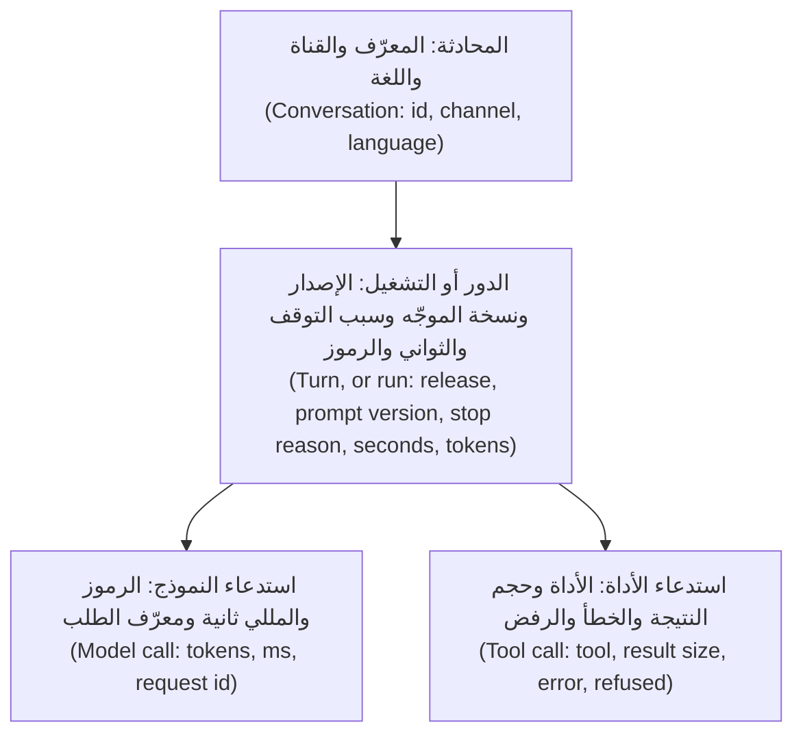
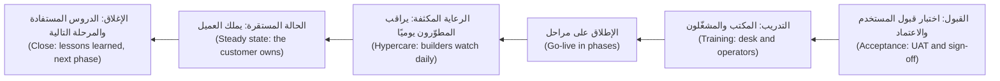

# الوحدة 15 — التشغيل والتسليم

*الوكيل الذي أُطلق لا يزال بحاجة إلى من يُبقيه سليمًا، ثم لا بد أن يصير ملكًا لشخص آخر. يتناول الدرس 15.1 المهمة الأولى: تتبّعات (traces) تُظهر ما فعله كل تشغيل دون الاحتفاظ بما قاله الموظفون، ولوحات متابعة وتنبيهات لأهداف مستوى الخدمة لا تدرّب الناس على تجاهلها، وخمس فئات من الحوادث لكل منها دليل تشغيل ومفتاح إيقاف، ومراجعات ما بعد الحادثة الخالية من اللوم (blameless postmortems)، وحلقة تغذية راجعة تحوّل الإخفاقات إلى حالات تقييم، وإدارة التغيير للموجّهات والنماذج. ويحوّل مختبره ملفات تتبّع JSONL (JSONL traces) إلى تقرير عن التكلفة والزمن والإخفاق، ويُجري تمرين حادثة يوقف فيه مفتاح الإيقاف وكيلًا وهميًا منفلتًا. أما الدرس 15.2 فهو ورشة التسليم: اختبار القبول مع العميل، ومجموعة الوثائق، والتدريب، ونموذج الدعم، والتبنّي، وتتبّع الفوائد مقابل خط الأساس الخيالي، والرعاية المكثفة (hypercare)، وإغلاق المشروع. ويحوّل مختبره معايير القبول (acceptance criteria) إلى نص اختبار قبول المستخدم يستطيع المشغِّل أن يتمرّن عليه، مع دليل المستخدم وفهرس لأدلة التشغيل وقائمة فحص التسليم لنجم ديسك (Najm Desk).*

> **الطبقة:** Production, Delivery — إبقاء الوكيل سليمًا أثناء عمله، وتسليمه إلى العميل ليتمكن من امتلاكه.

---

# 15.1 — تشغيل وكيل في الإنتاج: قابلية المراقبة والتنبيهات والحوادث وأدلة التشغيل وحلقة التحسين
*المستوى: 🔴 متقدم* · *المتطلبات: 8.2، 12.2، 13.1، 14.2* · *الطبقة: Production*

## ⚡ الدرس في دقيقة
- الوكلاء (Agents) يفشلون بهدوء: الخدمة تعمل والإجابات خاطئة. راقب **التشغيل**.
- تتبَّع أربعة مستويات؛ وسجّل المعرّفات والأعداد والأسباب، لا النصوص أبدًا.
- نبّه على أعراض أهداف مستوى الخدمة نادرًا؛ ولكل تنبيه دليل تشغيل.
- خمس فئات من الحوادث، وخطوة أولى واحدة: **أوقفه**، بمفتاح إيقاف جرى التدرّب عليه.
- الإخفاقات تصير حالات تقييم؛ والتغييرات تمرّ هكذا: قيِّم، ثم أطلق كناريًا، ثم راقب، ثم تراجع.

## 🧭 لماذا يهم
مساء الخميس تطلق لجين موجّهًا يقصّر الإجابات — افتراضي. وصباح الأحد في 07:10، وهي الذروة، تكون لوحة المتابعة لدى مها خضراء. وفي 09:20 تتصل يارا هاتفيًا: أعطى نجم ديسك أحد عشر شخصًا سياسة VPN دون مصدر، وأُعطي اثنان منهم قاعدة كلمة المرور ذات الاثني عشر حرفًا الملغاة. لم يُطلق شيء أي تنبيه، لأن شيئًا لم يفشل. ولا تحمل التتبّعات أي نسخة موجّه (prompt version)، ولا أحد متأكد ممن يحق له إيقاف المساعد.

## 📐 كيف يعمل

### 🟢 الأساسيات

**الوكلاء يفشلون بهدوء.** تفشل خدمة الويب بصوت عالٍ؛ أما الوكيل فقد يجيب إجابة خاطئة بثقة، أو يدور في حلقة ويحرق الرموز، أو يطيع أمرًا محقونًا، كل ذلك دون أي خطأ. لذا راقب **التشغيل**: رسالة واحدة تُعالَج حتى سبب التوقف (الدرس 8.2).



**التسجيل الآمن للبيانات الشخصية**. الضعيف: تسجيل كل موجّه وكل إجابة «لأغراض التنقيح». والقوي: سجّل المعرّفات والأحجام والأسباب؛ وأخفِ أولًا (الدرس 13.1)؛ واعتمد قائمة سماح للحقول المسجَّلة؛ واحتفظ بأي نص في مخزن منفصل قصير العمر (تقرر سارة ذلك، الدرس 13.2). معرّفات المحادثات عشوائية، ولا تكون رقم موظف أبدًا؛ ومعرّف المستخدم بعد تجزئته يظل في الغالب بيانات شخصية. يحتفظ `Trace` في المختبر 8.2 بنص مقتطع: لا بأس بذلك في مختبر؛ أما في الإنتاج فسجّل الأحجام بدلًا منه.

**OpenTelemetry.** يستطيع Anthropic SDK إصدار امتدادات OpenTelemetry، امتداد واحد لكل استدعاء، بسمات `gen_ai.*` من الاصطلاحات الدلالية لـGenAI التي لا تزال تتطور. تحمل الامتدادات البيانات الوصفية فقط افتراضيًا (`metadata_only`)؛ ولا تفعّل `content` إلا بعد موافقة سارة. وأي `conversation_id` تضعه يُصدَّر في الوضعين: فلا تضع فيه بيانات شخصية أبدًا. سجّل `resp._request_id` لكل استدعاء، من أجل تقارير الإخفاق.

### 🟡 التعمق أكثر

**اقرأ التتبّعات.** شغّل الأمر من `aiapps/labkit`. العيّنة اصطناعية وخيالية: 83 تشغيلًا، وخط الأساس (baseline) `r41` والكناري (canary) `r42-canary`. الأسعار قيم نائبة فقط: استخدم صفحة الأسعار.

```bash
PRICE_IN_PER_MTOK=1 PRICE_OUT_PER_MTOK=5 python labs/m15/trace_report.py labkit/data/m15_traces.jsonl --by release
```

```text
== r42-canary: 26 runs ==
outcomes : done 17 (65%) | no_progress 3 (12%) | iteration_cap 3 (12%) | token_budget 2 (8%) | model_error 1 (4%)
latency  : run p50 3.0 s, p95 11.9 s | tokens per run p95 11,051
cost     : 0.13 in all, 0.0076 per resolved conversation
slo      : success 65.4% (want 90%+) BREACH | p95 11.9 s (want 10 s or less) BREACH
privacy  : card in start.goal x1, email in start.goal x1, secret in start.goal x1
```

(يُطبع `r41` أولًا.) اقرأ النتائج والأذيال (p95) والمال لكل محادثة **محلولة**، لأن التشغيلات الفاشلة تكلّف أيضًا. يجتاز خط الأساس هدفَي مستوى الخدمة (SLOs) كليهما؛ ويفشل الكناري في كليهما ويكلّف أكثر من الضعف لكل محادثة محلولة: تراجع عنه. وسطر الخصوصية نتيجة ثانية: مسجِّل قديم احتفظ بنص خام. ويجعل رمز الخروج (exit code) هذا مهمة مجدولة، وهي أرخص تنبيه. يعدّ التقرير `done`، فكان سيفوّت حادثة الأحد: أضف علمًا باسم `cited` إلى `stop`. ولا يشمل `input_tokens` الرموز المخزّنة مؤقتًا: فإن خزّنت الموجّهات مؤقتًا، فسجّل أيضًا `cache_creation_input_tokens` و`cache_read_input_tokens` (الدرس 14.2)، وإلا قلَّ احتساب التكلفة والقاطع عن حقيقته.

```python
# labs/m15/trace_report.py
"""Lab 15.1: one page for the on-call person, from JSONL traces (Lab 8.2's format, plus release and prompt_version).
  python labs/m15/trace_report.py TRACE.jsonl [--by release]    exit 1 on an SLO breach, personal data or a broken log
Set PRICE_IN_PER_MTOK and PRICE_OUT_PER_MTOK (per million tokens) from the price page: prices never live in code."""
import json
import math
import os
import re
import sys
from collections import Counter, defaultdict

SLO = {"success": 0.90, "p95_seconds": 10.0}      # decisions, not facts: take yours from NFR-01 and your own data
PII = {"email": r"[\w.+-]+@[\w-]+\.[\w.]+", "card": r"\b(?:\d[ -]?){13,16}\b", "secret": r"(?i)\b(?:password|passcode)\s*(?:is|=|:)\s*\S+"}
PRICE = [float(os.environ.get(k, "nan")) for k in ("PRICE_IN_PER_MTOK", "PRICE_OUT_PER_MTOK")]


def pct(xs, p):
    """Nearest-rank percentile: averages hide the tail, where users wait."""
    xs = sorted(xs)
    return xs[max(0, math.ceil(p / 100 * len(xs)) - 1)] if xs else float("nan")


def report(label, runs):
    """Print one group of runs; return True when it breaches an SLO."""
    stops = [next((e for e in ev if e["event"] == "stop"), {}) for ev in runs]       # no stop event: the process died or was killed
    reasons, secs = Counter(s.get("reason", "no_stop_line") for s in stops), [s["seconds"] for s in stops if "seconds" in s]
    usage = [[sum(e.get(k, 0) for e in ev if e["event"] == "model") for k in ("input_tokens", "output_tokens")] for ev in runs]
    n, done, money = len(runs), reasons["done"], sum(a * PRICE[0] + b * PRICE[1] for a, b in usage) / 1e6
    print(f"== {label}: {n} runs ==\noutcomes : " + " | ".join(f"{k} {v} ({v / n:.0%})" for k, v in reasons.most_common()))
    print(f"latency  : run p50 {pct(secs, 50):.1f} s, p95 {pct(secs, 95):.1f} s | tokens per run p95 {pct([a + b for a, b in usage], 95):,.0f}")
    if not math.isnan(money):                      # failed runs cost too: divide by RESOLVED conversations
        print(f"cost     : {money:.2f} in all, {money / max(done, 1):.4f} per resolved conversation")
    ok = {f"success {done / n:.1%} (want {SLO['success']:.0%}+)": done / n >= SLO["success"],
          f"p95 {pct(secs, 95):.1f} s (want {SLO['p95_seconds']:g} s or less)": pct(secs, 95) <= SLO["p95_seconds"]}
    print("slo      : " + " | ".join(f"{k} {'ok' if v else 'BREACH'}" for k, v in ok.items()))
    return not all(ok.values())


if __name__ == "__main__":
    runs, bad, leaks = defaultdict(list), 0, Counter()
    for line in open(sys.argv[1], encoding="utf-8"):
        try:
            e = json.loads(line)
            run, kind = e["run"], e["event"]
        except (ValueError, KeyError, TypeError):
            bad += bool(line.strip())                  # a pipeline that drops lines is a finding too
            continue
        runs[run].append(e)
        for field, v in e.items():                     # kinds and places are safe to print; the values are not
            leaks.update((what, f"{kind}.{field}") for what, rx in PII.items() if isinstance(v, str) and re.search(rx, v))
    by, groups = (sys.argv[sys.argv.index("--by") + 1] if "--by" in sys.argv else None), defaultdict(list)
    for ev in runs.values():
        groups[next((e for e in ev if e["event"] == "start"), {}).get(by, "(none)") if by else "all"].append(ev)
    print(f"{len(runs)} runs, {bad} unreadable lines")
    breached = [report(label, g) for label, g in sorted(groups.items())]
    print("privacy  : " + (", ".join(f"{k} in {w} x{n}" for (k, w), n in sorted(leaks.items())) or "no personal-data patterns found"))
    sys.exit(1 if any(breached) or leaks or bad or not runs else 0)        # no traces at all is an incident too
```

**لوحات المتابعة وأهداف مستوى الخدمة والتنبيهات.** أربع لوحات: النتائج حسب سبب التوقف، ومؤشرات الجودة البديلة، والزمن والتكلفة، وأخطاء الحواجز والأدوات. تأتي الأهداف من المتطلبات: النجاح (`done` مؤشر بديل)، وp95 (NFR-01)، والتوافر (NFR-02)، والتكلفة لكل محادثة محلولة (NFR-06). في الشهر نحو 217 ساعة مكتب، فنسبة 99.5% لا تُبقي إلا نحو ساعة واحدة؛ وعند **معدل احتراق** قدره 10 تنفد هذه الساعة في نحو يومَي مكتب. استدعِ المناوب حين تحترق نافذة قصيرة وأخرى طويلة بسرعة ([*السحابة وDevOps (Cloud & DevOps)*، الدرس 5.2 — أهداف مستوى الخدمة وميزانيات الأخطاء والتنبيه](../cloud/index.ar.html#/5.2)). لمواجهة إرهاق التنبيهات: استدعِ المناوب عند الأعراض، وأعطِ كل تنبيه دليل تشغيل، واحذف التنبيهات المتجاهَلة.

| فئة الحادثة | كيف تبدو | ثم |
|---|---|---|
| عاصفة الإجابات الخاطئة | تنخفض التقييمات وتختفي الاستشهادات (citations) | `--by release`؛ تراجع |
| انقطاع أداة | أخطاء الأدوات؛ ويعتذر الوكيل | أوقف `write_tools`؛ واسأل المالك |
| قفزة التكلفة | تقفز الرموز؛ ويرتفع `iteration_cap` | هل تحرّك القاطع؟ |
| حادثة حقن | يتفعّل الحارس؛ واستدعاء أداة غريب | أوقف `write_tools`؛ واتصل بنورة، وبسارة إن خرجت بيانات |
| انحدار بعد تغيير | الكناري أسوأ | الإصدار السابق |

لكل فئة دليل تشغيل (runbook) (`labs/m15/runbooks/`)؛ وكلها تبدأ بـ**الإيقاف**. مفتاح الإيقاف ملف خارج النموذج يُقرأ عند كل خطوة من الحلقة، وفيه علمان (الدرس 7.1): إيقاف `model_calls` يعطي الوضع المتدهور (degraded mode)، وإيقاف `write_tools` يعطي وضع القراءة فقط. وهو **يفشل مغلقًا**؛ ويستطيع أي عضو في جدول مناوبة تقنية المعلومات الضغط عليه، ولا يستأنف العمل إلا المستوى L2 أو L3، وهو **يُتدرَّب عليه**. يكفي ملف مشترك على مضيف واحد؛ أما النسخ المتعددة فتحتاج إلى إعداد مشترك.

**تمرين الحادثة.** يؤدي `[mock:loop]` دور وكيل يكرر أداة واحدة إلى ما لا نهاية، مع رفع حدّ التكرارات إلى 500 ليكون المفتاح وحده القادر على إيقافه. المشهد الأول: يقلبه شخص بعد الاستدعاء الخامس. المشهد الثاني: يجب أن يوقفه قاطع التكلفة، عند 12,000 رمز في الساعة. هذا رقم للتمرين: فأكثر ساعات العيّنة العادية ازدحامًا أعلى منه بكثير.

```python
# labs/m15/kill_switch.py
"""Lab 15.1: a kill switch, a cost breaker that pulls it, and a drill that proves both.
  python labs/m15/kill_switch.py drill [DIR]
  python labs/m15/kill_switch.py flip FILE FLAG on|off WHO WHY   FLAG: model_calls, write_tools or all"""
import json
import os
import sys
import time
from pathlib import Path

import anthropic

sys.path.append(str(Path(__file__).resolve().parents[1] / "m08"))
from agent_loop import Trace          # noqa: E402  Lab 8.2's JSONL writer

MODEL = os.environ.get("MODEL", "claude-sonnet-5-5")
FLAGS = ("model_calls", "write_tools")        # lesson 7.1: model_calls off = degraded mode; write_tools off = read-only


class Switch:
    """Two flags in one file: any process can flip it, every loop step reads it."""

    def __init__(self, path):
        self.path = Path(path)

    def allowed(self, flag):
        try:                                  # fail closed: a missing or torn file means "off", never "on"
            return json.loads(self.path.read_text(encoding="utf-8"))["flags"][flag] == "on"
        except (OSError, ValueError, KeyError, TypeError):
            return False

    def set(self, value, who, why, flags=FLAGS):
        if value not in ("on", "off") or not set(flags) <= set(FLAGS):       # a mistyped press must fail loudly
            raise ValueError(f"values are on or off, flags are {FLAGS}")
        state = {f: "on" if self.allowed(f) else "off" for f in FLAGS} | {f: value for f in flags}
        tmp = self.path.with_name(self.path.name + ".tmp")
        tmp.write_text(json.dumps({"flags": state, "by": who, "why": why}), encoding="utf-8")
        os.replace(tmp, self.path)            # atomic: readers never see half a file
        with open(self.path.with_name(self.path.name + ".log"), "a", encoding="utf-8") as f:        # who pressed it, and why
            f.write(json.dumps({"ts": round(time.time()), "flags": flags, "value": value, "by": who, "why": why}) + "\n")


class Breaker:
    """Pulls the switch itself when more than `limit` tokens are spent inside `window_s` seconds."""

    def __init__(self, switch, limit, window_s=3600):
        self.switch, self.limit, self.window_s, self.spent = switch, limit, window_s, []

    def add(self, tokens):
        now = time.time()
        self.spent = [(t, n) for t, n in self.spent + [(now, tokens)] if t > now - self.window_s]
        total = sum(n for _, n in self.spent)
        if total > self.limit and self.switch.allowed("model_calls"):
            self.switch.set("off", "cost-breaker", f"{total} tokens in {self.window_s} s, limit {self.limit}", ("model_calls",))


TOOLS = [{"name": "get_ticket_history", "description": "Show the full history of one IT ticket by number.",
          "input_schema": {"type": "object", "properties": {"ticket_id": {"type": "string"}}, "required": ["ticket_id"]}}]


def history(ticket_id):
    return "\n".join(f"day {d}: customer called about ticket {ticket_id}, follow-up noted" for d in range(1, 31))        # a long result


def run_agent(goal, switch, breaker, trace, watch=None, max_steps=500):
    """A bare loop. 500 steps is the cap someone raised mid-incident, so only the switch is left."""
    client, t0, spent, messages = anthropic.Anthropic(timeout=30.0, max_retries=0), time.monotonic(), 0, [{"role": "user", "content": goal}]
    trace.log("start", model=MODEL, goal_chars=len(goal), release="drill")

    def stop(reason, step):
        trace.log("stop", step=step, reason=reason, tokens=spent, seconds=round(time.monotonic() - t0, 1))
        return reason

    for step in range(1, max_steps + 1):
        if not switch.allowed("model_calls"):                    # read BEFORE every model call: the next call never starts
            return stop("killed", step - 1)
        resp = client.messages.create(model=MODEL, max_tokens=1024, output_config={"effort": "low"}, tools=TOOLS, messages=messages)
        used = resp.usage.input_tokens + resp.usage.output_tokens
        spent += used
        trace.log("model", step=step, stop_reason=resp.stop_reason, input_tokens=resp.usage.input_tokens, output_tokens=resp.usage.output_tokens)
        breaker.add(used)
        if watch:
            watch(step)
        if resp.stop_reason != "tool_use":
            return stop("done" if resp.stop_reason == "end_turn" else resp.stop_reason, step)
        messages.append({"role": "assistant", "content": resp.content})
        results = []
        for b in (b for b in resp.content if b.type == "tool_use"):
            out = history(**b.input)
            trace.log("tool", step=step, tool=b.name, result_chars=len(out))
            results.append({"type": "tool_result", "tool_use_id": b.id, "content": out})
        messages.append({"role": "user", "content": results})
    return stop("iteration_cap", max_steps)


def drill(kind, folder):
    """'operator': a person flips the switch after the 5th model call. 'breaker': nobody does, so the cost breaker must."""
    folder = Path(folder)
    folder.mkdir(parents=True, exist_ok=True)
    switch, trace, again = Switch(folder / f"{kind}.switch.json"), Trace(folder / f"{kind}.jsonl"), Trace(folder / f"{kind}-again.jsonl")
    switch.set("on", "drill", "start")
    person = lambda step: step == 5 and switch.set("off", "maha", "loop in the drill", ("model_calls",))
    reason = run_agent("Show the full history of ticket 4471 [mock:loop]", switch, Breaker(switch, 12_000 if kind == "breaker" else 10**9),
                       trace, person if kind == "operator" else None)
    after = run_agent("Is ticket 4472 done yet?", switch, Breaker(switch, 10**9), again)        # a NEW conversation, switch still off
    calls = lambda t: sum(e["event"] == "model" for e in t.events)
    return {"reason": reason, "model_calls": calls(trace), "tokens": trace.events[-1]["tokens"], "new_request": after, "new_request_calls": calls(again)}


if __name__ == "__main__":
    if sys.argv[1:2] == ["flip"]:
        Switch(sys.argv[2]).set(sys.argv[4], sys.argv[5], " ".join(sys.argv[6:]) or "no reason given", FLAGS if sys.argv[3] == "all" else (sys.argv[3],))
    else:
        for kind in ("operator", "breaker"):
            print(kind, drill(kind, sys.argv[2] if len(sys.argv) > 2 else "drill_out"))
```

```bash
python labs/m15/kill_switch.py drill        # needs the offline mock (lesson 0.2)
```

```text
operator {'reason': 'killed', 'model_calls': 5, 'tokens': 4950, 'new_request': 'killed', 'new_request_calls': 0}
breaker {'reason': 'killed', 'model_calls': 8, 'tokens': 13392, 'new_request': 'killed', 'new_request_calls': 0}
```

لم يبدأ أي استدعاء بعد القلب؛ وانتهت الحلقة عند الاستدعاء الخامس لا 500. تجاوز القاطع الحد بأقل من استدعاء واحد: فاضبط الحدود دون عتبة الألم. ولم تُجرِ المحادثة الجديدة أي استدعاء للنموذج. *يعمل دون اتصال:* المفتاح والقاطع والتمرين والتقرير. *يحتاج إلى واجهة البرمجة الحقيقية:* هل يدور نموذج حقيقي في حلقة مثل `[mock:loop]`، وأعداد الرموز الحقيقية، وساعة ذروتك أنت. لا يملك وكيل المختبر عمليات كتابة: فاربط `write_tools` ببوابة أدواتك (tool gate).

### 🔴 نظرة الخبير

**مراجعات ما بعد الحادثة الخالية من اللوم.** سمِّ قائدًا ومشغِّلًا وكاتبًا. في غضون خمسة أيام عمل من كل استخدام للمفتاح، اكتب الأثر والجدول الزمني والاكتشاف والعوامل المساهمة والإجراءات مع مالك وتاريخ. الضعيف: «دفع لجين موجّهًا سيئًا». والقوي: «وصل موجّه إلى كل الحركة دون كناري ودون نسخة في التتبّع، فاستغرق الاكتشاف ساعتين». غياب اللوم لا يعني غياب المالك ([*السحابة وDevOps*، الدرس 5.3 — الحوادث ومراجعات ما بعد الحادثة الخالية من اللوم](../cloud/index.ar.html#/5.3)).

**حلقة التغذية الراجعة.** المصادر: التقييمات مع سبب، والتسليمات إلى البشر (hand-offs)، وإعادة كتابة المسودات، والتواصل المتكرر خلال ثلاثة أيام عمل، والتشغيلات التي لا تنتهي بـ`done`. وفي الفرز الأسبوعي الذي تجريه يارا ولجين تُوسَم الأسباب وتُحوَّل أسوأ الحالات إلى **حالات تقييم**: تُزال البيانات الشخصية، ويُحدَّد سلوك متوقع واحد، ومعرّف متطلب. راجع أولًا؛ فالمكررات تخفي الانحدارات ([*اختبار البرمجيات (Software Testing)*، الدرس 7.3 — السلامة والمتانة والعدالة والمراقبة](../testing/index.ar.html#/7.3)).

**إدارة التغيير.** الموجّه والأداة ومحتوى الاسترجاع وقاعدة الحاجز الوقائي ومعرّف النموذج والحدود كلها تغييرات. سمِّ النسخة التي ستتراجع إليها؛ وقيِّم بالبوابة (الدرس 12.2) ومجموعة الفريق الأحمر (red-team set) (الدرس 13.1)، مقارنًا التكلفة والزمن؛ ووافق وفق سياسة التغيير (الدرس 13.2)؛ وأطلق كناريًا مع موظفي المكتب مقابل عتبات مسبقة (`--by release`)؛ ثم رقِّ النسخة أو تراجع: موجّه أو معرّف نموذج بإعادة توجيه الإعداد، وصورة حاوية بإعادة نشر البصمة السابقة (الدرس 14.1). ثبّت معرّف النموذج وسجّله؛ وسمِّ من يراقب إشعارات الإيقاف التدريجي.

**متى لا تفعل ذلك.** التجربة التشغيلية بأربعة عشر موظفًا في المكتب لا تحتاج إلى منصة تتبّع؛ يكفي ملف JSONL والتقرير.

## 🧰 الأدوات
| الأداة أو الممارسة أو النمط | ما هي وماذا تفعل | متى تلجأ إليها |
|---|---|---|
| **Trace schema** — مخطط التتبّع | أربعة مستويات من المعرّفات والأعداد والأسباب؛ دون نص | قبل أول مستخدم |
| **SLO burn-rate alert** — تنبيه معدل احتراق هدف مستوى الخدمة | أطلق النداء حين تحترق نافذة قصيرة وأخرى طويلة بسرعة | أي هدف يواجه المستخدمين |
| **Kill switch** — مفتاح الإيقاف | أعلام خارج النموذج توقف الاستدعاءات أو الكتابات؛ ويفشل مغلقًا | كل وكيل يتصرف أو ينفق |
| **Runbook** — دليل التشغيل | صفحة واحدة: المحفّز والدقائق الأولى والإصلاح والإبلاغ والاستئناف | كل تنبيه وكل تغيير روتيني |

## 🏛️ عمليًا في بنك نجم
المُخرَج هو **مجموعة أدلة التشغيل لنجم ديسك الإصدار 1**: `docs/runbooks/`، من `labs/m15/runbooks/`: قالب، وبطاقة مفتاح الإيقاف، وخمسة أدلة تشغيل للحوادث، وروتينان.

**المُسلَّم الأسبوعي.** أودِع المجلد `week-15/`: `labs/m15/` مع اختبارات ناجحة، والتقرير على تتبّعاتك أنت، ومخرجات التمرين، و`docs/runbooks/` لوكيلك أنت، ومراجعة واحدة بعد الحادثة، و`NOTES.md`.

**جلسة المجموعة، 60 دقيقة.** تمرين إخلاء: ازرعوا حادثة في ملف تتبّع وسمّوا فئتها من التقرير (15)؛ واتبعوا دليل التشغيل واضغطوا المفتاح واكتبوا الملاحظة الأولى (25)؛ ويسمّي كلٌّ منكم سطرًا واحدًا غير واضح (20).

**ابنِه مع Claude Code.** أعطِه هذه المواصفة (spec) في وضع التخطيط:

```text
Goal: labs/m15/trace_report.py and kill_switch.py as in lesson 15.1, with tests in labkit/tests/test_m15_operating.py.
Context: Python 3.11, anthropic>=1,<2, the offline mock in aiapps/labkit, Lab 8.2's Trace in labs/m08/agent_loop.py.
Constraints: no prices in code; no prompt or answer text in traces; the switch fails closed and is written atomically;
no sampling parameters or prefill; no new dependencies; touch no other files.
Acceptance: pytest passes offline; the drill ends "killed" within one call of the flip and a new request makes no model call;
the report exits 1 on the sample traces and shows the canary breach.
Do not weaken a test. Run the tests after each step.
```

**تحقق قبل أن تقبله.**
- اكسره: اجعل `allowed` تُرجع True عند الخطأ، وعطّل القاطع، وأزِح فهرس النسبة المئوية. يجب أن تُفشل كل واحدة منها اختبارًا.
- اقرأ الفرق بحثًا عن الأسعار و`temperature` ونص الموجّه في التتبّعات.

## 🛠️ التمارين
- 🟢 **اقرأ الكناري.** دون اتصال. شغّل التقرير مع `--by release`. *يكتمل عندما:* يسمّي `NOTES.md` الإصدار الذي يُتراجَع عنه، والدليل، والحقول المسرِّبة.
- 🟡 **اضبط القاطع من البيانات.** دون اتصال. اجعل الحد ثلاثة أمثال أكثر ساعات `r41` ازدحامًا. *يكتمل عندما:* يُظهر اختبار أن `r41` لا يُفعِّل القاطع أبدًا، وأن تمرين الحلقة لا يزال يُفعِّله، ويشرح `NOTES.md` السبب.
- 🔴 **شغّل وكيلك أنت.** *يحتاج إلى واجهة البرمجة الحقيقية* وسقف الإنفاق من الدرس 0.2. شغّل وكيل المختبر 8.2 على 20 سؤالًا مع `TRACE_FILE`، وأصدر التقرير بأسعار حقيقية، واكسره مرة واحدة (`MAX_STEPS=1`)، واكتب مراجعة ما بعد الحادثة. *يكتمل عندما:* يحوي `NOTES.md` التقرير وتاريخ الأسعار وثلاثة إجراءات لها مالكون.

## ⚠️ أخطاء وفخاخ
- **تسجيل النص «مؤقتًا فقط».** يصير هو التسرّب.
- **مفتاح يحتاج إلى النموذج أو إلى نشر.** يفشل حين يلزم. استخدم ملفًا.
- **لا نسخة في التتبّع.** لا تستطيع معرفة ما تغيّر. سجّل الإصدار والموجّه والنموذج.
- **قراءة `done` على أنها صحيحة.** هي لا تعني إلا أن الحلقة انتهت. أضف التقييمات.

## 🧾 الخلاصة
- راقب التشغيلات: النتائج والأذيال والمال لكل محادثة محلولة.
- سجّل المعرّفات والأسباب، لا النصوص أبدًا.
- نبّه على أعراض أهداف مستوى الخدمة؛ وأوقف أولًا بمفتاح إيقاف جرى التدرّب عليه.
- الإخفاقات تصير حالات تقييم؛ والتغييرات تُطلق كناريًا وقابلة للتراجع.

## ✍️ اختبر نفسك

**1. تُظهر لوحة المتابعة عدم وجود أخطاء، ومع ذلك يبلّغ الموظفون عن إجابات بلا مصدر. ما الناقص؟**

- A. نافذة سياق أكبر للإجابات الطويلة
- B. هدف زمن أكثر تساهلًا لساعات الذروة
- C. إشارة جودة مثل معدل الاستشهاد
- D. تنبيه أكثر حساسية على معدل الأخطاء

<details><summary>الإجابة</summary>

**C.** الإخفاق هادئ؛ ولا تُظهره إلا إشارات الجودة. (🟢 الإخفاق الهادئ)

</details>

**2. تعذّرت قراءة ملف المفتاح أثناء حادثة. ماذا ينبغي أن يفعل الوكيل؟**

- A. يعدّه مُوقَفًا ويكفّ عن استدعاء النموذج
- B. يواصل العمل على آخر إعداد معروف
- C. يعدّه مفعّلًا لتستمر الخدمة
- D. يعيد محاولة القراءة مع مواصلة استدعاء النموذج

<details><summary>الإجابة</summary>

**A.** هو يفشل مغلقًا: فإن لم يثبت شيء أنه يجوز له العمل، فلا يعمل. (🟡 مفتاح الإيقاف)

</details>

**3. يُظهر الكناري نسبة 65% بحالة done وp95 عند 11.9 ثانية؛ وخط الأساس 93% و5.3 ثانية. ما الخطوة الأولى؟**

- A. الانتظار أسبوعًا لمزيد من البيانات
- B. رفع هدف p95 إلى 12 ثانية
- C. إضافة إعادة محاولات إلى استدعاءات أدوات الكناري
- D. إعادة توجيه الإعداد إلى الإصدار القديم

<details><summary>الإجابة</summary>

**D.** العتبات المسبقة متجاوَزة: فتراجع أولًا دون نشر؛ ثم حقّق بعد ذلك. (🔴 إدارة التغيير)

</details>

**4. يستدعي تنبيه المعالج الشخص المناوب ثلاثين مرة في الشهر ولا يتحرك أحد. ما أفضل إصلاح؟**

- A. استدعاء شخص ثانٍ أيضًا
- B. إلغاء هذا الاستدعاء والتنبيه على الأعراض بدلًا منه
- C. رفع عتبته كل شهر حتى يتوقف
- D. كتم القناة وقراءتها أيام الاثنين

<details><summary>الإجابة</summary>

**B.** التنبيه المتجاهَل يعلّم الناس تجاهل التالي. استدعِ المناوب عند أعراض أهداف مستوى الخدمة.

</details>

**5. يريد الدعم أرقام الموظفين معرّفات للمحادثات، للبحث في محادثات شخص ما. لماذا لا؟**

- A. الأرقام تُفهرَس ببطء شديد جدًا في معظم مخازن التتبّع
- B. المعرّف ينشر البيانات الشخصية إلى كل امتداد
- C. أرقام الموظفين أقصر من أن تبقى فريدة
- D. الدعم يبحث بالفعل برقم التذكرة

<details><summary>الإجابة</summary>

**B.** تُصدَّر معرّفات المحادثات حتى حين لا يُصدَّر أي نص. استخدم معرّفات عشوائية. (🟢 التسجيل الآمن للبيانات الشخصية)

</details>

## 📚 المراجع
- وثائق Claude API، OpenTelemetry: https://platform.claude.com/docs/en/manage-claude/opentelemetry؛ OpenTelemetry: https://opentelemetry.io/docs/؛ Google SRE: https://sre.google/
- [*السحابة وDevOps*، الدرس 5.1 — القياس عن بُعد: السجلات والمقاييس والتتبّعات وOpenTelemetry](../cloud/index.ar.html#/5.1)؛ [*تشغيل وكلاء الذكاء الاصطناعي في الإنتاج (Running AI Agents in Production)*، المستويات L0–L5 (levels L0–L5)](../agentic/learning-path.ar.html#level-3-production-engineer)
- **اقرأ هذا الأسبوع، الوحدة 15.** لا تعطيها الخطة فصولًا؛ وأقرب ما وُجد، كما ورد: Gulli، *Agentic Design Patterns*، الفصل 19 (Evaluation & Monitoring)، المسودة المجانية في الدرس 0.1؛ ومستودع *aie-book* لـChip Huyen (قائمة فحص الإنتاج، production checklist): https://github.com/chiphuyen/aie-book

---

# 15.2 — التسليم والتبنّي: التدريب ونموذج الدعم والقبول وإدارة التغيير وتتبّع الفوائد
*المستوى: 🔴 متقدم* · *المتطلبات: 6.2، 7.2، 13.2، 15.1* · *الطبقة: Delivery*

## ⚡ الدرس في دقيقة
- التسليم (Handover) ينقل **الملكية** لا الملفات: أشخاص مسمَّون يستطيعون تشغيل نجم ديسك وتغييره ودعمه والدفاع عنه دون المطوّرين.
- **القبول (Acceptance)**: يشغّل العميل نص اختبار قبول المستخدم المشتق من معايير القبول؛ ويوقّع الناس. والصف الفاشل يُعطى درجة خطورة، ثم إصلاحًا أو إعفاءً مكتوبًا. لا «نجاح مع ملاحظات» أبدًا.
- سلّم الوثائق والحيازة.
- التبنّي هو إدارة التغيير: سفراء التبنّي، والصراحة، والمتشكّكون المدعوون إلى كسره.
- تتبّع الفوائد بتعريفات خط الأساس؛ وشغّل الرعاية المكثفة؛ واختم بمراجعة الدروس المستفادة.

## 🧭 لماذا يهم
بعد ستة أسابيع من الإطلاق الفعلي — افتراضي — يعلن المزوّد أن معرّف النموذج (model id) الذي يقوم عليه نجم ديسك سيُحال إلى التقاعد. يصل الإشعار إلى لجين، التي انتقلت إلى مشروع آخر. تسأل هند يارا، التي تسأل مها، وهي لم تقرأ الموجّه (prompt) قط. وفي الأسبوع نفسه يتوقف موظف مكتب أقدم عن فتح المسودات: «كان خاطئًا مرتين في الأسبوع الأول». أما لوحات المتابعة التي كانت ستُظهر ذلك فتوجد في مستودع لجين.

لا أحد يملك الموجّه ولا الإشعارات ولا التبنّي. كان البناء سليمًا؛ أما التسليم فكان ملفًا مضغوطًا ووداعًا. التسليم هو المكان الذي يجب أن يتحول فيه «أنا» إلى دور.

## 📐 كيف يعمل

### 🟢 الأساسيات

**التسليم مشروع.** خطّط له منذ التصميم.



**اختبار القبول.** اختبار قبول المستخدم (UAT) ليس ضمان الجودة (QA)، حيث يطارد المطوّرون العيوب، وليس تقييمًا (eval) يمنح درجة لمجموعة. يشغّل أشخاص العميل سيناريوهات متفقًا عليها في بيئة شبيهة بالإنتاج ويقررون. اشتق النص من معايير القبول (الدرس 6.2): لكل صف معرّف، والمعايير والمتطلبات التي يثبتها، ومن يتصرف، وما يقوله، وما يجب أن يكون صحيحًا، وكيف يُشغَّل (`auto`، أو نموذج `real`، أو `person`). الضعيف: «يجيب عن أسئلة السياسات جيدًا». والقوي: «سؤال الحاسوب المحمول يحصل على إجابة تستشهد بـ[laptop-requests]، ولا تظهر تذكرة». يُظهر الرد ما قاله الوكيل؛ ولا يُظهر ما فعله إلا النظام المرجعي، أي TicketHub أو Najm ID.

**من يوقّع.** توقّع هند على القبول من جهة الأعمال، ويارا على العمليات، ونورة على صفوف الأمن، وليلى على حزمة الحوكمة والمخاطر المتبقية، وفهد على صدق الأدلة. الناس يوقّعون؛ أما الأدوات فتجمع الأدلة فقط.

| الصف الفاشل | ما يحدث |
|---|---|
| معطِّل: يفشل صف GR، أو كتابة خاطئة | لا اعتماد؛ أصلِح، ثم أعد تشغيل كل صف قد يمسّه الإصلاح |
| رئيسي: يفشل ما لا بد منه، ولا شيء غير آمن | يُصلَح ويُعاد اختباره، أو يوقّع الراعي إعفاءً له مالك وتاريخ |
| ثانوي: يفشل ما يُستحسن أو أمر شكلي | قائمة الأعمال المتراكمة؛ وقد يقبله الراعي |

**مجموعة الوثائق.** دليل المستخدم؛ ودليل المسؤول؛ والمعمارية وسجلات القرارات المعمارية (الدرسان 7.1 و7.2)؛ وأدلة التشغيل (runbooks) (الدرس 15.1)؛ وسجل المخاطر وحزمة الحوكمة (الدرس 13.2)؛ وتقرير التقييم (الدرس 12.2). الوثائق تتعفن، فاربط كلًا منها بفحص: `pack_check.py`، واختبار فهرس أدلة التشغيل، والمشغِّل أدناه.

### 🟡 التعمق أكثر

**المختبر.** جدول سيناريوهات نص اختبار القبول بيانات. ينفّذ `uat_runner.py` الصفوف التي يستطيعها ويصدر تقريرًا؛ والتطبيق الافتراضي هو الشريحة الرقيقة (thin slice) في المختبر 7.2، ويُوصَل تطبيقك بـ`--app module:function`. مقتطف من `labs/m15/handover/uat_script.md`:

```markdown
| ID | Criterion | Who | Says | Expect | How |
|---|---|---|---|---|---|
| U-05 | AC-2 FR-02 GR-02 | Rayan | What is the status of ticket 4474? | kind=refused; no=suspicious; no=password; handoff=yes | auto |
| U-09 | AC-3 FR-03 FR-04 | Rayan | My second monitor flickers when the laptop wakes up, please open a ticket | kind=draft; has=draft; handoff=no | auto |
| U-14 | AC-3 AC-4 AC-5 | Yara | After U-09, U-10 and U-11, look in TicketHub and Najm ID | no ticket from U-09 or U-11; the Najm ID account is unchanged; the unlock request names the manager | person |
```

```python
# labs/m15/uat_runner.py
"""Lab 15.2: run the UAT script's scenario table against an app and print a pass/fail report. A rehearsal, never the sign-off.
  python labs/m15/uat_runner.py [SCRIPT.md] [--app module:function] [--evidence FILE] [--strict]
The default app is Lab 7.2's thin slice. Yours is any function (user, text) -> object with .kind .text .handoff."""
import importlib
import json
import os
import re
import sys
import time
from collections import namedtuple
from pathlib import Path
from urllib.parse import urlparse

Row = namedtuple("Row", "id criterion who says expect how")
HERE = Path(__file__).resolve().parent
CHECKS = {        # check name -> test(reply, wanted). Every check says what must be true, never an exact sentence.
    "kind": lambda r, w: r.kind == w,
    "has": lambda r, w: w.lower() in r.text.lower(),
    "no": lambda r, w: w.lower() not in r.text.lower(),
    "first": lambda r, w: w.lower() in (r.text.strip().splitlines() or [""])[0].lower(),
    "handoff": lambda r, w: bool(r.handoff) == (w == "yes"),
    "lang": lambda r, w: (sum(0x600 <= ord(c) <= 0x6FF for c in r.text) > len(r.text) / 3) == (w == "ar"),
}


def parse(text):
    """The rows of the table under '## Scenarios'. A typo fails here, before anything runs, never as a silent pass."""
    found = re.search(r"^## Scenarios\n(.*?)(?=^## |\Z)", text, re.M | re.S)
    if not found:
        raise ValueError("the script has no '## Scenarios' table")
    cells = [[c.strip() for c in line.strip().strip("|").split("|")] for line in found.group(1).splitlines() if line.startswith("|")][2:]
    for c in cells:
        if len(c) != len(Row._fields):
            raise ValueError(f"{c[0]}: a row needs {len(Row._fields)} cells")
    rows = [Row(*c) for c in cells]
    for r in rows:
        if r.how not in ("auto", "real", "person"):
            raise ValueError(f"{r.id}: 'how' must be auto, real or person, not {r.how!r}")
        for check in (c for c in r.expect.split(";") if r.how != "person" and c.strip()):
            if check.partition("=")[0].strip() not in CHECKS:
                raise ValueError(f"{r.id}: unknown check {check.strip()!r}")
    return rows


def load_app(spec=None):
    if spec:
        module, _, name = spec.partition(":")
        sys.path.insert(0, os.getcwd())                       # your app is a file in the folder you run this from
        return getattr(importlib.import_module(module), name)
    sys.path.append(str(HERE.parent / "m07"))
    import demo                                           # noqa: E402  Lab 7.2: respond(user, text) -> (route, Reply)
    return lambda user, text: demo.respond(user, text)[1]


def is_real():
    """Real mode: not the local mock, and a real key (the same test as Lab 12.2's check_mode)."""
    local = urlparse(os.environ.get("ANTHROPIC_BASE_URL", "")).hostname in ("127.0.0.1", "localhost")
    return not local and os.environ.get("ANTHROPIC_API_KEY", "mock") != "mock"


def run(rows, app, real):
    out = []
    for r in rows:
        if r.how == "person" or (r.how == "real" and not real):
            out.append((r, "SKIP", "a person runs this row" if r.how == "person" else "needs the real model"))
            continue
        try:
            reply = app(r.who, r.says)
            failed = [c.strip() for c in r.expect.split(";") if c.strip() and not CHECKS[c.partition("=")[0].strip()](reply, c.partition("=")[2].strip())]
            why = "; ".join(failed) + f" (got kind={reply.kind})"
        except Exception as e:                            # an app that crashes during acceptance has failed acceptance
            failed, why = True, f"the app raised {type(e).__name__}"
        out.append((r, "FAIL" if failed else "PASS", why if failed else ""))
    return out


def report(results):
    for r, result, why in results:
        print(f"{r.id:5} {r.criterion:18} {r.how:7} {result:5} {why[:70]}")
    n = {k: sum(x[1] == k for x in results) for k in ("PASS", "FAIL", "SKIP")}
    print(f"\n{n['PASS']} passed, {n['FAIL']} failed, {n['SKIP']} not run: " + ", ".join(r.id for r, res, _ in results if res == "SKIP"))
    if n["FAIL"]:
        print("verdict: NOT ACCEPTED. Each failed row is a defect: give it a severity, fix it or waive it in writing, then run again.")
    elif n["SKIP"]:
        print("verdict: NOT READY TO SIGN. Everything this runner could run passed; a person must run the rest.")
    else:
        print("verdict: ALL ROWS PASSED. This is evidence for the sign-off meeting, not the signature: people sign.")
    return n


if __name__ == "__main__":
    args = sys.argv[1:]
    opt = lambda name: args[args.index(name) + 1] if name in args else None
    script, real = next((a for a in args if a.endswith(".md")), str(HERE / "handover" / "uat_script.md")), is_real()
    results = run(parse(Path(script).read_text(encoding="utf-8")), load_app(opt("--app")), real)
    n = report(results)
    if opt("--evidence"):
        Path(opt("--evidence")).write_text(json.dumps({"script": script, "mode": "real" if real else "offline", "date": time.strftime("%Y-%m-%d"),
                                                       "rows": [[r.id, res, why] for r, res, why in results]}, indent=1), encoding="utf-8")
    sys.exit(1 if n["FAIL"] or (n["SKIP"] and "--strict" in args) else 0)
```

```bash
python labs/m15/uat_runner.py --evidence uat_evidence.json      # the mock running, as in lesson 7.2
```

```text
U-01  AC-1 FR-01 FR-07   real    SKIP  needs the real model
U-02  FR-01              auto    PASS
...                      (U-03 to U-08 pass)
U-09  AC-3 FR-03 FR-04   auto    FAIL  kind=draft; has=draft (got kind=answer)
U-10  AC-4 FR-05 GR-03   auto    FAIL  kind=request; has=manager; handoff=yes (got kind=answer)
U-11  AC-5 GR-04         real    SKIP  needs the real model
...                      (U-12 to U-14 need people)

7 passed, 2 failed, 5 not run: U-01, U-11, U-12, U-13, U-14
verdict: NOT ACCEPTED. Each failed row is a defect: give it a severity, fix it or waive it in writing, then run again.
```

تنجح سبعة صفوف: تنفّذها الشريحة الرقيقة، وتنسخ النسخة المحاكاة أفضل جملة، فالنجاح يُظهر أن التوصيلات تعمل لا أن نموذجًا حقيقيًا يجيب جيدًا. ويفشل U-09 وU-10: فالشريحة الرقيقة لا مسودات فيها ولا طلب فتح قفل، فكشفت البروفة مبكرًا ميزات ناقصة من الإصدار 1. وينتظر خمسة صفوف: اثنان يحتاجان إلى النموذج الحقيقي، وثلاثة تحتاج إلى أشخاص. *يعمل دون اتصال:* الجدول والفحوص والتقرير. *يحتاج إلى واجهة البرمجة الحقيقية:* U-01 وU-11، وبناء حقيقي خلف `--app`.

**التدريب**. يحصل موظفو المكتب على 90 دقيقة في مجموعات: ما يستطيع الوكيل فعله وما لا يستطيع، وقراءة مصدر، وتأكيد مسودة، وتقديم ملاحظات، والتعامل مع تسليم إلى إنسان، وخمسة سيناريوهات منها إجابة خاطئة. ويحصل المشغِّلون على نصف يوم: أدلة التشغيل، والمفتاح في بيئة التجهيز، وتقرير التتبّع، ودليل تشغيل التغيير، ثم التظليل العكسي: يراقب المطوّرون مشغِّلًا يجري تمرينًا ويبعدون أيديهم عن المفاتيح ([*حوكمة الذكاء الاصطناعي (AI Governance)*، الدرس 2.3 — الإلمام بالذكاء الاصطناعي والتدريب والثقافة](../aigp/index.ar.html#/2.3)).

**نموذج الدعم.**

| المستوى | من | ما يعالجه |
|---|---|---|
| L1 | سفراء التبنّي وموظفو المكتب | الأسئلة العملية، وبلاغات الإجابات الخاطئة، والتسليمات إلى البشر |
| L2 | عمليات المنصة (مها وسالم) | التنبيهات، والمفتاح، وانقطاعات الأدوات، وعمليات النشر المعتمدة |
| L3 | فريق تمكين المطوّرين (Developer Enablement) | العيوب في الموجّهات والأدوات والاسترجاع والتقييمات؛ وتغييرات النموذج |
| المخاطر | نورة وسارة وليلى وحمد | الحقن، والخصوصية، والحوكمة |

يصعّد كل مستوى إلى التالي؛ وينضم أصحاب المخاطر (risk owners) في حالات الحقن والخصوصية. تقرر يارا ما ينبغي أن يقوله نجم ديسك أو يفعله، ويصنع فريق تمكين المطوّرين التغيير ويختبره، وتعتمد نورة كل ما يتصل بالأمن، وتُبلَّغ ليلى بالتغييرات الجوهرية. وتحدد هند أهداف الاستجابة؛ وسمِّ من يقرأ إشعارات الإيقاف التدريجي الصادرة عن المزوّد.

**التبنّي.** درِّب أولًا **سفراء التبنّي**، واحدًا أو اثنين لكل وردية. تواصَل قبل الإطلاق، وعند الإطلاق، وبعده. وقدّم ثلاث قنوات: تقييمًا مع سبب، وقناة دردشة، ولقاءً أسبوعيًا قصيرًا. **المتشكّكون** هم أفضل من يختبره: ادعُهم إلى كسره، وسجّل كل إخفاق حالة تقييم وأرِهم الإصلاح ([*إدارة منتجات الذكاء الاصطناعي (AI Product Management)*، الدرس 7.3 — التبنّي وإدارة التغيير](../aipm/index.ar.html#/7.3)).

**تتبّع الفوائد.** قارِن بخط الأساس الخيالي، مقيسًا بالطريقة نفسها:

| القياس | خط الأساس، خيالي | الهدف، خيالي | المصدر |
|---|---|---|---|
| وسيط زمن الرد الأول | 3 ساعات و40 دقيقة | 3 ساعات على الأكثر | ساعة TicketHub |
| محادثات السياسات المحتواة | لا شيء | 35% على الأقل مما ضمن النطاق | سجلات الدردشة وTicketHub |
| صحة الإجابات | غير مقيسة | 95% على الأقل | تشغيل التقييم |
| الرضا | غير مقيس | 4.0 من 5 على الأقل | التقييم داخل الدردشة؛ وعدّ من يجيبون |

اتفقوا على تعريف «أول رد مفيد» قبل الإطلاق، لأن الساعة اليوم تتوقف عند ملاحظة الفرز. ضع على كل رقم وسمًا: مقيس أو مقدَّر. حساب خيالي: ربع 1,800 تذكرة أسبوعيًا نحو 450 سؤال سياسة، و35% منها نحو 158 محادثة محتواة في الأسبوع ([*إدارة منتجات الذكاء الاصطناعي*، الدرس 8.1 — مقاييس المنتج للذكاء الاصطناعي](../aipm/index.ar.html#/8.1)).

**الإيقاع والرعاية المكثفة والإغلاق.** أسبوعيًا: فرز ملاحظات مدته 30 دقيقة. شهريًا: تحديث التقييم وتقرير التكلفة والفوائد. ربع سنويًا: مراجعة النطاق والنموذج والمخاطر وخارطة الطريق مع ليلى. و**الرعاية المكثفة** تعني فحوصات يومية للوحة المتابعة ومعايير خروج مكتوبة، مثل تشغيلين أسبوعيين للتقييم عند الهدف، وعدم وقوع حادثة أضرت بالناس أو كشفت بيانات، ومعالجة المشغِّلين حادثة بمفردهم. وشروط الضمان تعود إلى العقد: أشرِك الشؤون القانونية والمشتريات. وللإغلاق: قائمة الفحص مكتملة بالأدلة، ومراجعة للدروس المستفادة خالية من اللوم، وتقرير إغلاق، ومرحلة تالية يُحتج لها بالأدلة: الفوائد، وقائمة أعمال مرتّبة بالأولوية، وما تعلمته عن التبنّي.

### 🔴 نظرة الخبير

**إتمام العمل يعني أن يتم من دونك.** يكتمل التسليم حين ينفّذ العميل كل مهمة مرة واحدة وأنت تراقب: كناري لتغيير النموذج، وتمرين مفتاح الإيقاف، وتحديث للتقييم، ووثيقة سياسة ملغاة. وأي شيء لا يستطيعه إلا مطوّر اعتمادية، ويدخل سجل المخاطر.

**يمكن التلاعب بالقبول دون أن يغش أحد.** نص كتبه المطوّرون وشغّلوه لا يثبت إلا القليل. وصفوف يارا أثمن من صفوفك: أضف سؤال كل متشكّك، وأبقِ صفوف `real` و`person` ظاهرة، ودوِّن كل إعفاء.

**الملكية باللجنة تفشل.** أعطِ كل وثيقة وتنبيه وإشعار وموجّه مالكًا مسمّى واحدًا ونائبًا.

**متى لا تفعل ذلك.** قد تُقبل تجربة تشغيلية من خمسة مستخدمين لمساعد للقراءة فقط بقائمة فحص من صفحة واحدة. لا تدرّب الجميع دفعة واحدة، ولا تجعل التبنّي إلزامًا: فالأداة المفروضة يلتف عليها الناس.

## 🧰 الأدوات
| الأداة أو الممارسة أو النمط | ما هي وماذا تفعل | متى تلجأ إليها |
|---|---|---|
| **UAT script** — نص اختبار قبول المستخدم | جدول سيناريوهات مشتق من معايير القبول، يشغّله العميل | قبل كل اعتماد |
| **UAT runner** — مشغِّل اختبار القبول | يشغّل الصفوف التي تستطيعها الآلة؛ ويبلّغ بـPASS أو FAIL أو لم يُشغَّل | للبروفة وبعد الإصلاحات |
| **Support model** — نموذج الدعم | L1 وL2 وL3 وأصحاب المخاطر وملكية التغيير | قبل الإطلاق |
| **Benefits tracker** — متتبّع الفوائد | خط الأساس والهدف والفعلي والمصدر لكل قياس | شهريًا منذ الإطلاق |
| **Hypercare plan** — خطة الرعاية المكثفة | مراقبة مكثفة محدودة المدة بمعايير خروج | كل مرحلة إطلاق |

## 🏛️ عمليًا في بنك نجم
المُخرَج هو **حزمة تسليم نجم ديسك الإصدار 1**: `docs/handover/`، من `labs/m15/handover/`: نص اختبار القبول، ودليل المستخدم، وفهرس أدلة التشغيل، وقائمة فحص التسليم التي تحمل أيضًا نموذج الدعم. أما الوثائق الأخرى فتأتي من وحدات سابقة، أو عليك كتابتها؛ وتسمّي قائمة الفحص مالكًا ودليلًا لكل منها. وتبقى صفوف الاعتماد ومربعات الاختيار و`TODO` فارغة للناس.

**منصتك.**

| السؤال | الإجابة |
|---|---|
| أين توجد وثائق التسليم لديك، ومن يحررها؟ | |
| من يملك حساب المزوّد وإشعاراته؟ | |
| من يستطيع الكتابة إلى المستودع والتكامل المستمر وملف المفتاح بعد التسليم؟ | |

**المُسلَّم الأسبوعي.** أضف `docs/handover/` لوكيلك أنت إلى `week-15/`، مع مخرجات المشغِّل وملف الأدلة، واختبارات ناجحة، و`NOTES.md`.

**جلسة المجموعة، 60 دقيقة.** مثّلوا اجتماع التسليم. (1) يؤدي قارئان دور هند ويارا مع الحزمة وحدها وعشر دقائق؛ ويضع كل منهما علامة على الادعاء الذي يثق به أقل (20). (2) يشغّل المؤلف المشغِّل مباشرة؛ وتحدد المجموعة درجة خطورة لكل FAIL وتقرر: إصلاح أو إعفاء أو إعادة تحديد النطاق (25). (3) سمّوا الوثيقة التي ستتعفن أولًا وفحصها (15).

**ابنِه مع Claude Code.** اطلب منه أن يُجري تشغيلًا تجريبيًا للتسليم بصفة عميل متشكّك. أعطِه هذه المواصفة في وضع التخطيط، الذي يقترح دون تعديل:

```text
Goal: act as a sceptical customer and list what would stop you signing the Najm Desk v1 handover.
Context: read docs/handover/, docs/runbooks/, docs/governance/, the specification and the latest uat_runner output.
Play two readers. Hind, the sponsor: who do I call, what must I keep watching, what do I tell my boss.
Yara, the desk lead: will my team use it, and what happens when it is wrong.
Output: at most 15 findings, each with file and line, the question the pack cannot answer, and the evidence that would answer it.
Group them as missing, unclear, or contradicts another file.
Constraints: read-only; invent no facts, names, numbers or approvals; quote only what you read.
```

**تحقق قبل أن تقبله.**
- افتح الملف والسطر وراء خمس نتائج. واستبعد ما ليس حقيقيًا: فقد يختلق ثغرة.
- تحقق بـ`git status` من أنه لم يُعدَّل شيء ولم يُملأ مربع اختيار أو صف اعتماد.
- أصلح الثغرات الحقيقية بنفسك، ثم أعد تشغيل المشغِّل والاختبارات.

## 🛠️ التمارين
- 🟢 **شغّل البروفة.** دون اتصال. شغّل المشغِّل وصنّف U-09 وU-10. *يكتمل عندما:* يحوي `NOTES.md` التقرير، ولكل صف فاشل درجة خطورة وسببًا وقرارًا: إصلاح أو إعفاء أو إعادة تحديد النطاق.
- 🟡 **أضف صف المتشكّك.** دون اتصال. أضف صفًا لمتطلب من عندك، مثل GR-01 بقدر ما يستطيع الرد أن يُظهره، ونسخة من التطبيق تكسره. *يكتمل عندما:* يُظهر اختبار أن الصف ينجح على الأصل ويفشل على النسخة.
- 🔴 **شغّله فعليًا.** *يحتاج إلى واجهة البرمجة الحقيقية* وسقف الإنفاق من الدرس 0.2 وزميلًا يؤدي دور هند. شغّل النص على بنائك أنت بـ`--app`؛ ويشغّل الزميل صفوف `person` ويوقّع وحده. *يكتمل عندما:* يحوي `NOTES.md` ملف الأدلة، وقراراتهم، وكل إعفاء بمالك وتاريخ، وما أخفته النسخة المحاكاة.

## ⚠️ أخطاء وفخاخ
- **التسليم ملفًا مضغوطًا.** سلّم الحيازة والوصول وأول تشغيل دون مساعدة.
- **نص قبول لم يكتبه أو يشغّله إلا المطوّرون.** يحرره العميل وينفّذه.
- **«نجاح مع ملاحظات».** الملاحظة عيب: درجة خطورة، ثم إصلاح أو إعفاء مكتوب.
- **التدريب بالشرائح.** شغّل سيناريوهات تتضمن إجابة خاطئة؛ ودرِّب المشغِّلين بتمارين.

## 🧾 الخلاصة
- التسليم ينقل الملكية؛ والإنجاز يعني أن العميل نفّذ كل مهمة مرة واحدة دونك.
- اختبار القبول للعميل: صفوف ما يجب أن يكون صحيحًا، ودرجات الخطورة، والإعفاءات المكتوبة، وتوقيع الناس.
- درِّب بالممارسة؛ وأعطِ كل وثيقة وتنبيه وموجّه مالكًا واحدًا.
- يحتاج التبنّي إلى سفراء التبنّي والصراحة والمتشكّكين المدعوين إلى كسره.
- قِس الفوائد بتعريفات خط الأساس؛ ثم الرعاية المكثفة والمراجعة والإغلاق.

## ✍️ اختبر نفسك

**1. لنفترض أن الصف U-09 ينجح لأن الرد يُظهر تذكرة مسودة. ومع ذلك تتركه يارا مفتوحًا. لماذا هي محقة؟**

- A. المسودات تحتاج دائمًا إلى موافقتين
- B. يُظهر ما قيل لا ما يحتفظ به TicketHub
- C. لا يستطيع المشغِّل قراءة الردود المكتوبة بالعربية
- D. يُنجح المشغِّل أي صف يحصل على رد

<details><summary>الإجابة</summary>

**B.** النظام المرجعي وحده يُظهر هل توجد تذكرة؛ ولهذا يرسل الصف U-14 شخصًا إلى TicketHub وNajm ID. (🟢 اختبار القبول)

</details>

**2. يفشل صف وتطلب هند أن يُمرَّر مع ملاحظات. ماذا تقول قواعد النص؟**

- A. مرّره الآن وسجّل الملاحظة في قائمة الأعمال المتراكمة
- B. أعد تشغيله حتى ينجح ثم سجّل أنه نجح
- C. احذف الصف من النص قبل اجتماع المراجعة
- D. أعطه درجة خطورة، ثم أصلحه أو أعفِه

<details><summary>الإجابة</summary>

**D.** الملاحظة عيب: فتُعطى درجة خطورة، ثم إصلاحًا وإعادة اختبار، أو إعفاءً بمالك وتاريخ.

</details>

**3. بعد ستة أسابيع من الإطلاق يبقى إشعار تقاعد نموذج في صندوق بريد مطوّر غادر. أي خطوة تسليم تمنع ذلك؟**

- A. تسمية مالك للإشعارات في نموذج الدعم
- B. فترة رعاية مكثفة أطول للتجربة التشغيلية كلها
- C. تدريب موظفي المكتب على حدود النموذج
- D. جلسة اختبار قبول ثانية لصفوف الاختبار العربية

<details><summary>الإجابة</summary>

**A.** تحتاج الإشعارات إلى مالك مسمّى ونائب؛ ثم يجري الترحيل تغييرًا عاديًا مع كناري. (🟡 نموذج الدعم)

</details>

**4. انخفض وسيط زمن الرد الأول من 3 ساعات و40 دقيقة إلى ساعة و10 دقائق، لكن الرقم الجديد يقيس أول رد في الدردشة، وخط الأساس يقيس ملاحظة الفرز. ماذا تفعل؟**

- A. انشره، فالاتجاه صحيح
- B. خذ متوسط التعريفين في رقم واحد
- C. أعد القياس لكليهما بتعريف واحد أولًا
- D. أبلغ بمعدل الاحتواء وحده بدلًا من ذلك الرقم المنشور

<details><summary>الإجابة</summary>

**C.** لا تدّعِ فوائد إلا على تعريف خط الأساس نفسه، موسومة بأنها مقيسة أو مقدَّرة. (🟡 تتبّع الفوائد)

</details>

**5. يقول موظف مكتب أقدم إن نجم ديسك يخطئ كثيرًا ويرفض المسودات. ما أفضل استجابة؟**

- A. اجعل المسودات إلزامية للمكتب كله هذا الشهر
- B. ادعُه إلى كسره، ثم أرِه الإصلاح
- C. اطلب من سفير التبنّي تجاهل الملاحظات حاليًا
- D. انتظر تقرير الفوائد الشهري ليحسم الأمر

<details><summary>الإجابة</summary>

**B.** سجّل كل إخفاق حالة تقييم وأرِ الإصلاح: المتشكّكون أفضل مختبريك، والإلزام لا يبني ثقة. (🟡 التبنّي)

</details>

## 📚 المراجع
- وثائق Claude API، نظرة عامة على النماذج (Models overview): https://platform.claude.com/docs/en/about-claude/models/overview؛ عدّة المختبر (lab kit): https://github.com/Tamoura/system-design-for-vibe-coders/tree/main/aiapps/labkit
- [*إدارة منتجات الذكاء الاصطناعي*، الدرس 7.3 — التبنّي وإدارة التغيير](../aipm/index.ar.html#/7.3)؛ [*إدارة منتجات الذكاء الاصطناعي*، الدرس 8.1 — مقاييس المنتج للذكاء الاصطناعي](../aipm/index.ar.html#/8.1)؛ [*حوكمة الذكاء الاصطناعي*، الدرس 2.3 — الإلمام بالذكاء الاصطناعي والتدريب والثقافة](../aigp/index.ar.html#/2.3)؛ [*حوكمة الذكاء الاصطناعي*، الدرس 10.3 — إدارة التغيير والصيانة والتقاعد](../aigp/index.ar.html#/10.3)؛ [*اختبار البرمجيات*، الدرس 1.3 — المتطلبات وحالات الاختبار وتقارير العيوب](../testing/index.ar.html#/1.3)؛ [*تشغيل وكلاء الذكاء الاصطناعي في الإنتاج*، المستويات L0–L5 (levels L0–L5)](../agentic/learning-path.ar.html#level-3-production-engineer)
