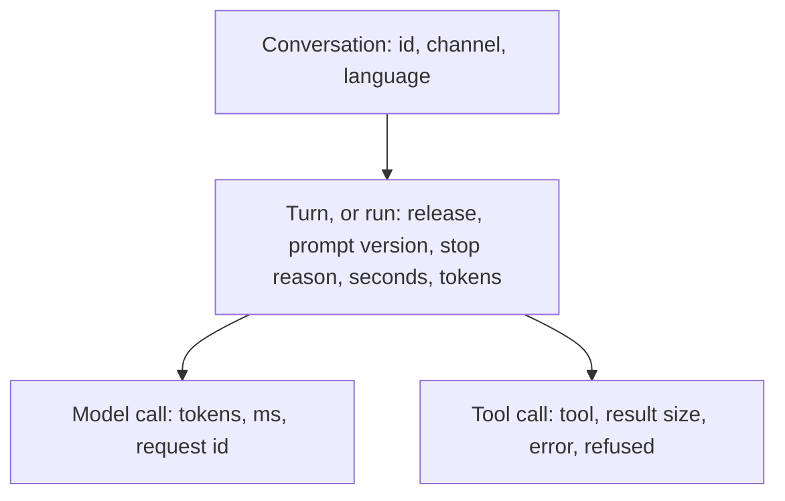
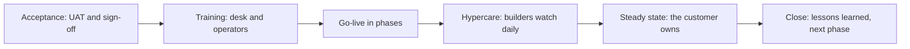

# Module 15 — Operating and handing over

*A shipped agent still has to be kept healthy, and then it has to belong to someone else. Lesson 15.1 is about the first job: traces that show what every run did without keeping what staff said, dashboards and SLO alerts that do not train people to ignore them, five incident classes with a runbook and a kill switch, blameless postmortems, a feedback loop that turns failures into eval cases, and change management for prompts and models. Its lab turns JSONL traces into a cost, latency and failure report and runs an incident drill that proves the kill switch stops a runaway agent. Lesson 15.2 is the handover workshop: acceptance testing with the customer, the documentation set, training, the support model, adoption, benefits tracking against the fictional baseline, hypercare, and closing the engagement. Its lab turns the acceptance criteria into a UAT script that a runner can rehearse, with a user guide, a runbook index and a handover checklist for Najm Desk.*

> **Layer:** Production, Delivery — keeping an agent healthy while it runs, and handing it to the customer so that they can own it.

---

# 15.1 — Running an agent in production: observability, alerts, incidents, runbooks and the improvement loop
*Level: 🔴 Advanced* · *Prerequisites: 8.2, 12.2, 13.1, 14.2* · *Layer: Production*

## ⚡ In 60 seconds
- Agents fail softly: the service is up and the answers are wrong. Observe the **run**.
- Trace four levels; log ids, counts and reasons, never text.
- Alert on SLO (service level objective) symptoms, rarely; every alert has a runbook.
- Five incident classes, one first move: **stop it**, with a drilled kill switch.
- Failures become eval cases; changes go evaluate, canary, monitor, roll back.

## 🧭 Why it matters
Thursday night Lujain ships a prompt that shortens answers (hypothetical). Sunday at 07:10, the peak, Maha's dashboard is green. At 09:20 Yara phones: Najm Desk gave eleven people the VPN policy with no source, and two were given the retired 12-character password rule. Nothing alerted, because nothing failed. The traces hold no prompt version, and nobody is sure who may switch the assistant off.

## 📐 How it works

### 🟢 The essentials

**Agents fail softly.** A web service fails loudly. An agent also gives confident wrong answers, loops while burning tokens, or obeys an injected order. So observe the **run**: one message handled until a stop reason (lesson 8.2).



**PII-safe logging** (PII is personal data). Weak: log every prompt and answer "for debugging". Strong: log ids, sizes and reasons; mask first (lesson 13.1); allow-list logged fields; keep any text in a separate, short-lived store (Sara decides, lesson 13.2). Conversation ids are random, never an employee number; a hashed user id is still personal data. Lab 8.2's `Trace` keeps clipped text: fine for a lab; in production log sizes instead.

**OpenTelemetry.** The Anthropic SDK can emit OpenTelemetry spans, one per call (beta at the time of writing; pin the version), with `gen_ai.*` attributes from the GenAI semantic conventions, still evolving. Content is off by default; enable it only after Sara agrees. A `conversation_id` you set is exported even then: never put personal data in it.

### 🟡 Going deeper

**Read the traces.** Run from `aiapps/labkit`. The sample is synthetic and fictional: 83 runs, baseline `r41` and canary `r42-canary`. Prices are placeholders: use the price page.

```bash
PRICE_IN_PER_MTOK=1 PRICE_OUT_PER_MTOK=5 python labs/m15/trace_report.py labkit/data/m15_traces.jsonl --by release
```

```text
== r42-canary: 26 runs ==
outcomes : done 17 (65%) | no_progress 3 (12%) | iteration_cap 3 (12%) | token_budget 2 (8%) | model_error 1 (4%)
latency  : run p50 3.0 s, p95 11.9 s | tokens per run p95 11,051
cost     : 0.13 in all, 0.0076 per resolved conversation
slo      : success 65.4% (want 90%+) BREACH | p95 11.9 s (want 10 s or less) BREACH
privacy  : card in start.goal x1, email in start.goal x1, secret in start.goal x1
```

(`r41` prints first.) Read outcomes, tails (p95) and money per **resolved** conversation, since failed runs cost too. The baseline passes both SLOs; the canary fails both and costs over twice as much per resolved conversation: roll it back. The privacy line is a second finding: an old logger kept raw text. The exit code makes this a cron job, the cheapest alert. The report counts `done`, so it would have missed the Sunday incident: add a `cited` flag to `stop`.

```python
# labs/m15/trace_report.py
"""Lab 15.1: one page for the on-call person, from JSONL traces (Lab 8.2's format, plus release and prompt_version).
  python labs/m15/trace_report.py TRACE.jsonl [--by release]    exit 1 on an SLO breach, personal data or a broken log
Set PRICE_IN_PER_MTOK and PRICE_OUT_PER_MTOK (per million tokens) from the price page: prices never live in code."""
import json
import math
import os
import re
import sys
from collections import Counter, defaultdict

SLO = {"success": 0.90, "p95_seconds": 10.0}      # decisions, not facts: take yours from NFR-01 and your own data
PII = {"email": r"[\w.+-]+@[\w-]+\.[\w.]+", "card": r"\b(?:\d[ -]?){13,16}\b", "secret": r"(?i)\b(?:password|passcode)\s*(?:is|=|:)\s*\S+"}
PRICE = [float(os.environ.get(k, "nan")) for k in ("PRICE_IN_PER_MTOK", "PRICE_OUT_PER_MTOK")]


def pct(xs, p):
    """Nearest-rank percentile: averages hide the tail, where users wait."""
    xs = sorted(xs)
    return xs[max(0, math.ceil(p / 100 * len(xs)) - 1)] if xs else float("nan")


def report(label, runs):
    """Print one group of runs (each a list of events); return True when it breaches an SLO."""
    stops = [next((e for e in ev if e["event"] == "stop"), {}) for ev in runs]       # no stop event: the process died or was killed
    reasons, secs = Counter(s.get("reason", "no_stop_line") for s in stops), [s["seconds"] for s in stops if "seconds" in s]
    usage = [[sum(e.get(k, 0) for e in ev if e["event"] == "model") for k in ("input_tokens", "output_tokens")] for ev in runs]
    n, done, money = len(runs), reasons["done"], sum(a * PRICE[0] + b * PRICE[1] for a, b in usage) / 1e6
    print(f"== {label}: {n} runs ==\noutcomes : " + " | ".join(f"{k} {v} ({v / n:.0%})" for k, v in reasons.most_common()))
    print(f"latency  : run p50 {pct(secs, 50):.1f} s, p95 {pct(secs, 95):.1f} s | tokens per run p95 {pct([a + b for a, b in usage], 95):,.0f}")
    if not math.isnan(money):                      # failed runs cost too: divide by RESOLVED conversations
        print(f"cost     : {money:.2f} in all, {money / max(done, 1):.4f} per resolved conversation")
    ok = {f"success {done / n:.1%} (want {SLO['success']:.0%}+)": done / n >= SLO["success"],
          f"p95 {pct(secs, 95):.1f} s (want {SLO['p95_seconds']:g} s or less)": pct(secs, 95) <= SLO["p95_seconds"]}
    print("slo      : " + " | ".join(f"{k} {'ok' if v else 'BREACH'}" for k, v in ok.items()))
    return not all(ok.values())


if __name__ == "__main__":
    runs, bad, leaks = defaultdict(list), 0, Counter()
    for line in open(sys.argv[1], encoding="utf-8"):
        try:
            e = json.loads(line)
            run, kind = e["run"], e["event"]
        except (ValueError, KeyError, TypeError):
            bad += bool(line.strip())                  # a pipeline that drops lines is a finding too
            continue
        runs[run].append(e)
        for field, v in e.items():                     # kinds and places are safe to print; the values are not
            leaks.update((what, f"{kind}.{field}") for what, rx in PII.items() if isinstance(v, str) and re.search(rx, v))
    by, groups = (sys.argv[sys.argv.index("--by") + 1] if "--by" in sys.argv else None), defaultdict(list)
    for ev in runs.values():
        groups[next((e for e in ev if e["event"] == "start"), {}).get(by, "(none)") if by else "all"].append(ev)
    print(f"{len(runs)} runs, {bad} unreadable lines")
    breached = [report(label, g) for label, g in sorted(groups.items())]
    print("privacy  : " + (", ".join(f"{k} in {w} x{n}" for (k, w), n in sorted(leaks.items())) or "no personal-data patterns found"))
    sys.exit(1 if any(breached) or leaks or bad or not runs else 0)        # no traces at all is an incident too
```

**Dashboards, SLOs and alerts.** Four panels: outcomes by stop reason, quality proxies (citations, hand-offs, ratings), latency and cost, guard and tool errors. Targets come from requirements: success (`done` is a proxy), p95 (NFR-01), availability (NFR-02), cost per resolved conversation (NFR-06). A month has about 217 desk hours, so 99.5% leaves about one; at a **burn rate** (bad fraction seen over allowed) of 10 it is gone in about two desk days. Page when a short and a long window burn fast ([*Cloud & DevOps*, lesson 5.2 — SLOs, error budgets, alerting and on-call that people can sustain](../cloud/index.html#/5.2)). Against fatigue: page on symptoms, give each alert a runbook, delete alerts nobody acts on.

| Incident class | It looks like | Then |
|---|---|---|
| Wrong-answer storm | Ratings fall, citations vanish | `--by release`; roll back |
| Tool outage | Tool errors; the agent apologises | `write_tools` off; ask the owner |
| Cost spike | Tokens jump; `iteration_cap` rises | Did the breaker act? |
| Injection incident | Guard fires; an odd tool call | `write_tools` off; call Noura |
| Regression after a change | The canary is worse | Previous release |

Each has a runbook (`labs/m15/runbooks/`); all start by **stopping**. The kill switch is a file outside the model, read on every loop step, with two flags (lesson 7.1): `model_calls` off gives degraded mode, `write_tools` off gives read-only. It **fails closed** (an unreadable file means off); anyone on the IT on-call rota may press it, only L2 or L3 resumes, and it is **drilled**. One host can share a file; several instances need shared configuration, read the same way.

**The drill.** `[mock:loop]` plays an agent that repeats one tool for ever, with the cap raised to 500 so only the switch can stop it. Act one: a person flips it after call five. Act two: the cost breaker, at 12,000 tokens an hour, must. A drill number: the sample's busiest normal hour is far higher.

```python
# labs/m15/kill_switch.py
"""Lab 15.1: a kill switch, a cost breaker that pulls it, and a drill that proves both (the mock supplies [mock:loop]).
  python labs/m15/kill_switch.py drill [DIR]
  python labs/m15/kill_switch.py flip FILE FLAG on|off WHO WHY   FLAG: model_calls, write_tools or all"""
import json
import os
import sys
import time
from pathlib import Path

import anthropic

sys.path.append(str(Path(__file__).resolve().parents[1] / "m08"))
from agent_loop import Trace          # noqa: E402  Lab 8.2's JSONL writer

MODEL = os.environ.get("MODEL", "claude-sonnet-5-5")
FLAGS = ("model_calls", "write_tools")        # lesson 7.1: model_calls off = degraded mode; write_tools off = read-only


class Switch:
    """Two flags in one file: any process can flip it, every loop step reads it."""

    def __init__(self, path):
        self.path = Path(path)

    def allowed(self, flag):
        try:                                  # fail closed: a missing or torn file means "off", never "on"
            return json.loads(self.path.read_text(encoding="utf-8"))["flags"][flag] == "on"
        except (OSError, ValueError, KeyError, TypeError):
            return False

    def set(self, value, who, why, flags=FLAGS):
        if value not in ("on", "off") or not set(flags) <= set(FLAGS):       # a mistyped press must fail loudly
            raise ValueError(f"values are on or off, flags are {FLAGS}")
        state = {f: "on" if self.allowed(f) else "off" for f in FLAGS} | {f: value for f in flags}
        tmp = self.path.with_name(self.path.name + ".tmp")
        tmp.write_text(json.dumps({"flags": state, "by": who, "why": why}), encoding="utf-8")
        os.replace(tmp, self.path)            # atomic: readers never see half a file
        with open(self.path.with_name(self.path.name + ".log"), "a", encoding="utf-8") as f:        # who pressed it, and why
            f.write(json.dumps({"ts": round(time.time()), "flags": flags, "value": value, "by": who, "why": why}) + "\n")


class Breaker:
    """Pulls the switch itself when more than `limit` tokens are spent inside `window_s` seconds."""

    def __init__(self, switch, limit, window_s=3600):
        self.switch, self.limit, self.window_s, self.spent = switch, limit, window_s, []

    def add(self, tokens):
        now = time.time()
        self.spent = [(t, n) for t, n in self.spent + [(now, tokens)] if t > now - self.window_s]
        total = sum(n for _, n in self.spent)
        if total > self.limit and self.switch.allowed("model_calls"):
            self.switch.set("off", "cost-breaker", f"{total} tokens in {self.window_s} s, limit {self.limit}", ("model_calls",))


TOOLS = [{"name": "get_ticket_history", "description": "Show the full history of one IT ticket by number.",
          "input_schema": {"type": "object", "properties": {"ticket_id": {"type": "string"}}, "required": ["ticket_id"]}}]


def history(ticket_id):
    return "\n".join(f"day {d}: customer called about ticket {ticket_id}, follow-up noted" for d in range(1, 31))        # a long result


def run_agent(goal, switch, breaker, trace, watch=None, max_steps=500):
    """A bare loop. 500 steps is the cap someone raised mid-incident, so only the switch is left."""
    client, t0, spent, messages = anthropic.Anthropic(timeout=30.0, max_retries=0), time.monotonic(), 0, [{"role": "user", "content": goal}]
    trace.log("start", model=MODEL, goal_chars=len(goal), release="drill")

    def stop(reason, step):
        trace.log("stop", step=step, reason=reason, tokens=spent, seconds=round(time.monotonic() - t0, 1))
        return reason

    for step in range(1, max_steps + 1):
        if not switch.allowed("model_calls"):                    # read BEFORE every model call: the next call never starts
            return stop("killed", step - 1)
        resp = client.messages.create(model=MODEL, max_tokens=1024, output_config={"effort": "low"}, tools=TOOLS, messages=messages)
        used = resp.usage.input_tokens + resp.usage.output_tokens
        spent += used
        trace.log("model", step=step, stop_reason=resp.stop_reason, input_tokens=resp.usage.input_tokens, output_tokens=resp.usage.output_tokens)
        breaker.add(used)
        if watch:
            watch(step)
        if resp.stop_reason != "tool_use":
            return stop("done" if resp.stop_reason == "end_turn" else resp.stop_reason, step)
        messages.append({"role": "assistant", "content": resp.content})
        results = []
        for b in (b for b in resp.content if b.type == "tool_use"):
            out = history(**b.input)
            trace.log("tool", step=step, tool=b.name, result_chars=len(out))
            results.append({"type": "tool_result", "tool_use_id": b.id, "content": out})
        messages.append({"role": "user", "content": results})
    return stop("iteration_cap", max_steps)


def drill(kind, folder):
    """'operator': a person flips the switch after the 5th model call. 'breaker': nobody does, so the cost breaker must."""
    folder = Path(folder)
    folder.mkdir(parents=True, exist_ok=True)
    switch, trace, again = Switch(folder / f"{kind}.switch.json"), Trace(folder / f"{kind}.jsonl"), Trace(folder / f"{kind}-again.jsonl")
    switch.set("on", "drill", "start")
    person = lambda step: step == 5 and switch.set("off", "maha", "loop in the drill", ("model_calls",))
    reason = run_agent("Show the full history of ticket 4471 [mock:loop]", switch, Breaker(switch, 12_000 if kind == "breaker" else 10**9),
                       trace, person if kind == "operator" else None)
    after = run_agent("Is ticket 4472 done yet?", switch, Breaker(switch, 10**9), again)        # a NEW conversation, switch still off
    calls = lambda t: sum(e["event"] == "model" for e in t.events)
    return {"reason": reason, "model_calls": calls(trace), "tokens": trace.events[-1]["tokens"], "new_request": after, "new_request_calls": calls(again)}


if __name__ == "__main__":
    if sys.argv[1:2] == ["flip"]:
        Switch(sys.argv[2]).set(sys.argv[4], sys.argv[5], " ".join(sys.argv[6:]) or "no reason given", FLAGS if sys.argv[3] == "all" else (sys.argv[3],))
    else:
        for kind in ("operator", "breaker"):
            print(kind, drill(kind, sys.argv[2] if len(sys.argv) > 2 else "drill_out"))
```

```bash
python labs/m15/kill_switch.py drill        # needs the offline mock (lesson 0.2)
```

```text
operator {'reason': 'killed', 'model_calls': 5, 'tokens': 4950, 'new_request': 'killed', 'new_request_calls': 0}
breaker {'reason': 'killed', 'model_calls': 8, 'tokens': 13392, 'new_request': 'killed', 'new_request_calls': 0}
```

No call started after the flip, and the loop ended at call five, not 500. The breaker overshot by under one call, since spend is added after a call: set limits below the pain point. A new conversation reached the model zero times. *Works offline:* the switch, breaker, drill and report. *Needs the real API:* whether a real model loops like `[mock:loop]`, real token counts (the mock estimates them), your own peak hour. The lab agent has no writes: wire `write_tools` into your tool gate.

### 🔴 Expert view

**Blameless postmortems.** Each incident has a lead, an operator and a scribe. Within five working days of every use of the switch, write up impact, timeline, detection, contributing factors, actions with owner and date. Weak: "Lujain pushed a bad prompt." Strong: "A prompt reached all traffic with no canary and no trace version, so detection took two hours." Blameless is not ownerless ([*Cloud & DevOps*, lesson 5.3 — Incidents and blameless postmortems](../cloud/index.html#/5.3)).

**The feedback loop.** Sources: ratings with a reason, hand-offs, draft rewrites, repeat contacts within three working days, runs not ending `done`. A weekly triage (Yara, Lujain) labels causes and turns the worst into **eval cases**: personal data removed, one expected behaviour, a requirement id. Review first; duplicates hide regressions ([*Software Testing*, lesson 7.3 — Safety, robustness, fairness and monitoring: red-teaming, metamorphic tests, drift and turning incidents into tests](../testing/index.html#/7.3)).

**Change management.** Prompt, tool, retrieval content, guardrail rule, model id and limits are all changes. Name the version to roll back to; evaluate with the gate (lesson 12.2) and red-team set (lesson 13.1), comparing cost and latency; approve per the change policy (lesson 13.2); canary with desk agents against preset thresholds (`--by release`); then promote, or roll back: a prompt or model id by repointing configuration, an image by redeploying the previous digest (lesson 14.1). Pin and record the model id; name who watches deprecation notices.

**When not to.** A pilot with fourteen desk staff needs no tracing platform; the JSONL file and report suffice.

## 🧰 The toolkit
| Tool, practice or pattern | What it is and does | When to reach for it |
|---|---|---|
| **Trace schema** | Four levels of ids, counts, reasons; no text | Before the first user |
| **SLO burn-rate alert** | Page when short and long windows burn fast | Any user-facing target |
| **Kill switch** | Out-of-model flags that stop calls or writes; fails closed | Every agent that acts or spends |
| **Runbook** | One page: trigger, first minutes, fix, tell, resume | Every alert and routine change |

## 🏛️ In practice at Najm Bank
The artefact is the **Najm Desk v1 Runbook Set** (Maha owns it): `docs/runbooks/`, from `labs/m15/runbooks/`: a template, the kill-switch card, five incident runbooks, two routines.

**Weekly deliverable.** Commit `week-15/`: `labs/m15/` with passing tests, the report on your own traces, the drill output, `docs/runbooks/` for your own agent, one postmortem, `NOTES.md`.

**Group session (60 minutes).** A fire drill: plant an incident in a trace file and name its class from the report (15); follow the runbook, press the switch, write the first note (25); each names one unclear line (20).

**Build it with Claude Code.** Give this spec in plan mode (check the current Claude Code documentation):

```text
Goal: labs/m15/trace_report.py and kill_switch.py as in lesson 15.1, with tests in labkit/tests/test_m15_operating.py.
Context: Python 3.11, anthropic>=1,<2, the offline mock in aiapps/labkit, Lab 8.2's Trace in labs/m08/agent_loop.py.
Constraints: no prices in code; no prompt or answer text in traces; the switch fails closed and is written atomically;
no sampling parameters or prefill; no new dependencies; touch no other files.
Acceptance: pytest passes offline; the drill ends "killed" within one call of the flip and a new request makes no model call;
the report exits 1 on the sample traces and shows the canary breach.
Do not weaken a test. Run the tests after each step.
```

**Verify before you accept it.**
- Break it: make `allowed` return True on error, disable the breaker, shift the percentile index. Each must fail a test.
- Read the diff for prices, `temperature` and prompt text in traces.

## 🛠️ Exercises
- 🟢 **Read the canary.** Offline. Run the report with `--by release`. *Done when:* `NOTES.md` names the release to roll back, the proof and the leaking fields.
- 🟡 **Set the breaker from data.** Offline. Set the limit to three times the busiest hour of `r41`. *Done when:* a test shows `r41` never trips it, the loop drill still does, and `NOTES.md` says why.
- 🔴 **Operate your own agent.** *Needs the real API* and the cap from lesson 0.2. Run Lab 8.2's agent on 20 questions with `TRACE_FILE`, report with real prices, break it once (`MAX_STEPS=1`), write the postmortem. *Done when:* `NOTES.md` has the report, price date and three owned actions.

## ⚠️ Mistakes and traps
- **Logging text "just for now".** It becomes the leak.
- **A switch that needs the model or a deploy.** It fails when needed. Use a file.
- **No version in the trace.** You cannot find what changed. Record release, prompt and model.
- **Reading `done` as correct.** It only means the loop ended. Add evals.

## 🧾 Recap
- Observe runs: outcomes, tails, money per resolved conversation.
- Log ids and reasons, never text.
- Alert on SLO symptoms; stop first with a drilled kill switch.
- Failures become eval cases; changes are canaried and reversible.

## ✍️ Check yourself

**1. The dashboard shows no errors, yet staff report answers with no source. What is missing?**

- A. A larger context window for long answers
- B. A looser latency target for peak hours
- C. A quality signal such as citation rate
- D. A more sensitive alert on the error rate

<details><summary>Answer</summary>

**C.** The failure is soft; only quality signals (citations, ratings, canary questions) show it. (🟢 Soft failure.)

</details>

**2. The switch file cannot be read during an incident. What should the agent do?**

- A. Treat it as off and stop calling the model
- B. Keep running on its last known setting
- C. Treat it as on so that service continues
- D. Retry the read while still calling the model

<details><summary>Answer</summary>

**A.** It fails closed: if nothing proves it may run, it does not. (🟡 Kill switch.)

</details>

**3. The canary shows 65% done and p95 11.9 s; the baseline 93% and 5.3 s. What first?**

- A. Wait a week to collect more data first
- B. Raise the p95 target to 12 s
- C. Add retries to the canary's tool calls
- D. Point configuration back at the old release

<details><summary>Answer</summary>

**D.** The preset thresholds are breached: roll back first, with no deploy; investigate afterwards. (🔴 Change management.)

</details>

**4. A CPU alert pages the on-call person thirty times a month and nobody acts. What is the best fix?**

- A. Page a second person so that someone acts
- B. Retire the page and alert on symptoms instead
- C. Raise its threshold a little each month until it stops
- D. Mute the channel and read it on Mondays

<details><summary>Answer</summary>

**B.** An ignored alert teaches people to ignore the next. Page on SLO symptoms. (🟡 SLOs and alerts.)

</details>

**5. Support wants employee numbers as conversation ids, to search a person's chats. Why not?**

- A. Numbers index slowly in most trace stores
- B. The id spreads personal data to every span
- C. Employee numbers are too short to stay unique
- D. Support already searches by ticket number

<details><summary>Answer</summary>

**B.** Conversation ids are exported even when no text is. Use random ids. (🟢 PII-safe logging.)

</details>

## 📚 References
- Claude API, OpenTelemetry: https://platform.claude.com/docs/en/manage-claude/opentelemetry; OpenTelemetry: https://opentelemetry.io/docs/; Google SRE: https://sre.google/
- [*Cloud & DevOps*, lesson 5.1 — Telemetry: logs, metrics, traces and OpenTelemetry](../cloud/index.html#/5.1); [*Running AI Agents in Production*, levels L0–L5](../agentic/learning-path.html#level-3-production-engineer)
- **Read this week (Module 15).** The plan gives it no chapters; the nearest, as given: Gulli, *Agentic Design Patterns*, chapter 19 (Evaluation & Monitoring), the free draft in lesson 0.1; Chip Huyen's *aie-book* repository (production checklist): https://github.com/chiphuyen/aie-book

---

# 15.2 — Handover and adoption: training, support model, acceptance, change management and benefits tracking
*Level: 🔴 Advanced* · *Prerequisites: 6.2, 7.2, 13.2, 15.1* · *Layer: Delivery*

## ⚡ In 60 seconds
- Handover moves **ownership**, not files: named people can run, change, support and defend Najm Desk without the builders.
- **Acceptance**: the customer runs a user acceptance test (UAT) script derived from the acceptance criteria; people sign. A failed row gets a severity, then a fix or a written waiver. Never "pass with comments".
- Hand over documents and custody (repositories, secrets, the switch).
- Adoption is change management: champions, honesty, sceptics invited to break it.
- Track benefits with the baseline's definitions; run hypercare; close with a lessons-learned review.

## 🧭 Why it matters
Six weeks after go-live (hypothetical) the provider announces that the model id behind Najm Desk will retire. The notice goes to Lujain, who has moved to another project. Hind asks Yara, who asks Maha, who has never read the prompt. The same week a senior desk agent stops opening drafts: "it was wrong twice in the first week." The dashboards that would show this live in Lujain's repository.

Nobody owns the prompt, the notices or the adoption. The build was sound; the handover was a zip file and a goodbye. Handover is where "me" must become a role.

## 📐 How it works

### 🟢 The essentials

**Handover is a project.** Plan it from design.



**Acceptance testing.** UAT is not QA, where builders hunt defects, and not an eval, which scores a set. The customer's people run agreed scenarios in a production-like environment and decide. Derive the script from the acceptance criteria (lesson 6.2): each row has an id, the criteria and requirements it proves, who runs it, what they say, what must be true, and how it runs (`auto`, `real` model, or `person`). Weak: "it answers policy questions well". Strong: "a laptop question gets an answer citing [laptop-requests], and no ticket appears". A reply shows what the agent said; only the system of record, TicketHub or Najm ID, shows what it did.

**Who signs.** Hind for business acceptance, Yara for operations, Noura for the security rows, Layla for the governance pack and residual risk, Fahad for the truthfulness of the evidence. People sign; tools only gather evidence.

| Failed row | What happens |
|---|---|
| Blocker: a GR row fails, or a wrong write | No sign-off; fix, then re-run every row the fix could touch |
| Major: a must-have fails, nothing unsafe | Fix and re-test, or the sponsor signs a waiver with an owner and a date |
| Minor: a should-have or cosmetic fails | Backlog; the sponsor may accept |

**The documentation set.** User guide; admin guide (configuration, flags, policy documents); architecture and ADRs (lessons 7.1 and 7.2); runbooks (lesson 15.1); risk register and governance pack (lesson 13.2); eval report (lesson 12.2). Documents rot, so tie each to a check: `pack_check.py`, the runbook-index test, the runner below.

### 🟡 Going deeper

**The lab.** The UAT script's scenario table is data. `uat_runner.py` executes the rows it can and reports; the default app is Lab 7.2's thin slice, and yours plugs in with `--app module:function`. An excerpt of `labs/m15/handover/uat_script.md`:

```markdown
| ID | Criterion | Who | Says | Expect | How |
|---|---|---|---|---|---|
| U-05 | AC-2 FR-02 GR-02 | Rayan | What is the status of ticket 4474? | kind=refused; no=suspicious; no=password; handoff=yes | auto |
| U-09 | AC-3 FR-03 FR-04 | Rayan | My second monitor flickers when the laptop wakes up, please open a ticket | kind=draft; has=draft; handoff=no | auto |
| U-14 | AC-3 AC-4 AC-5 | Yara | After U-09, U-10 and U-11, look in TicketHub and Najm ID | no ticket from U-09 or U-11; the Najm ID account is unchanged; the unlock request names the manager | person |
```

```python
# labs/m15/uat_runner.py
"""Lab 15.2: run the UAT script's scenario table against an app and print a pass/fail report. A rehearsal, never the sign-off.
  python labs/m15/uat_runner.py [SCRIPT.md] [--app module:function] [--evidence FILE] [--strict]
The default app is Lab 7.2's thin slice. Yours is any function (user, text) -> object with .kind .text .handoff."""
import importlib
import json
import os
import re
import sys
import time
from collections import namedtuple
from pathlib import Path

Row = namedtuple("Row", "id criterion who says expect how")
HERE = Path(__file__).resolve().parent
CHECKS = {        # check name -> test(reply, wanted). Every check says what must be true, never an exact sentence.
    "kind": lambda r, w: r.kind == w,
    "has": lambda r, w: w.lower() in r.text.lower(),
    "no": lambda r, w: w.lower() not in r.text.lower(),
    "first": lambda r, w: w.lower() in (r.text.strip().splitlines() or [""])[0].lower(),
    "handoff": lambda r, w: bool(r.handoff) == (w == "yes"),
    "lang": lambda r, w: (sum(0x600 <= ord(c) <= 0x6FF for c in r.text) > len(r.text) / 3) == (w == "ar"),
}


def parse(text):
    """The rows of the table under '## Scenarios'. A typo fails here, before anything runs, never as a silent pass."""
    found = re.search(r"^## Scenarios\n(.*?)(?=^## |\Z)", text, re.M | re.S)
    if not found:
        raise ValueError("the script has no '## Scenarios' table")
    cells = [[c.strip() for c in line.strip().strip("|").split("|")] for line in found.group(1).splitlines() if line.startswith("|")][2:]
    for c in cells:
        if len(c) != len(Row._fields):
            raise ValueError(f"{c[0]}: a row needs {len(Row._fields)} cells")
    rows = [Row(*c) for c in cells]
    for r in rows:
        if r.how not in ("auto", "real", "person"):
            raise ValueError(f"{r.id}: 'how' must be auto, real or person, not {r.how!r}")
        for check in (c for c in r.expect.split(";") if r.how != "person" and c.strip()):
            if check.partition("=")[0].strip() not in CHECKS:
                raise ValueError(f"{r.id}: unknown check {check.strip()!r}")
    return rows


def load_app(spec=None):
    if spec:
        module, _, name = spec.partition(":")
        return getattr(importlib.import_module(module), name)
    sys.path.append(str(HERE.parent / "m07"))
    import demo                                           # noqa: E402  Lab 7.2: respond(user, text) -> (route, Reply)
    return lambda user, text: demo.respond(user, text)[1]


def is_real():
    """Real mode: not the local mock, and a real key (the same test as Lab 12.2's check_mode)."""
    local = os.environ.get("ANTHROPIC_BASE_URL", "").startswith(("http://127.0.0.1", "http://localhost"))
    return not local and os.environ.get("ANTHROPIC_API_KEY", "mock") != "mock"


def run(rows, app, real):
    out = []
    for r in rows:
        if r.how == "person" or (r.how == "real" and not real):
            out.append((r, "SKIP", "a person runs this row" if r.how == "person" else "needs the real model"))
            continue
        try:
            reply = app(r.who, r.says)
            failed = [c.strip() for c in r.expect.split(";") if c.strip() and not CHECKS[c.partition("=")[0].strip()](reply, c.partition("=")[2].strip())]
            why = "; ".join(failed) + f" (got kind={reply.kind})"
        except Exception as e:                            # an app that crashes during acceptance has failed acceptance
            failed, why = True, f"the app raised {type(e).__name__}"
        out.append((r, "FAIL" if failed else "PASS", why if failed else ""))
    return out


def report(results):
    for r, result, why in results:
        print(f"{r.id:5} {r.criterion:18} {r.how:7} {result:5} {why[:70]}")
    n = {k: sum(x[1] == k for x in results) for k in ("PASS", "FAIL", "SKIP")}
    print(f"\n{n['PASS']} passed, {n['FAIL']} failed, {n['SKIP']} not run: " + ", ".join(r.id for r, res, _ in results if res == "SKIP"))
    if n["FAIL"]:
        print("verdict: NOT ACCEPTED. Each failed row is a defect: give it a severity, fix it or waive it in writing, then run again.")
    elif n["SKIP"]:
        print("verdict: NOT READY TO SIGN. Everything this runner could run passed; a person must run the rest.")
    else:
        print("verdict: ALL ROWS PASSED. This is evidence for the sign-off meeting, not the signature: people sign.")
    return n


if __name__ == "__main__":
    args = sys.argv[1:]
    opt = lambda name: args[args.index(name) + 1] if name in args else None
    script, real = next((a for a in args if a.endswith(".md")), str(HERE / "handover" / "uat_script.md")), is_real()
    results = run(parse(Path(script).read_text(encoding="utf-8")), load_app(opt("--app")), real)
    n = report(results)
    if opt("--evidence"):
        Path(opt("--evidence")).write_text(json.dumps({"script": script, "mode": "real" if real else "offline", "date": time.strftime("%Y-%m-%d"),
                                                       "rows": [[r.id, res, why] for r, res, why in results]}, indent=1), encoding="utf-8")
    sys.exit(1 if n["FAIL"] or (n["SKIP"] and "--strict" in args) else 0)
```

```bash
python labs/m15/uat_runner.py --evidence uat_evidence.json      # the mock running, as in lesson 7.2
```

```text
U-01  AC-1 FR-01 FR-07   real    SKIP  needs the real model
U-02  FR-01              auto    PASS
...                      (U-03 to U-08 pass)
U-09  AC-3 FR-03 FR-04   auto    FAIL  kind=draft; has=draft (got kind=answer)
U-10  AC-4 FR-05 GR-03   auto    FAIL  kind=request; has=manager; handoff=yes (got kind=answer)
U-11  AC-5 GR-04         real    SKIP  needs the real model
...                      (U-12 to U-14 need people)

7 passed, 2 failed, 5 not run: U-01, U-11, U-12, U-13, U-14
verdict: NOT ACCEPTED. Each failed row is a defect: give it a severity, fix it or waive it in writing, then run again.
```

Seven rows pass: the thin slice implements them, and the mock copies the best sentence, so a pass shows the plumbing works, not that a real model answers well. U-09 and U-10 fail: the thin slice has no drafts and no unlock request, so the rehearsal found missing v1 features early. Five rows wait: two need the real model, three need people. *Works offline:* the table, the checks, the report. *Needs the real API:* U-01 and U-11, and a real build behind `--app`.

**Training** (lengths are proposals). Desk staff get 90 minutes in groups: what it can and cannot do, reading a source, confirming a draft, giving feedback, handling a hand-off, five scenarios including a wrong answer. Operators get half a day: the runbooks, the switch in staging, the trace report, the change runbook, then reverse-shadowing: the builders watch an operator run a drill and keep their hands off ([*AI Governance*, lesson 2.3 — AI literacy, training and culture](../aigp/index.html#/2.3)).

**Support model.**

| Level | Who | Handles |
|---|---|---|
| L1 | Desk champions and agents | How-to, wrong-answer reports, hand-offs |
| L2 | Platform operations (Maha, Salem) | Alerts, the switch, tool outages, approved deploys |
| L3 | Developer Enablement | Defects in prompts, tools, retrieval, evals; model changes |
| Risk | Noura, Sara, Layla, Hamad | Injection, privacy, governance |

Each level escalates to the next; risk owners join for injection and privacy. Yara decides what Najm Desk should say or do, Developer Enablement makes and tests the change, Noura approves anything security-relevant, and Layla hears of material changes. Hind sets the response targets; name who reads the provider's deprecation notices.

**Adoption.** Train **champions**, one or two per shift, first. Communicate before go-live (what it does and will not do), at go-live (how to give feedback) and after (what changed because of feedback). Offer three channels: a rating with a reason, a chat channel, a weekly huddle. **Sceptics** are your best testers: invite them to break it, log each failure as an eval case and show the fix ([*AI Product Management*, lesson 7.3 — Adoption and change management inside the enterprise](../aipm/index.html#/7.3)).

**Benefits tracking.** Compare with the fictional baseline, measured the same way:

| Measure | Baseline (fictional) | Target | Source |
|---|---|---|---|
| Median first response | 3 h 40 min | At most 3 h 00 | TicketHub clock |
| Contained policy conversations | None | At least 35% of in-scope | Chat and TicketHub logs |
| Answer correctness | Not measured | At least 95% | Eval run |
| Satisfaction | Not measured | At least 4.0 of 5 | In-chat rating; count who answers |

Agree "first useful response" before go-live, because today the clock stops at the triage note. Label each figure measured or estimated. Fictional arithmetic: a quarter of 1,800 weekly tickets is about 450 policy questions, and 35% of those is about 158 contained a week ([*AI Product Management*, lesson 8.1 — Product metrics for AI: value, quality, adoption, trust](../aipm/index.html#/8.1)).

**Cadence, hypercare, close.** Weekly: a 30-minute feedback triage. Monthly: eval refresh, cost and benefits report. Quarterly: review scope, model, risks and roadmap with Layla. **Hypercare** (a proposal of four weeks) means daily dashboard checks and written exit criteria, such as two weekly eval runs at target, no incident that harmed people or exposed data, and operators handling an incident alone. Warranty terms belong to the contract: involve legal and procurement. To close: the checklist complete with evidence, a blameless lessons-learned review (keep, stop, start), a closure report, and a next phase argued from evidence: benefits, a ranked backlog, what you learned about adoption.

### 🔴 Expert view

**Done means done without you.** Handover is complete when the customer has performed each task once while you watched: a model-change canary, a kill-switch drill, an eval refresh, a retired policy document. Anything only a builder can do is a dependency, and goes on the risk register.

**Acceptance can be gamed without anyone cheating.** A script the builders wrote and ran proves little. Yara's rows are worth more than yours: add every sceptic's question, keep `real` and `person` rows visible, and write down every waiver.

**Ownership by committee fails.** Give every document, alert, notice and prompt one named owner and a deputy.

**When not to.** A five-user pilot of a read-only copilot may accept on a one-page checklist. Do not train everyone at once, and do not make adoption a mandate: a forced tool gets worked around.

## 🧰 The toolkit
| Tool, practice or pattern | What it is and does | When to reach for it |
|---|---|---|
| **UAT script** | Scenario table from the acceptance criteria, run by the customer | Before every sign-off |
| **UAT runner** | Runs the rows a machine can; reports PASS, FAIL or not run | Rehearsal, and after fixes |
| **Support model** | L1, L2, L3, risk owners, change ownership | Before go-live |
| **Benefits tracker** | Baseline, target, actual and source per measure | Monthly from go-live |
| **Hypercare plan** | Bounded close watching with exit criteria | Each go-live phase |

## 🏛️ In practice at Najm Bank
The artefact is the **Najm Desk v1 Handover Pack** (Fahad owns it): `docs/handover/`, from `labs/m15/handover/`: the UAT script, user guide, runbook index and handover checklist, which also carries the support model. The other documents come from earlier modules, or are yours to write (the admin guide); the checklist names an owner and evidence for each. Sign-off rows, checkboxes and `TODO`s stay empty for people.

**Your platform.**

| Question | Answer |
|---|---|
| Where do your handover documents live, and who edits them? | |
| Who holds the provider account and its notices? | |

**Weekly deliverable.** Add `docs/handover/` for your own agent to `week-15/`, with the runner output and evidence file, tests passing, and `NOTES.md`.

**Group session (60 minutes).** Role-play the handover meeting. (1) Two readers play Hind and Yara with only the pack and ten minutes; each marks the claim they trust least (20). (2) The author runs the runner live; the group sets a severity per FAIL and decides fix, waiver or re-scope (25). (3) Name the document that will rot first and its check (15).

**Build it with Claude Code.** Have it dry-run the handover as a sceptical customer. Give this spec in plan mode, which cannot edit (check the current Claude Code documentation):

```text
Goal: act as a sceptical customer and list what would stop you signing the Najm Desk v1 handover.
Context: read docs/handover/, docs/runbooks/, docs/governance/, the specification and the latest uat_runner output.
Play two readers. Hind, the sponsor: who do I call, what must I keep watching, what do I tell my boss.
Yara, the desk lead: will my team use it, and what happens when it is wrong.
Output: at most 15 findings, each with file and line, the question the pack cannot answer, and the evidence that would answer it.
Group them as missing, unclear, or contradicts another file.
Constraints: read-only; invent no facts, names, numbers or approvals; quote only what you read.
```

**Verify before you accept it.**
- Open the file and line behind five findings. Discard any that are not real: it can invent a gap.
- Check with `git status` that nothing was edited and no checkbox or sign-off row was filled in.
- Fix the real gaps yourself, then rerun the runner and the tests.

## 🛠️ Exercises
- 🟢 **Run the rehearsal.** Offline. Run the runner and classify U-09 and U-10. *Done when:* `NOTES.md` holds the report and, per failed row, a severity, a reason and a decision: fix, waiver or re-scope.
- 🟡 **Add the sceptic's row.** Offline. Add a row for a requirement of your own, such as GR-01 (a pasted password never reaches the model), and a copy of the app that breaks it. *Done when:* a test shows the row passes on the original, fails on the copy.
- 🔴 **Run it for real.** *Needs the real API*, the cap from lesson 0.2 and a colleague who plays Hind. Run the script against your own build with `--app`; the colleague runs the `person` rows and alone signs. *Done when:* `NOTES.md` has the evidence file, their decisions, each waiver with owner and date, and what the mock had hidden.

## ⚠️ Mistakes and traps
- **Handover as a zip file.** Hand over custody, access and a first unaided run.
- **A UAT script only the builders wrote or ran.** The customer edits and executes it.
- **"Pass with comments".** A comment is a defect: severity, then fix or written waiver.
- **Training by slides.** Run scenarios, including a wrong answer; drill operators.

## 🧾 Recap
- Handover transfers ownership; done means the customer did each task once without you.
- UAT is the customer's: must-be-true rows, severities, written waivers, people signing.
- Train by practice; give every document, alert and prompt one owner.
- Adoption needs champions, honesty and sceptics invited to break it.
- Measure benefits with the baseline's definitions; then hypercare, review, close.

## ✍️ Check yourself

**1. Suppose row U-09 passes because the reply shows a draft ticket. Yara still leaves it open. Why is she right?**

- A. Drafts always need two approvals
- B. It shows what was said, not what TicketHub holds
- C. The runner cannot read replies written in Arabic
- D. The runner passes any row that gets a reply

<details><summary>Answer</summary>

**B.** Only the system of record shows whether a ticket exists; that is why row U-14 sends a person to TicketHub and Najm ID. (🟢 Acceptance testing.)

</details>

**2. A row fails and Hind asks to pass it with comments. What do the script's rules say?**

- A. Pass it now and log the comment for the backlog
- B. Re-run it until it passes, then record that
- C. Drop the row from the script before the meeting
- D. Give it a severity, then fix it or waive it

<details><summary>Answer</summary>

**D.** A comment is a defect: it gets a severity, then a fix and re-test, or a waiver with an owner and a date. (🟢 Who signs.)

</details>

**3. Six weeks after go-live a model retirement notice sits in a departed builder's mailbox. Which handover step prevents this?**

- A. Naming a notice owner in the support model
- B. A longer hypercare period for the pilot
- C. Training desk staff on the limits of the model
- D. A second UAT session for the Arabic rows

<details><summary>Answer</summary>

**A.** Notices need a named owner and a deputy; migration then runs as an ordinary change with a canary. (🟡 Support model.)

</details>

**4. Median first response fell from 3 h 40 min to 1 h 10 min, but the new figure times the first chat reply, the baseline the triage note. What do you do?**

- A. Publish it, since the direction is right
- B. Average the two definitions into one figure
- C. Re-measure both on one definition first
- D. Report only the contained rate instead

<details><summary>Answer</summary>

**C.** Claim benefits only on the baseline's own definition, labelled measured or estimated. (🟡 Benefits tracking.)

</details>

**5. A senior desk agent says Najm Desk is wrong too often and refuses drafts. What is the best response?**

- A. Make drafts mandatory for the whole desk
- B. Invite them to break it, then show the fix
- C. Ask the champion to ignore the feedback
- D. Wait for the monthly benefits report to settle it

<details><summary>Answer</summary>

**B.** Log each failure as an eval case and show the fix: sceptics are your best testers, and a mandate builds no trust. (🟡 Adoption.)

</details>

## 📚 References
- Claude API, Models overview (status, deprecations and retirements): https://platform.claude.com/docs/en/about-claude/models/overview; lab kit: https://github.com/Tamoura/system-design-for-vibe-coders/tree/main/aiapps/labkit
- [*AI Product Management*, lesson 7.3 — Adoption and change management inside the enterprise](../aipm/index.html#/7.3); [*AI Product Management*, lesson 8.1 — Product metrics for AI: value, quality, adoption, trust](../aipm/index.html#/8.1); [*AI Governance*, lesson 2.3 — AI literacy, training and culture](../aigp/index.html#/2.3); [*AI Governance*, lesson 10.3 — Change management, maintenance and retirement](../aigp/index.html#/10.3); [*Software Testing*, lesson 1.3 — Requirements, test cases and bug reports: from acceptance criteria to a defect someone can fix](../testing/index.html#/1.3); [*Running AI Agents in Production*, levels L0–L5](../agentic/learning-path.html#level-3-production-engineer)
