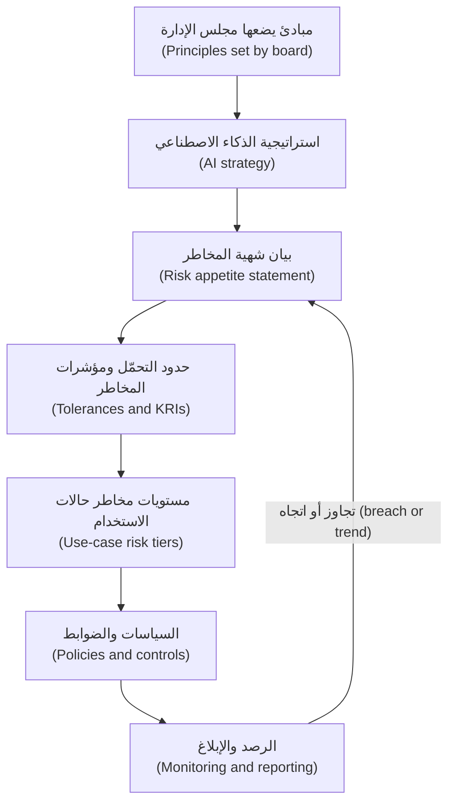
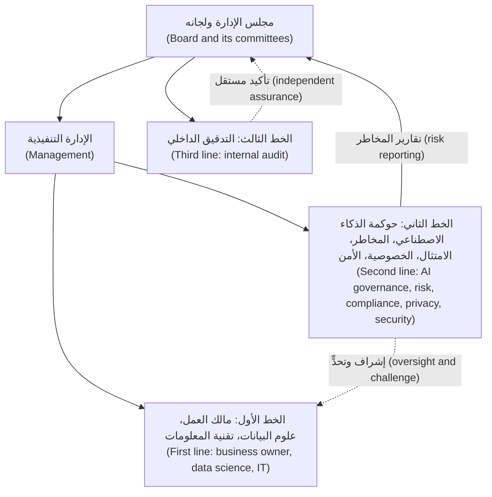

# الوحدة (Module) 2 — التوقعات المؤسسية (Organisational expectations)

*سياسة الذكاء الاصطناعي (AI policy) التي لا يملكها أحد مجرد أمنية. فقبل أن يستطيع بنك نجم (Najm Bank) حوكمة (governance) نموذج (model) واحد، عليه أن يقرر ما يؤمن به، وكم من مخاطر الذكاء الاصطناعي (AI risk) هو مستعد لتحمّله، ومن يقرر، ومن يتحقق، وهل يعرف موظفوه ما يكفي لاكتشاف المشكلات. تبني هذه الوحدة ذلك العمود الفقري المؤسسي (organisational spine). يحوّل الدرس (Lesson) 2.1 المبادئ (principles) إلى استراتيجية (strategy) وشهية مخاطر (risk appetite) ونموذج تشغيلي (operating model). ويعطي الدرس 2.2 كل دور (role) مهمته، من مجلس الإدارة (board) إلى التدقيق الداخلي (internal audit)، ويربطها في لجنة (committee) ومصفوفة RACI (RACI matrix) ومسار تصعيد (escalation path). ويغطي الدرس 2.3 واجب الإلمام بالذكاء الاصطناعي (AI literacy) في EU AI Act، والتدريب القائم على الأدوار (role-based training)، والثقافة (culture) التي تجعل الناس يتحدثون عن المشكلات. وطوال الوحدة، تبني ليلى، رئيسة حوكمة الذكاء الاصطناعي (Head of AI Governance) الجديدة في بنك نجم، الهيكل (structure) الذي كنت ستبنيه أنت. هذه الدورة تعليمية وليست استشارة قانونية (legal advice).*

> **التغطية من مجال المعرفة (BoK coverage):** I.B — تحديد ما تتوقعه المؤسسة من الذكاء الاصطناعي (AI) وإبلاغه: المبادئ، والاستراتيجية، وشهية المخاطر، والأدوار (roles) والمساءلة (accountability)، والتدريب والتوعية.

---

# 2.1 — من المبادئ إلى الاستراتيجية وشهية المخاطر
*المستوى: 🟡 متوسط (Intermediate)* · *المتطلبات (Prerequisites): 1.2، 1.3* · *مجال المعرفة (BoK): I.B*

## ⚡ الدرس في دقيقة (In 60 seconds)
- تبدأ حوكمة الذكاء الاصطناعي (AI governance) من القمة: **المبادئ (principles)** (ما نقدّره) تقود **استراتيجية الذكاء الاصطناعي (AI strategy)** (ما سنستخدم الذكاء الاصطناعي من أجله)، التي تحدّها **شهية المخاطر (risk appetite)** (مقدار مخاطر الذكاء الاصطناعي الذي نقبله) و**تحمّل المخاطر (risk tolerances)** (الحدود القابلة للقياس (measurable) من حولها).
- لا قيمة للمبادئ إلا بعد ترجمتها إلى التزامات يمكن لشخص ما اختبارها: "عادل" تصبح "نقيس فجوات معدلات الموافقة (approval-rate gaps) بين المجموعات قبل الإطلاق (launch) وشهريًا (monthly) بعده".
- يحدد مجلس الإدارة شهية المخاطر؛ وتحدد الإدارة التنفيذية (management) حدود التحمّل (tolerances) ومؤشرات المخاطر الرئيسية، ويراقبها خط الدفاع الثاني (second line).
- **النموذج التشغيلي (operating model)** (مركزي (centralised)، أو اتحادي (federated)، أو محوري وفرعي) هو الطريقة التي تنفّذ بها المؤسسة الاستراتيجية. الهيكل يتبع الاستراتيجية، لا العكس.
- إشارة الامتحان (Exam cue): الأسئلة التي تسأل "ما الذي يجب أن تفعله المؤسسة *أولًا*" تريد عادةً التزام القيادة (leadership commitment)، أو مبادئ محددة (defined principles)، أو شهية (appetite) واضحة، لا شراء أداة (tool purchase) أو نموذجًا جديدًا.
- الفخ الأكبر (Biggest trap): معاملة قائمة منشورة من المبادئ الأخلاقية على أنها حوكمة. فالمبادئ بلا مالكين (owners) ومقاييس (metrics) وعواقب مجرد تسويق.

## 🧭 لماذا يهم
في أسبوعها الأول، تجد ليلى أربعة مشاريع ذكاء اصطناعي (AI projects) جارية في بنك نجم دون رؤية مشتركة (shared view) لسببها. فريق دانة يعيد بناء نموذج تقييم الجدارة الائتمانية (credit-scoring model) للموافقة على مزيد من قروض المنشآت الصغيرة والمتوسطة (SME loans). وخالد يريد روبوت محادثة (chatbot) لخدمة العملاء (customer service) يعمل قبل رمضان. والموارد البشرية (HR) اشتركت في أداة مورّد (vendor) لفرز السير الذاتية (CV screening). ومديرو العلاقات (relationship managers) يلصقون البيانات المالية (financials) للعملاء في أداة ذكاء اصطناعي توليدي عامة (public GenAI tool) لكتابة مسودات مذكرات الائتمان. يعتقد كل فريق أنه يتصرف بمسؤولية. ولا يستطيع أيٌّ منهم أن يقول كم من المخاطر يرغب البنك في تحمّله في أيٍّ من ذلك، أو من وافق عليه.

ثم يحيل الرئيس التنفيذي (CEO) إلى ليلى سؤالًا من لجنة المخاطر في مجلس الإدارة (board risk committee): "ما شهيتنا لمخاطر الذكاء الاصطناعي؟". لا أحد يملك إجابة. للبنك شهية مفصّلة لمخاطر الائتمان (حدود التركّز (concentration limits)، وسقوف نسبة القرض إلى القيمة)، ولمخاطر السوق (market risk)، وللمخاطر التشغيلية (operational risk). والذكاء الاصطناعي يمسّ الثلاث كلها، لكنه غير مكتوب في أي مكان.

ومن دون خط يمتد من المبادئ إلى الاستراتيجية إلى الشهية، يُناقَش كل قرار يخص الذكاء الاصطناعي من الصفر، ويفوز صاحب الحجة التجارية الأعلى صوتًا.

## 📐 كيف يعمل

### 🟢 الأساسيات

**تسلسل الحوكمة (governance cascade).** فكّر في حوكمة الذكاء الاصطناعي كسلسلة من الطبقات (layers)، كل منها أكثر تحديدًا من التي فوقها:

| الطبقة (Layer) | السؤال الذي تجيب عنه | من يملكها | مثال من بنك نجم |
|---|---|---|---|
| المبادئ | ما الذي نقدّره؟ | مجلس الإدارة | "نعامل العملاء بعدالة ونستطيع تفسير القرارات التي تؤثر فيهم." |
| استراتيجية الذكاء الاصطناعي | أين سيخلق الذكاء الاصطناعي قيمة، وأين لن نستخدمه؟ | اللجنة التنفيذية (executive committee) | "استخدم الذكاء الاصطناعي لتسريع قرارات ائتمان المنشآت الصغيرة والمتوسطة (SME credit) وكشف الاحتيال (fraud detection)؛ ولا رفض آليًا بالكامل لائتمان الأفراد (retail credit)." |
| شهية المخاطر | كم من مخاطر الذكاء الاصطناعي سنقبل سعيًا إلى تلك الاستراتيجية؟ | مجلس الإدارة، بمشورة إدارة المخاطر (risk management) | "شهية منخفضة (Low appetite) للذكاء الاصطناعي الذي قد يسبب معاملة غير عادلة (unfair treatment) للعملاء." |
| حدود تحمّل المخاطر والسقوف | ما الحدود القابلة للقياس التي تُظهر أننا داخل الشهية؟ | الإدارة التنفيذية، ويراقبها خط الدفاع الثاني | "يجب أن تبقى نسبة معدل الموافقة (Approval-rate ratio) بين أي مجموعة محمية (protected group) والمجموعة المرجعية (reference group) فوق حدّ متفق عليه." |
| السياسات والإجراءات (policies and procedures) | ما الذي يجب أن يفعله الناس؟ | مالكو السياسات (Policy owners) | سياسة الذكاء الاصطناعي، وسياسة الاستخدام المقبول (acceptable-use policy)، وإجراء الاستقبال (الوحدة 3) |
| الضوابط والمقاييس | كيف نتحقق من أن ذلك حدث؟ | خط الدفاع الأول (first line)، ويختبرها الخطان الثاني والثالث | اختبار العدالة (fairness testing) قبل الإطلاق، وتقرير الرصد الشهري |

يجب أن تعود كل طبقة إلى التي فوقها. فالضابط (control) الذي لا يفسّره أي مبدأ بيروقراطية (bureaucracy)؛ والمبدأ (principle) الذي لا يختبره أي ضابط زينة (decoration).

**المبادئ (principles).** معظم المؤسسات لا تخترع مبادئ الذكاء الاصطناعي (AI principles) من العدم. بل تكيّف مجموعة معترفًا بها، ثم تضيف ما يخصها. والمصادر الشائعة هي:

- **OECD AI Principles** (اعتُمدت في 2019 وحُدّثت في مايو 2024): النمو الشامل والرفاه؛ واحترام سيادة القانون وحقوق الإنسان (human rights) والقيم الديمقراطية (democratic values) بما فيها العدالة (fairness) والخصوصية (privacy)؛ والشفافية (transparency) وقابلية التفسير (explainability)؛ والمتانة (robustness) والأمن (security) والسلامة (safety)؛ والمساءلة.
- **UNESCO Recommendation on the Ethics of AI** (2021)، مع تركيز قوي على حقوق الإنسان والكرامة (dignity) والأثر البيئي (environmental impact).
- خصائص الجدارة بالثقة (trustworthiness characteristics) في **NIST AI RMF** (صالح وموثوق (valid and reliable)؛ آمن؛ مؤمَّن ومرن (secure and resilient)؛ خاضع للمساءلة وشفاف (accountable and transparent)؛ قابل للتفسير وقابل للفهم (explainable and interpretable)؛ معزِّز للخصوصية (privacy-enhanced)؛ عادل مع إدارة التحيّز الضار).
- البيانات الإقليمية (regional statements) مثل **SDAIA AI Ethics Principles** في المملكة العربية السعودية، والتوقعات القطاعية (sector expectations) مثل إرشادات مصرف قطر المركزي للذكاء الاصطناعي الموجّهة للمؤسسات المالية (financial institutions).

اجعل المجموعة قصيرة، وبكلماتك أنت، مع سطر يوضح ما يعنيه كل بند عمليًا.

**الاستراتيجية (strategy).** تحدد استراتيجية الذكاء الاصطناعي أين سيخدم الذكاء الاصطناعي أهداف العمل (business goals)، وما القدرات (capabilities) المطلوبة (البيانات (data)، والكفاءات (talent)، والمنصات (platforms)، والشركاء)، وأين *لن* يُستخدم الذكاء الاصطناعي. وبالنسبة لبنك قطري، تُعدّ الاستراتيجية الوطنية للذكاء الاصطناعي في قطر وتوقعات المصرف المركزي (central bank) جزءًا من السياق (context).

**شهية المخاطر (risk appetite) مقابل تحمّل المخاطر (risk tolerance).** يظهر هذان المصطلحان باستمرار ويسهل الخلط بينهما:

- **شهية المخاطر (Risk appetite)** هي مقدار المخاطر ونوعها الذي تستعد المؤسسة لتحمّله أو الاحتفاظ به لتحقيق أهدافها. وهي عادةً نوعية (qualitative) ويحددها مجلس الإدارة: "منخفضة (Low)"، "متوسطة (Moderate)"، "مرتفعة (high)"، لكل فئة مخاطر (risk category).
- **تحمّل المخاطر (Risk tolerance)** هو التفاوت المقبول حول تلك الشهية، معبَّرًا عنه بمصطلحات قابلة للقياس: حدود، وسقوف، ونقاط تفعيل (trigger points). ويستخدم NIST AI RMF مصطلح "تحمّل المخاطر" بمعنى استعداد المؤسسة لتحمّل المخاطر من أجل تحقيق أهدافها، ويتوقع تحديده وتوثيقه لأنه يشكّل كل قرار لاحق في وظائف Map وMeasure وManage.
- **القدرة على تحمّل المخاطر (Risk capacity)** هي أقصى قدر من المخاطر تستطيع المؤسسة استيعابه قبل أن تنهار (تنظيميًا أو ماليًا أو من حيث السمعة). ويجب أن تقع الشهية داخل القدرة (capacity) بهامش واسع.

### 🟡 التعمق أكثر (Going deeper)

**كتابة بيان شهية مخاطر الذكاء الاصطناعي (AI risk appetite statement).** البيان القابل للاستخدام يفعل ثلاثة أشياء لكل فئة مخاطر: يذكر مستوى الشهية (appetite level)، ويشرح المبررات، ويسمّي حدود التحمّل أو المؤشرات التي تُظهر هل البنك داخلها. ومخاطر الذكاء الاصطناعي ليست فئة واحدة. بل تتقاطع مع الفئات القائمة، لذا فأوضح نهج هو توسيع تصنيف المخاطر المؤسسية بدلًا من إنشاء عالم موازٍ:

| فئة المخاطر | الزاوية الخاصة بالذكاء الاصطناعي | الشهية | مثال على حد تحمّل (tolerance) أو مؤشر مخاطر رئيسي (KRI) |
|---|---|---|---|
| السلوك والعدالة تجاه العملاء | قرارات تمييزية (Discriminatory decisions) أو غير قابلة للتفسير | منخفضة | لا قرار ذكاء اصطناعي عالي المخاطر (high-risk) بشأن العملاء دون مسار للمراجعة البشرية (human review)؛ ومقياس العدالة (fairness metric) ضمن نطاق متفق عليه |
| الامتثال التنظيمي (regulatory compliance) | EU AI Act، وGDPR، وPDPPL، وتوقعات QCB | منخفضة جدًا (Very low) | صفر أنظمة عالية المخاطر في الإنتاج دون استكمال المطابقة (conformity) أو فحوص المُشغِّل (deployer checks) |
| المرونة التشغيلية (Operational resilience) | إخفاق النموذج (Model failure)، والانجراف (drift)، وتعطل المورّد (vendor outage) | متوسطة | انخفاض أداء نموذج حرج عن الحد لأكثر من X يومًا يستدعي التصعيد (escalation) |
| أمن المعلومات (information security) | حقن الأوامر (prompt injection)، وتسرّب البيانات (data leakage) إلى الذكاء الاصطناعي التوليدي (GenAI) | منخفضة | لا بيانات سرية (confidential data) في أدوات ذكاء اصطناعي توليدي (GenAI tools) غير معتمدة؛ ومراجعة تنبيهات منع فقدان البيانات (DLP) أسبوعيًا |
| الاستراتيجية والابتكار | التخلف عن المنافسين | متوسطة إلى مرتفعة | يمكن لحالات استخدام الإنتاجية الداخلية منخفضة المخاطر (low-risk) المضي في مسار خفيف (light-touch track) |

لاحظ أن الشهية ليست منخفضة بشكل موحّد (فانعدام الشهية (zero appetite) لكل مخاطر الذكاء الاصطناعي يعني عدم استخدامه)، وأن "X" في حد التحمّل تحددها الإدارة بالبيانات. وتحرص ليلى على أن يكون الرقم موجودًا، وله مالك (owner)، ويُبلَّغ عنه.

**من الشهية (appetite) إلى مستويات حالات الاستخدام (use-case tiers).** تصبح الشهية عملية عبر تصنيف المخاطر في مستويات (risk tiering): تُصنَّف كل حالة استخدام (use case) مقترحة (مثلًا منخفضة، ومتوسطة، ومرتفعة، ومحظورة)، ويحصل كل مستوى على ضوابط متناسبة (proportionate controls). فأداة ذكاء اصطناعي توليدي (GenAI tool) تكتب مسودات محاضر الاجتماعات الداخلية تقع في مستوى منخفض (low tier) مع مراجعة خفيفة. أما نموذج تقييم الجدارة الائتمانية فيقع في مستوى مرتفع (high tier) مع تحقق مستقل (independent validation)، وتقييم الأثر على حماية البيانات (data protection impact assessment)، وتقييم الأثر على الحقوق الأساسية (fundamental rights impact assessment) لعملاء الاتحاد الأوروبي (EU)، وموافقة اللجنة (committee approval). وبيان الشهية (appetite statement) هو ما يبرر هذا الفرق. وتبني الوحدة 8 عملية الاستقبال والتصنيف الكاملة.

**اختيار النموذج التشغيلي (operating model).** يحدد النموذج التشغيلي أين تقع خبرة حوكمة الذكاء الاصطناعي وصلاحيات القرار (decision rights). وهناك ثلاثة أنماط شائعة:

| النموذج | كيف يعمل | نقاط القوة (Strengths) | نقاط الضعف (Weaknesses) | يناسب عندما (Fits when) |
|---|---|---|---|---|
| مركزي | فريق مركزي واحد (غالبًا في المخاطر أو الامتثال (compliance) أو مكتب رئيس البيانات) يراجع كل الذكاء الاصطناعي ويعتمده | الاتساق (consistency)، ووضوح المساءلة (clear accountability)، وتجميع الخبراء النادرين | عنق زجاجة (bottleneck)؛ والبعد عن العمل؛ وثقافة "الحوكمة تقول لا" | النضج المبكر (Early maturity)، وقلة حالات الاستخدام (use cases)، والتنظيم المشدد (heavily regulated) |
| اتحادي (لامركزي) (Federated, decentralised) | كل وحدة عمل (business unit) تحكم ذكاءها الاصطناعي وفق معايير دنيا مشتركة | السرعة، والسياق، والملكية (ownership) | عدم الاتساق (Inconsistency)؛ وانحراف المعايير (standards drift)؛ وصعوبة الحصول على رؤية مؤسسية (enterprise view) | المجموعات الكبيرة المتنوعة ذات وظائف مخاطر محلية قوية |
| محوري وفرعي (هجين) (Hub-and-spoke, hybrid) | يحدد مركز محوري (central hub) السياسة (policy) والمنهجيات والأدوات والسجل (inventory)؛ وتطبّقها "فروع (spokes)" مدمجة (أبطال مخاطر الذكاء الاصطناعي) في كل وحدة | توازن بين الاتساق والسرعة؛ وقابل للتوسع (scales) | يحتاج إلى صلاحيات قرار واضحة (Clear decision rights) بين المركز والفروع (hub and spokes)؛ وقد يعاني الأبطال (champions) من نقص الموارد (under-resourced) | معظم المؤسسات المتوسطة والكبيرة حين يتنامى استخدام الذكاء الاصطناعي |

سيبدأ بنك نجم بنموذج مركزي ريثما يُبنى السجل، ثم ينتقل إلى النموذج المحوري والفرعي (hub-and-spoke model) مع أبطال في كل خط أعمال (business line).

الحلقة (loop) في الأسفل مهمة: فنتائج الرصد (monitoring) تعود إلى مجلس الإدارة، الذي قد يشدد الشهية أو يخففها.

### 🔴 نظرة الخبير (Expert view)

**المبادئ تتعارض (Principles conflict)، والحوكمة (governance) هي طريقة حل التعارضات (resolve conflicts).** قد تتعارض قابلية التفسير مع الدقة (accuracy). وقد تتعارض الخصوصية (تقليل البيانات) مع اختبار العدالة (الذي قد يحتاج إلى سمات حساسة). والسرعة إلى السوق تتعارض مع عمق التحقق (validation depth). والبرامج الناضجة (Mature programmes) لا تتظاهر بزوال هذه التوترات (tensions). بل تسمّيها، وتضع قاعدة افتراضية ("حين تتعارض الدقة وقابلية التفسير في قرارات ائتمان العملاء، تفوز قابلية التفسير ما لم تعتمد اللجنة خلاف ذلك")، وتسجّل القرارات لتبقى متسقة مع الوقت. ويحب الامتحان السيناريوهات التي يتصادم فيها مبدآن (two principles) جيدان؛ وأفضل إجابة (best answer) عادةً توثّق المفاضلة (trade-off) وتحيلها إلى صاحب القرار المسؤول (accountable decision-maker) بدلًا من اختيار أحدهما بصمت.

**الحوكمة على مستوى مجلس الإدارة (Board-level governance).** يقدّم **ISO/IEC 38507** إرشادات (guidance) لهيئات الحوكمة (مجالس الإدارة) بشأن تبعات استخدام الذكاء الاصطناعي: فهي تبقى مسؤولة (accountable) عن استخدام المؤسسة للذكاء الاصطناعي، حتى حين تُفوَّض القرارات أو تُؤتمت، وينبغي أن تشرف على السياسات (policies) وشهية المخاطر والثقافة التي تشكّل ذلك الاستخدام. ويضع **ISO/IEC 42001** الفكرة نفسها في نظام إدارة (management system) قابل للاعتماد (certifiable): يجب أن تُظهر الإدارة العليا (top management) القيادة والالتزام، وأن تضع سياسة للذكاء الاصطناعي تلائم غرض المؤسسة وتوفّر إطارًا (framework) لأهداف الذكاء الاصطناعي، وأن تسند الأدوار والمسؤوليات (roles and responsibilities) والصلاحيات (authorities). وبالمثل تتوقع وظيفة Govern في NIST AI RMF أن تتحمل القيادة العليا المسؤولية (responsibility) عن القرارات المتعلقة بالمخاطر المرتبطة بتطوير الذكاء الاصطناعي ونشره.

**الدمج خير من الاختراع (Integration beats invention).** تدير البنوك أصلًا برامج للمخاطر المؤسسية، ومخاطر النماذج (model risk)، ومخاطر الأطراف الثالثة (third-party risk)، والخصوصية، وأمن المعلومات. والحوكمة الفعّالة (effective governance) للذكاء الاصطناعي توسّعها بدلًا من بناء جزيرة معزولة: تنضم مخاطر الذكاء الاصطناعي إلى تصنيف المخاطر (risk taxonomy)، وتنضم نماذج الذكاء الاصطناعي (AI models) إلى سجل النماذج (model inventory)، ويمر مورّدو الذكاء الاصطناعي (AI vendors) بإجراءات الإسناد الخارجي (outsourcing) مع أسئلة إضافية خاصة بالذكاء الاصطناعي. ويبني **ISO/IEC 23894** (إرشادات إدارة مخاطر الذكاء الاصطناعي) على ISO 31000، وهذا يساعد. أما الإطار المنفصل (separate framework) الذي لا يربطه أحد بتقارير المخاطر المؤسسية فيميل إلى الموت حين يغادر راعيه.

**التنظيم يشكّل الشهية (Regulation shapes appetite) لكنه لا يحل محلها.** القانون يضع حدًا أدنى (floor). ويمكن أن تكون الشهية أشد من القانون، ولا يمكن أبدًا أن تكون أخف. والمجموعة العاملة في الاتحاد الأوروبي ودول الخليج كثيرًا ما تضع شهية موحدة (group-wide appetite) على مستوى المجموعة للاستخدامات عالية المخاطر عند أشد مستوى ذي صلة، ولا تسمح إلا بتفاوت محلي معتمد.

## ⚖️ الأدوات التنظيمية
| الأداة | ما تشترطه أو توصي به | إشارة الامتحان |
|---|---|---|
| **OECD AI Principles** | خمسة مبادئ قائمة على القيم (values-based principles) للذكاء الاصطناعي الجدير بالثقة (حُدّثت في مايو 2024) إضافة إلى توصيات للحكومات | الأساس الدولي (international baseline) الأوسع اعتمادًا؛ والمصدر الذي تكيّفه مجموعات مبادئ مؤسسية كثيرة |
| **UNESCO Recommendation on the Ethics of AI** | إطار أخلاقي عالمي (2021) يتمحور حول حقوق الإنسان والكرامة والتنوع (diversity) والبيئة | قانون مرن (Soft law) اعتمدته الدول الأعضاء (member states) في UNESCO؛ غير ملزم للشركات |
| **NIST AI RMF** — وظيفة Govern | مساءلة القيادة (Leadership accountability)، وتحمّل مخاطر موثّق، والسياسات والثقافة أساسًا لوظائف (functions) Map وMeasure وManage | Govern وظيفة شاملة (cross-cutting)؛ وتحمّل المخاطر قرار مؤسسي (organisational decision) لا يحدده الإطار نيابة عنك |
| **ISO/IEC 42001** — البند 5 القيادة (Clause 5 Leadership) | التزام الإدارة العليا، وسياسة للذكاء الاصطناعي، وأدوار ومسؤوليات (responsibilities) وصلاحيات مسندة | معيار نظام إدارة (management-system standard) قابل للاعتماد؛ ويجب أن تُظهر "الإدارة العليا" التزامها |
| **ISO/IEC 38507** | إرشادات لهيئات الحوكمة (governing bodies) بشأن التبعات الحوكمية (governance implications) لاستخدام الذكاء الاصطناعي | يبقى مجلس الإدارة مسؤولًا حتى حين يقرر الذكاء الاصطناعي |
| **ISO/IEC 23894** | إرشادات إدارة مخاطر الذكاء الاصطناعي (AI risk management guidance) المبنية على ISO 31000 | ادمج مخاطر الذكاء الاصطناعي في إدارة المخاطر المؤسسية القائمة |
| **SDAIA AI Ethics Principles** | مبادئ أخلاقيات الذكاء الاصطناعي الوطنية السعودية للجهات التي تطوّر الذكاء الاصطناعي أو تستخدمه | مثال على إطار مبادئ خليجي؛ تحقق من النص الرسمي (official text) الحالي |

## 🏛️ عمليًا في بنك نجم
تصوغ ليلى، وتعتمد لجنة المخاطر في مجلس الإدارة، أول **بيان لمبادئ الذكاء الاصطناعي وشهية المخاطر (AI Principles and Risk Appetite Statement)**. وهذا مقتطف منه:

> **مبادئ الذكاء الاصطناعي في بنك نجم (الإصدار (version) 1.0)**
> 1. **المعاملة العادلة (Fair treatment).** يجب ألا ينتج الذكاء الاصطناعي فروقًا غير مبررة في النتائج للعملاء أو الموظفين. *عمليًا:* يُختبر الذكاء الاصطناعي الموجّه للعملاء بحثًا عن نتائج متفاوتة (disparate outcomes) قبل الإطلاق ويُراقَب بعده.
> 2. **قابلية التفسير (explainability).** القرارات التي تؤثر تأثيرًا كبيرًا في شخص يمكن تفسيرها له بلغة بسيطة. *عمليًا:* تحمل قرارات الائتمان (credit decisions) رموز أسباب (reason codes) يستطيع مدير العلاقة (relationship manager) قراءتها بصوت عالٍ.
> 3. **المساءلة البشرية (Human accountability).** لكل نظام ذكاء اصطناعي (AI system) شخص مسمّى يملكه، ولا يملك أي نظام ذكاء اصطناعي الكلمة الأخيرة في رفض ائتمان عميل من الأفراد. *عمليًا:* لكل نظام في السجل مالك عمل مسؤول.
> 4. **الخصوصية والأمن (Privacy and security).** يستخدم الذكاء الاصطناعي الحد الأدنى الضروري من البيانات الشخصية (personal data) ويُحمى كأي نظام حرج (critical system). *عمليًا:* فحص أولي (screen) لتقييم الأثر على حماية البيانات (DPIA) جزء من الاستقبال (intake).
> 5. **الموثوقية (Reliability).** يُتحقق من الذكاء الاصطناعي قبل الاستخدام ويُراقَب أثناءه. *عمليًا:* تخضع النماذج من المستوى المرتفع (high-tier models) لتحقق مستقل.

> **شهية مخاطر الذكاء الاصطناعي (مقتطف)**
>
> | الفئة | الشهية | حد التحمّل / مؤشر المخاطر الرئيسي (Tolerance / KRI) | المالك | يُرفع إلى (Reported to) |
> |---|---|---|---|---|
> | العدالة تجاه العملاء (Customer fairness) | منخفضة | مقاييس العدالة (fairness metrics) ضمن النطاقات المتفق عليها لكل نماذج المستوى المرتفع؛ وأي تجاوز يُصعَّد خلال 5 أيام عمل (working days) | رئيس إقراض الأفراد (خالد) لنماذج الائتمان (credit models) | لجنة حوكمة الذكاء الاصطناعي (AI Governance Committee) شهريًا؛ ولجنة المخاطر في مجلس الإدارة ربع سنويًا (quarterly) |
> | التنظيمية | منخفضة جدًا | 100% من أنظمة المستوى المرتفع (high-tier systems) استكملت تقييمات الأثر (impact assessments) قبل الإطلاق | رئيسة حوكمة الذكاء الاصطناعي (ليلى) | لجنة المخاطر في مجلس الإدارة ربع سنويًا |
> | تسرّب البيانات عبر الذكاء الاصطناعي التوليدي | منخفضة | صفر حوادث (incidents) مؤكدة لوجود بيانات العملاء (customer data) في أدوات غير معتمدة؛ وفرز تنبيهات DLP خلال يومي عمل (2 working days) | CISO | لجنة حوكمة الذكاء الاصطناعي شهريًا |
> | الابتكار (innovation) | متوسطة | البت في حالات الاستخدام منخفضة المستوى خلال 10 أيام عمل من اكتمال الاستقبال | رئيسة حوكمة الذكاء الاصطناعي | اللجنة التنفيذية ربع سنويًا |

*قرار النموذج التشغيلي:* مراجعة مركزية (centralised review) في السنة الأولى؛ ثم نموذج محوري وفرعي مع أبطال مخاطر ذكاء اصطناعي مسمّين ابتداءً من الشهر الثاني عشر، رهنًا بمراجعة اللجنة لأحجام الاستقبال (intake volumes).

## 🛠️ التمارين (Exercises)

### 🟢 مبتدئ (Beginner)
خذ مبادئ OECD الخمسة القائمة على القيم وأعِد كتابة كل منها في صورة التزام من سطر واحد (one-line commitment) لمؤسسة تعرفها، مع جملة "عمليًا" واحدة لكل منها.
*يكتمل عندما (Done when):* يكون لكل مبدأ التزام يستطيع شخص ما اختباره أو تدقيقه.

### 🟡 متوسط
صُغ جدول شهية مخاطر الذكاء الاصطناعي لروبوت محادثة خدمة العملاء (customer-service chatbot) في بنك نجم يغطي أربع فئات مخاطر (risk categories) على الأقل، مع مستوى شهية، وحد تحمّل واحد أو مؤشر مخاطر رئيسي، ومالك لكل منها.
*يكتمل عندما:* يكون لكل صف حد تحمّل قابل للقياس ودور مسمّى، وتكون لفئة واحدة على الأقل شهية متوسطة (لا منخفضة) مع تبرير.

### 🔴 متقدم (Advanced)
يريد قسم الخدمات المصرفية للشركات (corporate banking) في بنك نجم أن يدير حوكمة الذكاء الاصطناعي الخاصة به لأن "المركز بطيء جدًا". اكتب توصية من صفحة واحدة (one-page recommendation) للراعي التنفيذي (executive sponsor) تقارن بين النماذج المركزي والاتحادي والمحوري والفرعي لبنك نجم، واقترح صلاحيات القرار بين المركز والفروع.
*يكتمل عندما:* تسمّي التوصية (recommendation) ما يحتفظ به المركز (السياسة، والسجل، واعتمادات المستوى المرتفع)، وما تستطيع الفروع البت فيه، وكيف يظل مجلس الإدارة يحصل على رؤية مؤسسية واحدة.

## ⚠️ أخطاء وفخاخ الامتحان (Mistakes and exam traps)
- **المبادئ كخط نهاية (Principles as the finish line).** نشر المبادئ (Publishing principles) هو البداية. وخيارات الإجابة (Answer options) التي تتوقف عند "نشر المبادئ الأخلاقية (ethical principles)" نادرًا ما تكون الأفضل حين يضيف خيار آخر الملكية أو المقاييس أو الضوابط (controls).
- **الخلط بين الشهية والتحمّل (Confusing appetite and tolerance).** الشهية هي "كم من المخاطر نريد" بصيغة نوعية؛ والتحمّل هو الحد القابل للقياس. يحدد مجلس الإدارة الشهية؛ وتحدد الإدارة التنفيذية حدود التحمّل وتراقبها.
- **انعدام الشهية في كل مكان (Zero appetite everywhere).** إعلان عدم التسامح مطلقًا (zero tolerance) مع أي مخاطر للذكاء الاصطناعي يبدو آمنًا لكنه يمنع كل استخدام أو، وهو الأسوأ، يدفعه إلى الخفاء (الذكاء الاصطناعي الخفي). توقّع إجابات تفضّل النهج المتناسب القائم على المخاطر.
- **الأداة قبل الاستراتيجية (Tool before strategy).** شراء منصة لحوكمة الذكاء الاصطناعي قبل تحديد المبادئ والشهية والملكية "خطوة أولى (first step)" خاطئة كلاسيكية.
- **بناء جزيرة معزولة (Building a silo).** معاملة مخاطر الذكاء الاصطناعي بمعزل عن أطر المخاطر المؤسسية ومخاطر النماذج والخصوصية والأطراف الثالثة تخلق فجوات (gaps) وازدواجية (duplication)؛ والدمج (integration) هو الإجابة الأفضل عادةً.
- **القانون كسقف (Law as the ceiling).** المتطلبات القانونية (Legal requirements) هي الحد الأدنى. ويجوز للمؤسسة وضع قواعد داخلية (internal rules) أشد؛ ولا يجوز لها أبدًا وضع قواعد أخف.

## 🧾 الخلاصة (Recap)
- يسير التسلسل (cascade) من المبادئ ← الاستراتيجية ← شهية المخاطر ← حدود التحمّل ← المستويات (tiers) ← السياسات ← الضوابط ← الرصد، مع إعادة النتائج إلى مجلس الإدارة.
- كيّف المبادئ المعترف بها (OECD، وUNESCO، وخصائص NIST (NIST characteristics)، والمبادئ الإقليمية) وترجم كلًّا منها إلى التزامات قابلة للاختبار (testable commitments).
- الشهية نوعية ويملكها مجلس الإدارة؛ والتحمّل قابل للقياس وتملكه الإدارة التنفيذية؛ وكلاهما يقع داخل القدرة على تحمّل المخاطر.
- النماذج التشغيلية المركزية والاتحادية والمحورية الفرعية تفاضل بين الاتساق والسرعة؛ والنموذج المحوري الفرعي هو الوجهة الشائعة (common destination) مع توسّع استخدام الذكاء الاصطناعي.
- تبقى مجالس الإدارة (boards) مسؤولة عن الذكاء الاصطناعي (ISO/IEC 38507)؛ ويضع كلٌّ من ISO/IEC 42001 وNIST AI RMF التزام القيادة أولًا.

## ✍️ اختبر نفسك (Check yourself)

**1. اعتمد مجلس إدارة بنك نجم مبادئ الذكاء الاصطناعي (AI principles). أي خطوة تحوّل مبدأ (principle) "العدالة (fairness)" إلى حوكمة (governance) على أفضل وجه؟**

- A. نشر المبادئ (principles) على الموقع الإلكتروني (website) للبنك وفي التقرير السنوي (annual report)، مع بيان يوقّعه رئيس المجلس (chair)
- B. تحديد مقياس (metric) للعدالة (fairness)، ونطاق تحمّل (tolerance band)، ومالك (owner) يبلّغ لجنة حوكمة الذكاء الاصطناعي (AI Governance Committee) بالتجاوزات (breaches)
- C. مطالبة علماء البيانات (data scientists) "بمراعاة العدالة (fairness)" وبرفع أي مخاوف (concerns) إلى مديرهم المباشر (line manager) متى رأوها، دون أي مقياس (metric) أو حد (limit) محدد، وبما يترك التقدير لكل فريق (team) بمفرده (alone)
- D. إضافة كلمة "عادل" إلى اسم كل نموذج (model) في السجل (inventory) وإلى عنوان كل مشروع (project) في خطة التسليم (delivery plan) ومحضر الاجتماعات (meeting minutes)

الإجابة (Answer)

**B.** تحتاج الحوكمة (governance) إلى التزامات قابلة للقياس (measurable commitments) مع مالكين (owners) وتصعيد (escalation). أما A فتواصل لا ضابط (control)؛ وC بلا مقياس (metric) ولا مساءلة (accountability). (انظر 🟢 الأساسيات و🏛️ عمليًا.)

**2. أي عبارة تصف الفرق بين شهية المخاطر (risk appetite) وتحمّل المخاطر (risk tolerance) على أفضل وجه؟**

- A. يحدد علماء البيانات (data scientists) الشهية (appetite)؛ ويحدد مجلس الإدارة (board) التحمّل (tolerance)، ويعتمده مرة في السنة لجميع النماذج معًا
- B. هما مترادفان (synonyms) يُستخدمان بالتبادل في NIST AI RMF، الذي يعرّفهما معًا بأنهما أقصى خسارة (maximum loss) تتحملها المؤسسة
- C. الشهية (appetite) هي المقدار والنوع العامّان للمخاطر التي ستقبلها المؤسسة؛ والتحمّل (tolerance) هو الحدود القابلة للقياس (measurable) التي تُظهر هل هي داخل تلك الشهية
- D. التحمّل (tolerance) هو أقصى قدر من المخاطر تستطيع المؤسسة استيعابه قبل أن تنهار؛ والشهية (appetite) هي مقدار المخاطر الذي تحمّلته فعلًا، ويُحدَّد كلاهما مرة واحدة في بداية المشروع (project)

الإجابة

**C.** الشهية (appetite) هي الموقف النوعي (qualitative position) على مستوى مجلس الإدارة (board)؛ وحدود التحمّل (tolerances) هي الحدود القابلة للقياس (measurable). أما D فيصف القدرة على تحمّل المخاطر (risk capacity)، وهو مشتِّت (distractor) شائع. (انظر 🟢 الأساسيات.)

**3. لدى شركة تأمين (insurer) سريعة النمو 60 حالة استخدام (use case) للذكاء الاصطناعي (AI) عبر خمس وحدات عمل (business units). ولدى فريق المراجعة المركزي (central AI review team) للذكاء الاصطناعي تراكم أعمال (backlog) لثلاثة أشهر، وبدأت الوحدات تتجاوزه. أي تغيير في النموذج التشغيلي (operating model) هو الأنسب؟**

- A. الانتقال إلى النموذج المحوري والفرعي (hub-and-spoke model): إبقاء السياسة (policy) والسجل (inventory) واعتمادات الحالات عالية المخاطر (high-risk) مركزية (centralised)، ودمج أبطال (champions) مدرَّبين في كل وحدة للتعامل مع المراجعات الأقل مخاطر (lower-risk)
- B. إيقاف كل مشاريع الذكاء الاصطناعي (AI) حتى يُصفّى التراكم (backlog)
- C. السماح لكل وحدة بوضع معاييرها الخاصة للذكاء الاصطناعي (AI) باستقلال
- D. إسناد كل اعتمادات الذكاء الاصطناعي (AI) إلى شركة استشارات خارجية (external consultancy)

الإجابة

**A.** يحافظ النموذج المحوري والفرعي (hub-and-spoke model) على الاتساق (consistency) والرؤية المؤسسية (enterprise visibility) مع إضافة طاقة قريبة من العمل. أما C فنموذج (model) اتحادي (federated) بالكامل دون معايير (standards) مشتركة، فيفقد الاتساق؛ وB يدفع نحو الذكاء الاصطناعي الخفي (shadow AI). (انظر 🟡 التعمق أكثر (Going deeper)، النماذج التشغيلية (operating models).)

**4. بموجب ISO/IEC 38507، من يبقى مسؤولًا (accountable) عن استخدام المؤسسة للذكاء الاصطناعي (AI) حين تُفوَّض القرارات إلى أنظمة الذكاء الاصطناعي (AI systems)؟**

- A. مورّد الذكاء الاصطناعي (AI vendor)
- B. فريق علوم البيانات (data science team) الذي بنى النموذج (model)
- C. لا أحد، لأن القرار آلي (automated)
- D. هيئة الحوكمة (مجلس الإدارة)

الإجابة

**D.** يخاطب ISO/IEC 38507 هيئات الحوكمة (governing bodies)، والفكرة أن المساءلة (accountability) لا تُفوَّض إلى الآلة (machine) أو المورّد (vendor). (انظر 🔴 نظرة الخبير (Expert view).)

**5. يقول فريق النماذج (model team) في بنك نجم إن تفسير قرارات نموذج الائتمان (credit model) الجديد سيكلّف نقطتين من الدقة (accuracy). والمبادئ (principles) تقدّر الدقة وقابلية التفسير (explainability) كلتيهما. ما أفضل استجابة حوكمية (governance response)؟**

- A. اختيار النموذج الأدق دائمًا، فقابلية التفسير (explainability) اختيارية ويمكن إضافتها لاحقًا إن طلبتها الجهة الرقابية (regulator)، فلا حاجة إلى تسجيل أي مفاضلة (trade-off)
- B. ترك فريق علوم البيانات (data science team) يقرر بشكل غير رسمي، لأنه يفهم النموذج (model) أفضل من أي لجنة (committee)
- C. التخلي عن النموذج (model) وإعادة بدء المشروع (project) بتقنية أبسط (simpler technique)
- D. توثيق المفاضلة (trade-off) وتطبيق القاعدة الافتراضية (default) المعلنة للبنك أو إحالتها إلى صاحب القرار المسؤول (accountable decision-maker)، مع تسجيل القرار

الإجابة

**D.** المبادئ تتعارض (Principles conflict)؛ والحوكمة (governance) تحل التعارضات (conflicts) بشفافية واتساق عبر القواعد الافتراضية (defaults) والقرارات الخاضعة للمساءلة (accountability). أما A وB فيتخطيان المساءلة؛ وC رد فعل مبالغ فيه. (انظر 🔴 نظرة الخبير (Expert view).)

## 📚 المراجع (References)
- OECD AI Principles: https://oecd.ai/en/ai-principles
- UNESCO، توصية بشأن أخلاقيات الذكاء الاصطناعي: https://www.unesco.org/en/artificial-intelligence/recommendation-ethics
- إطار NIST لإدارة مخاطر الذكاء الاصطناعي (NIST AI Risk Management Framework): https://www.nist.gov/itl/ai-risk-management-framework
- ISO/IEC 42001:2023 نظام إدارة الذكاء الاصطناعي (AI management system): https://www.iso.org/standard/81230.html
- ISO/IEC JTC 1/SC 42 (اللجنة المسؤولة عن ISO/IEC 38507 و23894 ومجموعة معايير الذكاء الاصطناعي): https://www.iso.org/committee/6794475.html
- SDAIA (الهيئة السعودية للبيانات والذكاء الاصطناعي): https://sdaia.gov.sa/
- مصرف قطر المركزي (Qatar Central Bank): https://www.qcb.gov.qa/
- شهادة AIGP (AIGP certification) من IAPP ومجال المعرفة (Body of Knowledge): https://iapp.org/certify/aigp/

---

# 2.2 — الأدوار والمساءلة ولجنة حوكمة الذكاء الاصطناعي
*المستوى: 🟡 متوسط* · *المتطلبات: 2.1* · *مجال المعرفة: I.B*

## ⚡ الدرس في دقيقة (In 60 seconds)
- يحتاج كل نظام ذكاء اصطناعي إلى **مالك مسؤول (accountable owner)** واحد في جهة العمل، لا في تقنية المعلومات أو علوم البيانات (data science). وأدوار الحوكمة (governance roles) تدعم هذا المالك؛ ولا تحل محله.
- يفصل **نموذج الخطوط الثلاثة (three lines model)** بين التنفيذ (الخط الأول: جهة العمل، وعلوم البيانات، وتقنية المعلومات)، والإشراف (الخط الثاني: المخاطر، والامتثال، والخصوصية، وحوكمة الذكاء الاصطناعي)، والتأكيد المستقل (الخط الثالث (third line): التدقيق الداخلي)، وكلها ترفع تقاريرها إلى هيئة الحوكمة (governing body).
- **لجنة حوكمة الذكاء الاصطناعي (AI governance committee)** متعددة التخصصات (cross-functional)، ولها ميثاق مكتوب (written charter)، وصلاحيات قرار، ومسار تصعيد إلى مجلس الإدارة. إنها تقرر؛ ولا تكتفي بالنقاش.
- مصفوفة **RACI** تجعل الأدوار ملموسة لكل خطوة في دورة الحياة (life cycle). "A" واحدة بالضبط لكل نشاط.
- إشارة الامتحان: حين يسأل سيناريو عمن ينبغي أن يملك خطرًا من مخاطر الذكاء الاصطناعي، اختر مالك العمل (business owner) لحالة الاستخدام؛ وحين يسأل عمن يقدّم التأكيد المستقل (independent assurance)، اختر التدقيق الداخلي.
- الفخ الأكبر: جعل فريق الحوكمة (أو اللجنة) مسؤولًا عن كل نتيجة للذكاء الاصطناعي. فذلك يشتّت الملكية ويحوّل الحوكمة إلى عنق زجاجة.

## 🧭 لماذا يهم
أُطلق روبوت محادثة خدمة العملاء في بنك نجم يوم خميس. وبحلول الأحد كان قد أخبر ثلاثة عملاء بأن رسوم التأخر في السداد (late-payment fee) ستُعفى، وهي لن تُعفى. ونشر أحد العملاء لقطة الشاشة (screenshot). وكان السؤال في اجتماع الأزمة (crisis meeting) يوم الاثنين بسيطًا: "من يملك هذا؟". قالت دانة إن فريقها أجرى الضبط الدقيق (fine-tuning) للنموذج فقط. وقالت تقنية المعلومات إنها استضافته فقط. وأشار المورّد إلى شروط الخدمة الخاصة به. وقال خالد إنه لم يعتمد الطلب (prompt) النهائي قط. وكان التسويق (marketing) قد كتب رسالة الترحيب (welcome message). الجميع لمسه؛ ولم يملكه أحد.

واجهت محكمة في كندا السؤال نفسه في قضية *Moffatt v. Air Canada* (2024). فقد أعطى روبوت المحادثة الخاص بشركة الطيران عميلًا معلومات خاطئة عن أسعار السفر في حالات الوفاة (bereavement fares). وجادلت الشركة، في جوهر الأمر، بأن روبوت المحادثة مسؤول عن تصريحاته. رفضت المحكمة (tribunal) ذلك وحمّلت الشركة المسؤولية: فالمؤسسة مسؤولة عن كل المعلومات على موقعها، سواء جاءت من صفحة ثابتة (static page) أو من روبوت محادثة. وقعت المسؤولية القانونية (liability) على المؤسسة. أما داخليًا، فيحتاج بنك نجم إلى معرفة أي *شخص* يحملها، قبل الحادثة (incident) التالية لا بعدها.

## 📐 كيف يعمل

### 🟢 الأساسيات

**من يفعل ماذا (Who does what).** هذه هي الأدوار التي تحتاجها معظم برامج حوكمة الذكاء الاصطناعي، مع مهمتها الأساسية. والمسميات (Titles) تختلف من مؤسسة لأخرى؛ أما الوظائف فلا.

| الدور | المهمة الأساسية (Core job) في حوكمة الذكاء الاصطناعي | في بنك نجم |
|---|---|---|
| مجلس الإدارة (ولجنة المخاطر أو التدقيق التابعة له) | يحدد المبادئ وشهية المخاطر؛ ويشرف؛ ويُخضع الإدارة التنفيذية للمساءلة | لجنة المخاطر في مجلس الإدارة |
| الراعي التنفيذي | مسؤول تنفيذي أول (Senior executive) يتبنى البرنامج، ويؤمّن الميزانية (secures budget)، ويكسر الجمود (breaks deadlocks) | رئيس المخاطر (Chief Risk Officer) |
| قائد حوكمة الذكاء الاصطناعي (AI governance lead) | يصمم الإطار ويديره: السياسات، والسجل، والاستقبال، واللجنة، والتقارير (reporting) | ليلى، رئيسة حوكمة الذكاء الاصطناعي |
| لجنة حوكمة الذكاء الاصطناعي | هيئة متعددة التخصصات (Cross-functional body) تعتمد حالات الاستخدام عالية المخاطر والاستثناءات والسياسات | يرأسها رئيس المخاطر (CRO) |
| مالك العمل / المنتج | مسؤول عن غرض نظام ذكاء اصطناعي محدد ونتائجه ومخاطره | خالد لتقييم الجدارة الائتمانية (credit scoring) وروبوت المحادثة |
| علوم البيانات / الهندسة | بناء النماذج (models) والأنظمة واختبارها وتوثيقها ورصدها | فريق دانة |
| رئيس البيانات (Chief Data Officer) | استراتيجية البيانات (Data strategy)، وجودة البيانات (data quality)، وتسلسل البيانات (lineage)، وملكية البيانات (data ownership) | عمر |
| الشؤون القانونية (Legal) | تفسير القوانين (Interprets laws)، والعقود (contracts)، والمسؤولية القانونية، والملكية الفكرية (IP) | فريق المستشار القانوني العام (General Counsel) |
| الخصوصية / مسؤول حماية البيانات (Data Protection Officer, DPO) | الامتثال لحماية البيانات، وتقييمات الأثر على حماية البيانات (DPIAs)، وحقوق أصحاب البيانات (data-subject rights)؛ ويجب أن يتمكن مسؤول حماية البيانات من العمل باستقلال بموجب GDPR | سارة |
| أمن المعلومات | أمن النماذج والبيانات وسلسلة توريد الذكاء الاصطناعي؛ وإساءة استخدام الذكاء الاصطناعي التوليدي (GenAI misuse) | CISO |
| الامتثال | ربط المتطلبات التنظيمية (EU AI Act، وتوقعات QCB، وقواعد حماية المستهلك)، ومخاطر السلوك (conduct risk) | رئيس الامتثال |
| المشتريات / مخاطر الأطراف الثالثة | العناية الواجبة (due diligence) بالمورّدين (vendors) والعقود لمنتجات الذكاء الاصطناعي | يوسف |
| الموارد البشرية | الآثار على القوى العاملة (Workforce impacts)، والذكاء الاصطناعي في التوظيف (hiring)، وسجلات التدريب (training records) | شريك أعمال الموارد البشرية |
| التدقيق الداخلي | تأكيد مستقل بأن الحوكمة مصممة جيدًا وتعمل | رئيس التدقيق |

**المسؤول مقابل المنفِّذ (Accountable vs responsible).** كلمتان يتعامل معهما الامتحان بدقة. *المنفِّذ (Responsible)* يعني أداء العمل. و*المسؤول* يعني المحاسبة على النتيجة، مع صلاحية القرار. ففريق دانة منفِّذ لبناء نموذج الائتمان؛ وخالد مسؤول عن استخدامه في قرارات الإقراض (lending decisions)، لأنها عملية العمل (business process) الخاصة به، وعملاؤه، وأرباحه وخسائره. أما قائد الحوكمة (governance lead) فمسؤول عن نجاح *الإطار*، لا عن نتائج كل نموذج.

**نموذج الخطوط الثلاثة (three lines model).** نموذج الخطوط الثلاثة لمعهد المدققين الداخليين (المحدَّث في 2020 (updated in 2020) عن نموذج "خطوط الدفاع الثلاثة" الأقدم) هو الطريقة المعيارية لترتيب هذه الأدوار:

- **الخط الأول (first line):** الأشخاص الذين يملكون المخاطر ويديرونها كجزء من تقديم المنتجات والخدمات. وفي الذكاء الاصطناعي: مالك العمل، وعلوم البيانات، والهندسة (engineering)، وعمليات تقنية المعلومات. وهم يبنون الضوابط في النظام ويشغّلونها.
- **الخط الثاني (second line):** الوظائف المتخصصة (specialist functions) التي تقدّم الخبرة، وتضع الأطر (frameworks)، وتتحدى (challenge)، وترصد. وفي الذكاء الاصطناعي: فريق حوكمة الذكاء الاصطناعي (AI Governance team)، وإدارة المخاطر، والامتثال، والخصوصية، وأمن المعلومات، وفي البنوك إدارة مخاطر النماذج (model risk management).
- **الخط الثالث (third line):** التدقيق الداخلي، الذي يقدّم لهيئة الحوكمة تأكيدًا مستقلًا وموضوعيًا بشأن ما إذا كان الخطان الأولان يعملان. واستقلاله عن الإدارة التنفيذية هو ما يمنحه قيمته.
- **هيئة الحوكمة (governing body)** (مجلس الإدارة) تقع فوق الخطوط الثلاثة (three lines) كلها وتتلقى تقارير من كل منها. أما مقدّمو التأكيد الخارجيون (المدققون الخارجيون (external auditors)، وجهات منح الشهادات (certification bodies)، والجهات الرقابية) فيقعون خارجها.

### 🟡 التعمق أكثر

**لجنة حوكمة الذكاء الاصطناعي (AI Governance Committee).** تنشئ معظم المؤسسات لجنة لأن قرارات الذكاء الاصطناعي تحتاج إلى عدة منظورات (several perspectives) في آن واحد: فنموذج الائتمان يثير معًا أسئلة العدالة (الامتثال)، والبيانات الشخصية (الخصوصية)، والأمن، والقانون، والعمل. واللجنة التي تعمل بنجاح لديها:

- **ميثاق (charter)** يحدد الغرض (purpose)، والنطاق (أي أنظمة الذكاء الاصطناعي والقرارات يغطيها)، والعضوية (membership)، والنصاب (quorum)، وصلاحيات القرار، ووتيرة الاجتماعات (meeting frequency)، وطريقة رفع التقارير إلى الأعلى.
- **صلاحيات قرار واضحة (Clear decision rights).** مثلًا: تعتمد حالات الاستخدام من المستوى المرتفع قبل البناء وقبل الإطلاق؛ وتعتمد استثناءات السياسات (policy exceptions) فوق حدّ معين؛ وتقبل المخاطر المتبقية (residual risk) ضمن الشهية؛ وتصعّد كل ما يقع خارج الشهية إلى لجنة المخاطر في مجلس الإدارة.
- **العضوية المناسبة (The right membership).** رئيس رفيع المستوى (غالبًا رئيس المخاطر أو رئيس العمليات (COO))، وقائد الحوكمة أمينًا للسر (secretary)، وأعضاء مصوّتون (voting members) من خطوط الأعمال (business lines) والبيانات والشؤون القانونية والخصوصية والأمن والامتثال. ويحضر التدقيق الداخلي عادةً مراقبًا لا مصوّتًا، حمايةً لاستقلاله.
- **السجلات (Records).** المحاضر (Minutes)، والقرارات مع مبرراتها، والشروط المرفقة بالاعتمادات، والإجراءات مع مالكيها وتواريخها. وهذه السجلات أدلة (evidence) للجهات الرقابية (regulators) والمدققين (auditors).
- **التناسب (proportionality).** لا ينبغي أن تراجع اللجنة كل تغيير في طلب روبوت محادثة. فقرارات المستوى المنخفض (Low-tier decisions) تُفوَّض إلى فريق الحوكمة (governance team) أو إلى أبطال الفروع (spoke champions)؛ وتركّز اللجنة على أنظمة المستوى المرتفع والقرارات الصعبة (hard calls).

ولدى بعض المؤسسات أيضًا **مجلس استشاري لأخلاقيات الذكاء الاصطناعي (AI ethics board)**، وأحيانًا بأعضاء خارجيين؛ ويجب أن تكون علاقته باللجنة صاحبة القرار (deciding committee) واضحة.

**مصفوفة RACI (RACI matrix).** تُسند مصفوفة RACI لكل نشاط:

- **R — المنفِّذ (Responsible):** يؤدي العمل (قد يكون عدة أشخاص).
- **A — المسؤول (Accountable):** يملك النتيجة ويعتمدها (واحد بالضبط لكل نشاط).
- **C — المُستشار (Consulted):** يقدّم رأيه قبل القرار (في الاتجاهين).
- **I — المُبلَّغ (Informed):** يُبلَّغ بعد القرار (في اتجاه واحد).

قواعد تحافظ على فائدة المصفوفة (matrix): "A" واحدة لكل صف؛ وكل صف فيه "R" واحدة على الأقل؛ وتجنّب وضع "C" للجميع (فتتحول إلى لجنة من حقوق النقض)؛ وتحقق من أن الشخص نفسه لا يؤدي العمل ويتحقق منه باستقلال في آن واحد.

**التصعيد (escalation).** تخبر مسارات التصعيد (escalation paths) الناس بما يفعلونه حين يقع أمر خارج صلاحيتهم أو خارج الشهية. والتصميم الجيد للتصعيد يحدد المحفّزات (تجاوز حد تحمّل (Tolerance breach)، أو حادث جسيم (serious incident)، أو خلاف بين الخطين الأول والثاني، أو طلب استثناء من سياسة)، والمسار (البطل (champion) ← قائد الحوكمة ← اللجنة ← لجنة المخاطر في مجلس الإدارة)، والمهل الزمنية (time limits) في كل خطوة، وما يحدث في الأثناء (مثلًا، هل يُوقَف النموذج مؤقتًا). ويجب أن يتمكن الخط الثاني من التصعيد *متجاوزًا* الخط الأول حين يختلف معه، بما في ذلك مباشرة إلى مجلس الإدارة عند الحاجة. ومن دون ذلك، يصبح "التحدي" مجرد نصيحة.

**الأدوار التنظيمية (Regulatory roles) تُربط بالأدوار الداخلية (internal roles).** يسند EU AI Act الالتزامات إلى أدوار مؤسسية (مقدّم النظام (provider)، والمُشغِّل (deployer)، والمستورد (importer)، والموزّع (distributor)، والممثل المفوَّض (authorised representative)، ومصنّع المنتج)، لا إلى أفراد. وداخليًا، يجب أن يملك شخص ما كل التزام. وبصفته مُشغِّلًا لنظام عالي المخاطر، يجب على بنك نجم إسناد الإشراف البشري (human oversight) إلى أشخاص طبيعيين (natural persons) يملكون الكفاءة والتدريب والصلاحية اللازمة (necessary competence, training and authority)، ودعمهم (المادة 26 (Art. 26)). ويحتاج مقدّم النظام عالي المخاطر إلى نظام لإدارة الجودة (quality management system) يتضمن إطار مساءلة (accountability framework) يحدد مسؤوليات الإدارة والموظفين الآخرين (المادة 17 (Art. 17)). بعبارة أخرى، يفترض القانون أنك أنجزت هذا الدرس.

### 🔴 نظرة الخبير

**الملكية هي الجزء الأصعب (Ownership is the hardest part).** عمليًا، الإخفاق الأشيع ليس غياب اللجنة بل غموض المالك (unclear owner). فكثيرًا ما تصبح فرق علوم البيانات المالكة الفعلية للنماذج لأنها تفهمها. يبدو ذلك طبيعيًا لكنه خاطئ: فهي لا تستطيع قبول مخاطر العمل (business risk) نيابة عن وظيفة الإقراض (lending function)، وليست هي من يُحاسَب أمام العملاء. أصرّ على أن يسمّي كل بند في السجل مالك عمل بمستوى رفيع يكفي لإيقاف النظام، وأن يوقّع المالك على قبول المخاطر (risk acceptance).

**الأنظمة المشتركة وأنظمة المورّدين (Shared and vendor systems).** حين يخدم نظام عدة خطوط أعمال (منصة روبوت محادثة على مستوى المجموعة) أو يأتي من مورّد (أداة فرز السير الذاتية)، تظل الملكية فردية لكل *استخدام*. فقد يكون للمنصة مالك تقني (technical owner)، لكن لكل نشر لها (الأسئلة الشائعة للأفراد (retail FAQs)، واستفسارات الموارد البشرية) مالك عمل خاص به. وشراء نظام ينقل بعض العمل إلى المورّد، ولا ينقل أبدًا المساءلة عن طريقة استخدامك له.

**الاستقلالية وتضارب المصالح (Independence and conflicts).** يفقد الخطان الثاني والثالث قيمتهما إذا بنيا ما يراجعانه. فإذا كان فريق ليلى يطوّر أيضًا طلبات روبوت المحادثة، فيجب أن يراجعها شخص آخر. وإذا كان المتحققون من مخاطر النماذج يتبعون رئيس البيانات الذي بنى فريقه النماذج، فاستقلالية التحقق (validation independence) محل تساؤل. والبنوك تعرف هذا أصلًا من ممارسة إدارة مخاطر النماذج، مثل الإرشادات الرقابية الأمريكية (US supervisory guidance) SR 11-7، التي تتوقع أن يكون التحقق من النماذج (model validation) مستقلًا عن تطويرها. انقل المنطق نفسه إلى الذكاء الاصطناعي.

**توقعات المعايير (Standards expectations).** يشترط **ISO/IEC 42001** أن تسند الإدارة العليا مسؤوليات وصلاحيات نظام إدارة الذكاء الاصطناعي وتبلّغ بها، ويتضمن الملحق A (Annex A) فيه ضوابط للتنظيم الداخلي (internal organisation)، منها الأدوار والمسؤوليات وعملية للإبلاغ عن المخاوف (reporting concerns). وتتوقع وظيفة Govern في **NIST AI RMF** وجود هياكل مساءلة (accountability structures) تجعل الفرق المناسبة ممكَّنة ومسؤولة ومدرَّبة، وتدرج التواصل مع الجهات الفاعلة (actors) المعنية في الذكاء الاصطناعي ومخاطر الأطراف الثالثة ضمن الحوكمة. وبالمثل يبدأ **Model AI Governance Framework** السنغافوري بهياكل الحوكمة الداخلية وتدابيرها: أدوار ومسؤوليات وضوابط مخاطر (risk controls) واضحة.

**اللجان (committees) تفشل بطرق يمكن التنبؤ بها:** الاعتماد الشكلي (rubber-stamping)، والجمود (gridlock)، والاستعراض دون قرارات، والإغراق في التفاهات. والعلاج عادةً ميثاق أوضح (sharper charter)، وتصنيف أفضل للمستويات (better tiering)، وصلاحيات مفوَّضة (delegated authority).

## ⚖️ الأدوات التنظيمية
| الأداة | ما تشترطه أو توصي به | إشارة الامتحان |
|---|---|---|
| **EU AI Act** — المادة 26 (Art. 26) | يجب على مُشغِّلي الذكاء الاصطناعي عالي المخاطر إسناد الإشراف البشري إلى أشخاص يملكون الكفاءة والتدريب والصلاحية اللازمة، واستخدام الأنظمة وفق التعليمات | الإشراف (oversight) وظيفة لشخص مسمّى، لا خاصية في النظام (system feature) |
| **EU AI Act** — المادة 17 (Art. 17) | يحتاج مقدّمو الذكاء الاصطناعي عالي المخاطر إلى نظام لإدارة الجودة، يتضمن إطار مساءلة للإدارة والموظفين | الأدوار والمسؤوليات اشتراط قانوني (legal requirement) على مقدّمي الأنظمة (providers) |
| **GDPR** — المواد 37–39 (Arts 37–39) | تعيين مسؤول حماية البيانات ومكانته ومهامه، ويجب أن يتمكن من العمل باستقلال وأن يرفع تقاريره إلى أعلى مستوى إداري | مسؤول حماية البيانات يقدّم المشورة ويرصد؛ ويبقى المتحكّم (controller) مسؤولًا |
| **ISO/IEC 42001** — البند 5.3 (Clause 5.3) والملحق A | إسناد الأدوار والمسؤوليات والصلاحيات والإبلاغ بها؛ وضوابط للتنظيم الداخلي والإبلاغ عن المخاوف | يبحث مدققو الاعتماد (certification auditors) عن أدوار موثّقة |
| **NIST AI RMF** — وظيفة Govern | هياكل المساءلة، وفرق مدرَّبة وممكَّنة، وسياسات مخاطر الأطراف الثالثة | Govern أساس Map وMeasure وManage |
| **IIA Three Lines Model** | الخط الأول يملك المخاطر، والخط الثاني يشرف ويتحدى، والخط الثالث يقدّم تأكيدًا مستقلًا لهيئة الحوكمة | التدقيق الداخلي هو الخط الثالث المستقل |
| **Singapore Model AI Governance Framework** | هياكل الحوكمة الداخلية بأدوار ومسؤوليات واضحة كأول مجال للممارسة | إطار طوعي (Voluntary framework) يُستشهد به كثيرًا في الحوكمة العملية (practical governance) |

## 🏛️ عمليًا في بنك نجم
**مصفوفة RACI (RACI matrix) لنظام ذكاء اصطناعي (AI system) من المستوى المرتفع (high tier)** (تقييم الجدارة الائتمانية) التي وضعتها ليلى واعتمدتها اللجنة:

| النشاط (Activity) | مالك العمل (خالد) | علوم البيانات (دانة) | حوكمة الذكاء الاصطناعي (ليلى) | مسؤول حماية البيانات (سارة) | رئيس البيانات (عمر) | الامتثال | أمن المعلومات | الشؤون القانونية | لجنة حوكمة الذكاء الاصطناعي | التدقيق الداخلي |
|---|---|---|---|---|---|---|---|---|---|---|
| استقبال حالة الاستخدام ودراسة الجدوى | **A** | C | R | C | C | C | I | C | I | I |
| تصنيف مستوى المخاطر | C | C | **A**/R | C | I | C | C | C | I | I |
| DPIA وFRIA | R | C | C | **A** | C | R (FRIA) | C | C | I | I |
| مصادر البيانات وجودتها | C | R | I | C | **A** | I | C | C | I | I |
| البناء والاختبار والتوثيق | C | **A**/R | C | I | C | I | C | I | I | I |
| التحقق المستقل | I | C | **A** (عبر مخاطر النماذج) | I | I | C | C | I | I | I |
| اعتماد الإطلاق (Launch approval) | R | C | R | C | C | C | C | C | **A** | I |
| الرصد ومعالجة الحوادث | **A** | R | C | C | C | C | R | I | I | I |
| مراجعة التأكيد (Assurance review) | I | I | I | I | I | I | I | I | I | **A**/R |

*ملاحظات:* فُصل تقييم الأثر على حماية البيانات عن تقييم الأثر على الحقوق الأساسية: سارة مسؤولة عن تقييم الأثر على حماية البيانات؛ أما تقييم الأثر على الحقوق الأساسية فتملكه جهة العمل، ويديره الامتثال، وتعتمد اللجنة نتيجته. ويُبلَّغ التدقيق الداخلي طوال الوقت لكنه لا يكون أبدًا "A" لأنشطة الخط الأول أو الثاني.

**سلّم التصعيد (مقتطف من ميثاق اللجنة (committee charter)):**

| المحفّز (Trigger) | التصعيد أولًا إلى | المهلة الزمنية (Time limit) | إن لم يُحل | الإجراء المؤقت (Interim action) |
|---|---|---|---|---|
| تجاوز حد تحمّل (مثل نطاق العدالة) | مالك العمل وقائد حوكمة الذكاء الاصطناعي | 5 أيام عمل | لجنة حوكمة الذكاء الاصطناعي | يقرر المالك إضافة مراجعة بشرية أو الإيقاف المؤقت (pause) |
| حادث جسيم فيه ضرر بالعملاء (customer harm) | رئيسة حوكمة الذكاء الاصطناعي ورئيس المخاطر | في اليوم نفسه | رئيس لجنة المخاطر في مجلس الإدارة | الإيقاف المؤقت أو التراجع افتراضيًا |
| خلاف بين الخط الأول والثاني على قبول المخاطر | لجنة حوكمة الذكاء الاصطناعي | الاجتماع التالي، أو 10 أيام عمل | لجنة المخاطر في مجلس الإدارة | لا إطلاق حتى يُحل |
| طلب استثناء من سياسة | قائد حوكمة الذكاء الاصطناعي | 10 أيام عمل | اللجنة (للمستوى المرتفع) | قيد في سجل الاستثناءات |

## 🛠️ التمارين

### 🟢 مبتدئ
اذكر الأدوار التي ينبغي أن تشارك في اعتماد أداة فرز السير الذاتية (CV-screening tool) في بنك نجم، واكتب لكل منها جملة واحدة عما يسهم به.
*يكتمل عندما:* تكون قد سمّيت مالك العمل (الموارد البشرية)، والخصوصية، والامتثال، والمشتريات (procurement)، والشؤون القانونية، واللجنة، وحددت أيها المسؤول.

### 🟡 متوسط
اكتب ميثاقًا من صفحة واحدة للجنة حوكمة الذكاء الاصطناعي في بنك نجم: الغرض، والنطاق (scope)، والعضوية، والنصاب، وصلاحيات القرار، والصلاحيات المفوَّضة لأنظمة المستوى المنخفض (low-tier systems)، وخط رفع التقارير (reporting line)، وحفظ السجلات (record-keeping).
*يكتمل عندما:* يستطيع شخص لم يقابل ليلى قط أن يعرف من الميثاق ما تستطيع اللجنة البت فيه وما لا تستطيع.

### 🔴 متقدم
راجع مصفوفة RACI أعلاه وحدد خطرين يتعلقان بالاستقلالية (independence) أو تضارب المصالح. اقترح تغييرات واشرح كيف ستثبت الاستقلالية لمدقق (auditor) داخلي.
*يكتمل عندما:* يسمّي كل خطر من يقع في التضارب، ولماذا يهم ذلك، وعلاجًا ملموسًا (مثل تغيير خط رفع التقارير أو مراجع منفصل).

## ⚠️ أخطاء وفخاخ الامتحان
- **علوم البيانات كمالك (Data science as owner).** الفريق الذي يبني النموذج منفِّذ للبناء، لا مسؤول عن نتيجة العمل. اختر مالك العمل.
- **حرفا A (Two As).** مصفوفة RACI بمساءلة مشتركة (shared accountability) تعني انعدام المساءلة. "A" واحدة لكل نشاط.
- **التدقيق الداخلي يصمم الضوابط (Internal audit designing controls).** يجب أن يبقى الخط الثالث مستقلًا؛ فإذا جعلت إجابةٌ ما التدقيقَ الداخلي يبني إطار الذكاء الاصطناعي (AI framework) أو يعتمده، فكن متشككًا. يمكنه تقديم المشورة، لكن دوره الأساسي هو التأكيد.
- **المورّد هو المسؤول (The vendor is accountable).** شراء نظام لا ينقل المساءلة عن طريقة استخدامك له (تُظهر *Moffatt v. Air Canada* أن المؤسسة تُحاسَب على روبوت المحادثة الخاص بها).
- **اللجنة كمنتدى للكلام (Committee as a talking shop).** اللجنة بلا ميثاق وصلاحيات قرار ومحاضر ليست حوكمة. اختر الإجابات التي تضفي الطابع الرسمي على القرارات والتصعيد.
- **مسؤول حماية البيانات كصاحب قرار (DPO as decision-maker).** بموجب GDPR يقدّم مسؤول حماية البيانات المشورة ويرصد؛ أما المتحكّم (المؤسسة) فهو المسؤول عن الامتثال.

## 🧾 الخلاصة
- يحتاج كل نظام ذكاء اصطناعي إلى مالك عمل رفيع المستوى واحد يكون مسؤولًا؛ وأدوار الحوكمة تدعم وتتحدى.
- نموذج الخطوط الثلاثة: الخط الأول يملك المخاطر، والخط الثاني يشرف ويتحدى، والخط الثالث (التدقيق الداخلي) يقدّم تأكيدًا مستقلًا لمجلس الإدارة.
- لجنة حوكمة الذكاء الاصطناعي الفعّالة لديها ميثاق، وصلاحيات قرار، والأعضاء المناسبون، وسجلات، ونطاق متناسب (proportionate).
- مصفوفة RACI تجعل الأدوار ملموسة: "A" واحدة بالضبط لكل نشاط؛ وافصل التنفيذ (doing) عن التحقق.
- يحتاج التصعيد إلى محفّزات (triggers) ومسارات ومهل زمنية وإجراءات مؤقتة (interim actions)، ويجب أن يتمكن الخط الثاني من التصعيد متجاوزًا الخط الأول.

## ✍️ اختبر نفسك

**1. أعطى روبوت المحادثة (chatbot) في بنك نجم العملاء معلومات خاطئة عن الرسوم. أي دور (role) ينبغي أن يكون مسؤولًا (accountable) عن نتائج روبوت المحادثة؟**

- A. مالك العمل (business owner) لعملية خدمة العملاء (customer service)
- B. عالم البيانات (data scientist) الذي أجرى الضبط الدقيق (fine-tuning) للنموذج (model) وكتب وثائقه (documentation)
- C. مورّد النموذج اللغوي الأساسي ومنصة استضافته (hosting platform)
- D. التدقيق الداخلي (internal audit)، بوصفه الوظيفة المستقلة (independent function) التي تراجع الضوابط (controls)

الإجابة

**A.** مالك العمل (business owner) مسؤول (accountable) عن استخدام النظام في عمليته. أما علوم البيانات (data science) فمنفِّذة (responsible) للبناء، والمورّد (vendor) يزوّد مكوّنًا، والتدقيق الداخلي (internal audit) يقدّم تأكيدًا مستقلًا (independent assurance). (انظر 🟢 الأساسيات.)

**2. في نموذج الخطوط الثلاثة (three lines model)، ما الدور (role) الأساسي للتدقيق الداخلي (internal audit) في حوكمة الذكاء الاصطناعي (AI governance)؟**

- A. بناء نماذج الذكاء الاصطناعي (AI models) واعتمادها (approval) قبل دخولها حيز الاستخدام (use)
- B. تقديم تأكيد مستقل وموضوعي لهيئة الحوكمة (governing body)
- C. كتابة سياسة الذكاء الاصطناعي (AI policy) للمؤسسة (organisation) وإبقاؤها محدّثة
- D. إدارة الرصد اليومي لأداء النماذج (model performance) والإبلاغ عن الانجراف (drift)

الإجابة

**B.** التدقيق الداخلي (internal audit) هو الخط الثالث (third line)؛ وقيمته تأتي من استقلاله. وكتابة السياسة (policy) مهمة للخط الثاني (second line) عادةً، والرصد (monitoring) مهمة للخط الأول (first line). (انظر 🟢 الأساسيات.)

**3. مصفوفة RACI (RACI matrix) لإطلاق (launch) نظام ذكاء اصطناعي (AI system) عالي المخاطر (high-risk) تُدرج كلًّا من رئيس إقراض الأفراد (Head of Retail Lending) ورئيسة حوكمة الذكاء الاصطناعي (Head of AI Governance) بصفة "A". ما المشكلة؟**

- A. لا مشكلة؛ فالمساءلة المشتركة (shared accountability) أكثر أمانًا لأن عدة أشخاص يُسألون حينئذٍ عن النتيجة (result)
- B. ينبغي أن تكون رئيسة حوكمة الذكاء الاصطناعي (Head of AI Governance) "I" في كل نشاط، فتُبلَّغ دون أن تُسأل أبدًا
- C. ينبغي أن يكون هناك طرف مسؤول (accountable) واحد بالضبط لكل نشاط، وإلا أصبحت الملكية (ownership) غامضة
- D. لا أحد بصفة "C"، فلا يُستشار أحد (consulted) قبل اتخاذ القرارات (decisions)

الإجابة

**C.** "A" واحدة لكل نشاط هي القاعدة الأساسية في RACI. والمساءلة المشتركة (Shared accountability) تشتّت الملكية (ownership). (انظر 🟡 التعمق أكثر (Going deeper)، مصفوفة RACI (RACI matrix).)

**4. بموجب EU AI Act، ما الذي يجب أن يفعله مُشغِّل (deployer) نظام ذكاء اصطناعي (AI system) عالي المخاطر (high-risk) بشأن الإشراف البشري (human oversight)؟**

- A. لا شيء؛ فالإشراف (oversight) واجب على مقدّم النظام (provider) وحده، فلا يلتزم المشغّلون (deployers) بإسناده إلى أحد
- B. إسناد الإشراف (oversight) إلى أشخاص طبيعيين (natural persons) يملكون الكفاءة والتدريب والصلاحية اللازمة (necessary competence, training and authority)
- C. تعيين مدقق خارجي (external auditor) للإشراف على النظام (system) ورفع تقرير إلى المجلس (board) كل ربع سنة، فلا حاجة إلى تدريب الموظفين ولا إلى صلاحية أو كفاءة (competence) محددة
- D. تسجيل كل مشرف (overseer) لدى مكتب الذكاء الاصطناعي (AI Office) قبل أول استخدام للنظام، وتجديد القيد كل سنة

الإجابة

**B.** تضع المادة 26 (Art. 26) هذا الواجب على المُشغِّلين (deployers). فمقدّمو الأنظمة (providers) يصممون من أجل الإشراف (المادة 14 (Art. 14))، لكن المُشغِّلين يجب أن يوفّروا له الأشخاص. (انظر 🟡 التعمق أكثر (Going deeper) و⚖️ الأدوات التنظيمية.)

**5. لدى شركة تجزئة (retailer)، يعتقد فريق مخاطر الذكاء الاصطناعي (AI risk) في الخط الثاني (second line) أن نموذج توصيات (recommendation model) يتجاوز حد تحمّل العدالة المعتمد (approved fairness tolerance). ويخالفه مالك المنتج (product owner) في الخط الأول (first line) ويريد إبقاءه قيد التشغيل (operation). ماذا يجب أن يحدث؟**

- A. يقرر مالك المنتج (product owner) لأنه المسؤول
- B. يحسم فريق علوم البيانات (data science team) الخلاف
- C. يُصعَّد الخلاف عبر المسار المحدد إلى لجنة حوكمة الذكاء الاصطناعي (AI Governance Committee)، مع إجراء مؤقت (interim action) وفق ما تحدده سياسة التصعيد (escalation policy)
- D. يسجّل الخط الثاني (second line) قلقه (concern) بهدوء (quietly) ولا يتخذ أي إجراء آخر

الإجابة

**C.** الخلافات بين الخطوط محفّز للتصعيد (escalation trigger). ويجب أن يتمكن الخط الثاني (second line) من التصعيد (escalation)، لا مجرد تقديم النصيحة؛ أما D فيجعل التحدي (challenge) بلا أنياب، وA يترك الخط الأول (first line) يصحح واجبه بنفسه. (انظر 🟡 التعمق أكثر (Going deeper)، التصعيد.)

## 📚 المراجع
- EU AI Act، Regulation 2024/1689: https://eur-lex.europa.eu/eli/reg/2024/1689/oj
- GDPR، Regulation 2016/679: https://eur-lex.europa.eu/eli/reg/2016/679/oj
- إطار NIST لإدارة مخاطر الذكاء الاصطناعي: https://www.nist.gov/itl/ai-risk-management-framework
- ISO/IEC 42001:2023: https://www.iso.org/standard/81230.html
- معهد المدققين الداخليين (نموذج الخطوط الثلاثة): https://www.theiia.org/
- لجنة حماية البيانات الشخصية في سنغافورة، Model AI Governance Framework: https://www.pdpc.gov.sg/
- الاحتياطي الفيدرالي الأمريكي SR 11-7، إرشادات إدارة مخاطر النماذج: https://www.federalreserve.gov/boarddocs/srletters/2011/sr1107.htm
- الاحتياطي الفيدرالي (Federal Reserve) وOCC وFDIC، SR 26-2 الإرشادات المنقّحة بشأن إدارة مخاطر النماذج، أبريل 2026: https://www.federalreserve.gov/supervisionreg/srletters/SR2602.htm

---

# 2.3 — الإلمام بالذكاء الاصطناعي والتدريب (training) والثقافة
*المستوى: 🟡 متوسط* · *المتطلبات: 2.2* · *مجال المعرفة: I.B*

## ⚡ الدرس في دقيقة (In 60 seconds)
- **الإلمام بالذكاء الاصطناعي (AI literacy)** هو المهارات والمعرفة والفهم التي تمكّن الناس من استخدام الذكاء الاصطناعي والإشراف عليه بشكل واعٍ، وفهم فرصه ومخاطره وأضراره المحتملة.
- بموجب **المادة 4 من EU AI Act (EU AI Act Art. 4)**، يجب على مقدّمي الأنظمة والمُشغِّلين (deployers) اتخاذ تدابير لضمان، بأقصى ما يستطيعون، مستوى كافٍ (sufficient level) من الإلمام بالذكاء الاصطناعي لدى موظفيهم وغيرهم ممن يشغّلون أنظمة الذكاء الاصطناعي أو يستخدمونها نيابة عنهم. وهي سارية منذ **2 فبراير 2025**.
- الواجب متناسب: فهو يعتمد على المعرفة التقنية (technical knowledge) للأشخاص وخبرتهم وتعليمهم وتدريبهم، وسياق الاستخدام (context of use)، ومن يُستخدم الذكاء الاصطناعي عليهم. والتعلّم الإلكتروني (e-learning) الموحّد للجميع لا يفي به جيدًا.
- البرامج الفعّالة **قائمة على الأدوار (role-based)**: فمجلس الإدارة، والتنفيذيون (executives)، ومالكو العمل (business owners)، والبنّاؤون (builders)، والمشرفون (overseers)، ووظائف الرقابة (control functions)، وجميع الموظفين يحتاج كلٌّ منهم إلى عمق مختلف.
- الثقافة هي التي تحدد هل ينجح أي من ذلك: حوافز (incentives) تكافئ السلوك الآمن، والأمان النفسي (psychological safety)، وقنوات محمية (protected channels) للتحدث عن المخاوف (speaking up).
- الفخ الأكبر: معاملة الإلمام (literacy) كدورة لمرة واحدة لها معدل إتمام (completion rate). فالجهات الرقابية والامتحان يهتمان بما إذا كان الناس قادرين فعلًا على أداء أدوارهم بأمان.

## 🧭 لماذا يهم
أسفر أول استطلاع (survey) أجرته ليلى لموظفي بنك نجم عن ثلاث نتائج مقلقة. فنحو ثلث مديري العلاقات استخدموا أداة ذكاء اصطناعي توليدي عامة في العمل خلال الشهر الماضي، ومعظمهم لا يعرف هل يخزّن المورّد طلباتهم. ومسؤولو الائتمان (credit officers) الذين يراجعون القرارات المدعومة بالنموذج وافقوا على توصية النموذج (model's recommendation) في كل مرة تقريبًا، حتى حين بدت رموز الأسباب غريبة، لأن "النموذج على حق في العادة". واثنان من علماء البيانات (data scientists) المبتدئين لاحظا أن أداة المورّد لفرز السير الذاتية تصنّف المرشحين (candidates) من جامعات معيّنة في مرتبة أدنى باستمرار، لكنهما لم يثيرا الأمر لأنه "ليس مشروعهما".

لا شيء من هذه إخفاقات تقنية. فالأولى فجوة في الإلمام (literacy gap) تخلق نوع التسريب الذي عانته Samsung في 2023، حين أفيد بأن موظفين لصقوا كودًا مصدريًا (source code) داخليًا ومحاضر اجتماعات (meeting notes) في ChatGPT، فقيّدت الشركة بعدها استخدام الذكاء الاصطناعي التوليدي. والثانية هي **تحيّز الأتمتة (automation bias)**، أي الميل إلى الإفراط في الثقة بالمخرجات الآلية، مما يجعل الإشراف البشري مجرد إجراء شكلي (formality). والثالثة مشكلة ثقافية (culture problem): رأى الناس خطرًا وسكتوا. ويضيف فرع بنك نجم في فرانكفورت بُعدًا قانونيًا: فواجب الإلمام بالذكاء الاصطناعي في EU AI Act سارٍ منذ فبراير 2025، وبنك نجم مُشغِّل لأنظمة ذكاء اصطناعي في الاتحاد الأوروبي، ويمكن القول إنه أيضًا مقدّم نظام بالنسبة إلى نموذج الائتمان الداخلي الخاص به.

## 📐 كيف يعمل

### 🟢 الأساسيات

**ماذا يقول القانون (What the law says).** تشترط المادة 4 من EU AI Act (EU AI Act Art. 4) على مقدّمي أنظمة الذكاء الاصطناعي (providers of AI systems) ومُشغِّليها اتخاذ تدابير لضمان، بأقصى ما يستطيعون، مستوى كافٍ من الإلمام بالذكاء الاصطناعي لدى موظفيهم والأشخاص الآخرين الذين يتعاملون مع تشغيل أنظمة الذكاء الاصطناعي واستخدامها نيابة عنهم. وعليهم في ذلك مراعاة المعرفة التقنية لهؤلاء الأشخاص وخبرتهم وتعليمهم وتدريبهم، والسياق الذي ستُستخدم فيه أنظمة الذكاء الاصطناعي، والأشخاص أو المجموعات التي ستُستخدم الأنظمة عليهم. ويعرّف القانون الإلمام بالذكاء الاصطناعي بأنه المهارات والمعرفة والفهم التي تتيح لمقدّمي الأنظمة والمُشغِّلين والأشخاص المتأثرين (affected persons) نشر أنظمة الذكاء الاصطناعي عن وعي، واكتساب الوعي بفرص الذكاء الاصطناعي ومخاطره والضرر المحتمل الذي قد يسببه.

نقاط أساسية يجب تذكرها:

- **على من:** مقدّمو الأنظمة والمُشغِّلون، وهذا يشمل تقريبًا أي مؤسسة تستخدم الذكاء الاصطناعي بصفة مهنية (professional capacity) ضمن نطاق القانون، لا أصحاب الأنظمة عالية المخاطر وحدهم.
- **لمن:** الموظفون، إضافة إلى "الأشخاص الآخرين" الذين يعملون نيابة عن المؤسسة، مثل المتعاقدين (contractors) ومقدّمي الخدمات (service providers) الذين يشغّلون ذكاءها الاصطناعي.
- **متى:** من 2 فبراير 2025، إلى جانب الممارسات المحظورة (prohibited practices).
- **بأي قدر:** "كافٍ (sufficient)" و"بأقصى ما يستطيعون"، ويُحكم عليه في سياقه. لا يفرض القانون منهجًا دراسيًا (curriculum) أو شهادة (certificate). وقد نشرت المفوضية الأوروبية (European Commission) أسئلة وأجوبة بشأن الإلمام بالذكاء الاصطناعي؛ ووقت كتابة هذا الدرس تشير تلك الإرشادات إلى أنه لا تُشترط شهادة محددة وأن المؤسسات يمكنها الاحتفاظ بسجلات داخلية (internal records) لتدابيرها. تحقق من الإرشادات الحالية (current guidance).
- **الوضع الحالي (Status):** تضمّن مقترح (proposal) "Digital Omnibus" الذي قدّمته المفوضية (Commission) في نوفمبر 2025 تغييرات في طريقة صياغة واجب الإلمام بالذكاء الاصطناعي. وتفيد التقارير باعتماده باللائحة (Regulation) 2026/1744 (آخر فحص 12 نوفمبر 2026)، لكن المصادر تختلف في الصياغة النهائية للمادة 4 ولم نقرأ النص الرسمي. راجع EUR-Lex؛ وقد يظل الامتحان يختبر القانون الأصلي.

**خارج الاتحاد الأوروبي (Beyond the EU).** تشير أدوات أخرى في الاتجاه نفسه. إذ يشترط **ISO/IEC 42001** أن تحدد المؤسسة الكفاءة (competence) اللازمة للأشخاص الذين يؤدون عملًا يؤثر في أداء الذكاء الاصطناعي، وأن تضمن كفاءتهم عبر التعليم أو التدريب أو الخبرة، وأن تجعل الناس واعين بسياسة الذكاء الاصطناعي وبإسهامهم (بنود الكفاءة والوعي فيه). وتتوقع وظيفة Govern في **NIST AI RMF** أن يتلقى الموظفون والشركاء (partners) تدريبًا على إدارة مخاطر الذكاء الاصطناعي (AI risk management) ليتمكنوا من أداء واجباتهم. وبالنسبة لمُشغِّلي الأنظمة عالية المخاطر (deployers of high-risk systems)، تضيف **المادة 26 من EU AI Act (EU AI Act Art. 26)** اشتراطًا محددًا بأن يملك الأشخاص المكلفون بالإشراف البشري الكفاءة والتدريب والصلاحية اللازمة.

**الإلمام ليس هو المهارة التقنية (Literacy is not the same as technical skill).** لا يحتاج عضو مجلس الإدارة إلى معرفة كيفية عمل التعزيز التدرّجي (gradient boosting). بل يحتاج إلى معرفة الأسئلة التي ينبغي طرحها، وما تعنيه شهية المخاطر بالنسبة للذكاء الاصطناعي، وكيف تبدو علامة التحذير (warning sign) في تقرير. ويحتاج مسؤول الائتمان (credit officer) إلى معرفة الغرض المقصود (intended purpose) من النموذج، وقيوده المعروفة (known limitations)، ومتى وكيف يتجاوزه. ولهذا تبدأ البرامج الجيدة بربط الأدوار (mapping roles).

### 🟡 التعمق أكثر

**تصميم التدريب القائم على الأدوار (Role-based training design).** ابنِ مصفوفة للجماهير (audiences)، وما يحتاجه كل منها، وكيف ستتحقق من أنه حصل عليه:

| الجمهور (Audience) | ما يحتاجون إلى فهمه | الشكل (Format) | كيف تتحقق |
|---|---|---|---|
| مجلس الإدارة ولجنة المخاطر (risk committee) فيه | فرص الذكاء الاصطناعي ومخاطره للبنك؛ والمشهد التنظيمي (regulatory landscape)؛ وكيفية قراءة تقارير مخاطر الذكاء الاصطناعي؛ ومساءلتهم | إحاطات (Briefings)، وورش عمل بالسيناريوهات (scenario workshops) | محاضر مجلس الإدارة (Board minutes) تُظهر تحديًا واعيًا (informed challenge)؛ وتقييم ذاتي سنوي (annual self-assessment) |
| التنفيذيون ومالكو العمل | شهية المخاطر والتصنيف في مستويات (tiering)؛ وواجباتهم كمالكين؛ وتقييمات الأثر؛ وتصعيد الحوادث (incident escalation) | ورش عمل بحالات الاستخدام الخاصة بهم | المالكون يستكملون الاستقبال وقبول المخاطر بشكل صحيح |
| علماء البيانات والمهندسون (engineers) | اختبار العدالة، والتوثيق (documentation)، والخصوصية بالتصميم (privacy by design)، والأمن، وتقييم الذكاء الاصطناعي التوليدي، والمتطلبات التنظيمية لمقدّمي الأنظمة | تدريب تقني (Technical training)، وأدلة تطبيقية (playbooks)، ومراجعة الأقران (peer review) | جودة توثيق النماذج (model documentation)؛ واتجاه ملاحظات التحقق (validation findings) |
| المشرفون البشريون (مسؤولو الائتمان، ومراجعو الموارد البشرية) | غرض النظام، وحدوده، وأنماط إخفاقه المعروفة، وتحيّز الأتمتة، وكيفية التجاوز (override) ومتى يُصعَّد | تدريب عملي بحالات حقيقية؛ وتجديد بعد تغييرات النموذج | معدلات التجاوز (Override rates) وجودتها بالعيّنات (sampling)؛ واعتماد الكفاءة (competency sign-off) قبل منح الوصول (access) |
| وظائف الرقابة (المخاطر، والامتثال، والخصوصية، والتدقيق) | كيف تعمل أنظمة الذكاء الاصطناعي وكيف تخفق؛ وكيفية الاختبار والتحدي؛ والقوانين والمعايير (standards) ذات الصلة | دورات متخصصة (Specialist courses)، وشهادات مثل AIGP | جودة أعمال التحدي والتأكيد |
| المشتريات | العناية الواجبة وبنود العقود (contract clauses) الخاصة بالذكاء الاصطناعي | قوائم تحقق (Checklists) وتدريب | استبيانات (Questionnaires) مستكملة لكل مورّدي الذكاء الاصطناعي |
| جميع الموظفين | ما هو الذكاء الاصطناعي؛ وسياسة الاستخدام المقبول؛ وما لا يجوز إدخاله أبدًا في أدوات الذكاء الاصطناعي التوليدي؛ وكيفية الإبلاغ عن المخاوف | تعلّم إلكتروني قصير، وإرشادات على الشبكة الداخلية (intranet)، وتنبيهات في الأدوات | الإتمام (completion) إضافة إلى اختبارات قصيرة مفاجئة (spot quizzes)؛ واتجاهات تنبيهات DLP |

ثلاث قواعد تصميم (design rules) تجعل هذا يعمل:

1. **اربط التدريب بالوصول (Tie training to access).** لا يحصل مسؤول الائتمان على وصول إلى شاشة قرارات النموذج حتى يكمل تدريب المشرفين (overseer training). ولا يستطيع المطوّر النشر (deployment) في بيئة الإنتاج (production) دون وحدة التوثيق (documentation module).
2. **جدّد عند التغيير (Refresh on change).** حين يتغير النموذج أو السياسة أو القانون تغيّرًا جوهريًا، يُعاد تدريب المتأثرين، لا في دورة سنوية فقط.
3. **قِس السلوك (Measure behaviour)، لا الإتمام (completion) وحده.** معدلات الإتمام (Completion rates) تُظهر الحضور (attendance). أما المؤشرات السلوكية (Behavioural indicators) فتُظهر الإلمام: تنبيهات أقل عن بيانات سرية من أدوات الذكاء الاصطناعي التوليدي، ومشرفون يتجاوزون حين ينبغي لهم ذلك، وتوثيق أفضل.

**تحيّز الأتمتة (automation bias) والإشراف ذو المعنى (meaningful oversight).** يفشل الإشراف البشري حين يكون المشرفون غير مدرَّبين أو مثقلين أو محبَطين عن الاختلاف. وتتوقع مادة الإشراف البشري في EU AI Act للأنظمة عالية المخاطر (المادة 14 (Art. 14)) تصميم الأنظمة بحيث يستطيع المشرفون فهم قدرات النظام وقيوده، والبقاء واعين بالميل المحتمل إلى الإفراط في الاعتماد على المخرجات، وتفسير المخرجات (outputs) تفسيرًا صحيحًا، وتقرير عدم استخدامها أو تجاوزها. ويجب على المُشغِّلين توفير أشخاص أكفاء لهذا الإشراف. لذا يجب أن يغطي التدريب *متى* يُختلف مع النموذج، ويجب ألا يعاقب المديرون على التجاوزات المبررة (justified overrides).

**إبلاغ التوقعات (Communicating expectations).** يشمل الإلمام أيضًا التأكد من أن الناس يعرفون أن القواعد موجودة. ينشر بنك نجم مبادئ الذكاء الاصطناعي وسياسة الاستخدام المقبول على الشبكة الداخلية، ويضيف شريطًا إلى أدوات الذكاء الاصطناعي التوليدي المعتمدة ("لا تُدخل معرّفات العملاء (customer identifiers)")، ويرسل ملاحظات قصيرة بعنوان "نصيحة الشهر في الذكاء الاصطناعي"، ويعقد جلسات مفتوحة (open sessions) ربع سنوية تجيب فيها ليلى عن الأسئلة. أما التواصل الخارجي (مع العملاء والجهات الرقابية) فتغطيه وحدات لاحقة، لكنه ينطلق من الوضوح الداخلي (internal clarity) نفسه.

### 🔴 نظرة الخبير

**الثقافة هي الضابط الكامن تحت كل ضابط آخر (Culture is the control that sits under every other control).** السياسات والتدريب تحدد التوقعات؛ والثقافة تحدد ما يفعله الناس حين لا يراقبهم أحد. وأهم ثلاث روافع (levers) هي:

- **الحوافز (Incentives).** إذا كان فريق دانة يُكافأ فقط على دقة النموذج وسرعة الإطلاق، فسيُضغط على اختبار العدالة والتوثيق. وإذا كانت مكافأة خالد تعتمد فقط على حجم القروض (loan volume)، فسيكون في تضارب حين يوافق نموذج على مزيد من القروض على حساب العدالة. والمؤسسات الناضجة تضيف مقاييس حوكمة (governance measures) إلى الأهداف: جودة التوثيق، والإبلاغ عن الحوادث (incident reporting) في الوقت المناسب، وإغلاق ملاحظات التحقق. وتتضمن وظيفة Govern في NIST AI RMF صراحةً تعزيز عقلية التفكير النقدي (critical-thinking) وتقديم السلامة أولًا (safety-first) في تصميم الذكاء الاصطناعي وتطويره ونشره واستخدامه.
- **الأمان النفسي (psychological safety) والتحدث عن المخاوف (speaking up).** يجب أن يتمكن الناس من إثارة المخاوف دون خوف. وقد سكت عالما البيانات المبتدئان في بنك نجم جزئيًا لأنه لم تكن هناك قناة (channel) للمخاوف بشأن مشروع شخص آخر. وفّر مسارات متعددة: المدير المباشر (line manager)، وفريق حوكمة الذكاء الاصطناعي، وصندوق بريد مخصص لمخاوف الذكاء الاصطناعي، وقناة الإبلاغ عن المخالفات (whistleblowing channel) القائمة في البنك. وأغلق الحلقة (Close the loop) بإخبار المبلِّغ بما حدث.
- **النبرة من القمة ومن المستوى الأوسط (Tone from the top and the middle).** حين يقبل التنفيذيون علنًا تأخيرًا لأن نموذجًا أخفق في اختبار العدالة، يتعلم الجميع ما تعنيه المبادئ. وحين يتجاوزون اللجنة لبلوغ موعد إطلاق (launch date)، يتعلم الجميع ذلك أيضًا.

**قانون الإبلاغ عن المخالفات (Whistleblowing law).** في الاتحاد الأوروبي، يحمي توجيه حماية المبلِّغين 2019/1937 الأشخاص الذين يبلّغون عن انتهاكات قانون الاتحاد الأوروبي (EU law) عبر قنوات داخلية أو خارجية، وينص EU AI Act على أن هذا التوجيه ينطبق على البلاغات (reports) عن مخالفات قانون الذكاء الاصطناعي. وينبغي للمؤسسات الواقعة ضمن النطاق التأكد من أن قنوات الإبلاغ عن المخالفات (whistleblowing channels) لديها تغطي مخاوف الذكاء الاصطناعي صراحةً. وفي دول الخليج، تختلف أطر الإبلاغ عن المخالفات (whistleblowing frameworks) بحسب الدولة والقطاع؛ ولدى البنوك عادةً قنوات داخلية تفرضها الجهات الرقابية، لذا فالخطوة العملية هي التأكد من أن مسائل الذكاء الاصطناعي ضمن نطاقها.

**الأدلة للجهات الرقابية والمدققين (Evidence for regulators and auditors).** لأن واجب الإلمام قائم على المبادئ (principles-based)، فسيكون السؤال في التفتيش (inspection) أو التدقيق (audit): "ماذا فعلتم، ولماذا كان كافيًا لهؤلاء الأشخاص وهذه الأنظمة، وكيف تعرفون أنه نجح؟". احتفظ بسجل للإلمام (literacy register): الأدوار مربوطة بالتدريب، وأدلة الإتمام والكفاءة، ومحفّزات التجديد (refresh triggers)، ومقاييس الفعالية (effectiveness metrics). وسيبحث مدققو اعتماد **ISO/IEC 42001** أيضًا عن أدلة موثّقة على الكفاءة.

**حدود الإلمام (The limits of literacy).** لا يستطيع التدريب إصلاح نظام سيئ التصميم. فإذا كانت تفسيرات النموذج غير مقروءة، فلن يجعل أي قدر من تدريب المشرفين الإشرافَ ذا معنى. وإذا لم تكن لأداة ذكاء اصطناعي توليدي ضوابط مؤسسية، فإن مطالبة الموظفين بالحذر ضابط ضعيف. عامل الإلمام كطبقة دفاع واحدة إلى جانب الضوابط التقنية (منع فقدان البيانات (data loss prevention)، والتحكم في الوصول (access control)، وتصميم الواجهة) والضوابط الإجرائية (المراجعة، والعيّنات، والتصعيد).

## ⚖️ الأدوات التنظيمية
| الأداة | ما تشترطه أو توصي به | إشارة الامتحان |
|---|---|---|
| **EU AI Act** — المادة 4 (Art. 4) | يجب على مقدّمي الأنظمة والمُشغِّلين ضمان، بأقصى ما يستطيعون، مستوى كافٍ من الإلمام بالذكاء الاصطناعي لدى الموظفين وغيرهم ممن يشغّلون الذكاء الاصطناعي نيابة عنهم، مع مراعاة السياق؛ ويسري من 2 فبراير 2025 | ينطبق على كل مقدّمي الأنظمة والمُشغِّلين، لا على الأنظمة عالية المخاطر وحدها؛ متناسب، بلا منهج ثابت (fixed curriculum) |
| **EU AI Act** — المادة 14 (Art. 14) والمادة 26 (Art. 26) | تُصمَّم الأنظمة عالية المخاطر لإشراف بشري فعّال؛ ويسند المُشغِّلون الإشراف إلى أشخاص يملكون الكفاءة والتدريب والصلاحية (competence, training and authority) | يجب أن يعالج تدريب الإشراف (Oversight training) تحيّز الأتمتة والتجاوز |
| **ISO/IEC 42001** — البندان 7.2 و7.3 (Clauses 7.2 and 7.3) | تحديد الكفاءة وضمانها؛ وتوعية الناس بسياسة الذكاء الاصطناعي وبدورهم | احتفظ بأدلة موثّقة على الكفاءة |
| **NIST AI RMF** — وظيفة Govern | تدريب الموظفين والشركاء على إدارة مخاطر الذكاء الاصطناعي؛ وثقافة التفكير النقدي وتقديم السلامة أولًا | الثقافة جزء من الحوكمة، لا إضافة من الموارد البشرية |
| **EU Whistleblower Protection Directive** — 2019/1937 | قنوات (channels) إبلاغ داخلية وخارجية محمية عن انتهاكات قانون الاتحاد الأوروبي؛ ويمدّها قانون الذكاء الاصطناعي (AI Act) لتشمل مخالفاته | ينبغي أن تغطي قنوات التحدث عن المخاوف (speaking-up channels) الذكاء الاصطناعي صراحةً |

## 🏛️ عمليًا في بنك نجم
**خطة برنامج الإلمام بالذكاء الاصطناعي (السنة الأولى)** التي وضعتها ليلى واعتمدتها لجنة حوكمة الذكاء الاصطناعي:

| الجمهور | العدد (تقريبًا) | الوحدة التدريبية | إلزامية قبل (Mandatory before) | محفّز التجديد (Refresh trigger) | مقياس الفعالية (Effectiveness measure) | المالك |
|---|---|---|---|---|---|---|
| لجنة المخاطر في مجلس الإدارة | 6 | مخاطر الذكاء الاصطناعي للمديرين (ورشة عمل (workshop) ساعتان) | تقرير الذكاء الاصطناعي الربع سنوي التالي | سنويًا؛ وعند تغيير تنظيمي كبير | محاضر مجلس الإدارة تُظهر تحديًا خاصًا بالذكاء الاصطناعي | ليلى + أمين سر الشركة (Company Secretary) |
| مالكو العمل | 25 | امتلاك نظام ذكاء اصطناعي | توقيع أي قبول للمخاطر | سنويًا | اكتمال نماذج الاستقبال (Intake forms) من المرة الأولى | ليلى |
| مسؤولو الائتمان (المشرفون) | 120 | استخدام نموذج الائتمان وتجاوزه | منح الوصول إلى النموذج | كل تغيير جوهري في النموذج | مراجعة ربع سنوية لعيّنة التجاوزات (Override sample) من قبل مخاطر النماذج | خالد |
| مسؤولو التوظيف في الموارد البشرية (HR recruiters) | 15 | استخدام أداة فرز السير الذاتية بعدالة | منح الوصول إلى الأداة | تحديث نموذج المورّد (Vendor model update) | مراجعة رصد الأثر السلبي (Adverse-impact monitoring) | شريك أعمال الموارد البشرية |
| علماء البيانات | 18 | هندسة الذكاء الاصطناعي المسؤول في بنك نجم | صلاحيات النشر في الإنتاج | سنويًا؛ وعند سياسة جديدة | ملاحظات التحقق لكل نموذج | دانة |
| جميع الموظفين (بمن فيهم المتعاقدون) | ~2,000 | الذكاء الاصطناعي التوليدي وأنت: سياسة الاستخدام المقبول | الوصول إلى أدوات الذكاء الاصطناعي التوليدي المعتمدة | سنويًا | تنبيهات DLP المتعلقة بالذكاء الاصطناعي التوليدي لكل 1,000 مستخدم | ليلى + CISO |

**الالتزام بالتحدث عن المخاوف (أُضيف إلى سياسة الذكاء الاصطناعي (AI policy)):** "يستطيع أي شخص في بنك نجم، بمن فيهم المتعاقدون، إثارة مخاوف بشأن نظام ذكاء اصطناعي عبر مديره، أو فريق حوكمة الذكاء الاصطناعي، أو صندوق بريد مخاوف الذكاء الاصطناعي، أو قناة الإبلاغ عن المخالفات في البنك. ولن تؤدي المخاوف المُثارة بحسن نية إلى أي ضرر لصاحبها. ويُقرّ فريق حوكمة الذكاء الاصطناعي باستلام كل مخاوف خلال خمسة أيام عمل ويخبر من أثارها بما تم."

**تغيير الحوافز (Incentive change):** ابتداءً من العام المقبل، تتضمن أهداف مالكي العمل لأنظمة الذكاء الاصطناعي وقادة علوم البيانات مقياس حوكمة (governance measure) واحدًا لكل منهم (مثلًا، اكتمال التوثيق عند الإطلاق؛ والإبلاغ عن الحوادث خلال المهلة المطلوبة).

## 🛠️ التمارين

### 🟢 مبتدئ
اكتب خمس قواعد من نوع "لا تفعل أبدًا" (never-do rules) لجميع الموظفين الذين يستخدمون أدوات الذكاء الاصطناعي التوليدي في بنك نجم، كل منها في جملة واحدة بسيطة.
*يكتمل عندما:* يفهم موظف جديد (new joiner) بلا معرفة بالذكاء الاصطناعي كل قاعدة، وتغطي قاعدة واحدة على الأقل بيانات العملاء وأخرى التحقق من المخرجات.

### 🟡 متوسط
صمّم جلسة تدريبية (training session) مدتها 60 دقيقة لمسؤولي الائتمان الذين يشرفون على نموذج تقييم الجدارة الائتمانية. ضمّنها أهداف التعلم (learning objectives)، وحالة واحدة تبدو حقيقية يخطئ فيها النموذج، وكيف ستتحقق من الكفاءة.
*يكتمل عندما:* تغطي الجلسة صراحةً الغرض المقصود من النموذج، وقيوده المعروفة، وتحيّز الأتمتة، وكيفية التجاوز، ومتى يكون التصعيد.

### 🔴 متقدم
تسأل جهة رقابية (regulator) فرع بنك نجم في فرانكفورت كيف يمتثل لواجب الإلمام بالذكاء الاصطناعي في EU AI Act. صُغ ردًا من صفحة واحدة يصف التدابير، ولماذا هي كافية للأشخاص والأنظمة المعنية، والأدلة المحفوظة.
*يكتمل عندما:* يكون ردك متناسبًا حسب الدور، ويستشهد بالعوامل التي تقول المادة 4 (Art. 4) بمراعاتها، ويشير إلى سجلات لا إلى معدلات الإتمام وحدها.

## ⚠️ أخطاء وفخاخ الامتحان
- **"الأنظمة عالية المخاطر (high-risk) وحدها تستدعي الإلمام بالذكاء الاصطناعي (AI literacy)."** تنطبق المادة 4 (Art. 4) على مقدّمي أنظمة الذكاء الاصطناعي ومُشغِّليها عمومًا. لا تحصرها في الأنظمة عالية المخاطر.
- **"الشهادة مطلوبة (A certificate is required)."** لا يفرض القانون شهادة أو منهجًا؛ بل يشترط إلمامًا كافيًا (sufficient literacy) في السياق. اختر الإجابات التي تكيّف التدريب حسب الأدوار والسياق.
- **معدل الإتمام كدليل (Completion rate as proof).** إتمام 100% لوحدة تعلّم إلكتروني (e-learning module) عامة دليل ضعيف. فضّل الإجابات التي تقيس السلوك والكفاءة.
- **نسيان المتعاقدين (Forgetting contractors).** يمتد الواجب إلى الأشخاص الآخرين الذين يشغّلون الذكاء الاصطناعي أو يستخدمونه نيابة عن المؤسسة.
- **التدريب بدلًا من التصميم (Training instead of design).** حين يُظهر سيناريو إخفاق الإشراف لأن الواجهة (interface) تخفي معلومات أساسية، فالإجابة الأفضل تصلح النظام، لا التدريب وحده.
- **الصمت كامتثال (Silence as compliance).** غياب المخاوف المُبلَّغ عنها ليس دليلًا على ثقافة سليمة (healthy culture)؛ فقد يعني عدم وجود قناة آمنة (safe channel).

## 🧾 الخلاصة
- الإلمام بالذكاء الاصطناعي هو المعرفة والفهم اللازمان لاستخدام الذكاء الاصطناعي والإشراف عليه بشكل واعٍ ولفهم مخاطره وأضراره.
- المادة 4 من EU AI Act (EU AI Act Art. 4) سارية منذ 2 فبراير 2025 على مقدّمي الأنظمة والمُشغِّلين؛ وهي متناسبة مع خلفية الأشخاص والسياق، بلا منهج ثابت. يُبلَّغ بأن Digital Omnibus غيّرت هذه المادة؛ فاقرأ النص الحالي (current text).
- ابنِ تدريبًا قائمًا على الأدوار، واربطه بالوصول إلى الأنظمة، وجدّده عند التغيير، وقِس السلوك.
- يحتاج المشرفون البشريون (Human overseers) إلى تدريب محدد على القيود وتحيّز الأتمتة والتجاوز.
- الثقافة (الحوافز، والأمان النفسي، والنبرة من القمة) وقنوات التحدث المحمية هي ما يجعل البقية تعمل.

## ✍️ اختبر نفسك

**1. أي المؤسسات تخضع لواجب الإلمام بالذكاء الاصطناعي (AI literacy) في المادة 4 من EU AI Act (EU AI Act Art. 4)؟**

- A. مقدّمو أنظمة الذكاء الاصطناعي (providers of AI systems) ومُشغِّلوها (deployers)
- B. السلطات العامة (public authorities) وحدها
- C. مقدّمو أنظمة الذكاء الاصطناعي (providers of AI systems) عالية المخاطر (high-risk) وحدهم
- D. مقدّمو نماذج الذكاء الاصطناعي للأغراض العامة ذات المخاطر النظامية (systemic risk) وحدهم

الإجابة

**A.** تنطبق المادة 4 (Art. 4) على مقدّمي أنظمة الذكاء الاصطناعي (providers of AI systems) ومُشغِّليها (deployers)، لا على الجهات الفاعلة (actors) في الأنظمة عالية المخاطر (high-risk) أو نماذج (models) GPAI وحدها. (انظر 🟢 الأساسيات.)

**2. منذ أي تاريخ يسري واجب الإلمام بالذكاء الاصطناعي (AI literacy) في EU AI Act؟**

- A. 1 أغسطس 2024
- B. 2 فبراير 2027
- C. 2 أغسطس 2026
- D. 2 فبراير 2025

الإجابة

**D.** يسري واجب الإلمام بالذكاء الاصطناعي (AI literacy) والممارسات المحظورة (prohibited practices) من 2 فبراير 2025. أما 1 أغسطس 2024 فتاريخ دخول القانون حيز النفاذ (entry into force)؛ و2 أغسطس 2026 هو موعد سريان معظم القواعد المتبقية. (انظر ⚡ الدرس في دقيقة (In 60 seconds).)

**3. يوافق مسؤولو الائتمان (credit officers) في بنك نجم على توصية النموذج (model's recommendation) في كل حالة تقريبًا، حتى حين تبدو رموز الأسباب (reason codes) غير متسقة. أي استجابة تعالج المشكلة على أفضل وجه؟**

- A. إلغاء خطوة المراجعة البشرية (human review) لأنها لا تضيف شيئًا
- B. إرسال وحدة تعلّم إلكتروني (e-learning module) عامة للتوعية بالذكاء الاصطناعي (AI awareness) إلى جميع الموظفين
- C. استبدال مسؤولي الائتمان (credit officers) بموظفين أعلى رتبة
- D. منح المشرفين (overseers) تدريبًا (training) موجّهًا على حدود النموذج (model) وتحيّز الأتمتة (automation bias) وإجراءات التجاوز (override)، والتأكد من أن الواجهة (interface) تعرض ما يحتاجونه، ورصد (monitoring) جودة التجاوزات (overrides)

الإجابة

**D.** هذا تحيّز الأتمتة (automation bias)؛ والعلاج يجمع بين تدريب خاص بالدور (role-specific training)، وتصميم نظام يدعم الإشراف (oversight)، ورصد سلوكي (behavioural monitoring). أما B فليس قائمًا على الأدوار (role-based)؛ وA يزيل ضمانة مطلوبة (required safeguard). (انظر 🟡 التعمق أكثر (Going deeper).)

**4. تُبلغ مؤسسة عن إتمام 100% لتعلّمها الإلكتروني السنوي في الذكاء الاصطناعي (AI). ما نقطة الضعف الرئيسية في الاعتماد على ذلك دليلًا (evidence) على الإلمام بالذكاء الاصطناعي (AI literacy)؟**

- A. الإتمام (completion) يُظهر الحضور (attendance)، لا ما إذا كان الناس قادرين على أداء أدوارهم المتعلقة بالذكاء الاصطناعي (AI) بأمان
- B. يشترط EU AI Act شهادة (certificate) من جهة معتمدة (accredited body)
- C. التعلّم الإلكتروني (e-learning) محظور (prohibited) بموجب EU AI Act
- D. يجب إبلاغ مكتب الذكاء الاصطناعي (AI Office) بمعدلات الإتمام (Completion rates)

الإجابة

**A.** يتعلق الواجب بإلمام كافٍ (sufficient literacy) في السياق (context)؛ وأدلة السلوك والكفاءة أقوى. أما B وC وD فخاطئة. (انظر 🟡 التعمق أكثر (Going deeper) و⚠️ الأخطاء (Mistakes).)

**5. لاحظ مهندسان مبتدئان أن أداة مورّد (vendor) بدت تُلحق ضررًا ببعض المرشحين (candidates) لكنهما لم يبلّغا عن ذلك لأنه ليس مشروعهما. ما أفضل علاج حوكمي طويل الأمد؟**

- A. معاقبة المهندسين (engineers) الذين أثاروا المخاوف (concern)، وتذكير الجميع بأن القرارات (decisions) من اختصاص الإدارة (management)
- B. إنشاء قنوات واضحة ومحمية لإثارة مخاوف الذكاء الاصطناعي (AI)، والإعلان عنها، وإغلاق الحلقة (close the loop) مع المبلِّغين (reporters)، وتعزيز التحدث عن المخاوف (speaking up) عبر سلوك القيادة (leadership behaviour) والحوافز (Incentives)
- C. منع المهندسين (engineers) من الاطلاع على أنظمة الفرق الأخرى، حتى لا تصل المخاوف إلا إلى مالكي (owners) كل نظام
- D. مطالبة المورّد (vendor) بتدقيق نفسه (audit itself) وإرسال النتائج إلى لجنة حوكمة الذكاء الاصطناعي (AI governance committee) لاجتماعها القادم

الإجابة

**B.** هذا إخفاق في الثقافة (culture) وفي التحدث عن المخاوف (speaking up). والقنوات المحمية والتغذية الراجعة (feedback) وتعزيز القيادة (leadership reinforcement) تعالج السبب الجذري (root cause)؛ أما A فسيجعل الناس أقل ميلًا إلى التحدث. (انظر 🔴 نظرة الخبير (Expert view).)

## 📚 المراجع
- EU AI Act، Regulation 2024/1689: https://eur-lex.europa.eu/eli/reg/2024/1689/oj
- المفوضية الأوروبية، صفحة سياسة قانون الذكاء الاصطناعي وإرشاداته (بما في ذلك أسئلة وأجوبة الإلمام بالذكاء الاصطناعي): https://digital-strategy.ec.europa.eu/en/policies/regulatory-framework-ai
- EU Whistleblower Protection Directive 2019/1937: https://eur-lex.europa.eu/eli/dir/2019/1937/oj
- ISO/IEC 42001:2023: https://www.iso.org/standard/81230.html
- إطار NIST لإدارة مخاطر الذكاء الاصطناعي: https://www.nist.gov/itl/ai-risk-management-framework
- شهادة AIGP من IAPP ومجال المعرفة: https://iapp.org/certify/aigp/
- [*دليل عملي لتصبح مهندسًا أصيلًا في الذكاء الاصطناعي*، الدرس 12.1 — ممارسة الفريق: الاصطلاحات وأعراف المراجعة والملكية والمبتدئون والمقاييس والسياسة](../ainative/index.ar.html#/12.1) — منظور الهندسة اليومية الأصيلة في الذكاء الاصطناعي (AI-native engineering) لهذا الموضوع
