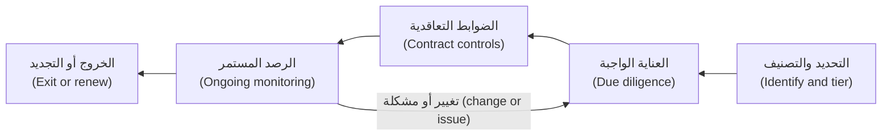

# الوحدة (Module) 3 — السياسات عبر دورة الحياة

*منحت الوحدة 2 بنك نجم (Najm Bank) مبادئ (principles)، وشهية مخاطر (risk appetite)، وأشخاصًا يملكون مخاطر الذكاء الاصطناعي (AI risk). أما هذه الوحدة فتمنح هؤلاء الأشخاص قواعد يتبعونها. يرسم الدرس (Lesson) 3.1 خريطة دورة حياة (life cycle) الذكاء الاصطناعي (AI) ومنظومة السياسات والإجراءات (policy stack) التي تحكم كل مرحلة (stage) منها، من سياسة الذكاء الاصطناعي (AI policy) العليا وصولًا إلى عملية الاستثناءات (exception process). ويتناول الدرس 3.2 مجالَي السياسات (policies) اللذين تتعثر فيهما المؤسسات أكثر من غيرهما: حوكمة البيانات للذكاء الاصطناعي (المصدر (provenance)، والجودة (quality)، والاحتفاظ (retention)، والاستخدام المشروع)، والملكية الفكرية (intellectual property) (الحقوق في بيانات التدريب (rights to training data)، وملكية المخرجات، والمعلومات السرية في الأوامر النصية). ويعالج الدرس 3.3 حقيقة أن معظم أنظمة الذكاء الاصطناعي (AI systems) في نجم لا تُبنى داخليًا: منتجات الموردين (vendor products)، وواجهات برمجة التطبيقات (APIs) للنماذج الأساسية (foundation models)، والنماذج مفتوحة المصدر (open-source models)، وما تحتاجه من العناية الواجبة (due diligence) والعقود (contracts) والرصد (monitoring). هذه الدورة تعليمية وليست استشارة قانونية (legal advice).*

> **التغطية ضمن مجال المعرفة (BoK coverage):** I.C — السياسات والإجراءات (policies and procedures) التي تحكم الذكاء الاصطناعي عبر دورة حياته، بما في ذلك حوكمة البيانات (data governance) والملكية الفكرية ومخاطر الطرف الثالث (third-party risk).

---

# 3.1 — دورة حياة الذكاء الاصطناعي (AI life cycle) ومنظومة السياسات
*المستوى: 🟡 متوسط (Intermediate)* · *المتطلبات (Prerequisites): 2.1، 2.2* · *مجال المعرفة (BoK): I.C*

## ⚡ الدرس في دقيقة (In 60 seconds)
- تمتد **دورة حياة الذكاء الاصطناعي (AI life cycle)** من التخطيط والتصميم (plan and design)، مرورًا ببناء البيانات والنموذج، والتحقق والمصادقة (verify and validate)، والنشر (deployment)، والتشغيل والرصد (operate and monitor)، وصولًا إلى الإيقاف والتقاعد (retirement). وتنطبق الحوكمة (governance) على كل مرحلة، لا عند الإطلاق (launch) فقط.
- المراجع القياسية لدورة الحياة: مراحل دورة الحياة (life-cycle stages) لدى **OECD** و**NIST AI RMF**، و**ISO/IEC 22989** (المفاهيم والمراحل)، و**ISO/IEC 5338** (عمليات دورة الحياة).
- تتكوّن **منظومة السياسات (policy stack)** من طبقات: سياسة الذكاء الاصطناعي (المبادئ والنطاق والأدوار)، وسياسة الاستخدام المقبول / الذكاء الاصطناعي التوليدي (acceptable-use / GenAI policy) (ما يجوز للموظفين فعله)، وإجراء سجل الأنظمة وتصنيف المخاطر، ومعايير إدارة مخاطر النماذج، وعملية الاستثناءات.
- السياسات تقول *ماذا* و*لماذا*؛ والمعايير (standards) تحدد *الحد الأدنى من المتطلبات (minimum requirements)*؛ والإجراءات (procedures) تقول *كيف*؛ والإرشادات (guidelines) تقدّم النصح. حافظ على تمايز هذه الطبقات.
- إشارة الامتحان (Exam cue): سجل أنظمة الذكاء الاصطناعي (AI inventory) هو الأساس. إذا سأل سيناريو عمّا تحتاجه المؤسسة قبل أن تتمكن من حوكمة ذكائها الاصطناعي، فالإجابة (Answer) غالبًا هي السجل (والتصنيف).
- الفخ الأكبر (Biggest trap): نهج "بوابة الإطلاق فقط". فالمخاطر التي تنشأ في مرحلتي التصميم أو البيانات، والانجراف (drift) بعد النشر، تفلت من بوابة واحدة (single gate).

## 🧭 لماذا يهم
بُنيت الضوابط القائمة (existing controls) في بنك نجم للبرمجيات التقليدية (traditional software): مجلس استشاري للتغيير يوافق على الإصدارات (releases)، وفريق مخاطر النماذج (model risk team) يصادق على النماذج الإحصائية (statistical models) المستخدمة في حسابات رأس المال (capital calculations). وحين تطابق ليلى مساعد الائتمان (credit copilot)، وهو أداة ذكاء اصطناعي توليدي (GenAI tool) تصوغ مذكرات الائتمان لمديري العلاقات (relationship managers)، مع تلك الضوابط (controls)، تظهر الثغرات (gaps) جلية. لم يراجع أحد قرار السماح له بقراءة القوائم المالية للعملاء (وهو خيار تصميمي). ولم يتحقق أحد من ترخيص مستندات الاسترجاع التي يفهرسها (وهو خيار يتعلق بالبيانات). وكان "إصداره" تعديلًا على الأمر النصي (prompt) دُفع بعد ظهر يوم ثلاثاء، ولم يمرّ قط على المجلس الاستشاري للتغيير. ولا أحد يراقب ما إذا كانت ملخّصاته تسوء كلما حدّث مزوّد النموذج الأساسي نموذجه (وهي ثغرة في الرصد).

تقع كل ثغرة من هذه الثغرات عند نقطة مختلفة من دورة الحياة، وتحتاج كل منها إلى قاعدة مختلفة. ولهذا تُكثر أطر حوكمة الذكاء الاصطناعي من الحديث عن دورة الحياة، ولهذا لا تكفي وثيقة واحدة بعنوان "سياسة الذكاء الاصطناعي" وحدها أبدًا.

## 📐 كيف يعمل

### 🟢 الأساسيات

**دورة حياة الذكاء الاصطناعي (AI life cycle).** ترسم الأطر (frameworks) المختلفة المراحل (stages) بصورة مختلفة قليلًا، لكنها تصف الرحلة نفسها. وهذه خلاصة عملية (practical synthesis):

| المرحلة | ما يحدث | أسئلة الحوكمة المعتادة |
|---|---|---|
| 1. التخطيط والتصميم | تحديد المشكلة، والغرض المقصود (intended purpose)، والمستخدمين (users) والأشخاص المتأثرين (affected people)؛ وتقرير ما إذا كان الذكاء الاصطناعي هو الأداة المناسبة | هل حالة الاستخدام (use case) هذه مسموح (Allowed) بها؟ ما فئة المخاطر (risk tier)؟ من يملكها؟ |
| 2. جمع البيانات ومعالجتها | الحصول على البيانات ووسمها وتنظيفها وتوثيقها | هل لدينا حقوق استخدامها؟ هل هي ممثِّلة (representative) وذات جودة جيدة؟ هل تتضمن بيانات شخصية (personal data)؟ |
| 3. البناء والتدريب | اختيار النموذج أو تدريبه؛ وفي الذكاء الاصطناعي التوليدي (GenAI)، اختيار نموذج أساسي (foundation model) وأوامر نصية (prompts) ومصادر استرجاع (retrieval sources) | نبني أم نشتري (Build or buy)؟ هل خيارات التصميم موثّقة؟ |
| 4. التحقق والمصادقة | اختبار الأداء والمتانة (robustness) والعدالة (fairness) والأمن (security)؛ ومصادقة مستقلة للفئة العليا | هل يستوفي معايير القبول (acceptance criteria) التي حُددت في التصميم (design)؟ |
| 5. النشر | الدمج (integration) في العمليات التجارية (business processes)، وتدريب المستخدمين (User training)، والإطلاق | هل اكتملت الموافقات (Approvals)؟ هل توجد شفافية تجاه المستخدمين؟ هل الإشراف مزوّد بالموظفين (Oversight staffed)؟ |
| 6. التشغيل والرصد | تتبّع الأداء والانجراف والحوادث (incidents) والشكاوى (complaints) والتغييرات من الموردين | هل ما زال ضمن حدود التحمّل (within tolerance)؟ من يستجيب للتنبيهات (alerts)؟ |
| 7. الإيقاف والتقاعد | الإيقاف (decommission)، وأرشفة الوثائق (archive documentation)، والتعامل مع البيانات (data)، وإبلاغ المستخدمين (tell users) | ماذا يحدث للبيانات وللقرارات التي اتُّخذت بالفعل؟ |

يستخدم **NIST AI RMF** تسلسلًا مشابهًا (التخطيط والتصميم؛ جمع البيانات ومعالجتها؛ بناء النموذج واستخدامه؛ التحقق والمصادقة؛ النشر والاستخدام؛ التشغيل والرصد) ويضيف الأشخاص "الذين يستخدمون النظام أو يتأثرون به". وتصف **OECD** مراحل مماثلة وتؤكد أنها تكرارية لا خطية. ويعرّف **ISO/IEC 22989** مفاهيم الذكاء الاصطناعي (AI concepts) ويصف مراحل دورة الحياة من النشأة (inception) حتى الإيقاف والتقاعد، ويحدد **ISO/IEC 5338** عمليات دورة حياة أنظمة الذكاء الاصطناعي (AI system life-cycle processes)، مبنيةً على المعايير الراسخة لعمليات هندسة الأنظمة والبرمجيات. ويتوقع امتحان AIGP منك أن تتعرّف على هذه المراحل وأن تضع أنشطة الحوكمة (governance activities) في موضعها منها.

للحلقة العائدة من الرصد إلى التصميم أهميتها: فأنظمة الذكاء الاصطناعي تتغيّر بعد الإطلاق، عبر إعادة التدريب (retraining)، أو تحديثات نماذج الموردين، أو التحولات في البيانات التي تتعامل معها.

**منظومة السياسات (policy stack).** تأتي وثائق الحوكمة (Governance documents) في طبقات. واستخدام المصطلحات بدقة يجنّب الالتباس لاحقًا:

- **السياسة (Policy):** بيان قصير (short statement) يعتمده مجلس الإدارة (board) أو الإدارة التنفيذية (management)، يحدد النية والنطاق والمبادئ والأدوار. ونادرًا ما يتغيّر.
- **المعيار (Standard):** متطلبات دنيا إلزامية، تقنية في الغالب (مثلًا: "يجب أن يكون للنماذج (models) عالية الفئة (high-tier) اختبار عدالة موثّق باستخدام مقاييس معتمدة (approved metrics)").
- **الإجراء (Procedure):** تعليمات خطوة بخطوة (step-by-step instructions) لعملية ما (كيفية تسجيل حالة استخدام، وكيفية طلب استثناء).
- **الإرشاد (Guideline):** ممارسة موصى بها (recommended practice)، غير إلزامية (دليل لكتابة الأوامر النصية).

تبدو منظومة سياسات الذكاء الاصطناعي في بنك نجم على هذا النحو:

| الوثيقة (Document) | النوع | ما تغطيه | المالك (owner) |
|---|---|---|---|
| سياسة الذكاء الاصطناعي | سياسة | المبادئ، والنطاق، وتعريف "نظام الذكاء الاصطناعي"، والأدوار (roles)، والنهج القائم على المخاطر (risk-based approach)، والروابط مع السياسات الأخرى | رئيس حوكمة الذكاء الاصطناعي (Head of AI Governance)، باعتماد لجنة المخاطر في مجلس الإدارة (board risk committee) |
| سياسة الاستخدام المقبول للذكاء الاصطناعي / الذكاء الاصطناعي التوليدي | سياسة | ما يجوز وما لا يجوز لجميع الموظفين فعله بأدوات الذكاء الاصطناعي (AI tools)؛ والأدوات المعتمدة (approved tools)؛ وقواعد البيانات (data rules) | رئيس حوكمة الذكاء الاصطناعي مع رئيس أمن المعلومات (CISO) |
| إجراء سجل أنظمة الذكاء الاصطناعي وتصنيف المخاطر | إجراء | كيفية تسجيل حالات الاستخدام (use cases) وتصنيفها في فئات (tiered) وإعادة تصنيفها (re-tiered) | رئيس حوكمة الذكاء الاصطناعي |
| معيار دورة حياة الذكاء الاصطناعي (AI Life-cycle Standard) | معيار | الحد الأدنى من الضوابط (Minimum controls) لكل فئة (per tier) في كل مرحلة من دورة الحياة | رئيس حوكمة الذكاء الاصطناعي |
| معيار إدارة مخاطر النماذج (الموسَّع ليشمل الذكاء الاصطناعي) | معيار | المصادقة (validation)، ورصد الأداء (performance monitoring)، وتغيير النماذج (model change) | رئيس مخاطر النماذج |
| إجراء استثناءات الذكاء الاصطناعي | إجراء | كيفية طلب الاستثناءات (exceptions) والموافقة (approval) عليها وتسجيلها وإنهاء صلاحيتها | رئيس حوكمة الذكاء الاصطناعي |
| مرتبطة (Linked): حوكمة البيانات، والخصوصية (privacy)، وأمن المعلومات (information security)، ومخاطر الطرف الثالث، والاحتفاظ بالسجلات (keeping records) | سياسات قائمة (Existing policies) | محدَّثة ببنود خاصة بالذكاء الاصطناعي (انظر 3.2 و3.3) | مالكوها الحاليون |

### 🟡 التعمق أكثر (Going deeper)

**ما الذي تتضمنه سياسة الذكاء الاصطناعي (AI policy).** تكون سياسة الذكاء الاصطناعي القوية قصيرة عادةً (بضع صفحات) وتتضمن:

1. **الغرض والنطاق (Purpose and scope):** الكيانات (entities) والمناطق الجغرافية (geographies) والأنظمة التي تشملها، بما في ذلك الذكاء الاصطناعي المشترى والمدمج، لا النماذج المبنية داخليًا فقط.
2. **تعريف نظام الذكاء الاصطناعي (Definition of AI system):** تتوافق مؤسسات كثيرة مع تعريف OECD (المحدَّث في نوفمبر 2023)، وهو أيضًا أساس التعريف الوارد في قانون الذكاء الاصطناعي الأوروبي (EU AI Act). والتعريف الواضح (clear definition) يمنع حجج "إنها مجرد تحليلات (analytics)".
3. **المبادئ (principles):** المبادئ المعتمدة من الدرس 2.1.
4. **النهج القائم على المخاطر (risk-based approach):** تُسجَّل كل حالة استخدام للذكاء الاصطناعي وتُصنَّف في فئة؛ وتتدرج الضوابط (controls scale) بحسب الفئة؛ وبعض الاستخدامات (uses) محظورة تمامًا (مثلًا: كل ما تحظره المادة 5 (Art. 5) من EU AI Act، إضافة إلى الخطوط الحمراء (red lines) الخاصة بالبنك).
5. **الأدوار والمساءلة (accountability):** مالك العمل (business owner)، وقائد الحوكمة (governance lead)، واللجنة (committee)، والخطوط الثلاثة (three lines).
6. **العمليات الإلزامية (Mandatory processes):** الاستقبال (intake)، وتقييمات الأثر (impact assessments)، والمصادقة، والموافقة، والرصد، والإبلاغ عن الحوادث (incident reporting)، والإيقاف والتقاعد.
7. **السياسات ذات الصلة (Related policies)** وكيفية حل التعارض بينها.
8. **الاستثناءات والمخالفات وعواقبها (Exceptions, breaches and consequences).**
9. **دورة المراجعة (Review cycle):** سنويًا على الأقل، وعند أي تغيير قانوني أو تقني كبير.

**سياسة الاستخدام المقبول / الذكاء الاصطناعي التوليدي (acceptable-use / GenAI policy).** هذه هي السياسة التي سيقرؤها معظم الموظفين فعلًا. ويجب أن تكون ملموسة: ما الأدوات المعتمدة (مثلًا: بيئة الذكاء الاصطناعي التوليدي المؤسسية الخاصة بالبنك، حيث يحظر عقد المورد (vendor contract) التدريب (training) على مدخلات نجم)؛ وما الأدوات المحظورة (الحسابات الاستهلاكية (consumer accounts) للأدوات العامة (public tools) لأي بيانات مصرفية)؛ وما فئات البيانات (data categories) التي يجوز إدخالها وأين؛ وواجب التحقق من المخرجات قبل الاعتماد عليها؛ وقواعد الإفصاح (متى يُبلَّغ العميل بأن الذكاء الاصطناعي استُخدم)؛ وكيفية طلب أداة جديدة. أما الحظر المطلق (Absolute bans) للذكاء الاصطناعي التوليدي فيميل إلى الفشل ويدفع الاستخدام إلى الظل (shadows)؛ والقنوات المعتمدة (approved channels) الواضحة مع قواعد البيانات تنجح أكثر.

**إجراء السجل والتصنيف (inventory and classification procedure).** لا يمكنك حوكمة ما لا تراه. السجل (inventory) قائمة بكل نظام ذكاء اصطناعي (AI system) قيد الاستخدام أو التطوير، يتضمن في حده الأدنى: معرّفًا فريدًا (unique ID)، والاسم والوصف، والغرض المقصود، ومالك العمل، ومرحلة دورة الحياة (life-cycle stage)، وما إذا كان مبنيًا (built) أو مشترى (bought) أو مدمجًا (embedded)، وتفاصيل المورد والنموذج، وفئات البيانات المستخدمة (بما في ذلك البيانات الشخصية وبيانات الفئات الخاصة)، والأشخاص المتأثرين، والولايات القضائية (jurisdictions)، وفئة المخاطر وسببها، وتصنيف EU AI Act (EU AI Act classification) ودور المؤسسة (مقدّم النظام (provider) أو المُشغِّل)، والتقييمات المنجزة (assessments completed)، وحالة الموافقة (approval status)، وتاريخ المراجعة التالية. ويوضح الإجراء من يجب عليه التسجيل (كل من يبدأ حالة استخدام للذكاء الاصطناعي، وقسم المشتريات (procurement) لأي عملية شراء (purchase) تتضمن ذكاءً اصطناعيًا)، وكيف يجري التصنيف (استبيان (questionnaire) يقيّمه فريق الحوكمة)، ومتى تُستدعى إعادة التصنيف (تغيّر الغرض أو البيانات أو المستخدمين أو الولاية القضائية (jurisdiction) أو النموذج).

إن العثور على الذكاء الاصطناعي القائم (existing AI) مشروع بحد ذاته: استطلع وحدات العمل (business units)، وافحص سجلات المشتريات (procurement records) ومطالبات النفقات (expense claims) بحثًا عن اشتراكات (subscriptions) في أدوات ذكاء اصطناعي، واسأل الموردين (vendors) عمّا إذا كانت منتجاتهم تتضمن ميزات ذكاء اصطناعي (AI features)، وتحقق من سجلات الشبكة (network logs) بحثًا عن حركة مرور (traffic) إلى خدمات الذكاء الاصطناعي العامة.

**إدارة مخاطر النماذج (model risk management).** لدى البنوك أصلًا تخصصات لإدارة مخاطر النماذج، والجهات الرقابية (regulators) تتوقع أن تشمل نماذج الذكاء الاصطناعي (AI models). ففي الولايات المتحدة، تضع الإرشادات الرقابية (supervisory guidance) SR 11-7 (2011) توقعات بتطوير متين للنماذج، ومصادقة مستقلة ("التحدي الفعّال")، وحوكمة تشمل سجلًا للنماذج (model inventory). وفي المملكة المتحدة، يضع البيان الرقابي (supervisory statement) SS1/23 الصادر عن هيئة التنظيم الاحترازي مبادئ إدارة مخاطر النماذج (model risk management principles) للبنوك ويأخذ في الحسبان صراحةً نماذج الذكاء الاصطناعي وتعلّم الآلة (machine learning). ويحمل إرشاد QCB للذكاء الاصطناعي (QCB's AI guideline) في المؤسسات المالية توقعات مماثلة للبنوك القطرية؛ تحقق من النص الحالي (current text). والخطوة الصحيحة في الحوكمة (governance move) هي توسيع إدارة مخاطر النماذج لتشمل الذكاء الاصطناعي بدلًا من تكرارها: وسّع تعريف "النموذج" ليغطي أنظمة الذكاء الاصطناعي بما فيها الذكاء الاصطناعي التوليدي، وأضف مصادقة خاصة بالذكاء الاصطناعي (العدالة، والمتانة، وقابلية التفسير (explainability)، وتقييم الذكاء الاصطناعي التوليدي)، وأضف محفّزات (triggers) لتغييرات نماذج الموردين. وفي أبريل 2026 حلّت محلّها إرشادات **SR 26-2** التي أصدرها الاحتياطي الفيدرالي (Federal Reserve) وOCC وFDIC. وهي أكثر اعتمادًا على المبادئ (principles-based)، وتربط شدة التحقق بأهمية النموذج (materiality) بدلًا من دورات ثابتة (fixed cycles)، وتضيّق تعريف النموذج، وتُخضع نماذج المورّدين (vendor models) للمعيار نفسه؛ راجع نصّها الحالي لمعرفة كيف تتعامل مع الذكاء الاصطناعي التوليدي والوكيلي (agentic).

**عملية الاستثناءات (exception process).** لن تناسب القواعد كل حالة أحيانًا. وعملية الاستثناءات الجيدة تجعل الانحرافات (deviations) مرئية ومحددة زمنيًا (time-bound) ولها مالك، بدلًا من أن تكون صامتة:

- يذكر مقدّم الطلب (requester) القاعدة (rule)، والسبب (reason)، والمخاطر، والضوابط التعويضية (compensating controls)، وتاريخ الانتهاء المقترح.
- تتدرج صلاحية الموافقة (approval authority) بحسب المخاطر (قائد الحوكمة للمخاطر المنخفضة؛ واللجنة للفئة العليا (high tier)؛ ولا موافقة إطلاقًا على المتطلبات المفروضة قانونًا، إذ لا يمكن استثناؤها داخليًا).
- يُدرَج كل استثناء (exception) في سجل الاستثناءات (exception register)، ويُبلَّغ به إلى اللجنة، وتنتهي صلاحيته. ويتطلب التجديد (renewal) قرارًا جديدًا (fresh decision).
- تكرار الاستثناءات من القاعدة نفسها إشارة إلى أن القاعدة تحتاج إلى تغيير.

### 🔴 نظرة الخبير (Expert view)

**اربط الضوابط بالمراحل والفئات (Map controls to stages and tiers).** أكثر أداة منفردة فائدةً في برنامج ناضج (mature programme) هي مصفوفة ضوابط دورة الحياة: صفوفها مراحل دورة الحياة، وأعمدتها فئات المخاطر (risk tiers)، وتسرد كل خلية الضوابط الإلزامية (mandatory controls) والأدلة (evidence). إنها تحوّل السياسة إلى شيء يستطيع المهندسون (engineers) اتباعه ويستطيع المدققون (auditors) اختباره. والملحق A (Annex A) من **ISO/IEC 42001** منظّم بطريقة مشابهة، بمجموعات ضوابط (control groups) تغطي سياسات الذكاء الاصطناعي (AI policies)، والتنظيم الداخلي (internal organisation)، والموارد (resources)، وتقييم الأثر (impact assessment)، ودورة حياة نظام الذكاء الاصطناعي، والبيانات لأنظمة الذكاء الاصطناعي، والمعلومات للأطراف المعنية (information for interested parties)، واستخدام أنظمة الذكاء الاصطناعي، والعلاقات مع الأطراف الثالثة والعملاء (third-party and customer relationships). وتستخدمه مؤسسات كثيرة قائمةَ تحقق (checklist) لمنظومة سياساتها.

**المتطلبات التنظيمية تعيش داخل المنظومة (Regulatory requirements live inside the stack).** بالنسبة لمقدّمي الأنظمة (providers) عالية المخاطر (high-risk)، يشترط EU AI Act نظامًا لإدارة المخاطر (risk management system) يعمل طوال دورة الحياة كاملة (المادة 9 (Art. 9)) ونظامًا لإدارة الجودة (quality management system) بسياسات وإجراءات وتعليمات مكتوبة (المادة 17 (Art. 17)). وللمُشغِّلين (deployers) واجباتهم الخاصة (المادة 26 (Art. 26))، بما في ذلك استخدام الأنظمة وفقًا لتعليمات الاستخدام (instructions for use)، ورصد تشغيلها، والاحتفاظ بالسجلات المولَّدة آليًا (automatically generated logs) الخاضعة لسيطرتهم لمدة مناسبة لا تقل عن ستة أشهر ما لم ينص قانون آخر على غير ذلك. ومنظومة السياسات هي المكان الذي تُسند فيه هذه الالتزامات ويُوثَّق الوفاء بها.

**الذكاء الاصطناعي التوليدي يطمس حدود دورة الحياة (GenAI blurs the life cycle).** مع نموذج أساسي مشترى، يصبح "البناء (build)" اختيارَ نموذج (model)، وكتابة أوامر نصية، وتهيئة الاسترجاع (configuring retrieval)، وإضافة حواجز الحماية (guardrails). وقد يكون "الإصدار (release)" تغييرًا في الإعدادات (configuration) دون أي نشر للشيفرة (code deployment). ويجب أن يعامل إجراء إدارة التغيير لديك تغييرات الأوامر النصية ومصادر الاسترجاع وإصدارات النماذج (model versions) على أنها تغييرات، مصنّفة بحسب أثرها. فتغيير الأمر النصي لمساعد الائتمان بما يغيّر طريقة تلخيصه لعوامل المخاطر تغيير جوهري (material)؛ أما تصحيح خطأ إملائي فليس كذلك.

**التناسب يبقي المنظومة حيّة (Proportionality keeps the stack alive).** إذا استغرق تسجيل أداة داخلية (Internal) منخفضة المخاطر (low-risk) ستة أسابيع، يتوقف الناس عن التسجيل (registration). والمسار السريع (fast track) لحالات الاستخدام منخفضة الفئة (نموذج قصير (short form)، وقرار خلال أيام) هو ما يجعل السجل مكتملًا، والاكتمال (completeness) أثمن من الصرامة (rigour) في الأنظمة التافهة.

## ⚖️ الأدوات التنظيمية
| الأداة | ما تشترطه أو توصي به | إشارة الامتحان |
|---|---|---|
| **ISO/IEC 5338** | عمليات دورة حياة أنظمة الذكاء الاصطناعي، مبنية على المعايير القائمة لدورة حياة الأنظمة والبرمجيات | معيار العمليات (process standard) لدورة حياة الذكاء الاصطناعي |
| **ISO/IEC 22989** | مفاهيم الذكاء الاصطناعي ومصطلحاته (terminology) ووصف لمراحل دورة الحياة | مفردات مشتركة (Shared vocabulary)؛ المراحل تمتد من النشأة إلى الإيقاف والتقاعد |
| **NIST AI RMF** | مراحل دورة الحياة والجهات الفاعلة في الذكاء الاصطناعي (AI actors)؛ وتدعو وظيفة Govern إلى سياسات وعمليات وسجل لأنظمة الذكاء الاصطناعي | السجل والسياسات يقعان ضمن Govern |
| **OECD AI Principles** | تعريف نظام الذكاء الاصطناعي (المحدَّث في نوفمبر 2023) ووصف تكراري لدورة الحياة | تعريف EU AI Act مبني على تعريف OECD (OECD definition) |
| **ISO/IEC 42001** — البند 5.2 (Clause 5.2) والملحق A | سياسة ذكاء اصطناعي تعتمدها الإدارة العليا (top management)؛ وضوابط الملحق A (Annex A controls) للسياسات ودورة الحياة والبيانات والأطراف الثالثة (third parties) وغيرها | الملحق A قائمة تحقق عملية (practical checklist) لمنظومة السياسات |
| **EU AI Act** — المواد 9 و17 و26 | إدارة المخاطر عبر دورة الحياة وإدارة الجودة (quality management) لمقدّمي الأنظمة عالية المخاطر؛ وواجبات المُشغِّل (deployer duties) بما فيها الرصد والاحتفاظ بالسجلات لستة أشهر على الأقل | الالتزامات تختلف بين مقدّمي الأنظمة والمُشغِّلين |
| **SR 11-7** | (حلّت محلّها **SR 26-2** في أبريل 2026.) إرشادات رقابية أمريكية بشأن إدارة مخاطر النماذج: تطوير سليم، ومصادقة مستقلة (independent validation)، وحوكمة، وسجل | "التحدي الفعّال (effective challenge)" والمصادقة المستقلة ينطبقان على نماذج الذكاء الاصطناعي في البنوك |

## 🏛️ عمليًا في بنك نجم
**مصفوفة ضوابط دورة حياة الذكاء الاصطناعي (مقتطف)** التي أعدّتها ليلى، وهي جزء من معيار دورة حياة الذكاء الاصطناعي:

| المرحلة | فئة منخفضة (مثل ملخّص محاضر الاجتماعات) | فئة متوسطة (مثل فرز تنبيهات الاحتيال) | فئة عليا (مثل التقييم الائتماني (credit scoring)، وفرز السير الذاتية (CV screening)، ومساعد الائتمان) |
|---|---|---|---|
| التخطيط والتصميم | التسجيل في السجل؛ وتسمية المالك (owner named) | + غرض مقصود وحالات إساءة استخدام (misuse cases) موثّقة؛ وفحص أولي للخصوصية (privacy screen) | + موافقة اللجنة على المضي؛ وتقييم الأثر على حماية البيانات (DPIA)؛ وتقييم الأثر على الحقوق الأساسية (FRIA) حيث يلزم؛ وتسجيل تصنيف EU AI Act |
| البيانات | مصادر بيانات معتمدة فقط | + سجل مصدر البيانات؛ وفحوص الجودة (quality checks) | + تحليل التمثيل والتحيّز؛ وتأكيد قسم الشؤون القانونية (Legal) لحقوق الاستخدام (rights-to-use) |
| البناء | أدوات ومنصات معتمدة | + توثيق النموذج (بطاقة النموذج) | + الاتفاق على نهج قابلية التفسير (Explainability approach)؛ ونموذج التهديدات الأمنية |
| التحقق والمصادقة | اختبار ذاتي (self-test) من المالك | + مراجعة الأقران (Peer review) للاختبارات | + مصادقة مستقلة من فريق مخاطر النماذج؛ واختبار الفريق الأحمر (red-teaming) للذكاء الاصطناعي التوليدي |
| النشر | نشر إرشادات المستخدم (User guidance) | + تدريب المستخدمين | + موافقة اللجنة على الإطلاق؛ وتدريب المشرفين (overseer training) قبل منح الوصول؛ وإشعار الشفافية (transparency notice) للعملاء |
| التشغيل والرصد | إقرار سنوي (Annual attestation) من المالك | + مراجعة ربع سنوية للأداء | + رصد شهري (Monthly monitoring) مقابل حدود التحمّل (tolerances)؛ ودليل التعامل مع الحوادث (incident playbook)؛ ومحفّزات تغييرات الموردين (vendor-change triggers) |
| الإيقاف والتقاعد | الحذف من السجل | + أرشفة الوثائق | + اعتماد خطة الإيقاف (Retirement plan)؛ وتطبيق الاحتفاظ بالبيانات (data retention)؛ وإبلاغ المستخدمين المتأثرين (affected users) |

**قيد في سجل الاستثناءات (مثال):**

| المعرّف (ID) | القاعدة | مقدّم الطلب | السبب | الضوابط التعويضية | الجهة الموافقة (Approved by) | تاريخ الانتهاء (expiry date) |
|---|---|---|---|---|---|---|
| EX-004 | مصادقة مستقلة للفئة العليا قبل الإطلاق | خالد | موعد تنظيمي نهائي (Regulatory deadline) لمنتج المنشآت الصغيرة والمتوسطة (SME) | تجربة محدودة (Limited pilot) على 200 طلب؛ ومراجعة بشرية بنسبة 100% (100% human review)؛ واكتمال المصادقة خلال 60 يومًا | لجنة حوكمة الذكاء الاصطناعي (AI Governance Committee) | 60 يومًا من تاريخ الموافقة |

## 🛠️ التمارين (Exercises)

### 🟢 مبتدئ (Beginner)
ضع كل نشاط من أنشطة نجم (Najm activities) التالية في مرحلة من مراحل دورة الحياة: اختيار مستندات الاسترجاع (retrieval documents) لمساعد الائتمان؛ فحص معدلات تنبيهات نموذج الاحتيال (fraud-model) كل شهر؛ تقرير ما إذا كانت الأسئلة الشائعة (FAQs) لروبوت المحادثة (chatbot) تحتاج إلى ذكاء اصطناعي؛ حذف بيانات تدريب (training data) نموذج التقييم القديم.
*يكتمل عندما (Done when):* يُطابَق كل نشاط مع مرحلة مع جملة واحدة من التعليل.

### 🟡 متوسط
اكتب قيد السجل (inventory record) لأداة فرز السير الذاتية (CV-screening tool)، مستخدمًا الحقول (fields) المذكورة في 🟡 التعمق أكثر.
*يكتمل عندما:* يُملأ كل حقل، ويكون لفئة المخاطر سبب، ويُذكر تصنيف EU AI Act ودور (role) نجم (مقدّم النظام أو المُشغِّل).

### 🔴 متقدم (Advanced)
صُغ إجراء استثناءات الذكاء الاصطناعي في نجم في أقل من 400 كلمة: من يحق له الطلب، وما يجب أن يقدّمه، وصلاحية الموافقة بحسب الفئة، وما لا يمكن استثناؤه، والتسجيل، وانتهاء الصلاحية (expiry)، والإبلاغ.
*يكتمل عندما:* يمنع الإجراء الاستثناءات الصامتة الدائمة، وينص على أن المتطلبات المفروضة قانونًا لا يمكن التنازل عنها داخليًا.

## ⚠️ أخطاء وفخاخ الامتحان (Mistakes and exam traps)
- **حوكمة بوابة الإطلاق فقط (Launch-gate-only governance).** الإجابات التي تضع جميع الضوابط عند النشر تغفل مخاطر التصميم والبيانات والرصد. فضّل الإجابات القائمة على دورة الحياة (life-cycle answers).
- **السجل كفكرة لاحقة (Inventory as an afterthought).** المؤسسة التي لم تحصر ذكاءها الاصطناعي في سجل لا تستطيع تصنيفه أو تقييمه أو رصده. والسجل عادةً هو "الخطوة التشغيلية الأولى" الصحيحة.
- **النماذج الداخلية وحدها هي المعتبرة (Only in-house models count).** أدوات الذكاء الاصطناعي التوليدي (GenAI tools) المشتراة والمدمجة والتي يستخدمها الموظفون تنتمي إلى السجل وتخضع لسياسة الاستخدام المقبول (acceptable-use policy).
- **الحظر الشامل للذكاء الاصطناعي التوليدي (Blanket GenAI bans).** نادرًا ما يكون الإجابة الأفضل؛ فالأدوات المعتمدة مع قواعد البيانات والتدريب تنجح أكثر وتقلل الذكاء الاصطناعي الخفي (shadow AI).
- **استثناءات بلا تاريخ انتهاء (Exceptions without expiry).** الاستثناء الذي ليس له تاريخ انتهاء هو تغيير في السياسة لم يوافق عليه أحد.
- **الخلط بين السياسة والإجراء (Policy vs procedure confusion).** السياسات تحدد النية (intent) والأدوار؛ والإجراءات تقدّم الخطوات. وقد تختبر أسئلة الامتحان في أي وثيقة ينتمي أمر ما.

## 🧾 الخلاصة (Recap)
- تمتد دورة حياة الذكاء الاصطناعي من التخطيط والتصميم، مرورًا بالبيانات والبناء والمصادقة والنشر والرصد، وصولًا إلى الإيقاف والتقاعد، وتعود حلقتها إلى البداية عند التغيير.
- تصف OECD وNIST AI RMF وISO/IEC 22989 وISO/IEC 5338 دورة الحياة؛ فاعرف المراحل.
- منظومة السياسات: سياسة الذكاء الاصطناعي، وسياسة الاستخدام المقبول / الذكاء الاصطناعي التوليدي، وإجراء السجل والتصنيف، ومعيار دورة الحياة (life-cycle standard)، وإدارة مخاطر النماذج، وإجراء الاستثناءات (exception procedure)، إضافة إلى بنود الذكاء الاصطناعي في السياسات القائمة.
- السجل هو الأساس؛ ومصفوفة ضوابط دورة الحياة تجعل الضوابط متناسبة (proportionate) وقابلة للاختبار.
- يجب أن تكون الاستثناءات مرئية، ولها مالك، ومعوَّضة بضوابط، ومحددة زمنيًا.

## ✍️ اختبر نفسك (Check yourself)

**1. يريد بنك نجم أن يبدأ حوكمة الذكاء الاصطناعي (AI governance) لكنه لا يعرف عدد أنظمة الذكاء الاصطناعي (AI systems) التي يستخدمها. ماذا ينبغي أن يفعل أولًا؟**

- A. شراء منصة لرصد الذكاء الاصطناعي تفحص الشبكة (network) بحثًا عن حركة النماذج وتبلغ عن الاستخدام بحسب الفريق (team)
- B. بناء سجل لأنظمة الذكاء الاصطناعي (AI inventory)، يشمل الذكاء الاصطناعي (AI) المشترى والمدمج، وتصنيف كل نظام بحسب المخاطر
- C. التكليف بتمرين اختبار الفريق الأحمر (red-team exercise) على روبوت المحادثة (chatbot) للعملاء لاكتشاف ثغرات حقن الطلبات (prompt injection) وتسرب البيانات (data leak)
- D. كتابة معايير تقنية تفصيلية لمصادقة النماذج (model validation) وحدود الاختبار (testing thresholds) وقوالب التوثيق (documentation templates)

الإجابة

**B.** لا يمكنك حوكمة ما لا تراه؛ فالسجل والتصنيف يمكّنان كل ما عداهما. أما الخيارات الأخرى فمفيدة لاحقًا، لكنها تفترض أنك تعرف ما لديك. (انظر 🟡 التعمق أكثر (Going deeper)، السجل (inventory).)

**2. أي وثيقة تتضمن عادةً تعليمات خطوة بخطوة (step-by-step instructions) لتسجيل (registration) حالة استخدام (use case) جديدة للذكاء الاصطناعي (AI)؟**

- A. إجراء (procedure)
- B. سياسة الذكاء الاصطناعي (AI policy)
- C. إرشاد (guideline)
- D. بيان شهية المخاطر

الإجابة

**A.** تصف الإجراءات (procedures) كيفية تنفيذ عملية ما؛ والسياسات (policies) تحدد النية (intent) والنطاق والأدوار (roles)؛ والإرشادات (guidelines) استشارية. (انظر 🟢 الأساسيات، منظومة السياسات (policy stack).)

**3. تصرّف مساعد التسوق (shopping assistant) القائم على الذكاء الاصطناعي التوليدي (GenAI) لدى متجر تجزئة (retailer) تصرفًا جيدًا عند الإطلاق (launch)، لكن إجاباته تراجعت بعد أن حدّث مورد النموذج الأساسي (foundation-model vendor) نموذجه. أي ضابط (control) من ضوابط دورة الحياة (life-cycle controls) كان غائبًا بأوضح صورة؟**

- A. دراسة جدوى (business case) في مرحلة التصميم (design stage)، يوقّعها الراعي (sponsor) قبل صرف أي ميزانية (budget)
- B. مراجعة ترخيص البيانات، تُنجز مرة واحدة قبل توقيع عقد المورّد (vendor's contract)
- C. رصد تشغيلي (Operational monitoring) مع محفّزات (triggers) لتغييرات نماذج الموردين
- D. سياسة ذكاء اصطناعي (AI policy) معتمدة من مجلس الإدارة، تنطبق على المورّد (vendor) تلقائيًا (automatically) عند نشرها (publication)

الإجابة

**C.** التراجع بعد تغيير من المورد (vendor) إخفاق في مرحلة التشغيل والرصد (operate-and-monitor). فدورة الحياة (life cycle) تعود في حلقة بعد النشر (deployment)، ويجب أن تفعل الحوكمة (governance) الشيء نفسه. (انظر 🔴 نظرة الخبير (Expert view).)

**4. ما الغرض الرئيسي من تاريخ انتهاء الصلاحية (expiry date) لاستثناء (exception) معتمد من السياسة (policy)؟**

- A. الامتثال (compliance) لمادة محددة في EU AI Act بشأن الاستثناءات (exceptions) تتيح انحرافات مؤقتة لمقدّمي الأنظمة (providers) عالية المخاطر (high-risk)
- B. السماح لمقدّم الطلب (requester) بتمديده تلقائيًا عندما يتأخر المشروع (project)، دون مراجعة إضافية (further review)
- C. تقليل عدد اجتماعات اللجنة (committee meetings) باعتماد كل استثناء (exception) لمدة السنة كلها
- D. ضمان أن تكون الانحرافات (deviations) مؤقتة وأن يُعاد البت فيها بدلًا من أن تصبح تغييرات صامتة ودائمة في السياسة (policy)

الإجابة

**D.** يفرض انتهاء الصلاحية (expiry) اتخاذ قرار جديد ويُبقي سجل الاستثناءات (exception register) ذا معنى. ولا توجد في قانون الذكاء الاصطناعي (AI Act) مادة بشأن الاستثناءات الداخلية (internal exceptions)، فالخيار A مختلَق. (انظر 🟡 التعمق أكثر (Going deeper)، الاستثناءات (exceptions).)

**5. أي معيار (standard) من معايير (standards) ISO/IEC يحدد عمليات دورة حياة أنظمة الذكاء الاصطناعي (AI system life-cycle processes)؟**

- A. ISO/IEC 42005
- B. ISO/IEC 5338
- C. ISO/IEC 38507
- D. ISO/IEC 5339

الإجابة

**B.** يغطي ISO/IEC 5338 عمليات دورة حياة أنظمة الذكاء الاصطناعي (AI system life-cycle processes). أما 42005 فيتعلق بتقييم الأثر (impact assessment)، و38507 بالحوكمة على مستوى مجلس الإدارة (board-level governance)، و42006 يغطي الجهات التي تمنح شهادة 42001. (انظر ⚖️ الأدوات التنظيمية.)

## 📚 المراجع (References)
- إطار NIST لإدارة مخاطر الذكاء الاصطناعي (NIST AI Risk Management Framework): https://www.nist.gov/itl/ai-risk-management-framework
- مبادئ OECD للذكاء الاصطناعي وتعريف نظام الذكاء الاصطناعي: https://oecd.ai/en/ai-principles
- اللجنة ISO/IEC JTC 1/SC 42 (ISO/IEC 5338 و22989 وعائلة معايير الذكاء الاصطناعي): https://www.iso.org/committee/6794475.html
- ISO/IEC 42001:2023: https://www.iso.org/standard/81230.html
- قانون الذكاء الاصطناعي الأوروبي، اللائحة (EU) 2024/1689: https://eur-lex.europa.eu/eli/reg/2024/1689/oj
- الاحتياطي الفيدرالي الأمريكي SR 11-7، إرشادات إدارة مخاطر النماذج: https://www.federalreserve.gov/boarddocs/srletters/2011/sr1107.htm
- الاحتياطي الفيدرالي وOCC وFDIC، SR 26-2 الإرشادات المنقّحة بشأن إدارة مخاطر النماذج، أبريل 2026: https://www.federalreserve.gov/supervisionreg/srletters/SR2602.htm
- هيئة التنظيم الاحترازي في بنك إنجلترا (مبادئ إدارة مخاطر النماذج SS1/23): https://www.bankofengland.co.uk/prudential-regulation
- مصرف قطر المركزي (Qatar Central Bank): https://www.qcb.gov.qa/

---

# 3.2 — سياسات حوكمة البيانات والملكية الفكرية للذكاء الاصطناعي
*المستوى: 🟡 متوسط* · *المتطلبات: 3.1* · *مجال المعرفة: I.C*

## ⚡ الدرس في دقيقة (In 60 seconds)
- ترث أنظمة الذكاء الاصطناعي نقاط قوة بياناتها وعيوبها. وتغطي حوكمة البيانات للذكاء الاصطناعي **مصدر البيانات (provenance)** (من أين جاءت البيانات)، و**تسلسل البيانات (lineage)** (كيف انتقلت وتغيّرت)، و**الجودة والتمثيل (quality and representativeness)**، و**الاحتفاظ (retention)**، و**الاستخدام المشروع (lawful use)** (الأساس القانوني (lawful basis)، والغرض، والحقوق).
- بالنسبة للأنظمة عالية المخاطر، تشترط **المادة 10 (Art. 10) من EU AI Act** ممارسات لحوكمة البيانات (data governance practices) تشمل بيانات التدريب والتحقق والاختبار (training, validation and testing data)، بما في ذلك فحصها بحثًا عن التحيّزات (biases) المحتملة. وتظل مبادئ **GDPR** (تحديد الغرض (purpose limitation)، وتقليل البيانات (minimisation)، وتحديد مدة التخزين) سارية على البيانات الشخصية المستخدمة في الذكاء الاصطناعي.
- يجب أن تغطي سياسات الملكية الفكرية (IP policies) ثلاثة أمور: **الحقوق في بيانات التدريب (rights to training data)** (التراخيص (licences)، وحق المؤلف (copyright)، وحدود التنقيب في النصوص والبيانات)، و**الحقوق في المخرجات (rights in outputs)** (من يملكها، وهل هي محمية أصلًا)، و**المعلومات السرية في الأوامر النصية (confidential information in prompts)** (الأسرار التجارية (trade secrets) وبيانات العملاء (customer data) التي تتسرب إلى الأدوات).
- إشارة الامتحان: عبارة "البيانات لدينا بالفعل" ليست أساسًا قانونيًا لغرض جديد. ابحث عن توافق الأغراض (purpose compatibility) وفحوص الحقوق (rights checks).
- الفخ الأكبر: افتراض أن البيانات المتاحة علنًا (publicly available) على الإنترنت حرة الاستخدام في التدريب، أو أن مخرجات الذكاء الاصطناعي (AI outputs) مملوكة للمؤسسة تلقائيًا.

## 🧭 لماذا يهم
يريد فريق دانة تحسين نموذج الائتمان (credit model) للمنشآت الصغيرة والمتوسطة بإضافة عشر سنوات من ملفات القروض التاريخية، وبيانات المعاملات (transaction data) من الحسابات الجارية (current accounts)، ومجموعة بيانات (dataset) عن القوائم المالية للشركات (company financials) اشتُريت من وسيط بيانات (data broker) قبل خمس سنوات. وفي الوقت نفسه، يبني فريق عمر مكتبة الاسترجاع (retrieval library) لمساعد الائتمان في بنك نجم، وقد رفع أحدهم تقارير بحثية (research reports) قطاعية من خدمة اشتراك (subscription service) مدفوعة. ويريد مديرو العلاقات لصق مسوّدات مذكرات الائتمان، التي تتضمن أسماء العملاء وبياناتهم المالية، في أداة ذكاء اصطناعي توليدي عامة (public GenAI tool) لتحسين صياغتها.

يثير كل من هذه الأمور سؤالًا يتعلق بالبيانات أو الملكية الفكرية لم يكتب البنك قاعدة له. هل جُمعت بيانات القروض التاريخية لغرض يتوافق مع تدريب النماذج (model training)؟ هل تعكس السنوات العشر قاعدة العملاء الحالية، أم فترةً كانت فيها فئات معينة (certain groups) محرومة من الخدمة (under-served)؟ هل يسمح ترخيص الوسيط (broker licence) باستخدامها في تعلّم الآلة؟ هل يسمح اشتراك الأبحاث (research subscription) بنسخ المحتوى إلى فهرس ذكاء اصطناعي (AI index)؟ وماذا يحدث لبيانات العملاء التي تُكتب في أداة ذكاء اصطناعي استهلاكية؟ والحالات الواقعية تُظهر حجم ما هو على المحك: فقد قيّدت هيئة حماية البيانات الإيطالية ChatGPT مؤقتًا في إيطاليا عام 2023، وغرّمت OpenAI مبلغ 15 مليون يورو في ديسمبر 2024، لأسباب منها الأساس القانوني لبيانات التدريب؛ كما قيّدت Samsung استخدام الذكاء الاصطناعي التوليدي عام 2023 بعد أن لصق موظفون، بحسب التقارير، شيفرة سرية (Confidential) في روبوت محادثة عام (public chatbot).

## 📐 كيف يعمل

### 🟢 الأساسيات

**لماذا يحتاج الذكاء الاصطناعي (AI) إلى قواعد بيانات خاصة به (its own data rules).** تركّز حوكمة البيانات التقليدية على الدقة (accuracy) لأغراض إعداد التقارير وعلى أمن البيانات المخزنة. ويضيف الذكاء الاصطناعي متطلبات جديدة (new demands):

- تُستخدم البيانات *لتعلّم الأنماط (learn patterns)*، فتتحول التحيّزات التاريخية (historical biases) إلى قرارات مستقبلية (نموذج التوظيف (recruiting model) لدى Amazon، الذي أفادت التقارير بالتخلي عنه عام 2018، تعلّم خفض تقييم السير الذاتية المرتبطة بالنساء لأنه دُرّب على تاريخ توظيف يهيمن عليه الذكور).
- كثيرًا ما *يُعاد توظيف (repurposed)* البيانات: تُجمع لسبب، ثم تُستخدم لتدريب نموذج لسبب آخر.
- يمكن للنماذج أن *تحفظ (memorise)* بيانات التدريب وأن تكشفها أحيانًا، فما يدخل قد يخرج.
- تأتي البيانات من مصادر كثيرة (الأنظمة الداخلية (internal systems)، والوسطاء (brokers)، وكشط الويب (web scraping)، والتوليد الاصطناعي (synthetic generation)، والموردين)، ولكل منها حقوقه وجودته.

**العناصر الأساسية لسياسة حوكمة البيانات للذكاء الاصطناعي (core data governance policy elements for AI):**

| العنصر (Element) | ما يعنيه | القاعدة العملية في نجم |
|---|---|---|
| المصدر | سجل بمصدر كل مجموعة بيانات، وبأي شروط، وكيف ومتى جُمعت | لا تُستخدم أي مجموعة بيانات للذكاء الاصطناعي دون سجل مصدر (provenance record) |
| التسلسل | كيف حُوّلت البيانات ودُمجت وصُفّيت ووُسمت بين المصدر والنموذج | تسجيل خطوط المعالجة (Pipelines) بحيث يمكن تتبّع أي مدخل للنموذج إلى أصله |
| الجودة | الدقة والاكتمال والاتساق والحداثة، مع معدلات خطأ (error rates) معروفة | فحوص جودة وعتبات (thresholds) محددة لكل مجموعة بيانات |
| التمثيل (representativeness) | مدى عكس البيانات للفئة السكانية (population) والسياق اللذين سيخدمهما النظام | مقارنة الفئة السكانية للتدريب بقاعدة العملاء الحالية |
| الاستخدام المشروع | أساس قانوني للمعالجة، وتوافق الأغراض، وقيود الفئات الخاصة (special-category limits)، وقواعد النقل (transfer rules) | توقيع مسؤول حماية البيانات (Data Protection Officer, DPO) على البيانات الشخصية في أي نظام متوسط أو عالي الفئة |
| تقليل البيانات | البيانات اللازمة للغرض فقط | تبرير كل خاصية من خصائص البيانات الشخصية (personal-data feature) |
| الاحتفاظ | مدة الاحتفاظ ببيانات التدريب ومجموعات الاختبار (test sets) والسجلات (logs) والأوامر النصية والمخرجات (outputs)، وسبب ذلك | جدول احتفاظ (Retention schedule) لكل نوع من البيانات، متوافق مع التجميد القانوني (legal holds) وواجبات حفظ السجلات (record-keeping duties) |
| الوصول والأمن | من يمكنه رؤية مجموعات البيانات (datasets) وتغييرها؛ والحماية من العبث (تسميم البيانات) | وصول قائم على الأدوار (Role-based access)؛ وفحوص سلامة (integrity checks) على بيانات التدريب |

**الاستخدام المشروع (lawful use) للبيانات الشخصية (personal data).** حيثما تكون البيانات الشخصية معنية، ينطبق **GDPR** (على عملاء نجم في الاتحاد الأوروبي) و**Qatar PDPPL** (القانون رقم 13 لسنة 2016) على الذكاء الاصطناعي كما ينطبقان على أي معالجة أخرى. ومبادئ GDPR في المادة 5 (Art. 5) صارمة: *تحديد الغرض* يعني أن البيانات المجمعة لخدمة قرض لا يمكن إعادة استخدامها تلقائيًا لتدريب نموذج تسويقي (marketing model)؛ و*تقليل البيانات* يقصر الخصائص على ما هو ضروري؛ و*تحديد مدة التخزين (storage limitation)* يعني ألا تُحفظ مجموعات التدريب إلى الأبد "احتياطًا". وتحتاج المعالجة (processing) إلى أساس قانوني بموجب المادة 6 (Art. 6)، وتحتاج الفئات الخاصة (مثل الصحة أو الأصل العرقي) إلى شرط من شروط المادة 9 (Art. 9). ويتناول رأي EDPB رقم 28/2024 (EDPB Opinion 28/2024) بشأن نماذج الذكاء الاصطناعي متى يمكن اعتبار النموذج مجهول الهوية (anonymous)، وكيف يمكن تقييم المصلحة المشروعة (legitimate interest) لتطوير النماذج ونشرها، والعواقب المترتبة حين يكون النموذج قد دُرّب على بيانات شخصية عولجت بصورة غير مشروعة (unlawfully processed). وتغطي الوحدة 4 قانون الخصوصية (privacy law) بعمق؛ أما النقطة هنا فهي أن سياسة البيانات (data policy) يجب أن تمرّر استخدام البيانات الشخصية (personal-data use) عبر فريق الخصوصية (privacy team).

### 🟡 التعمق أكثر

**المادة 10 (Art. 10) من EU AI Act.** بالنسبة لأنظمة الذكاء الاصطناعي عالية المخاطر التي تُدرَّب بالبيانات، يشترط القانون أن تخضع مجموعات بيانات التدريب والتحقق والاختبار لممارسات حوكمة وإدارة للبيانات مناسبة للغرض المقصود. وتشمل هذه، من بين أمور أخرى: خيارات التصميم (design choices) ذات الصلة؛ وعمليات جمع البيانات ومنشأها (وبالنسبة للبيانات الشخصية، الغرض الأصلي من جمعها)؛ وإعداد البيانات (data preparation) مثل التعليق التوضيحي (annotation) والوسم (labelling) والتنظيف والإثراء (enrichment)؛ والافتراضات (assumptions) التي يُقصد أن تمثلها البيانات؛ وتقييم توافرها وكميتها وملاءمتها؛ وفحصها في ضوء التحيّزات المحتملة (possible biases) التي يُرجَّح أن تؤثر على الصحة والسلامة أو الحقوق الأساسية (fundamental rights) أو تؤدي إلى تمييز محظور (prohibited discrimination)؛ وتدابير لاكتشاف تلك التحيّزات ومنعها والتخفيف منها؛ وتحديد الفجوات أو أوجه القصور في البيانات. ويجب أن تكون مجموعات البيانات ذات صلة، وممثِّلة بدرجة كافية (sufficiently representative)، وخالية من الأخطاء ومكتملة قدر الإمكان في ضوء الغرض المقصود. ويسمح القانون أيضًا لمقدّمي الأنظمة، استثناءً ومع ضمانات صارمة (strict safeguards)، بمعالجة الفئات الخاصة من البيانات الشخصية حيث يكون ذلك ضروريًا بصورة صارمة لاكتشاف التحيّز وتصحيحه. ونجم هو مقدّم النظام لنموذج التقييم الائتماني (credit-scoring model) الذي بناه داخليًا، وهو عالي المخاطر بموجب الملحق III (Annex III)، لذا تنطبق المادة 10 على مجموعات بيانات دانة.

**توثيق البيانات (Data documentation).** الممارسة الجيدة هي توثيق مجموعات البيانات كما تُوثَّق النماذج: "ورقة بيانات" (datasheet) أو بطاقة بيانات (data card) تصف الدافع (motivation)، والتكوين (composition)، وعملية الجمع (collection process)، والمعالجة المسبقة (preprocessing)، والاستخدامات، والتوزيع (distribution)، والصيانة (maintenance). وتصبح دليلًا لأغراض المادة 10 (Art. 10)، ولتقييمات الأثر على حماية البيانات (DPIAs)، وللقائمين على المصادقة (validators).

**الاحتفاظ في سياق الذكاء الاصطناعي (Retention for AI).** يضيف الذكاء الاصطناعي أنواعًا جديدة عدة من البيانات إلى جدول الاحتفاظ: مجموعات بيانات التدريب والاختبار، وإصدارات النماذج (التي قد تتضمن بيانات شخصية)، والأوامر النصية ومخرجات أدوات الذكاء الاصطناعي التوليدي، والسجلات. ويجب أن يوازن الاحتفاظ بين واجبات متعارضة (competing duties). فتحديد مدة التخزين يقول احذف حين لا تعود البيانات لازمة. وواجبات حفظ السجلات والمساءلة تقول احتفظ بما يكفي لتفسير القرارات وإعادة بنائها: إذ يجب على مُشغِّلي الأنظمة عالية المخاطر (deployers of high-risk systems) بموجب EU AI Act الاحتفاظ بالسجلات الخاضعة لسيطرتهم لمدة لا تقل عن ستة أشهر ما لم ينص قانون آخر على غير ذلك، وكثيرًا ما تشترط قواعد حفظ السجلات المصرفية مدة أطول لقرارات الائتمان (credit decisions). وينبغي أن تحدد السياسة، لكل نوع من البيانات، المدة والسبب والمحرّك القانوني (legal driver).

**الملكية الفكرية: الحقوق في بيانات التدريب (Intellectual property: training data rights).** قد تكون البيانات والمحتوى المستخدمان لتدريب الذكاء الاصطناعي (AI training) أو تأسيسه (ground) محميين بحق المؤلف، أو بحقوق قواعد البيانات (database rights)، أو بالعقد (شروط الترخيص)، أو بالأسرار التجارية. النقاط الرئيسية:

- **"المتاح علنًا" لا يعني "حر الاستخدام" (Publicly available is not free to use).** محتوى الويب (Web content) محمي بحق المؤلف في العادة. وفي الاتحاد الأوروبي، تنص توجيهة حق المؤلف في السوق الرقمية الموحدة 2019/790 على استثناءات للتنقيب في النصوص والبيانات (text-and-data mining): أحدها لمنظمات البحث (research organisations) ومؤسسات التراث الثقافي (cultural heritage institutions) لأغراض البحث العلمي (scientific research)، واستثناء عام يمكن لأصحاب الحقوق (rightsholders) الانسحاب منه (بالنسبة للمحتوى على الإنترنت، بطريقة قابلة للقراءة آليًا). وتتبع ولايات قضائية أخرى مقاربات مختلفة، والتقاضي (litigation) بشأن تدريب الذكاء الاصطناعي جارٍ في عدة دول؛ تحقق من الموقف الحالي (current position).
- **التراخيص مهمة (Licences matter).** تخضع مجموعة بيانات الوسيط (broker dataset) واشتراك الأبحاث لدى نجم للعقد (contract). وتقصر تراخيص كثيرة الاستخدام على التحليل الداخلي (internal analysis) ولا تسمح بتعلّم الآلة أو إعادة التوزيع (redistribution) أو المنتجات المشتقة (derived products). ويجب أن يتحقق قسم الشؤون القانونية من ذلك.
- **يجب على مقدّمي نماذج GPAI (GPAI model providers) معالجة حق المؤلف (copyright).** بموجب EU AI Act، يجب على مقدّمي نماذج الذكاء الاصطناعي للأغراض العامة (GPAI) وضع سياسة للامتثال (compliance) لقانون حق المؤلف (copyright law) في الاتحاد الأوروبي، بما في ذلك احترام الانسحاب من التنقيب في النصوص والبيانات (TDM opt-outs)، ونشر ملخص مفصّل (detailed summary) بما يكفي عن المحتوى المستخدم في التدريب (نشر مكتب الذكاء الاصطناعي (AI Office) نموذجًا له عام 2025). وهذا يساعد نجم، بوصفه مستخدمًا لاحقًا في السلسلة (downstream user)، على تقييم مقدّمي النماذج الأساسية (foundation-model providers) الذين يتعامل معهم.

**الملكية الفكرية: المخرجات (Intellectual property: outputs).** سؤالان منفصلان:

- *هل المخرجات محمية أصلًا؟* تشترط أنظمة حق المؤلف (Copyright systems) عمومًا تأليفًا بشريًا (human authorship) أو أصالة (originality). وإرشادات مكتب حق المؤلف الأمريكي (US Copyright Office) هي أن المواد التي يولّدها الذكاء الاصطناعي دون مساهمة إبداعية بشرية كافية غير قابلة للتسجيل، وإن كان الاختيار والترتيب والتعديل البشري قد يكون قابلًا للتسجيل. وتختلف المواقف من بلد إلى آخر. والنتيجة العملية: لا يستطيع نجم أن يفترض أنه يملك حقوقًا حصرية (exclusive rights) في صورة تسويقية (marketing image) مولّدة بالكامل بالذكاء الاصطناعي.
- *هل يمكن أن تنتهك المخرجات حقوق الآخرين؟* قد تعيد المخرجات إنتاج مواد محمية (protected material) أو علامات تجارية (trademarks). وينبغي أن تشترط السياسات مراجعة محتوى الذكاء الاصطناعي المنشور خارجيًا، وأن تعالج العقود مع مقدّمي الأنظمة التعويضات المتعلقة بالملكية الفكرية (انظر 3.3).

**المعلومات السرية في الأوامر النصية (confidential information in prompts).** الأوامر النصية عمليات نقل للبيانات (data transfers). فكتابة البيانات المالية (financials) للعملاء في أداة ذكاء اصطناعي توليدي استهلاكية قد تكشف بيانات سرية (confidential data) وشخصية لطرف ثالث (third party) يمكنه تخزينها، أو استخدامها لتدريب النماذج (بحسب الشروط)، أو كشفها في حادثة اختراق. وقد يخالف ذلك التزامات السرية المصرفية، وعقود العملاء (client contracts)، وقانون حماية البيانات (data protection law). وقد يُضعف أيضًا حماية الأسرار التجارية (trade-secret protection): فبموجب توجيهة الأسرار التجارية الأوروبية (EU Trade Secrets Directive) 2016/943، لا تُحمى المعلومات بوصفها سرًا تجاريًا (trade secret) إلا إذا اتخذ حائزها خطوات معقولة (reasonable steps) للحفاظ على سريتها، واللصق غير المنضبط (uncontrolled pasting) في الأدوات العامة يقوّض هذه الحجة. وينبغي أن تصنّف سياسة الاستخدام المقبول البيانات وتحدد أي الفئات يجوز إدخالها في أي الأدوات، مدعومةً باتفاقيات مؤسسية (enterprise agreements) تحظر التدريب على المدخلات (inputs)، وبضوابط تقنية (technical controls) مثل منع تسرب البيانات (data loss prevention).

### 🔴 نظرة الخبير

**حقوق البيانات تنتقل مع النموذج (Data rights travel with the model).** إذا دُرّب نموذج على بيانات لم يكن للمؤسسة حق استخدامها، فإن المشكلة لا تختفي بانتهاء التدريب. فالجهات الرقابية يمكنها أن تأمر بالحذف، وفي بعض الحالات اشترطت حذف النماذج أو الخوارزميات (algorithms) المشتقة من بيانات حُصل عليها بصورة غير سليمة. ويناقش رأي EDPB رقم 28/2024 (EDPB Opinion 28/2024) كيف يمكن للمعالجة غير المشروعة (unlawful processing) في مرحلة التطوير (development stage) أن تؤثر على مشروعية النشر اللاحق. ولهذا يجب تسجيل المصدر *قبل* التدريب، لا إعادة بنائه بعد ورود شكوى (complaint).

**العدالة تحتاج إلى بيانات قد لا ترغب في حيازتها (Fairness needs data you may not want to hold).** لاختبار ما إذا كان نموذج ائتماني يضر بفئة محمية (protected group)، تحتاج إلى معرفة الانتماء إلى تلك الفئة (group membership)، لكن قواعد تقليل البيانات والفئات الخاصة (special categories) لا تشجع على جمعها. وتشمل الخيارات: استخدام الإذن الضيق (narrow allowance) في EU AI Act لاكتشاف التحيّز (bias) في الأنظمة عالية المخاطر (مع ضماناته)، أو استخدام مؤشرات بديلة (proxies) بحذر، أو استخدام مجموعات بيانات اختبار منفصلة ومضبوطة الوصول (access-controlled). وينبغي أن تسمّي سياسة البيانات من يمكنه الإذن بذلك وبأي شروط؛ ويجب أن يشارك كل من مسؤول حماية البيانات وإدارة الامتثال.

**البيانات الاصطناعية والمجهّلة ليست آمنة تلقائيًا (Synthetic and anonymised data are not automatically safe).** البيانات الاصطناعية (Synthetic data) المولّدة من بيانات شخصية قد تسرّب معلومات عن أفراد حقيقيين، والبيانات "المجهّلة (anonymised)" قد يكون من الممكن إعادة تحديد هوية (re-identifiable) أصحابها. تعامل مع ادعاءات إخفاء الهوية (anonymity) على أنها أمر يجب التحقق منه، كما يفعل رأي EDPB بالنسبة للنماذج ذاتها.

**مجموعة سياسات واحدة، وولايات قضائية كثيرة (One policy set, many jurisdictions).** يعالج نجم البيانات في قطر والإمارات والاتحاد الأوروبي. وتختلف قواعد توطين البيانات (Data residency) ونقلها عبر الحدود (cross-border transfer) وقواعد السرية القطاعية. والنمط الشائع هو معيار لبيانات الذكاء الاصطناعي على مستوى المجموعة عند أشد مستوى مشترك، إضافة إلى ملاحق محلية (مثل متطلبات PDPPL في قطر؛ وقانون حماية البيانات الشخصية (personal data protection) الإماراتي (UAE PDPL)، وبالنسبة لكيانات مركز دبي المالي العالمي (DIFC entities)، قانون حماية البيانات لمركز دبي المالي العالمي). تحفّظ في التفاصيل المحلية وأكّدها مع المستشار القانوني المحلي (local counsel).

## ⚖️ الأدوات التنظيمية
| الأداة | ما تشترطه أو توصي به | إشارة الامتحان |
|---|---|---|
| **EU AI Act** — المادة 10 (Art. 10) | حوكمة بيانات التدريب والتحقق والاختبار للأنظمة عالية المخاطر: المنشأ (origin)، والإعداد (preparation)، وفحص التحيّز والتخفيف منه، والتمثيل، وفجوات البيانات (data gaps) | التزام على مقدّم النظام (Provider obligation)؛ وفحص التحيّز (bias examination) منصوص عليه صراحةً |
| **EU AI Act** — المادة 53 (Art. 53) | مقدّمو نماذج GPAI: سياسة للامتثال لحق المؤلف (بما في ذلك الانسحاب من التنقيب في النصوص والبيانات) وملخص علني لمحتوى التدريب (public summary of training content) | يمكن للمستخدمين اللاحقين (downstream users) استخدام ذلك لتقييم مقدّمي النماذج (model providers) |
| **GDPR** — المواد 5 و6 و9 | تحديد الغرض، وتقليل البيانات، وتحديد مدة التخزين؛ والأساس القانوني؛ وشروط الفئات الخاصة (special-category conditions) | البيانات الموجودة (Existing data) لا تأتي معها أغراض جديدة |
| **EDPB Opinion 28/2024** | إخفاء هوية النموذج (Model anonymity)، والمصلحة المشروعة لتطوير الذكاء الاصطناعي ونشره، وأثر بيانات التدريب المعالَجة بصورة غير مشروعة | يجب إثبات إخفاء هوية النموذج لا افتراضه |
| **EU DSM Copyright Directive** — 2019/790، المادتان 3–4 | استثناءات التنقيب في النصوص والبيانات (Text-and-data-mining exceptions)؛ ويمكن لأصحاب الحقوق الانسحاب من الاستثناء العام (general exception) | "المتاح علنًا" ليس ترخيصًا (licence) |
| **EU Trade Secrets Directive** — 2016/943 | تتوقف الحماية على اتخاذ خطوات معقولة للحفاظ على سرية المعلومات | ضوابط الأوامر النصية (Prompt controls) تساعد في الحفاظ على صفة السر التجاري (trade-secret status) |
| **Qatar PDPPL** — القانون رقم 13 لسنة 2016 | قانون حماية البيانات الشخصية في قطر، وينطبق على معالجة البيانات الشخصية بما في ذلك لأغراض الذكاء الاصطناعي | قانون محلي (Local law) إلى جانب GDPR بالنسبة لنجم؛ تحقق من النص الرسمي |

## 🏛️ عمليًا في بنك نجم
البنود (clauses) التي تضيفها ليلى وعمر وسارة إلى **سياسة حوكمة البيانات (Data Governance Policy)** و**سياسة الاستخدام المقبول للذكاء الاصطناعي (Acceptable Use of AI Policy)** في نجم:

> **بنود بيانات الذكاء الاصطناعي (سياسة حوكمة البيانات (Data Governance Policy)، القسم (section) 9)**
> 9.1 لا يجوز استخدام أي مجموعة بيانات لتدريب نظام ذكاء اصطناعي أو ضبطه ضبطًا دقيقًا (fine-tune) أو تقييمه أو تأسيسه ما لم يكن لها سجل مصدر يبيّن المصدر، وطريقة الجمع (collection method)، والنطاق الزمني (date range)، والترخيص أو الأساس القانوني، ومالك البيانات (data owner).
> 9.2 لا يجوز استخدام البيانات الشخصية لغرض جديد من أغراض الذكاء الاصطناعي إلا بعد أن يقيّم مسؤول حماية البيانات توافق الغرض والأساس القانوني، وبالنسبة للأنظمة متوسطة الفئة وعالية الفئة، بعد اكتمال الفحص الأولي (screen) لتقييم الأثر على حماية البيانات (data protection impact assessment).
> 9.3 لا يجوز استخدام بيانات الطرف الثالث (Third-party data) ومحتواه (مجموعات البيانات المرخّصة (licensed datasets)، والاشتراكات، ومحتوى الويب) للذكاء الاصطناعي إلا بعد أن يؤكد قسم الشؤون القانونية أن الترخيص يسمح بالاستخدام المقصود (intended use).
> 9.4 تتطلب الأنظمة عالية الفئة بطاقة بيانات توثّق التمثيل، والفجوات المعروفة (known gaps)، وفحص التحيّز، وتدابير التخفيف (mitigations)، يعتمدها مالك النموذج (model owner) وتُراجَع في المصادقة.
> 9.5 تخضع بيانات التدريب، وإصدارات النماذج، والأوامر النصية، والمخرجات، والسجلات لجدول الاحتفاظ الخاص بالذكاء الاصطناعي في الملحق C (Annex C). ويُحتفظ بسجلات الأنظمة عالية المخاطر الواقعة ضمن نطاق EU AI Act للمدة المطلوبة قانونًا على الأقل.

> **قواعد الأوامر النصية والمخرجات (سياسة الاستخدام المقبول للذكاء الاصطناعي (Acceptable Use of AI Policy)، القسم (section) 4)**
>
> | فئة البيانات (Data class) | الذكاء الاصطناعي التوليدي المؤسسي (enterprise GenAI) في نجم (بلا تدريب على المدخلات، واستضافة (hosting) في الاتحاد الأوروبي/قطر) | أدوات الذكاء الاصطناعي الاستهلاكية العامة |
> |---|---|---|
> | عامة (Public) | مسموح | مسموح |
> | داخلية | مسموح | غير مسموح |
> | سرية (بيانات العملاء، وملفات الائتمان) | مسموح فقط في حالات الاستخدام المعتمدة (مثل مساعد الائتمان) | ممنوع إطلاقًا (Never) |
> | مقيّدة (بيانات الفئات الخاصة (special-category data)، والأسرار الأمنية (security secrets)، والشيفرة المصدرية) | فقط بموافقة محددة (specific approval) | ممنوع إطلاقًا |
>
> 4.3 يجب أن يراجع شخصٌ مخرجات الذكاء الاصطناعي قبل استخدامها في أي تواصل مع العملاء (customer communication)، أو قرار ائتماني (credit decision)، أو نشر خارجي (external publication). 4.4 لا تفترض أن نجم يملك حقوقًا حصرية في المحتوى المولّد بالذكاء الاصطناعي (AI-generated content)؛ راجع قسم الشؤون القانونية قبل تسجيله أو الاعتماد عليه بوصفه ملكية خاصة (proprietary).

## 🛠️ التمارين

### 🟢 مبتدئ
لكل من مجموعات البيانات الثلاث التي تقترحها دانة (ملفات القروض التاريخية، ومعاملات الحسابات الجارية (current-account transactions)، والقوائم المالية للشركات من الوسيط)، اكتب السؤال الوحيد الذي يجب الإجابة عنه (answer it) قبل الاستخدام.
*يكتمل عندما:* يكون لديك سؤال واحد عن الاستخدام المشروع أو الحقوق لكل مجموعة بيانات، مع تسمية من يجيب عنه.

### 🟡 متوسط
صُغ مخططًا لبطاقة بيانات بيانات التدريب لنموذج الائتمان للمنشآت الصغيرة والمتوسطة، يتضمن ثمانية عناوين (headings) على الأقل، واملأ اثنين منها بمحتوى معقول من نجم.
*يكتمل عندما:* يغطي المخطط (outline) المنشأ، وغرض الجمع (collection purpose)، والإعداد، والتمثيل، والفجوات المعروفة، وفحص التحيّز، والاحتفاظ.

### 🔴 متقدم
قد لا تكون التقارير البحثية الموجودة بالفعل في مكتبة الاسترجاع لمساعد الائتمان مرخّصة لاستخدامها في الذكاء الاصطناعي. اكتب مذكرة قرار (decision memo) قصيرة للجنة: الخيارات (الإزالة (remove)، أو الترخيص، أو الإبقاء مع قيود)، ومخاطر كل منها، وتوصيتك.
*يكتمل عندما:* تميّز المذكرة بين المخاطر التعاقدية (contract risk) ومخاطر حق المؤلف (copyright risk)، وتعالج المخرجات التي تقتبس من التقارير، وتحدد مالكًا للإجراء وتاريخًا.

## ⚠️ أخطاء وفخاخ الامتحان
- **"البيانات لدينا أصلًا (We already hold the data)."** حيازة البيانات (Holding data) ليست أساسًا قانونيًا لغرض جديد من أغراض الذكاء الاصطناعي. ابحث عن فحوص توافق الغرض والأساس القانوني.
- **العلني يعني المجاني (Public equals free).** محتوى الويب العام ومجموعات البيانات المشتراة (purchased datasets) محمية عادةً بحق المؤلف أو بالعقد. اختر الإجابات التي تتحقق من الحقوق والتراخيص.
- **مخرجات الذكاء الاصطناعي ملكنا تلقائيًا (AI outputs are automatically ours).** حماية المواد المولّدة بالكامل بالذكاء الاصطناعي غير مؤكدة أو غير متاحة في أنظمة كثيرة؛ والمساهمة البشرية (human contribution) مهمة.
- **الأوامر النصية غير ضارة (Prompts are harmless).** الأوامر النصية تنقل البيانات إلى طرف ثالث؛ فتعامل معها كأي نقل للبيانات (data transfer) واضبطها وفق التصنيف (classification).
- **الاحتفاظ بكل شيء إلى الأبد (Keep everything forever).** يسري تحديد مدة التخزين وجداول الاحتفاظ (retention schedules) على بيانات التدريب والأوامر النصية والسجلات، مع موازنتها بواجبات حفظ السجلات القانونية.
- **التحيّز مشكلة في النموذج وحده (Bias is a model problem only).** معظم التحيّز يدخل عبر البيانات؛ والمادة 10 (Art. 10) تضع فحص التحيّز ضمن حوكمة البيانات.

## 🧾 الخلاصة
- تغطي حوكمة بيانات الذكاء الاصطناعي المصدر، والتسلسل، والجودة، والتمثيل، والاستخدام المشروع، وتقليل البيانات، والاحتفاظ، والأمن.
- تحدد المادة 10 (Art. 10) من EU AI Act واجبات حوكمة البيانات لمقدّمي الأنظمة عالية المخاطر، بما في ذلك فحص التحيّز؛ ويحكم GDPR والقوانين المحلية مثل Qatar PDPPL البيانات الشخصية.
- تغطي سياسة الملكية الفكرية (IP policy) الحقوق في بيانات التدريب (حق المؤلف، والتراخيص، والانسحاب من التنقيب في النصوص والبيانات)، والحقوق في المخرجات (التأليف البشري)، والمعلومات السرية في الأوامر النصية (الأسرار التجارية، وسرية العملاء).
- سجّل المصدر قبل التدريب: فمشكلات البيانات تنتقل مع النموذج.
- اضبط الأوامر النصية بتصنيف البيانات (data classification)، والاتفاقيات المؤسسية، والضوابط التقنية.

## ✍️ اختبر نفسك

**1. تريد دانة استخدام بيانات خدمة القروض (loan-servicing data) المجمّعة على مدى عشر سنوات لتدريب (training) نموذج جديد للميل التسويقي (new marketing-propensity model). ما سؤال حوكمة البيانات (data governance question) الرئيسي؟**

- A. ما إذا كان الغرض الجديد متوافقًا مع الغرض الأصلي (original purpose) وله أساس قانوني (lawful basis)
- B. ما إذا كانت البيانات (data) مخزنة في السحابة (cloud)، في منطقة تسمح بها سياسة السحابة (cloud policy) لدى البنك
- C. ما إذا كان لدى علماء البيانات (data scientists) تراخيص البرمجيات (software licences) الصحيحة لأدوات التدريب (training tools) التي يستخدمونها
- D. ما إذا كان النموذج (model) سيكون أدق (more accurate) من النموذج القديم بما يكفي لتبرير التغيير (change)

الإجابة

**A.** يحكم تحديدُ الغرض (purpose limitation) والأساسُ القانوني (lawful basis) إعادةَ توظيف البيانات الشخصية (personal data). وحيازة البيانات (Holding data) لا تكفي. (انظر 🟢 الأساسيات، الاستخدام المشروع (lawful use).)

**2. بموجب EU AI Act، أي متطلب ينطبق على بيانات تدريب (training data) أنظمة الذكاء الاصطناعي (AI systems) عالية المخاطر (high-risk)؟**

- A. يجب أن تكون جميع بيانات التدريب (training data) اصطناعية (synthetic)، لأن البيانات الشخصية الحقيقية لا يجوز استخدامها في أي نظام عالي المخاطر (high-risk) بموجب القانون (Act)، أيًّا كانت الضمانات (safeguards) القائمة
- B. يجب تخزين بيانات التدريب (training data) في الاتحاد الأوروبي (EU)، ولا يجوز أن يعالجها أي مقدّم (provider) خارج الاتحاد
- C. ممارسات لحوكمة البيانات (data governance practices) تشمل الفحص بحثًا عن التحيّزات المحتملة (possible biases) وتدابير لاكتشافها ومنعها والتخفيف منها
- D. يجب نشر بيانات التدريب (training data) حتى يستطيع الجمهور (public) فحصها بحثًا عن الأخطاء والتحيّز (bias)، وعلى المقدّم (provider) الرد على كل طلب

الإجابة

**C.** تشترط المادة 10 (Art. 10) ممارسات لحوكمة البيانات (data governance practices) تشمل فحص التحيّز والتخفيف منه. أما الخيارات الأخرى فليست من متطلبات المادة 10. (انظر 🟡 التعمق أكثر (Going deeper).)

**3. يقول فريق تسويق إن صور الويب (web images) "متاحة علنًا (publicly available)" ولذلك يمكن استخدامها بحرية للضبط الدقيق (fine-tuning) لنموذج صور (image model). ما أفضل رد؟**

- A. الموافقة (Agree)، لأن كل ما هو على الإنترنت ملك عام (public domain) ويمكن استخدامه في التدريب (training) دون إذن
- B. استخدام الصور التي لا تحمل علامة مائية (watermark) فقط (only)، لأن العلامة المائية هي الدليل الوحيد على ادعاء حق المؤلف (copyright)
- C. استخدام الصور دون إخبار أحد (tell anyone)، حتى لا يستطيع أي صاحب حقوق (rights holder) طلب إزالتها
- D. التحقق من حق المؤلف (copyright) وشروط الترخيص (licence terms) وأي انسحاب من التنقيب في النصوص والبيانات (text-and-data mining) قبل الاستخدام

الإجابة

**D.** الإتاحة العلنية (Public availability) لا تُسقط حق المؤلف (copyright)؛ وفي الاتحاد الأوروبي (EU) يمكن لأصحاب الحقوق (rightsholders) الانسحاب من الاستثناء العام (general exception) للتنقيب في النصوص والبيانات (text-and-data mining). (انظر 🟡 التعمق أكثر (Going deeper)، الحقوق في بيانات التدريب (rights to training data).)

**4. يلصق مديرو العلاقات (relationship managers) في أحد البنوك البيانات المالية (financials) للعملاء في أداة ذكاء اصطناعي توليدي استهلاكية (consumer GenAI tool). أي مزيج من السياسات (policies) يعالج ذلك على أفضل وجه؟**

- A. سياسة استخدام مقبول (acceptable-use policy) تصنّف البيانات (data) بحسب الأداة، وأداة مؤسسية معتمدة تحظر شروطها التدريب (training) على المدخلات (inputs)، وضوابط تقنية (technical controls) مثل منع تسرب البيانات (data loss prevention)
- B. بريد إلكتروني تذكيري (reminder email) يطلب من الموظفين توخي الحذر
- C. حظر تام (total ban) لكل أشكال الذكاء الاصطناعي (AI) في البنك
- D. مطالبة مورد الأداة (tool's vendor) بحذف البيانات (data)

الإجابة

**A.** الجمع بين قواعد واضحة، وقناة معتمدة آمنة، وضوابط تقنية (technical controls) يعالج المخاطر؛ أما B فضعيف، وC يدفع إلى الاستخدام الخفي (shadow use)، وD تفاعلي (reactive) بعد وقوع المشكلة. (انظر 🟡 التعمق أكثر (Going deeper)، المعلومات السرية في الأوامر النصية (confidential information in prompts).)

**5. لماذا قد يُضعف اللصقُ غير المنضبط (uncontrolled pasting) للمعلومات السرية (confidential information) في أدوات الذكاء الاصطناعي العامة (public AI tools) الموقفَ القانوني (legal position) للمؤسسة بما يتجاوز التسرب المباشر (immediate leak)؟**

- A. لأنه ينقل حق المؤلف (copyright) تلقائيًا إلى مورد الذكاء الاصطناعي (AI vendor)
- B. لأنه يجعل المؤسسة مقدّمًا لنموذج GPAI (GPAI provider)
- C. لأنه يخالف المادة 5 من EU AI Act (EU AI Act Art. 5)
- D. لأن حماية الأسرار التجارية (trade-secret protection) تتوقف على اتخاذ خطوات معقولة (reasonable steps) للحفاظ على سرية المعلومات، والإفصاح غير المنضبط (uncontrolled disclosure) يقوّض ذلك

الإجابة

**D.** بموجب توجيهة الأسرار التجارية الأوروبية (EU Trade Secrets Directive)، تتطلب الحماية تدابير معقولة للحفاظ على السرية. أما الخيارات الأخرى فتسيء عرض القانون. (انظر 🟡 التعمق أكثر (Going deeper).)

## 📚 المراجع
- قانون الذكاء الاصطناعي الأوروبي، اللائحة 2024/1689: https://eur-lex.europa.eu/eli/reg/2024/1689/oj
- اللائحة العامة لحماية البيانات (GDPR)، اللائحة 2016/679: https://eur-lex.europa.eu/eli/reg/2016/679/oj
- المجلس الأوروبي لحماية البيانات (European Data Protection Board) (الرأي 28/2024 بشأن نماذج الذكاء الاصطناعي (Opinion 28/2024 on AI models)): https://www.edpb.europa.eu/
- التوجيهة 2019/790 بشأن حق المؤلف في السوق الرقمية الموحدة: https://eur-lex.europa.eu/eli/dir/2019/790/oj
- التوجيهة 2016/943 بشأن الأسرار التجارية: https://eur-lex.europa.eu/eli/dir/2016/943/oj
- مكتب حق المؤلف الأمريكي، حق المؤلف والذكاء الاصطناعي: https://www.copyright.gov/ai/
- البوابة القانونية القطرية الميزان (Al Meezan) (القانون رقم 13 لسنة 2016، PDPPL): https://www.almeezan.qa/
- مكتب الذكاء الاصطناعي في المفوضية الأوروبية وإرشادات قانون الذكاء الاصطناعي: https://digital-strategy.ec.europa.eu/en/policies/regulatory-framework-ai

---

# 3.3 — مخاطر الطرف الثالث وسلسلة التوريد
*المستوى: 🟡 متوسط* · *المتطلبات: 3.1، 3.2* · *مجال المعرفة: I.C*

## ⚡ الدرس في دقيقة (In 60 seconds)
- تشتري معظم المؤسسات من الذكاء الاصطناعي أكثر بكثير مما تبنيه: منتجات ذكاء اصطناعي من الموردين، وميزات ذكاء اصطناعي مدمجة في البرمجيات القائمة، وواجهات برمجة تطبيقات للنماذج الأساسية (foundation-model APIs)، ونماذج مفتوحة المصدر أو مفتوحة الأوزان، وخدمات البيانات والوسم.
- **المساءلة (accountability) لا تنتقل مع الشراء (purchase).** بوصفك مُشغِّلًا (deployer)، تظل مسؤولًا عن طريقة استخدامك للنظام؛ وبموجب EU AI Act، للمُشغِّلين واجباتهم الخاصة، بل قد يصبح المُشغِّل مقدّمًا للنظام.
- لحوكمة الذكاء الاصطناعي لدى الطرف الثالث (third-party) أربع مراحل: **الحصر والتصنيف في فئات (inventory and tiering)**، و**العناية الواجبة (due diligence)** (استبيان خاص بالذكاء الاصطناعي مع الأدلة)، و**الضوابط التعاقدية (contractual controls)** (استخدام البيانات (data use)، والإخطار بالتغيير (change notification)، والتدقيق (audit)، والحوادث، والملكية الفكرية، والخروج)، و**الرصد المستمر (ongoing monitoring)**.
- تحتاج النماذج مفتوحة المصدر إلى فحوص خاصة بها: شروط الترخيص (كثير من النماذج "المفتوحة" تحمل قيودًا على الاستخدام)، والمصدر، وأمن ملفات النموذج (model files)، ومن يقدّم الدعم (support) لها.
- إشارة الامتحان: حين يتضمن سيناريو أداةً من مورد تسببت في ضرر، فإن أفضل إجابة عادةً تجمع بين مساءلة المؤسسة ذاتها وضوابط العقد (contract controls) والرصد، لا "إلقاء اللوم على المورد (vendor)".
- الفخ الأكبر: الاعتماد على الادعاءات التسويقية (marketing claims) للمورد ("خالٍ من التحيّز (bias-free)"، "ممتثل (compliant)") بدلًا من الأدلة، والاختبار في سياقك الخاص، والحقوق التعاقدية (contractual rights).

## 🧭 لماذا يهم
وقّع يوسف من قسم المشتريات عقد أداة فرز السير الذاتية لبنك نجم قبل عامين على نموذج عقد البرمجيات القياسي. ولا يذكر العقد شيئًا عن بيانات التدريب، أو اختبار التحيّز (bias testing)، أو استخدام بيانات المرشحين (candidate data) الخاصة بنجم، أو تغييرات النموذج. والآن تريد إدارة الموارد البشرية (HR) في فرانكفورت استخدام الأداة للتوظيف (hiring) في الاتحاد الأوروبي. والتوظيف واختيار المرشحين مدرجان بوصفهما عالي المخاطر في الملحق III (Annex III) من EU AI Act، ما يجعل نجم مُشغِّلًا لنظام عالي المخاطر عليه واجبات قانونية خاصة، وبعضها (مثل اتباع تعليمات الاستخدام ورصد النظام) مستحيل دون تعاون المورد (vendor's cooperation).

وفي الوقت نفسه، يعمل مساعد الائتمان على نموذج أساسي يُوصل إليه عبر واجهة برمجة تطبيقات (API)؛ وقد غيّر المورد إصدار النموذج الأساسي مرتين هذا العام بإشعار في سجل التغييرات المخصص للمطورين (developer changelog). وقد نزّل فريق دانة نموذجًا مفتوح الأوزان (open-weight) من منصة عامة (public hub) لتلخيص سرديات الاحتيال (fraud-narrative) دون أن يتحقق أحد من ترخيصه. وقد حُمّلت Air Canada المسؤولية عمّا قاله روبوت المحادثة الخاص بها لأحد العملاء؛ فشراء نظام أو تنزيله لا يعفيك من هذا النوع من المخاطر.

## 📐 كيف يعمل

### 🟢 الأساسيات

**أنواع الذكاء الاصطناعي لدى الطرف الثالث (Kinds of third-party AI).**

| النوع | مثال من نجم | المخاطر الرئيسية |
|---|---|---|
| منتج ذكاء اصطناعي من مورد | أداة فرز السير الذاتية | نموذج غامض (Opaque model)، وتحيّز، واستخدام المورد لبياناتك، ووصول محدود للاختبار |
| ذكاء اصطناعي مدمج في برمجيات قائمة | ميزة "رؤى الذكاء الاصطناعي (AI insights)" الجديدة المفعّلة في منصة إدارة علاقات العملاء (CRM) | يصل الذكاء الاصطناعي دون مراجعة المشتريات (procurement review)؛ وتتغير تدفقات البيانات (data flows) بصمت |
| واجهة برمجة تطبيقات لنموذج أساسي (Foundation-model API) | النموذج الذي يقف خلف مساعد الائتمان | تغيّر النموذج دون إشعار، واحتفاظ المزوّد بالبيانات، والانقطاعات (outages)، والتركّز (concentration) لدى عدد قليل من المزوّدين |
| نموذج مفتوح المصدر / مفتوح الأوزان | نموذج منزَّل لملخّصات الاحتيال | قيود الترخيص (Licence restrictions)، وبيانات تدريب مجهولة، وملفات خبيثة أو معبوث بها، وغياب دعم المورد |
| خدمات البيانات والوسم | مجموعات بيانات الوسيط (Broker datasets)، والوسم المسند إلى جهات خارجية (outsourced labelling) | المصدر والحقوق (انظر 3.2)، وقضايا العمالة والجودة |

**المساءلة تبقى عندك (Accountability stays with you).** المبدأ المحوري (central principle): المؤسسة التي تستخدم نظام ذكاء اصطناعي من طرف ثالث تظل مسؤولة عن نتائج ذلك الاستخدام. فالجهات الرقابية والمحاكم تنظر إلى المؤسسة التي اتخذت القرار بشأن العميل أو المرشح. ويمكن للعقود أن توزّع التكاليف وواجبات التعاون (cooperation duties) بين الأطراف، لكنها لا تُسقط التزاماتك تجاه الأشخاص المتأثرين.

**سلسلة القيمة في EU AI Act (EU AI Act value chain).** يوزّع القانون الواجبات بحسب الدور:

- **مقدّمو الأنظمة (Providers)** (من يطوّرون نظام ذكاء اصطناعي أو يكلّفون بتطويره ويطرحونه في السوق باسمهم) يتحملون معظم التزامات الأنظمة عالية المخاطر: إدارة المخاطر (risk management)، وحوكمة البيانات، والوثائق التقنية (technical documentation)، وتعليمات الاستخدام، وتقييم المطابقة (conformity assessment).
- **المُشغِّلون (Deployers)** (من يستخدمون نظام ذكاء اصطناعي تحت سلطتهم في سياق مهني) يجب عليهم، بالنسبة للأنظمة عالية المخاطر، استخدامها وفقًا لتعليمات الاستخدام، وإسناد الإشراف البشري (human oversight) إلى أشخاص أكفاء، وضمان أن تكون بيانات الإدخال (input data) الخاضعة لسيطرتهم ذات صلة وممثِّلة بدرجة كافية، ورصد التشغيل (monitor operation) وإبلاغ مقدّم النظام بالمخاطر أو الحوادث الجسيمة (serious incidents)، والاحتفاظ بالسجلات، وإبلاغ ممثلي العمال (workers' representatives) والعمال المتأثرين (affected workers) قبل استخدام ذكاء اصطناعي عالي المخاطر في مكان العمل (workplace). ويجب على بعض المُشغِّلين، ومنهم من يستخدمون الذكاء الاصطناعي لتقييم الجدارة الائتمانية للأشخاص الطبيعيين (natural persons)، إجراء تقييم الأثر على الحقوق الأساسية (fundamental rights impact assessment) (المادة 27 (Art. 27)).
- **المستوردون والموزّعون (Importers and distributors)** عليهم واجبات تحقق (verification duties) عند إدخال الأنظمة إلى سوق الاتحاد الأوروبي (EU market).
- يصبح المُشغِّل أو أي طرف ثالث آخر **مقدّمًا للنظام** إذا وضع اسمه أو علامته التجارية على نظام عالي المخاطر، أو أدخل عليه تعديلًا جوهريًا (substantial modification)، أو غيّر الغرض المقصود لنظام ما بحيث يصبح عالي المخاطر (المادة 25 (Art. 25)). فإذا أعاد نجم تسمية أداة السير الذاتية لتصبح "Najm TalentMatch" أو أعاد تدريبها تدريبًا جوهريًا، فقد يرث التزامات مقدّم النظام (provider obligations).

**أربع مراحل (stages) لحوكمة الذكاء الاصطناعي (AI governance) لدى الطرف الثالث (third-party).**

### 🟡 التعمق أكثر

**التحديد والتصنيف (Identify and tier).** المشتريات هي نقطة الاختناق (choke point). فلكل عملية شراء وتجديد، يسأل إجراء المشتريات (procurement procedure) في نجم الآن ما إذا كان المنتج يستخدم الذكاء الاصطناعي أو سيضيفه. فإن كان الجواب نعم، تُسجَّل عملية الشراء في سجل أنظمة الذكاء الاصطناعي وتُصنَّف مثل أي حالة استخدام داخلية (3.1). ويُلتقط الذكاء الاصطناعي المدمج (Embedded AI) عند التجديد.

**العناية الواجبة (due diligence).** متناسبة مع الفئة. ويكمّل استبيانُ عناية واجبة (due-diligence questionnaire) خاص بالذكاء الاصطناعي الفحوصَ المعتادة للأمن والخصوصية والوضع المالي (financial):

| المجال (Area) | أسئلة نموذجية (Sample questions) | الأدلة المطلوبة |
|---|---|---|
| الغرض المقصود والحدود | لأي غرض صُمّم النظام وجرت المصادقة عليه؟ ما القيود المعروفة (Known limitations) والاستخدامات غير الملائمة (unsuitable uses)؟ | تعليمات الاستخدام، وبطاقة النموذج أو النظام |
| الوضع التنظيمي (Regulatory status) | هل النظام عالي المخاطر بموجب EU AI Act؟ هل أنتم مقدّم النظام؟ ما حالة المطابقة (Conformity status)؟ | إعلان المطابقة الأوروبي (EU declaration of conformity) والتسجيل حيث ينطبق |
| بيانات التدريب | المصادر، والحقوق، والبيانات الشخصية، ومدى التمثيل لفئتنا السكانية | وثائق البيانات، وملخص محتوى التدريب (training content summary) لنماذج GPAI |
| الأداء والعدالة | الدقة ومعدلات الخطأ بحسب الفئات ذات الصلة (relevant groups)؛ ومنهجية الاختبار (test methodology) | تقارير الاختبار (Test reports)؛ ونتائج التدقيق المستقل؛ والإذن بإجراء اختباراتنا الخاصة |
| قابلية التفسير | ما التفسيرات التي يمكن تقديمها للمستخدمين والأشخاص المتأثرين؟ | نماذج من المخرجات (Sample outputs)، ورموز الأسباب (reason codes) |
| الإشراف البشري | ما الضوابط المتاحة للمشرفين (overseers) لفهم النظام أو تجاوزه أو إيقافه؟ | عرض توضيحي للواجهة (Interface demo)، والوثائق (documentation) |
| استخدام البيانات | هل تستخدمون مدخلاتنا أو مخرجاتنا لتدريب النماذج أو تحسينها؟ ما مدة الاحتفاظ؟ الموقع؟ المعالِجون الفرعيون (Subprocessors)؟ | اتفاقية معالجة البيانات (Data processing agreement)، وقائمة المعالِجين الفرعيين (subprocessor list) |
| الأمن | الحماية من حقن الأوامر (prompt injection)، وتسميم البيانات (data poisoning)، واستخراج النموذج (model extraction)؛ والتطوير الآمن (secure development) | الشهادات الأمنية (Security certifications)، وملخصات اختبارات الاختراق (penetration test) |
| إدارة التغيير (change management) | كيف ومتى تغيّرون النماذج؟ هل ستخطروننا؟ | سياسة الإصدارات (Release policy)، وإدارة الإصدارات (versioning) |
| الحوادث | كيف تكتشفون حوادث الذكاء الاصطناعي (AI incidents) وتتعاملون معها وتخطرون بها؟ | عملية التعامل مع الحوادث (Incident process)، وسجل الحوادث السابقة |
| الحوكمة | هل لديكم نظام لإدارة الذكاء الاصطناعي (AI management system) أو برنامج للذكاء الاصطناعي المسؤول؟ | شهادة ISO/IEC 42001 (ISO/IEC 42001 certificate) إن وُجدت؛ والسياسات |
| الاعتماد على النماذج الأساسية (Foundation-model dependencies) | على أي نماذج أساسية أو مكونات من أطراف ثالثة (third-party components) يعتمد منتجكم؟ | قائمة المكونات (Component list) |

لا تتوقف عند الاستبيان: بالنسبة للأنظمة عالية الفئة، اختبر في سياقك الخاص وببياناتك الخاصة.

**الضوابط التعاقدية (contractual controls).** يتضمن ملحق عقود الذكاء الاصطناعي في نجم ما يلي:

- **استخدام البيانات (data use):** عدم استخدام مدخلات نجم (Najm's inputs) أو مخرجاته أو بيانات عملائه لتدريب نماذج المورد أو تحسينها دون اتفاق صريح؛ وحدود للاحتفاظ (retention limits)؛ وموقع البيانات (data location)؛ والموافقة على المعالِجين الفرعيين (subprocessor approval)؛ واتفاقية معالجة بيانات تستوفي المادة 28 (Art. 28) من GDPR حيث يعالج المورد بيانات شخصية بصفته معالِجًا (processor).
- **الشفافية والتوثيق (Transparency and documentation):** تسليم تعليمات الاستخدام والمعلومات التقنية (technical information) اللازمة لالتزامات نجم الخاصة (تقييم الأثر على حماية البيانات، وتقييم الأثر على الحقوق الأساسية، والإشراف البشري، والتفسيرات للعملاء).
- **الإخطار بالتغيير (change notification):** إشعار مسبق (Advance notice) بالتغييرات الجوهرية (material changes) في النموذج أو البيانات أو الميزات؛ والحق في الاختبار قبل سريان التغييرات بالنسبة للاستخدامات عالية الفئة؛ وتثبيت الإصدار (version pinning) حيثما أمكن.
- **التزامات الأداء والعدالة (Performance and fairness commitments):** مقاييس متفق عليها (agreed metrics)، وإعداد التقارير، والمعالجة.
- **حقوق التدقيق والاختبار (Audit and testing rights):** حقوق لنجم ومدققيه والجهات الرقابية في الوصول إلى المعلومات والاختبار والتدقيق.
- **الإخطار بالحوادث (incident notification):** مهل زمنية لإخطار نجم بالحوادث والاختراقات الأمنية (security breaches) والأعطال الجسيمة (serious malfunctions)؛ والتعاون في التحقيقات والإبلاغ التنظيمي (regulatory reporting).
- **التعاون التنظيمي (Regulatory cooperation):** تعاون المورد مع التزامات نجم بموجب EU AI Act وحماية البيانات (data protection) وتجاه الجهات الرقابية المصرفية (banking regulator).
- **الملكية الفكرية (intellectual property):** ضمانات بشأن الحقوق في بيانات التدريب؛ وتعويضات عن مطالبات الأطراف الثالثة المتعلقة بالملكية الفكرية الناشئة عن المخرجات؛ ووضوح بشأن ملكية المخرجات والنماذج المضبوطة ضبطًا دقيقًا (fine-tuned models).
- **المسؤولية والتأمين والخروج (Liability, insurance and exit):** إعادة البيانات وحذفها، ودعم الانتقال (transition support)، والاستمرارية (continuity) إذا سحب المورد النموذج.

بالنسبة لمقدّمي الأنظمة عالية المخاطر، يتوقع EU AI Act أيضًا وجود اتفاقيات مكتوبة (written agreements) مع الأطراف الثالثة التي تورّد أنظمة ذكاء اصطناعي أو أدوات أو خدمات أو مكونات مدمجة في النظام عالي المخاطر، تحدد المعلومات والقدرات والوصول التقني والمساعدة اللازمة لاستيفاء متطلبات القانون (المادة 25 (Art. 25))، وينص على أن يضع مكتب الذكاء الاصطناعي شروطًا تعاقدية نموذجية طوعية. وفي الخدمات المالية (financial services)، تنطبق أيضًا القواعد القطاعية (sector rules) بشأن الإسناد الخارجي ومخاطر الأطراف الثالثة في تقنية المعلومات والاتصالات؛ ففي الاتحاد الأوروبي، يسري قانون المرونة التشغيلية الرقمية (Digital Operational Resilience Act) (DORA، اللائحة 2022/2554) منذ يناير 2025 على ترتيبات الأطراف الثالثة في تقنية المعلومات والاتصالات (ICT) لدى الكيانات المالية (financial entities) الواقعة ضمن نطاقه. أكّد النطاق لأي كيان بعينه.

**الرصد المستمر (ongoing monitoring).** أنظمة الذكاء الاصطناعي تتغير. ويشمل الرصد تتبّع ملاحظات الإصدار (release notes) وإصدارات النماذج، وإجراء فحوص دورية للأداء والعدالة على نتائج نجم الخاصة، ومراجعة الشكاوى وحالات التجاوز (overrides)، وإعادة تقييم المورد سنويًا أو عند أي تغيير جوهري.

### 🔴 نظرة الخبير

**النماذج الأساسية تنشئ سلسلة توريد متعددة الطبقات (Foundation models create a layered supply chain).** يشمل مساعد الائتمان ثلاثة أطراف على الأقل: مقدّم النموذج الأساسي (foundation-model provider)، ومنصة أو جهة تكامل (integrator)، ونجم الذي يهيّئ الأوامر النصية والاسترجاع (retrieval). ويمكن لكل طبقة أن تُدخل مخاطر، ولكل منها معرفة مختلفة. ويعالج EU AI Act ذلك جزئيًا عبر التزامات على مقدّمي نماذج الذكاء الاصطناعي للأغراض العامة (المادة 53 (Art. 53))، بما في ذلك الوثائق التقنية، والمعلومات والوثائق لمقدّمي الأنظمة اللاحقين (downstream providers) الذين يدمجون النموذج في أنظمتهم، وسياسة لحق المؤلف، وملخص علني لمحتوى التدريب؛ ولمقدّمي نماذج GPAI ذات المخاطر النظامية (systemic risk) (المفترضة عند تجاوز 10^25 عملية فاصلة عائمة (floating-point operations) من الحوسبة في التدريب) واجبات إضافية مثل التقييمات، والاختبار العدائي (adversarial testing)، والإبلاغ عن الحوادث، والأمن السيبراني (cybersecurity). ومدونة الممارسات (Code of Practice) لنماذج GPAI (GPAI Code of Practice) المنشورة في يوليو 2025 أداة طوعية يمكن لمقدّمي النماذج استخدامها لإثبات الامتثال. وبوصف نجم مستخدمًا لاحقًا في السلسلة، ينبغي له طلب هذه الوثائق والتحقق مما إذا كان مقدّم النموذج الذي يتعامل معه قد وقّع على المدونة. ويدرج أيضًا ملف الذكاء الاصطناعي التوليدي (Generative AI Profile) من NIST (NIST AI 600-1) مخاطر سلسلة القيمة (value chain) ودمج المكونات (component integration) ضمن المخاطر الفريدة للذكاء الاصطناعي التوليدي أو التي يفاقمها.

**النماذج مفتوحة المصدر ومفتوحة الأوزان (Open-source and open-weight models).** كلمة "مفتوح" تشمل أشياء كثيرة: فبعض النماذج يستخدم تراخيص مفتوحة المصدر متساهلة، بينما يحمل كثير من النماذج "مفتوحة الأوزان" تراخيص مخصصة (custom licences) فيها قيود على الاستخدام أو عتبات تجارية (commercial thresholds). ويضع تعريف الذكاء الاصطناعي مفتوح المصدر (Open Source AI Definition) الصادر عن مبادرة المصدر المفتوح (Open Source Initiative) عام 2024 معيارًا أعلى من مجرد نشر الأوزان (releasing weights). وتشمل فحوص الحوكمة للنماذج المفتوحة (open models): مراجعة قسم الشؤون القانونية للترخيص؛ والمصدر (الناشر الرسمي (official publisher) مقابل إعادة رفع)؛ وسلامة الملفات (بعض صيغ ملفات النماذج يمكنها تنفيذ شيفرة عند تحميلها، فاستخدم صيغًا آمنة (safe formats) وفحصًا)؛ والوثائق المتاحة عن بيانات التدريب والتقييمات؛ وخطة للدعم والترقيع (patching)، لأنه لا يوجد مورد يمكن الاتصال به. وبموجب EU AI Act، يستفيد الذكاء الاصطناعي الصادر بتراخيص حرة ومفتوحة المصدر (free and open-source licences) من إعفاءات (exemptions) معينة، لكن ليس إذا طُرح في السوق نظامًا عالي المخاطر، أو وقع تحت المحظورات (prohibitions)، أو استدعى التزامات الشفافية (transparency obligations)؛ ونماذج GPAI مفتوحة المصدر (open-source) معفاة من بعض واجبات التوثيق (documentation duties) ما لم تنطوِ على مخاطر نظامية.

**في الاتجاهين (Both directions).** حين يقدّم نجم لعملائه من المنشآت الصغيرة والمتوسطة ميزة للتنبؤ بالتدفقات النقدية (cash-flow forecasting) قائمة على الذكاء الاصطناعي، يكون نجم هو المورد، ويجب عليه الإجابة عن الاستبيانات التي يرسلها إلى الآخرين. ويتناول الملحق A من **ISO/IEC 42001** العلاقات مع الأطراف الثالثة *و*العملاء معًا، وتغطي وظيفة Govern في **NIST AI RMF** مخاطر الذكاء الاصطناعي الناشئة عن برمجيات الأطراف الثالثة وبياناتها وسلاسل التوريد (supply chains).

**التركّز والخروج (Concentration and exit).** يرتكز جزء كبير من السوق على عدد قليل من مقدّمي النماذج الأساسية والخدمات السحابية (cloud providers)؛ وقد يؤدي انقطاع واحد أو سحب نموذج واحد إلى تعطيل أنظمة كثيرة في آن واحد. سجّل الاعتماديات (dependencies)، وصمّم من أجل قابلية النقل (مجموعات تقييم (evaluation suites) تتيح لك اختبار نموذج بديل (replacement model) بسرعة)، واحتفظ بخطط خروج (exit plans) للأنظمة الحرجة (critical systems).

## ⚖️ الأدوات التنظيمية
| الأداة | ما تشترطه أو توصي به | إشارة الامتحان |
|---|---|---|
| **EU AI Act** — المادة 25 (Art. 25) | المسؤوليات على امتداد سلسلة القيمة؛ يصبح المُشغِّل أو الطرف الثالث مقدّمًا للنظام بإعادة التسمية التجارية (rebranding)، أو التعديل الجوهري، أو تغيير الغرض المقصود إلى غرض عالي المخاطر؛ واتفاقيات مكتوبة مع موردي المكونات (component suppliers) | إعادة التسمية التجارية لنظام عالي المخاطر أو تعديله جوهريًا (substantially modifying) قد يجعلك مقدّم النظام |
| **EU AI Act** — المادة 26 (Art. 26) | واجبات المُشغِّل في الذكاء الاصطناعي عالي المخاطر: اتباع التعليمات (follow instructions)، والإشراف البشري، وبيانات الإدخال ذات الصلة، والرصد، والسجلات، وإبلاغ العمال (informing workers) | شراء النظام لا يُسقط واجبات المُشغِّل |
| **EU AI Act** — المادة 53 (Art. 53) | مقدّمو نماذج GPAI: الوثائق التقنية، والمعلومات لمقدّمي الأنظمة اللاحقين، وسياسة حق المؤلف، وملخص محتوى التدريب | اطلب هذه الوثائق من مقدّمي النماذج الأساسية |
| **GDPR** — المادة 28 (Art. 28) | الشروط التعاقدية (Contract terms) حين يعالج المورد بيانات شخصية بصفته معالِجًا | موردو الذكاء الاصطناعي (AI vendors) الذين يعالجون بيانات العملاء يحتاجون إلى اتفاقية معالجة بيانات (DPA) |
| **NIST AI RMF** — وظيفة Govern | سياسات وإجراءات لمخاطر الذكاء الاصطناعي الناشئة عن برمجيات الأطراف الثالثة وبياناتها وسلسلة التوريد (supply chain) | مخاطر الطرف الثالث جزء من الحوكمة، لا من المشتريات فقط |
| **NIST AI 600-1** | ملف الذكاء الاصطناعي التوليدي؛ ويشمل مخاطر سلسلة القيمة ودمج المكونات | سلاسل توريد الذكاء الاصطناعي التوليدي تحتاج إلى شفافية إضافية |
| **ISO/IEC 42001** — الملحق A | ضوابط للعلاقات مع الأطراف الثالثة والعملاء، بما في ذلك توزيع المسؤوليات (allocating responsibilities) وإدارة الموردين (supplier management) | يغطي مورديك وعملاءك على حد سواء |
| **DORA** — اللائحة 2022/2554 | إدارة مخاطر تقنية المعلومات والاتصالات ومخاطر الأطراف الثالثة فيها للكيانات المالية الأوروبية الواقعة ضمن النطاق | القواعد القطاعية تضاف إلى القواعد الخاصة بالذكاء الاصطناعي بالنسبة للبنوك؛ أكّد النطاق |

## 🏛️ عمليًا في بنك نجم
**قائمة التحقق للعناية الواجبة والتعاقد مع موردي الذكاء الاصطناعي (AI vendor due-diligence and contracting checklist)** التي أعدّها يوسف وليلى لأداة فرز السير الذاتية (فئة عليا):

| الخطوة (Step) | الإجراء | المالك | الحالة (Status) |
|---|---|---|---|
| 1 | تسجيل الأداة في سجل أنظمة الذكاء الاصطناعي؛ وتصنيفها عالية المخاطر (التوظيف ضمن الملحق III (Annex III))؛ وتسجيل نجم بوصفه مُشغِّلًا | ليلى | منجز (Done) |
| 2 | التحقق من محفّزات التحول إلى مقدّم نظام (provider triggers): لا إعادة تسمية تجارية، ولا تعديل جوهري، والغرض المقصود دون تغيير | الشؤون القانونية | منجز: يبقى نجم مُشغِّلًا |
| 3 | إرسال استبيان العناية الواجبة الخاص بالذكاء الاصطناعي؛ وطلب تعليمات الاستخدام، وإعلان المطابقة (declaration of conformity) وتفاصيل التسجيل، وتقارير اختبار العدالة (fairness testing) | يوسف | مُرسَل (Sent) |
| 4 | إجراء اختبار الأثر السلبي (adverse-impact test) الخاص بنجم على 12 شهرًا من الطلبات التاريخية المجهّلة | دانة مع الموارد البشرية | مُجدوَل (Scheduled) |
| 5 | تقييم الأثر على حماية البيانات لبيانات المرشحين؛ وتأكيد أن المورد معالِج؛ واتفاقية معالجة بيانات وفق المادة 28 (Art. 28)؛ وعدم التدريب على بيانات نجم (Najm data) | سارة | قيد التنفيذ |
| 6 | إبلاغ ممثلي العمال في فرانكفورت قبل الاستخدام | الموارد البشرية | مخطَّط (Planned) |
| 7 | تعديل العقد (Contract amendment): ملحق الذكاء الاصطناعي (استخدام البيانات، والإخطار بالتغيير بإشعار مدته 30 يومًا للتغييرات الجوهرية، وحقوق التدقيق والاختبار، والإخطار بالحوادث، والتعاون التنظيمي، والتعويض عن الملكية الفكرية (IP indemnity)، والخروج) | يوسف مع الشؤون القانونية | قيد الصياغة (Drafting) |
| 8 | تدريب مسؤولي التوظيف (Recruiter training) على الإشراف (oversight) والتجاوز قبل منح الوصول | الموارد البشرية | مخطَّط |
| 9 | خطة الرصد (Monitoring plan): تحليل ربع سنوي لمعدلات الاختيار بحسب الفئة؛ ومراجعة ملاحظات إصدارات المورد (vendor release-note)؛ وإعادة تقييم سنوية (annual reassessment) | مالك العمل في الموارد البشرية | مُعَدّة كمسوّدة (Drafted) |
| 10 | موافقة اللجنة على النشر في الاتحاد الأوروبي، مع شروط | لجنة حوكمة الذكاء الاصطناعي | بانتظار الخطوات (Pending steps) 3–9 |

**قاعدة النماذج مفتوحة المصدر (المضافة إلى معيار دورة حياة الذكاء الاصطناعي (AI Life-cycle Standard)):** "لا يجوز تنزيل النماذج مفتوحة المصدر أو مفتوحة الأوزان إلا من مستودع الناشر الرسمي، وبصيغ ملفات آمنة، بعد أن يراجع قسم الشؤون القانونية الترخيص في ضوء الاستخدام المقصود لنجم، ويُسجَّل النموذج في سجل أنظمة الذكاء الاصطناعي. وتتطلب التجارب (Experiments) التي تستخدم بيانات العملاء الموافقات نفسها التي تتطلبها أي حالة استخدام أخرى للذكاء الاصطناعي."

## 🛠️ التمارين

### 🟢 مبتدئ
اسرد اعتماديات نجم على الذكاء الاصطناعي لدى الأطراف الثالثة الواردة في هذا الدرس، وصنّف كلًا منها بحسب النوع (منتج مورد (vendor product)، أو مدمج، أو واجهة برمجة تطبيقات لنموذج أساسي، أو نموذج مفتوح (open model)، أو خدمة بيانات).
*يكتمل عندما:* يكون لكل اعتمادية (dependency) نوع وخطر رئيسي واحد.

### 🟡 متوسط
اكتب عشرة بنود تعاقدية (جملة واحدة لكل منها) لاتفاقية نجم مع مقدّم النموذج الأساسي لمساعد الائتمان.
*يكتمل عندما:* تغطي البنود استخدام البيانات، والاحتفاظ والموقع، والإخطار بالتغيير، والإخطار بالحوادث، وحقوق التدقيق (audit rights) أو المعلومات، والتعاون التنظيمي، والملكية الفكرية، والخروج (exit).

### 🔴 متقدم
تريد إدارة الموارد البشرية إعادة تسمية (rename) أداة السير الذاتية إلى "Najm TalentMatch"، وإعادة تدريبها على بيانات التوظيف (hiring data) الخاصة بنجم، وتقديمها لشركة شقيقة (sister company). حلّل ما إذا كان نجم يصبح مقدّمًا للنظام بموجب EU AI Act، والالتزامات المترتبة على ذلك، وما الذي توصي به.
*يكتمل عندما:* يطبّق تحليلك محفّزات إعادة التسمية التجارية والتعديل الجوهري والغرض المقصود، ويسرد التزامات مقدّم النظام الرئيسية التي ستنطبق، ويقدّم توصية واضحة مع شروط.

## ⚠️ أخطاء وفخاخ الامتحان
- **"المورد (vendor) هو المسؤول."** يحتفظ المُشغِّلون بالتزاماتهم الخاصة ويظلون مسؤولين أمام الأشخاص المتأثرين. اختر الإجابات التي تجمع بين ضوابطك وتعاون المورد.
- **الاستبيان وحده (Questionnaire only).** الإجابات المبلَّغ عنها ذاتيًا (Self-reported answers) ليست أدلة. بالنسبة للأنظمة عالية الفئة، فضّل الإجابات التي تتضمن الاختبار في سياقك وحقوق التدقيق التعاقدية.
- **إغفال الذكاء الاصطناعي المدمج (Missing embedded AI).** ميزات الذكاء الاصطناعي المضافة إلى البرمجيات القائمة (existing software) تتجاوز المشتريات ما لم تُفحص التجديدات (renewals) وإفصاحات الموردين (vendor disclosures).
- **"المصدر المفتوح يعني بلا قيود (Open source means no restrictions)."** كثير من تراخيص النماذج مفتوحة الأوزان (open-weight licences) يقيّد الاستخدام؛ راجع التراخيص والمصدر.
- **نسيان التحول إلى مقدّم نظام (Forgetting provider conversion).** إعادة التسمية التجارية، أو التعديل الجوهري، أو تغيير الغرض المقصود قد يحوّل المُشغِّل إلى مقدّم نظام بموجب EU AI Act.
- **العناية الواجبة لمرة واحدة (One-off due diligence).** النماذج والموردون يتغيرون؛ وبنود الرصد والإخطار بالتغيير أساسية.

## 🧾 الخلاصة
- يشمل الذكاء الاصطناعي لدى الأطراف الثالثة منتجات الموردين، والميزات المدمجة، وواجهات برمجة التطبيقات للنماذج الأساسية، والنماذج المفتوحة، وخدمات البيانات، ولكل منها مخاطر مميزة.
- تبقى المساءلة عن الاستخدام على عاتق المؤسسة المُشغِّلة (deploying organisation)؛ ويمنح EU AI Act المُشغِّلين واجبات خاصة بهم، وقد يحوّلهم إلى مقدّمي أنظمة.
- احكم سلسلة التوريد في أربع مراحل: التحديد والتصنيف، والعناية الواجبة مع الأدلة والاختبار الذاتي (own testing)، والضوابط التعاقدية الخاصة بالذكاء الاصطناعي، والرصد المستمر مع خطط الخروج.
- على مقدّمي النماذج الأساسية التزامات GPAI بموجب المادة 53 (Art. 53) يمكن للمستخدمين اللاحقين الاعتماد عليها في الحصول على الوثائق.
- تحتاج النماذج مفتوحة الأوزان إلى فحوص للترخيص، والمصدر، وسلامة الملفات (integrity of files)، والدعم.

## ✍️ اختبر نفسك

**1. يستخدم نجم أداة من مورد (vendor) لفرز السير الذاتية (CV screening) للتوظيف (hiring) في فرعه بالاتحاد الأوروبي (EU). بموجب EU AI Act، ما دور (role) نجم، وهل عليه التزامات؟**

- A. مقدّم النظام (provider)؛ وعليه جميع الالتزامات
- B. مُشغِّل (deployer) لنظام عالي المخاطر (high-risk)؛ وعليه التزاماته الخاصة مثل الإشراف البشري (human oversight) والرصد (monitoring) واتباع تعليمات الاستخدام (instructions for use)
- C. لا دور (role) له، لأنه لم يبنِ الأداة
- D. موزّع (Distributor)؛ وعليه فقط التحقق من علامة CE (CE marking)

الإجابة

**B.** أدوات التوظيف (hiring) عالية المخاطر (high-risk) بموجب الملحق III (Annex III)، ونجم يستخدم النظام تحت سلطته، ما يجعله مُشغِّلًا (deployer) عليه واجبات المادة 26 (Art. 26). والخيار C هو الفخ الكلاسيكي (classic trap). (انظر 🟢 الأساسيات.)

**2. أي إجراء قد يجعل مُشغِّل (deployer) نظام ذكاء اصطناعي (AI system) عالي المخاطر (high-risk) مقدّمًا له بموجب EU AI Act؟**

- A. تدريب (training) موظفيه على النظام قبل أن يبدؤوا باستخدامه
- B. إبلاغ مقدّم النظام (provider) بحادث (incident) خلال المدة المتفق عليها
- C. وضع اسمه أو علامته التجارية على النظام
- D. الاحتفاظ بسجلات النظام (system's logs) للمدة التي يشترطها القانون

الإجابة

**C.** إعادة التسمية التجارية (rebranding)، أو التعديل الجوهري (substantial modification)، أو تغيير الغرض المقصود (intended purpose) بحيث يصبح النظام عالي المخاطر (high-risk)، قد يحوّل المُشغِّل (deployer) إلى مقدّم نظام (المادة 25 (Art. 25)). أما الخيارات الأخرى فأنشطة عادية للمُشغِّل. (انظر 🟢 الأساسيات.)

**3. أكمل مورد (vendor) ذكاء اصطناعي (AI) لدى شركة لوجستية (logistics company) استبيانًا (questionnaire) يدّعي فيه أن نموذجه لتحسين المسارات (route-optimisation) "خالٍ من التحيّز (bias-free) وممتثل (compliant) بالكامل". وسيؤثر النظام على نوبات عمل السائقين (drivers' shifts) وأجورهم. ما أفضل خطوة تالية؟**

- A. قبول الإجابة (Answer) وتوقيع العقد (contract)
- B. مطالبة المورد (vendor) بإضافة الادعاء إلى تسويقه
- C. رفض المورد (vendor) لأن كل ذكاء اصطناعي (AI) متحيّز
- D. طلب أدلة داعمة (supporting evidence)، واختبار النظام على بيانات الشركة وسياقها، وتأمين حقوق التدقيق (audit rights) والإخطار بالتغيير (change notification) في العقد (contract)

الإجابة

**D.** الادعاءات تحتاج إلى أدلة (evidence)، واختبار محلي، وحقوق تعاقدية (contractual rights). أما A فيعتمد على الإبلاغ الذاتي (self-reporting)؛ وC غير متناسب (disproportionate). (انظر 🟡 التعمق أكثر (Going deeper).)

**4. حدّث مقدّم النموذج الأساسي (foundation-model provider) الذي يقف خلف مساعد الائتمان (credit copilot) في نجم نموذجه دون إشعار مباشر، فتغيّرت جودة المخرجات (outputs). أي بند تعاقدي كان سيساعد بصورة مباشرة أكثر من غيره؟**

- A. الإخطار المسبق بالتغييرات الجوهرية (material changes) في النموذج (model) مع الحق في الاختبار قبل سريانها
- B. تعويض عن الملكية الفكرية (IP indemnity) يغطي المطالبات المتعلقة ببيانات التدريب (training data) والمخرجات (outputs) التي ينتجها، حتى قيمة العقد (contract value)
- C. بند بشأن مواقع مكاتب المورّد ولغات موظفي الدعم (support staff) لديه
- D. مدة سداد (payment term) أطول، حتى يستطيع البنك تأجيل الدفع للمورّد (vendor) إلى ما بعد الإطلاق (launch)، مع إعفاء من الفوائد (interest)

الإجابة

**A.** الإخطار بالتغيير (change notification) وحقوق الاختبار (testing rights) يعالجان تغييرات النماذج (models) الصامتة. أما التعويض عن الملكية الفكرية (IP indemnity) فيعالج خطرًا مختلفًا. (انظر 🟡 التعمق أكثر (Going deeper)، الضوابط التعاقدية (contractual controls).)

**5. يريد فريق دانة استخدام نموذج (model) مفتوح الأوزان (open-weight) منزَّل من منصة عامة (public hub). أي فحص هو الأهم قبل الاستخدام؟**

- A. لا شيء، لأن النماذج المفتوحة (open models) لا تحمل أي قيود
- B. التحقق من عدد مرات التنزيل فقط
- C. مراجعة الترخيص (licence) في ضوء الاستخدام المقصود (intended use)، والتحقق من المصدر (provenance) وسلامة الملفات (integrity of files)، وتسجيل النموذج (model) في السجل (inventory)
- D. مطالبة مؤلفي النموذج (model's authors) بتوقيع عقد الموردين القياسي لنجم

الإجابة

**C.** قد تقيّد تراخيص النماذج مفتوحة الأوزان (open-weight licences) الاستخدام، والمصدر (provenance) وسلامة الملفات (integrity of files) مهمان للأمن (security). والشعبية (Popularity) ليست ضمانة، وكثيرًا ما لا يوجد مورد (vendor) يمكن التعاقد معه. (انظر 🔴 نظرة الخبير (Expert view).)

## 📚 المراجع
- قانون الذكاء الاصطناعي الأوروبي، اللائحة 2024/1689: https://eur-lex.europa.eu/eli/reg/2024/1689/oj
- مكتب الذكاء الاصطناعي في المفوضية الأوروبية، مدونة الممارسات لنماذج GPAI وإرشادات قانون الذكاء الاصطناعي: https://digital-strategy.ec.europa.eu/en/policies/regulatory-framework-ai
- اللائحة العامة لحماية البيانات، اللائحة 2016/679: https://eur-lex.europa.eu/eli/reg/2016/679/oj
- قانون المرونة التشغيلية الرقمية (DORA)، اللائحة 2022/2554: https://eur-lex.europa.eu/eli/reg/2022/2554/oj
- إطار NIST لإدارة مخاطر الذكاء الاصطناعي: https://www.nist.gov/itl/ai-risk-management-framework
- NIST AI 600-1، ملف الذكاء الاصطناعي التوليدي: https://doi.org/10.6028/NIST.AI.600-1
- ISO/IEC 42001:2023: https://www.iso.org/standard/81230.html
- مبادرة المصدر المفتوح، تعريف الذكاء الاصطناعي مفتوح المصدر: https://opensource.org/ai
