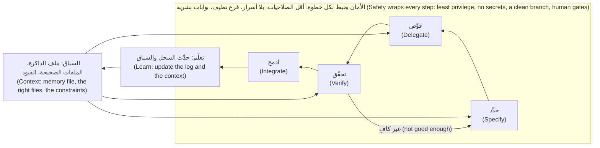

# الوحدة 0 — التوجيه: أن تصبح مهندسًا أصيلًا في الذكاء الاصطناعي (Orientation: becoming AI-native)

*أهلًا بك في فريق منصة المدفوعات (Payments Platform) في بنك نجم (Najm Bank). قبل أن تدع وكيلًا (agent) يكتب سطرًا واحدًا من نجم ريميت (Najm Remit)، تحسم هذه الوحدة ثلاثة أمور. يبيّن الدرس 0.1 ما المهندس الأصيل في الذكاء الاصطناعي (AI-native engineer) وما ليس هو: التحوّل من كتابة الشيفرة (typing code) إلى توجيهها (directing) والتحقق منها (verifying) وتحمّل مسؤوليتها (owning)، والعادات الخمس (the five habits) التي تدرّب عليها الدورة كلها، وما يُظهره البحث وما لا يُظهره (what the research does and does not show)، والحدود الصادقة للدورة (the honest limits of the course). والدرس 0.2 هو مختبر إعدادك (your setup lab): أدوات البرمجة الوكيلية (agentic coding tools)، وإعداد آمن للبداية (a safe starting configuration) يشمل أوضاع الصلاحيات (permission modes) والأسرار (secrets) وما لا يدخل أبدًا في الموجّه (what never goes into a prompt)، ومستودع نجم ريميت (the Najm Remit repository) وعدّة ailab العاملة دون اتصال (the offline ailab kit)، وينتهي بالمختبر m00 (lab m00)، وهو إصلاح بكلمة واحدة (a one-word fix) يمرّ بك مرة واحدة حول الحلقة (once around the loop). أما الدرس 0.3 فيسمّي تلك الحلقة: حدِّد، فوِّض، تحقّق، ادمج (specify, delegate, verify, integrate)، ويغذّيها السياق (context) ويحيط بها الأمان (safety)، ويمنحك بطاقة التفويض (the delegation card) ومبدأ أن صاحب التغيير المسجَّل يبقى مسؤولًا (the author of record stays accountable). لا تحتاج عدّة ailab إلى مفتاح API (no API key) (وقد تحتاج أداتك الوكيلية إلى حساب (an account))، وكل ما يخص بنك نجم خيالي (fictional).*

> **التركيز (Focus):** Mindset, Workflow, Secure — ما المهندس الأصيل في الذكاء الاصطناعي (what an AI-native engineer is)، وكيف تُعدّ بيئتك بأمان (how to set up safely)، والحلقة التي تدرّب عليها بقية الدورة (the loop the rest of the course trains).

---

# 0.1 — ما المهندس الأصيل في الذكاء الاصطناعي (What an AI-native engineer is) وما ليس هو (and is not): التحوّل (the shift) والعادات الخمس (five habits) والأدلة (the evidence)
*المستوى (Level): 🟢 مبتدئ (Beginner)* · *المتطلبات (Prerequisites): لا يوجد (none)* · *التركيز (Focus): Mindset*

## ⚡ الدرس في دقيقة (In 60 seconds)
- **التحوّل (The shift):** تكتب الشيفرة بيدك أقل، وتوجّه (directing) وتتحقق (verifying) وتتحمّل المسؤولية (owning) أكثر. الوكيل (agent) يصوغ المسودة (drafts)، وأنت تجيب عن كل سطر (answer for every line).
- استخدام الذكاء الاصطناعي **طيف (spectrum)** يمتد من الإكمال التلقائي (autocomplete) إلى الوكلاء المتوازين (parallel agents)، وليس سلّمًا (ladder). اختر النقطة التي تناسب المهمة (the task) وما تستطيع فحصه (what you can check).
- **الفايب كودينج (Vibe coding)** يعني قبول الشيفرة دون قراءتها (accepting code without reading it)؛ أما **الهندسة الأصيلة في الذكاء الاصطناعي (AI-native engineering)** فنقيضه: مسؤولة ومتحقَّق منها (accountable and verified). و**مهندس الذكاء الاصطناعي (AI engineer)** يبني منتجات ذكاء اصطناعي (AI products)، وهذه وظيفة مختلفة (a different job).
- خمس عادات تحمل الدورة (carry the course): **السياق أولًا (Context first)**، و**حدِّد قبل أن تفوِّض (Specify before you delegate)**، و**خطوات صغيرة مُتحقَّق منها (Small verified steps)**، و**ثق بالدليل لا بالطلاقة (Trust evidence, not fluency)**، و**أتمت الحلقة وحافظ على المهارة (Automate the loop, keep the skill)**.
- الأدلة متباينة ومرتبطة بظروف كل دراسة (mixed and setting-specific). الشعور بالسرعة ليس سرعة فعلية (Feeling fast is not being fast).
- إشارة القرار (Decision cue): قبل أن تفوِّض (delegating)، اسأل: «هل أستطيع أن أعرف لو كان هذا خاطئًا؟» ⁦(could I tell if this were wrong?)⁩

## 🧭 لماذا يهم (Why it matters)
بعد ظهر يوم الخميس، تُغلق لجين (Lujain)، المهندسة الخريجة (graduate engineer) في فريق منصة المدفوعات (Payments Platform)، التذكرة (ticket) REMIT-209 في خمس عشرة دقيقة. كتب وكيلها (agent) التغيير، وأبلغ أن «كل الاختبارات تنجح» (all tests pass)، فأودعته (committed). وفي صباح الجمعة يفتح فريق الدعم (support team) سجل التحويلات (the history) في جدولهم الإلكتروني (spreadsheet) فيجد عمود الرسوم (the fee column) يعرض أرقامًا خاطئة. يسأل طارق (Tariq)، قائد الهندسة (engineering lead)، لجين سؤالًا واحدًا: «من مؤلف هذا التغيير؟» ⁦(Who is the author of this change?)⁩ فتجيب بأن الوكيل هو من كتبه. يرد طارق بالنفي: المؤلف (the author) هو صاحب الاسم المسجَّل على الإيداع (commit)، وعلى هذا الشخص أن يشرح كل سطر (explain every line).

لا شيء في هذه القصة يتعلق بأداة سيئة (a bad tool). إنها طريقة عمل مفقودة (a missing way of working): لا سياق (context) عمّن يقرأ المُخرَج (the output)، ولا تعريف لمعنى «انتهى» (definition of done)، ولا نظرة إلى الفروقات (the diff). تبني هذه الدورة طريقة العمل هذه على مدى أربعة عشر أسبوعًا (fourteen weeks) على قاعدة شيفرة صغيرة واحدة (one small codebase).

## 📐 كيف يعمل (How it works)

### 🟢 الأساسيات (The essentials)

**التحوّل (The shift).** يجعل الوكلاء (agents) إنتاج المسودة الأولى (a first draft) رخيصًا. ويبقى نادرًا أن تعرف ما الذي ينبغي بناؤه (what to build)، وأن تعطي الأداة ما تحتاج إليه (giving the tool what it needs)، وأن تميّز المسودة الصحيحة من المسودة المعقولة الشكل (a right draft from a plausible one). تستغرق كتابة الشيفرة (typing code) من يومك وقتًا أقل؛ وتستغرق كتابة معنى «انتهى» (what "done" means) ومراجعة مسودة شخص آخر بسرعة (checking someone else's draft at speed) وتحمّل مسؤولية تغيير لم تكتبه بنفسك (owning a change you did not type) وقتًا أكثر. لا تستطيع التحقق (verify) مما لا تستطيع قراءته، ولذلك تزداد أهمية الأساسيات (fundamentals) ولا تقل.

**طيف لا سلّم (A spectrum, not a ladder).** أربع طرق شائعة لاستخدام الذكاء الاصطناعي (AI) أثناء البرمجة (while you code)؛ ولا تجعل إحداها الأخرى خاطئة (none makes the others wrong).

| الأسلوب (Mode) | ما هو (What it is) | تلجأ إليه عندما (Reach for it when) | الخطر الرئيسي (Main risk) |
|---|---|---|---|
| **الإكمال التلقائي (Autocomplete)** | يقترح الأسطر التالية أثناء الكتابة (suggests the next lines as you type) | تعرف ما الذي تكتبه (you know what you are writing) | القبول بلا تفكير (accepting by reflex) |
| **المحادثة (Chat)** | تسأل أو تلصق، وأنت من يطبّق الإجابة (you ask or paste; you apply the answer) | الشرح (explaining) والمقارنة بين الخيارات (comparing options) وصياغة مقتطف (drafting a snippet) | لصق بيانات لا ينبغي لصقها (pasting data you should not)؛ والوثوق بنبرة الثقة (trusting confidence) |
| **البرمجة الوكيلية (Agentic coding)** | تقرأ الأداة الملفات وتعدّلها وتشغّل الأوامر في حلقة (reads files, edits them and runs commands in a loop)، وأنت تراجع الفروقات (a diff) | مهمة محددة الحدود ولها فحص (a bounded task with a check) | فروقات كبيرة تمرّ عليها مرورًا سريعًا (a large diff you skim) |
| **الوكلاء المتوازون (Parallel agents)** | عدة جلسات (sessions) تعمل في آن واحد، كلٌّ في نسخته الخاصة (its own copy) | مهام مستقلة تستطيع التحقق منها كلًّا على حدة (independent tasks you can verify separately) | تصبح المراجعة عنق الزجاجة (review becomes the bottleneck) |

اختر لكل مهمة على حدة (Choose per task): هل أستطيع فحص النتيجة (check the result)، وكم الضرر لو كانت خاطئة (how much damage if it is wrong)، وهل المهمة محددة بما يكفي لتسليمها (specified well enough to hand over)؟

**الفايب كودينج (Vibe coding) وما تعلّمه هذه الدورة (and what this course teaches).** صاغ أندريه كارباثي (Andrej Karpathy) مصطلح «الفايب كودينج» (vibe coding) في مطلع 2025 للبرمجة التي تستسلم فيها للإحساس (give in to the vibes) وتنسى أن الشيفرة موجودة (forget the code exists)، كما يُقتبس على نطاق واسع (as widely quoted). ورسم سايمون ويليسون (Simon Willison) الخط الفاصل المفيد: هو «بناء برمجيات بنموذج لغوي كبير (LLM) دون مراجعة الشيفرة التي يكتبها» (building software with an LLM without reviewing the code it writes)، بخلاف العمل المهني الذي يجب أن يكون قابلًا للصيانة وآمنًا (maintainable and secure). والنماذج الأولية التي تُرمى (Throwaway prototypes) استخدام مقبول. أما نجم ريميت (Najm Remit) فتنقل الأموال، حيث يكون قبول شيفرة غير مقروءة (accepting unread code) عيبًا في العملية (a process defect). تستخدم الهندسة الأصيلة في الذكاء الاصطناعي (AI-native engineering) الأدوات نفسها، لكنك تقرأ وتختبر وتتحمّل مسؤولية النتيجة (read, test and answer for the result).

**مهندس أصيل في الذكاء الاصطناعي أم مهندس ذكاء اصطناعي؟ ⁦(AI-native engineer or AI engineer?)⁩** يعمل **المهندس الأصيل في الذكاء الاصطناعي (AI-native engineer)** *مع* أدوات الذكاء الاصطناعي (AI tools). ويبني **مهندس الذكاء الاصطناعي (AI engineer)** منتجات *فوق* النماذج (on models): روبوتات المحادثة (chatbots) والاسترجاع (retrieval) ووكلاء العملاء (customer agents). هذه الدورة هي الأولى؛ أما الثانية ففي الدورة المرافقة (companion course) [*بناء تطبيقات الذكاء الاصطناعي والوكلاء (Building AI Applications & Agents)*، الدرس 0.1 — ما الذي يلزم لإطلاق وكيل بمستوى المؤسسات (What it takes to ship an enterprise-grade agent)](../aiapps/index.ar.html#/0.1). وإن كنت لا تستطيع البرمجة بعد (cannot program yet)، فابدأ بـ[*تصميم الأنظمة لمبرمجي الفايب (System Design for Vibe Coders)*، الدرس 9.5 — تقنيات Claude Code المتقدمة (Claude Code power techniques)](../vibe/index.ar.html#l9-5).

**العادات الخمس (The five habits).**

| العادة (Habit) | في جملة واحدة (In one sentence) | ما تمنعه (It prevents) | أين نتدرب عليها (Trained in) |
|---|---|---|---|
| **السياق أولًا (Context first)** | أعطِ الوكيل (agent) ما يحتاج إليه قبل أن تقول له ماذا يفعل (before you say what to do) | إجابة صحيحة عن المشكلة الخطأ (a right answer to the wrong problem) | الوحدة 2 (Module 2) |
| **حدِّد قبل أن تفوِّض (Specify before you delegate)** | اكتب ما معنى «انتهى» (what done means) وما هو خارج النطاق (what is out of scope) والخطة (the plan) | «إنه يعمل» دون معنى متفق عليه (it works with no agreed meaning) | الوحدة 3 (Module 3) |
| **خطوات صغيرة مُتحقَّق منها (Small verified steps)** | حلقات قصيرة (short loops) بفحص بعد كل واحدة: اختبارات (tests) وفروقات (diff) وإيداع (commit) | مفاجأة من 600 سطر (a 600-line surprise) | الوحدة 4 (Module 4) |
| **ثق بالدليل لا بالطلاقة (Trust evidence, not fluency)** | الجواب الواثق ليس دليلًا (a confident answer is not evidence)؛ الدليل هو الاختبارات والفروقات | شحن خطأ يبدو معقولًا (shipping a plausible mistake) | الوحدة 5 (Module 5) |
| **أتمت الحلقة وحافظ على المهارة (Automate the loop, keep the skill)** | حوّل الخطوات المتكررة إلى أوامر وخطّافات (commands and hooks)، وواصل ممارسة الأساسيات (keep practising the basics) | روتين بطيء (slow routine)؛ وحكم صدئ (rusty judgement) | الوحدتان 9 و13 (Modules 9 and 13) |

### 🟡 التعمق أكثر (Going deeper)

**تذكرة واحدة، فترتان بعد الظهر (One ticket, two afternoons).** كتبت حصة (Hessa)، مالكة المنتج (product owner)، هذه التذكرة (ticket):

```text
REMIT-209: show express transfers in the history output

Support cannot tell from `python -m remit history` which transfers were sent
express. Customers ask why their fee was 27.00 and not 12.00.
Please show it.
```

(يضيف التحويل السريع (express) رسمًا إضافيًا ثابتًا (a flat surcharge): يكلّف تحويل 500 QAR على الممر QAR-INR مبلغ 27.00 لا 12.00.) فترتا بعد الظهر كلتاهما مصمَّمتان لأغراض التعليم (constructed for teaching)، لا مسجّلتان من نموذج حقيقي (not recorded from a real model).

**خميس لجين (Lujain's Thursday).**

| الوقت (Time) | ما تفعله (What she does) | ما ينقص (What is missing) |
|---|---|---|
| 13:05 | تكتب `add express to history` | لا سياق (no context)، ولا تعريف لمعنى «انتهى» (no definition of done) |
| 13:12 | يُدرج الوكيل (agent) عمود السرعة بعد الممر (the corridor) ويعدّل الاختبار القديم (the old test) ليتوافق معه. «تم. كل الاختبارات تنجح.» ⁦(Done. All tests pass.)⁩ | الاختبار المتغيّر إشارة (a changed test is a signal) |
| 13:20 | تقرأ الملخص (the summary) لا الفروقات (the diff)؛ وتودع (commits) «added express to history» بلا وسم `AI-assisted` | الدليل (evidence)؛ وقاعدة الفريق (the team's rule) |
| الجمعة 09:30 (Fri 09:30) | جدول الدعم (support's spreadsheet) يقرأ الأعمدة بحسب موضعها (by position)، فيتحرك كل ما بعد الممر. تراجع (revert)؛ وساعتان من إعادة العمل (two hours of rework) | لم يسأل أحد من يقرؤه (nobody asked who reads it) |

**ظهيرتك أنت، بالعادات (Your afternoon, with the habits).**

| الوقت (Time) | ما تفعله (What you do) | العادة (Habit) |
|---|---|---|
| 13:00 | تقرأ `CONTRIBUTING.md` و`docs/TOUR.md`. تسأل حصة (Hessa) من يقرأ مخرجات السجل (who reads the history output): جدول إلكتروني (a spreadsheet) بحسب موضع العمود، فلا يجوز أن يتحرك شيء. فرع جديد (new branch) | السياق أولًا (Context first) |
| 13:10 | تكتب المواصفة (the specification) أدناه؛ وتطلب خطة (a plan)؛ وتعدّلها ليأتي الاختبار الفاشل أولًا (so the failing test comes first) | حدِّد قبل أن تفوِّض (Specify before you delegate) |
| 13:25 | يفشل الاختبار لسبب صحيح (fails for the right reason)؛ ثم يأتي التغيير (then the change) | خطوات صغيرة مُتحقَّق منها (Small verified steps) |
| 13:45 | تشغّل مجموعة الاختبارات (the suite) بنفسك (yourself)، وتقرأ `git diff --stat`، وتتأكد أن لا اختبار قديمًا تغيّر (no old test changed)، وتشغّل `send --express` و`history` حقيقيين | ثق بالدليل لا بالطلاقة (Trust evidence, not fluency) |
| 14:05 | تودع `feat(cli): show express transfers in history`؛ وتسِم طلب الدمج (pull request) بـ`AI-assisted`؛ وتسجّل ذلك (log it) | أتمت الحلقة وحافظ على المهارة (Automate the loop, keep the skill) |

الموجّه (prompt) الذي يحل محله (The prompt that replaces it):

```text
Goal: in `python -m remit history`, mark express transfers so support can tell them apart (REMIT-209).
Context: read CONTRIBUTING.md and docs/TOUR.md first. History is printed by `_run` in src/remit/cli.py.
Transfer.express already exists in src/remit/models.py, so no storage change is needed.
Support's spreadsheet reads each line by column position.
Done means:
- An express transfer's line ends with two spaces and the word `express`. Nothing else on the line changes.
- A standard transfer's line is byte-for-byte what it is today.
- One new test for the express line. No existing test is edited.
Non-goals: do not touch money.py, fees.py or service.py; no new options; no reformatting.
Process: plan first, then write the failing test and show me it fails, then make it pass. Do not commit.
```

استغرقت الظهيرة الحذرة سبعين دقيقة مقابل خمس عشرة، أما المهملة فلم تنتهِ (was not finished). وهذا مبالغة (overkill) في سكربت يُرمى (a throwaway script). وازِن العناية بحجم المخاطر (Match the care to the stakes).

**ما تقوله الأدلة (What the evidence says) وما لا تقوله (and what it does not).** أربعة مصادر؛ تحقّق من أي رقم بمقارنته بأصله (check a number against its original) قبل أن تكرّره. ولبعضها مؤلفون مرتبطون بشركات تبيع هذه الأدوات (vendor-affiliated authors) (مثل GitHub وMicrosoft Research وGoogle وAnthropic).

| المصدر (Source) | بيئة الدراسة (Setting) | ما أبلغ عنه (What it reported) | تحفّظه الخاص (Its own caveat) |
|---|---|---|---|
| تجربة METR العشوائية (METR randomized trial)، 2025 | 16 مطوّرًا ذوي خبرة في المصادر المفتوحة (experienced open-source developers)، و246 مهمة في مستودعاتهم الناضجة (their own mature repositories)، بأدوات مطلع 2025 (early-2025 tools) | استغرقت المهام وقتًا أطول بنسبة 19% عند السماح بالذكاء الاصطناعي (took 19% longer with AI allowed). كانوا قد توقعوا أن تكون أسرع بنسبة 24% وظنّوا بعدها أنها أسرع بنسبة 20% (forecast 24% faster and afterwards believed 20% faster) | بيئة محددة جدًا (very specific setting)؛ وتقول METR إن النتائج قد تختلف في أماكن أخرى ومع نماذج أحدث (results may differ elsewhere and with later models) |
| Peng وآخرون ⁦(Peng et al.)⁩، 2023 | مهمة واحدة قائمة بذاتها (one self-contained task): خادم HTTP بلغة JavaScript | مجموعة Copilot أسرع بنسبة 55.8% (Copilot group 55.8% faster)، وفاصل الثقة 95% من 21% إلى 89% (95% interval 21% to 89%) | مهمة واحدة بأسلوب المختبر (one task, lab-style)، وفاصل واسع (wide interval) |
| تقارير DORA، 2024 و2025 (DORA reports, 2024 and 2025) | استطلاعات لمتخصصي التقنية (surveys of technology professionals) | 2024: ارتبط ازدياد اعتماد الذكاء الاصطناعي بانخفاض الإنتاجية (throughput) والاستقرار (stability). 2025: صار أثر الإنتاجية إيجابيًا وبقي أثر الاستقرار سلبيًا. الذكاء الاصطناعي يضخّم ما هو موجود أصلًا (AI amplifies what is already there) | ارتباطات لا أسباب (associations, not causes)؛ وبيانات ذاتية الإبلاغ (self-reported) |
| Shen وTamkin، Anthropic، 2026 | 52 مهندسًا أغلبهم مبتدئون (mostly junior engineers) يتعلمون مكتبة غير مألوفة (an unfamiliar library) | سجّلت مجموعة الذكاء الاصطناعي 50% في اختبار الفهم (comprehension quiz) مقابل 67% لمن برمجوا يدويًا (hand-coders)؛ ولا مكسب معنوي في السرعة (no significant speed gain) | دراسة صغيرة وأولية (small, preliminary)؛ وAnthropic هي من تصنع Claude Code |

تُظهر هذه المصادر مجتمعةً مكاسب في المهام محددة النطاق (gains on well-scoped tasks) بهوامش خطأ واسعة (wide error bars)، وخسارة للمتمرّسين على شيفرة مألوفة (a loss for experienced people on familiar code) في تجربة واحدة، وفي استطلاعات DORA نتائج يبدو أنها تعتمد على الممارسات المحيطة بالأداة (the practices around the tool). لكنها **لا** تُظهر أن الذكاء الاصطناعي يجعل الجميع أسرع أو أبطأ (makes everyone faster or slower)، ولا أن الآثار تنتقل عبر أجيال الأدوات (carry across tool generations) (يخمّن تحديث METR لعام 2026 أن المطورين صاروا الآن أسرع، لكنه يصف بياناته الأحدث بأنها دليل ضعيف جدًا على مقدار ذلك)، ولا أن ارتباطات DORA سببية (causal)، ولا ما يحدث للمهارات على مدى سنوات (what happens to skills over years). أخطأ مطوّرو METR في تقدير سرعتهم هم أنفسهم (misjudged their own speed)، ومن هنا عمود «الدقائق» (minutes) في سجل الوكيل (agent log).

### 🔴 نظرة الخبير (Expert view)

**ما يبقى بشريًا (What stays human).** خمسة أشياء لا تُفوَّض (do not delegate): **الحكم (judgement)** (هل هذا هو التغيير الصحيح؟ ⁦(is this the right change?)⁩)، و**تحمّل المسؤولية (ownership)** (يجيب شخص ما عنها — someone answers for it)، و**المتطلبات (requirements)** (الجدول الإلكتروني الذي لم يدوّنه أحد — the spreadsheet nobody wrote down)، و**المخاطر (risk)** (أي الملفات تحمل منطق الأموال — which files are money logic)، و**الذوق (taste)**. يستطيع الوكلاء (agents) المساعدة في كل منها؛ لكن لا يستطيع أي وكيل أن يحملها (none can hold it).

**تعريف عملي (A working definition)، ولماذا لا يوجد تعريف معياري (and why none is standard).** ليس لعبارة «أصيل في الذكاء الاصطناعي» ("AI-native") معنى متفق عليه (no agreed meaning). تستخدمها المصادر لوصف طريقة عمل شخصية (a personal way of working) كما في مقال Addy Osmani لعام 2025 (Addy Osmani's 2025 essay) الذي يرى الذكاء الاصطناعي شريكًا مبتدئًا في البرمجة الثنائية (AI as a junior pair programmer)، أو مجموعة مهارات على مستوى الوظيفة (a job-level skill set)، أو نموذج تشغيل لمؤسسة (an organisation's operating model) كما في دليل Anthropic العملي لعام 2026 (Anthropic's 2026 playbook) الذي تصبح فيه العملية «حلقة» (the process "becomes a loop") مع دمج الذكاء الاصطناعي في كل نقطة (with AI embedded at each point). يبيع عدة مؤلفين شيئًا ما (several authors sell something)؛ لكنهم يتفقون على أنك تعيد تصميم سير العمل وضوابطه (redesign the workflow and its controls)، لا أن تضيف أداة فحسب. أما **التعريف العملي (working definition)** في الدورة فهو من وضعنا لا معيار (ours, not a standard):

> المهندس الأصيل في الذكاء الاصطناعي (AI-native engineer) يوجّه أدوات الذكاء الاصطناعي (AI tools) بانتظام في عمله اليومي (daily work) ويبقى مسؤولًا عن النتيجة (accountable for the result). يقدّم السياق (supply context)، ويعرّف معنى «انتهى» قبل التفويض (define done before delegating)، ويعمل بخطوات صغيرة مُتحقَّق منها (work in small verified steps)، ويحكم على المُخرَج بالدليل (judge output by evidence)، ويؤتمت ما يتكرر (automate what repeats) دون أن يسمح لمهارته بالتراجع (without letting their own skill lapse).

**شركتان تصفان ممارستهما الخاصة (Two companies describing their own practice).** يرى منشور Microsoft [«التطوير الموجَّه بالمواصفات: نهج المواصفات أولًا للهندسة الأصيلة في الذكاء الاصطناعي» (Spec-Driven Development: A Spec-First Approach to AI-Native Engineering)](https://developer.microsoft.com/blog/spec-driven-development-ai-native-engineering/) أن على الفرق أن تتفق على النية (agree on intent) قبل أن يولّد الذكاء الاصطناعي الشيفرة، ويقدّم لهذه المهمة أداته مفتوحة المصدر GitHub Spec Kit (its open-source GitHub Spec Kit). نهج المواصفات أولًا (Spec-first) جزء من طريقة استخدام Microsoft لعبارة «أصيل في الذكاء الاصطناعي» ("AI-native")؛ وعادتك الثانية تقوم على الرهان نفسه (makes the same bet)، وتعود إليه الوحدة 3 (Module 3). وتذكر Meta في [«كيف بنت Meta تطبيق Forum بالهندسة الأصيلة في الذكاء الاصطناعي» (How Meta Built Forum With AI-Native Engineering)](https://engineering.fb.com/2026/10/15/ml-applications/how-meta-built-forum-ai-native-engineering/) أن فريقًا صغيرًا بنى Forum، وهو تطبيق Groups مستقل (a standalone Groups app)، بوكيل ذكاء اصطناعي مشاركًا (an AI agent as a participant). وهدفها «الإنسان على الحلقة» (human-on-the-loop): يدير الوكيل دورة التخطيط والبناء والاختبار والتصحيح (the plan, build, test and correct cycle) بينما يحدد المهندس الهدف ويعتمد النتيجة (sets the goal and approves the result). وتسمّيه Meta هدفًا لا حالة منجزة (a target, not a finished state)، وتضع معيار «انتهى» عند التحقق (verification) — اختبارات آلية وفحوص بصرية (automated tests and visual checks) — لا عند نجاح الترجمة البرمجية (compilation)؛ أما خميس لجين (Lujain) فكان فيه اختبارات خضراء (green tests) ولا نظرة على المخرجات الحقيقية (no look at the real output). كلٌّ منهما رواية شركة عن عملها الخاص (a company's account of its own work)، لا دليل مستقل (not independent evidence)؛ فاقرأ الأصول (read the originals).

**كيف تعمل الدورة (How the course works).** وحدة واحدة كل أسبوع (one module a week) (الوحدات 0 إلى 13)، ثم المشروع الختامي (capstone)؛ ولكل وحدة درس مفاهيمي (a concept lesson) ومختبر أو ورشة عمل (a lab or workshop). تعمل المختبرات (Labs) على **نجم ريميت (Najm Remit)**، وهي خدمة Python صغيرة، ويقيّمها **`ailab`**، وهي عدّة تعمل دون اتصال (an offline kit): لا مفتاح API (no API key)، ولا شبكة (no network)، ولا حاجة إلى وكيل (no agent required). استخدم Claude Code أو أداة أخرى أو لا شيء؛ فالمُقيِّم (the grader) ينظر إلى النتيجة. ينتهي كل مختبر بمُخرَج (a deliverable) وجلسة جماعية (a group session) و**سجل وكيل (agent log)**. **بنك نجم (Najm Bank) خيالي (fictional)**، وكذلك عملاؤه وأسعاره وحدوده (its customers, rates and limits). فريقك: **طارق (Tariq)**، مرشدك (your mentor) الذي يدير «عيادة الذكاء الاصطناعي الأصيل» الأسبوعية (the weekly "AI-native clinic")، و**لجين (Lujain)**، المتحمسة التي تثق أكثر مما ينبغي (enthusiastic, over-trusting)، و**حصة (Hessa)**، مالكة المنتج (product owner) التي تكتب التذاكر (writes the tickets). ويشارك زملاء من الجودة والأمن وهندسة الموثوقية (SRE) والحوكمة والمنصة (quality, security, SRE, governance and platform) في وحداتهم الخاصة.

**حدود صادقة (Honest limits).** لا تستطيع الدورة أن تعدك بأنك ستصبح أسرع (cannot promise you will be faster). فالأدوات تتغير بسرعة (tools change fast): روجعت تفاصيل Claude Code فيها في أكتوبر 2026، فراجع التوثيق الحالي (check the current documentation). والمختبرات صغيرة وخيالية (small and fictional)، والمُقيِّم (the grader) يفحص النتائج لا الفهم (checks results, not understanding). والغاية أن تساعدك الدورة على معرفة متى يكون الوكيل مخطئًا (tell when an agent is wrong).

## 🧰 الأدوات (The toolkit)
| الأداة أو الممارسة أو النمط (Tool, practice or pattern) | ما هي وماذا تفعل (What it is and does) | متى تلجأ إليها (When to reach for it) |
|---|---|---|
| **The five habits** — العادات الخمس | هي العمود الفقري للدورة (the course's spine)، سُمّيت في هذا الدرس وتُدرَّب وحدةً بعد وحدة (trained module by module) | كل مهمة؛ ومراجعة تدقيقية عند حدوث خطأ (an audit when something goes wrong) |
| **Delegation spectrum** — طيف التفويض | الإكمال التلقائي (autocomplete) والمحادثة (chat) والبرمجة الوكيلية (agentic coding) والوكلاء المتوازون (parallel agents)، يُختار منها لكل مهمة (chosen per task) | قبل أي عمل (before any piece of work) |
| **Baseline self-check** — الفحص الذاتي المرجعي | عشر عبارات تُقيَّم من 0 إلى 2، اثنتان لكل عادة (ten statements scored 0 to 2, two per habit) | الآن، ومرة أخرى عند المشروع الختامي (again at the capstone) |
| **Agent log** — سجل الوكيل | بضعة أسطر لكل مهمة بمساعدة الذكاء الاصطناعي (a few lines per AI-assisted task): الموجّه وما حدث وما أصلحته والدقائق (prompt, what happened, what you fixed, minutes) | بعد كل مختبر ومهمة حقيقية (after every lab and real task) |

## 🏛️ عمليًا في بنك نجم (In practice at Najm Bank)
وثيقتان (two artefacts) تُحفظان في مستودع ملاحظات (a notes repository) خارج مجلدات المختبر (outside the lab folders).

**أولًا، الفحص الذاتي المرجعي (the baseline self-check).** قيّم كل عبارة بـ0 (أبدًا — never) أو 1 (أحيانًا — sometimes) أو 2 (عادةً — usually) بحسب طريقة عملك اليوم (as you work today). المقياس من وضع الدورة ولا يُعدّ أداة قياس معتمدة علميًا (not a validated instrument): إنه مرآة لا درجة (a mirror, not a grade).

```markdown
# Baseline before Module 1          Date:

Context first
 C1 Before I prompt I read the repo's notes and ask who uses what I change    [0|1|2]
 C2 I know what my tool can see, and I start a fresh session per task        [0|1|2]
Specify before you delegate
 S1 I write what done means (the checks that prove it) before any code       [0|1|2]
 S2 I write down what is out of scope and what must not change              [0|1|2]
Small verified steps
 V1 I commit in small steps and can undo the last one in a minute            [0|1|2]
 V2 I stop an agent heading the wrong way instead of waiting for it          [0|1|2]
Trust evidence, not fluency
 E1 I read the whole diff, test files included, before I commit              [0|1|2]
 E2 I run the checks myself instead of trusting "tests pass" in a summary    [0|1|2]
Automate the loop, keep the skill
 A1 I turn steps I repeat into a command, script or hook                     [0|1|2]
 A2 I still write or debug code by hand often enough to stay sharp           [0|1|2]

Total (0-20):      Lowest habit (lowest pair sum; on a tie pick one):      The one habit I will watch this week:
```

**ثانيًا، سجل الوكيل (the agent log).** مُدخَل واحد لكل مهمة بمساعدة الذكاء الاصطناعي (one entry per AI-assisted task). املأ الدقائق بصدق (fill the minutes honestly).

```markdown
Entry: 2026-10-22, REMIT-209, branch remit-209-history-express
Prompt (paste or summarise):   spec: express at line end, no existing test edited
What the agent did:            plan, failing test, edit to cli.py, one new test
What I corrected:              it first inserted a column; I asked for end of line
What I checked myself:         full suite, git diff --stat, real send --express + history
Minutes:                       context and spec 25 · agent 20 · verify 20 · integrate 5
Would I delegate it again?     Yes, with the same spec
```

## 🛠️ التمارين (Exercises)
*لا يحتاج أي منها إلى وكيل (None of these needs an agent).*
- 🟢 **قيّم خطك المرجعي (Score your baseline).** *يكتمل عندما (Done when):* يحتوي `baseline.md` على عشر درجات (ten scores) ومجموع (a total) وأضعف عادة لديك (your lowest habit) وتغيير واحد لهذا الأسبوع (one change for this week).
- 🟡 **ارسم خريطة لاستخدامك (Map your own use).** ضع خمس مهام حديثة على الطيف (the spectrum). *يكتمل عندما (Done when):* يبيّن جدول من خمسة صفوف (a five-row table) هل كان كل أسلوب صحيحًا (whether each mode was right)، وما الذي كنت تستطيع فحصه (what you could check)، وأي مهمة كنت ستنقلها (which task you would move).
- 🔴 **دقِّق ادعاءً واحدًا (Audit one claim).** تتبّع رقمًا سمعته عن الذكاء الاصطناعي وإنتاجية المطورين (developer productivity) حتى مصدره (its source). *يكتمل عندما (Done when):* يذكر نصف صفحة (half a page) المصدر (the source) وبيئة الدراسة (setting) والمؤلفين (authors) والنتيجة (finding) وتحفظين اثنين (two caveats)، ويبيّن هل ينطبق ذلك على عملك (whether it applies to your work).

## ⚠️ أخطاء وفخاخ (Mistakes and traps)
- **الوثوق بالإحساس بالسرعة (Trusting the feeling of speed).** شعر مطوّرو METR بأنهم أسرع؛ وخالفتهم الساعة (the clock disagreed). قِس وقتك بنفسك (time yourself).
- **اعتبار الفايب كودينج (vibe coding) خطيئة أو منهجًا (Treating vibe coding as a sin, or a method).** لا بأس به فيما يُرمى (fine for a throwaway)؛ وهو عيب (a defect) في منطق الأموال (money logic). قرِّر بحسب حجم المخاطر (decide by stakes).
- **تسلّق السلّم لذاته (Climbing the ladder for its own sake).** لا ترتقِ إلا حين تستطيع التحقق مما يعود إليك (verify what comes back).
- **اقتباس دراسة واحدة كأنها قانون (Quoting one study as a law).** كل رقم ينتمي إلى بيئة دراسة (a setting) وجيل من الأدوات (a tool generation) ومجموعة من الناس (a group of people).

## 🧾 الخلاصة (Recap)
- ينتقل العمل من كتابة الشيفرة (typing code) إلى توجيهها والتحقق منها وتحمّل مسؤوليتها (directing, verifying and owning it)؛ ويبقى المهندس مسؤولًا (accountable).
- استخدام الذكاء الاصطناعي طيف يُختار لكل مهمة (a spectrum chosen per task). الفايب كودينج (Vibe coding) يقبل شيفرة غير مقروءة (unread code)؛ والهندسة الأصيلة في الذكاء الاصطناعي (AI-native engineering) مسؤولة ومتحقَّق منها (accountable and verified).
- العادات الخمس (The five habits): السياق أولًا (Context first)، حدِّد قبل أن تفوِّض (Specify before you delegate)، خطوات صغيرة مُتحقَّق منها (Small verified steps)، ثق بالدليل لا بالطلاقة (Trust evidence, not fluency)، أتمت الحلقة وحافظ على المهارة (Automate the loop, keep the skill).
- الأدلة متباينة (mixed) ومرتبطة بظروف كل دراسة (setting-specific) وبعضها من إنتاج شركات تبيع هذه الأدوات (partly vendor-made)؛ ولا تنتج عنها قاعدة عامة (no universal rule). وليس لعبارة «أصيل في الذكاء الاصطناعي» ("AI-native") تعريف معياري (standard definition)؛ وتعريف الدورة تعريف عملي (a working one).

## ✍️ اختبر نفسك (Check yourself)

**1. تقول لجين (Lujain): «لقد برمجتُ تغيير السجل بالفايب كودينج (vibe-coded). كتبه الوكيل (agent) والاختبارات تنجح (the tests pass).» ما الذي يجعل هذا مختلفًا عمّا تعلّمه الدورة؟**

- A. استخدمت أداة وكيلية (agentic tool) بدل أن تكتب التغيير بنفسها (typing the change herself)
- B. قبلت التغيير دون أن تقرأه أو تكون قادرة على الدفاع عنه (without reading it or being able to defend it)
- C. اختارت نافذة محادثة (chat window) في حين كان الإكمال التلقائي (autocomplete) كافيًا
- D. شغّلت الاختبارات (ran the tests) قبل فتح طلب الدمج (pull request)

<details><summary>الإجابة</summary>

**B.** استخدام الوكيل أمر مقبول (using an agent is fine). الناقص هو المراجعة (review): على المؤلف (the author) أن يكون قادرًا على شرح كل سطر والدفاع عنه (explain and defend every line). (🟢 الفايب كودينج (Vibe coding).)

</details>

**2. يقول زميل (a colleague says): «أظهرت دراسة (a study showed) أن الذكاء الاصطناعي يجعل المطورين أسرع بنسبة 55%، فلنخطط على هذا الأساس (plan for it).» ما أفضل خطوة أولى؟ ⁦(What is the best first move?)⁩**

- A. نخطط على 55%، لأن تجربة مضبوطة (a controlled experiment) تدعمه
- B. نخطط على بطء 19%، لأن تجربة أخرى (another trial) وجدت ذلك
- C. نقارن بيئة الدراسة (the study's setting) ببيئتنا قبل التخطيط
- D. نأخذ متوسط الدراستين (average the two studies) ونخطط على الوسط

<details><summary>الإجابة</summary>

**C.** جاءت نسبة 55.8% من مهمة واحدة قائمة بذاتها (one self-contained task)؛ وجاء البطء بنسبة 19% من مطورين ذوي خبرة في مستودعاتهم الخاصة (experienced developers in their own repositories). ليس أي منهما قانونًا (a law)، وأخذ المتوسط بين أرقام من بيئات مختلفة (averaging numbers from different settings) ليس أفضل. (🟡 ما تقوله الأدلة (What the evidence says).)

</details>

**3. يسأل طارق (Tariq) أي مهندس يعمل أقرب ما يكون إلى المهندس الأصيل في الذكاء الاصطناعي (AI-native engineer). أي إجابة تتفق مع الدرس؟**

- A. رنا (Rana) تشغّل ستة وكلاء متوازين (six parallel agents) طوال اليوم وتقرأ الملخصات (summaries)
- B. عمر (Omar) يكتب كل سطر بيده ليتجنب أي مخاطرة (any risk)
- C. سامي (Sami) يقبل كل اقتراح إكمال تلقائي (autocomplete suggestion) ليوفّر الوقت
- D. دينا (Dina) تستخدم المحادثة (chat) للتصميم، ووكيلًا (an agent) للاختبارات، وتقرأ كل فرق (diff)

<details><summary>الإجابة</summary>

**D.** يُختار الأسلوب لكل مهمة ويرتبط بما تستطيع فحصه (what you can check). رنا تتخطى المراجعة (skips review)، وسامي يقبل بلا تفكير (accepts by reflex)، وعمر يتجنب الأدوات (avoids the tools). (🟢 طيف لا سلّم (A spectrum, not a ladder).)

</details>

**4. تطلب حصة (Hessa) من الفريق إضافة مساعد محادثة للعملاء (a chat assistant for customers) إلى تطبيق نجم (Najm app). أي دورة تغطي بناءه؟**

- A. هذه الدورة، لأنها عن العمل مع الوكلاء (working with agents)
- B. *اختبار البرمجيات (Software Testing)*، لأن كل ميزة تحتاج إلى اختبارات (tests)
- C. *تصميم الأنظمة لمبرمجي الفايب (System Design for Vibe Coders)*، لأنها تغطي الوكلاء
- D. *بناء تطبيقات الذكاء الاصطناعي والوكلاء (Building AI Applications & Agents)*، الدورة المرافقة (the companion course)

<details><summary>الإجابة</summary>

**D.** بناء المنتجات فوق النماذج (building products on models) هو هندسة الذكاء الاصطناعي (AI engineering). أما هذه الدورة فعن كيف يعمل المهندس مع أدوات الذكاء الاصطناعي (works with AI tools). (🟢 مهندس أصيل في الذكاء الاصطناعي أم مهندس ذكاء اصطناعي؟ ⁦(AI-native engineer or AI engineer?)⁩)

</details>

**5. غيّر وكيل لجين (Lujain) مخرجات السجل دون أن يسأل أحد من يقرؤها. أي عادة جرى تخطيها أولًا (skipped first)؟**

- A. السياق أولًا (Context first)
- B. حدِّد قبل أن تفوِّض (Specify before you delegate)
- C. خطوات صغيرة مُتحقَّق منها (Small verified steps)
- D. أتمت الحلقة وحافظ على المهارة (Automate the loop, keep the skill)

<details><summary>الإجابة</summary>

**A.** أن جدول الدعم (support's spreadsheet) يقرأ الأعمدة بحسب موضعها سياقٌ لا يستطيع أن يقدّمه إلا إنسان (context only a person could supply). (🟡 تذكرة واحدة، فترتان بعد الظهر (One ticket, two afternoons).)

</details>

## 📚 المراجع (References)
- توثيق Claude Code (Claude Code documentation): https://code.claude.com/docs/en/overview
- [*بناء تطبيقات الذكاء الاصطناعي والوكلاء (Building AI Applications & Agents)*، الدرس 0.1 — ما الذي يلزم لإطلاق وكيل بمستوى المؤسسات (What it takes to ship an enterprise-grade agent)](../aiapps/index.ar.html#/0.1)؛ [*اختبار البرمجيات (Software Testing)*، الدرس 6.1 — التحقق من الشيفرة المولَّدة بالذكاء الاصطناعي (Verifying AI-generated code)](../testing/index.ar.html#/6.1)
- **تعمّق أكثر (Go deeper) — الأدلة (evidence).** METR, "Measuring the Impact of Early-2025 AI on Experienced Open-Source Developer Productivity": https://metr.org/blog/2025-07-10-early-2025-ai-experienced-os-dev-study/ وتحديثها لعام 2026 (its 2026 update) https://metr.org/blog/2026-02-24-uplift-update/. DORA 2025: https://cloud.google.com/blog/products/ai-machine-learning/announcing-the-2025-dora-report. Anthropic, "How AI assistance impacts the formation of coding skills": https://www.anthropic.com/research/AI-assistance-coding-skills.
- **تعمّق أكثر (Go deeper) — روايتان من شركتين عن عملهما (two companies' own accounts).** Microsoft for Developers, "Spec-Driven Development: A Spec-First Approach to AI-Native Engineering": https://developer.microsoft.com/blog/spec-driven-development-ai-native-engineering/. Engineering at Meta, "How Meta Built Forum With AI-Native Engineering": https://engineering.fb.com/2026/10/15/ml-applications/how-meta-built-forum-ai-native-engineering/.
- **تعمّق أكثر (Go deeper) — المصطلح (the term).** Simon Willison, "Not all AI-assisted programming is vibe coding (but vibe coding rocks)": https://simonwillison.net/2025/Mar/19/vibe-coding/. Anthropic, "The AI-native SDLC playbook": https://claude.com/blog/the-ai-native-sdlc-playbook. Addy Osmani, "The AI-Native Software Engineer": https://addyo.substack.com/p/the-ai-native-software-engineer.

---

# 0.2 — إعدادك: الأدوات (tools) والإعداد الآمن (safe configuration) ومستودع نجم ريميت (the Najm Remit repo) وعدّة ailab (the ailab kit)
*المستوى (Level): 🟢 مبتدئ (Beginner)* · *المتطلبات (Prerequisites): 0.1* · *التركيز (Focus): Workflow, Secure*

## ⚡ الدرس في دقيقة (In 60 seconds)
- الإعداد أربعة أشياء (Setup is four things): أداة معتمدة (an approved tool)، ووضع صلاحيات (permission mode) يناسب المخاطر، ومكان عمل نظيف (a clean place to work)، وعدّة `ailab` (the ailab kit).
- ابدأ بالوضع اليدوي (Manual mode) (`default`). لا تستخدم `bypassPermissions` أبدًا حيث توجد بيانات اعتماد حقيقية (real credentials). والوضع التلقائي (Auto mode) حكم مصنِّف (a classifier's judgement) لا جدار (not a wall).
- أبقِ الأسرار (secrets) خارج الموجّهات (prompts) وبعيدة المنال: كل ما يقرؤه الوكيل (whatever the agent reads) يدخل سياقه (enters its context).
- شجرة نظيفة (clean tree)، وفرع لكل مهمة (a branch per task)، ومجلد يُرمى (a throwaway directory): عندها لا يُظهر `git diff` إلا ما فعله الوكيل (shows only what the agent did).
- العدّة (The kit): `python -m ailab doctor | list | start | grade | solve`. تعمل دون اتصال (offline)؛ والمُقيِّم (the grader) شريك تدريب (a practice partner).
- المختبر m00 (Lab m00) (في 🏛️): صحّح خطأ إملائيًا (fix a typo)، وشغّل الاختبارات (run the tests)، وأودع بصيغة `type(scope): subject`. هل يحتاج إلى وكيل؟ لا (Needs an agent: no).

## 🧭 لماذا يهم (Why it matters)
في يومها الثاني تضجر لجين (Lujain) من طلبات الصلاحيات (permission prompts) فتحوّل وكيلها (agent) إلى وضع التجاوز (bypass mode). يحوي حاسوبها المحمول ملف تعريف VPN (a VPN profile) وتسجيل دخول إلى السحابة (a cloud login) وملف `.env` لمشروع قديم. لا يحدث شيء. هذا هو الفخ (the trap): اليوم السيئ نادر، فيبدو الأمان احتكاكًا (friction). ولدى نورة (Noura)، مسؤولة أمن التطبيقات والذكاء الاصطناعي (application and AI security)، قاعدة للأسبوع صفر (week zero): للوكيل يداك (the agent has your hands). كل ما تستطيع قراءته أو حذفه أو دفعه (read, delete or push)، يستطيعه هو.

تُظهر تقارير علنية (public reports) كيف يبدو النادر: قال أحد المستخدمين إن وكيل Antigravity من Google، في «وضع Turbo» (Turbo mode)، حذف محتويات قرص (deleted a drive's contents) (نوفمبر 2025)؛ وقال مؤسس شركة إن وكيل Replit حذف قاعدة بيانات إنتاج (a production database) أثناء تجميد الشيفرة (a code freeze) (يوليو 2025). كلاهما روايتان فرديتان غير مدقَّقتين (unaudited single accounts)، فخذ التفاصيل بتحفظ (hold the details loosely). والنمط هو ما يسميه OWASP الصلاحيات المفرطة للوكيل (excessive agency) (LLM06): وظائف أو صلاحيات أو استقلالية أكثر من اللازم (too much functionality, permission or autonomy).

## 📐 كيف يعمل (How it works)

### 🟢 الأساسيات (The essentials)

**الأدوات (Tools).** مرتبة أبجديًا لا بحسب الجودة (alphabetical, not ranked): [Aider](https://aider.chat/docs/)، [Claude Code](https://code.claude.com/docs/en/overview)، [Cursor](https://cursor.com/docs/agent/overview)، [Gemini CLI](https://geminicli.com/docs/)، [GitHub Copilot agent mode](https://docs.github.com/en/copilot/how-tos/copilot-in-your-ide/use-copilot-agents/use-agent-mode) و[OpenAI Codex CLI](https://developers.openai.com/codex).

تستخدم الأمثلة Claude Code؛ والعادات (the habits) لا تعتمد على أداة بعينها (do not depend on one tool)، والمُقيِّم (the grader) لا يعرف أبدًا أيّها استخدمت.

**تثبيت Claude Code وتشغيله (Install and start Claude Code).** اتبع صفحة الإعداد الرسمية (the official setup page) المرتبطة أعلاه، لا أمرًا من مدونة أو من إجابة محادثة (not a command from a blog or a chat answer)؛ ثم يطبع `claude --version` إصدارك. انتقل بـ`cd` إلى مجلد عملك (your work directory) وشغّل `claude`؛ وتوقّع خطوة تسجيل دخول (a sign-in step) (في نجم، تلك المعتمدة — the approved one).

**مربع حوار الثقة (The trust dialog).** في مجلد لم يره من قبل، يسألك Claude Code هل تثق به (whether you trust it). تعني الموافقة أن إعدادات المشروع نفسه وخطّافاته (the project's own settings and hooks) ستسري، فلا توافق إلا على مجلد قرأته. لا تبدأ في مجلدك الرئيسي (home directory): فهذا يوسّع ما يستطيع الوكيل الوصول إليه (what the agent can reach).

**أوضاع الصلاحيات (Permission modes).** هي التي تحدد ما يعمل دون أن يسأل (what runs without asking).

| الوضع (Mode) | ما يعمل دون سؤال (Runs without asking) | لك أنت (For you) |
|---|---|---|
| الوضع اليدوي (Manual) (`default`) | القراءة فقط (reads only) | الأسابيع 0 إلى 3 (weeks 0 to 3)، وأي شيء جديد (anything new) |
| `plan` | يقرأ؛ ويقترح ولا يعدّل (reads; proposes, does not edit) | الاستكشاف والتخطيط (exploring and planning) |
| `acceptEdits` | القراءة وتعديل الملفات وأوامر الملفات البسيطة في مجلد العمل (reads, file edits, simple file commands in the working directory) | مجلد يُرمى (a throwaway directory)، بعد أن تقرأ كل فرق (once you read every diff) |
| `auto` | كل شيء، مع مصنِّف يراجع (everything, with a classifier reviewing) | ليس بعد (not yet) (الوحدة 8 — Module 8) |
| `dontAsk` | الأدوات المعتمدة مسبقًا فقط؛ وتُرفض البقية (only pre-approved tools; the rest is denied) | التشغيل المبرمج (scripted runs) (الوحدة 9 — Module 9) |
| `bypassPermissions` | كل شيء (وقواعد المنع لا تزال تسري — deny rules still apply) | أبدًا مع وجود بيانات اعتماد حقيقية على الجهاز (never with real credentials on the machine) |

بدّل بـShift+Tab أو `/plan`. ويقول التوثيق (the documentation) إن وضع التجاوز لا يُستخدم إلا «في بيئات معزولة مثل الحاويات أو الآلات الافتراضية أو حاويات التطوير التي لا يتوفر فيها اتصال بالإنترنت» (in isolated environments like containers, VMs, or dev containers without internet access). والوضع التلقائي (Auto mode) يضيف نموذجًا مراجعًا (a reviewing model)، لكن التوثيق يقول إنه لا يضمن الأمان (does not guarantee safety). وتختلف أوضاع البدء بحسب الإصدار (starting modes vary by version)، فاقرأ شريط الحالة (status bar) وابدأ بـ`claude --permission-mode default`.

### 🟡 التعمق أكثر (Going deeper)

**ملف بداية آمن (A safe starting file).** احفظ هذا في `~/.claude/settings.json`، وهو إعدادات المستخدم (your user settings) (ادمج المفاتيح إن كان الملف موجودًا؛ وراجع التوثيق الحالي لأسماء المفاتيح — check the current documentation for key names).

```json
{
  "permissions": {
    "defaultMode": "default",
    "deny": [
      "Read(./.env)",
      "Read(./.env.local)",
      "Read(~/.ssh/**)",
      "Read(~/.aws/**)",
      "Bash(git push *)"
    ]
  }
}
```

أبقِه خارج مجلد المختبر (the lab folder): فملف `.claude/settings.json` الذي يُودَع يُفشل فحص النطاق (scope check) في m00 (ويُتجاهل `.claude/settings.local.json`). وقاعدة `deny` تغلب قاعدة `allow` في أي نطاق (in any scope). ولا توجد قاعدة `allow` لـ`pytest` عن قصد (on purpose): فالاختبارات شيفرة (tests are code)، وقاعدة على مستوى المستخدم ستصل إلى مستودعات لم تقرأها. وفي مستودع تثق به، اختر «عدم السؤال مرة أخرى» (don't ask again) مرة واحدة؛ فتُحفظ القاعدة في `.claude/settings.local.json`. هذه حواجز وقائية (guard rails) لا جدران (walls): فـ`Bash(git push *)` لا يوقف `git -C . push`. أما البيئة المعزولة (the sandbox) (`/sandbox`، وهي مطفأة افتراضيًا — off by default) والخطّافات (hooks) فتفرضان (enforce) الحماية (الوحدة 8 — Module 8).

**الأسرار (Secrets) و`.env`.** تأخذ Remit إعداداتها من متغيرات البيئة (environment variables) ولا تحمّل ملف `.env` أبدًا؛ و`.gitignore` يتجاهله أصلًا. افترض أن كل ما يقرؤه الوكيل موجود في سياقه (its context) وفي نص الجلسة (a transcript): يحتفظ Claude Code بنصوص الجلسات المحلية (local transcripts) نصًا عاديًا (plain text) تحت `~/.claude/projects/` لمدة 30 يومًا افتراضيًا (by default). وإن وصل سر (a secret) إلى موجّه، فاعتبره مسرَّبًا (leaked) وبدِّله (rotate it).

**ما لا يدخل أبدًا في الموجّه (What never goes into a prompt).** قواعد نجم: أدوات وبيئات معتمدة فقط (approved tools and environments only)؛ ولا بيانات «سرّية» (Confidential) أو «مقيّدة» (Restricted) ولا أسرار في الموجّهات أو سياقات الوكلاء (in prompts or agent contexts).

| لا تلصق أبدًا (Never paste) | افعل بدلًا من ذلك (Do instead) |
|---|---|
| المفاتيح ورموز الوصول وكلمات المرور وسلاسل الاتصال (keys, tokens, passwords, connection strings) | سمِّ المتغير (name the variable)؛ وبدِّل السر إن تسرّب (rotate if one leaks) |
| أسماء عملاء حقيقيين وأرقام حساباتهم أو هوياتهم (real customer names, account or ID numbers) | استخدم بيانات Remit الخيالية أو اخترع بيانات (use the fictional Remit data or invent some) |
| سجلات إنتاج فيها بيانات شخصية (production logs with personal data) | أخفِ البيانات أولًا والصق الشكل فقط (mask first, paste the shape) |

استخدام موجّهاتك في التدريب (training use of your prompts) يعتمد على الخطة (the plan): اقرأ صفحة استخدام البيانات (the data-usage page) وشروط مؤسستك (your organisation's terms).

**الجلسات والنظافة (Sessions and hygiene).** الجلسات الطويلة تكلّف أكثر وتعمل أسوأ (long sessions cost more and work worse) («جلسة المطبخ الشامل» — the documentation's "kitchen sink session" — في التوثيق): ابدأ جلسة جديدة لكل مهمة (a fresh one per task)؛ يعرض `/usage` التكلفة (cost) ويعرض `/context` ما يملأ النافذة (what fills the window). *الشجرة النظيفة (Clean tree):* لا يُظهر `git status` شيئًا قبل أن يبدأ الوكيل (shows nothing before the agent starts)، فيكون `git diff` عمله هو وحده (is its work and only that). *فرع لكل مهمة (Branch per task):* يجعل `git switch -c remit-212-typo` التراجع مجرد حذف فرع (undo a branch delete). *مجلد يُرمى (Throwaway directory):* تقيم المختبرات في `~/ainative/`، لا في مستودع يهمّك أمره (a repository you care about). وتفوت نقاط الاستعادة (checkpoints) في `/rewind` تغييرات الصدفة (shell changes) مثل `rm`: استخدم git.

### 🔴 نظرة الخبير (Expert view)

**كيف تعمل العدّة (How the kit works).** يبدأ `start` بنسخ المستودع الأساسي (copies the base repository)، ويودِع (commits) «Initial state»، ويطبّق بذرة المختبر (the lab's seed) باسم «Lab starting state» ويضع عليها الوسم `lab-start`، فيكون `git diff lab-start` هو عملك. ويشغّل `grade` الاختبارات الخفية (hidden tests) على نسخة من مجلدك ولا يخرج بالرمز 0 (exits 0) إلا حين تنجح كل الفحوص المطلوبة (every required check passes). ويطبّق `solve` الحل المرجعي (the reference solution)؛ وهو نظرة خاطفة (a peek)، فحاول أولًا (try first).

**جولة في المستودع (The repo tour).** اقرأ `README.md` و`CONTRIBUTING.md` و`docs/TOUR.md`، بهذا الترتيب (in that order). المال (money) يُمثَّل بـ`Decimal` في الصنف `Money`، لا بـ`float` أبدًا (never). و`ledger.py` و`screening.py` قديمان وليس لهما اختبارات مخصصة (no dedicated tests). أما `najmkit` فمكتبة نجم الداخلية (Najm's internal library) للمعرّفات والوقت وأحداث التدقيق (ids, time and audit events)؛ ولم يُدرَّب أي نموذج عليها (no model was trained on it)، فقل للوكيل أن يقرأ `docs/najmkit.md`. وحين يختلف التوثيق (a doc) عن الشيفرة، فالشيفرة هي الحَكَم (the code wins). جرّب واجهة سطر الأوامر (the CLI): يطبع `PYTHONPATH=src python -m remit quote QAR 500 INR` رسمًا قدره 12.00 QAR (ويتيح `PYTHONPATH=src` لـPython إيجاد الحزمة (find the package)؛ كما يعرض README الأمر `python -m pip install -e .`).

## 🧰 الأدوات (The toolkit)
| الأداة أو الممارسة أو النمط (Tool, practice or pattern) | ما هي وماذا تفعل (What it is and does) | متى تلجأ إليها (When to reach for it) |
|---|---|---|
| **Permission modes** — أوضاع الصلاحيات | Manual وplan وacceptEdits وauto وdontAsk وbypassPermissions | كل جلسة (every session)؛ وافحص شريط الحالة (check the status bar) |
| **Deny rules** — قواعد المنع | مدخلات في الإعدادات تمنع قراءة الأسرار والأوامر الخطرة (settings entries that block reads of secrets and risky commands) | قبل أول جلسة (before the first session) |
| **Branch per task** — فرع لكل مهمة | شجرة نظيفة وفرع واحد لكل تذكرة (a clean tree and one branch per ticket) | كل مهمة (every task) |
| **ailab kit** — عدّة ailab | `doctor` و`list` و`start` و`grade` و`solve`: مشغّل مختبرات يعمل دون اتصال (an offline lab runner) | كل مختبر (every lab) |
| **Conventional Commits** — الإيداعات التقليدية | `type(scope): subject`، كما يحدده `CONTRIBUTING.md` (as CONTRIBUTING.md defines it) | كل إيداع (every commit) |

## 🏛️ عمليًا في بنك نجم (In practice at Najm Bank)
*يحتاج إلى وكيل (Needs an agent): لا. افعله بيدك أولًا (do it by hand first)؛ فمحاولة الوكيل اختيارية (the agent pass is optional) ولا يستطيع المُقيِّم (the grader) أن يعرف أيّهما استخدمت. لا وكيل لديك؟ قارن مع مساعد محادثة (a chat assistant) (ألصق شيفرة خيالية فقط — paste only fictional code)، أو سجّل محاولتك اليدوية وحدها (log the by-hand attempt alone).*

**التذكرة (The ticket).** هذه هي `TASK.md`، كما كتبتها حصة (Hessa).

> ```text
> # REMIT-212: spelling mistake in the "transfer sent" message
>
> **From:** Hessa, Product Owner, Najm Remit
> **To:** Payments Platform
> **Priority:** Low, but every customer who sends money sees it
>
> A customer wrote to us: the English message we send after a transfer has a spelling
> mistake in it. Please fix it.
>
> Right now the test suite is red because of it. It is a good first task: small, safe, and
> a chance to go through the whole loop once (find, fix, check, commit).
>
> ## What I need
>
> 1. The English "transfer sent" message is spelled correctly again.
> 2. `pytest -q` passes.
> 3. The change is as small as it can be: the misspelled word, nothing else. Please do not
>    add or edit tests; the existing ones are right.
> 4. It is committed as **one commit**, with a message that follows `CONTRIBUTING.md`: this
>    is a bug fix, so the type is `fix`; the scope is the module you changed; the subject
>    starts with a verb in the imperative ("correct", not "corrected").
>
> ## Notes
>
> - Use whatever helps you: your editor, or an AI coding tool if you have one. If a tool
>   makes the change, read the diff before you commit. You are the one who is accountable
>   for it.
> - Work on a branch if you like (`git switch -c remit-212-typo`). Grading reads the branch
>   that is checked out, so grade from the branch that holds your commit. Two commits instead
>   of one? Run `git reset --soft lab-start`, then commit again.
> - Git and `pytest` run in this directory. Every `python -m ailab` command runs from the
>   `ailab` folder of the course repository, with its virtual environment active.
> - Run `python -m ailab doctor` first if you have not already. When you think you are done:
>   `python -m ailab grade m00 --dir <this directory>`
> ```

**البدء (Start).** تحتاج إلى Python 3.11 أو أحدث وgit (Python 3.11 or newer and git).

```bash
cd ~
git clone https://github.com/Tamoura/system-design-for-vibe-coders.git
cd system-design-for-vibe-coders/ainative/ailab
python -m venv .venv && source .venv/bin/activate    # Windows: .venv\Scripts\activate
python -m pip install -r requirements.txt            # pytest, nothing else
python -m ailab doctor
python -m ailab start m00 --dir ~/ainative/m00
cd ~/ainative/m00
```

يطبع `doctor` سطر `[PASS]` أو `[FAIL]` لكل فحص (per check) وينتهي بـ`Everything needed is in place.` أصلح أي FAIL أولًا (fix any FAIL first).

من هنا تعمل في مكانين (two places). في `~/ainative/m00` تحرّر وتشغّل (edit and run) `git` و`pytest`. ويحتاج أمر `python -m ailab` العادي إلى مجلد `ailab` والبيئة الافتراضية المفعّلة (the active virtual environment)، لكن `start` ينتهي بطباعة أمر تقييم (a grade command) يعمل من أي مجلد (works from any folder) (`/home/you` ترمز إلى مجلدك الرئيسي — stands for your home):

```text
When you are ready, grade from any directory:
  PYTHONPATH=/home/you/system-design-for-vibe-coders/ainative/ailab python -m ailab grade m00 --dir /home/you/ainative/m00
```

**خطوتك، بيدك أولًا (Your move, by hand first).** في `~/ainative/m00` شغّل `git switch -c remit-212-typo`، ثم `pytest -q` واقرأ أول فشل من أعلاه (read the first failure from the top): فهو يبيّن ما كان متوقعًا وما خرج فعلًا (what was expected and what came out). ابحث عن ذلك النص (search for that text) (`grep -rn --include='*.py' "<a phrase from the message>" src` أو محرّرك — or your editor)، وأجرِ أصغر تعديل (the smallest edit)، وأعد تشغيل `pytest -q` واقرأ `git diff`. أودِع مرة واحدة (commit once). يشترط `CONTRIBUTING.md` الصيغة `type(scope): subject`: نوعًا من `feat fix docs test refactor perf chore ci build revert`، ونطاقًا واحدًا بأحرف صغيرة (one lower-case scope) (لا قائمة — not a list)، وموضوعًا بصيغة الأمر (an imperative subject)، بلا نقطة في النهاية (no full stop)، وترويسة لا تتجاوز 72 حرفًا (a header up to 72 characters) (مثال: `fix(limits): count transfers made just after midnight`). هنا النوع `fix` والنطاق هو الوحدة البرمجية التي غيّرتها (the module you changed). سجّل دقائقك (log your minutes).

**ثم مع وكيل (Then with an agent)** (اختياري — optional)، في مجلد ثانٍ (a second directory) (في مجلد `ailab`: `python -m ailab start m00 --dir ~/ainative/m00-agent`). الموجّه الضعيف (The weak prompt) `fix the typo in the message` لا يسمّي ملفًا ولا حدًّا ولا نقطة توقف (names no file, limit or stopping point)، فقد يعيد الوكيل كتابة الجملة أو اختبار. ابدأ في الوضع اليدوي (Manual mode) بموجّه أقوى واقرأ كل فرق (read every diff):

```text
Goal: fix REMIT-212 (see TASK.md): the English "transfer sent" message has a spelling mistake.
Context: Python 3.11; tests run with `pytest -q`; commit rules are in CONTRIBUTING.md. Read TASK.md and CONTRIBUTING.md first.
Constraints: change as little as possible; do not add or edit any test; do not commit.
Acceptance: `pytest -q` passes; `git diff` shows one file and one line changed.
First tell me the file and line that cause it. Wait for my OK before editing.
```

أنت من يودِع (You commit)، برسالة راجعتَها بنفسك على `CONTRIBUTING.md`: أنت صاحب التغيير المسجَّل (the author of record). لا تشغّل `/init` ولا تضف `CLAUDE.md` هنا: فالملفات الزائدة تُفشل فحص النطاق (extra files fail the scope check)، وملفات الذاكرة (memory files) في الوحدة 2 (Module 2).

**ما الذي يفحصه المُقيِّم (What the grader checks).** نجاح `doctor` واختبارات المستودع (the repo's tests pass). فحوص خفية (hidden checks) على الرسالة بالإنجليزية والعربية، وعلى أن الإملاء الخاطئ (the wrong spelling) اختفى من كل ملف Python تحت `src/` (يُحتسب التعليق، ويُحتسب كذلك إصلاح يُطبَّق عند بناء الرسالة فقط — a comment counts, and so does a fix applied only when the message is built). الاختبارات لم تُعدَّل ولم يُضف إليها (neither edited nor added). لم يتغير إلا ملف القالب (only the template file changed)، وبقدر ضئيل: فهو يطابق الملف الابتدائي (the starter) مع تصحيح الكلمة الواحدة. إيداع جديد واحد بالضبط (exactly one new commit) على الفرع المفعّل (the checked-out branch) (لا يُحتسب إيداع الدمج — a merge commit does not count)، بالشكل الذي يحدده `CONTRIBUTING.md`، بنوع `fix` والوحدة نطاقًا (the module as scope) وموضوع بصيغة الأمر من بضع كلمات (an imperative subject of a few words) وبلا علامة ترقيم في النهاية (no ending punctuation). لا شيء متروك دون إيداع (nothing left uncommitted)؛ ولا أسرار (no secrets). ولا يستطيع أن يعرف من أجرى التغيير، ولا هل قرأت الفروقات (the diff)، ولا هل رسالتك جيدة بما يتجاوز شكلها (beyond its form).

**التقييم (Grade).** قيّم من الفرع الذي يحمل إيداعك (grade on the branch that holds your commit): يقرأ المُقيِّم (the grader) أي فرع مفعّل (whichever branch is checked out) بأي اسم (`main` يصلح أيضًا — works too).

```bash
cd ~/system-design-for-vibe-coders/ainative/ailab      # with the virtual environment active
python -m ailab grade m00 --dir ~/ainative/m00
```

في الحالة الابتدائية يكون المُخرَج الحقيقي (on the starter state the real output is):

```text
[PASS] Your environment passes `ailab doctor`
[FAIL] Your tests pass: 97 passed, 2 failed: test_customer_send_and_history_share_a_database_file, test_transfer_sent_in_english
       hint: Run `pytest -q` in your lab directory (not the ailab folder) and read the first failure from the top.
[FAIL] The message is right in English and Arabic: 3 of 5 hidden checks failed: test_english_transfer_sent_spells_received_correctly, test_english_transfer_sent_is_otherwise_unchanged, test_the_misspelling_is_gone_from_the_whole_source_tree
       hint: Compare your customers' message with the sentence the failing test expects. The wrong spelling must go from comments in src/ too.
[PASS] The tests were not edited
[FAIL] Only the template file changed: no files have changed yet
       hint: Make the change the ticket asks for.
[FAIL] The change is tiny: 0 files, +0 -0 lines (nothing has changed yet)
       hint: Fix the misspelled word first.
[FAIL] Exactly one new commit: 0 new commits since the start
       hint: Commit your finished change (git add -A && git commit).
[FAIL] Commit messages follow CONTRIBUTING.md: found 0 commits since the start; expected 1
       hint: Commit your finished change (git add -A && git commit).
[PASS] The fix is committed (nothing left over)
[PASS] No secrets in the change

Lab m00: 4/10 required checks passed: NOT YET
```

إصلاح صحيح أُودِع بالرسالة `fixed the typo` يُفشل سطرًا واحدًا (fails one line)، هو `Commit messages follow CONTRIBUTING.md`، مقتبسًا رسالتك (quoting your message). أصلحه بـ`git commit --amend`. وإن كان لديك إيداعان (two commits)، شغّل `git reset --soft lab-start` وأودِع مرة واحدة (commit once)؛ ولا حاجة إلى إعادة تأسيس تفاعلية (no interactive rebase needed). وإن بدّلت إلى `main` بعد الإيداع على فرع المهمة (the task branch)، فكل سطر فاشل يسمّي الفرع الذي يحمل إيداعك (names the branch that holds your commit): فعُد إليه (switch back to it). وحين ينجح كل شيء يكون السطر الأخير `Lab m00: 10/10 required checks passed: PASSED`.

**المُخرَج الأسبوعي (Weekly deliverable) (الوحدة 0 — Module 0).** في مستودع ملاحظات خاص بك (a notes repository of your own) خارج مجلدات المختبر (outside the lab folders) (`git init ~/ainative-notes`)، أودِع `week-00/` ومعه `baseline.md` (الدرس 0.1) و`agent-log.md` (قالب الدرس 0.1 — the 0.1 template) و`m00-grade.txt` و`delegation-card.md` (بطاقتك للتذكرة REMIT-212، الدرس 0.3 — your card for REMIT-212). ولملف التقييم (the grade file)، أنشئ المجلد ثم شغّل في مجلد `ailab`: `python -m ailab grade m00 --dir ~/ainative/m00 > ~/ainative-notes/week-00/m00-grade.txt`.

**الجلسة الجماعية (Group session) (60 دقيقة — 60 minutes).** (1) سمِّ أضعف عادة في خطك المرجعي (name your lowest baseline habit) (10). (2) تبادلوا `git diff lab-start` واشرحوا التغيير في جملة واحدة (explain the change in a sentence) (15). (3) قارنوا سجلات المحاولة اليدوية وسجلات الوكيل (compare by-hand and agent logs) (15). (4) اذكر وضع الصلاحيات الذي بدأت به ولماذا (state your starting permission mode and why) (10). (5) اتفقوا على قائمة «لا تلصق أبدًا» للمجموعة (agree the group's never-paste list) (10).

**المراجعة الختامية (Debrief).** ما الذي أخطأ فيه الوكيل، أو كاد (what did the agent get wrong, or nearly)؟ ما الذي فات سياقك أو مواصفتك (what did your context or spec miss)؟ ما الذي فحصتَه ولم يخبرك به ملخصه (what did you check that its summary did not tell you)؟ أي الطريقتين كانت أسرع (which way was faster)؟

**سجل الوكيل (Agent log).** استخدم قالب الدرس 0.1 (use the lesson 0.1 template): مُدخَل واحد لكل محاولة (one entry per attempt).

## 🛠️ التمارين (Exercises)
- 🟢 **بيدك (By hand).** *بلا وكيل (No agent).* *يكتمل عندما (Done when):* يطبع `grade` الكلمة `PASSED`، ويحوي المستودع إيداعًا جديدًا واحدًا (one new commit) (ويُفضَّل على فرع مهمة — ideally on a task branch؛ والمُقيِّم لا يفحص الاسم)، ويحوي سجلك مُدخَلًا بالدقائق (an entry with minutes).
- 🟡 **مع وكيل، ثم قارن (With an agent, then compare).** *يحتاج إلى وكيل (اختياري) — Needs an agent (optional).* أعد المهمة في مجلد جديد (a fresh directory) وفي الوضع اليدوي (Manual mode). *يكتمل عندما (Done when):* تظهر `PASSED` مرة أخرى، ويقارن جدول بين المحاولتين من حيث الدقائق والموجّهات (minutes, prompts) وما فعله الوكيل مما لم تكن لتفعله أنت (what the agent did that you would not).
- 🔴 **أثبت حواجزك الوقائية (Prove your guard rails).** *يحتاج إلى وكيل (Needs an agent).* ثبّت ملف الإعدادات أعلاه، وضع ملف `.env` فيه `FAKE_KEY=not-a-real-secret` فقط في مجلد منفصل يُرمى (a separate throwaway directory) (ليس مستودع m00)، وشغّل `claude` هناك واطلب منه قراءة الملف. *يكتمل عندما (Done when):* تسجّل ملاحظة وضع البدء لديك (your starting mode)، وما فعلته الأداة حين سرت قاعدة المنع (what the tool did when the deny rule applied) (تختلف الصياغة — wording varies)، ولماذا لا تُعدّ قاعدة المنع `Bash(git push *)` جدارًا (is not a wall).

## ⚠️ أخطاء وفخاخ (Mistakes and traps)
- **وضع التجاوز «لإيقاف الطلبات» (Bypass mode "to stop the prompts").** ضع في قائمة السماح (allow-list) الأوامر الآمنة التي تواصل الموافقة عليها بدلًا من ذلك.
- **الإعدادات أو `/init` أو اختبار جديد في مستودع المختبر (Settings, /init or a new test in the lab repository).** الملفات الزائدة تُفشل فحص النطاق (extra files fail the scope check).
- **تصديق «الاختبارات تنجح» في الملخص (Trusting "tests pass" in the summary).** شغّل `pytest -q` بنفسك (run it yourself).
- **التلصص على `hidden/` (مقروء في العدّة) أو تشغيل `solve` أولًا (Peeking at hidden/ or running solve first).** المُقيِّم شريك تدريب لا بوابة (a practice partner, not a gate)؛ والتلصص يُفسد التدريب (defeats the practice).

## 🧾 الخلاصة (Recap)
- استخدم أداة معتمدة (an approved tool)؛ وتعلّم في الوضع اليدوي (Manual mode)؛ وأبقِ وضع التجاوز (bypass) بعيدًا عن الأجهزة الحقيقية (real machines).
- أبقِ الأسرار (secrets) خارج الموجّهات وبعيدة المنال؛ وقواعد المنع (deny rules) حواجز وقائية (guard rails)، أما البيئة المعزولة (the sandbox) والخطّافات (hooks) فتفرضان الحماية (enforce).
- الشجرة النظيفة (clean tree) والفرع لكل مهمة (branch per task) والمجلد الذي يُرمى (throwaway directory) تُبقي الفروقات صادقة (keep the diff honest).
- تقيّم العدّة (The kit) النتيجة دون اتصال (grades the result offline)، لا تفكيرك.
- m00 هو الحلقة كلها في صورة مصغّرة (the whole loop in miniature): ابحث، أصلح، افحص، أودِع (find, fix, check, commit).

## ✍️ اختبر نفسك (Check yourself)

**1. تضجر لجين (Lujain) من الموافقة على تشغيلات `pytest` (approving pytest runs). ما الأنسب لهذا الدرس؟ ⁦(What fits this lesson best?)⁩**

- A. التحويل إلى `bypassPermissions` لأن بيانات المختبر خيالية (fictional)
- B. إيقاف مربع حوار الثقة (the trust dialog) لتقلّ الطلبات
- C. إضافة قاعدة سماح ضيقة (a narrow allow rule) لـ`pytest` والبقاء في الوضع اليدوي (Manual mode)
- D. التحويل إلى الوضع `auto` الذي يضمن الأمان (which guarantees safety)

<details><summary>الإجابة</summary>

**C.** قاعدة سماح ضيقة (A narrow allow rule) تُحفظ في الإعدادات المحلية لذلك المستودع (that repository's local settings) تزيل الطلب ولا توسّع شيئًا آخر. والوضع التلقائي (Auto mode) لا يضمن الأمان (does not guarantee safety). (🟡 ملف بداية آمن (A safe starting file).)

</details>

**2. تريد قواعد منع (deny rules) لملف `.env` تسري في كل مشروع (apply in every project) ولا تظهر أبدًا في فروقات m00 (never show up in m00's diff). أين تضعها؟ ⁦(Where do they go?)⁩**

- A. `.claude/settings.json` في مجلد المختبر، مودَعًا (committed)
- B. `~/.claude/settings.json`، إعدادات المستخدم (your user settings)
- C. `TASK.md` ليقرأها الوكيل أولًا
- D. تعليقًا في أعلى `notify.py`

<details><summary>الإجابة</summary>

**B.** تسري إعدادات المستخدم (User settings) في كل مكان وتقيم خارج المستودع؛ أما ملف المشروع المودَع فيُحتسب ملفًا متغيّرًا (a changed file). (🟡 ملف بداية آمن (A safe starting file).)

</details>

**3. تلصق تتبّع المكدس (a stack trace) في موجّه فتلاحظ أنه يحوي رمز API حيًّا (a live API token). ماذا تفعل؟**

- A. تحذف الرسالة؛ فنص الجلسة (the transcript) لا يُخزَّن
- B. تطلب من الوكيل أن ينسى الرمز (forget the token)
- C. لا شيء، لأن المستودع خاص (private)
- D. تعتبر الرمز مسرَّبًا (leaked) وتبدّله (rotate it)

<details><summary>الإجابة</summary>

**D.** تُحفظ نصوص الجلسات (Transcripts) نصًا عاديًا لمدة 30 يومًا افتراضيًا (plain text for 30 days by default) وقد غادر المحتوى جهازك؛ وحذفه أو طلب النسيان من الأداة لا يتراجع عن شيء (undoes nothing). (🟡 الأسرار (Secrets) و`.env`.)

</details>

**4. يعرض `grade` كل سطر PASS (every line PASS) عدا فحص رسالة الإيداع (the commit-message check) الذي يقتبس رسالتك «fixed the typo». ماذا الآن؟ ⁦(What now?)⁩**

- A. عدِّل الإيداع (Amend the commit) برسالة بصيغة `type(scope): subject`
- B. أضف إيداعًا ثانيًا (a second commit) برسالة أفضل
- C. عدِّل الاختبار الخفي (the hidden test) ليُقبل نص الرسالة
- D. أعد تشغيل `ailab doctor` الذي يعيد فحص الرسائل (re-checks messages)

<details><summary>الإجابة</summary>

**A.** يريد الفحص إيداعًا واحدًا بالضبط وبالشكل الصحيح (exactly one commit in the right shape)، فعدِّله؛ والإيداع الثاني يكسر «Exactly one new commit». (🏛️ التقييم (Grade).)

</details>

**5. لماذا لا تمثّل `Bash(git push *)` في قائمة المنع (the deny list) حماية كاملة؟ ⁦(Why is it not full protection?)⁩**

- A. تسري قواعد المنع (Deny rules) فقط بعد قبول مربع حوار الثقة (the trust dialog)
- B. يمكن التحايل على أنماط Bash (Bash patterns can be sidestepped)، كما في `git -C . push`
- C. تعمل قواعد المنع لقراءة الملفات فقط (file reads only)
- D. قاعدة سماح مطابقة (a matching allow rule) في نطاق آخر تتغلب عليها

<details><summary>الإجابة</summary>

**B.** تطابق قواعد Bash نص الأمر (command text)، فتفلت الصيغ المتنوعة (variants slip past)؛ والبيئة المعزولة (the sandbox) والخطّافات (hooks) تفرضان الحماية. (🟡 ملف بداية آمن (A safe starting file).)

</details>

## 📚 المراجع (References)
- توثيق Claude Code (Claude Code documentation): أوضاع الصلاحيات (permission modes) https://code.claude.com/docs/en/permission-modes، والصلاحيات (permissions) https://code.claude.com/docs/en/permissions، والأمان (security) https://code.claude.com/docs/en/security، واستخدام البيانات (data usage) https://code.claude.com/docs/en/data-usage، والتكاليف (costs) https://code.claude.com/docs/en/costs، والعزل (sandboxing) https://code.claude.com/docs/en/sandboxing، والإعدادات (settings) https://code.claude.com/docs/en/settings
- عدّة المختبر (The lab kit): https://github.com/Tamoura/system-design-for-vibe-coders/tree/main/ainative/ailab. الإيداعات التقليدية (Conventional Commits): https://www.conventionalcommits.org. Git: https://git-scm.com.
- تقارير الحوادث المستخدمة أعلاه (Incident reports used above) (روايات مستخدمين أفراد غير مدقَّقة — single-user accounts, not audited): Fortune عن حذف Replit (on the Replit deletion) https://fortune.com/2025/07/23/ai-coding-tool-replit-wiped-database-called-it-a-catastrophic-failure/ ؛ وقاعدة بيانات الحوادث (AI Incident Database) عن حذف Antigravity https://incidentdatabase.ai/cite/1433/
- أهم 10 مخاطر لتطبيقات النماذج اللغوية الكبيرة من OWASP لعام 2025 (OWASP Top 10 for LLM Applications 2025)، البند LLM06: الصلاحيات المفرطة للوكيل (Excessive Agency): https://genai.owasp.org/llm-top-10/
- [*الذكاء الاصطناعي الآمن وأمان التطبيقات (Secure AI & Application Security)*، الدرس 9.2 — الوكلاء والأدوات: الصلاحيات المفرطة وأدوات أقل الصلاحيات وMCP (Agents and tools: excessive agency, least-privilege tools and MCP)](../secai/index.ar.html#/9.2)

---

# 0.3 — الحلقة الأصيلة في الذكاء الاصطناعي (The AI-native loop): حدِّد وفوِّض وتحقّق وادمج (specify, delegate, verify, integrate)، ومن يبقى مسؤولًا (and who stays accountable)
*المستوى (Level): 🟢 مبتدئ (Beginner)* · *المتطلبات (Prerequisites): 0.1* · *التركيز (Focus): Mindset, Workflow*

## ⚡ الدرس في دقيقة (In 60 seconds)
- الحلقة (The loop) هي **حدِّد، فوِّض، تحقّق، ادمج (specify, delegate, verify, integrate)**، ويغذّي **السياق (context)** كل خطوة ويحيط **الأمان (safety)** بها كلها. اللفة الواحدة خطوة صغيرة واحدة لا مشروع كامل (one lap is one small step, not one project).
- اختر **مستوى الاستقلالية (autonomy level)** لكل مهمة: الاقتراح (suggest)، والتعديل بموافقة (edit with approval)، والتعديل بحرية في بيئة معزولة (edit freely in a sandbox)، والتشغيل الطويل (long-running). لا ترفعه إلا بقدر ما يرخص الفحص ويصغر الضرر (raise it only as checking gets cheaper and the damage smaller).
- فوِّض العمل الآلي والمحلي وسهل التحقق (mechanical, local and easy to verify). واحتفظ بمنطق الأموال (money logic) والحدود الأمنية (security boundaries) وقرارات المفاضلة (trade-off decisions). لا تفوِّض أبدًا ما لا تستطيع التحقق منه (never delegate what you cannot verify).
- التحقق غالبًا أكبر بند في الميزانية (verification is often the largest line in the budget). حدِّد **ميزانية التحقق (verification budget)** قبل أن تفوِّض؛ فإن عجزت عن شراء الثقة بها، فقلِّص المهمة (shrink the task).
- يبقى **صاحب التغيير المسجَّل (author of record)** مسؤولًا (accountable): تستطيع شرح كل سطر، ويقول طلب الدمج (pull request) `AI-assisted`.
- الفخ (Trap): الوقت «الموفَّر» بتخطي الفحص لا يزول، بل ينتقل إلى مراجع أو إلى الإنتاج (only moved to a reviewer, or to production).

## 🧭 لماذا يهم (Why it matters)
بعد التراجع عن REMIT-209 (the REMIT-209 revert)، يسأل طارق (Tariq) لجين (Lujain) عمّا أنفقته على التحقق (what she spent on verifying). «لا شيء. الوكيل شغّل الاختبارات.» يرسم عمودين على السبورة (two columns on the whiteboard). كتابة الشيفرة (typing code) أصبحت رخيصة. أما فحصها فلا. وإذا تُخطّي الفحص، دفع شخص آخر الثمن (someone else pays): المراجع (the reviewer) أو فريق الدعم (the support team) أو العميل (a customer).

يشير البحث في الاتجاه نفسه، مع الحذر (with caution). فقد ربط تقرير DORA لعام 2024 ارتفاع اعتماد الذكاء الاصطناعي بانخفاض استقرار التسليم (lower delivery stability)، وأشار مؤلفوه إلى أن أحجام الدفعات الأكبر (larger batch sizes) جزء من السبب؛ ويقول تقرير 2025 إن الذكاء الاصطناعي يضخّم ما يفعله الفريق أصلًا (amplifies what a team already does). وهذه ارتباطات استطلاعية (survey associations) لا برهان (not proof). والقراءة العملية هي ما يعلّمه هذا الدرس: أبقِ كل خطوة صغيرة بما يكفي للتحقق منها (small enough to verify)، وقرّر ما تسلّمه، واعرف من يجيب عنه (who answers for it).

## 📐 كيف يعمل (How it works)

### 🟢 الأساسيات (The essentials)

**الحلقة (The loop).** لكل لفة أربع خطوات (each lap has four steps). يغذّيها السياق كلها، ويحيط بها الأمان (context feeds all of them, and safety wraps them).



- **حدِّد (Specify):** اكتب معنى «انتهى» (what done means) وما هو خارج النطاق (what is out of scope) والفحوص التي ستخبرك (which checks will tell you) (الوحدة 3 — Module 3).
- **فوِّض (Delegate):** سلّم الوكيل خطوة محددة الحدود (hand a bounded step to the agent)، بمستوى استقلالية اخترته (at an autonomy level you chose)، ومعه السياق الذي يحتاج إليه (with the context it needs) (الوحدتان 2 و4 — Modules 2 and 4).
- **تحقّق (Verify):** اجمع الأدلة (collect evidence): الاختبارات (tests) والفروقات (the diff) وتشغيل البرنامج (running it) والمصادر (sources) (الوحدة 5 — Module 5).
- **ادمج (Integrate):** أودِع (commit)، وضع الوسم (label)، وافتح طلب الدمج (open the pull request)، واحصل على المراجعة (get review)، وادمج (merge)، ودوّن ما تعلمته (write down what you learned) (الوحدات 4 و9 و11 — Modules 4, 9 and 11).

السهم العائد من «تحقّق» هو لبّ الفكرة (the arrow back from Verify is the point): فكثير من اللفات تنتهي هناك، بمواصفة أفضل (with a better spec). و**الأمان (Safety)** هو ما يرمز إليه الصندوق: يعمل الوكيل بأقل الصلاحيات (least privilege)، وبلا أسرار في سياقه (no secrets in its context)، وعلى فرع نظيف تستطيع رميه (a clean branch you can throw away)، وبعيدًا عن الإنتاج (never near production)، ومع بوابة بشرية (a human gate) — مراجع ثانٍ (a second reviewer) — حيثما تنتقل الأموال. تبنيه الوحدة 8 (Module 8)؛ وقد أعطاك الدرس 0.2 الطبقة الأولى (the first layer).

**مستويات الاستقلالية (Autonomy levels).** كم يجوز للوكيل أن يفعل قبل أن تنظر (how much the agent may do before you look).

| المستوى (Level) | يجوز للوكيل أن (The agent may) | أقرب إعداد في Claude Code — راجع التوثيق (Closest Claude Code setting, check the docs) | متى تستخدمه (Use when) |
|---|---|---|---|
| 1. الاقتراح (Suggest) | يقترح تغييرًا أو خطة؛ وأنت تطبّقه (propose a change or a plan; you apply it) | وضع التخطيط (plan mode)، أو المحادثة (chat) | الاستكشاف (exploring)، وشيفرة غير مألوفة (unfamiliar code)، ومخاطر عالية (high risk) |
| 2. التعديل بموافقة (Edit with approval) | يعدّل ويشغّل الأوامر، وكل أمر يُعتمد (edit and run commands, each one approved) | الوضع اليدوي (Manual mode) | الافتراضي للعمل الحقيقي (the default for real work) |
| 3. التعديل بحرية في بيئة معزولة (Edit freely in a sandbox) | يعدّل ويشغّل دون أن يسأل، داخل حدود (edit and run without asking, inside a boundary) | `acceptEdits` في مجلد يُرمى أو شجرة عمل (worktree)؛ و`auto` بعد الوحدة 8 (Module 8) | اختبارات سريعة (fast tests)، وفرع (a branch)، ولا شيء تخسره (nothing to lose) |
| 4. التشغيل الطويل أو في الخلفية (Long-running or background) | يعمل بينما تفعل شيئًا آخر (work while you do something else) | `/background` و`claude --bg` والوضع غير التفاعلي (headless) `claude -p` | عمل محدد جيدًا ويمكن فحصه باستقلال (well-specified, independently checkable work) (الوحدتان 9 و10 — Modules 9 and 10) |

ارفع المستوى فقط حين يرخص الفحص ويصغر نطاق الضرر (blast radius). الإنتاج (Production) ليس ضمن النطاق أبدًا، في أي مستوى: تلك قاعدة نجم (a Najm rule).

**ماذا تفوِّض (What to delegate).** سؤالان يحسمان (two questions decide): ما مدى سوء الإجابة الخاطئة (how bad is a wrong answer)، وما مدى رخص فحصها (how cheaply can you check)؟

| | سهل التحقق (Easy to verify) | صعب التحقق (Hard to verify) |
|---|---|---|
| **مخاطر منخفضة (Low risk)** | **فوِّض (Delegate).** أعد تسمية متغير محلي (rename a local variable)؛ وأضف خيار CLI باختبارات مخرجات دقيقة (add a CLI flag with exact-output tests)؛ وحدِّث أوامر README (refresh the README commands) | **فوِّض مع فحص بشري (Delegate with a human check).** صياغة عربية لإشعار (Arabic wording for a notification)، إن كنت لا تقرأ العربية: استعن بقارئ (get a reader) |
| **مخاطر عالية (High risk)** | **فوِّض المسودة واحتفظ بالقرار (Delegate the draft, keep the decision).** اختبارات لحدود الرسوم (tests for fee boundaries)؛ وتغيير في `fees.py` بمخرجات متوقعة دقيقة ومراجع ثانٍ (exact expected outputs and a second reviewer) | **احتفظ به (Keep it).** قاعدة التقريب لعملة جديدة (the rounding rule for a new currency)؛ وعتبات الفحص (screening thresholds)؛ وحد التخويل (an authorisation boundary)؛ و«هل نبني هذا؟» ⁦(should we build this?)⁩ |

احتفظ بمنطق الأموال (money logic) والحدود الأمنية (security boundaries) وقرارات المفاضلة (trade-off decisions) وكل ما يقترب من الإنتاج (anything near production). *لا تفوِّض أبدًا ما لا تستطيع التحقق منه (Never delegate what you cannot verify).* تستطيع التحقق من مهمة حين تستطيع أن تسمّي فحصًا (name a check) وتشغّله وتفهم سبب فشله إن فشل (understand why it failed if it does).

**تحجيم الخطوة (Sizing a step).** للخطوة الجيدة سبب واحد للتغيّر (one reason to change)، وفحص «انتهى» (a done-check) تستطيع صياغته في جملة، وفروقات تقرؤها في جلسة واحدة (a diff you can read in one sitting). «أضف `--explain` إلى `quote`» خطوة (is a step). «حسِّن شاشات الرسوم» أمنية (is a wish). وحين تنمو الخطوة فيصير لها سبب ثانٍ، فقسِّمها (split it)؛ وحين لا تستطيع صياغة فحصها، فأنت ما زلت تحدِّد (you are still specifying).

**صاحب التغيير المسجَّل (The author of record).** قاعدة نجم، المكرَّرة في `CONTRIBUTING.md`: يبقى المؤلف مسؤولًا (the author remains accountable)، وتحمل طلبات الدمج المُنجَزة بمساعدة الذكاء الاصطناعي (AI-assisted pull requests) الوسم `AI-assisted`. وصاحب التغيير المسجَّل هو الشخص الذي يحمل الإيداع اسمه ويفتح طلب الدمج. ومعنى ذلك أنك تستطيع شرح كل سطر والدفاع عنه (explain and defend every line)، وأنك شغّلت الفحوص وتقول أيّها (say which)، ووسمت التغيير (labelled the change)، وأنه في منطق الأموال يوافق أيضًا مراجع بشري ثانٍ (a second human reviewer approves too). ولا يعني ذلك أنه لا يجوز لك استخدام وكيل. ولا المراجع شبكة أمانك (your safety net): فالمراجع يرى الفروقات لا ظهيرتك (a reviewer sees the diff, not your afternoon).

### 🟡 التعمق أكثر (Going deeper)

**تذكرة واحدة، مع توقيت الحلقة (One ticket, timed through the loop).** تذكرة حصة (Hessa's ticket):

```text
REMIT-244: explain the fee in `quote`

Support is asked "why is my fee 12.00?" and has to work it out by hand.
Add an option to `python -m remit quote` that says how the fee was worked out:
the fee schedule, the tier, and whether the minimum or the cap applied.
```

المواصفة التي تكتبها (وتعطيها للوكيل) (the specification you write, and give the agent):

```text
- New flag `quote ... --explain`. Without it the output is byte-for-byte unchanged.
- With it, one extra line after "Fee:": `Fee basis: schedule STD-A, tier 2 of 4`, tiers numbered from 1,
  plus `, minimum applied` or `, cap applied` when true.
- Use `fees.explain_fee` as it is. Do not touch money.py, fees.py, fx.py or any existing test.
- Done means: new tests for tier, minimum and cap; the suite passes; 100, 500, 500.01 and 20000 checked by hand.
```

الدقائق أدناه توضيحية (illustrative)، من مثال مصمَّم (a constructed example)، لا قياسات (not measurements). وستختلف دقائقك، ولهذا في سجل الوكيل (agent log) عمود للدقائق.

| الخطوة (Step) | ما يحدث (What happens) | الدقائق (Minutes) |
|---|---|---|
| حدِّد (Specify) | اقرأ `explain_fee`، وقرّر أن الطبقات تُعدّ من 1 (tiers count from 1)، واكتب المواصفة والبطاقة (write the spec and the card) | 12 |
| فوِّض (Delegate) | اطلب الخطة (plan)، وعدّلها (edit the plan)، ووافق على التعديلات بينما يعمل الوكيل (approve the edits while the agent works) | 6 |
| تحقّق (Verify) | اقرأ الفروقات (read the diff) (6)؛ وشغّل المجموعة (run the suite) (2)؛ وافحص `git diff --stat` والاختبارات القديمة (check the old tests) (2)؛ وأرجِع `src` وشاهد الاختبارات الجديدة تفشل (revert src and watch the new tests fail) (3)؛ وشغّل أربعة مبالغ (run four amounts) (6)؛ وارفض عرضًا بتنظيف `fees.py` (decline an offer to tidy fees.py) (1) | 20 |
| ادمج (Integrate) | رسالة الإيداع (commit message)، ونص طلب الدمج مع الأوامر المشغَّلة (pull request text with the commands run)، والوسم (label)، ومُدخَل السجل (log entry) | 9 |
| **الإجمالي (Total)** | مقدَّر باليد قبل البدء (estimated by hand, before starting): 40 | **47** |

التحقق نحو 40% من اللفة (about 40% of the lap). هذه هي **ميزانية التحقق (verification budget)** وقد صارت مرئية، وليست هدرًا (not waste): إنها ما تدفعه لتضع اسمك على التغيير. وهذا هو الدليل الذي تشتريه (the evidence it buys)، مخرجاتٍ حقيقية من نموذج أولي (a prototype) لهذه التذكرة جرى تشغيله أثناء كتابة الدرس. المبالغ الأربعة (the four amounts):

| المبلغ بالريال القطري (Amount, QAR) | سطر `Fee:` (line) | سطر `Fee basis:` (line) |
|---|---|---|
| 100 | 5.00 QAR | schedule STD-A, tier 1 of 4, minimum applied |
| 500 | 12.00 QAR | schedule STD-A, tier 1 of 4 |
| 500.01 | 12.50 QAR | schedule STD-A, tier 2 of 4 |
| 20000 | 150.00 QAR | schedule STD-A, tier 4 of 4, cap applied |

وفحص أن الاختبارات الجديدة تستطيع أن تفشل (the new tests can fail)، مع وضع تغيير المصدر جانبًا (with the source change put aside) (مقتطف — an excerpt):

```text
$ git stash push -- src && pytest -q
FAILED tests/test_config_cli.py::test_quote_explain_names_the_tier - assert (...
FAILED tests/test_config_cli.py::test_quote_explain_says_when_the_minimum_or_the_cap_applied
2 failed, 100 passed in 0.36s
$ git stash pop
```

الاختبار الجديد الثالث يحرس المخرجات القديمة (guards the old output)، فينجح في الحالتين (passes either way)، كما صُمّم. وفي تشغيل مصمَّم (in a constructed run)، رقّم الوكيل الطبقات في أول فرق له (first diff) من 0 وعرض «تبسيط» `fees.py` ما دام فيه. التقط جدول الحدود (the boundary table) الأول؛ وأجاب ما ليس من أهداف المواصفة (the spec's non-goal) عن الثاني.

**ضبط الميزانية (Setting the budget).** قرِّر قبل أن تفوِّض (decide before you delegate): «سأنفق حتى 25 دقيقة في التحقق من هذا» (I will spend up to 25 minutes verifying this). فإن لم تستطع الفحوص التي تقدر على تحمّل كلفتها (the checks you can afford) أن تمنحك الثقة، فقلِّص المهمة (shrink the task) أو أضف اختبارًا أولًا (add a test first) أو افعلها بنفسك. وإن تجاوزت الميزانية الوقت الذي يوفره الوكيل، فقد كان التفويض قرارًا خاطئًا لهذه المهمة (the wrong call)، وفي معرفة ذلك فائدة (useful to know). أخطأ مطوّرو METR في تقدير سرعتهم (misjudged their own speed)، فاستخدم الساعة لا الشعور (use the clock, not the feeling).

**الإخفاق النموذجي في كل خطوة (The typical failure at each step).**

| الخطوة (Step) | الإخفاق النموذجي (Typical failure) | إشارة مبكرة (Early signal) | العادة التي تلتقطه (Habit that catches it) |
|---|---|---|---|
| السياق (Context) | يخترع الوكيل دالة في `najmkit`، أو لا يعرف من يقرأ المخرجات (invents a function, or does not know who reads the output) | استدعاء غير موجود في أي مكان من المستودع (a call that exists nowhere in the repo) | السياق أولًا (Context first) |
| حدِّد (Specify) | تذكرة غامضة تصبح بناءً خاطئًا واثقًا (a vague ticket becomes a confident wrong build) | تمسّ الفروقات ملفات لم تذكرها (the diff touches files you never mentioned) | حدِّد قبل أن تفوِّض (Specify before you delegate) |
| فوِّض (Delegate) | الخطوة كبيرة جدًا، أو الاستقلالية عالية جدًا (the step is too big, or the autonomy too high) | تتوقف عن قراءة الفروقات (you stop reading the diff) | خطوات صغيرة مُتحقَّق منها (Small verified steps) |
| تحقّق (Verify) | تقرأ الملخص، أو عُدِّل اختبار قديم لينجح (you read the summary, or an old test was edited to pass) | «كل الاختبارات تنجح» واختبار تغيّر (all tests pass and a changed test) | ثق بالدليل لا بالطلاقة (Trust evidence, not fluency) |
| ادمج (Integrate) | لا وسم، وإيداع ضخم، ولا شيء مسجَّل (no label, a giant commit, nothing logged) | طلب دمج بلا أوامر مذكورة (a pull request with no commands listed) | خطوات صغيرة مُتحقَّق منها (Small verified steps)؛ وأتمت الحلقة وحافظ على المهارة (Automate the loop, keep the skill) (القوالب والخطّافات — templates, hooks) |
| الأمان (Safety) | وضع التجاوز «لتوفير الوقت» (bypass mode to save time)؛ وسر في موجّه (a secret in a prompt) | تتوقف الطلبات عن الظهور (prompts stop appearing)؛ وملف `.env` في السياق (in the context) | قواعد المنع (deny rules)، والوضع اليدوي (Manual mode)، وفرع نظيف (a clean branch) |

**أين تدرّب الدورة كل خطوة (Where the course trains each step).**

| جزء الحلقة (Part of the loop) | أين يُدرَّب (Trained in) |
|---|---|
| السياق (Context) | الوحدة 1 (Module 1) (كيف تعمل الوكلاء — how agents work)، والوحدة 2 (Module 2) |
| حدِّد (Specify) | الوحدة 3 (Module 3) |
| فوِّض (Delegate) | الوحدة 4 (Module 4)؛ والوحدة 10 لعدة وكلاء (Module 10 for several agents) |
| تحقّق (Verify) | الوحدة 5، مع الوحدتين 6 و7 لتصحيح الأخطاء (debugging) والشيفرة الموروثة (legacy code) |
| الأمان (Safety) | الوحدة 8 (Module 8) |
| الدمج والأتمتة (Integrate and automate) | الوحدتان 9 و11 (Modules 9 and 11) |
| الفرق والحفاظ على المهارة (Teams and keeping the skill) | الوحدتان 12 و13 (Modules 12 and 13) |

تشغّل الوحدة 14 (Module 14) الحلقة كلها على تغيير حقيقي (a real change).

### 🔴 نظرة الخبير (Expert view)

**حجم الدفعة (Batch size).** يجعل الوكلاء (agents) إنتاج الفروقات الكبيرة رخيصًا (large diffs cheap to produce)، وتزداد كلفة المراجعة مع حجم الفروقات (review cost grows with the diff). ويربط مؤلفو DORA جزءًا من هبوط الاستقرار (the stability dip) بالدفعات الأكبر (larger batches) (وهذا ارتباط — an association). لذلك تبقى وحدة الحلقة صغيرة (the unit of the loop stays small) حتى حين يستطيع الوكيل أن يفعل أكثر.

**حين يكلّف التفويض أكثر من الفعل بنفسك (When delegation costs more than doing it).** تقول صفحة أفضل الممارسات (best-practices page) في Claude Code إنك إن استطعت وصف الفروقات في جملة واحدة (describe the diff in one sentence) فتخطَّ الخطة (skip the plan). وإصلاح m00 بهذا الحجم؛ فتشغّل الحلقة عليه للتدرّب لا للسرعة (for practice, not for speed). وحين يكون الهدف تعلّم مهارة، فالفعل بيدك يبنيها (doing it by hand builds it): فقد وجدت دراسة صغيرة أولية من Anthropic فهمًا أقل في مجموعة استعانت بالذكاء الاصطناعي (lower comprehension in an AI-assisted group).

**لا تتحقق بالشيء الذي كتبه (Do not verify with the thing that wrote it).** وكيل ثانٍ يراجع الفروقات (a second agent reviewing the diff) فحص مفيد، لكنه ليس برهانًا مستقلًا (not independent proof): فالصفحة نفسها تحذّر من أن المراجعين «سيبلّغون عادةً عن بعض الملاحظات حتى حين يكون العمل سليمًا» (will usually report some, even when the work is sound). والدليل يأتي من التنفيذ (evidence comes from execution): الاختبارات (tests) وتشغيل البرنامج (running the program) والفروقات (the diff). وما تستطيع تحمّل كلفة فحصه يحدد ما تفوِّضه (what you can afford to check decides what you delegate). اختبارات المخرجات الدقيقة (exact-output tests) رخيصة؛ أما التزامن (concurrency) والأمان (security) والصياغة العربية (Arabic wording) فليست كذلك. انظر [*اختبار البرمجيات (Software Testing)*، الدرس 6.2 — الاختبارات بوصفها مواصفة لوكلاء البرمجة (Tests as the specification for coding agents)](../testing/index.ar.html#/6.2).

## 🧰 الأدوات (The toolkit)
| الأداة أو الممارسة أو النمط (Tool, practice or pattern) | ما هي وماذا تفعل (What it is and does) | متى تلجأ إليها (When to reach for it) |
|---|---|---|
| **The loop** — الحلقة | حدِّد وفوِّض وتحقّق وادمج، والسياق يغذّيها والأمان يحيط بها (specify, delegate, verify, integrate, with context feeding and safety wrapping) | كل مهمة، بحجم خطوة صغيرة واحدة (every task, at the size of one small step) |
| **Delegation card** — بطاقة التفويض | قائمة تحقق من صفحة واحدة: المهمة والمخاطر والاستقلالية وخطة التحقق والتراجع (a one-page checklist: task, risk, autonomy, verification plan, rollback) | قبل أن تسلّم أي شيء إلى وكيل (before you hand anything to an agent) |
| **Autonomy levels** — مستويات الاستقلالية | الاقتراح والتعديل بموافقة والتعديل بحرية في بيئة معزولة والتشغيل الطويل (suggest, edit with approval, edit freely in a sandbox, long-running) | حين تختار وضعًا، وحين يغريك رفعه (when you pick a mode, and when you are tempted to raise it) |
| **Verification budget** — ميزانية التحقق | الدقائق التي ستنفقها على الفحص، تحدَّد قبل التفويض (the minutes you will spend on checking, set before you delegate) | كلما كانت المهمة أكبر من تغيير بسطر واحد (whenever the task is bigger than a one-line change) |
| **Author of record** — صاحب التغيير المسجَّل | الشخص الذي يحمل التغيير اسمه ويجيب عنه (the person whose name is on the change and who answers for it) | كل إيداع وطلب دمج (every commit and pull request) |

## 🏛️ عمليًا في بنك نجم (In practice at Najm Bank)
الوثيقة (The artefact) هي **بطاقة التفويض (Delegation card)**، قائمة تحقق من صفحة واحدة (a one-page checklist) تملؤها قبل أن تسلّم العمل إلى وكيل. تستغرق دقيقتين، ومهمتها أن تجعلك تقرّر قبل أن يبدأ الوكيل (decide before the agent starts). يطلب منك طارق (Tariq) أن تحضر واحدة لكل مهمة تفوِّضها هذا الأسبوع. وهذه بطاقة REMIT-244 معبّأة (filled in)، نموذجًا لك (as your model). ومُخرَج الوحدة 0 (your Module 0 deliverable) هو البطاقة نفسها لـREMIT-212 (التمرين 🟢)، محفوظة باسم `delegation-card.md`.

```markdown
# Delegation card
Task:             REMIT-244, add `quote --explain` (schedule, tier, minimum or cap)
Why delegate:     mechanical, local to cli.py, easy to check; no money logic changes
Risk:             low (display only)         Verifiable by me:  yes, exact-output tests
Autonomy level:   2, edit with approval (Manual mode), on branch remit-244-explain
Context to give:  CONTRIBUTING.md, docs/TOUR.md, explain_fee in fees.py, tests/test_config_cli.py
Done means:       flag off = output unchanged; flag on = one "Fee basis" line; tests for tier, minimum, cap
Do not touch:     money.py, fees.py, fx.py, any existing test
Verification:     full suite; revert src and watch new tests fail; run 100, 500, 500.01, 20000
Budget:           25 minutes; if it cannot buy confidence, shrink the task or do it by hand
Worth it?:        yes, the checks are cheap and support stops working fees out by hand
Rollback:         git switch main && git branch -D remit-244-explain
Author of record: me. Label AI-assisted. Second reviewer: not needed (no money logic)
```

## 🛠️ التمارين (Exercises)
- 🟢 **عبّئ بطاقة لـREMIT-212 (Fill a card for REMIT-212).** *بلا وكيل (No agent).* استخدم تذكرة الخطأ الإملائي في m00 (the m00 typo ticket). *يكتمل عندما (Done when):* تحوي البطاقة كل الحقول (every field)، ومنها `Worth it?`: جملة واحدة عن هل يستحق تفويض تلك التذكرة (whether delegating that ticket is worth it).
- 🟡 **صنِّف ست مهام (Sort six tasks).** *بلا وكيل (No agent).* ضع كلًّا منها في المصفوفة (the matrix) مع مستوى استقلالية وفحص من سطر واحد (a one-line check): أعد تسمية متغير محلي في `cli.py`؛ وغيّر قاعدة التقريب في `money.py`؛ وأضف اختبارات لحدود طبقات الرسوم (fee tier boundaries)؛ واكتب الصياغة العربية لإشعار جديد (the Arabic wording of a new notification)؛ وانقل واجهة `najmkit` البرمجية إلى إصدار أحدث (upgrade the najmkit API)؛ وصحّح خطأً إملائيًا في README. *يكتمل عندما (Done when):* توضع الست كلها، وتكون واحدة على الأقل «احتفظ بها» (keep)، ولكل منها فحص مسمّى (a named check).
- 🔴 **قِس لفة حقيقية (Time a real lap).** *يحتاج إلى وكيل (اختياري) — Needs an agent (optional).* بعد أن تجتاز m00 بنفسك، ابدأ بيئة معزولة (a sandbox) (في مجلد `ailab`: `python -m ailab start m00 --dir ~/ainative/sandbox`، ثم `python -m ailab solve m00 --dir ~/ainative/sandbox` للحصول على مستودع أخضر — a green repository) ونفّذ REMIT-244 على فرع. اكتب تقديرك اليدوي أولًا (write your by-hand estimate first). *يكتمل عندما (Done when):* يعطي جدول الدقائق لكل خطوة (minutes for each step)، ونسبة التحقق (the verification share)، وجملة واحدة عن هل كانت ميزانية البطاقة صحيحة (whether the card's budget was right).

## ⚠️ أخطاء وفخاخ (Mistakes and traps)
- **تخطي المواصفة لأن «الوكيل سيتدبّر الأمر» (Skipping the spec because "the agent will work it out").** وسيفعل، بثقة (confidently). اكتب معنى «انتهى» وما ليس من الأهداف (the non-goals).
- **تفويض ما لا تستطيع التحقق منه (Delegating what you cannot verify).** إن كنت لا تقرأ العربية أو لا تستطيع إعادة إنتاج سباق التزامن (reproduce the race)، فابحث عن قارئ (find a reader) أو احتفظ بالمهمة.
- **مسرحية التحقق (Verification theatre).** قراءة الملخص، أو تشغيل الاختبارات التي كتبها الوكيل وحدها، ليست دليلًا (is not evidence).
- **تفويض القرار (Delegating the decision).** دع الوكيل يصوغ المسودة (draft)؛ وأنت من يختار قاعدة التقريب (the rounding rule).
- **زحف الاستقلالية (Autonomy creep).** اليدوي، ثم `acceptEdits`، ثم التجاوز «هذه المرة فقط» (just this once). كل خطوة تحتاج إلى سبب (needs a reason).
- **دفع الكلفة إلى المراجع (Pushing the cost to the reviewer).** فروقات من 600 سطر تكلّف مراجعتها أكثر مما كلّف إنتاجها (costs more to review than it cost to produce).

## 🧾 الخلاصة (Recap)
- اللفة الواحدة هي حدِّد وفوِّض وتحقّق وادمج (specify, delegate, verify, integrate)، يغذّيها السياق (context) ويحيط بها الأمان (safety).
- لا ترتفع الاستقلالية (autonomy) إلا بقدر ما يرخص الفحص ويصغر الضرر؛ والإنتاج (production) ليس ضمن النطاق أبدًا.
- فوِّض العمل الآلي والمحلي القابل للتحقق (mechanical, local, verifiable work)؛ واحتفظ بمنطق الأموال والحدود الأمنية وقرارات المفاضلة (money logic, security boundaries and trade-offs).
- التحقق كلفة حقيقية (a real cost): حدِّد الميزانية أولًا، وقِسها (measure it).
- صاحب التغيير المسجَّل (The author of record) يجيب عن كل سطر، ويقول طلب الدمج (pull request) `AI-assisted`.

## ✍️ اختبر نفسك (Check yourself)

**1. أي مهمة ينبغي أن تحتفظ بها لجين (Lujain) لنفسها بحسب مصفوفة التفويض (the delegation matrix)؟**

- A. إعادة تسمية متغير محلي (Renaming a local variable) في `cli.py`
- B. إضافة اختبارات لحدود طبقات الرسوم (fee-tier boundaries) بقيم معروفة
- C. تحديث الأوامر (Refreshing the commands) في README
- D. اختيار قاعدة التقريب (the rounding rule) لعملة جديدة

<details><summary>الإجابة</summary>

**D.** مخاطرها عالية ويصعب التحقق منها (high risk and hard to verify)، وهي قرار مفاضلة (a trade-off decision). أما البقية فمخاطرها منخفضة أو يسهل فحصها (low risk or easy to check). (🟢 ماذا تفوِّض (What to delegate).)

</details>

**2. تريد مها (Maha)، قائدة هندسة الموثوقية (SRE lead)، أن يعمل وكيل دون إشراف طوال الليل (unattended overnight). ما الذي يجب أن يتحقق قبل أن يرتفع مستوى الاستقلالية إلى التشغيل الطويل (long-running)؟**

- A. أن يكون العمل محدَّدًا وقابلًا للفحص ومعزولًا عن الإنتاج (specified, checkable and confined away from production)
- B. أن يُختار أحدث نموذج (The newest model is selected)، فتقلّ الأخطاء (mistakes are rarer)
- C. أن يكون الوضع التلقائي (Auto mode) مفعّلًا، فلا تقاطع الطلبات التشغيل
- D. أن تكون للوكيل صلاحيات المدير (admin rights)، فلا يعوقه شيء

<details><summary>الإجابة</summary>

**A.** ترتفع الاستقلالية (Autonomy) كلما رخص الفحص وصغر نطاق الضرر (the blast radius smaller). واختيار النموذج أو قلة الطلبات أو زيادة الصلاحيات لا يحقق أيًّا منهما (do neither). (🟢 مستويات الاستقلالية (Autonomy levels).)

</details>

**3. تطلب حصة (Hessa) تغيير صياغة من سطر واحد (a one-line wording change). كتابة المواصفة ستستغرق أطول من التعديل نفسه. ما الأفضل؟**

- A. تشغيل الحلقة كاملة، لأن العملية (process) لا تكون اختيارية أبدًا
- B. تسليمه لوكيل في الخلفية (a background agent) لتنجز عملًا آخر
- C. إجراء التعديل بيدك، ثم فحص الفروقات بنفسك (check the diff yourself)
- D. أن تطلب من الوكيل كتابة المواصفة (to write the spec)، ثم تفوِّض (then delegate)

<details><summary>الإجابة</summary>

**C.** إن استطعت وصف الفروقات في جملة واحدة (describe the diff in one sentence) فتخطَّ الخطة. فكلفة الحلقة (the overhead of the loop) تتجاوز المهمة، وتظل تتحقق وتتحمل المسؤولية. (🔴 حين يكلّف التفويض أكثر من الفعل بنفسك (When delegation costs more than doing it).)

</details>

**4. تغيير لجين (Lujain) في `limits.py` موسوم `AI-assisted` والتكامل المستمر (CI) أخضر. ماذا لا تزال تشترط قاعدة نجم؟**

- A. لا شيء آخر (Nothing more)، فالوسم (the label) والتكامل المستمر (CI) يكفيان
- B. مراجع بشري ثانٍ (a second human reviewer)، مع بقاء لجين مسؤولة (still accountable)
- C. أن يُحتسب الوكيل الذي كتبه (The agent that wrote it) مراجعًا ثانيًا (the second reviewer)
- D. موافقة من رئيس أمن المعلومات (CISO) قبل كل دمج

<details><summary>الإجابة</summary>

**B.** يحتاج منطق الأموال (Money logic) إلى مراجع بشري ثانٍ إضافة إلى المؤلف، والمساعدة بالذكاء الاصطناعي لا تنقل المسؤولية (does not move accountability). (🟢 صاحب التغيير المسجَّل (The author of record).)

</details>

**5. يقول ملخص الوكيل إنه حدّث أيضًا اختبارًا قديمًا لتنجح مجموعة الاختبارات (so the suite passes). أي خطوة أخفقت، وماذا تفعل؟**

- A. تحقّق (Verify): افحص تغيير ذلك الاختبار واسأل أي سلوك أخفاه (what behaviour it hid)
- B. حدِّد (Specify): أعد كتابة التذكرة (rewrite the ticket) واطلب من الوكيل أن يبدأ من جديد (start again)
- C. ادمج (Integrate): اضغط الإيداعات (squash the commits) ليصعب رؤية التغيير
- D. فوِّض (Delegate): ارفع مستوى الاستقلالية (raise the autonomy level) ليتمم العمل وحده

<details><summary>الإجابة</summary>

**A.** الاختبار القديم المعدَّل إشارة (An edited existing test is a signal). ما لم تقل المواصفة إنه سيتغير، فاكتشف أي سلوك أخفاه التعديل. (🟡 الإخفاق النموذجي في كل خطوة (The typical failure at each step).)

</details>

## 📚 المراجع (References)
- أفضل ممارسات Claude Code (Claude Code best practices) (التحقق وأنماط الإخفاق ووضع التخطيط — verification, failure patterns, plan mode): https://code.claude.com/docs/en/best-practices؛ وأوضاع الصلاحيات (permission modes): https://code.claude.com/docs/en/permission-modes
- **تعمّق أكثر (Go deeper).** DORA، «حالة تطوير البرمجيات بمساعدة الذكاء الاصطناعي لعام 2025» (2025 State of AI-assisted Software Development): https://cloud.google.com/blog/products/ai-machine-learning/announcing-the-2025-dora-report؛ وتقرير 2024 (2024 report): https://cloud.google.com/blog/products/devops-sre/announcing-the-2024-dora-report
- Anthropic، «دليل دورة حياة تطوير البرمجيات الأصيلة في الذكاء الاصطناعي» (The AI-native SDLC playbook): https://claude.com/blog/the-ai-native-sdlc-playbook
- [*بناء تطبيقات الذكاء الاصطناعي والوكلاء (Building AI Applications & Agents)*، الدرس 8.1 — خطِّط ونفِّذ ولاحِظ وكرِّر: التأمل وشروط التوقف وأولى أنماط الإخفاق (Plan, act, observe, repeat: reflection, stopping conditions and the first failure modes)](../aiapps/index.ar.html#/8.1)
- [*اختبار البرمجيات (Software Testing)*، الدرس 6.1 — التحقق من الشيفرة المولَّدة بالذكاء الاصطناعي (Verifying AI-generated code)](../testing/index.ar.html#/6.1)؛ [*الذكاء الاصطناعي الآمن وأمان التطبيقات (Secure AI & Application Security)*، الدرس 6.3 — تأمين الشيفرة المولَّدة بالذكاء الاصطناعي (Securing AI-generated code)](../secai/index.ar.html#/6.3)
