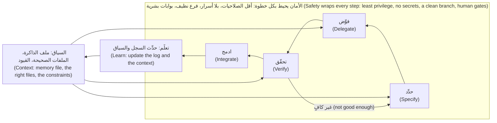

# الوحدة 0 — التوجيه: أن تصبح مهندسًا أصيلًا في الذكاء الاصطناعي

*أهلًا بك في فريق منصة المدفوعات (Payments Platform) في بنك نجم (Najm Bank). قبل أن تدع وكيلًا (agent) يكتب سطرًا واحدًا من نجم ريميت (Najm Remit)، تحسم هذه الوحدة ثلاثة أمور. يبيّن الدرس 0.1 ما المهندس الأصيل في الذكاء الاصطناعي (AI-native engineer) وما ليس هو: التحوّل من كتابة الشيفرة (typing code) إلى توجيهها (directing) والتحقق منها (verifying) وتحمّل مسؤوليتها (owning)، والعادات الخمس التي تدرّب عليها الدورة كلها، وما يُظهره البحث وما لا يُظهره، والحدود الصادقة للدورة. والدرس 0.2 هو مختبر إعدادك: أدوات البرمجة الوكيلية، وإعداد آمن للبداية يشمل أوضاع الصلاحيات (permission modes) والأسرار (secrets) وما لا يدخل أبدًا في الموجّه، ومستودع نجم ريميت وعدّة ailab العاملة دون اتصال، وينتهي بالمختبر m00 (lab m00)، وهو إصلاح بكلمة واحدة يمرّ بك مرة واحدة حول الحلقة. أما الدرس 0.3 فيسمّي تلك الحلقة: حدِّد، فوِّض، تحقّق، ادمج (specify, delegate, verify, integrate)، ويغذّيها السياق (context) ويحيط بها الأمان (safety)، ويمنحك بطاقة التفويض ومبدأ أن صاحب التغيير المسجَّل يبقى مسؤولًا. لا تحتاج عدّة ailab إلى مفتاح API (وقد تحتاج أداتك الوكيلية إلى حساب)، وكل ما يخص بنك نجم خيالي (fictional).*

> **التركيز (Focus):** Mindset, Workflow, Secure — ما المهندس الأصيل في الذكاء الاصطناعي، وكيف تُعدّ بيئتك بأمان، والحلقة التي تدرّب عليها بقية الدورة.

---

# 0.1 — ما المهندس الأصيل في الذكاء الاصطناعي وما ليس هو: التحوّل والعادات الخمس (five habits) والأدلة
*المستوى (Level): 🟢 مبتدئ (Beginner)* · *المتطلبات (Prerequisites): لا يوجد (none)* · *التركيز: Mindset*

## ⚡ الدرس في دقيقة (In 60 seconds)
- **التحوّل (The shift):** تكتب الشيفرة بيدك أقل، وتوجّه وتتحقق وتتحمّل المسؤولية أكثر. الوكيل يصوغ المسودة (drafts)، وأنت تجيب عن كل سطر.
- استخدام الذكاء الاصطناعي **طيف (spectrum)** يمتد من الإكمال التلقائي (autocomplete) إلى الوكلاء المتوازين (parallel agents)، وليس سلّمًا (ladder). اختر النقطة التي تناسب المهمة وما تستطيع فحصه.
- **الفايب كودينج (Vibe coding)** يعني قبول الشيفرة دون قراءتها؛ أما **الهندسة الأصيلة في الذكاء الاصطناعي (AI-native engineering)** فنقيضه: مسؤولة ومتحقَّق منها. و**مهندس الذكاء الاصطناعي (AI engineer)** يبني منتجات ذكاء اصطناعي (AI products)، وهذه وظيفة مختلفة.
- خمس عادات تحمل الدورة: **السياق أولًا (Context first)**، و**حدِّد قبل أن تفوِّض (Specify before you delegate)**، و**خطوات صغيرة مُتحقَّق منها (Small verified steps)**، و**ثق بالدليل لا بالطلاقة (Trust evidence, not fluency)**، و**أتمت الحلقة وحافظ على المهارة (Automate the loop, keep the skill)**.
- الأدلة متباينة ومرتبطة بظروف كل دراسة. الشعور بالسرعة ليس سرعة فعلية.
- إشارة القرار (Decision cue): قبل أن تفوِّض (delegating)، اسأل: «هل أستطيع أن أعرف لو كان هذا خاطئًا؟» ⁦(could I tell if this were wrong?)⁩

## 🧭 لماذا يهم
بعد ظهر يوم الخميس، تُغلق لجين (Lujain)، المهندسة الخريجة (graduate engineer) في فريق منصة المدفوعات، التذكرة (ticket) REMIT-209 في خمس عشرة دقيقة. كتب وكيلها التغيير، وأبلغ أن «كل الاختبارات تنجح»، فأودعته (committed). وفي صباح الجمعة يفتح فريق الدعم (support team) سجل التحويلات في جدولهم الإلكتروني (spreadsheet) فيجد عمود الرسوم يعرض أرقامًا خاطئة. يسأل طارق (Tariq)، قائد الهندسة (engineering lead)، لجين سؤالًا واحدًا: «من مؤلف هذا التغيير؟» ⁦⁩ فتجيب بأن الوكيل هو من كتبه. يرد طارق بالنفي: المؤلف هو صاحب الاسم المسجَّل على الإيداع (commit)، وعلى هذا الشخص أن يشرح كل سطر (explain every line).

لا شيء في هذه القصة يتعلق بأداة سيئة. إنها طريقة عمل مفقودة: لا سياق عمّن يقرأ المُخرَج، ولا تعريف لمعنى «انتهى» (definition of done)، ولا نظرة إلى الفروقات. تبني هذه الدورة طريقة العمل هذه على مدى أربعة عشر أسبوعًا (fourteen weeks) على قاعدة شيفرة صغيرة واحدة.

## 📐 كيف يعمل

### 🟢 الأساسيات

**التحوّل (The shift).** يجعل الوكلاء (agents) إنتاج المسودة الأولى رخيصًا. ويبقى نادرًا أن تعرف ما الذي ينبغي بناؤه، وأن تعطي الأداة ما تحتاج إليه، وأن تميّز المسودة الصحيحة من المسودة المعقولة الشكل. تستغرق كتابة الشيفرة من يومك وقتًا أقل؛ وتستغرق كتابة معنى «انتهى» ومراجعة مسودة شخص آخر بسرعة وتحمّل مسؤولية تغيير لم تكتبه بنفسك وقتًا أكثر. لا تستطيع التحقق (verify) مما لا تستطيع قراءته، ولذلك تزداد أهمية الأساسيات (fundamentals) ولا تقل.

**طيف لا سلّم (A spectrum, not a ladder).** أربع طرق شائعة لاستخدام الذكاء الاصطناعي (AI) أثناء البرمجة؛ ولا تجعل إحداها الأخرى خاطئة.

| الأسلوب (Mode) | ما هو | تلجأ إليه عندما | الخطر الرئيسي (Main risk) |
|---|---|---|---|
| **الإكمال التلقائي (Autocomplete)** | يقترح الأسطر التالية أثناء الكتابة | تعرف ما الذي تكتبه | القبول بلا تفكير |
| **المحادثة (Chat)** | تسأل أو تلصق، وأنت من يطبّق الإجابة | الشرح (explaining) والمقارنة بين الخيارات (comparing options) وصياغة مقتطف | لصق بيانات لا ينبغي لصقها؛ والوثوق بنبرة الثقة (trusting confidence) |
| **البرمجة الوكيلية (Agentic coding)** | تقرأ الأداة الملفات وتعدّلها وتشغّل الأوامر في حلقة، وأنت تراجع الفروقات | مهمة محددة الحدود ولها فحص | فروقات كبيرة تمرّ عليها مرورًا سريعًا |
| **الوكلاء المتوازون (Parallel agents)** | عدة جلسات (sessions) تعمل في آن واحد، كلٌّ في نسخته الخاصة | مهام مستقلة تستطيع التحقق منها كلًّا على حدة | تصبح المراجعة عنق الزجاجة |

اختر لكل مهمة على حدة: هل أستطيع فحص النتيجة، وكم الضرر لو كانت خاطئة، وهل المهمة محددة بما يكفي لتسليمها؟

**الفايب كودينج (Vibe coding) وما تعلّمه هذه الدورة (and what this course teaches).** صاغ أندريه كارباثي (Andrej Karpathy) مصطلح «الفايب كودينج» في مطلع 2025 للبرمجة التي تستسلم فيها للإحساس وتنسى أن الشيفرة موجودة، كما يُقتبس على نطاق واسع. ورسم سايمون ويليسون (Simon Willison) الخط الفاصل المفيد: هو «بناء برمجيات بنموذج لغوي كبير (LLM) دون مراجعة الشيفرة التي يكتبها»، بخلاف العمل المهني الذي يجب أن يكون قابلًا للصيانة وآمنًا. والنماذج الأولية التي تُرمى (Throwaway prototypes) استخدام مقبول. أما نجم ريميت فتنقل الأموال، حيث يكون قبول شيفرة غير مقروءة عيبًا في العملية. تستخدم الهندسة الأصيلة في الذكاء الاصطناعي الأدوات نفسها، لكنك تقرأ وتختبر وتتحمّل مسؤولية النتيجة.

**مهندس أصيل في الذكاء الاصطناعي أم مهندس ذكاء اصطناعي؟ ⁦(AI-native engineer or AI engineer?)⁩** يعمل **المهندس الأصيل في الذكاء الاصطناعي (AI-native engineer)** *مع* أدوات الذكاء الاصطناعي (AI tools). ويبني **مهندس الذكاء الاصطناعي (AI engineer)** منتجات *فوق* النماذج: روبوتات المحادثة (chatbots) والاسترجاع (retrieval) ووكلاء العملاء (customer agents). هذه الدورة هي الأولى؛ أما الثانية ففي الدورة المرافقة (companion course) [*بناء تطبيقات الذكاء الاصطناعي والوكلاء (Building AI Applications & Agents)*، الدرس 0.1 — ما الذي يلزم لإطلاق وكيل بمستوى المؤسسات](../aiapps/index.ar.html#/0.1). وإن كنت لا تستطيع البرمجة بعد، فابدأ بـ[*تصميم الأنظمة لمبرمجي الفايب (System Design for Vibe Coders)*، الدرس 9.5 — تقنيات Claude Code المتقدمة (Claude Code power techniques)](../vibe/index.ar.html#l9-5).

**العادات الخمس (The five habits).**

| العادة (Habit) | في جملة واحدة | ما تمنعه | أين نتدرب عليها (Trained in) |
|---|---|---|---|
| **السياق أولًا (Context first)** | أعطِ الوكيل ما يحتاج إليه قبل أن تقول له ماذا يفعل | إجابة صحيحة عن المشكلة الخطأ | الوحدة 2 (Module 2) |
| **حدِّد قبل أن تفوِّض (Specify before you delegate)** | اكتب ما معنى «انتهى» وما هو خارج النطاق والخطة | «إنه يعمل» دون معنى متفق عليه | الوحدة 3 (Module 3) |
| **خطوات صغيرة مُتحقَّق منها (Small verified steps)** | حلقات قصيرة (short loops) بفحص بعد كل واحدة: اختبارات (tests) وفروقات (diff) وإيداع | مفاجأة من 600 سطر (a 600-line surprise) | الوحدة 4 (Module 4) |
| **ثق بالدليل لا بالطلاقة (Trust evidence, not fluency)** | الجواب الواثق ليس دليلًا؛ الدليل هو الاختبارات والفروقات | شحن خطأ يبدو معقولًا | الوحدة 5 (Module 5) |
| **أتمت الحلقة وحافظ على المهارة (Automate the loop, keep the skill)** | حوّل الخطوات المتكررة إلى أوامر وخطّافات، وواصل ممارسة الأساسيات | روتين بطيء (slow routine)؛ وحكم صدئ (rusty judgement) | الوحدتان 9 و13 (Modules 9 and 13) |

### 🟡 التعمق أكثر (Going deeper)

**تذكرة واحدة، فترتان بعد الظهر (One ticket, two afternoons).** كتبت حصة (Hessa)، مالكة المنتج (product owner)، هذه التذكرة:

```text
REMIT-209: show express transfers in the history output

Support cannot tell from `python -m remit history` which transfers were sent
express. Customers ask why their fee was 27.00 and not 12.00.
Please show it.
```

(يضيف التحويل السريع (express) رسمًا إضافيًا ثابتًا: يكلّف تحويل 500 QAR على الممر QAR-INR مبلغ 27.00 لا 12.00.) فترتا بعد الظهر كلتاهما مصمَّمتان لأغراض التعليم، لا مسجّلتان من نموذج حقيقي.

**خميس لجين (Lujain's Thursday).**

| الوقت (Time) | ما تفعله | ما ينقص |
|---|---|---|
| 13:05 | تكتب `add express to history` | لا سياق، ولا تعريف لمعنى «انتهى» |
| 13:12 | يُدرج الوكيل عمود السرعة بعد الممر ويعدّل الاختبار القديم ليتوافق معه. «تم. كل الاختبارات تنجح.» ⁦⁩ | الاختبار المتغيّر إشارة |
| 13:20 | تقرأ الملخص لا الفروقات؛ وتودع (commits) «added express to history» بلا وسم `AI-assisted` | الدليل (evidence)؛ وقاعدة الفريق |
| الجمعة 09:30 (Fri 09:30) | جدول الدعم (support's spreadsheet) يقرأ الأعمدة بحسب موضعها، فيتحرك كل ما بعد الممر. تراجع (revert)؛ وساعتان من إعادة العمل | لم يسأل أحد من يقرؤه |

**ظهيرتك أنت، بالعادات (Your afternoon, with the habits).**

| الوقت | ما تفعله | العادة |
|---|---|---|
| 13:00 | تقرأ `CONTRIBUTING.md` و`docs/TOUR.md`. تسأل حصة من يقرأ مخرجات السجل: جدول إلكتروني بحسب موضع العمود، فلا يجوز أن يتحرك شيء. فرع جديد (new branch) | السياق أولًا |
| 13:10 | تكتب المواصفة أدناه؛ وتطلب خطة؛ وتعدّلها ليأتي الاختبار الفاشل أولًا | حدِّد قبل أن تفوِّض |
| 13:25 | يفشل الاختبار لسبب صحيح (fails for the right reason)؛ ثم يأتي التغيير | خطوات صغيرة مُتحقَّق منها |
| 13:45 | تشغّل مجموعة الاختبارات بنفسك (yourself)، وتقرأ `git diff --stat`، وتتأكد أن لا اختبار قديمًا تغيّر، وتشغّل `send --express` و`history` حقيقيين | ثق بالدليل لا بالطلاقة |
| 14:05 | تودع `feat(cli): show express transfers in history`؛ وتسِم طلب الدمج (pull request) بـ`AI-assisted`؛ وتسجّل ذلك (log it) | أتمت الحلقة وحافظ على المهارة |

الموجّه (prompt) الذي يحل محله:

```text
Goal: in `python -m remit history`, mark express transfers so support can tell them apart (REMIT-209).
Context: read CONTRIBUTING.md and docs/TOUR.md first. History is printed by `_run` in src/remit/cli.py.
Transfer.express already exists in src/remit/models.py, so no storage change is needed.
Support's spreadsheet reads each line by column position.
Done means:
- An express transfer's line ends with two spaces and the word `express`. Nothing else on the line changes.
- A standard transfer's line is byte-for-byte what it is today.
- One new test for the express line. No existing test is edited.
Non-goals: do not touch money.py, fees.py or service.py; no new options; no reformatting.
Process: plan first, then write the failing test and show me it fails, then make it pass. Do not commit.
```

استغرقت الظهيرة الحذرة سبعين دقيقة مقابل خمس عشرة، أما المهملة فلم تنتهِ. وهذا مبالغة (overkill) في سكربت يُرمى. وازِن العناية بحجم المخاطر.

**ما تقوله الأدلة (What the evidence says) وما لا تقوله (and what it does not).** أربعة مصادر؛ تحقّق من أي رقم بمقارنته بأصله قبل أن تكرّره. ولبعضها مؤلفون مرتبطون بشركات تبيع هذه الأدوات (vendor-affiliated authors).

| المصدر (Source) | بيئة الدراسة (Setting) | ما أبلغ عنه | تحفّظه الخاص |
|---|---|---|---|
| تجربة METR العشوائية، 2025 | 16 مطوّرًا ذوي خبرة في المصادر المفتوحة (experienced open-source developers)، و246 مهمة في مستودعاتهم الناضجة، بأدوات مطلع 2025 (early-2025 tools) | استغرقت المهام وقتًا أطول بنسبة 19% عند السماح بالذكاء الاصطناعي (took 19% longer with AI allowed). كانوا قد توقعوا أن تكون أسرع بنسبة 24% وظنّوا بعدها أنها أسرع بنسبة 20% (forecast 24% faster and afterwards believed 20% faster) | بيئة محددة جدًا؛ وتقول METR إن النتائج قد تختلف في أماكن أخرى ومع نماذج أحدث |
| Peng وآخرون ⁦⁩، 2023 | مهمة واحدة قائمة بذاتها: خادم HTTP بلغة JavaScript | مجموعة Copilot أسرع بنسبة 55.8% (Copilot group 55.8% faster)، وفاصل الثقة 95% من 21% إلى 89% (95% interval 21% to 89%) | مهمة واحدة بأسلوب المختبر، وفاصل واسع (wide interval) |
| تقارير DORA، 2024 و2025 (DORA reports, 2024 and 2025) | استطلاعات لمتخصصي التقنية | 2024: ارتبط ازدياد اعتماد الذكاء الاصطناعي بانخفاض الإنتاجية (throughput) والاستقرار (stability). 2025: صار أثر الإنتاجية إيجابيًا وبقي أثر الاستقرار سلبيًا. الذكاء الاصطناعي يضخّم ما هو موجود أصلًا | ارتباطات لا أسباب؛ وبيانات ذاتية الإبلاغ (self-reported) |
| Shen وTamkin، Anthropic، 2026 | 52 مهندسًا أغلبهم مبتدئون (mostly junior engineers) يتعلمون مكتبة غير مألوفة | سجّلت مجموعة الذكاء الاصطناعي 50% في اختبار الفهم (comprehension quiz) مقابل 67% لمن برمجوا يدويًا (hand-coders)؛ ولا مكسب معنوي في السرعة | دراسة صغيرة وأولية (small, preliminary)؛ وAnthropic هي من تصنع Claude Code |

تُظهر هذه المصادر مجتمعةً مكاسب في المهام محددة النطاق بهوامش خطأ واسعة، وخسارة للمتمرّسين على شيفرة مألوفة في تجربة واحدة، وفي استطلاعات DORA نتائج يبدو أنها تعتمد على الممارسات المحيطة بالأداة. لكنها **لا** تُظهر أن الذكاء الاصطناعي يجعل الجميع أسرع أو أبطأ، ولا أن الآثار تنتقل عبر أجيال الأدوات (يخمّن تحديث METR لعام 2026 أن المطورين صاروا الآن أسرع، لكنه يصف بياناته الأحدث بأنها دليل ضعيف جدًا على مقدار ذلك)، ولا أن ارتباطات DORA سببية (causal)، ولا ما يحدث للمهارات على مدى سنوات. أخطأ مطوّرو METR في تقدير سرعتهم هم أنفسهم، ومن هنا عمود «الدقائق» (minutes) في سجل الوكيل (agent log).

### 🔴 نظرة الخبير (Expert view)

**ما يبقى بشريًا (What stays human).** خمسة أشياء لا تُفوَّض: **الحكم (judgement)** (هل هذا هو التغيير الصحيح؟ ⁦⁩)، و**تحمّل المسؤولية (ownership)**، و**المتطلبات (requirements)**، و**المخاطر (risk)**، و**الذوق (taste)**. يستطيع الوكلاء المساعدة في كل منها؛ لكن لا يستطيع أي وكيل أن يحملها.

**تعريف عملي (A working definition)، ولماذا لا يوجد تعريف معياري (and why none is standard).** ليس لعبارة «أصيل في الذكاء الاصطناعي» ("AI-native") معنى متفق عليه. تستخدمها المصادر لوصف طريقة عمل شخصية كما في مقال Addy Osmani لعام 2025 (Addy Osmani's 2025 essay) الذي يرى الذكاء الاصطناعي شريكًا مبتدئًا في البرمجة الثنائية، أو مجموعة مهارات على مستوى الوظيفة، أو نموذج تشغيل لمؤسسة كما في دليل Anthropic العملي لعام 2026 (Anthropic's 2026 playbook) الذي تصبح فيه العملية «حلقة» مع دمج الذكاء الاصطناعي في كل نقطة. يبيع عدة مؤلفين شيئًا ما؛ لكنهم يتفقون على أنك تعيد تصميم سير العمل وضوابطه، لا أن تضيف أداة فحسب. أما **التعريف العملي (working definition)** في الدورة فهو من وضعنا لا معيار:

> المهندس الأصيل في الذكاء الاصطناعي يوجّه أدوات الذكاء الاصطناعي بانتظام في عمله اليومي (daily work) ويبقى مسؤولًا عن النتيجة. يقدّم السياق (supply context)، ويعرّف معنى «انتهى» قبل التفويض، ويعمل بخطوات صغيرة مُتحقَّق منها، ويحكم على المُخرَج بالدليل، ويؤتمت ما يتكرر دون أن يسمح لمهارته بالتراجع.

**شركتان تصفان ممارستهما الخاصة (Two companies describing their own practice).** يرى منشور Microsoft [«التطوير الموجَّه بالمواصفات: نهج المواصفات أولًا للهندسة الأصيلة في الذكاء الاصطناعي»](https://developer.microsoft.com/blog/spec-driven-development-ai-native-engineering/) أن على الفرق أن تتفق على النية قبل أن يولّد الذكاء الاصطناعي الشيفرة، ويقدّم لهذه المهمة أداته مفتوحة المصدر GitHub Spec Kit. نهج المواصفات أولًا (Spec-first) جزء من طريقة استخدام Microsoft لعبارة «أصيل في الذكاء الاصطناعي»؛ وعادتك الثانية تقوم على الرهان نفسه، وتعود إليه الوحدة 3 (Module 3). وتذكر Meta في [«كيف بنت Meta تطبيق Forum بالهندسة الأصيلة في الذكاء الاصطناعي»](https://engineering.fb.com/2026/10/15/ml-applications/how-meta-built-forum-ai-native-engineering/) أن فريقًا صغيرًا بنى Forum، وهو تطبيق Groups مستقل، بوكيل ذكاء اصطناعي مشاركًا. وهدفها «الإنسان على الحلقة» (human-on-the-loop): يدير الوكيل دورة التخطيط والبناء والاختبار والتصحيح بينما يحدد المهندس الهدف ويعتمد النتيجة. وتسمّيه Meta هدفًا لا حالة منجزة، وتضع معيار «انتهى» عند التحقق (verification) — اختبارات آلية وفحوص بصرية — لا عند نجاح الترجمة البرمجية (compilation)؛ أما خميس لجين فكان فيه اختبارات خضراء (green tests) ولا نظرة على المخرجات الحقيقية. كلٌّ منهما رواية شركة عن عملها الخاص، لا دليل مستقل؛ فاقرأ الأصول.

**كيف تعمل الدورة (How the course works).** وحدة واحدة كل أسبوع (الوحدات 0 إلى 13)، ثم المشروع الختامي (capstone)؛ ولكل وحدة درس مفاهيمي ومختبر أو ورشة عمل. تعمل المختبرات (Labs) على **نجم ريميت (Najm Remit)**، وهي خدمة Python صغيرة، ويقيّمها **`ailab`**، وهي عدّة تعمل دون اتصال: لا مفتاح API، ولا شبكة، ولا حاجة إلى وكيل. استخدم Claude Code أو أداة أخرى أو لا شيء؛ فالمُقيِّم ينظر إلى النتيجة. ينتهي كل مختبر بمُخرَج وجلسة جماعية و**سجل وكيل (agent log)**. **بنك نجم (Najm Bank) خيالي (fictional)**، وكذلك عملاؤه وأسعاره وحدوده. فريقك: **طارق (Tariq)**، مرشدك الذي يدير «عيادة الذكاء الاصطناعي الأصيل» الأسبوعية، و**لجين (Lujain)**، المتحمسة التي تثق أكثر مما ينبغي (enthusiastic, over-trusting)، و**حصة (Hessa)**، مالكة المنتج التي تكتب التذاكر. ويشارك زملاء من الجودة والأمن وهندسة الموثوقية (SRE) والحوكمة والمنصة في وحداتهم الخاصة.

**حدود صادقة (Honest limits).** لا تستطيع الدورة أن تعدك بأنك ستصبح أسرع. فالأدوات تتغير بسرعة: روجعت تفاصيل Claude Code فيها في أكتوبر 2026، فراجع التوثيق الحالي (check the current documentation). والمختبرات صغيرة وخيالية، والمُقيِّم يفحص النتائج لا الفهم. والغاية أن تساعدك الدورة على معرفة متى يكون الوكيل مخطئًا.

## 🧰 الأدوات
| الأداة أو الممارسة أو النمط (Tool, practice or pattern) | ما هي وماذا تفعل | متى تلجأ إليها |
|---|---|---|
| **The five habits** — العادات الخمس | هي العمود الفقري للدورة، سُمّيت في هذا الدرس وتُدرَّب وحدةً بعد وحدة | كل مهمة؛ ومراجعة تدقيقية عند حدوث خطأ |
| **Delegation spectrum** — طيف التفويض | الإكمال التلقائي والمحادثة والبرمجة الوكيلية والوكلاء المتوازون، يُختار منها لكل مهمة | قبل أي عمل |
| **Baseline self-check** — الفحص الذاتي المرجعي | عشر عبارات تُقيَّم من 0 إلى 2، اثنتان لكل عادة (ten statements scored 0 to 2, two per habit) | الآن، ومرة أخرى عند المشروع الختامي |
| **Agent log** — سجل الوكيل | بضعة أسطر لكل مهمة بمساعدة الذكاء الاصطناعي: الموجّه وما حدث وما أصلحته والدقائق | بعد كل مختبر ومهمة حقيقية |

## 🏛️ عمليًا في بنك نجم
وثيقتان (two artefacts) تُحفظان في مستودع ملاحظات خارج مجلدات المختبر.

**أولًا، الفحص الذاتي المرجعي (the baseline self-check).** قيّم كل عبارة بـ0 (أبدًا — never) أو 1 (أحيانًا — sometimes) أو 2 (عادةً — usually) بحسب طريقة عملك اليوم. المقياس من وضع الدورة ولا يُعدّ أداة قياس معتمدة علميًا: إنه مرآة لا درجة.

```markdown
# Baseline before Module 1          Date:

Context first
 C1 Before I prompt I read the repo's notes and ask who uses what I change    [0|1|2]
 C2 I know what my tool can see, and I start a fresh session per task        [0|1|2]
Specify before you delegate
 S1 I write what done means (the checks that prove it) before any code       [0|1|2]
 S2 I write down what is out of scope and what must not change              [0|1|2]
Small verified steps
 V1 I commit in small steps and can undo the last one in a minute            [0|1|2]
 V2 I stop an agent heading the wrong way instead of waiting for it          [0|1|2]
Trust evidence, not fluency
 E1 I read the whole diff, test files included, before I commit              [0|1|2]
 E2 I run the checks myself instead of trusting "tests pass" in a summary    [0|1|2]
Automate the loop, keep the skill
 A1 I turn steps I repeat into a command, script or hook                     [0|1|2]
 A2 I still write or debug code by hand often enough to stay sharp           [0|1|2]

Total (0-20):      Lowest habit (lowest pair sum; on a tie pick one):      The one habit I will watch this week:
```

**ثانيًا، سجل الوكيل (the agent log).** مُدخَل واحد لكل مهمة بمساعدة الذكاء الاصطناعي. املأ الدقائق بصدق.

```markdown
Entry: 2026-10-22, REMIT-209, branch remit-209-history-express
Prompt (paste or summarise):   spec: express at line end, no existing test edited
What the agent did:            plan, failing test, edit to cli.py, one new test
What I corrected:              it first inserted a column; I asked for end of line
What I checked myself:         full suite, git diff --stat, real send --express + history
Minutes:                       context and spec 25 · agent 20 · verify 20 · integrate 5
Would I delegate it again?     Yes, with the same spec
```

## 🛠️ التمارين (Exercises)
*لا يحتاج أي منها إلى وكيل.*
- 🟢 **قيّم خطك المرجعي (Score your baseline).** *يكتمل عندما (Done when):* يحتوي `baseline.md` على عشر درجات (ten scores) ومجموع وأضعف عادة لديك وتغيير واحد لهذا الأسبوع.
- 🟡 **ارسم خريطة لاستخدامك (Map your own use).** ضع خمس مهام حديثة على الطيف. *يكتمل عندما:* يبيّن جدول من خمسة صفوف هل كان كل أسلوب صحيحًا، وما الذي كنت تستطيع فحصه، وأي مهمة كنت ستنقلها.
- 🔴 **دقِّق ادعاءً واحدًا (Audit one claim).** تتبّع رقمًا سمعته عن الذكاء الاصطناعي وإنتاجية المطورين (developer productivity) حتى مصدره. *يكتمل عندما:* يذكر نصف صفحة المصدر وبيئة الدراسة والمؤلفين (authors) والنتيجة (finding) وتحفظين اثنين (two caveats)، ويبيّن هل ينطبق ذلك على عملك.

## ⚠️ أخطاء وفخاخ (Mistakes and traps)
- **الوثوق بالإحساس بالسرعة (Trusting the feeling of speed).** شعر مطوّرو METR بأنهم أسرع؛ وخالفتهم الساعة. قِس وقتك بنفسك (time yourself).
- **اعتبار الفايب كودينج (vibe coding) خطيئة أو منهجًا (Treating vibe coding as a sin, or a method).** لا بأس به فيما يُرمى؛ وهو عيب في منطق الأموال (money logic). قرِّر بحسب حجم المخاطر.
- **تسلّق السلّم لذاته (Climbing the ladder for its own sake).** لا ترتقِ إلا حين تستطيع التحقق مما يعود إليك.
- **اقتباس دراسة واحدة كأنها قانون (Quoting one study as a law).** كل رقم ينتمي إلى بيئة دراسة وجيل من الأدوات ومجموعة من الناس.

## 🧾 الخلاصة (Recap)
- ينتقل العمل من كتابة الشيفرة إلى توجيهها والتحقق منها وتحمّل مسؤوليتها؛ ويبقى المهندس مسؤولًا (accountable).
- استخدام الذكاء الاصطناعي طيف يُختار لكل مهمة. الفايب كودينج يقبل شيفرة غير مقروءة (unread code)؛ والهندسة الأصيلة في الذكاء الاصطناعي مسؤولة ومتحقَّق منها.
- العادات الخمس: السياق أولًا، حدِّد قبل أن تفوِّض، خطوات صغيرة مُتحقَّق منها، ثق بالدليل لا بالطلاقة، أتمت الحلقة وحافظ على المهارة.
- الأدلة متباينة (mixed) ومرتبطة بظروف كل دراسة (setting-specific) وبعضها من إنتاج شركات تبيع هذه الأدوات (partly vendor-made)؛ ولا تنتج عنها قاعدة عامة. وليس لعبارة «أصيل في الذكاء الاصطناعي» تعريف معياري (standard definition)؛ وتعريف الدورة تعريف عملي.

## ✍️ اختبر نفسك (Check yourself)

**1. تقول لجين (Lujain): «لقد برمجتُ تغيير السجل بالفايب كودينج (vibe-coded). كتبه الوكيل (agent) والاختبارات تنجح (the tests pass).» ما الذي يجعل هذا مختلفًا عمّا تعلّمه الدورة؟**

- A. استخدمت أداة وكيلية (agentic tool) بدل أن تكتب التغيير بنفسها ثم شرحته بإيجاز لزميلها
- B. قبلت التغيير دون أن تقرأه أو تكون قادرة على الدفاع عنه
- C. اختارت نافذة محادثة (chat window) في حين كان الإكمال التلقائي (autocomplete) كافيًا
- D. شغّلت الاختبارات قبل فتح طلب الدمج (pull request)

<details><summary>الإجابة</summary>

**B.** استخدام الوكيل أمر مقبول. الناقص هو المراجعة (review): على المؤلف أن يكون قادرًا على شرح كل سطر والدفاع عنه. (🟢 الفايب كودينج (Vibe coding).)

</details>

**2. يقول زميل (a colleague says): «أظهرت دراسة (a study showed) أن الذكاء الاصطناعي يجعل المطورين أسرع بنسبة 55%، فلنخطط على هذا الأساس (plan for it).» ما أفضل خطوة أولى؟ ⁦(What is the best first move?)⁩**

- A. نخطط على 55%، لأن تجربة مضبوطة تدعمه
- B. نخطط على بطء 19%، لأن تجربة أخرى (another trial) وجدت ذلك بالفعل (indeed)
- C. نقارن بيئة الدراسة ببيئتنا قبل التخطيط
- D. نأخذ متوسط الدراستين ونخطط على الوسط

<details><summary>الإجابة</summary>

**C.** جاءت نسبة 55.8% من مهمة واحدة قائمة بذاتها؛ وجاء البطء بنسبة 19% من مطورين ذوي خبرة في مستودعاتهم الخاصة. ليس أي منهما قانونًا، وأخذ المتوسط بين أرقام من بيئات مختلفة ليس أفضل. (🟡 ما تقوله الأدلة.)

</details>

**3. يسأل طارق (Tariq) أي مهندس يعمل أقرب ما يكون إلى المهندس الأصيل في الذكاء الاصطناعي (AI-native engineer). أي إجابة تتفق مع الدرس؟**

- A. رنا (Rana) تشغّل ستة وكلاء متوازين طوال اليوم وتقرأ الملخصات (summaries)
- B. عمر (Omar) يكتب كل سطر بيده ليتجنب أي مخاطرة
- C. سامي (Sami) يقبل كل اقتراح إكمال تلقائي (autocomplete suggestion) ليوفّر الوقت
- D. دينا (Dina) تستخدم المحادثة (chat) للتصميم، ووكيلًا للاختبارات، وتقرأ كل فرق (diff)

<details><summary>الإجابة</summary>

**D.** يُختار الأسلوب لكل مهمة ويرتبط بما تستطيع فحصه. رنا تتخطى المراجعة (skips review)، وسامي يقبل بلا تفكير، وعمر يتجنب الأدوات. (🟢 طيف لا سلّم.)

</details>

**4. تطلب حصة (Hessa) من الفريق إضافة مساعد محادثة للعملاء (a chat assistant for customers) إلى تطبيق نجم (Najm app). أي دورة تغطي بناءه؟**

- A. هذه الدورة، لأنها عن العمل مع الوكلاء
- B. *اختبار البرمجيات (Software Testing)*، لأن كل ميزة تحتاج إلى اختبارات (tests)
- C. *تصميم الأنظمة لمبرمجي الفايب (System Design for Vibe Coders)*، لأنها تغطي الوكلاء
- D. *بناء تطبيقات الذكاء الاصطناعي والوكلاء (Building AI Applications & Agents)*، الدورة المرافقة

<details><summary>الإجابة</summary>

**D.** بناء المنتجات فوق النماذج هو هندسة الذكاء الاصطناعي (AI engineering). أما هذه الدورة فعن كيف يعمل المهندس مع أدوات الذكاء الاصطناعي. (🟢 مهندس أصيل في الذكاء الاصطناعي أم مهندس ذكاء اصطناعي؟ ⁦⁩)

</details>

**5. غيّر وكيل لجين (Lujain) مخرجات السجل دون أن يسأل أحد من يقرؤها. أي عادة جرى تخطيها أولًا (skipped first)؟**

- A. السياق أولًا (Context first)
- B. حدِّد قبل أن تفوِّض (Specify before you delegate)
- C. خطوات صغيرة مُتحقَّق منها (Small verified steps)
- D. أتمت الحلقة وحافظ على المهارة

<details><summary>الإجابة</summary>

**A.** أن جدول الدعم (support's spreadsheet) يقرأ الأعمدة بحسب موضعها سياقٌ لا يستطيع أن يقدّمه إلا إنسان. (🟡 تذكرة واحدة، فترتان بعد الظهر.)

</details>

## 📚 المراجع (References)
- توثيق Claude Code (Claude Code documentation): https://code.claude.com/docs/en/overview
- [*بناء تطبيقات الذكاء الاصطناعي والوكلاء*، الدرس 0.1 — ما الذي يلزم لإطلاق وكيل بمستوى المؤسسات](../aiapps/index.ar.html#/0.1)؛ [*اختبار البرمجيات (Software Testing)*، الدرس 6.1 — التحقق من الشيفرة المولَّدة بالذكاء الاصطناعي (Verifying AI-generated code)](../testing/index.ar.html#/6.1)
- **تعمّق أكثر (Go deeper) — الأدلة (evidence).** METR, "Measuring the Impact of Early-2025 AI on Experienced Open-Source Developer Productivity": https://metr.org/blog/2025-07-10-early-2025-ai-experienced-os-dev-study/ وتحديثها لعام 2026 (its 2026 update) https://metr.org/blog/2026-02-24-uplift-update/. DORA 2025: https://cloud.google.com/blog/products/ai-machine-learning/announcing-the-2025-dora-report. Anthropic, "How AI assistance impacts the formation of coding skills": https://www.anthropic.com/research/AI-assistance-coding-skills.
- **تعمّق أكثر (Go deeper) — روايتان من شركتين عن عملهما (two companies' own accounts).** Microsoft for Developers, "Spec-Driven Development: A Spec-First Approach to AI-Native Engineering": https://developer.microsoft.com/blog/spec-driven-development-ai-native-engineering/. Engineering at Meta, "How Meta Built Forum With AI-Native Engineering": https://engineering.fb.com/2026/10/15/ml-applications/how-meta-built-forum-ai-native-engineering/.
- **تعمّق أكثر (Go deeper) — المصطلح (the term).** Simon Willison, "Not all AI-assisted programming is vibe coding": https://simonwillison.net/2025/Mar/19/vibe-coding/. Anthropic, "The AI-native SDLC playbook": https://claude.com/blog/the-ai-native-sdlc-playbook. Addy Osmani, "The AI-Native Software Engineer": https://addyo.substack.com/p/the-ai-native-software-engineer.

---

# 0.2 — إعدادك: الأدوات (tools) والإعداد الآمن (safe configuration) ومستودع نجم ريميت وعدّة ailab
*المستوى: 🟢 مبتدئ* · *المتطلبات: 0.1* · *التركيز: Workflow, Secure*

## ⚡ الدرس في دقيقة (In 60 seconds)
- الإعداد أربعة أشياء: أداة معتمدة، ووضع صلاحيات (permission mode) يناسب المخاطر، ومكان عمل نظيف، وعدّة `ailab`.
- ابدأ بالوضع اليدوي (Manual mode) (`default`). لا تستخدم `bypassPermissions` أبدًا حيث توجد بيانات اعتماد حقيقية (real credentials). والوضع التلقائي (Auto mode) حكم مصنِّف لا جدار.
- أبقِ الأسرار خارج الموجّهات (prompts) وبعيدة المنال: كل ما يقرؤه الوكيل يدخل سياقه.
- شجرة نظيفة (clean tree)، وفرع لكل مهمة، ومجلد يُرمى: عندها لا يُظهر `git diff` إلا ما فعله الوكيل.
- العدّة: `python -m ailab doctor | list | start | grade | solve`. تعمل دون اتصال (offline)؛ والمُقيِّم شريك تدريب.
- المختبر m00 (Lab m00) (في 🏛️): صحّح خطأ إملائيًا، وشغّل الاختبارات (run the tests)، وأودع بصيغة `type(scope): subject`. هل يحتاج إلى وكيل؟ لا (Needs an agent: no).

## 🧭 لماذا يهم
في يومها الثاني تضجر لجين من طلبات الصلاحيات (permission prompts) فتحوّل وكيلها إلى وضع التجاوز (bypass mode). يحوي حاسوبها المحمول ملف تعريف VPN وتسجيل دخول إلى السحابة وملف `.env` لمشروع قديم. لا يحدث شيء. هذا هو الفخ: اليوم السيئ نادر، فيبدو الأمان احتكاكًا (friction). ولدى نورة (Noura)، مسؤولة أمن التطبيقات والذكاء الاصطناعي (application and AI security)، قاعدة للأسبوع صفر (week zero): للوكيل يداك. كل ما تستطيع قراءته أو حذفه أو دفعه، يستطيعه هو.

تُظهر تقارير علنية (public reports) كيف يبدو النادر: قال أحد المستخدمين إن وكيل Antigravity من Google، في «وضع Turbo» (Turbo mode)، حذف محتويات قرص (نوفمبر 2025)؛ وقال مؤسس شركة إن وكيل Replit حذف قاعدة بيانات إنتاج أثناء تجميد الشيفرة (يوليو 2025). كلاهما روايتان فرديتان غير مدقَّقتين، فخذ التفاصيل بتحفظ. والنمط هو ما يسميه OWASP الصلاحيات المفرطة للوكيل (excessive agency) (LLM06): وظائف أو صلاحيات أو استقلالية أكثر من اللازم.

## 📐 كيف يعمل

### 🟢 الأساسيات

**الأدوات (Tools).** مرتبة أبجديًا لا بحسب الجودة: [Aider](https://aider.chat/docs/)، [Claude Code](https://code.claude.com/docs/en/overview)، [Cursor](https://cursor.com/docs/agent/overview)، [Gemini CLI](https://geminicli.com/docs/)، [GitHub Copilot agent mode](https://docs.github.com/en/copilot/how-tos/copilot-in-your-ide/use-copilot-agents/use-agent-mode) و[OpenAI Codex CLI](https://developers.openai.com/codex).

تستخدم الأمثلة Claude Code؛ والعادات لا تعتمد على أداة بعينها، والمُقيِّم لا يعرف أبدًا أيّها استخدمت.

**تثبيت Claude Code وتشغيله (Install and start Claude Code).** اتبع صفحة الإعداد الرسمية المرتبطة أعلاه، لا أمرًا من مدونة أو من إجابة محادثة؛ ثم يطبع `claude --version` إصدارك. انتقل بـ`cd` إلى مجلد عملك وشغّل `claude`؛ وتوقّع خطوة تسجيل دخول.

**مربع حوار الثقة (The trust dialog).** في مجلد لم يره من قبل، يسألك Claude Code هل تثق به. تعني الموافقة أن إعدادات المشروع نفسه وخطّافاته ستسري، فلا توافق إلا على مجلد قرأته. لا تبدأ في مجلدك الرئيسي (home directory): فهذا يوسّع ما يستطيع الوكيل الوصول إليه.

**أوضاع الصلاحيات (Permission modes).** هي التي تحدد ما يعمل دون أن يسأل.

| الوضع | ما يعمل دون سؤال | لك أنت |
|---|---|---|
| الوضع اليدوي (Manual) (`default`) | القراءة فقط (reads only) | الأسابيع 0 إلى 3 (weeks 0 to 3)، وأي شيء جديد (anything new) |
| `plan` | يقرأ؛ ويقترح ولا يعدّل | الاستكشاف والتخطيط |
| `acceptEdits` | القراءة وتعديل الملفات وأوامر الملفات البسيطة في مجلد العمل | مجلد يُرمى، بعد أن تقرأ كل فرق |
| `auto` | كل شيء، مع مصنِّف يراجع | ليس بعد (الوحدة 8 — Module 8) |
| `dontAsk` | الأدوات المعتمدة مسبقًا فقط؛ وتُرفض البقية | التشغيل المبرمج (scripted runs) (الوحدة 9 — Module 9) |
| `bypassPermissions` | كل شيء | أبدًا مع وجود بيانات اعتماد حقيقية على الجهاز |

بدّل بـShift+Tab أو `/plan`. ويقول التوثيق إن وضع التجاوز لا يُستخدم إلا «في بيئات معزولة مثل الحاويات أو الآلات الافتراضية أو حاويات التطوير التي لا يتوفر فيها اتصال بالإنترنت». والوضع التلقائي يضيف نموذجًا مراجعًا، لكن التوثيق يقول إنه لا يضمن الأمان. وتختلف أوضاع البدء بحسب الإصدار، فاقرأ شريط الحالة (status bar) وابدأ بـ`claude --permission-mode default`.

### 🟡 التعمق أكثر

**ملف بداية آمن (A safe starting file).** احفظ هذا في `~/.claude/settings.json`، وهو إعدادات المستخدم.

```json
{
  "permissions": {
    "defaultMode": "default",
    "deny": [
      "Read(./.env)",
      "Read(./.env.local)",
      "Read(~/.ssh/**)",
      "Read(~/.aws/**)",
      "Bash(git push *)"
    ]
  }
}
```

أبقِه خارج مجلد المختبر: فملف `.claude/settings.json` الذي يُودَع يُفشل فحص النطاق (scope check) في m00 (ويُتجاهل `.claude/settings.local.json`). وقاعدة `deny` تغلب قاعدة `allow` في أي نطاق. ولا توجد قاعدة `allow` لـ`pytest` عن قصد: فالاختبارات شيفرة، وقاعدة على مستوى المستخدم ستصل إلى مستودعات لم تقرأها. وفي مستودع تثق به، اختر «عدم السؤال مرة أخرى» مرة واحدة؛ فتُحفظ القاعدة في `.claude/settings.local.json`. هذه حواجز وقائية (guard rails) لا جدران (walls): فـ`Bash(git push *)` لا يوقف `git -C . push`. أما البيئة المعزولة (`/sandbox`، وهي مطفأة افتراضيًا — off by default) والخطّافات (hooks) فتفرضان (enforce) الحماية (الوحدة 8 — Module 8).

**الأسرار (Secrets) و`.env`.** تأخذ Remit إعداداتها من متغيرات البيئة (environment variables) ولا تحمّل ملف `.env` أبدًا؛ و`.gitignore` يتجاهله أصلًا. افترض أن كل ما يقرؤه الوكيل موجود في سياقه وفي نص الجلسة: يحتفظ Claude Code بنصوص الجلسات المحلية (local transcripts) نصًا عاديًا (plain text) تحت `~/.claude/projects/` لمدة 30 يومًا افتراضيًا. وإن وصل سر إلى موجّه، فاعتبره مسرَّبًا (leaked) وبدِّله (rotate it).

**ما لا يدخل أبدًا في الموجّه (What never goes into a prompt).** قواعد نجم: أدوات وبيئات معتمدة فقط؛ ولا بيانات «سرّية» (Confidential) أو «مقيّدة» (Restricted) ولا أسرار في الموجّهات أو سياقات الوكلاء.

| لا تلصق أبدًا (Never paste) | افعل بدلًا من ذلك |
|---|---|
| المفاتيح ورموز الوصول وكلمات المرور وسلاسل الاتصال | سمِّ المتغير؛ وبدِّل السر إن تسرّب |
| أسماء عملاء حقيقيين وأرقام حساباتهم أو هوياتهم | استخدم بيانات Remit الخيالية أو اخترع بيانات |
| سجلات إنتاج فيها بيانات شخصية | أخفِ البيانات أولًا والصق الشكل فقط |

استخدام موجّهاتك في التدريب يعتمد على الخطة: اقرأ صفحة استخدام البيانات وشروط مؤسستك.

**الجلسات والنظافة (Sessions and hygiene).** الجلسات الطويلة تكلّف أكثر وتعمل أسوأ: ابدأ جلسة جديدة لكل مهمة؛ يعرض `/usage` التكلفة (cost) ويعرض `/context` ما يملأ النافذة. *الشجرة النظيفة:* لا يُظهر `git status` شيئًا قبل أن يبدأ الوكيل، فيكون `git diff` عمله هو وحده. *فرع لكل مهمة:* يجعل `git switch -c remit-212-typo` التراجع مجرد حذف فرع. *مجلد يُرمى (Throwaway directory):* تقيم المختبرات في `~/ainative/`، لا في مستودع يهمّك أمره. وتفوت نقاط الاستعادة (checkpoints) في `/rewind` تغييرات الصدفة (shell changes) مثل `rm`: استخدم git.

### 🔴 نظرة الخبير

**كيف تعمل العدّة (How the kit works).** يبدأ `start` بنسخ المستودع الأساسي، ويودِع «Initial state»، ويطبّق بذرة المختبر باسم «Lab starting state» ويضع عليها الوسم `lab-start`، فيكون `git diff lab-start` هو عملك. ويشغّل `grade` الاختبارات الخفية (hidden tests) على نسخة من مجلدك ولا يخرج بالرمز 0 (exits 0) إلا حين تنجح كل الفحوص المطلوبة. ويطبّق `solve` الحل المرجعي؛ وهو نظرة خاطفة، فحاول أولًا (try first).

**جولة في المستودع (The repo tour).** اقرأ `README.md` و`CONTRIBUTING.md` و`docs/TOUR.md`، بهذا الترتيب. المال (money) يُمثَّل بـ`Decimal` في الصنف `Money`، لا بـ`float` أبدًا (never). و`ledger.py` و`screening.py` قديمان وليس لهما اختبارات مخصصة. أما `najmkit` فمكتبة نجم الداخلية للمعرّفات والوقت وأحداث التدقيق؛ ولم يُدرَّب أي نموذج عليها، فقل للوكيل أن يقرأ `docs/najmkit.md`. وحين يختلف التوثيق عن الشيفرة، فالشيفرة هي الحَكَم. جرّب واجهة سطر الأوامر: يطبع `PYTHONPATH=src python -m remit quote QAR 500 INR` رسمًا قدره 12.00 QAR (ويتيح `PYTHONPATH=src` لـPython إيجاد الحزمة؛ كما يعرض README الأمر `python -m pip install -e .`).

## 🧰 الأدوات
| الأداة أو الممارسة أو النمط | ما هي وماذا تفعل | متى تلجأ إليها |
|---|---|---|
| **Permission modes** — أوضاع الصلاحيات | Manual وplan وacceptEdits وauto وdontAsk وbypassPermissions | كل جلسة (every session)؛ وافحص شريط الحالة |
| **Deny rules** — قواعد المنع | مدخلات في الإعدادات تمنع قراءة الأسرار والأوامر الخطرة | قبل أول جلسة |
| **Branch per task** — فرع لكل مهمة | شجرة نظيفة وفرع واحد لكل تذكرة | كل مهمة (every task) |
| **ailab kit** — عدّة ailab | `doctor` و`list` و`start` و`grade` و`solve`: مشغّل مختبرات يعمل دون اتصال | كل مختبر (every lab) |
| **Conventional Commits** — الإيداعات التقليدية | `type(scope): subject`، كما يحدده `CONTRIBUTING.md` | كل إيداع (every commit) |

## 🏛️ عمليًا في بنك نجم
*يحتاج إلى وكيل (Needs an agent): لا. افعله بيدك أولًا؛ فمحاولة الوكيل اختيارية ولا يستطيع المُقيِّم أن يعرف أيّهما استخدمت. لا وكيل لديك؟ قارن مع مساعد محادثة، أو سجّل محاولتك اليدوية وحدها.*

**التذكرة (The ticket).** هذه هي `TASK.md`، كما كتبتها حصة.

> ```text
> # REMIT-212: spelling mistake in the "transfer sent" message
>
> **From:** Hessa, Product Owner, Najm Remit
> **To:** Payments Platform
> **Priority:** Low, but every customer who sends money sees it
>
> A customer wrote to us: the English message we send after a transfer has a spelling
> mistake in it. Please fix it.
>
> Right now the test suite is red because of it. It is a good first task: small, safe, and
> a chance to go through the whole loop once (find, fix, check, commit).
>
> ## What I need
>
> 1. The English "transfer sent" message is spelled correctly again.
> 2. `pytest -q` passes.
> 3. The change is as small as it can be: the misspelled word, nothing else. Please do not
>    add or edit tests; the existing ones are right.
> 4. It is committed as **one commit**, with a message that follows `CONTRIBUTING.md`: this
>    is a bug fix, so the type is `fix`; the scope is the module you changed; the subject
>    starts with a verb in the imperative ("correct", not "corrected").
>
> ## Notes
>
> - Use whatever helps you: your editor, or an AI coding tool if you have one. If a tool
>   makes the change, read the diff before you commit. You are the one who is accountable
>   for it.
> - Work on a branch if you like (`git switch -c remit-212-typo`). Grading reads the branch
>   that is checked out, so grade from the branch that holds your commit. Two commits instead
>   of one? Run `git reset --soft lab-start`, then commit again.
> - Git and `pytest` run in this directory. Every `python -m ailab` command runs from the
>   `ailab` folder of the course repository, with its virtual environment active.
> - Run `python -m ailab doctor` first if you have not already. When you think you are done:
>   `python -m ailab grade m00 --dir <this directory>`
> ```

**البدء (Start).** تحتاج إلى Python 3.11 أو أحدث وgit (Python 3.11 or newer and git).

```bash
cd ~
git clone https://github.com/Tamoura/system-design-for-vibe-coders.git
cd system-design-for-vibe-coders/ainative/ailab
python -m venv .venv && source .venv/bin/activate    # Windows: .venv\Scripts\activate
python -m pip install -r requirements.txt            # pytest, nothing else
python -m ailab doctor
python -m ailab start m00 --dir ~/ainative/m00
cd ~/ainative/m00
```

يطبع `doctor` سطر `[PASS]` أو `[FAIL]` لكل فحص (per check) وينتهي بـ`Everything needed is in place.` أصلح أي FAIL أولًا.

من هنا تعمل في مكانين (two places). في `~/ainative/m00` تحرّر وتشغّل `git` و`pytest`. ويحتاج أمر `python -m ailab` العادي إلى مجلد `ailab` والبيئة الافتراضية المفعّلة، لكن `start` ينتهي بطباعة أمر تقييم يعمل من أي مجلد (`/home/you` ترمز إلى مجلدك الرئيسي — stands for your home):

```text
When you are ready, grade from any directory:
  PYTHONPATH=/home/you/system-design-for-vibe-coders/ainative/ailab python -m ailab grade m00 --dir /home/you/ainative/m00
```

**خطوتك، بيدك أولًا (Your move, by hand first).** في `~/ainative/m00` شغّل `git switch -c remit-212-typo`، ثم `pytest -q` واقرأ أول فشل من أعلاه: فهو يبيّن ما كان متوقعًا وما خرج فعلًا. ابحث عن ذلك النص (`grep -rn --include='*.py' "<a phrase from the message>" src` أو محرّرك — or your editor)، وأجرِ أصغر تعديل، وأعد تشغيل `pytest -q` واقرأ `git diff`. أودِع مرة واحدة (commit once). يشترط `CONTRIBUTING.md` الصيغة `type(scope): subject`: نوعًا من `feat fix docs test refactor perf chore ci build revert`، ونطاقًا واحدًا بأحرف صغيرة، وموضوعًا بصيغة الأمر، بلا نقطة في النهاية، وترويسة لا تتجاوز 72 حرفًا (a header up to 72 characters) (مثال: `fix(limits): count transfers made just after midnight`). هنا النوع `fix` والنطاق هو الوحدة البرمجية التي غيّرتها. سجّل دقائقك.

**ثم مع وكيل (Then with an agent)** (اختياري — optional)، في مجلد ثانٍ (في مجلد `ailab`: `python -m ailab start m00 --dir ~/ainative/m00-agent`). الموجّه الضعيف `fix the typo in the message` لا يسمّي ملفًا ولا حدًّا ولا نقطة توقف، فقد يعيد الوكيل كتابة الجملة أو اختبار. ابدأ في الوضع اليدوي بموجّه أقوى واقرأ كل فرق (read every diff):

```text
Goal: fix REMIT-212 (see TASK.md): the English "transfer sent" message has a spelling mistake.
Context: Python 3.11; tests run with `pytest -q`; commit rules are in CONTRIBUTING.md. Read TASK.md and CONTRIBUTING.md first.
Constraints: change as little as possible; do not add or edit any test; do not commit.
Acceptance: `pytest -q` passes; `git diff` shows one file and one line changed.
First tell me the file and line that cause it. Wait for my OK before editing.
```

أنت من يودِع، برسالة راجعتَها بنفسك على `CONTRIBUTING.md`: أنت صاحب التغيير المسجَّل. لا تشغّل `/init` ولا تضف `CLAUDE.md` هنا: فالملفات الزائدة تُفشل فحص النطاق، وملفات الذاكرة (memory files) في الوحدة 2 (Module 2).

**ما الذي يفحصه المُقيِّم (What the grader checks).** نجاح `doctor` واختبارات المستودع. فحوص خفية (hidden checks) على الرسالة بالإنجليزية والعربية، وعلى أن الإملاء الخاطئ اختفى من كل ملف Python تحت `src/`. الاختبارات لم تُعدَّل ولم يُضف إليها. لم يتغير إلا ملف القالب، وبقدر ضئيل: فهو يطابق الملف الابتدائي مع تصحيح الكلمة الواحدة. إيداع جديد واحد بالضبط على الفرع المفعّل، بالشكل الذي يحدده `CONTRIBUTING.md`، بنوع `fix` والوحدة نطاقًا وموضوع بصيغة الأمر من بضع كلمات وبلا علامة ترقيم في النهاية. لا شيء متروك دون إيداع؛ ولا أسرار. ولا يستطيع أن يعرف من أجرى التغيير، ولا هل قرأت الفروقات، ولا هل رسالتك جيدة بما يتجاوز شكلها.

**التقييم (Grade).** قيّم من الفرع الذي يحمل إيداعك: يقرأ المُقيِّم أي فرع مفعّل بأي اسم (`main` يصلح أيضًا — works too).

```bash
cd ~/system-design-for-vibe-coders/ainative/ailab      # with the virtual environment active
python -m ailab grade m00 --dir ~/ainative/m00
```

في الحالة الابتدائية يكون المُخرَج الحقيقي:

```text
[PASS] Your environment passes `ailab doctor`
[FAIL] Your tests pass: 97 passed, 2 failed: test_customer_send_and_history_share_a_database_file, test_transfer_sent_in_english
       hint: Run `pytest -q` in your lab directory (not the ailab folder) and read the first failure from the top.
[FAIL] The message is right in English and Arabic: 3 of 5 hidden checks failed: test_english_transfer_sent_spells_received_correctly, test_english_transfer_sent_is_otherwise_unchanged, test_the_misspelling_is_gone_from_the_whole_source_tree
       hint: Compare your customers' message with the sentence the failing test expects. The wrong spelling must go from comments in src/ too.
[PASS] The tests were not edited
[FAIL] Only the template file changed: no files have changed yet
       hint: Make the change the ticket asks for.
[FAIL] The change is tiny: 0 files, +0 -0 lines (nothing has changed yet)
       hint: Fix the misspelled word first.
[FAIL] Exactly one new commit: 0 new commits since the start
       hint: Commit your finished change (git add -A && git commit).
[FAIL] Commit messages follow CONTRIBUTING.md: found 0 commits since the start; expected 1
       hint: Commit your finished change (git add -A && git commit).
[PASS] The fix is committed (nothing left over)
[PASS] No secrets in the change

Lab m00: 4/10 required checks passed: NOT YET
```

إصلاح صحيح أُودِع بالرسالة `fixed the typo` يُفشل سطرًا واحدًا، هو `Commit messages follow CONTRIBUTING.md`، مقتبسًا رسالتك. أصلحه بـ`git commit --amend`. وإن كان لديك إيداعان (two commits)، شغّل `git reset --soft lab-start` وأودِع مرة واحدة؛ ولا حاجة إلى إعادة تأسيس تفاعلية. وإن بدّلت إلى `main` بعد الإيداع على فرع المهمة، فكل سطر فاشل يسمّي الفرع الذي يحمل إيداعك: فعُد إليه. وحين ينجح كل شيء يكون السطر الأخير `Lab m00: 10/10 required checks passed: PASSED`.

**المُخرَج الأسبوعي (Weekly deliverable) (الوحدة 0 — Module 0).** في مستودع ملاحظات خاص بك خارج مجلدات المختبر (`git init ~/ainative-notes`)، أودِع `week-00/` ومعه `baseline.md` (الدرس 0.1) و`agent-log.md` (قالب الدرس 0.1 — the 0.1 template) و`m00-grade.txt` و`delegation-card.md` (بطاقتك للتذكرة REMIT-212، الدرس 0.3 — your card for REMIT-212). ولملف التقييم، أنشئ المجلد ثم شغّل في مجلد `ailab`: `python -m ailab grade m00 --dir ~/ainative/m00 > ~/ainative-notes/week-00/m00-grade.txt`.

**الجلسة الجماعية (Group session) (60 دقيقة — 60 minutes).** (1) سمِّ أضعف عادة في خطك المرجعي (10). (2) تبادلوا `git diff lab-start` واشرحوا التغيير في جملة واحدة (15). (3) قارنوا سجلات المحاولة اليدوية وسجلات الوكيل (15). (4) اذكر وضع الصلاحيات الذي بدأت به ولماذا (10). (5) اتفقوا على قائمة «لا تلصق أبدًا» للمجموعة (10).

**المراجعة الختامية (Debrief).** ما الذي أخطأ فيه الوكيل، أو كاد؟ ما الذي فات سياقك أو مواصفتك؟ ما الذي فحصتَه ولم يخبرك به ملخصه؟ أي الطريقتين كانت أسرع؟

**سجل الوكيل (Agent log).** استخدم قالب الدرس 0.1 (use the lesson 0.1 template): مُدخَل واحد لكل محاولة.

## 🛠️ التمارين
- 🟢 **بيدك (By hand).** *بلا وكيل.* *يكتمل عندما:* يطبع `grade` الكلمة `PASSED`، ويحوي المستودع إيداعًا جديدًا واحدًا، ويحوي سجلك مُدخَلًا بالدقائق.
- 🟡 **مع وكيل، ثم قارن (With an agent, then compare).** *يحتاج إلى وكيل (اختياري) — Needs an agent (optional).* أعد المهمة في مجلد جديد وفي الوضع اليدوي. *يكتمل عندما:* تظهر `PASSED` مرة أخرى، ويقارن جدول بين المحاولتين من حيث الدقائق والموجّهات (minutes, prompts) وما فعله الوكيل مما لم تكن لتفعله أنت.
- 🔴 **أثبت حواجزك الوقائية (Prove your guard rails).** *يحتاج إلى وكيل.* ثبّت ملف الإعدادات أعلاه، وضع ملف `.env` فيه `FAKE_KEY=not-a-real-secret` فقط في مجلد منفصل يُرمى (ليس مستودع m00)، وشغّل `claude` هناك واطلب منه قراءة الملف. *يكتمل عندما:* تسجّل ملاحظة وضع البدء لديك، وما فعلته الأداة حين سرت قاعدة المنع (تختلف الصياغة — wording varies)، ولماذا لا تُعدّ قاعدة المنع `Bash(git push *)` جدارًا.

## ⚠️ أخطاء وفخاخ
- **وضع التجاوز «لإيقاف الطلبات» (Bypass mode "to stop the prompts").** ضع في قائمة السماح (allow-list) الأوامر الآمنة التي تواصل الموافقة عليها بدلًا من ذلك.
- **الإعدادات أو `/init` أو اختبار جديد في مستودع المختبر (Settings, /init or a new test in the lab repository).** الملفات الزائدة تُفشل فحص النطاق.
- **تصديق «الاختبارات تنجح» في الملخص (Trusting "tests pass" in the summary).** شغّل `pytest -q` بنفسك.
- **التلصص على `hidden/` (مقروء في العدّة) أو تشغيل `solve` أولًا (Peeking at hidden/ or running solve first).** المُقيِّم شريك تدريب لا بوابة؛ والتلصص يُفسد التدريب.

## 🧾 الخلاصة
- استخدم أداة معتمدة؛ وتعلّم في الوضع اليدوي؛ وأبقِ وضع التجاوز (bypass) بعيدًا عن الأجهزة الحقيقية (real machines).
- أبقِ الأسرار خارج الموجّهات وبعيدة المنال؛ وقواعد المنع (deny rules) حواجز وقائية، أما البيئة المعزولة والخطّافات فتفرضان الحماية.
- الشجرة النظيفة والفرع لكل مهمة والمجلد الذي يُرمى تُبقي الفروقات صادقة.
- تقيّم العدّة النتيجة دون اتصال، لا تفكيرك.
- m00 هو الحلقة كلها في صورة مصغّرة: ابحث، أصلح، افحص، أودِع.

## ✍️ اختبر نفسك

**1. تضجر لجين (Lujain) من الموافقة على تشغيلات `pytest` (approving pytest runs). ما الأنسب لهذا الدرس؟ ⁦(What fits this lesson best?)⁩**

- A. التحويل إلى `bypassPermissions` لأن بيانات المختبر خيالية (fictional)
- B. إيقاف مربع حوار الثقة لتقلّ الطلبات
- C. إضافة قاعدة سماح ضيقة لـ`pytest` والبقاء في الوضع اليدوي (Manual mode)
- D. التحويل إلى الوضع `auto` الذي يضمن الأمان

<details><summary>الإجابة</summary>

**C.** قاعدة سماح ضيقة تُحفظ في الإعدادات المحلية لذلك المستودع تزيل الطلب ولا توسّع شيئًا آخر. والوضع التلقائي (Auto mode) لا يضمن الأمان. (🟡 ملف بداية آمن.)

</details>

**2. تريد قواعد منع (deny rules) لملف `.env` تسري في كل مشروع (apply in every project) ولا تظهر أبدًا في فروقات m00 (never show up in m00's diff). أين تضعها؟ ⁦(Where do they go?)⁩**

- A. `.claude/settings.json` في مجلد المختبر، مودَعًا (committed)
- B. `~/.claude/settings.json`، إعدادات المستخدم
- C. `TASK.md` ليقرأها الوكيل أولًا
- D. تعليقًا في أعلى `notify.py`

<details><summary>الإجابة</summary>

**B.** تسري إعدادات المستخدم (User settings) في كل مكان وتقيم خارج المستودع؛ أما ملف المشروع المودَع فيُحتسب ملفًا متغيّرًا. (🟡 ملف بداية آمن.)

</details>

**3. تلصق تتبّع المكدس (a stack trace) في موجّه فتلاحظ أنه يحوي رمز API حيًّا (a live API token). ماذا تفعل؟**

- A. تحذف الرسالة؛ فنص الجلسة لا يُخزَّن
- B. تطلب من الوكيل أن ينسى الرمز
- C. لا شيء، لأن المستودع خاص (private)
- D. تعتبر الرمز مسرَّبًا (leaked) وتبدّله (rotate it)

<details><summary>الإجابة</summary>

**D.** تُحفظ نصوص الجلسات (Transcripts) نصًا عاديًا لمدة 30 يومًا افتراضيًا (plain text for 30 days by default) وقد غادر المحتوى جهازك؛ وحذفه أو طلب النسيان من الأداة لا يتراجع عن شيء (undoes nothing). (🟡 الأسرار (Secrets) و`.env`.)

</details>

**4. يعرض `grade` كل سطر PASS (every line PASS) عدا فحص رسالة الإيداع (the commit-message check) الذي يقتبس رسالتك «fixed the typo». ماذا الآن؟ ⁦(What now?)⁩**

- A. عدِّل الإيداع برسالة بصيغة `type(scope): subject`
- B. أضف إيداعًا ثانيًا برسالة أفضل
- C. عدِّل الاختبار الخفي ليُقبل نص الرسالة
- D. أعد تشغيل `ailab doctor` الذي يعيد فحص الرسائل (re-checks messages) ويُصلح ما يجده تلقائيًا

<details><summary>الإجابة</summary>

**A.** يريد الفحص إيداعًا واحدًا بالضبط وبالشكل الصحيح، فعدِّله؛ والإيداع الثاني يكسر «Exactly one new commit». (🏛️ التقييم (Grade).)

</details>

**5. لماذا لا تمثّل `Bash(git push *)` في قائمة المنع (the deny list) حماية كاملة؟ ⁦(Why is it not full protection?)⁩**

- A. تسري قواعد المنع (Deny rules) فقط بعد قبول مربع حوار الثقة عند أول فتح للمجلد
- B. يمكن التحايل على أنماط Bash، كما في `git -C . push`
- C. تعمل قواعد المنع لقراءة الملفات فقط
- D. قاعدة سماح مطابقة في نطاق آخر تتغلب عليها

<details><summary>الإجابة</summary>

**B.** تطابق قواعد Bash نص الأمر (command text)، فتفلت الصيغ المتنوعة؛ والبيئة المعزولة والخطّافات (hooks) تفرضان الحماية. (🟡 ملف بداية آمن.)

</details>

## 📚 المراجع
- توثيق Claude Code: أوضاع الصلاحيات https://code.claude.com/docs/en/permission-modes، والصلاحيات (permissions) https://code.claude.com/docs/en/permissions، والأمان (security) https://code.claude.com/docs/en/security، واستخدام البيانات (data usage) https://code.claude.com/docs/en/data-usage، والتكاليف (costs) https://code.claude.com/docs/en/costs، والعزل (sandboxing) https://code.claude.com/docs/en/sandboxing، والإعدادات (settings) https://code.claude.com/docs/en/settings
- عدّة المختبر: https://github.com/Tamoura/system-design-for-vibe-coders/tree/main/ainative/ailab. الإيداعات التقليدية (Conventional Commits): https://www.conventionalcommits.org. Git: https://git-scm.com.
- تقارير الحوادث المستخدمة أعلاه: Fortune عن حذف Replit https://fortune.com/2025/07/23/ai-coding-tool-replit-wiped-database-called-it-a-catastrophic-failure/ ؛ وقاعدة بيانات الحوادث عن حذف Antigravity https://incidentdatabase.ai/cite/1433/
- أهم 10 مخاطر لتطبيقات النماذج اللغوية الكبيرة من OWASP لعام 2025 (OWASP Top 10 for LLM Applications 2025)، البند LLM06: الصلاحيات المفرطة للوكيل: https://genai.owasp.org/llm-top-10/
- [*الذكاء الاصطناعي الآمن وأمان التطبيقات (Secure AI & Application Security)*، الدرس 9.2 — الوكلاء والأدوات: الصلاحيات المفرطة وأدوات أقل الصلاحيات وMCP](../secai/index.ar.html#/9.2)

---

# 0.3 — الحلقة الأصيلة في الذكاء الاصطناعي: حدِّد وفوِّض وتحقّق وادمج، ومن يبقى مسؤولًا
*المستوى: 🟢 مبتدئ* · *المتطلبات: 0.1* · *التركيز: Mindset, Workflow*

## ⚡ الدرس في دقيقة (In 60 seconds)
- الحلقة هي **حدِّد، فوِّض، تحقّق، ادمج (specify, delegate, verify, integrate)**، ويغذّي **السياق (context)** كل خطوة ويحيط **الأمان (safety)** بها كلها. اللفة الواحدة خطوة صغيرة واحدة لا مشروع كامل.
- اختر **مستوى الاستقلالية (autonomy level)** لكل مهمة: الاقتراح (suggest)، والتعديل بموافقة، والتعديل بحرية في بيئة معزولة، والتشغيل الطويل (long-running). لا ترفعه إلا بقدر ما يرخص الفحص ويصغر الضرر.
- فوِّض العمل الآلي والمحلي وسهل التحقق. واحتفظ بمنطق الأموال والحدود الأمنية (security boundaries) وقرارات المفاضلة (trade-off decisions). لا تفوِّض أبدًا ما لا تستطيع التحقق منه.
- التحقق غالبًا أكبر بند في الميزانية. حدِّد **ميزانية التحقق (verification budget)** قبل أن تفوِّض؛ فإن عجزت عن شراء الثقة بها، فقلِّص المهمة.
- يبقى **صاحب التغيير المسجَّل (author of record)** مسؤولًا: تستطيع شرح كل سطر، ويقول طلب الدمج `AI-assisted`.
- الفخ (Trap): الوقت «الموفَّر» بتخطي الفحص لا يزول، بل ينتقل إلى مراجع أو إلى الإنتاج.

## 🧭 لماذا يهم
بعد التراجع عن REMIT-209 (the REMIT-209 revert)، يسأل طارق لجين عمّا أنفقته على التحقق. «لا شيء. الوكيل شغّل الاختبارات.» يرسم عمودين على السبورة. كتابة الشيفرة أصبحت رخيصة. أما فحصها فلا. وإذا تُخطّي الفحص، دفع شخص آخر الثمن: المراجع أو فريق الدعم أو العميل.

يشير البحث في الاتجاه نفسه، مع الحذر. فقد ربط تقرير DORA لعام 2024 ارتفاع اعتماد الذكاء الاصطناعي بانخفاض استقرار التسليم (lower delivery stability)، وأشار مؤلفوه إلى أن أحجام الدفعات الأكبر (larger batch sizes) جزء من السبب؛ ويقول تقرير 2025 إن الذكاء الاصطناعي يضخّم ما يفعله الفريق أصلًا. وهذه ارتباطات استطلاعية (survey associations) لا برهان. والقراءة العملية هي ما يعلّمه هذا الدرس: أبقِ كل خطوة صغيرة بما يكفي للتحقق منها، وقرّر ما تسلّمه، واعرف من يجيب عنه.

## 📐 كيف يعمل

### 🟢 الأساسيات

**الحلقة (The loop).** لكل لفة أربع خطوات. يغذّيها السياق كلها، ويحيط بها الأمان.



- **حدِّد (Specify):** اكتب معنى «انتهى» وما هو خارج النطاق والفحوص التي ستخبرك (الوحدة 3 — Module 3).
- **فوِّض (Delegate):** سلّم الوكيل خطوة محددة الحدود، بمستوى استقلالية اخترته، ومعه السياق الذي يحتاج إليه (الوحدتان 2 و4 — Modules 2 and 4).
- **تحقّق (Verify):** اجمع الأدلة (collect evidence): الاختبارات والفروقات وتشغيل البرنامج (running it) والمصادر (sources) (الوحدة 5 — Module 5).
- **ادمج (Integrate):** أودِع، وضع الوسم (label)، وافتح طلب الدمج، واحصل على المراجعة (get review)، وادمج (merge)، ودوّن ما تعلمته (الوحدات 4 و9 و11 — Modules 4, 9 and 11).

السهم العائد من «تحقّق» هو لبّ الفكرة: فكثير من اللفات تنتهي هناك، بمواصفة أفضل. و**الأمان (Safety)** هو ما يرمز إليه الصندوق: يعمل الوكيل بأقل الصلاحيات (least privilege)، وبلا أسرار في سياقه، وعلى فرع نظيف تستطيع رميه، وبعيدًا عن الإنتاج، ومع بوابة بشرية — مراجع ثانٍ — حيثما تنتقل الأموال. تبنيه الوحدة 8 (Module 8)؛ وقد أعطاك الدرس 0.2 الطبقة الأولى.

**مستويات الاستقلالية (Autonomy levels).** كم يجوز للوكيل أن يفعل قبل أن تنظر.

| المستوى | يجوز للوكيل أن | أقرب إعداد في Claude Code — راجع التوثيق | متى تستخدمه (Use when) |
|---|---|---|---|
| 1. الاقتراح | يقترح تغييرًا أو خطة؛ وأنت تطبّقه | وضع التخطيط (plan mode)، أو المحادثة | الاستكشاف (exploring)، وشيفرة غير مألوفة (unfamiliar code)، ومخاطر عالية (high risk) |
| 2. التعديل بموافقة | يعدّل ويشغّل الأوامر، وكل أمر يُعتمد | الوضع اليدوي | الافتراضي للعمل الحقيقي |
| 3. التعديل بحرية في بيئة معزولة | يعدّل ويشغّل دون أن يسأل، داخل حدود | `acceptEdits` في مجلد يُرمى أو شجرة عمل (worktree)؛ و`auto` بعد الوحدة 8 (Module 8) | اختبارات سريعة (fast tests)، وفرع، ولا شيء تخسره |
| 4. التشغيل الطويل أو في الخلفية | يعمل بينما تفعل شيئًا آخر | `/background` و`claude --bg` والوضع غير التفاعلي (headless) `claude -p` | عمل محدد جيدًا ويمكن فحصه باستقلال (الوحدتان 9 و10 — Modules 9 and 10) |

ارفع المستوى فقط حين يرخص الفحص ويصغر نطاق الضرر (blast radius). الإنتاج (Production) ليس ضمن النطاق أبدًا، في أي مستوى: تلك قاعدة نجم.

**ماذا تفوِّض (What to delegate).** سؤالان يحسمان: ما مدى سوء الإجابة الخاطئة، وما مدى رخص فحصها؟

| | سهل التحقق | صعب التحقق |
|---|---|---|
| **مخاطر منخفضة (Low risk)** | **فوِّض (Delegate).** أعد تسمية متغير محلي؛ وأضف خيار CLI باختبارات مخرجات دقيقة؛ وحدِّث أوامر README | **فوِّض مع فحص بشري (Delegate with a human check).** صياغة عربية لإشعار، إن كنت لا تقرأ العربية: استعن بقارئ |
| **مخاطر عالية (High risk)** | **فوِّض المسودة واحتفظ بالقرار (Delegate the draft, keep the decision).** اختبارات لحدود الرسوم؛ وتغيير في `fees.py` بمخرجات متوقعة دقيقة ومراجع ثانٍ | **احتفظ به (Keep it).** قاعدة التقريب لعملة جديدة؛ وعتبات الفحص (screening thresholds)؛ وحد التخويل؛ و«هل نبني هذا؟» ⁦⁩ |

احتفظ بمنطق الأموال والحدود الأمنية وقرارات المفاضلة وكل ما يقترب من الإنتاج. *لا تفوِّض أبدًا ما لا تستطيع التحقق منه.* تستطيع التحقق من مهمة حين تستطيع أن تسمّي فحصًا وتشغّله وتفهم سبب فشله إن فشل.

**تحجيم الخطوة (Sizing a step).** للخطوة الجيدة سبب واحد للتغيّر، وفحص «انتهى» تستطيع صياغته في جملة، وفروقات تقرؤها في جلسة واحدة. «أضف `--explain` إلى `quote`» خطوة. «حسِّن شاشات الرسوم» أمنية. وحين تنمو الخطوة فيصير لها سبب ثانٍ، فقسِّمها (split it)؛ وحين لا تستطيع صياغة فحصها، فأنت ما زلت تحدِّد.

**صاحب التغيير المسجَّل (The author of record).** قاعدة نجم، المكرَّرة في `CONTRIBUTING.md`: يبقى المؤلف مسؤولًا، وتحمل طلبات الدمج المُنجَزة بمساعدة الذكاء الاصطناعي الوسم `AI-assisted`. وصاحب التغيير المسجَّل هو الشخص الذي يحمل الإيداع اسمه ويفتح طلب الدمج. ومعنى ذلك أنك تستطيع شرح كل سطر والدفاع عنه، وأنك شغّلت الفحوص وتقول أيّها (say which)، ووسمت التغيير، وأنه في منطق الأموال يوافق أيضًا مراجع بشري ثانٍ. ولا يعني ذلك أنه لا يجوز لك استخدام وكيل. ولا المراجع شبكة أمانك: فالمراجع يرى الفروقات لا ظهيرتك.

### 🟡 التعمق أكثر

**تذكرة واحدة، مع توقيت الحلقة (One ticket, timed through the loop).** تذكرة حصة (Hessa's ticket):

```text
REMIT-244: explain the fee in `quote`

Support is asked "why is my fee 12.00?" and has to work it out by hand.
Add an option to `python -m remit quote` that says how the fee was worked out:
the fee schedule, the tier, and whether the minimum or the cap applied.
```

المواصفة التي تكتبها (وتعطيها للوكيل):

```text
- New flag `quote ... --explain`. Without it the output is byte-for-byte unchanged.
- With it, one extra line after "Fee:": `Fee basis: schedule STD-A, tier 2 of 4`, tiers numbered from 1,
  plus `, minimum applied` or `, cap applied` when true.
- Use `fees.explain_fee` as it is. Do not touch money.py, fees.py, fx.py or any existing test.
- Done means: new tests for tier, minimum and cap; the suite passes; 100, 500, 500.01 and 20000 checked by hand.
```

الدقائق أدناه توضيحية (illustrative)، من مثال مصمَّم، لا قياسات. وستختلف دقائقك، ولهذا في سجل الوكيل عمود للدقائق.

| الخطوة (Step) | ما يحدث | الدقائق |
|---|---|---|
| حدِّد | اقرأ `explain_fee`، وقرّر أن الطبقات تُعدّ من 1 (tiers count from 1)، واكتب المواصفة والبطاقة | 12 |
| فوِّض | اطلب الخطة (plan)، وعدّلها، ووافق على التعديلات بينما يعمل الوكيل | 6 |
| تحقّق | اقرأ الفروقات (read the diff) (6)؛ وشغّل المجموعة (run the suite) (2)؛ وافحص `git diff --stat` والاختبارات القديمة (2)؛ وأرجِع `src` وشاهد الاختبارات الجديدة تفشل (3)؛ وشغّل أربعة مبالغ (6)؛ وارفض عرضًا بتنظيف `fees.py` (1) | 20 |
| ادمج | رسالة الإيداع (commit message)، ونص طلب الدمج مع الأوامر المشغَّلة، والوسم، ومُدخَل السجل (log entry) | 9 |
| **الإجمالي (Total)** | مقدَّر باليد قبل البدء: 40 | **47** |

التحقق نحو 40% من اللفة (about 40% of the lap). هذه هي **ميزانية التحقق (verification budget)** وقد صارت مرئية، وليست هدرًا: إنها ما تدفعه لتضع اسمك على التغيير. وهذا هو الدليل الذي تشتريه، مخرجاتٍ حقيقية من نموذج أولي لهذه التذكرة جرى تشغيله أثناء كتابة الدرس. المبالغ الأربعة:

| المبلغ بالريال القطري (Amount, QAR) | سطر `Fee:` (line) | سطر `Fee basis:` |
|---|---|---|
| 100 | 5.00 QAR | schedule STD-A, tier 1 of 4, minimum applied |
| 500 | 12.00 QAR | schedule STD-A, tier 1 of 4 |
| 500.01 | 12.50 QAR | schedule STD-A, tier 2 of 4 |
| 20000 | 150.00 QAR | schedule STD-A, tier 4 of 4, cap applied |

وفحص أن الاختبارات الجديدة تستطيع أن تفشل، مع وضع تغيير المصدر جانبًا:

```text
$ git stash push -- src && pytest -q
FAILED tests/test_config_cli.py::test_quote_explain_names_the_tier - assert (...
FAILED tests/test_config_cli.py::test_quote_explain_says_when_the_minimum_or_the_cap_applied
2 failed, 100 passed in 0.36s
$ git stash pop
```

الاختبار الجديد الثالث يحرس المخرجات القديمة، فينجح في الحالتين، كما صُمّم. وفي تشغيل مصمَّم، رقّم الوكيل الطبقات في أول فرق له (first diff) من 0 وعرض «تبسيط» `fees.py` ما دام فيه. التقط جدول الحدود الأول؛ وأجاب ما ليس من أهداف المواصفة عن الثاني.

**ضبط الميزانية (Setting the budget).** قرِّر قبل أن تفوِّض: «سأنفق حتى 25 دقيقة في التحقق من هذا» (I will spend up to 25 minutes verifying this). فإن لم تستطع الفحوص التي تقدر على تحمّل كلفتها أن تمنحك الثقة، فقلِّص المهمة أو أضف اختبارًا أولًا أو افعلها بنفسك. وإن تجاوزت الميزانية الوقت الذي يوفره الوكيل، فقد كان التفويض قرارًا خاطئًا لهذه المهمة، وفي معرفة ذلك فائدة. أخطأ مطوّرو METR في تقدير سرعتهم، فاستخدم الساعة لا الشعور.

**الإخفاق النموذجي في كل خطوة (The typical failure at each step).**

| الخطوة | الإخفاق النموذجي (Typical failure) | إشارة مبكرة (Early signal) | العادة التي تلتقطه |
|---|---|---|---|
| السياق | يخترع الوكيل دالة في `najmkit`، أو لا يعرف من يقرأ المخرجات | استدعاء غير موجود في أي مكان من المستودع | السياق أولًا |
| حدِّد | تذكرة غامضة تصبح بناءً خاطئًا واثقًا | تمسّ الفروقات ملفات لم تذكرها | حدِّد قبل أن تفوِّض |
| فوِّض | الخطوة كبيرة جدًا، أو الاستقلالية عالية جدًا | تتوقف عن قراءة الفروقات | خطوات صغيرة مُتحقَّق منها |
| تحقّق | تقرأ الملخص، أو عُدِّل اختبار قديم لينجح | «كل الاختبارات تنجح» واختبار تغيّر | ثق بالدليل لا بالطلاقة |
| ادمج | لا وسم، وإيداع ضخم، ولا شيء مسجَّل | طلب دمج بلا أوامر مذكورة | خطوات صغيرة مُتحقَّق منها؛ وأتمت الحلقة وحافظ على المهارة (القوالب والخطّافات — templates, hooks) |
| الأمان | وضع التجاوز «لتوفير الوقت»؛ وسر في موجّه | تتوقف الطلبات عن الظهور؛ وملف `.env` في السياق | قواعد المنع، والوضع اليدوي، وفرع نظيف |

**أين تدرّب الدورة كل خطوة (Where the course trains each step).**

| جزء الحلقة | أين يُدرَّب |
|---|---|
| السياق | الوحدة 1 (Module 1)، والوحدة 2 (Module 2) |
| حدِّد | الوحدة 3 (Module 3) |
| فوِّض | الوحدة 4 (Module 4)؛ والوحدة 10 لعدة وكلاء (Module 10 for several agents) |
| تحقّق | الوحدة 5، مع الوحدتين 6 و7 لتصحيح الأخطاء (debugging) والشيفرة الموروثة (legacy code) |
| الأمان | الوحدة 8 (Module 8) |
| الدمج والأتمتة | الوحدتان 9 و11 (Modules 9 and 11) |
| الفرق والحفاظ على المهارة | الوحدتان 12 و13 (Modules 12 and 13) |

تشغّل الوحدة 14 (Module 14) الحلقة كلها على تغيير حقيقي.

### 🔴 نظرة الخبير

**حجم الدفعة (Batch size).** يجعل الوكلاء إنتاج الفروقات الكبيرة رخيصًا، وتزداد كلفة المراجعة مع حجم الفروقات. ويربط مؤلفو DORA جزءًا من هبوط الاستقرار بالدفعات الأكبر (larger batches). لذلك تبقى وحدة الحلقة صغيرة حتى حين يستطيع الوكيل أن يفعل أكثر.

**حين يكلّف التفويض أكثر من الفعل بنفسك (When delegation costs more than doing it).** تقول صفحة أفضل الممارسات (best-practices page) في Claude Code إنك إن استطعت وصف الفروقات في جملة واحدة فتخطَّ الخطة. وإصلاح m00 بهذا الحجم؛ فتشغّل الحلقة عليه للتدرّب لا للسرعة. وحين يكون الهدف تعلّم مهارة، فالفعل بيدك يبنيها: فقد وجدت دراسة صغيرة أولية من Anthropic فهمًا أقل في مجموعة استعانت بالذكاء الاصطناعي.

**لا تتحقق بالشيء الذي كتبه (Do not verify with the thing that wrote it).** وكيل ثانٍ يراجع الفروقات فحص مفيد، لكنه ليس برهانًا مستقلًا: فالصفحة نفسها تحذّر من أن المراجعين «سيبلّغون عادةً عن بعض الملاحظات حتى حين يكون العمل سليمًا». والدليل يأتي من التنفيذ: الاختبارات وتشغيل البرنامج والفروقات. وما تستطيع تحمّل كلفة فحصه يحدد ما تفوِّضه. اختبارات المخرجات الدقيقة (exact-output tests) رخيصة؛ أما التزامن (concurrency) والأمان والصياغة العربية (Arabic wording) فليست كذلك. انظر [*اختبار البرمجيات*، الدرس 6.2 — الاختبارات بوصفها مواصفة لوكلاء البرمجة](../testing/index.ar.html#/6.2).

## 🧰 الأدوات
| الأداة أو الممارسة أو النمط | ما هي وماذا تفعل | متى تلجأ إليها |
|---|---|---|
| **The loop** — الحلقة | حدِّد وفوِّض وتحقّق وادمج، والسياق يغذّيها والأمان يحيط بها | كل مهمة، بحجم خطوة صغيرة واحدة |
| **Delegation card** — بطاقة التفويض | قائمة تحقق من صفحة واحدة: المهمة والمخاطر والاستقلالية وخطة التحقق والتراجع | قبل أن تسلّم أي شيء إلى وكيل |
| **Autonomy levels** — مستويات الاستقلالية | الاقتراح والتعديل بموافقة والتعديل بحرية في بيئة معزولة والتشغيل الطويل | حين تختار وضعًا، وحين يغريك رفعه |
| **Verification budget** — ميزانية التحقق | الدقائق التي ستنفقها على الفحص، تحدَّد قبل التفويض | كلما كانت المهمة أكبر من تغيير بسطر واحد |
| **Author of record** — صاحب التغيير المسجَّل | الشخص الذي يحمل التغيير اسمه ويجيب عنه | كل إيداع وطلب دمج |

## 🏛️ عمليًا في بنك نجم
الوثيقة هي **بطاقة التفويض (Delegation card)**، قائمة تحقق من صفحة واحدة تملؤها قبل أن تسلّم العمل إلى وكيل. تستغرق دقيقتين، ومهمتها أن تجعلك تقرّر قبل أن يبدأ الوكيل. يطلب منك طارق أن تحضر واحدة لكل مهمة تفوِّضها هذا الأسبوع. وهذه بطاقة REMIT-244 معبّأة (filled in)، نموذجًا لك. ومُخرَج الوحدة 0 (your Module 0 deliverable) هو البطاقة نفسها لـREMIT-212 (التمرين 🟢)، محفوظة باسم `delegation-card.md`.

```markdown
# Delegation card
Task:             REMIT-244, add `quote --explain` (schedule, tier, minimum or cap)
Why delegate:     mechanical, local to cli.py, easy to check; no money logic changes
Risk:             low (display only)         Verifiable by me:  yes, exact-output tests
Autonomy level:   2, edit with approval (Manual mode), on branch remit-244-explain
Context to give:  CONTRIBUTING.md, docs/TOUR.md, explain_fee in fees.py, tests/test_config_cli.py
Done means:       flag off = output unchanged; flag on = one "Fee basis" line; tests for tier, minimum, cap
Do not touch:     money.py, fees.py, fx.py, any existing test
Verification:     full suite; revert src and watch new tests fail; run 100, 500, 500.01, 20000
Budget:           25 minutes; if it cannot buy confidence, shrink the task or do it by hand
Worth it?:        yes, the checks are cheap and support stops working fees out by hand
Rollback:         git switch main && git branch -D remit-244-explain
Author of record: me. Label AI-assisted. Second reviewer: not needed (no money logic)
```

## 🛠️ التمارين
- 🟢 **عبّئ بطاقة لـREMIT-212 (Fill a card for REMIT-212).** *بلا وكيل.* استخدم تذكرة الخطأ الإملائي في m00 (the m00 typo ticket). *يكتمل عندما:* تحوي البطاقة كل الحقول (every field)، ومنها `Worth it?`: جملة واحدة عن هل يستحق تفويض تلك التذكرة.
- 🟡 **صنِّف ست مهام (Sort six tasks).** *بلا وكيل.* ضع كلًّا منها في المصفوفة مع مستوى استقلالية وفحص من سطر واحد: أعد تسمية متغير محلي في `cli.py`؛ وغيّر قاعدة التقريب في `money.py`؛ وأضف اختبارات لحدود طبقات الرسوم؛ واكتب الصياغة العربية لإشعار جديد؛ وانقل واجهة `najmkit` البرمجية إلى إصدار أحدث؛ وصحّح خطأً إملائيًا في README. *يكتمل عندما:* توضع الست كلها، وتكون واحدة على الأقل «احتفظ بها» (keep)، ولكل منها فحص مسمّى.
- 🔴 **قِس لفة حقيقية (Time a real lap).** *يحتاج إلى وكيل (اختياري) — Needs an agent.* بعد أن تجتاز m00 بنفسك، ابدأ بيئة معزولة (في مجلد `ailab`: `python -m ailab start m00 --dir ~/ainative/sandbox`، ثم `python -m ailab solve m00 --dir ~/ainative/sandbox` للحصول على مستودع أخضر — a green repository) ونفّذ REMIT-244 على فرع. اكتب تقديرك اليدوي أولًا. *يكتمل عندما:* يعطي جدول الدقائق لكل خطوة، ونسبة التحقق، وجملة واحدة عن هل كانت ميزانية البطاقة صحيحة.

## ⚠️ أخطاء وفخاخ
- **تخطي المواصفة لأن «الوكيل سيتدبّر الأمر» (Skipping the spec because "the agent will work it out").** وسيفعل، بثقة (confidently). اكتب معنى «انتهى» وما ليس من الأهداف.
- **تفويض ما لا تستطيع التحقق منه (Delegating what you cannot verify).** إن كنت لا تقرأ العربية أو لا تستطيع إعادة إنتاج سباق التزامن، فابحث عن قارئ أو احتفظ بالمهمة.
- **مسرحية التحقق (Verification theatre).** قراءة الملخص، أو تشغيل الاختبارات التي كتبها الوكيل وحدها، ليست دليلًا.
- **تفويض القرار (Delegating the decision).** دع الوكيل يصوغ المسودة (draft)؛ وأنت من يختار قاعدة التقريب.
- **زحف الاستقلالية (Autonomy creep).** اليدوي، ثم `acceptEdits`، ثم التجاوز «هذه المرة فقط». كل خطوة تحتاج إلى سبب.
- **دفع الكلفة إلى المراجع (Pushing the cost to the reviewer).** فروقات من 600 سطر تكلّف مراجعتها أكثر مما كلّف إنتاجها.

## 🧾 الخلاصة
- اللفة الواحدة هي حدِّد وفوِّض وتحقّق وادمج، يغذّيها السياق ويحيط بها الأمان.
- لا ترتفع الاستقلالية (autonomy) إلا بقدر ما يرخص الفحص ويصغر الضرر؛ والإنتاج ليس ضمن النطاق أبدًا.
- فوِّض العمل الآلي والمحلي القابل للتحقق؛ واحتفظ بمنطق الأموال والحدود الأمنية وقرارات المفاضلة.
- التحقق كلفة حقيقية: حدِّد الميزانية أولًا، وقِسها (measure it).
- صاحب التغيير المسجَّل يجيب عن كل سطر، ويقول طلب الدمج `AI-assisted`.

## ✍️ اختبر نفسك

**1. أي مهمة ينبغي أن تحتفظ بها لجين (Lujain) لنفسها بحسب مصفوفة التفويض (the delegation matrix)؟**

- A. إعادة تسمية متغير محلي في `cli.py`
- B. إضافة اختبارات لحدود طبقات الرسوم (fee-tier boundaries) بقيم معروفة
- C. تحديث الأوامر في README الرئيسي (main)
- D. اختيار قاعدة التقريب لعملة جديدة

<details><summary>الإجابة</summary>

**D.** مخاطرها عالية ويصعب التحقق منها، وهي قرار مفاضلة. أما البقية فمخاطرها منخفضة أو يسهل فحصها. (🟢 ماذا تفوِّض.)

</details>

**2. تريد مها (Maha)، قائدة هندسة الموثوقية (SRE lead)، أن يعمل وكيل دون إشراف طوال الليل (unattended overnight). ما الذي يجب أن يتحقق قبل أن يرتفع مستوى الاستقلالية إلى التشغيل الطويل (long-running)؟**

- A. أن يكون العمل محدَّدًا وقابلًا للفحص ومعزولًا عن الإنتاج
- B. أن يُختار أحدث نموذج، فتقلّ الأخطاء
- C. أن يكون الوضع التلقائي (Auto mode) مفعّلًا، فلا تقاطع الطلبات التشغيل
- D. أن تكون للوكيل صلاحيات المدير (admin rights)، فلا يعوقه شيء

<details><summary>الإجابة</summary>

**A.** ترتفع الاستقلالية (Autonomy) كلما رخص الفحص وصغر نطاق الضرر. واختيار النموذج أو قلة الطلبات أو زيادة الصلاحيات لا يحقق أيًّا منهما. (🟢 مستويات الاستقلالية (Autonomy levels).)

</details>

**3. تطلب حصة (Hessa) تغيير صياغة من سطر واحد (a one-line wording change). كتابة المواصفة ستستغرق أطول من التعديل نفسه. ما الأفضل؟**

- A. تشغيل الحلقة كاملة، لأن العملية (process) لا تكون اختيارية أبدًا
- B. تسليمه لوكيل في الخلفية لتنجز عملًا آخر
- C. إجراء التعديل بيدك، ثم فحص الفروقات بنفسك
- D. أن تطلب من الوكيل كتابة المواصفة، ثم تفوِّض (then delegate)

<details><summary>الإجابة</summary>

**C.** إن استطعت وصف الفروقات في جملة واحدة فتخطَّ الخطة. فكلفة الحلقة تتجاوز المهمة، وتظل تتحقق وتتحمل المسؤولية. (🔴 حين يكلّف التفويض أكثر من الفعل بنفسك.)

</details>

**4. تغيير لجين (Lujain) في `limits.py` موسوم `AI-assisted` والتكامل المستمر (CI) أخضر. ماذا لا تزال تشترط قاعدة نجم؟**

- A. لا شيء آخر (Nothing more)، فالوسم والتكامل المستمر (CI) يكفيان
- B. مراجع بشري ثانٍ، مع بقاء لجين مسؤولة (still accountable)
- C. أن يُحتسب الوكيل الذي كتبه مراجعًا ثانيًا
- D. موافقة من رئيس أمن المعلومات (CISO) قبل كل دمج

<details><summary>الإجابة</summary>

**B.** يحتاج منطق الأموال (Money logic) إلى مراجع بشري ثانٍ إضافة إلى المؤلف، والمساعدة بالذكاء الاصطناعي لا تنقل المسؤولية. (🟢 صاحب التغيير المسجَّل.)

</details>

**5. يقول ملخص الوكيل إنه حدّث أيضًا اختبارًا قديمًا لتنجح مجموعة الاختبارات (so the suite passes). أي خطوة أخفقت، وماذا تفعل؟**

- A. تحقّق (Verify): افحص تغيير ذلك الاختبار واسأل أي سلوك أخفاه
- B. حدِّد (Specify): أعد كتابة التذكرة واطلب من الوكيل أن يبدأ من جديد (start again)
- C. ادمج (Integrate): اضغط الإيداعات ليصعب رؤية التغيير
- D. فوِّض (Delegate): ارفع مستوى الاستقلالية ليتمم العمل وحده

<details><summary>الإجابة</summary>

**A.** الاختبار القديم المعدَّل إشارة. ما لم تقل المواصفة إنه سيتغير، فاكتشف أي سلوك أخفاه التعديل. (🟡 الإخفاق النموذجي في كل خطوة.)

</details>

## 📚 المراجع
- أفضل ممارسات Claude Code: https://code.claude.com/docs/en/best-practices؛ وأوضاع الصلاحيات: https://code.claude.com/docs/en/permission-modes
- **تعمّق أكثر (Go deeper).** DORA، «حالة تطوير البرمجيات بمساعدة الذكاء الاصطناعي لعام 2025» (2025 State of AI-assisted Software Development): https://cloud.google.com/blog/products/ai-machine-learning/announcing-the-2025-dora-report؛ وتقرير 2024 (2024 report): https://cloud.google.com/blog/products/devops-sre/announcing-the-2024-dora-report
- Anthropic، «دليل دورة حياة تطوير البرمجيات الأصيلة في الذكاء الاصطناعي»: https://claude.com/blog/the-ai-native-sdlc-playbook
- [*بناء تطبيقات الذكاء الاصطناعي والوكلاء*، الدرس 8.1 — خطِّط ونفِّذ ولاحِظ وكرِّر: التأمل وشروط التوقف وأولى أنماط الإخفاق](../aiapps/index.ar.html#/8.1)
- [*اختبار البرمجيات*، الدرس 6.1 — التحقق من الشيفرة المولَّدة بالذكاء الاصطناعي](../testing/index.ar.html#/6.1)؛ [*الذكاء الاصطناعي الآمن وأمان التطبيقات*، الدرس 6.3 — تأمين الشيفرة المولَّدة بالذكاء الاصطناعي (Securing AI-generated code)](../secai/index.ar.html#/6.3)
