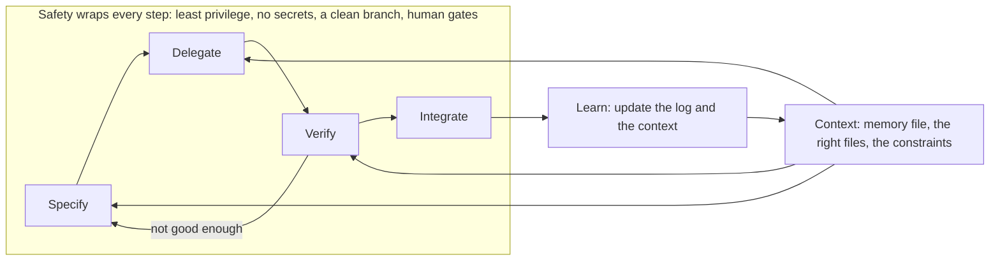

# Module 0 — Orientation: becoming AI-native

*Welcome to the Payments Platform team at Najm Bank. Before you let an agent write a line of Najm Remit, this module settles three things. Lesson 0.1 says what an AI-native engineer is and is not: the shift from typing code to directing, verifying and owning it, the five habits the whole course trains, what the research does and does not show, and the honest limits of the course. Lesson 0.2 is your setup lab: the agentic coding tools, a safe starting configuration (permission modes, secrets, what never goes into a prompt), the Najm Remit repository and the offline ailab kit, ending with lab m00, a one-word fix that takes you once around the loop. Lesson 0.3 names that loop, specify, delegate, verify, integrate, with context feeding it and safety around it, and gives you the delegation card and the principle that the author of record stays accountable. The ailab kit needs no API key (your own agentic tool may need an account), and everything on the Najm side is fictional.*

> **Focus:** Mindset, Workflow, Secure — what an AI-native engineer is, how to set up safely, and the loop the rest of the course trains.

---

# 0.1 — What an AI-native engineer is (and is not): the shift, five habits and the evidence
*Level: 🟢 Beginner* · *Prerequisites: none* · *Focus: Mindset*

## ⚡ In 60 seconds
- The **shift**: you type less and do more directing, verifying and owning. The agent drafts; you answer for every line.
- AI use is a **spectrum**, from autocomplete to parallel agents, not a ladder. Pick the point that fits the task and what you can check.
- **Vibe coding** means accepting code without reading it; **AI-native engineering** is the opposite: accountable and verified. An **AI engineer** builds AI products, a different job.
- Five habits carry the course: **Context first**, **Specify before you delegate**, **Small verified steps**, **Trust evidence, not fluency**, **Automate the loop, keep the skill**.
- The evidence is mixed and setting-specific. Feeling fast is not being fast.
- Decision cue: before delegating, ask "could I tell if this were wrong?"

## 🧭 Why it matters
On Thursday afternoon Lujain, the graduate engineer on the Payments Platform team, closes ticket REMIT-231 in fifteen minutes. Her agent wrote the change, reported "all tests pass" and she committed. On Friday morning Hessa's support team opens the history in their spreadsheet and the fee column shows the wrong numbers. Tariq, the engineering lead, asks Lujain one question: "Who is the author of this change?" She says the agent wrote it. Tariq says no: the author is whoever's name is on the commit, and that person has to explain every line.

Nothing in that story is about a bad tool. It is a missing way of working: no context about who reads the output, no definition of done, no look at the diff. This course builds that way of working over fourteen weeks on one small codebase.

## 📐 How it works

### 🟢 The essentials

**The shift.** Agents make a first draft cheap. What stays scarce is knowing what to build, giving the tool what it needs, and telling a right draft from a plausible one. Typing code takes less of your day; writing down what "done" means, checking someone else's draft at speed and owning a change you did not type take more. You cannot verify what you cannot read, so the fundamentals matter more, not less.

**A spectrum, not a ladder.** Four common ways to use AI while you code; none makes the others wrong.

| Mode | What it is | Reach for it when | Main risk |
|---|---|---|---|
| **Autocomplete** | Suggests the next lines as you type | You know what you are writing | Accepting by reflex |
| **Chat** | You ask or paste; you apply the answer | Explaining, comparing options, drafting a snippet | Pasting data you should not; trusting confidence |
| **Agentic coding** | The tool reads files, edits them and runs commands in a loop; you review a diff | A bounded task with a check | A large diff you skim |
| **Parallel agents** | Several sessions work at once, each in its own copy | Independent tasks you can verify separately | Review becomes the bottleneck |

Choose per task: can I check the result, how much damage if it is wrong, and is the task specified well enough to hand over?

**Vibe coding and what this course teaches.** Andrej Karpathy coined "vibe coding" in early 2025 for programming where you give in to the vibes and forget the code exists (as widely quoted). Simon Willison drew the useful line: it is "building software with an LLM without reviewing the code it writes", unlike professional work that must be maintainable and secure. Throwaway prototypes are a fair use. Najm Remit moves money, where accepting unread code is a process defect. AI-native engineering uses the same tools but you read, test and answer for the result.

**AI-native engineer or AI engineer?** An **AI-native engineer** works *with* AI tools. An **AI engineer** builds products *on* models: chatbots, retrieval, customer agents. This course is the first; the second is the companion course [*Building AI Applications & Agents*, lesson 0.1 — What it takes to ship an enterprise-grade agent](../aiapps/index.html#/0.1). If you cannot program yet, start with [*System Design for Vibe Coders*, lesson 9.5 — Claude Code power techniques](../vibe/index.en.html#l9-5).

**The five habits.** They are the spine of every lab.

| Habit | In one sentence | It prevents | Trained in |
|---|---|---|---|
| **Context first** | Give the agent what it needs before you say what to do | A right answer to the wrong problem | Module 2 |
| **Specify before you delegate** | Write down what done means, what is out of scope, and the plan | "It works" with no agreed meaning | Module 3 |
| **Small verified steps** | Short loops with a check after each: tests, diff, commit | A 600-line surprise | Module 4 |
| **Trust evidence, not fluency** | A confident answer is not evidence; tests and diffs are | Shipping a plausible mistake | Module 5 |
| **Automate the loop, keep the skill** | Turn repeated steps into commands and hooks; keep practising the basics | Slow routine; rusty judgement | Modules 9 and 13 |

### 🟡 Going deeper

**One ticket, two afternoons.** Hessa's ticket:

```text
REMIT-231: show express transfers in the history output

Support cannot tell from `python -m remit history` which transfers were sent
express. Customers ask why their fee was 27.00 and not 12.00.
Please show it.
```

(Express adds a flat surcharge: QAR 500 on QAR-INR costs 27.00, not 12.00.) Both afternoons are constructed for teaching, not recorded from a real model.

**Lujain's Thursday.**

| Time | What she does | What is missing |
|---|---|---|
| 13:05 | Types `add express to history` | No context, no definition of done |
| 13:12 | The agent inserts a speed column after the corridor and edits the old test to match. "Done. All tests pass." | A changed test is a signal |
| 13:20 | Reads the summary, not the diff; commits "added express to history" with no `AI-assisted` label | Evidence; the team's rule |
| Fri 09:30 | Support's spreadsheet reads columns by position, so everything after the corridor shifts. Revert; two hours of rework | Nobody asked who reads it |

**Your afternoon, with the habits.**

| Time | What you do | Habit |
|---|---|---|
| 13:00 | Read `CONTRIBUTING.md` and `docs/TOUR.md`. Ask Hessa who reads the history output: a spreadsheet, by column position, so nothing may move. New branch | Context first |
| 13:10 | Write the specification below; ask for a plan; edit it so the failing test comes first | Specify |
| 13:25 | The test fails for the right reason; then the change | Small verified steps |
| 13:45 | Run the suite yourself, read `git diff --stat`, confirm no old test changed, run a real `send --express` and `history` | Trust evidence |
| 14:05 | Commit `feat(cli): show express transfers in history`; label the pull request `AI-assisted`; log it | Integrate; keep the skill |

The prompt that replaces it:

```text
Goal: in `python -m remit history`, mark express transfers so support can tell them apart (REMIT-231).
Context: read CONTRIBUTING.md and docs/TOUR.md first. History is printed by `_run` in src/remit/cli.py.
Transfer.express already exists in src/remit/models.py, so no storage change is needed.
Support's spreadsheet reads each line by column position.
Done means:
- An express transfer's line ends with two spaces and the word `express`. Nothing else on the line changes.
- A standard transfer's line is byte-for-byte what it is today.
- One new test for the express line. No existing test is edited.
Non-goals: do not touch money.py, fees.py or service.py; no new options; no reformatting.
Process: plan first, then write the failing test and show me it fails, then make it pass. Do not commit.
```

The careful afternoon took seventy minutes against fifteen, and the careless one was not finished. Do not over-read it: for a throwaway script this is overkill. Match the care to the stakes.

**What the evidence says, and what it does not.** Four sources; check a number against its original before you repeat it. Some have vendor-affiliated authors (GitHub and Microsoft Research, Google, Anthropic).

| Source | Setting | What it reported | Its own caveat |
|---|---|---|---|
| METR randomized trial, 2025 | 16 experienced open-source developers, 246 tasks in their own mature repositories, early-2025 tools | Tasks took 19% longer with AI allowed. They had forecast 24% faster and afterwards believed 20% faster | Very specific setting; METR says results may differ elsewhere and with later models |
| Peng et al., 2023 | One self-contained task: an HTTP server in JavaScript | Copilot group 55.8% faster, 95% interval 21% to 89% | One task, lab-style, wide interval |
| DORA reports, 2024 and 2025 | Surveys of technology professionals | 2024: more AI adoption went with lower throughput and stability. 2025: throughput turned positive, stability stayed negative. AI amplifies what is already there | Associations, not causes; self-reported |
| Shen and Tamkin, Anthropic, 2026 | 52 mostly junior engineers learning an unfamiliar library | AI group scored 50% on a comprehension quiz, hand-coders 67%; no significant speed gain | Small, preliminary; Anthropic makes Claude Code |

Together they show gains on well-scoped tasks with wide error bars, a loss for experienced people on familiar code in one trial, and, in DORA's surveys, results that seem to depend on the practices around the tool. They do **not** show that AI makes everyone faster or slower, that effects carry across tool generations (METR's 2026 update guesses developers are now faster, but calls its newer data very weak evidence of how much), that DORA's associations are causal, or what happens to skills over years. The METR developers misjudged their own speed, hence the agent log's "minutes" column.

### 🔴 Expert view

**What stays human.** Five things do not delegate: **judgement** (is this the right change?), **ownership** (someone answers for it), **requirements** (the spreadsheet nobody wrote down), **risk** (which files are money logic) and **taste**. Agents can help with each; none can hold it.

**A working definition, and why none is standard.** "AI-native" has no agreed meaning. Sources use it for a personal way of working (Addy Osmani's 2025 essay: AI as a junior pair programmer), a job-level skill set, or an organisation's operating model (Anthropic's 2026 playbook: the process "becomes a loop", with AI embedded at each point). Several authors sell something; they agree that you redesign the workflow and its controls, not just add a tool. The course's **working definition** is ours, not a standard:

> An AI-native engineer routinely directs AI tools in daily work and stays accountable for the result. They supply context, define done before delegating, work in small verified steps, judge output by evidence, and automate what repeats without letting their own skill lapse.

**Two companies describing their own practice.** Microsoft's post "Spec-Driven Development: A Spec-First Approach to AI-Native Engineering" argues that teams should agree on intent before an AI generates code, and offers its open-source GitHub Spec Kit for the job. Spec-first is part of how Microsoft uses "AI-native"; your second habit makes the same bet, and Module 3 returns to it. Meta reports in "How Meta Built Forum With AI-Native Engineering" that a small team built Forum, a standalone Groups app, with an AI agent as a participant. Its target is "human-on-the-loop": the agent runs the plan, build, test and correct cycle while an engineer sets the goal and approves the result. Meta calls it a target, not a finished state, and sets the bar for done at verification (automated tests and visual checks), not compilation; Lujain's Thursday had green tests and no look at the real output. Each is a company's account of its own work, not independent evidence; read the originals, linked below.

**How the course works.** One module a week (Modules 0 to 13), then the capstone; each has a concept lesson and a lab or workshop. Labs run on **Najm Remit**, a small Python service, graded by **`ailab`**, an offline kit: no API key, no network, no agent required. Use Claude Code, another tool or none; the grader looks at the result. Each lab ends with a deliverable, a group session and an **agent log**. **Najm Bank is fictional**, as are its customers, rates and limits. Your team: **Tariq** (your mentor, who runs the weekly "AI-native clinic"), **Lujain** (enthusiastic, over-trusting) and **Hessa** (product owner, writes the tickets). Colleagues in quality, security, SRE, governance and platform join in their own modules.

**Honest limits.** The course cannot promise you will be faster. Tools change fast: its Claude Code details were checked against the documentation in October 2026, so check the current pages. The labs are small and fictional, and the grader checks results, not understanding. The aim is to help you tell when an agent is wrong.

## 🧰 The toolkit
| Tool, practice or pattern | What it is and does | When to reach for it |
|---|---|---|
| **The five habits** | The course's spine, named in this lesson and trained module by module | Every task; an audit when something goes wrong |
| **Delegation spectrum** | Autocomplete, chat, agentic coding, parallel agents, chosen per task | Before any piece of work |
| **Baseline self-check** | Ten statements scored 0 to 2, two per habit | Now, and again at the capstone |
| **Agent log** | A few lines per AI-assisted task: prompt, what happened, what you fixed, minutes | After every lab and real task |

## 🏛️ In practice at Najm Bank
Two artefacts, kept in a notes repository outside the lab folders.

**First, the baseline self-check.** Score each statement 0 (never), 1 (sometimes) or 2 (usually) as you work today. The scale is the course's own, not a validated instrument: a mirror, not a grade.

```markdown
# Baseline before Module 1          Date:

Context first
 C1 Before I prompt I read the repo's notes and ask who uses what I change    [0|1|2]
 C2 I know what my tool can see, and I start a fresh session per task        [0|1|2]
Specify before you delegate
 S1 I write what done means (the checks that prove it) before any code       [0|1|2]
 S2 I write down what is out of scope and what must not change              [0|1|2]
Small verified steps
 V1 I commit in small steps and can undo the last one in a minute            [0|1|2]
 V2 I stop an agent heading the wrong way instead of waiting for it          [0|1|2]
Trust evidence, not fluency
 E1 I read the whole diff, test files included, before I commit              [0|1|2]
 E2 I run the checks myself instead of trusting "tests pass" in a summary    [0|1|2]
Automate the loop, keep the skill
 A1 I turn steps I repeat into a command, script or hook                     [0|1|2]
 A2 I still write or debug code by hand often enough to stay sharp           [0|1|2]

Total (0-20):      Lowest habit:      The one habit I will watch this week:
```

**Second, the agent log.** One entry per AI-assisted task. Fill the minutes honestly.

```markdown
Entry: 2026-10-22, REMIT-231, branch remit-231-history-express
Prompt (paste or summarise):   spec: express at line end, no existing test edited
What the agent did:            plan, failing test, edit to cli.py, one new test
What I corrected:              it first inserted a column; I asked for end of line
What I checked myself:         full suite, git diff --stat, real send --express + history
Minutes:                       context and spec 25 · agent 20 · verify 20 · integrate 5
Would I delegate it again?     Yes, with the same spec
```

## 🛠️ Exercises
*None of these needs an agent.*
- 🟢 **Score your baseline.** *Done when:* `baseline.md` has ten scores, a total, your lowest habit and one change for this week.
- 🟡 **Map your own use.** Place five recent tasks on the spectrum. *Done when:* a five-row table says whether each mode was right, what you could check, and which task you would move.
- 🔴 **Audit one claim.** Trace a number you have heard about AI and developer productivity to its source. *Done when:* half a page names the source, setting, authors, finding, two caveats, and whether it applies to your work.

## ⚠️ Mistakes and traps
- **Trusting the feeling of speed.** The METR developers felt faster; the clock disagreed. Time yourself.
- **Treating vibe coding as a sin, or a method.** Fine for a throwaway; a defect on money logic. Decide by stakes.
- **Climbing the ladder for its own sake.** Move up only when you can verify what comes back.
- **Quoting one study as a law.** Each number belongs to a setting, a tool generation and a group of people.

## 🧾 Recap
- The work shifts from typing code to directing, verifying and owning it; the engineer stays accountable.
- AI use is a spectrum chosen per task. Vibe coding accepts unread code; AI-native engineering is accountable and verified.
- The five habits: Context first, Specify before you delegate, Small verified steps, Trust evidence, not fluency, Automate the loop, keep the skill.
- The evidence is mixed, setting-specific and partly vendor-made; no universal rule follows. "AI-native" has no standard definition; the course's is a working one.

## ✍️ Check yourself

**1. Lujain says: "I vibe-coded the history change. The agent wrote it and the tests pass." What makes this unlike what the course teaches?**

- A. She used an agentic tool rather than typing the change herself
- B. She accepted the change without reading it or being able to defend it
- C. She chose a chat window when autocomplete would have done
- D. She ran the tests before opening the pull request

<details><summary>Answer</summary>

**B.** Using an agent is fine. What is missing is review: the author must be able to explain and defend every line. (🟢 Vibe coding.)

</details>

**2. A colleague says "a study showed AI makes developers 55% faster, so plan for it." What is the best first move?**

- A. Plan for 55%, since a controlled experiment backs it up
- B. Plan for 19% slower, since another trial found that
- C. Compare the study's setting with yours before planning
- D. Average the two studies and plan for the midpoint

<details><summary>Answer</summary>

**C.** The 55.8% came from one self-contained task; the 19% slowdown from experienced developers in their own repositories. Neither is a law, and averaging numbers from different settings is no better. (🟡 What the evidence says.)

</details>

**3. Tariq asks which engineer is working most like an AI-native engineer. Which answer fits the lesson?**

- A. Rana runs six parallel agents all day and reads the summaries
- B. Omar writes every line by hand to avoid any risk
- C. Sami accepts every autocomplete suggestion to save time
- D. Dina uses chat for design, an agent for tests, and reads each diff

<details><summary>Answer</summary>

**D.** The mode is chosen per task and tied to what you can check. Rana skips review, Sami accepts by reflex, Omar avoids the tools. (🟢 A spectrum, not a ladder.)

</details>

**4. Hessa asks the team to add a chat assistant for customers to the Najm app. Which course covers building it?**

- A. This course, because it is about working with agents
- B. *Software Testing*, because every feature needs tests
- C. *System Design for Vibe Coders*, because it covers agents
- D. *Building AI Applications & Agents*, the companion course

<details><summary>Answer</summary>

**D.** Building products on models is AI engineering. This course is about how an engineer works with AI tools. (🟢 AI-native engineer or AI engineer?)

</details>

**5. Lujain's agent changed the history output without anyone asking who reads it. Which habit was skipped first?**

- A. Context first
- B. Specify before you delegate
- C. Small verified steps
- D. Automate the loop, keep the skill

<details><summary>Answer</summary>

**A.** That support's spreadsheet reads columns by position was context only a person could supply. (🟡 One ticket, two afternoons.)

</details>

## 📚 References
- Claude Code documentation: https://code.claude.com/docs/en/overview
- [*Building AI Applications & Agents*, lesson 0.1 — What it takes to ship an enterprise-grade agent](../aiapps/index.html#/0.1); [*Software Testing*, lesson 6.1 — Verifying AI-generated code](../testing/index.html#/6.1)
- **Go deeper (evidence).** METR, "Measuring the Impact of Early-2025 AI on Experienced Open-Source Developer Productivity": https://metr.org/blog/2025-07-10-early-2025-ai-experienced-os-dev-study/ and its 2026 update https://metr.org/blog/2026-02-24-uplift-update/. DORA 2025: https://cloud.google.com/blog/products/ai-machine-learning/announcing-the-2025-dora-report. Anthropic, "How AI assistance impacts the formation of coding skills": https://www.anthropic.com/research/AI-assistance-coding-skills.
- **Go deeper (two companies' own accounts).** Microsoft for Developers, "Spec-Driven Development: A Spec-First Approach to AI-Native Engineering": https://developer.microsoft.com/blog/spec-driven-development-ai-native-engineering/. Engineering at Meta, "How Meta Built Forum With AI-Native Engineering": https://engineering.fb.com/2026/10/15/ml-applications/how-meta-built-forum-ai-native-engineering/.
- **Go deeper (the term).** Simon Willison, "Not all AI-assisted programming is vibe coding (but vibe coding rocks)": https://simonwillison.net/2025/Mar/19/vibe-coding/. Anthropic, "The AI-native SDLC playbook": https://claude.com/blog/the-ai-native-sdlc-playbook. Addy Osmani, "The AI-Native Software Engineer": https://addyo.substack.com/p/the-ai-native-software-engineer.

---

# 0.2 — Your setup: tools, safe configuration, the Najm Remit repo and the ailab kit
*Level: 🟢 Beginner* · *Prerequisites: 0.1* · *Focus: Workflow, Secure*

## ⚡ In 60 seconds
- Setup is four things: an approved tool, a permission mode that fits the risk, a clean place to work, and the `ailab` kit.
- Start in Manual (`default`) mode. Never use `bypassPermissions` where real credentials live. Auto mode is a classifier's judgement, not a wall.
- Keep secrets out of prompts and out of reach: whatever the agent reads enters its context.
- Clean tree, a branch per task, a throwaway directory: then `git diff` shows only what the agent did.
- The kit: `python -m ailab doctor | list | start | grade | solve`. Offline, no API key. The grader is a practice partner, not a gate.
- Lab m00: fix a typo, run the tests, commit as `type(scope): subject`. Needs an agent: no.

## 🧭 Why it matters
On her second day Lujain tires of permission prompts and switches her agent to bypass mode. Her laptop holds a VPN profile, a cloud login and an old project's `.env`. Nothing happens. That is the trap: the bad day is rare, so safety feels like friction. Noura (application and AI security) has a rule for week zero: the agent has your hands. Whatever you can read, delete or push, it can.

Public reports show what rare looks like. One user said Google's Antigravity agent, in "Turbo mode", deleted a drive's contents when asked to clear a project cache (November 2025); a founder said a Replit agent deleted a production database during a code freeze (July 2025). Both are unaudited single accounts, so hold the details loosely. The pattern maps onto OWASP's excessive agency (LLM06): too much functionality, permission or autonomy.

## 📐 How it works

### 🟢 The essentials

**Tools.** This table is alphabetical, paraphrases each vendor's own description and ranks nothing.

| Tool (documentation) | The vendor's description |
|---|---|
| [Aider](https://aider.chat/docs/) | Pair programming with LLMs on a new or existing codebase |
| [Claude Code](https://code.claude.com/docs/en/overview) | An agentic coding tool that reads your codebase, edits files and runs commands |
| [Cursor](https://cursor.com/docs/agent/overview) | An agent that searches the codebase, edits files and runs terminal commands |
| [Gemini CLI](https://geminicli.com/docs/) | An open-source AI agent that brings Gemini into your terminal |
| [GitHub Copilot agent mode](https://docs.github.com/en/copilot/how-tos/copilot-in-your-ide/use-copilot-agents/use-agent-mode) | Edits code on its own for a task; you review and, by default, approve commands |
| [OpenAI Codex CLI](https://developers.openai.com/codex) | A coding agent that runs locally on your computer |

The examples use Claude Code. The habits do not depend on one tool, and the grader never knows which you used.

**Install and start Claude Code.** Installation steps change: follow the official setup page linked from the overview above, not a command from a blog, a chat answer or this lesson. `claude --version` then prints your version. IDE and desktop versions exist; learn in the terminal, where the lesson commands are typed. Next, `cd` into your work directory and run `claude`; expect a sign-in step (at Najm, the approved one).

**The trust dialog.** In a folder it has not seen, Claude Code asks whether you trust it. Yes lets the project's own settings and hooks apply (its tool servers get a separate prompt), so say yes only to a folder you have read. Project `allow` rules apply after you accept; `deny` and `ask` rules at once. Do not start in your home directory: it widens what the agent can reach. (Check the current documentation.)

**Permission modes.** They decide what runs without asking.

| Mode | Runs without asking | For you |
|---|---|---|
| Manual (`default`) | Reads only | Weeks 0 to 3, anything new |
| `plan` | Reads; proposes, does not edit | Exploring and planning |
| `acceptEdits` | Reads, file edits, simple file commands in the working directory | A throwaway directory, once you read every diff |
| `auto` | Everything, with a classifier reviewing | Not yet (Module 8) |
| `dontAsk` | Only pre-approved tools; the rest is denied | Scripted runs (Module 9) |
| `bypassPermissions` | Everything (deny rules still apply) | Never with real credentials on the machine |

Switch with Shift+Tab or `/plan`. The documentation says to use bypass mode only "in isolated environments like containers, VMs, or dev containers without internet access", and that it "offers no protection against prompt injection or unintended actions". Auto mode adds a reviewing model, but the documentation says it does not guarantee safety. Starting modes vary by version (recent ones document `auto` as the terminal default), so read the status bar and begin with `claude --permission-mode default`.

### 🟡 Going deeper

**A safe starting file.** Save this as `~/.claude/settings.json`, your user settings (check the current documentation for key names).

```json
{
  "permissions": {
    "defaultMode": "default",
    "deny": [
      "Read(./.env)",
      "Read(./.env.local)",
      "Read(~/.ssh/**)",
      "Read(~/.aws/**)",
      "Bash(git push *)"
    ]
  }
}
```

Keep it out of the lab folder: the m00 grader counts every changed file, so a committed `.claude/settings.json` fails the scope checks (`.claude/settings.local.json` is ignored). A `deny` beats an `allow` in any scope. There is no `allow` for `pytest` on purpose: tests are code, and a user-level rule would reach repositories you have not read. In one you trust, choose "don't ask again" once; the rule is saved to `.claude/settings.local.json`. The list names `.env` and `.env.local`, not `.env.*`, which would hide the harmless `.env.example`. These are guard rails, not walls: `Bash(git push *)` does not stop `git -C . push`. The sandbox (`/sandbox`, off by default) and hooks enforce (Module 8).

**Secrets and `.env`.** Remit takes settings from environment variables and never loads a `.env` file; `.gitignore` already ignores it. Assume everything the agent reads is in its context and a transcript: Claude Code keeps local transcripts as plain text under `~/.claude/projects/`, for 30 days by default. If a secret reaches a prompt, treat it as leaked and rotate it.

**What never goes into a prompt.** Najm's rules: approved tools only, in approved environments, with no Confidential or Restricted data and no secrets in prompts or agent contexts.

| Never paste | Do instead |
|---|---|
| Keys, tokens, passwords, connection strings | Name the variable; rotate if one leaks |
| Real customer names, account or ID numbers | Use the fictional Remit data or invent some |
| Production logs with personal data | Mask first, paste the shape |

On data use, the documentation says commercial plans are not used for training unless the customer opts in, while consumer accounts choose; read the current page and your organisation's terms.

**Sessions.** Long sessions cost more and work worse (the documentation's "kitchen sink session"), so use a fresh session per task; `/usage` shows session cost and `/context` what fills the window.

**Environment hygiene.** *Clean tree:* `git status` shows nothing before the agent starts, so `git diff` is the agent's work and only that. *Branch per task:* `git switch -c remit-212-typo` makes undo a branch delete. *Throwaway directory:* labs live in `~/ainative/`, never in a repository you care about. Checkpoints (`/rewind`) miss shell changes such as `rm` and are no substitute for git.

### 🔴 Expert view

**How the kit works.** `start` copies the base repository, runs `git init` on `main`, commits "Initial state", applies the lab's seed as "Lab starting state", tags it `lab-start` and writes `TASK.md`; `git diff lab-start` is your work. `grade` copies your directory and runs hidden tests in a subprocess, never importing your code; it exits 0 only when every required check passes. `solve` applies the reference solution; it is a peek, so try first.

**The repo tour.** Read `README.md`, `CONTRIBUTING.md` and `docs/TOUR.md`, in that order. A transfer runs `validate, limits, screening, fee, fx, ledger, store, notify` in `service.py`, stopping at the first failure. Money is `Decimal` in the `Money` class, never `float`. `ledger.py` and `screening.py` are old and have no tests. `najmkit` is Najm's internal library for ids, time and audit events; no model was trained on it, so tell an agent to read `docs/najmkit.md`. When a doc and the code disagree, the code wins. Try the CLI (`PYTHONPATH=src` lets Python find the package; the README also shows `python -m pip install -e .`):

```text
$ PYTHONPATH=src python -m remit quote QAR 500 INR
Corridor:  QAR -> INR
Send:      500.00 QAR
Fee:       12.00 QAR
Total:     512.00 QAR
Rate:      22.5720 (valid for 60 s)
Receive:   11286.00 INR
Delivery:  bank_deposit
```

## 🧰 The toolkit
| Tool, practice or pattern | What it is and does | When to reach for it |
|---|---|---|
| **Permission modes** | Manual, plan, acceptEdits, auto, dontAsk, bypassPermissions | Every session; check the status bar |
| **Deny rules** | Settings entries that block reads of secrets and risky commands | Before the first session, in user settings |
| **Branch per task** | A clean tree and one branch per ticket | Every task |
| **ailab kit** | `doctor`, `list`, `start`, `grade`, `solve`: an offline lab runner | Every lab |
| **Conventional Commits** | `type(scope): subject`, as `CONTRIBUTING.md` defines it | Every commit |

## 🏛️ In practice at Najm Bank
*Needs an agent: no. Do it by hand first; the agent pass is optional, and the grader cannot tell which you used. With no agent, a chat assistant works for the comparison (paste only fictional code), or log the by-hand attempt alone.*

**The ticket.** This is `task.md`, as Hessa wrote it.

> ```text
> # REMIT-212: spelling mistake in the "transfer sent" message
>
> **From:** Hessa, Product Owner, Najm Remit
> **To:** Payments Platform
> **Priority:** Low, but every customer who sends money sees it
>
> A customer wrote to us: the English message we send after a transfer has a spelling
> mistake in it. Please fix it.
>
> Right now the test suite is red because of it. It is a good first task: small, safe, and
> a chance to go through the whole loop once (find, fix, check, commit).
>
> ## What I need
>
> 1. The English "transfer sent" message is spelled correctly again.
> 2. `pytest -q` passes.
> 3. The change is as small as it can be: one message, nothing else. Please do not edit
>    the tests; they are right.
> 4. It is committed as **one commit**, with a message that follows the team's rules in
>    `CONTRIBUTING.md`.
>
> ## Notes
>
> - Use whatever helps you: your editor, or an AI coding tool if you have one. If a tool
>   makes the change, read the diff before you commit. You are the one who is accountable
>   for it.
> - Run `python -m ailab doctor` first if you have not already.
> - When you think you are done, grade it from the `ailab` folder of the course repository:
>   `python -m ailab grade m00 --dir <this directory>`
> ```

**Start.** You need Python 3.11 or newer and git.

```bash
cd ~
git clone https://github.com/Tamoura/system-design-for-vibe-coders.git
cd system-design-for-vibe-coders/ainative/ailab
python -m venv .venv && source .venv/bin/activate    # Windows: .venv\Scripts\activate
python -m pip install -r requirements.txt            # pytest, nothing else
python -m ailab doctor
python -m ailab start m00 --dir ~/ainative/m00
cd ~/ainative/m00
```

`doctor` prints a `[PASS]` or `[FAIL]` line per check (Python 3.11 or newer, git, pytest, a writable folder, your git identity, the kit files) and ends with `Everything needed is in place.` Fix any FAIL first.

**Your move, by hand first.** Run `git switch -c remit-212-typo`, then `pytest -q` and read the first failure from the top: it shows what was expected and what came out. Search for that text (`grep -rn --include='*.py' "<a phrase from the message>" src`, or your editor), make the smallest edit, rerun `pytest -q` and read `git diff`. Commit once. `CONTRIBUTING.md` requires `type(scope): subject`: a type from `feat fix docs test refactor perf chore ci build revert`, a required lower-case scope, an imperative subject, no full stop, a header up to 72 characters (example: `fix(limits): count transfers made just after midnight`). Time yourself and log it.

**Then with an agent** (optional), in a second directory (`ailab start m00 --dir ~/ainative/m00-agent`). The weak prompt `fix the typo in the message` names no file, limit or stopping point, so the agent may rewrite the sentence or a test. Start in Manual mode with a stronger one and read every diff:

```text
Goal: fix REMIT-212 (see TASK.md): the English "transfer sent" message has a spelling mistake.
Context: Python 3.11; tests run with `pytest -q`; commit rules are in CONTRIBUTING.md. Read TASK.md and CONTRIBUTING.md first.
Constraints: change as little as possible; do not edit any test; do not commit.
Acceptance: `pytest -q` passes; `git diff` shows one file and one line changed.
First tell me the file and line that cause it. Wait for my OK before editing.
```

You commit, with a message you checked against `CONTRIBUTING.md` yourself: the grader wants one commit in that shape, and you are the author of record. Do not run `/init` or add a `CLAUDE.md` here: extra files count against you, and memory files are Module 2.

**What the grader checks.** `doctor` and the repo's tests pass; hidden checks on the customer-visible message in English and Arabic; the tests not edited; only the template file changed, and tiny; exactly one new commit that follows `CONTRIBUTING.md`, nothing left uncommitted; no secrets. It cannot tell who made the change, whether you read the diff, or whether your message is good beyond its shape.

**Grade.**

```bash
cd ~/system-design-for-vibe-coders/ainative/ailab      # with the virtual environment active
python -m ailab grade m00 --dir ~/ainative/m00
```

On the starter state the real output is:

```text
[PASS] Your environment passes `ailab doctor`
[FAIL] Your tests pass: 97 passed, 2 failed: test_customer_send_and_history_share_a_database_file, test_transfer_sent_in_english
       hint: Run `pytest -q` in your repository and read the first failure from the top.
[FAIL] The message is right in English and Arabic: 3 of 5 hidden checks failed: test_english_transfer_sent_spells_received_correctly, test_english_transfer_sent_is_otherwise_unchanged, test_the_misspelling_is_gone_from_the_whole_source_tree
       hint: Compare the message your customers get with the sentence the failing test expects.
[PASS] The tests were not edited
[FAIL] Only the template file changed: no files have changed yet
       hint: Make the change the ticket asks for.
[FAIL] The change is tiny: 0 files, +0 -0 lines (nothing substantial has changed yet)
       hint: This is a one-word fix. Look at `git diff lab-start` and remove anything else.
[FAIL] Exactly one new commit: 0 new commits since the start
       hint: Commit your finished change (git add -A && git commit).
[FAIL] Commit messages follow CONTRIBUTING.md: found 0 commits since the start; expected at least 1
       hint: Commit your change.
[PASS] The fix is committed (nothing left over)
[PASS] No secrets in the change

Lab m00: 4/10 required checks passed: NOT YET
```

A right fix committed as `fixed the typo` fails one line, `Commit messages follow CONTRIBUTING.md`, whose detail quotes your message and says it does not look like `type(scope): subject`; the hint says to amend. Once fixed, the last line reads `Lab m00: 10/10 required checks passed: PASSED`.

**Weekly deliverable (Module 0).** In your notes repository, not in `~/ainative/m00`, commit `week-00/` with `baseline.md` (lesson 0.1), `agent-log.md`, `m00-grade.txt` (the final grade output) and `delegation-card.md` (lesson 0.3, for REMIT-212). The m00 repository holds exactly one new commit.

**Group session (60 minutes).** (1) Name your lowest baseline habit (10). (2) Swap `git diff lab-start` and explain the change in a sentence (15). (3) Compare by-hand and agent logs (15). (4) State your starting permission mode and why (10). (5) Agree the group's never-paste list (10).

**Debrief.** What did the agent get wrong, or nearly? What did your context or spec miss? What did you check that its summary did not tell you? Which way was faster, and did the log agree with your feeling?

**Agent log.** Use the lesson 0.1 template: one entry per attempt.

## 🛠️ Exercises
- 🟢 **By hand.** *No agent.* *Done when:* `grade` prints `PASSED`, the repository has one new commit on a task branch, and your log has an entry with minutes.
- 🟡 **With an agent, then compare.** *Needs an agent (optional).* Redo it in a fresh directory, in Manual mode. *Done when:* `PASSED` again, and a table compares both attempts on minutes, prompts and what the agent did that you would not have.
- 🔴 **Prove your guard rails.** *Needs an agent.* Install the settings file above, put a `.env` holding only `FAKE_KEY=not-a-real-secret` in a separate throwaway directory (not an m00 repository), start `claude` there and ask it to read the file. *Done when:* a note records your starting mode, what the tool did when the deny rule applied (wording varies), and why a `Bash(git push *)` deny is not a wall.

## ⚠️ Mistakes and traps
- **Bypass mode "to stop the prompts".** Allow-list the safe commands you keep approving instead.
- **Settings or `/init` in the lab repository.** Extra files fail the scope check.
- **Trusting "tests pass" in the summary.** Run `pytest -q` yourself.
- **Peeking at `hidden/` (it is readable in the kit) or running `solve` first.** The grader is a practice partner, not a gate; peeking defeats the practice.

## 🧾 Recap
- Use an approved tool; learn in Manual mode; treat bypass as off limits on a real machine.
- Keep secrets out of prompts and reach; deny rules are guard rails, while the sandbox and hooks enforce.
- Clean tree, branch per task and a throwaway directory keep the diff honest.
- The kit grades the result offline, not your thinking.
- m00 is the whole loop in miniature: find, fix, check, commit as `type(scope): subject`.

## ✍️ Check yourself

**1. Lujain is tired of approving `pytest` runs. What fits this lesson best?**

- A. Switch to `bypassPermissions`, since the lab data is fictional
- B. Turn off the trust dialog so fewer prompts appear
- C. Add a narrow allow rule for `pytest` and stay in Manual mode
- D. Switch to `auto` mode, which guarantees safety

<details><summary>Answer</summary>

**C.** A narrow allow rule, saved in that repository's local settings, removes the prompt she keeps approving and widens nothing else. Auto mode does not guarantee safety. (🟡 A safe starting file.)

</details>

**2. You want deny rules for `.env` that apply in every project and never show up in m00's diff. Where do they go?**

- A. `.claude/settings.json` in the lab directory, committed
- B. `~/.claude/settings.json`, your user settings
- C. `TASK.md`, so the agent reads them first
- D. A comment at the top of `notify.py`

<details><summary>Answer</summary>

**B.** User settings apply everywhere and live outside the repository; a committed project file counts as a changed file. (🟡 A safe starting file.)

</details>

**3. You paste a stack trace into a prompt and notice it holds a live API token. What do you do?**

- A. Delete the message; the transcript is not stored
- B. Ask the agent to forget the token
- C. Nothing, since the repository is private
- D. Treat the token as leaked and rotate it

<details><summary>Answer</summary>

**D.** Transcripts are kept as plain text for 30 days by default, and the content has left your machine; deleting it or asking the tool to forget does not undo that. (🟡 Secrets and `.env`.)

</details>

**4. `grade` shows every line PASS except the commit-message check, which quotes your message "fixed the typo". What now?**

- A. Amend the commit with a `type(scope): subject` message
- B. Add a second commit with a better message
- C. Edit the hidden test so the message is accepted
- D. Rerun `ailab doctor`, which re-checks messages

<details><summary>Answer</summary>

**A.** The check wants exactly one commit in the right shape, so amend it; a second commit breaks "Exactly one new commit". (🏛️ Grade.)

</details>

**5. Why is `Bash(git push *)` in the deny list not full protection?**

- A. Deny rules apply only after you accept the trust dialog
- B. Bash patterns can be sidestepped, as with `git -C . push`
- C. Deny rules work for file reads only
- D. A matching allow rule in another scope overrides it

<details><summary>Answer</summary>

**B.** Bash rules match command text, so variants slip past; the sandbox and hooks enforce. (🟡 A safe starting file.)

</details>

## 📚 References
- Claude Code documentation: permission modes https://code.claude.com/docs/en/permission-modes, permissions https://code.claude.com/docs/en/permissions, security https://code.claude.com/docs/en/security, data usage https://code.claude.com/docs/en/data-usage, costs https://code.claude.com/docs/en/costs, sandboxing https://code.claude.com/docs/en/sandboxing, settings https://code.claude.com/docs/en/settings
- The lab kit: https://github.com/Tamoura/system-design-for-vibe-coders/tree/main/ainative/ailab. Conventional Commits: https://www.conventionalcommits.org. Git: https://git-scm.com.
- Incident reports used above (single-user accounts, not audited): Fortune on the Replit deletion https://fortune.com/2025/07/23/ai-coding-tool-replit-wiped-database-called-it-a-catastrophic-failure/ ; AI Incident Database on the Antigravity deletion https://incidentdatabase.ai/cite/1433/
- OWASP Top 10 for LLM Applications 2025 (LLM06, Excessive Agency): https://genai.owasp.org/llm-top-10/
- [*Secure AI & Application Security*, lesson 9.2 — Agents and tools: excessive agency, least-privilege tools and MCP](../secai/index.html#/9.2)

---

# 0.3 — The AI-native loop: specify, delegate, verify, integrate, and who stays accountable
*Level: 🟢 Beginner* · *Prerequisites: 0.1* · *Focus: Mindset, Workflow*

## ⚡ In 60 seconds
- The loop is **specify, delegate, verify, integrate**, with **context** feeding every step and **safety** wrapping all of it. One lap is one small step, not one project.
- Pick an **autonomy level** per task: suggest, edit with approval, edit freely in a sandbox, long-running. Raise it only as checking gets cheaper and the damage smaller.
- Delegate work that is mechanical, local and easy to verify. Keep money logic, security boundaries and trade-off decisions. Never delegate what you cannot verify.
- Verification is often the largest line in the budget. Set a **verification budget** before you delegate; if it cannot buy confidence, shrink the task.
- The **author of record** stays accountable: you can explain every line, and the pull request says `AI-assisted`.
- Trap: time "saved" by skipping the check is only moved to a reviewer, or to production.

## 🧭 Why it matters
After the REMIT-231 revert, Tariq asks Lujain what she spent on verifying. "Nothing. The agent ran the tests." He draws two columns on the whiteboard. Typing code got cheap. Checking it did not. If the check is skipped, someone else pays: the reviewer, Hessa's support team, or a customer.

Research points the same way, with caution. The 2024 DORA report associated higher AI adoption with lower delivery stability, and its authors suggested larger batch sizes as part of the reason; the 2025 report says AI amplifies what a team already does. Those are survey associations, not proof. The practical reading is the one this lesson teaches: keep each step small enough to verify, decide what you hand over, and know who answers for it.

## 📐 How it works

### 🟢 The essentials

**The loop.** Each lap has four steps. Context feeds all of them, and safety wraps them.



- **Specify:** write what done means, what is out of scope and which checks will tell you (Module 3).
- **Delegate:** hand a bounded step to the agent, at an autonomy level you chose, with the context it needs (Modules 2 and 4).
- **Verify:** collect evidence: tests, the diff, running it, sources (Module 5).
- **Integrate:** commit, label, open the pull request, get review, merge, and write down what you learned (Modules 4 and 9).

The arrow back from Verify is the point: many laps end there, with a better spec. **Safety** is what the box stands for: the agent runs with least privilege, no secrets in its context, on a clean branch you can throw away, never near production, and with a human gate (a second reviewer) wherever money moves. Module 8 builds it; lesson 0.2 gave you the first layer.

**Autonomy levels.** How much the agent may do before you look.

| Level | The agent may | Closest Claude Code setting (check the docs) | Use when |
|---|---|---|---|
| 1. Suggest | Propose a change or a plan; you apply it | Plan mode, or chat | Exploring, unfamiliar code, high risk |
| 2. Edit with approval | Edit and run commands, each one approved | Manual mode | The default for real work |
| 3. Edit freely in a sandbox | Edit and run without asking, inside a boundary | `acceptEdits` in a throwaway directory or worktree; `auto` after Module 8 | Fast tests, a branch, nothing to lose |
| 4. Long-running or background | Work while you do something else | `/background`, `claude --bg`, headless `claude -p` | Well-specified, independently checkable work (Modules 9 and 10) |

Raise the level only when checks get cheaper and the blast radius smaller. Production is never in scope, at any level: that is a Najm rule.

**What to delegate.** Two questions decide: how bad is a wrong answer, and how cheaply can you check?

| | Easy to verify | Hard to verify |
|---|---|---|
| **Low risk** | **Delegate.** Rename a local variable; add a CLI flag with exact-output tests; refresh the README commands | **Delegate with a human check.** Arabic wording for a notification, if you do not read Arabic: get a reader |
| **High risk** | **Delegate the draft, keep the decision.** Tests for fee boundaries; a change to `fees.py` with exact expected outputs and a second reviewer | **Keep it.** The rounding rule for a new currency; screening thresholds; an authorisation boundary; "should we build this?" |

Keep money logic, security boundaries, trade-off decisions and anything near production. *Never delegate what you cannot verify.* You can verify a task when you can name a check, run it, and understand why it failed if it does.

**Sizing a step.** A good step has one reason to change, a done-check you can state in a sentence, and a diff you can read in one sitting. "Add `--explain` to `quote`" is a step. "Improve the fee screens" is a wish. When a step grows a second reason, split it; when you cannot state its check, you are still specifying.

**The author of record.** Najm's rule, repeated in `CONTRIBUTING.md`: the author remains accountable, and AI-assisted pull requests carry the `AI-assisted` label. The author of record is the person whose name is on the commit and who opens the pull request. That means you can explain and defend every line, you ran the checks and say which, you labelled the change, and for money logic a second human reviewer approves too. It does not mean you may not use an agent. Nor is the reviewer your safety net: a reviewer sees the diff, not your afternoon.

### 🟡 Going deeper

**One ticket, timed through the loop.** Hessa's ticket:

```text
REMIT-244: explain the fee in `quote`

Support is asked "why is my fee 12.00?" and has to work it out by hand.
Add an option to `python -m remit quote` that says how the fee was worked out:
the fee schedule, the tier, and whether the minimum or the cap applied.
```

The specification you write (and give the agent):

```text
- New flag `quote ... --explain`. Without it the output is byte-for-byte unchanged.
- With it, one extra line after "Fee:": `Fee basis: schedule STD-A, tier 2 of 4`, tiers numbered from 1,
  plus `, minimum applied` or `, cap applied` when true.
- Use `fees.explain_fee` as it is. Do not touch money.py, fees.py, fx.py or any existing test.
- Done means: new tests for tier, minimum and cap; the suite passes; 100, 500, 500.01 and 20000 checked by hand.
```

The minutes below are illustrative, from a constructed example, not measurements. Yours will differ, which is why the agent log has a minutes column.

| Step | What happens | Minutes |
|---|---|---|
| Specify | Read `explain_fee`, decide that tiers count from 1, write the spec and the card | 12 |
| Delegate | Plan, edit the plan, approve the edits while the agent works | 6 |
| Verify | Read the diff (6); run the suite (2); check `git diff --stat` and the old tests (2); revert `src` and watch the new tests fail (3); run four amounts (6); decline an offer to tidy `fees.py` (1) | 20 |
| Integrate | Commit message, pull request text with the commands run, label, log entry | 9 |
| **Total** | Estimated by hand, before starting: 40 | **47** |

Verification is about 40% of the lap. That is the **verification budget** made visible, and it is not waste: it is what you pay to put your name on the change. Here is the evidence it buys, as real output from a prototype of this ticket run while writing the lesson. The four amounts:

| Amount (QAR) | `Fee:` line | `Fee basis:` line |
|---|---|---|
| 100 | 5.00 QAR | schedule STD-A, tier 1 of 4, minimum applied |
| 500 | 12.00 QAR | schedule STD-A, tier 1 of 4 |
| 500.01 | 12.50 QAR | schedule STD-A, tier 2 of 4 |
| 20000 | 150.00 QAR | schedule STD-A, tier 4 of 4, cap applied |

And the check that the new tests can fail, with the source change put aside (an excerpt):

```text
$ git stash push -- src && pytest -q
FAILED tests/test_config_cli.py::test_quote_explain_names_the_tier - assert (...
FAILED tests/test_config_cli.py::test_quote_explain_says_when_the_minimum_or_the_cap_applied
2 failed, 100 passed in 0.36s
$ git stash pop
```

The third new test guards the old output, so it passes either way, as designed. In a constructed run, the agent's first diff numbered the tiers from 0 and offered to "simplify" `fees.py` while it was there. The boundary table caught the first; the spec's non-goal answered the second.

**Setting the budget.** Decide before you delegate: "I will spend up to 25 minutes verifying this." If the checks you can afford cannot give you confidence, shrink the task, add a test first, or do it yourself. If the budget exceeds the time the agent saves, delegating was the wrong call for this task, and that is useful to know. The METR developers misjudged their own speed, so use the clock, not the feeling.

**The typical failure at each step.**

| Step | Typical failure | Early signal | Habit that catches it |
|---|---|---|---|
| Context | The agent invents a `najmkit` function, or does not know who reads the output | A call that exists nowhere in the repo | Context first |
| Specify | A vague ticket becomes a confident wrong build | The diff touches files you never mentioned | Specify before you delegate |
| Delegate | The step is too big, or the autonomy too high | You stop reading the diff | Small verified steps |
| Verify | You read the summary, or an old test was edited to pass | "All tests pass" and a changed test | Trust evidence, not fluency |
| Integrate | No label, a giant commit, nothing logged | A pull request with no commands listed | Small verified steps; Automate the loop, keep the skill (templates, hooks) |
| Safety | Bypass mode "to save time"; a secret in a prompt | Prompts stop appearing; a `.env` in the context | Deny rules, Manual mode, a clean branch |

**Where the course trains each step.**

| Part of the loop | Trained in |
|---|---|
| Context | Module 1 (how agents work), Module 2 |
| Specify | Module 3 |
| Delegate | Module 4; Module 10 for several agents |
| Verify | Module 5, with Modules 6 and 7 for debugging and legacy code |
| Safety | Module 8 |
| Integrate and automate | Modules 9 and 11 |
| Teams and keeping the skill | Modules 12 and 13 |

Module 14 runs the whole loop on a real change.

### 🔴 Expert view

**Batch size.** Agents make large diffs cheap to produce, and review cost grows with the diff. DORA's authors tie part of the stability dip to larger batches (an association). So the unit of the loop stays small even when the agent could do more.

**When delegation costs more than doing it.** The Claude Code best-practices page says that if you could describe the diff in one sentence, skip the plan. The m00 fix is that size; you run the loop on it for practice, not for speed. And when the aim is to learn a skill, doing it by hand builds it: one small, preliminary Anthropic study found lower comprehension in an AI-assisted group.

**Do not verify with the thing that wrote it.** A second agent reviewing the diff is a useful check, not independent proof: the same page warns that reviewers "will usually report some, even when the work is sound". Evidence comes from execution: tests, running the program, the diff. What you can afford to check decides what you delegate. Exact-output tests are cheap; concurrency, security and Arabic wording are not. See [*Software Testing*, lesson 6.2 — Tests as the specification for coding agents](../testing/index.html#/6.2).

## 🧰 The toolkit
| Tool, practice or pattern | What it is and does | When to reach for it |
|---|---|---|
| **The loop** | Specify, delegate, verify, integrate, with context feeding and safety wrapping | Every task, at the size of one small step |
| **Delegation card** | A one-page checklist: task, risk, autonomy, verification plan, rollback | Before you hand anything to an agent |
| **Autonomy levels** | Suggest, edit with approval, edit freely in a sandbox, long-running | When you pick a mode, and when you are tempted to raise it |
| **Verification budget** | The minutes you will spend on checking, set before you delegate | Whenever the task is bigger than a one-line change |
| **Author of record** | The person whose name is on the change and who answers for it | Every commit and pull request |

## 🏛️ In practice at Najm Bank
The artefact is the **Delegation card**, a one-page checklist you fill in before you hand work to an agent. It takes two minutes, and its job is to make you decide before the agent starts. Tariq asks you to bring one for any task you delegate this week. Here is the card for REMIT-244, filled in; copy it as `delegation-card.md`.

```markdown
# Delegation card
Task:             REMIT-244, add `quote --explain` (schedule, tier, minimum or cap)
Why delegate:     mechanical, local to cli.py, easy to check; no money logic changes
Risk:             low (display only)         Verifiable by me:  yes, exact-output tests
Autonomy level:   2, edit with approval (Manual mode), on branch remit-244-explain
Context to give:  CONTRIBUTING.md, docs/TOUR.md, explain_fee in fees.py, tests/test_config_cli.py
Done means:       flag off = output unchanged; flag on = one "Fee basis" line; tests for tier, minimum, cap
Do not touch:     money.py, fees.py, fx.py, any existing test
Verification:     full suite; revert src and watch new tests fail; run 100, 500, 500.01, 20000
Budget:           25 minutes; if it cannot buy confidence, shrink the task or do it by hand
Rollback:         git switch main && git branch -D remit-244-explain
Author of record: me. Label AI-assisted. Second reviewer: not needed (no money logic)
```

## 🛠️ Exercises
- 🟢 **Fill a card for REMIT-212.** *No agent.* Use the m00 typo ticket. *Done when:* the card has every field and one sentence says whether delegating that ticket is worth it.
- 🟡 **Sort six tasks.** *No agent.* Place each in the matrix with an autonomy level and a one-line check: rename a local variable in `cli.py`; change the rounding rule in `money.py`; add tests for fee tier boundaries; write the Arabic wording of a new notification; upgrade the `najmkit` API; fix a typo in the README. *Done when:* all six are placed, at least one is "keep", and each has a named check.
- 🔴 **Time a real lap.** *Needs an agent (optional).* After you have passed m00 yourself, start a sandbox (`python -m ailab start m00 --dir ~/ainative/sandbox`, then `python -m ailab solve m00 --dir ~/ainative/sandbox` for a green repository) and do REMIT-244 on a branch. Write your by-hand estimate first. *Done when:* a table gives minutes for each step, the verification share, and one sentence on whether the card's budget was right.

## ⚠️ Mistakes and traps
- **Skipping the spec because "the agent will work it out".** It will, confidently. Write done and the non-goals.
- **Delegating what you cannot verify.** If you cannot read the Arabic or reproduce the race, find a reader or keep the task.
- **Verification theatre.** Reading the summary, or running only the tests the agent wrote, is not evidence.
- **Delegating the decision.** Let the agent draft; you choose the rounding rule.
- **Autonomy creep.** Manual, then `acceptEdits`, then bypass "just this once". Each step needs a reason.
- **Pushing the cost to the reviewer.** A 600-line diff costs more to review than it cost to produce.

## 🧾 Recap
- One lap is specify, delegate, verify, integrate, fed by context and wrapped in safety.
- Autonomy rises only as checks get cheaper and the damage smaller; production is never in scope.
- Delegate mechanical, local, verifiable work; keep money logic, security boundaries and trade-offs.
- Verification is a real cost: set the budget first, and measure it.
- The author of record answers for every line, and the pull request says `AI-assisted`.

## ✍️ Check yourself

**1. Which task should Lujain keep for herself under the delegation matrix?**

- A. Renaming a local variable in `cli.py`
- B. Adding tests for fee-tier boundaries with known values
- C. Refreshing the commands in the README
- D. Choosing the rounding rule for a new currency

<details><summary>Answer</summary>

**D.** It is high risk and hard to verify, and it is a trade-off decision. The others are low risk or easy to check. (🟢 What to delegate.)

</details>

**2. Maha wants an agent to work unattended overnight. What must be true before the autonomy level rises to long-running?**

- A. The work is specified, checkable and confined away from production
- B. The newest model is selected, so mistakes are rarer
- C. Auto mode is on, so prompts do not interrupt the run
- D. The agent has admin rights, so nothing blocks it

<details><summary>Answer</summary>

**A.** Autonomy rises as checking gets cheaper and the blast radius smaller. A model choice, fewer prompts or more rights do neither. (🟢 Autonomy levels.)

</details>

**3. Hessa asks for a one-line wording change. Writing the spec would take longer than the edit. What is best?**

- A. Run the full loop, since process is never optional
- B. Hand it to a background agent so you can do other work
- C. Make the edit by hand, then check the diff yourself
- D. Ask the agent to write the spec, then delegate

<details><summary>Answer</summary>

**C.** If you can describe the diff in one sentence, skip the plan. The overhead of the loop exceeds the task, and you still verify and own it. (🔴 When delegation costs more than doing it.)

</details>

**4. Lujain's `limits.py` change is labelled `AI-assisted` and CI is green. What does Najm's rule still require?**

- A. Nothing more, since the label and CI cover it
- B. A second human reviewer, with Lujain still accountable
- C. The agent that wrote it counted as the second reviewer
- D. A sign-off from the CISO before every merge

<details><summary>Answer</summary>

**B.** Money logic needs a second human reviewer in addition to the author, and AI assistance does not move accountability. (🟢 The author of record.)

</details>

**5. The agent's summary says it also updated an old test so the suite passes. Which step failed, and what do you do?**

- A. Verify: inspect that test change and ask what behaviour it hid
- B. Specify: rewrite the ticket and ask the agent to start again
- C. Integrate: squash the commits so the change is harder to see
- D. Delegate: raise the autonomy level so it can finish alone

<details><summary>Answer</summary>

**A.** An edited existing test is a signal. Unless the spec said it would change, find out what behaviour the edit hid. (🟡 The typical failure at each step.)

</details>

## 📚 References
- Claude Code best practices (verification, failure patterns, plan mode): https://code.claude.com/docs/en/best-practices; permission modes: https://code.claude.com/docs/en/permission-modes
- **Go deeper.** DORA, 2025 State of AI-assisted Software Development: https://cloud.google.com/blog/products/ai-machine-learning/announcing-the-2025-dora-report; 2024 report: https://cloud.google.com/blog/products/devops-sre/announcing-the-2024-dora-report
- Anthropic, "The AI-native SDLC playbook": https://claude.com/blog/the-ai-native-sdlc-playbook
- [*Building AI Applications & Agents*, lesson 8.1 — Plan, act, observe, repeat: reflection, stopping conditions and the first failure modes](../aiapps/index.html#/8.1)
- [*Software Testing*, lesson 6.1 — Verifying AI-generated code](../testing/index.html#/6.1); [*Secure AI & Application Security*, lesson 6.3 — Securing AI-generated code](../secai/index.html#/6.3)
