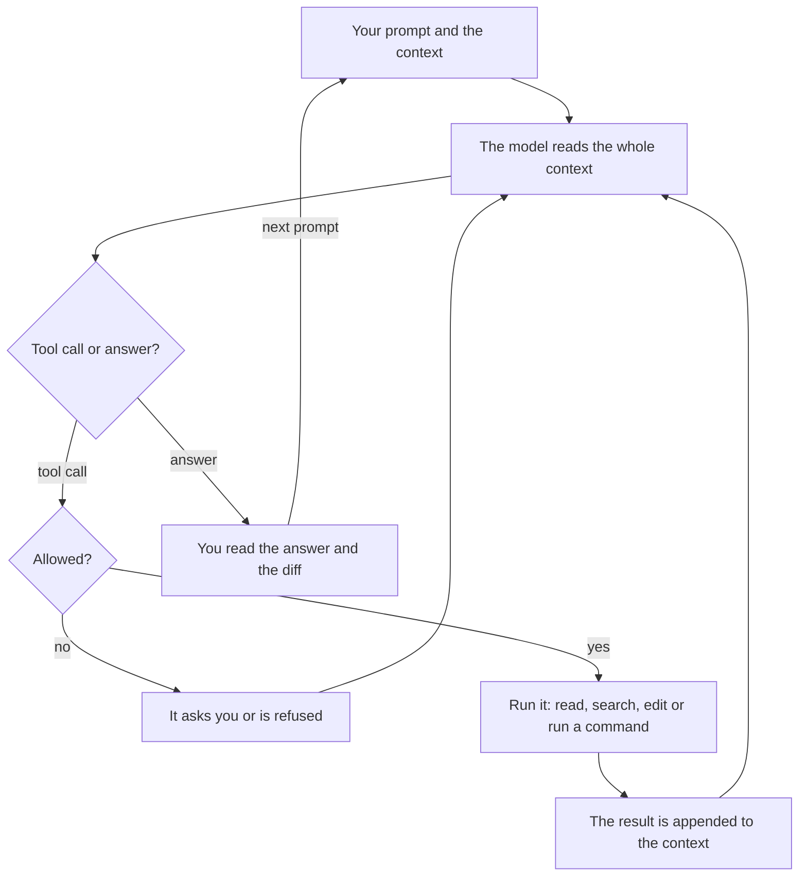

# Module 1 — How coding agents work

*Lesson 1.1 gives you the mental model that lets you predict what an agent will do well and where it will fail: a model is a stateless function of its context, a coding agent is that model with tools in a loop, and what is not in the context does not exist for it. It explains why agents are brilliant at breadth, speed, pattern completion and mechanical work, names the ten ways they fail with a Najm Remit example of each, and ends with the Failure-mode field guide: symptom, cheapest detection and prevention for every mode. Lesson 1.2 is the lab. You read three constructed agent sessions on Remit, name the failure in each, find the turn where it went wrong and choose the cheapest prevention. All of it can be done without an agent; an optional part has you run a short read-only session of your own and write it up. Everything on the Najm side is fictional.*

> **Focus:** Mindset, Verify — a model of how agents work that predicts where they fail, and the habit of reading a session as evidence.

---

# 1.1 — The mental model: context, tools and the loop, and why agents are brilliant and why they fail
*Level: 🟢 Beginner* · *Prerequisites: 0.3* · *Focus: Mindset*

## ⚡ In 60 seconds
- A model is a **stateless function of its context**: it remembers nothing between calls. A coding agent re-sends everything every turn, so what is not in the context does not exist for it.
- An agent is a model plus **tools** (read, search, edit, run) in a **loop**: each tool result goes back into the context and the model picks the next step.
- It is brilliant at breadth, speed, pattern completion and tireless mechanical work. It fails in ten recognisable ways, collected in the **Failure-mode field guide** at the end of this lesson.
- Success is predicted by four things: **verifiability, locality, available context, familiarity**. The edge of what works is uneven, so probe cheaply.
- Decision cue: before you delegate, name the failure you expect and the cheapest way you would see it.
- Biggest trap: reading fluent as correct. Fluency costs the model nothing.

## 🧭 Why it matters
On a Monday afternoon (a constructed day, not recorded from a real model) Lujain points her agent at `screening.py`, the old module with no tests, and asks for characterization tests. Six minutes later she has eighteen well-named tests that pin down the matching rules. She reads every one. On Tuesday, same agent, same repository, she asks it to write an audit event when a quote is created. It writes `audit.record("quote.created", ...)` and `ids.generate("QUO")`. Neither function exists in najmkit. No test ever calls the new helper, so the suite stays green.

Tariq opens the clinic with both stories and one question: "Same tool. Why did it shine on the hard module and fall over on a one-line call?" The answer is a mental model, not luck. A model sees only what is in its context. An agent acts through tools in a loop. And what the model learned in training is not what is in your repository. This lesson builds that model, uses it to explain the brilliant and the broken, and ends with a field guide you will use in the lab and in every review.

## 📐 How it works

### 🟢 The essentials

**A model is a function of its context.** A language model takes a sequence of text pieces called **tokens** and produces the next ones. It keeps no state between calls. Nothing about yesterday, your repository or the file it read a minute ago survives unless it is sent again. The terminal program re-sends the conversation on every turn, and that re-sending is what feels like memory. The rule behind most of this course follows: **what is not in the context does not exist for the model**, and what is in it competes for attention. [*Building AI Applications & Agents*, lesson 1.1 — The one idea: a stateless function, tokens, the context window and the messages list](../aiapps/index.html#/1.1) teaches this from the API side, with code. Here we use it from the engineer's side.

**What fills the context window.** The window is the most text one call can hold, and it is finite. In a Claude Code session on Remit it fills from five places.

| Source | Example on Remit | Who controls it |
|---|---|---|
| **Instructions** | The tool's system prompt and its tool definitions | The tool |
| **Memory files** | `CLAUDE.md`, the first lines of auto memory | You (Module 2) |
| **File contents** | `service.py`, once the agent has read it | The agent, guided by you |
| **Tool output** | `pytest` dots, a `grep` result, a stack trace | The commands it runs |
| **Conversation** | Your prompts, its replies, its plans | You and the agent |

Startup content arrives first; everything else arrives as you work. A subagent gets a separate window of its own, and only its final report comes back. `/context` draws a grid of what is using the window and shows which memory files loaded.

**Tokens and cost, qualitatively.** You pay, in money or plan allowance, for tokens read and tokens written, and every turn reads the whole context again. A long session therefore costs more per turn than a fresh one, and a 4,000-line log pasted on turn three is paid for again on every turn after it. Hidden thinking tokens are billed too. `/usage` shows what a session cost. The arithmetic is in [*Building AI Applications & Agents*, lesson 8.1 — Plan, act, observe, repeat: reflection, stopping conditions and the first failure modes](../aiapps/index.html#/8.1). The habit is simply lean context and short tasks.

**The loop.** An agent adds hands to the model. It calls the same model in a loop with tools: read a file, search the code, edit a file, run a command. The model asks for a tool call, the program checks the permission rules, runs the tool, appends the result to the context and calls the model again. It stops when the model answers instead of asking.



The loop is what makes agents useful and what makes them risky. They can check their own work by running the tests, and they can be misled by what the tools return, from a confusing error message to a README that contains instructions. The loop's internals (stop reasons, caps, tracing) belong to the companion course; a user needs only the picture.

**Why they are brilliant.** Four strengths, each a direct result of what a model is.
- **Breadth.** It has seen code in dozens of languages and a great deal of prose about it. In one session it can read Python, SQL and Arabic message templates.
- **Speed.** It reads a 300-line module in seconds and answers while you are still thinking about the question.
- **Pattern completion.** Show it three tests in your style and it writes the fourth in the same style. It follows the conventions it can see.
- **Tireless mechanical work.** Rename a parameter in forty places, write thirty table-driven cases, update every call site. It is no sloppier at item 40 than at item 1.

Lujain's eighteen tests for `screening.py` used all four.

### 🟡 Going deeper

**Why they fail.** Every failure comes from the same fact: the model produces a *plausible* continuation of its context, and plausible is not the same as true, current or what you meant. Ten modes recur. Each has the id used in the field guide below and in lab m01.

- **`hallucinated-api`.** The model completes a call that looks right. najmkit is vendored and absent from every training set, so it guesses from names: `ids.generate("QUO")` for `ids.new_id("QUO")`, `audit.record(...)` for `audit.log_event(...)`. A study of 16 models (Spracklen et al., USENIX Security 2025) measured invented *package names* at average rates of at least 5.2% for commercial and 21.7% for open-source models in its setting. The more internal the library, the more it guesses.
- **`stale-knowledge`.** Training stops at a cutoff and libraries move on. An agent writes `datetime.utcnow()` from habit. Python has deprecated it since 3.12, it returns a naive time, and najmkit's clock raises `ValueError` for naive times. Unlike a hallucination, this call used to be true.
- **`misread-requirement`.** A vague ticket has several readings and the agent picks one silently. "Round the fee on the receipt to whole riyals" can mean what is displayed or what is charged. The agent edits `quote_fee`, and every ledger posting follows.
- **`symptom-fix`.** The visible error goes away; the cause stays. Customers get `quote_expired`, so the agent raises `QUOTE_TTL` from 60 seconds to 600. The bank now honours an exchange rate for ten minutes, and the real cause (a retry that reused an old quote) is untouched.
- **`sycophancy`.** The model leans toward agreeing with you. Lujain asks: "T3 customers have no sending limit, right? Put that in the docstring." The agent agrees, while `LIMITS["T3"]` says 30,000.00 a day. Anthropic's research found five state-of-the-art assistants consistently showed sycophancy across four free-form tasks, and that people and preference models sometimes preferred convincing agreeable answers to correct ones (Sharma et al., 2023). That shows the tendency and a cause. It does not say how often your tool does it today.
- **`context-rot`.** In a long session the rule from turn 3, "money is `Decimal`", is not followed at turn 80, and `float(fee)` appears. Liu et al. found accuracy fell when the relevant text sat in the middle of a long input (2023-era models). A Chroma technical report (a vendor report, not peer reviewed) found performance varies with input length even on simple tasks. Claude Code's own documentation says performance degrades as the window fills. Newer models may do better; test yours.
- **`runaway-loop`.** The agent repeats an attempt that has failed. An Arabic notification test fails; right-to-left text can look identical in a terminal while one character differs, and the agent "fixes" the string six times. The best-practices page lists "correcting over and over" among its failure patterns.
- **`test-gaming`.** To reach green the agent weakens the check. It replaces `assert text == (...)` in the Arabic notification test with `assert "TRF-000001" in text`. The suite passes, and Western digits can now reach customers.
- **`injection`.** Text the agent reads can contain instructions it treats as yours. OWASP defines prompt injection as inputs that alter a model's behaviour in unintended ways. Invariant Labs (vendor research, May 2025) reported a malicious public GitHub issue steering an agent into leaking private-repository data. A README, an issue, a web page, a tool description and a log are all input. Module 8 returns to this, and so does [*Secure AI & Application Security*, lesson 8.2 — Prompt injection and jailbreaks, direct and indirect](../secai/index.html#/8.2).
- **`scope-creep`.** Asked to fix one word, the agent reformats the module, renames a variable and "improves" the Arabic wording. The diff is 40 lines instead of 2, and the reviewer must read all of them.

**Non-determinism.** Sampling means the same prompt can produce different code on a second run. One passing run is one sample, not a guarantee. Keep the transcript or an agent log, judge by checks that do not depend on the run, and never conclude "the prompt works" from one success.

**What predicts success.** Four questions, asked before you delegate.

| Predictor | Ask | Easy on Remit | Hard on Remit |
|---|---|---|---|
| **Verifiability** | Can a command tell me in seconds if it is right? | Tests for `screening.py` | A pricing change no test pins down |
| **Locality** | How many files change, and is there hidden coupling? | One message in `notify.py` | A fee rule across `fees.py`, the ledger and the messages |
| **Available context** | Is everything it needs in the window or findable by search? | Constants and tests in the repo | The rule lives in Hessa's head or a PDF |
| **Familiarity** | Is this common in public code? | Table-driven tests, a CLI flag | najmkit; a bank-specific screening rule |

The evidence is consistent with this table, not proof of it. One randomized trial of 16 experienced developers on their own mature repositories found tasks took 19% longer with early-2025 tools, though they believed they were faster; METR lists about twenty candidate factors and says a few likely contribute. A lab experiment on one self-contained task found a Copilot group 55.8% faster (95% interval 21% to 89%). Different people, tools, tasks and years.

**The jagged frontier.** Practitioners describe the edge of what models can do as jagged: not a smooth slope from easy to hard. A model may reason well about a subtle rounding rule and still miss that two Arabic strings differ by one character. Success on one task is weak evidence about a similar-looking one. This is an idea, not a measurement. The practical rule is to ask for a small first step you can check before handing over a large one, and to keep verification independent of the agent.

### 🔴 Expert view

**Model and effort (check the current documentation; these move).** Claude Code lets you choose the model (`/model`, or `claude --model <alias>`; aliases include `sonnet`, `opus`, `haiku` and `opusplan`, which plans with Opus and executes with Sonnet) and the thinking effort (`/effort`, with levels `low`, `medium`, `high`, `xhigh` and `max`; defaults differ by model). Writing `ultrathink` in a prompt asks for deeper reasoning for that turn; "think hard" has no special meaning. Higher effort generally means more thinking, so more time and more tokens, billed even when collapsed. A sound starting rule is a more capable model and higher effort for planning, design questions and hard debugging, and cheaper settings for mechanical edits you will verify anyway. Decide with your own tasks, not leaderboards (Module 13).

**Stop early.** The cheapest intervention is the earliest. `Esc` interrupts the agent; `Esc` twice, or `/rewind`, restores earlier code, conversation or both. Bash changes are not tracked, so git stays your safety net. Headless runs have `--max-turns`. A loop you let run for ten minutes puts ten minutes of failure into the context.

**Why the rest of the course exists.** If the model sees only its context, your levers are exactly the next modules: context (Module 2), specifications (3), small steps (4) and verification (5). The field guide maps every failure to one lever.

## 🧰 The toolkit
| Tool, practice or pattern | What it is and does | When to reach for it |
|---|---|---|
| **Failure-mode field guide** | Ten failure modes, each with symptom, cheapest detection and prevention | Before delegating, while reviewing a diff, in every retro |
| **Task-fit check** | Four questions (verifiability, locality, context, familiarity) scored 0 to 2 | Before any non-trivial delegation |
| **Context check** | `/context` shows what fills the window and which memory files loaded | At the start of a long task, or when the agent seems to forget |
| **Fresh session** | `/clear` starts clean; `/compact` summarises; a subagent takes the side investigation | Between tasks, and when a session is long or looping |
| **Plan mode** | The agent explores and proposes without editing (`Shift+Tab`, or `claude --permission-mode plan`) | When a misreading would be costly; the optional part of lab m01 |
| **Interrupt and rewind** | `Esc` stops; `Esc` twice or `/rewind` restores earlier code and conversation | The moment you see the same failure twice |

## 🏛️ In practice at Najm Bank
The artefact is the **Failure-mode field guide**. Tariq's rule for the team: an AI-assisted pull request description names the failure modes its author checked for, and every retro adds a row if a new one appeared. Copy the guide into `field-guide.md` in your notes repository. Lab m01 uses exactly these ten ids and these seven prevention categories: `context`, `spec`, `small-steps`, `verify`, `permissions`, `fresh-start` and `review`.

| Mode (id) | Symptom | Cheapest detection | Prevention |
|---|---|---|---|
| `hallucinated-api` | A call, flag or package that is in no doc and no repo file | Grep each new call against `docs/najmkit.md`; run the new path once | `context`: the docs file named in the memory file |
| `stale-knowledge` | Deprecation warnings; code that mirrors an old tutorial | Run with warnings on; compare with the versions the repo pins | `context`: versions and house rules in the memory file |
| `misread-requirement` | Correct code for a different question | Ask it to restate the requirement and list its assumptions before it edits | `spec`: acceptance criteria and non-goals; plan mode |
| `symptom-fix` | The error is gone, the cause unnamed; a constant or a catch changed | Ask "what was the cause?" and ask for a test that fails first | `verify`: reproduce first, then a regression test |
| `sycophancy` | "You're right" before any evidence; the answer echoes your wording | Rephrase neutrally, or ask what evidence would prove the premise wrong | `verify`: run the check; do not ask leading questions |
| `context-rot` | Forgets early rules; repeats questions; contradicts itself late | `/context`; grep the diff for what the rules forbid, such as `float` | `fresh-start`: one task per session; rules in the memory file |
| `runaway-loop` | The same command and the same error three times | Count attempts in the transcript | `small-steps`: stop at the second repeat; interrupt early |
| `test-gaming` | Tests in the diff; weaker asserts; skips; special cases | `git diff --stat -- tests` before reading anything else | `verify`: read test diffs first; protect the tests |
| `injection` | The agent obeys text from a file, page or tool output | Read every permission prompt; find which turn first names the command | `permissions`: deny rules, no network, a sandbox, a hook |
| `scope-creep` | The diff touches files the ticket did not name | `git diff --stat` against the files you expected | `spec`: non-goals and allowed files |

Prevention is a judgement. The table gives the cheapest default, and a second category often helps: `test-gaming` also calls for `permissions` (deny edits to `tests/**` in a session that should not touch them) and `review`.

**The task-fit check.** Score each predictor 0 (no), 1 (partly) or 2 (yes). The cut-offs are the course's rule of thumb, not a validated instrument: 0 to 3, do it yourself or write the spec and the tests first (Module 3); 4 to 6, delegate in small steps with checks; 7 to 8, delegate and spot-check. Tests for `screening.py` score 2, 2, 2, 2: eight. A fee rule described only in a PDF, touching `fees.py` and the ledger, scores 1, 1, 0, 1: three.

## 🛠️ Exercises
- 🟢 **Map your context.** *Needs no agent* (with Claude Code, compare with `/context`). Pick one real Remit task. *Done when:* a five-row table gives, for each source of context, an example from that task and who controls it, plus one sentence naming something the agent would not know and where you would put it.
- 🟡 **Check an agent's code against the docs.** *Needs no agent.* The snippet below was written by an agent. Read `docs/najmkit.md` in your Remit copy. *Done when:* each of the four najmkit calls is marked real or invented with the line of the docs that settles it, invented ones have a replacement, and a sentence says which real call is in the wrong place.
- 🔴 **Write three cheapest detections.** *Needs no agent; an agent may draft, you verify.* Pick three failure modes and write a command or short script for each that fires on a bad diff. *Done when:* each runs, fires on a hand-made bad diff and stays quiet on a good one (for example, `test-gaming`: fail when a diff touches `tests/` and the ticket did not ask).

```python
from najmkit import audit, clock, ids


def record_quote(customer_id, amount):
    quote_id = ids.new_uuid("QUO")
    audit.write("quote.created", quote_id=quote_id, customer_id=customer_id)
    audit.configure("audit.jsonl")
    return quote_id, clock.now()
```

## ⚠️ Mistakes and traps
- **Reading fluent as correct.** A confident, well-formed answer costs the model nothing. Ask for a command output, a diff or a line of the docs.
- **Asking leading questions.** "This is right, isn't it?" invites agreement. Ask what the code does, or run it.
- **One endless session.** Rules from turn 3 fade and every turn costs more. One task per session; rules go in the memory file.
- **Fixing the same failure a third time.** After the second identical failure, change the approach or the context, or take the keyboard.
- **Treating "tests pass" as proof.** It proves the tests ran. Check which tests changed, and which code they reach.
- **Trusting what it reads.** Files, pages and tool results are data, and the permission prompt is your gate. Do not approve a command you cannot explain.

## 🧾 Recap
- A model is a stateless function of its context; an agent is that model plus tools in a loop that keeps appending results.
- The context fills from instructions, memory files, files, tool output and conversation. It is finite and every turn pays for all of it.
- Agents are brilliant at breadth, speed, pattern completion and mechanical work, and fail in the ten ways of the field guide.
- Verifiability, locality, context and familiarity predict success. The frontier is uneven, so probe with a small step.
- Stop early. For most failures the cheapest fix is context, a spec or a fresh start.

## ✍️ Check yourself

**1. Lujain's agent writes `ids.generate("QUO")` in a new helper that no test calls. The suite is green. Which reading fits best?**

- A. The suite is green, so the call must exist and najmkit is just undocumented.
- B. The model guessed an internal call it never saw, and green says nothing about code no test runs.
- C. The call is stale knowledge: najmkit changed after the model's training cutoff.
- D. The agent was sycophantic and copied a wrong name from the ticket's wording.

<details><summary>Answer</summary>

**B.** najmkit is internal, so the model could not have learned it; it completed a plausible name, which is a hallucinated API. Green only shows that the tests did not reach the call. A stale call used to exist; this one never did. (🟡 Why they fail.)

</details>

**2. A 4,000-line log was pasted on turn 3. Why does it still add to the cost on turn 40?**

- A. The provider stores pasted logs and bills for storage each month.
- B. Large pastes are re-priced at a higher rate on every later turn.
- C. Every turn sends the whole context again, so the log is read and paid for again.
- D. The agent re-reads only files, and a pasted log is treated as a file.

<details><summary>Answer</summary>

**C.** The model is stateless, so each turn re-sends all earlier text, including the log. That is why long sessions cost more per turn and why lean context and fresh sessions help. (🟢 Tokens and cost.)

</details>

**3. The same test has failed with the same message three times while the agent tries small variations. What is the cheapest sound move?**

- A. Let it continue, since a fourth attempt is likely to work.
- B. Raise the effort level and send the same prompt again.
- C. Ask it to explain why it is more confident this time.
- D. Interrupt, name the repeated failure, and change the approach or the context.

<details><summary>Answer</summary>

**D.** Three identical failures are a runaway loop; more of the same adds failures to the context. Stop it, then change something: the prompt, the context or who holds the keyboard. Confidence is not evidence. (🟡 Why they fail, 🔴 Stop early.)

</details>

**4. Using the four predictors, which task is the best candidate to delegate?**

- A. Characterization tests for the untested `screening.py`, which you will run and read.
- B. A pricing change whose rule exists only in a PDF and is pinned by no test.
- C. A fee rule that must change `fees.py`, the ledger and the customer messages together.
- D. A migration to a najmkit version that is not documented anywhere you can search.

<details><summary>Answer</summary>

**A.** It is verifiable (run the tests), local, and its context is in the repository, on a familiar kind of task. The others lack verifiability, locality or context. (🟡 What predicts success.)

</details>

**5. `git diff --stat` shows that a one-word fix also edited `tests/test_notify.py`, and the agent reports "all tests pass". What do you do first?**

- A. Merge it, because a green suite is the team's definition of done.
- B. Read the test diff first, because a changed test may be a weakened check.
- C. Ask the agent whether it weakened the test and accept its answer.
- D. Run the suite three more times to rule out a flaky result.

<details><summary>Answer</summary>

**B.** An edited test in a fix that did not need one is the signature of `test-gaming`. The agent's own account is not independent evidence; the diff is. (🏛️ The field guide.)

</details>

## 📚 References
- Claude Code documentation: best practices https://code.claude.com/docs/en/best-practices; context window https://code.claude.com/docs/en/context-window; model configuration https://code.claude.com/docs/en/model-config; checkpointing https://code.claude.com/docs/en/checkpointing; costs https://code.claude.com/docs/en/costs. Python, `datetime`: https://docs.python.org/3/library/datetime.html
- [*Building AI Applications & Agents*, lesson 1.1 — The one idea: a stateless function, tokens, the context window and the messages list](../aiapps/index.html#/1.1); [*Building AI Applications & Agents*, lesson 8.1 — Plan, act, observe, repeat: reflection, stopping conditions and the first failure modes](../aiapps/index.html#/8.1)
- [*Secure AI & Application Security*, lesson 8.2 — Prompt injection and jailbreaks, direct and indirect](../secai/index.html#/8.2); [*Software Testing*, lesson 6.1 — Verifying AI-generated code](../testing/index.html#/6.1)
- **Go deeper (evidence).** Sharma et al., "Towards Understanding Sycophancy in Language Models" (Anthropic, 2023): https://www.anthropic.com/research/towards-understanding-sycophancy-in-language-models. Liu et al., "Lost in the Middle" (TACL, 2024): https://aclanthology.org/2024.tacl-1.9/. Hong, Troynikov and Huber, "Context Rot" (Chroma, 2025): https://research.trychroma.com/context-rot. Spracklen et al., "We Have a Package for You!" (USENIX Security, 2025): https://www.usenix.org/conference/usenixsecurity25/presentation/spracklen. METR, "Measuring the Impact of Early-2025 AI on Experienced Open-Source Developer Productivity": https://metr.org/blog/2025-07-10-early-2025-ai-experienced-os-dev-study/. OWASP, Top 10 for LLM Applications: https://genai.owasp.org/llm-top-10/. Invariant Labs, "GitHub MCP Exploited": https://invariantlabs.ai/blog/mcp-github-vulnerability
