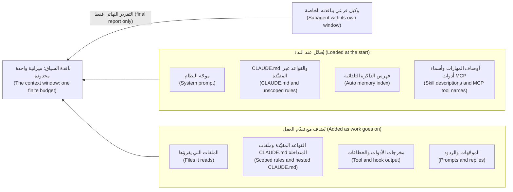

# الوحدة 2 — هندسة السياق (Context engineering)

*لا يكون الوكيل (agent) أفضل مما يعرفه عند بدء الجلسة ومما يظل قادرًا على رؤيته أثناء سيرها. وتدور هذه الوحدة حول منحه ما يحتاج إلى معرفته دون أي شيء يعوق عمله. يعالج الدرس 2.1 نافذة السياق (context window) بوصفها ميزانية: ما الذي ينفقها — موجّه النظام وملفات الذاكرة والقواعد والملفات المشار إليها ومخرجات الأدوات والمحادثة؛ وكيف تُحمَّل ذاكرة المشروع (project memory) وتُدمج؛ وما الذي يستحق مكانًا في `CLAUDE.md` وما لا يستحق؛ وكيف تشير إلى الملفات بدقة؛ وكيف تعلّم الوكيل مكتبة خاصة مثل `najmkit`؛ وكيف تُبقي الجلسة نظيفة عبر `/clear` و`/compact` والأسئلة الجانبية والوكلاء الفرعيين (subagents). ومُنتَجه هو قالب ذاكرة المشروع وقائمة التقليم. أما الدرس 2.2 فهو المختبر m02: تكتب ذاكرة المشروع لنجم ريميت، ويشغّل المُقيِّم (grader) الأوامر التي وثّقتَها ويتحقق من كل ادعاء مقابل المستودع، وتشغّل التذكرة الصغيرة نفسها مرتين، بملفك وبدونه، لتقيس ما الذي تغيّر. وكل ما يتعلق بجانب بنك نجم خيالي.*

> **التركيز:** Context — إعطاء الوكيل ما يحتاج إلى معرفته، ودون ما يعوق عمله.

---

# 2.1 — ما الذي يراه الوكيل: ميزانية السياق وذاكرة المشروع والقواعد والمراجع والضغط والوكلاء الفرعيون
*المستوى: 🟢 مبتدئ (Beginner)* · *المتطلبات: 1.1* · *التركيز: Context*

**بعد هذا الدرس تستطيع** تشذيب ملف ذاكرة مشروع، بإعطاء كل سطر حكمًا والأمر الذي يثبته. *مدة الدراسة: نحو 110 دقيقة (تقدير).*

## ⚡ الدرس في دقيقة
- هذه هي عادة **السياق أولًا**. فالنافذة **ميزانية**: يستنفدها موجّه النظام (system prompt) والذاكرة والقواعد والملفات ومخرجات الأدوات والمحادثة، ويتراجع الأداء كلما امتلأت.
- **ذاكرة المشروع** (`CLAUDE.md` أو `AGENTS.md`) تُحمَّل في كل جلسة. أبقِ ما لا يستطيع الوكيل تخمينه، واسأل عن كل سطر: هل يتسبب حذفه في خطأ؟ وابقَ دون 200 سطر.
- الذاكرة **سياق لا إنفاذ**: الجملة تطلب، أما الخطاف (hook) أو قاعدة المنع (deny rule) فيفرض.
- **أشِر ولا تلصق.** سمِّ الملف والدالة والسؤال؛ وأعطِ `najmkit` ملف وثائق.
- أبقِ الجلسات نظيفة: `/clear`، و`/compact` مع تركيز، و`/btw`، والوكلاء الفرعيون. والقواعد التي يجب أن تنجو تُوضع في الملف.
- أكبر فخ: لصق ملف README ووثيقة المعمارية في الذاكرة.

## 🧭 لماذا يهم
في الأسبوع الثاني تكتب لجين، المهندسة حديثة التخرج، الفقرة نفسها في موجّه رابع: `pytest -q`، والمال من النوع `Decimal`، وتبدو الإيداعات (commits) هكذا `type(scope): subject`، و`najmkit` مكتبتنا الداخلية فاقرأ وثائقها. وفي المرة الخامسة تنسى العبارة الأخيرة، فيخترع الوكيل `audit.record(...)` — وهذا هو نمط `hallucinated-api` من الدرس 1.1. ويقول طارق، قائد الهندسة: «اكتبه مرة واحدة، حيث تقرؤه الأداة في بداية كل جلسة.»

وبعد شهر تظهر له المشكلة المعاكسة — وهي مُختلَقة. فقد لصق أحدهم ملف README ووثيقة المعمارية ودليل الأسلوب في `CLAUDE.md`: 400 سطر، منها صفحة تصف `risk.py` لم يعد له وجود. وتسمّي الوثائق «ملف CLAUDE.md المفرط التحديد» نمط إخفاق. وللقصتين سبب واحد: لم يقرر أحد ما الذي ينبغي أن يراه الوكيل.

## 📐 كيف يعمل

### 🟢 الأساسيات

**النافذة ميزانية.** لا يرى النموذج إلا سياقه (الدرس 1.1). وكل طبقة تنفق من نافذة محدودة، وبعضها يُدفع ثمنه قبل أن تكتب كلمة واحدة.

| الطبقة | على ريميت |
|---|---|
| **موجّه النظام** | تعليمات الأداة، وأوصاف المهارات، وأسماء أدوات MCP |
| **ملفات الذاكرة (memory files)** | `CLAUDE.md`؛ وأول 200 سطر أو 25KB من الذاكرة التلقائية (auto memory) |
| **القواعد** | `.claude/rules/*.md`، عند الإطلاق أو عند لمس ملفات مطابقة |
| **الملفات** | `src/remit/fees.py`، بمجرد أن تسمّيه أو يقرأه |
| **مخرجات الأدوات** | نتائج `pytest`، ونتائج بحث `grep`، ومخرجات الخطافات |
| **المحادثة** | موجّهاتك وردوده: وهي تنمو مع كل دور |



أبقِ طبقات البدء صغيرة لأن كل جلسة تدفع ثمنها، واجلب الباقي بدقة لأنه يبقى. ويعرض `/context` الشبكة وأي ملفات ذاكرة حُمّلت. وتصف صفحة أفضل الممارسات السياق بأنه «أهم مورد ينبغي إدارته».

**ذاكرة المشروع** هي نص Markdown يوضع أمام موجّهك الأول. وفي Claude Code هي `CLAUDE.md`، وتوجد في أربعة أماكن.

| النطاق | المسار | من يحصل عليه |
|---|---|---|
| السياسة المُدارة (Managed policy) | `/etc/claude-code/CLAUDE.md` (Linux وWSL)؛ وعلى macOS `/Library/Application Support/ClaudeCode/CLAUDE.md`؛ وعلى Windows `C:\Program Files\ClaudeCode\CLAUDE.md` | كل من يستخدم الجهاز؛ ولا يمكن استثناؤها |
| المستخدم | `~/.claude/CLAUDE.md` | أنت، في كل مشروع |
| المشروع | `./CLAUDE.md` أو `./.claude/CLAUDE.md` | الفريق، عبر git |
| المحلي | `./CLAUDE.local.md` | أنت، في هذا المشروع؛ وأضِفه إلى `.gitignore` بنفسك |

**التحميل والأسبقية.** تُحمَّل ملفات `CLAUDE.md` و`CLAUDE.local.md` الموجودة في دليل العمل وفي كل دليل أعلى منه عند الإطلاق؛ أما ما في الأدلة الفرعية فيُحمَّل عند الطلب، حين يقرأ Claude ملفًا هناك أو يكتبه أو يعدّله. **لا شيء يُلغي شيئًا.** تُضَمّ كل الملفات بعضها إلى بعض، بدءًا بملفات الأدلة الأعلى، ويلي `CLAUDE.local.md` الملف `CLAUDE.md` في دليله. وإذا تعارض ملفان فقد يتبع Claude أيًّا منهما: فأزِل التناقضات بدل الاعتماد على ترتيب.

**ما يدخل في الملف.** الأوامر التي لا يستطيع الوكيل تخمينها، كأن تحتاج واجهة سطر الأوامر إلى `PYTHONPATH=src` بينما لا تحتاج إليه الاختبارات؛ والاصطلاحات التي تخالف الافتراضي مثل `type(scope): subject` مع نطاق إلزامي؛ والمزالق كأن يكون `ledger.py` شيفرة موروثة وغير مختبَرة؛ ومؤشرات إلى الوثائق. **وما يبقى خارجه.** كل ما يمكن قراءته من الشيفرة، واصطلاحات اللغة القياسية، والشروحات التعليمية الطويلة، والحقائق كثيرة التغير: فالحدود والرسوم مكانها `limits.py` و`fees.py`.

اختباران يُبقيان الملف صادقًا. تستهدف الوثائق **أقل من 200 سطر** لأن الملفات الأطول تستهلك سياقًا (context) أكبر وتُضعف الالتزام. وتسأل صفحة أفضل الممارسات عن كل سطر: **هل يتسبب حذف هذا السطر في أن يرتكب الوكيل أخطاء؟** فإن لم يحدث ذلك فالسطر ضجيج.

### 🟡 التعمق أكثر

**AGENTS.md.** تقرأ أدوات أخرى `AGENTS.md`، وهو ملف Markdown عادي ومفتوح يُعدّ «README للوكلاء». ويقرؤه Claude Code مباشرة منذ الإصدار v2.1.277، لكن افتراضيًا فقط حين لا يوجد `CLAUDE.md` ولا `CLAUDE.local.md` في دليل العمل أو فوقه؛ ويغيّر ذلك إعداد «Project instructions» في `/config`. ولمشاركة ملف واحد، اكتب `AGENTS.md` وضع `@AGENTS.md` داخل `CLAUDE.md`. وقد تغيّرت هذه التفاصيل في 2026، فراجع الوثائق الحالية.

**المهمة نفسها باسم آخر.** في [Spec-Driven Development: A Spec-First Approach to AI-Native Engineering](https://developer.microsoft.com/blog/spec-driven-development-ai-native-engineering/)، تصف Microsoft دورة حياة من سبع خطوات خطوتها الأولى *دستور*: مبادئ وحواجز وقائية. وتشرح تدوينتها المرافقة عن GitHub Spec Kit، عدّة Microsoft المفتوحة المصدر، ملفَّ الدستور. وهذه هنا وظيفة ذاكرة المشروع: قواعد دائمة يقرؤها الوكيل في كل جلسة. وتغطي الوحدة 3 الخطوات الست الأخرى. وما تصفه شركة عن ممارستها ليس دليلًا مستقلًا؛ فهو يُظهر أن الفكرة متداولة اليوم، لا أن الدستور يحسّن النتائج. فاقرأ المصادر الأصلية المرتبطة أدناه.

**الاستيراد.** يجلب `@path/to/file` ملفًا إلى الذاكرة؛ وتتداخل الاستيرادات حتى أربع مراحل وتُتجاهل داخل مقاطع الشيفرة وكتلها المسيَّجة. **الاستيراد لا يقلل كلفة السياق**: فالملفات المستوردة تُحمَّل عند الإطلاق. وسيضع `@docs/najmkit.md` الصفحة كلها في كل جلسة؛ أما المؤشر العادي فيكلّف سطرًا واحدًا ويُتَّبع حين يهم الأمر.

**القواعد.** تقسّم الملفات في `.claude/rules/` الذاكرة بحسب الموضوع. فالقاعدة التي بلا `paths:` تُحمَّل عند الإطلاق؛ والتي فيها `paths:` لا تُحمَّل إلا حين يعمل Claude على ملفات مطابقة، فلا تكلّف قاعدة الاختبارات شيئًا وهو يعدّل `src/`. وراجع الوثائق لمعرفة صيغة glob الدقيقة:

```markdown
---
paths:
  - "tests/**"
---
Tests are deterministic: use the fixtures in tests/conftest.py (fixed clock, sequential ids).
```

**الذاكرة سياق لا إنفاذ.** يتبع النموذج الملف في الغالب، و«في الغالب» ليست ضابطًا. وتوصي صفحة الذاكرة باستخدام خطاف `PreToolUse` لمنع إجراء أيًّا كان قرار Claude؛ وتقترح صفحة أفضل الممارسات كلمة "IMPORTANT" على السطر الوحيد الذي يجب ألا يفوت. استخدمها مرة واحدة: فإذا صرخ كل شيء لم يصرخ شيء. يعطي الملف القاعدة وسببها؛ ويفرضها الخطاف أو قاعدة المنع (الدرسان 8.2 و9.1). وتعيش قاعدة المنع في `.claude/settings.json`؛ وهي تغطي أدوات الملفات المدمجة وأوامر مثل `cat`، لا كل عملية فرعية: طبقة لا جدار.

```json
{ "permissions": { "deny": ["Read(./.env)"] } }
```

**أشِر بدقة.** الموجّه الغامض يجعل الوكيل يبحث، وتُدفع كلفة النتائج بوصفها مخرجات أدوات. أما الموجّه الدقيق فيسمّي الملف والدالة والحقيقة التي لا يراها والإجابة المطلوبة.

```text
The express fee looks wrong. Can you check the fee code?
```

```text
Read @src/remit/fees.py (explain_fee) and @tests/test_fees.py.
A QAR-INR express transfer of 500.00 costs 27.00: the 12.00 fee plus a 15.00 surcharge. Support says 12.00.
Change nothing. Tell me which line adds the surcharge, whether before or after the cap, and which test pins it down.
```

**وثائق يستطيع الوكيل قراءتها.** ما يعيش في رأس أحدهم ليس في النافذة: فأبقِ الوثائق في المستودع وأشِر إليها. لكن الوثائق تنحرف. فما زال `docs/ARCHITECTURE.md` يسرد `risk.py` (ولا يُظهر `ls src/remit` شيئًا منه) ومستويين من KYC بلا حد شهري، بينما في `limits.py` ثلاثة مستويات وحدود شهرية. ويقول `docs/TOUR.md` إن الشيفرة هي التي تحسم.

**تعليم الوكيل مكتبتك الخاصة.** `najmkit` مضمَّنة داخل المستودع وليست في أي مجموعة تدريب، فيخمّن الوكيل من الأسماء. لا تصفها في `CLAUDE.md`، حيث تدفع كل جلسة ثمنها: اكتب صفحة كاملة لقارئ لم يرها قط، وسطرًا واحدًا يقول إن الصفحة موجودة. و`docs/najmkit.md` هو النموذج: فهو يذكر أن المكتبة داخلية، ويعرض كل توقيع مع نتيجة نموذجية هي `"TRF-9F3A1C7B2D40"`، ويحدد القواعد: سجّل المعرّفات فقط.

### 🔴 نظرة الخبير

**إبقاء النافذة نظيفة.**

| الإجراء | ما يفعله | متى تستخدمه |
|---|---|---|
| `/clear` | يبدأ محادثة جديدة | بين مهام غير مترابطة |
| `/compact [instructions]` | يلخّص: `/compact Focus on the API changes`؛ ويمكن أن يلخّص `/rewind` جزءًا منه | حين يطول التاريخ لكنه ما زال لازمًا |
| `/btw [question]` | سؤال جانبي لا يدخل التاريخ أبدًا | «ماذا تفعل `Money.zero`؟» |
| وكيل فرعي — وكيل Explore للقراءة فقط | نافذة خاصة؛ ولا يعود إلا تقريره النهائي | تحقيق في عشرين ملفًا |

لا يرى الوكيل الفرعي محادثتك أبدًا؛ فهو يتلقى موجّه نظام خاصًا به ومهمتك، و`CLAUDE.md` الخاص بك أيضًا ما عدا وكيلَي Explore وPlan.

**ما الذي ينجو من الضغط.** ينجو موجّه النظام وملف `CLAUDE.md` في جذر المشروع، إذ يُقرأ من القرص من جديد، والقواعد غير المقيَّدة (unscoped rules) والذاكرة التلقائية والخطة. **التعليمات المعطاة في المحادثة فقط لا تنجو كما كُتبت**، أما القواعد المقيَّدة (scoped rules) وملفات `CLAUDE.md` المتداخلة فلا تعود إلا حين تُلمس ملفاتها مرة أخرى.

**تدهور السياق (Context rot)، بحذر.** قدّم الدرس 1.1 الدليل: تقرير من مورّد هو Chroma، وLiu وآخرون عن نماذج حقبة 2023. لم يختبر أيٌّ منهما وكلاء برمجة، فلا يعطي أيٌّ منهما رقمًا لمستودعك.

**عامِل الذاكرة معاملة الشيفرة.** أي تغيير في `CLAUDE.md` يغيّر ما يُقال لكل وكيل في الفريق: فراجع الفروقات الخام. وأفادت Pillar Security، وهي مورّد أمني، في 2025 بأن رموز Unicode المخفية في ملفات القواعد يمكن أن تُخفي التعليمات عن المراجع البشري بينما يتبعها كل من Copilot وCursor. وقلّم وفق جدول: يفحص `/doctor prompt-audit [path]` (الإصدار v2.1.283 أو أحدث) ملفات التعليمات بحثًا عن محتوى قديم أو متعارض. والذاكرة التلقائية محلية لجهاز واحد، فقواعد الفريق مكانها ملف المشروع، في git. وحين يخطئ الوكيل فاسأل هل ثمة سطر ناقص أو خاطئ أو هو من مهام الخطاف؛ ولا تضف قاعدة لكل خطأ.

**متى لا تفعل ذلك.** لا يحتاج سكربت مؤقت من عشرة أسطر إلى ملف ذاكرة، والحقيقة العابرة مكانها الموجّه، والقاعدة التي لا يخرقها الوكيل أبدًا ينبغي أن تُحذف.

## 🧰 الأدوات
| الأداة أو الممارسة أو النمط | ما هي وماذا تفعل | متى تلجأ إليها |
|---|---|---|
| **Project memory** — ذاكرة المشروع | `CLAUDE.md` (أو `AGENTS.md`): الملف القصير الذي يُحمَّل في كل جلسة | كل مستودع يلمسه وكيل |
| **Path-scoped rules** — القواعد المقيَّدة بالمسار | `.claude/rules/*.md` مع `paths:`، تُحمَّل حين تُلمس ملفات مطابقة | قاعدة لمجلد واحد |
| **Precise reference** — المرجع الدقيق | موجّه يسمّي الملف (`@path`) والدالة والحقيقة الناقصة | كل موجّه غير بسيط |
| **Library docs file** — ملف وثائق المكتبة | صفحة كاملة لشيفرة لم يرها النموذج قط | مكتبة داخلية |
| **Fresh session** — جلسة جديدة | `/clear` و`/compact` مع تركيز و`/btw` ووكيل فرعي؛ ويعرض `/context` السبب | بين المهام؛ وحين تكبر الجلسة |
| **Pruning checklist** — قائمة التقليم | ثمانية أسئلة تُطرح على ملف الذاكرة | شهريًا؛ وبعد حادثة |

## 🏛️ عمليًا في بنك نجم
مُنتَجان: **قالب ذاكرة المشروع** و**قائمة التقليم**. وأولًا، المثال الذي نشآ منه.

**قبل.** هذا ما تحصل عليه حين تطلب من أداة ملف `CLAUDE.md` وتضيف إليه ما تقوله وثيقة المعمارية — مُختلَق للتعليم، لا مسجَّل من نموذج حقيقي. وكل عيب فيه قابل للتحقق.

```markdown
# Najm Remit

### Project Overview
Najm Remit is a robust, scalable remittance platform for Najm Bank. It follows best practices.

### Project Structure

    src/remit/
    ├── money.py      # Money class
    ├── fees.py       # Fee schedules
    ├── risk.py       # Limits and name screening
    ├── ledger.py     # Double-entry ledger
    └── service.py    # RemitService
    tests/

### Commands
- Install: `pip install -r requirements.txt`
- Test: `make test`
- Lint: `ruff check .` and `black .`
- Run: `python -m remit quote QAR 500 INR`

### Architecture
There are two KYC tiers: T1 may send QAR 5,000 per day and T2 QAR 25,000. There is no monthly limit.
Limits and screening live in `src/remit/risk.py`.

### Code Style
- Follow PEP 8 and write clean, readable, maintainable code.
- Use type hints and docstrings. Use descriptive variable names.
- Be careful when changing financial logic.

### Git
- Use conventional commits, for example `feat: add quote endpoint`.
```

يشغّل مُقيِّم الدرس 2.2 الأوامر ويتحقق من المسارات. وهذا مقتطف من مخرجاته الحقيقية على ذلك الملف، بلا تلميحات:

```text
[FAIL] The documented commands run and work: `make test` (line 18): this repository has no Makefile; `ruff check .` (line 19): ...
[FAIL] Every file it points to exists: not in the repository: `risk.py` (line 11), `requirements.txt` (line 17), `src/remit/risk.py` (line 24)
```

الحجم ليس هو المشكلة: فالملف يوثّق أدوات لا يملكها ريميت، ويكرر وثيقة قديمة، ويُغفل ما لا يستطيع الوكيل تخمينه.

**بعد.** عشرون سطرًا، وكل سطر يجتاز اختبار «هل يتسبب حذفه في خطأ؟».

```markdown
# Najm Remit

Money-transfer service for the fictional Najm Bank. Python 3.11, standard library only, pytest.

### Commands
- All tests, from the repository root: `pytest -q`. One file: `pytest -q tests/test_fees.py`
- Command line: `PYTHONPATH=src python -m remit quote QAR 500 INR` (the tests do not need `PYTHONPATH`; the command line does)
- There is no linter, formatter or Makefile. Do not invent a command.

### Conventions
- IMPORTANT: money is `Decimal` through `Money` (`src/remit/money.py`), never `float`.
- Ids, time and audit events come from `najmkit`, our internal library, which is not in your training data. Read `docs/najmkit.md` first and do not guess names.
- Tests are named `tests/test_<module>.py`; `tests/conftest.py` gives a fixed clock and sequential ids. New behaviour needs a test.
- Commits: `type(scope): subject`, scope required and lower case, for example `fix(limits): count transfers made just after midnight`. `CONTRIBUTING.md` lists the types.
- Customer messages exist in English and Arabic (`src/remit/notify.py`). Change both.

### Gotchas
- `docs/ARCHITECTURE.md` is partly stale; the code wins. `docs/TOUR.md` is current.
- `src/remit/ledger.py` and `src/remit/screening.py` are legacy and untested. Read their docstrings first.

### Never
- Never edit, delete or skip a test to make it pass.
- Never write a secret or real customer data into code, tests, logs or commits.
- Never add a dependency, or call `uuid.uuid4()` or `datetime.now()` in service code.
- Never tell a customer that a name matched a sanctions list; a screening hit only says we need to review.
```

الأوامر عملت. وقاعدة `float` مذكورة مرة واحدة، مع `IMPORTANT` الوحيدة. وتحصل `najmkit` على مؤشر لا نسخة، والوثيقة القديمة موسومة لا مقتبسة. ويجيزه المُقيِّم نفسه في كل فحص.

**قالب ذاكرة المشروع.** انسخه، واحذف ما لا ينطبق، وشغّل كل أمر قبل أن تُبقيه.

```markdown
# <Project name>

<Two sentences: what it is, the runtime, what is fictional.>

### Commands
- <Run all tests, and from where>: `<command>`
- <Run one file or one test>: `<command>`
- <Anything that needs setup>: `<command>`
- <Tools that do NOT exist here>

### Conventions
- <A rule the agent would get wrong, with the reason in a few words>

### Gotchas
- <Something fragile or misleading; a document that is out of date>

### Never
- <Three to eight things that would hurt here>
```

**قائمة التقليم.** قاعدة طارق (مُختلَقة، fictional): تغيير الذاكرة يحتاج إلى مراجع آخر واحد، ويُقلَّم كل ملف شهريًا.

```markdown
# Memory pruning checklist     File:        Reviewed:        By:
1. Run every command from a fresh shell and open every path. Does each work today?
2. For each line: would removing it cause a mistake? If not, delete it.
3. Can the agent read the line from the code? If so, delete it.
4. Does a line copy a document or a table of numbers? Point to it instead.
5. Does a line contradict another line or another memory file?
6. Was a line added after one bad run, or is it obeyed unprompted now?
7. Which rule is a promise the file cannot keep? Move it to a hook or deny rule.
8. Is the file under 200 lines, IMPORTANT used once or twice, and the diff free of odd Unicode or unknown links?
```

## 🛠️ التمارين
- 🟢 **قلّم ملف «قبل».** *لا يحتاج إلى وكيل.* *يكتمل عندما:* يكون لكل سطر حكم — أبقِ أو أصلح أو احذف — وسبب، وتُعلَّم خمسة ادعاءات بأنها خاطئة أو غير قابلة للتشغيل مع الأمر الذي كشفها.
- 🟡 **الغامض مقابل الدقيق.** *يحتاج إلى وكيل.* اطرح سؤال رسوم التحويل السريع بالطريقتين في جلستين جديدتين. *يكتمل عندما:* يقارن جدول بين الملفات المقروءة والدقائق وما إذا كانت الإجابة سمّت السطر، وما يعرضه `/context`.
- 🔴 **اختبر ما ينجو من الضغط.** *يحتاج إلى وكيل.* أعطِ قاعدة واحدة في المحادثة فقط وأخرى في `CLAUDE.md`، ثم شغّل `/compact`، ثم اختبر الاثنتين. *يكتمل عندما:* تسجّل ملاحظة `claude --version` وما رأيته وخلاصة قصيرة.

## ⚠️ أخطاء وفخاخ
- **لصق الوثائق في الذاكرة.** يُدفع ثمنها في كل جلسة، وهي قديمة مرتين. أشِر إليها بدلًا من ذلك.
- **توثيق أوامر لم يشغّلها أحد.** قد تسرد المسودات أدوات لا يملكها المشروع. شغّل كل أمر.
- **معاملة الملف كأنه قفل.** يمكن تجاهل السطر؛ فاستخدم خطافًا أو قاعدة منع.
- **تعديلات الذاكرة بلا مراجعة.** سطر مخفي واحد يوجّه كل وكيل في الفريق.

## 🧾 الخلاصة
- النافذة ميزانية: أبقِ طبقات البدء صغيرة واجلب الباقي بدقة.
- تحمل الذاكرة ما لا يستطيع الوكيل تخمينه، في أقل من 200 سطر، وكل سطر يجتاز سؤال «هل يتسبب حذفه في خطأ؟»
- تُضَمّ ملفات الذاكرة بعضها إلى بعض، ولا شيء يُلغي شيئًا، والاستيراد لا يوفّر سياقًا، والقواعد المقيَّدة تُحمَّل عند الطلب.
- الذاكرة تطلب، والخطافات تفرض. أشِر إلى الوثائق وتحقق منها مقابل الشيفرة؛ وأبقِ الجلسات نظيفة؛ وراجع الذاكرة وقلّمها كما تفعل بالشيفرة.

## ✍️ اختبر نفسك

**1. تلصق لجين جدول الوحدات من `docs/ARCHITECTURE.md` في `CLAUDE.md`؛ ثم يعدّل وكيل لاحقًا ملف `risk.py` غير الموجود. ما أفضل علاج؟**

- A. أضف ملاحظة تقول إن `risk.py` قد زال.
- B. احذف الجدول وأشِر إلى `docs/TOUR.md`.
- C. انقل الجدول إلى قاعدة مقيَّدة بالمسار.
- D. علّم الجدول بـ IMPORTANT ليُفحص أولًا.

<details><summary>الإجابة</summary>

**B.** الشيفرة تُظهر الوحدات أصلًا، والنسخة تحمل انحراف الوثيقة إلى كل جلسة. أما التقييد والتوكيد فيُبقيان جدولًا خاطئًا. 🟡 وثائق يستطيع الوكيل قراءتها.

</details>

**2. يقول `CLAUDE.md` في ريميت `type(scope): subject`؛ ويقول `~/.claude/CLAUDE.md` عند لجين «بلا نطاقات». ماذا يحدث في ريميت؟**

- A. ملف المشروع هو الغالب، لأنه أقرب إلى الشيفرة.
- B. ملفها الخاص بالمستخدم هو الغالب، لأنه شخصي لها.
- C. يُحمَّل الاثنان، وقد يتبع Claude أيًّا منهما.
- D. يرفض Claude البدء حتى يتفقا.

<details><summary>الإجابة</summary>

**C.** لا شيء يُلغي شيئًا: تُضَمّ الملفات بعضها إلى بعض، وعند التعارض قد يتبع Claude أيًّا منهما. 🟢 التحميل والأسبقية.

</details>

**3. يضيف طارق `@docs/najmkit.md` إلى `CLAUDE.md` كي تعرف كل جلسة `najmkit`. ماذا يفعل ذلك؟**

- A. يحمّل الصفحة كلها عند الإطلاق، كأنك لصقتها.
- B. يحمّل الصفحة فقط حين يذكر ملف ما `najmkit`.
- C. لا يفعل شيئًا خارج ملف مستوى المستخدم.
- D. يحمّل الصفحة مرة واحدة ويحتفظ بملخص.

<details><summary>الإجابة</summary>

**A.** الملفات المستوردة تُحمَّل عند الإطلاق، فالاستيراد لا يقلل كلفة السياق. 🟡 الاستيراد.

</details>

**4. في الدور 5 تقول لجين: «اعرض المبالغ دائمًا مع عملتها». وبعد الضغط التلقائي (auto-compaction) يطبع الوكيل أرقامًا مجرّدة. لماذا، وما الحل؟**

- A. حذف الضغط ملف `CLAUDE.md`، فعليها إعادة إنشائه.
- B. عرض العملة افتراضي في النموذج ولا تغيّره التعليمات.
- C. كانت الذاكرة التلقائية معطّلة، فعليها تشغيلها.
- D. عاشت القاعدة في المحادثة فقط؛ فضعها في `CLAUDE.md`.

<details><summary>الإجابة</summary>

**D.** التعليمات المعطاة في المحادثة فقط لا تنجو من الضغط كما كُتبت؛ أما `CLAUDE.md` فيُعاد قراءته من القرص. 🔴 ما الذي ينجو من الضغط.

</details>

**5. يريد الفريق أن يتأكد من ألا يقرأ أي وكيل `.env`. أي تغيير هو الأنسب؟**

- A. قاعدة منع لقراءة `.env`، مع سطر في الذاكرة يشرح السبب.
- B. عبارة NEVER READ .env بأحرف كبيرة في أعلى `CLAUDE.md`.
- C. الجملة نفسها في قاعدة مقيَّدة بالمسار.
- D. ملف سياسة أمنية مستورد عبر `@`.

<details><summary>الإجابة</summary>

**A.** الذاكرة تطلب؛ وقاعدة المنع أو الخطاف يفرض. أما الأحرف الكبيرة والتقييد والاستيراد فتبقى نصًّا. 🟡 الذاكرة سياق لا إنفاذ.

</details>

## 📚 المراجع
- وثائق Claude Code: الذاكرة https://code.claude.com/docs/en/memory; ونافذة السياق https://code.claude.com/docs/en/context-window; وأفضل الممارسات https://code.claude.com/docs/en/best-practices; والأوامر https://code.claude.com/docs/en/commands. وAGENTS.md: https://agents.md
- [*تصميم الأنظمة لمبرمجي الفايب (System Design for Vibe Coders)*، الدرس 9.2 — هندسة السياق](../vibe/index.ar.html#l9-2)؛ [*بناء تطبيقات الذكاء الاصطناعي والوكلاء (Building AI Applications & Agents)*، الدرس 1.1 — الفكرة الواحدة: دالة عديمة الحالة والرموز ونافذة السياق وقائمة الرسائل](../aiapps/index.ar.html#/1.1)؛ [*الذكاء الاصطناعي الآمن وأمان التطبيقات (Secure AI & Application Security)*، الدرس 8.2 — حقن الموجّه وكسر القيود، المباشر وغير المباشر](../secai/index.ar.html#/8.2)
- **للتوسع.** Microsoft for Developers، "Spec-Driven Development: A Spec-First Approach to AI-Native Engineering": https://developer.microsoft.com/blog/spec-driven-development-ai-native-engineering/ ؛ وتدوينته المرافقة "Diving Into Spec-Driven Development With GitHub Spec Kit": https://developer.microsoft.com/blog/spec-driven-development-spec-kit/ ؛ Chroma، "Context Rot": https://research.trychroma.com/context-rot ؛ Liu وآخرون، "Lost in the Middle": https://aclanthology.org/2024.tacl-1.9/ ؛ Pillar Security، "Rules File Backdoor": https://www.pillar.security/blog/new-vulnerability-in-github-copilot-and-cursor-how-hackers-can-weaponize-code-agents

---

# 2.2 — المختبر: اكتب ذاكرة المشروع لنجم ريميت وقِس ما الذي تغيّره
*المستوى: 🟢 مبتدئ* · *المتطلبات: 0.2، 2.1* · *التركيز: Context*

**بعد هذا الدرس تستطيع** كتابة ملف ذاكرة مشروع ينجح في فحوص المُقيِّم، وقياس ما يغيّره بتشغيل مع الملف وبدونه. *مدة الدراسة: نحو 110 دقيقة (تقدير).*

## ⚡ الدرس في دقيقة
- المختبر m02: اكتب `CLAUDE.md` (أو `AGENTS.md`) للمستودع الابتدائي، وشغّل تذكرة صغيرة واحدة مرتين، بدونه ومعه، وسجّل الفرق في `ab-notes.md`.
- يحتاج إلى وكيل: **نعم في جزء A/B**؛ والبديل بلا وكيل مساعد محادثة أو زميل. أما المُقيِّم فلا يحتاج إليه أبدًا.
- يشغّل المُقيِّم **الأوامر التي وثّقتَها** ويتحقق من المال بصيغة Decimal (Decimal money) وهيكل الاختبارات وقاعدة الإيداع و`najmkit` وكل مسار وبعض الادعاءات مقابل الشيفرة؛ ويرفض الحقائق القديمة والحشو والأسرار والنص المخفي.
- الفخاخ: `docs/ARCHITECTURE.md` قديم جزئيًا، و`python -m remit` يحتاج إلى `PYTHONPATH=src`، ولا يوجد مدقّق شيفرة ولا Makefile.
- تُفحص الملاحظات من حيث الاكتمال واقتباس أسطر حقيقية من ملفك، لا من حيث «فاز B». و«لا فرق» إجابة صالحة.

## 🧭 لماذا يهم
يقول طارق: «الجميع يعتقد أن ملف الذاكرة يساعد. أرني ذلك.» ففي تجربة METR العشوائية (randomized trial) — 16 مطوّرًا ذوي خبرة على مستودعاتهم الخاصة وبأدوات مطلع 2025، كما في الدرس 0.1 — اعتقد المطوّرون أنهم أسرع بينما قالت الساعة غير ذلك. تجربة صغيرة واحدة لا تثبت شيئًا عن مستودعك، لكن الإحساس بموجّه ما ليس أمتن من الإحساس بالسرعة. والعلاج نفسه: قِس، قياسًا صغيرًا وصادقًا.

الأمر الخاطئ أو المؤشر القديم في ملف الذاكرة يُدفع ثمنه في كل جلسة، ولذلك ينفّذ هذا المُقيِّم ما كتبتَه.

## 📐 كيف يعمل

### 🟢 الأساسيات

**اكتبه من المستودع، لا مما تتذكره.**
1. **اقرأ ما كتبه الفريق:** `README.md` و`CONTRIBUTING.md` و`docs/TOUR.md` و`docs/najmkit.md`. وعامِل `docs/ARCHITECTURE.md` بوصفه ادعاءً يجب التحقق منه.
2. **شغّل الأشياء** من جذر المستودع، كما سيفعل الوكيل.
3. **عدِّد ما لا يستطيع الوكيل تخمينه:** كيف تبدأ واجهة سطر الأوامر، والأدوات غير الموجودة، و`najmkit`، وقاعدة الإيداع.
4. **صُغ مسودة قصيرة** من القالب في الدرس 2.1.
5. **تحقق من كل سطر:** هل هو صحيح اليوم؟ وهل يتسبب حذفه في خطأ؟

```bash
cd ~/ainative/m02
pytest -q                          # 99 passed
python -m remit quote QAR 500 INR  # what an agent tries first
ls src/remit                       # is there a risk.py?
```

يفشل الأمر الثاني في صدفة جديدة، وينبغي أن يقول ملفك السبب:

```text
/usr/local/bin/python: No module named remit
```

يعمل `PYTHONPATH=src python -m remit quote QAR 500 INR`. فالاختبارات تأخذ مسارها من `pyproject.toml`؛ أما سطر الأوامر فلا.

**يستطيع الوكيل أن يصوغ المسودة؛ وأنت تتحقق.** أعطِه قائمة القراءة وقواعد الملف، واجعله يُظهر عمله:

```text
Read README.md, CONTRIBUTING.md, docs/TOUR.md and docs/najmkit.md. Treat docs/ARCHITECTURE.md as possibly out of date: check anything you take from it against src/.
Draft CLAUDE.md in about 40 lines: commands an agent cannot guess, conventions that differ from the defaults, gotchas, a short never list, pointers to docs. Leave out anything readable from the code.
Run every command you put in it and show me the output. Quote the file behind each claim. Do not write the file yet.
```

`/init` بداية معقولة، لكن مخرجاته مسودة كأي مسودة وكيل: افحصها بحثًا عن أوامر لا يملكها المستودع، ودعه يكتب `CLAUDE.md` وحده.

### 🟡 التعمق أكثر

**صمّم التجربة بأمانة.** يتغيّر متغيّر واحد: ملف الذاكرة. الأداة والنموذج والموجّه نفسها، وجلسة جديدة، ونسختان جديدتان. تتيح REMIT-252 (`quote --json`) للذاكرة أن تهم في عدة مواضع: فأسهل طريقة لطباعة `Decimal` بصيغة JSON هي `float(...)` أو `default=float`، وهذا يخرق قاعدة المال؛ وواجهة سطر الأوامر تحتاج إلى `PYTHONPATH=src`؛ وللاختبارات مكان معتاد هو `tests/test_config_cli.py`؛ وللإيداع قاعدة.

**قِس ستة أشياء:** وهي صفوف الجدول في `ab-notes.md`. و*المنعطف الخاطئ* هو كل مرة اضطررت فيها إلى إيقاف الوكيل أو تصحيحه أو إعادة توجيهه؛ وعدّه من النص.

**سمِّ العوامل المربكة.** قد يجد الوكيل في A ملف `CONTRIBUTING.md` عبر README؛ وحينها لم تحدث قاعدة الإيداع فرقًا: نتيجة. وقد تحتفظ أداتك بملاحظات بين الجلسات — الذاكرة التلقائية في Claude Code، ويبدّلها `/memory` — ويُحمَّل `~/.claude/CLAUDE.md` على مستوى المستخدم في التشغيلين. والوكيل غير حتمي (الدرس 1.1)، وأنت تعرف أيُّهما بالملف وأيُّهما بدونه. والتشغيل الواحد لكل نسخة حكاية لا دليل: فكرّر كلًّا منهما مرتين إن استطعت، واطلب من زميل أن يعدّ المنعطفات الخاطئة من الفروقات. وإن لم يكن B أفضل فتلك نتيجة أيضًا.

**بلا وكيل؟** الصق التذكرة في محادثة جديدة مرتين، مرة مع ملفات المستودع ومرة مع ملف ذاكرتك أيضًا. أو احسب زمن زميل لم يقرأ ريميت، مرة بالمستودع وحده ومرة بملفك. الزميل هو الاختبار الأفضل. وماذا لو لم تتوفر جلسة تفاعلية إطلاقًا، كأن يكون العمل سكربتًا أو مهمة في التكامل المستمر أو وكيلًا داخل وكيل؟ عندئذٍ تؤدي أنت دور الوكيل: المقارنة ملوَّثة، فاذكر ذلك تحت *الحدود*.

### 🔴 نظرة الخبير

**ما يفحصه المُقيِّم وما لا يستطيعه.** إنه يشغّل `pytest` و`python -m remit` فقط، في نسخة مؤقتة بقاعدة بيانات مؤقتة؛ وأي خيار في pytest لا يتعرف عليه المُقيِّم يُفشل الفحص دون تشغيل الأمر، وأمر لأداة لا يملكها ريميت يفشل أينما كتبتَه، ومنه كتلة `text`. ولا يقارن إلا الادعاءات التي يعرفها — التقريب والمنازل العشرية (decimal places) ودفتر الأستاذ والساعة والاعتماديات وحقائق المعمارية القديمة — فتمر الحقائق الخاطئة الأخرى. وهو لا يستطيع أن يعرف إن كان الملف *مفيدًا*، ولا من كتبه، ولا إن كانت التجربة قد جرت: النتائج المختلَقة تمر. وفي A/B تظهر الفائدة. ولا تُفحص الملاحظات أبدًا على أساس أن B تتفوق على A، لأن ذلك سيكافئ تحسينات مختلَقة.

**العتبات حواجز وقائية لا أهداف.** قائمة «لا تفعل أبدًا» من اثنتي عشرة قاعدة تجتاز الفحص وقد تبقى مع ذلك الملف المفرط التحديد الذي تحذّر منه الوثائق. افحص الملف بأداة الفحص، ثم اقرأه كما سيقرؤه الوكيل؛ واستخدم الخطافات (hooks) لما يجب ألا يحدث أبدًا (الدرس 9.1).

## 🧰 الأدوات
| الأداة أو الممارسة أو النمط | ما هي وماذا تفعل | متى تلجأ إليها |
|---|---|---|
| **Project memory** — ذاكرة المشروع | `CLAUDE.md` أو `AGENTS.md`: الملف القصير الذي يُحمَّل في كل جلسة | كل مستودع يلمسه وكيل |
| **A/B memory test** — اختبار A/B للذاكرة | التذكرة نفسها بالملف وبدونه، في نسخ جديدة | حين تضيف ملف ذاكرة أو تغيّره |
| **Memory lint** — فحص الذاكرة | فحوص المُقيِّم: تشغيل الأوامر، وحل المسارات، ومقارنة الادعاءات | قبل أن تودع ملف ذاكرة |
| **Pruning checklist** — قائمة التقليم | ثمانية أسئلة تُطرح على ملف الذاكرة | شهريًا؛ وبعد حادثة |
| **Agent log** — سجل الوكيل | الموجّه، وما فعله، وما صحّحته، والدقائق | بعد كل جلسة مع وكيل |

## 🏛️ عمليًا في بنك نجم
*يحتاج إلى وكيل: نعم، لجزء A/B. أما المُقيِّم فلا يحتاج إليه أبدًا.*

**التذكرة.** هذه هي `TASK.md`، كما كتبتها حصة، مالكة المنتج.

```text
# REMIT-251: write the project memory for Remit, then measure what it changes

**From:** Hessa, Product Owner, Najm Remit (with Tariq)
**To:** Payments Platform, new joiners
**Priority:** Medium. Every AI session on this repository starts from nothing.

Each of us re-types the same paragraph into every prompt: how to run the tests, what a commit message looks
like, that money is `Decimal`, that `najmkit` exists only here. Tariq wants it written down once, in the
repository, and wants to know whether it helps. There are two parts.

### Part 1: the memory file (required)

Write the project memory at the root of the repository: `CLAUDE.md` (Claude Code), or `AGENTS.md` if your
tool reads that. It is for the agent.

- **Short**: 15 to 150 non-blank lines, `@` imports included.
- **Useful**: the commands an agent cannot guess, the conventions that differ from the defaults (money,
  tests, commits, `najmkit`), the gotchas, and a short list of things it must never do.
- **True**: the grader runs every command you document from the repository root (only `pytest` and
  `python -m remit`; a command for a tool Remit lacks fails wherever it appears), and every file you name
  must exist. When a document and the code disagree, the code wins.
- **A pointer, not a copy**: send the agent to the docs. No filler, no secrets, no customer data, nothing hidden.

### Part 2: the A/B notes (required; needs an agent or a stand-in)

`lab-assets/ab-task.md` is a second, small ticket (REMIT-252). Do it twice with the same tool, model and
prompt, each in a fresh copy of the repository: once without your memory file, once with it. Fill in
`ab-notes.md` (its opening paragraph lists what the grader reads) and report what happened, including
"no difference". No agent? Use a chat assistant, or a colleague who has not read the repository.

### Done when

- `pytest -q` passes, and only `CLAUDE.md`, `AGENTS.md`, `.claude/CLAUDE.md`, `.claude/rules/*.md` and
  `ab-notes.md` changed (`docs/` or `.claude/settings.json` fails).
- The memory file passes the grader's checks, and `ab-notes.md` is complete.
- Your work is committed, with messages that follow `CONTRIBUTING.md`.
- Grade it from the `ailab` folder of the course repository, with its virtual environment active:
  `python -m ailab grade m02 --dir <this directory>`
```

**البداية.** تحتاج إلى الإعداد من الدرس 0.2.

```bash
cd system-design-for-vibe-coders/ainative/ailab      # with the virtual environment active
python -m ailab start m02 --dir ~/ainative/m02
cd ~/ainative/m02
```

**دورك، الجزء 1: الملف.** يدويًا: الخطوات الخمس أعلاه. ومع وكيل: موجّه الصياغة، ثم راجع المسودة وصحّحها وشغّل كل أمر بنفسك واكتب الملف. قيِّمه كلما شئت: كل سطر فاشل يسمّي الخطأ، ولا يعطي الإجابة أبدًا. وأودِع (Commit) برسالة مثل `docs(memory): add CLAUDE.md for coding agents`.

**دورك، الجزء 2: التجربة.** اصنع نسختين نظيفتين دون ملفات المختبر، ولا حتى في تاريخ git (git history)، وإلا قرأ الوكيل `TASK.md` وبدأ يكتب ملف ذاكرة. انسخ ملفك إلى B وحده.

```bash
cd system-design-for-vibe-coders/ainative/ailab      # with the virtual environment active
for d in a b; do
  python -m ailab start m02 --dir ~/ainative/m02-$d > /dev/null
  (cd ~/ainative/m02-$d &&
   git rm -rq TASK.md ab-notes.md lab-assets &&
   git checkout -q --orphan clean &&                # a new history, without the lab commits
   git commit -qm "chore(lab): clean copy" &&
   git branch -qD main && git tag -d lab-start > /dev/null &&
   git reflog expire --expire=now --all)
done
cp ~/ainative/m02/CLAUDE.md ~/ainative/m02-b/       # or AGENTS.md, or the .claude folder
git -C ~/ainative/m02-b add -A
git -C ~/ainative/m02-b commit -qm "docs(memory): add project memory"
git -C ~/ainative/m02-a tag ab-start
git -C ~/ainative/m02-b tag ab-start
```

في كل نسخة ابدأ أداتك من جديد في الوضع اليدوي (Manual mode) — `claude --permission-mode manual`؛ والافتراضي يتوقف على إصدارك — والصق نص `~/ainative/m02/lab-assets/ab-task.md` متبوعًا بعبارة "Plan first. Commit when the tests pass." (أي: خطِّط أولًا، وأودِع حين تنجح الاختبارات). ولا تذكر ملفات الذاكرة. تطلب التذكرة `quote QAR 500 INR --json`: سطرًا واحدًا من JSON، والمبالغ نصوصًا، والاختبارات في مكانها المعتاد، وإيداعًا يتبع القواعد. وبعد ذلك، في كل نسخة:

```bash
git add -A                                  # so new, uncommitted files count too
git diff --cached --numstat ab-start        # added, deleted, file: sum the first two columns for "Lines changed"
git log ab-start..HEAD --format=%s          # do the commit messages follow CONTRIBUTING.md?
pytest -q                                   # does the suite pass?
```

ثم املأ `ab-notes.md` في `~/ainative/m02`؛ وتسرد فقرته الافتتاحية ما يقرؤه المُقيِّم.

- **ستة صفوف، وخلية لكل تشغيل.** الدقائق والمنعطفات الخاطئة والملفات والأسطر أرقام: تُقبل كلها: `12` و`~10` و`0.4`، و`<1` للدلالة على أقل من دقيقة، و`none` للدلالة على صفر، و`57 (+56 -1)`. والصفان الأخيران `yes` أو `no`.
- **خمسة أقسام نثرية** — ما الذي اختلف، والسطر الذي أحدث فرقًا، وسطر لم يغيّر شيئًا، وما غيّرته بعد ذلك، والحدود — تحتاج إلى كلمات حقيقية: 12 لما اختلف، و8 للحدود. ويكفي "No difference: both runs made the same change" (لا فرق: أجرى التشغيلان التغيير نفسه)؛ أما "Nothing yet." (لا شيء بعد) فتكفي جوابًا عن قسم ما غيّرته بعد ذلك.
- **اقتباسان.** في كل قسم اقتباس، انسخ سطرًا واحدًا حرفيًا من ملف ذاكرتك في اقتباس كتلي `>`: 15 حرفًا أو أكثر، وسطرًا مختلفًا في كل قسم. وإن لم يهم أي سطر فاقتبس السطر الأكثر احتمالًا أن يكون قد أحدث فرقًا، وقل إنك لم تستطع إثبات ذلك. ولا بأس بسطر حذفته بعد ذلك: فالتقليم هو المقصد.

أودِع الملاحظات.

**ما يفحصه المُقيِّم.** أن ينجح `pytest -q` وألا يتغيّر إلا `CLAUDE.md` و`AGENTS.md` و`.claude/CLAUDE.md` و`.claude/rules/*.md` و`ab-notes.md` (يُفشل تغيير `docs/` أو `.claude/settings.json` الفحص؛ وقاعدة المنع مهمة المختبر m08). وللذاكرة: من 15 إلى 150 سطرًا غير فارغ، بما فيها الاستيرادات؛ وكل أمر موثَّق ينتهي بالرمز 0؛ والمال بصيغة Decimal مع منع `float`، وهيكل الاختبارات، وقاعدة الإيداع، و`najmkit` مع مؤشر إلى وثائقها وبلا أسماء مخترعة؛ وقائمة «لا تفعل أبدًا» قصيرة خاصة بالمستودع؛ ووجود كل مسار؛ وخلو الملف من الادعاءات القديمة أو الخاطئة والحشو والوثائق المعاد سردها؛ ومن الأسرار وبيانات العملاء والمحارف غير المرئية والتعليمات بتجاهل القواعد أو جلب الشيفرة وتشغيلها. استشاري: كيف تجد واجهة سطر الأوامر الحزمة، وألا تُذكر حدود أو رسوم أو أسعار، وألا توجد روابط إلا إلى أماكن تعرفها. وللملاحظات وgit: استبدال العناصر النائبة، وكتابة الخلايا بالصيغة الصحيحة، وبلوغ الحد الأدنى للكلمات، ووجود سطرين مقتبسين مختلفين في ذاكرتك؛ ورسائل إيداع تقليدية، وألا يبقى شيء دون إيداع.

**التقييم.** شغّله من مجلد `ailab`، لا من `~/ainative/m02`؛ ففي أي مكان آخر تحصل على `No module named ailab`.

```bash
cd system-design-for-vibe-coders/ainative/ailab      # with the virtual environment active
python -m ailab grade m02 --dir ~/ainative/m02
```

هذه هي المخرجات الحقيقية على الحالة الابتدائية، وقد استُبدلت أسطر `waiting for a memory file` الخمسة عشر الأخرى بـ«…»:

```text
[PASS] Your tests still pass: 99 passed
[FAIL] Only the memory file(s) and the notes changed: no files have changed yet
       hint: Make the change the ticket asks for.
[FAIL] A project memory file exists: none of CLAUDE.md, .claude/CLAUDE.md or AGENTS.md exists (or it is empty)
       hint: Create CLAUDE.md at the root of the repository (or AGENTS.md if your tool reads that).
[FAIL] The memory file is a sensible size: waiting for a memory file
…
[PASS] No secrets in the change
[FAIL] ab-notes.md is filled in: 20 TODO placeholders left
       hint: Fill every section. Report what happened, including 'no difference'. The grader checks completeness, not that the memory won; the opening paragraph of ab-notes.md lists what it reads.
[FAIL] The notes quote real lines of your memory: waiting for a memory file
[FAIL] Your commits follow CONTRIBUTING.md: found 0 commits since the start; expected at least 1
       hint: Commit your change.
[PASS] Everything is committed (nothing left over)

Lab m02: 3/21 required checks passed: NOT YET
```

إيداع ملف «قبل» من الدرس 2.1 باسم `CLAUDE.md` يعطي `Lab m02: 9/21 required checks passed: NOT YET`، مع الإخفاقات التي رأيتها هناك. أما الملف الذي يجتاز كل شيء فينتهي بالسطر `Lab m02: 21/21 required checks passed: PASSED`.

**المُخرَج الأسبوعي.** في مستودع ملاحظاتك، لا في `~/ainative/m02`، أودِع المجلد `week-02/` ومعه `CLAUDE.md` النهائي (أو `AGENTS.md`) و`ab-notes.md` و`m02-grade.txt` و`agent-log.md` و`pruning-checklist.md` (قائمة الدرس 2.1 بعد ملئها).

**جلسة جماعية (60 دقيقة).** (1) تبادلوا الملفات وشغّلوا أوامر شريككم من نسخة جديدة (10). (2) يجد شريككم، الجديد على ريميت، أين يوضع `--json`، مرة بالمستودع وحده ومرة بملفكم؛ وقيسوا زمن الاثنتين (20). (3) قارنوا الملاحظات؛ ويحذف كل شخص ثلاثة أسطر (15). (4) اتفقوا على ما يجب أن يحتويه كل ملف ذاكرة في نجم، ومن يراجع التغييرات عليه (15).

**المناقشة الختامية.** ما الذي أخطأ فيه الوكيل، أو كاد؟ وما الذي فات سياقك؟ وأي سطر كنت ستقسم أنه مهم ولم يكن؟ وما الذي التقطه المُقيِّم؟

**سجل الوكيل (Agent log).** مدخل واحد لصياغة الملف ومدخل لكل تشغيل، بصيغة مختصرة من صيغة الدرس 0.1. لا وكيل؟ قل ما فعلته بدلًا من ذلك.

```markdown
Entry: <date>, REMIT-251, <memory draft | run A | run B>
Prompt:       <paste or summarise>
What it did:  <steps taken>
I corrected:  <what you fixed or redirected>
Minutes:      <honest total, including checking>
```

## 🛠️ التمارين
- 🟢 **اكتبه وافحصه.** *لا يحتاج إلى وكيل.* *يكتمل عندما:* ينجح كل فحص ذاكرة في `grade`، وكان كل أمر في ملفك قد شُغّل في صدفتك أنت أولًا.
- 🟡 **شغّل التجربة.** *يحتاج إلى وكيل*. *يكتمل عندما:* ينجح `ab-notes.md`، مع فقرة حدود تسمّي عاملًا مربكًا واحدًا من إعدادك أنت.
- 🔴 **ازرع خطأً وراقب.** *يحتاج إلى وكيل.* ضع سطرًا خاطئًا واحدًا هو `make test` أمرًا للاختبار في نسخة من ملفك، وأعطِ الوكيل مهمة تحتاج إليه. *يكتمل عندما:* تعطي ملاحظة الدقائق الضائعة، وما فعله الوكيل حين فشل الأمر، وأي فحص يلتقط السطر.

## ⚠️ أخطاء وفخاخ
- **نسخ مسودة دون تشغيلها.** المُقيِّم ينفّذ أوامرك، وكذلك سيفعل وكيلك.
- **الاعتماد على `docs/ARCHITECTURE.md`.** هو قديم جزئيًا؛ وإصلاحه تذكرة أخرى، ويفشل فحص النطاق إن فعلت ذلك هنا. و`KIT_NOTES.md` يخص عدّة المختبر لا مستودعك: فلا تشر إليه.
- **نسخ ملف «بعد» من الدرس 2.1.** سيجتاز الفحص ولن يعلّمك شيئًا. اكتب ملفك من المستودع.
- **ترك ملفات المختبر في نسخ A/B**، أو في تاريخ git الخاص بها. قد يقرأ الوكيل `TASK.md`.
- **الإبلاغ عن فوز لم تره.** تُقيَّم الملاحظات على الاكتمال لا على النتائج.
- **إخفاء أمر سيئ.** يبقى `make test` في كتلة `text` أمرًا سيئًا: فالفحص يقرؤه هناك، وكذلك سيفعل وكيلك.

## 🧾 الخلاصة
- **السياق أولًا** في صورة مختبر: ابنِ الملف من المستودع. اقرأ، وشغّل، وصُغ مسودة قصيرة، وتحقق.
- ينفّذ المُقيِّم أوامرك ويتحقق من المسارات وبعض الادعاءات؛ ولا يستطيع الحكم على فائدة الملف.
- قِس مع تغيير متغيّر واحد: الأداة والنموذج والموجّه نفسها، ونسختان جديدتان، وستة أرقام.
- التشغيل الواحد لكل نسخة حكاية لا دليل. أبلغ عن «لا فرق» إن كان ذلك ما رأيته، وسمِّ العوامل المربكة.

## ✍️ اختبر نفسك

**1. يُفشل المُقيِّم فحص «تعمل الأوامر الموثَّقة» ويسمّي `make test` في السطر 12. ما العلاج الصحيح؟**

- A. ثبّت `make`، لأن الفحص يبحث عن الأداة في المشروع.
- B. احذف السطر ووثّق `pytest -q`.
- C. انقل السطر إلى كتلة `text`، مثالًا لا أمرًا يُنفَّذ.
- D. أعد تسميته `make check`، فالمُقيِّم يسمح بذلك.

<details><summary>الإجابة</summary>

**B.** ليس لدى ريميت Makefile، فسيشغّل الوكيل السطر ويفشل. وكتلة `text` لا تُخفي شيئًا: فالفحص يقرؤها، وكذلك الوكيل. 🔴 ما يفحصه المُقيِّم.

</details>

**2. تكتب لجين `CLAUDE.md` من 20 سطرًا، وتضع القواعد الحقيقية في `AGENTS.md`، ولا تضيف أي استيراد. افتراضيًا، ما الذي يُحمَّل، وماذا يقول الفحص؟**

- A. الملفان كلاهما، ويحسب الفحص الاثنين.
- B. `AGENTS.md` وحده، وهو المعيار المفتوح الذي تقرؤه الأدوات الأخرى.
- C. ولا واحد منهما، لأن ملفي ذاكرة يتعارضان.
- D. `CLAUDE.md` وحده؛ ويقول الفحص إن `AGENTS.md` مُهمَل.

<details><summary>الإجابة</summary>

**D.** لا يقرأ Claude Code `AGENTS.md` إلا حين لا يوجد `CLAUDE.md`. ولمشاركة ملف واحد، ضع `@AGENTS.md` داخل `CLAUDE.md`. 🟡 AGENTS.md، في الدرس 2.1.

</details>

**3. في زوج واحد من التشغيلات، استغرق B أربع عشرة دقيقة ومنعطفًا خاطئًا واحدًا؛ واستغرق A اثنتين وعشرين دقيقة وثلاثة منعطفات. ماذا يجوز أن تستنتج؟**

- A. الملف يوفّر ثلث الوقت، فكل مستودع يحتاج إلى واحد ولا حاجة إلى قياس آخر.
- B. كان أداء B أفضل هنا؛ فكرّر التشغيلات واطلب من شخص آخر أن يعدّ.
- C. تُظهر أعداد المنعطفات الخاطئة أي أسطر الملف كانت مهمة.
- D. الزوج باطل ما لم يكن التشغيلان متزامنين.

<details><summary>الإجابة</summary>

**B.** الزوج الواحد حكاية لا دليل: فالوكيل غير حتمي وأنت تعرف أيُّهما بالملف. 🟡 سمِّ العوامل المربكة.

</details>

**4. أي عبارة عن المُقيِّم صحيحة؟**

- A. يعرف أن تشغيلي A/B قد جريا، لأن في الجدول أرقامًا.
- B. يعرف أن الملف يفيد، لأنه يقارن بين العمودين.
- C. يتحقق من وجود الأسطر المقتبسة، لا من أنها كانت مهمة.
- D. يعرف إن كان وكيل قد كتب الملف، من صياغته.

<details><summary>الإجابة</summary>

**C.** يفحص شكل الملاحظات وأن الاقتباسات أسطر حقيقية. ولا يستطيع أن يرى من كتب الملف، ولا إن كانت التشغيلات قد جرت، ولا إن كانت الذاكرة أفادت. 🔴 ما يفحصه المُقيِّم.

</details>

**5. يقول السطر الاستشاري إن ملفك يوثّق `python -m remit` لكنه لا يوثّق كيف تجد Python الحزمة. لماذا يهم ذلك؟**

- A. على خلاف `pytest`، لا يستطيع الأمر استيراد `remit` دون `PYTHONPATH=src`.
- B. لا تستطيع Python 3.11 الاستيراد من مجلد اسمه `src`.
- C. يحتاج الأمر إلى اتصال بالشبكة ليجد الحزمة.
- D. يحتاج `pytest` أيضًا إلى `PYTHONPATH=src` ليستورد `remit`.

<details><summary>الإجابة</summary>

**A.** تجد الاختبارات `src` عبر `pyproject.toml`؛ أما سطر الأوامر فيحتاج إلى `PYTHONPATH=src` أو تثبيت قابل للتعديل، وإلا فشل برسالة `No module named remit`. 🟢 الأساسيات.

</details>

## 📚 المراجع
- وثائق Claude Code: الذاكرة https://code.claude.com/docs/en/memory; وأفضل الممارسات https://code.claude.com/docs/en/best-practices. وAGENTS.md: https://agents.md
- عدّة المختبر: https://github.com/Tamoura/system-design-for-vibe-coders/tree/main/ainative/ailab; والإيداعات التقليدية (Conventional Commits): https://www.conventionalcommits.org; وGit: https://git-scm.com
- [*اختبار البرمجيات (Software Testing)*، الدرس 6.2 — الاختبارات بوصفها مواصفة لوكلاء البرمجة](../testing/index.ar.html#/6.2)
- **للتوسع: الدليل.** METR، "Measuring the Impact of Early-2025 AI on Experienced Open-Source Developer Productivity": https://metr.org/blog/2025-07-10-early-2025-ai-experienced-os-dev-study/
