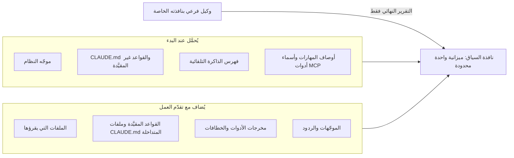

# الوحدة 2 — هندسة السياق (Context engineering)

*لا يكون الوكيل (agent) أفضل مما يعرفه عند بدء الجلسة (when a session starts) ومما يظل قادرًا على رؤيته أثناء سيرها (as the session runs). وتدور هذه الوحدة حول منحه ما يحتاج إلى معرفته (what it needs to know) دون أي شيء يعوق عمله (nothing that gets in the way). يعالج الدرس 2.1 نافذة السياق (context window) بوصفها ميزانية (a budget): ما الذي ينفقها (what spends it) — موجّه النظام (the system prompt) وملفات الذاكرة (memory files) والقواعد (rules) والملفات المشار إليها (referenced files) ومخرجات الأدوات (tool output) والمحادثة (the conversation)؛ وكيف تُحمَّل ذاكرة المشروع (project memory) وتُدمج (loaded and combined)؛ وما الذي يستحق مكانًا في `CLAUDE.md` وما لا يستحق (what belongs and what does not)؛ وكيف تشير إلى الملفات بدقة (point at files precisely)؛ وكيف تعلّم الوكيل مكتبة خاصة (a private library) مثل `najmkit`؛ وكيف تُبقي الجلسة نظيفة (keep a session clean) عبر `/clear` و`/compact` والأسئلة الجانبية (side questions) والوكلاء الفرعيين (subagents). ومُنتَجه (its artefact) هو قالب ذاكرة المشروع (the project memory template) وقائمة التقليم (a pruning checklist). أما الدرس 2.2 فهو المختبر m02 (lab m02): تكتب ذاكرة المشروع لنجم ريميت (Najm Remit)، ويشغّل المُقيِّم (grader) الأوامر التي وثّقتَها ويتحقق من كل ادعاء مقابل المستودع (checks every claim against the repository)، وتشغّل التذكرة (ticket) الصغيرة نفسها مرتين، بملفك وبدونه، لتقيس ما الذي تغيّر (to measure what it changed). وكل ما يخص جانب نجم خيالي (Everything on the Najm side is fictional).*

> **التركيز (Focus):** Context — إعطاء الوكيل ما يحتاج إلى معرفته (giving the agent what it needs to know)، ودون ما يعوق عمله (and nothing that gets in the way).

---

# 2.1 — ما الذي يراه الوكيل: ميزانية السياق وذاكرة المشروع والقواعد والمراجع والضغط والوكلاء الفرعيون (What the agent sees: the context budget, project memory, rules, references, compaction and subagents)
*المستوى (Level): 🟢 مبتدئ (Beginner)* · *المتطلبات (Prerequisites): 1.1* · *التركيز (Focus): Context*

## ⚡ الدرس في دقيقة (In 60 seconds)
- هذه هي عادة **السياق أولًا (Context first)**. فالنافذة **ميزانية (budget)**: يستنفدها موجّه النظام (system prompt) والذاكرة (memory) والقواعد (rules) والملفات (files) ومخرجات الأدوات (tool output) والمحادثة (conversation)، ويتراجع الأداء (performance degrades) كلما امتلأت.
- **ذاكرة المشروع (Project memory)** (`CLAUDE.md` أو `AGENTS.md`) تُحمَّل في كل جلسة (loads every session). أبقِ ما لا يستطيع الوكيل تخمينه (what the agent cannot guess)، واسأل عن كل سطر: هل يتسبب حذفه في خطأ؟ ⁦(would removing it cause a mistake?)⁩ وابقَ دون 200 سطر (Stay under 200 lines).
- الذاكرة **سياق لا إنفاذ (context, not enforcement)**: الجملة تطلب (a sentence asks)، أما الخطاف (hook) أو قاعدة المنع (deny rule) فيفرض (enforces).
- **أشِر ولا تلصق (Point, do not paste).** سمِّ الملف والدالة والسؤال (Name the file, function and question)؛ وأعطِ `najmkit` ملف وثائق (a docs file).
- أبقِ الجلسات نظيفة (Keep sessions clean): `/clear`، و`/compact` مع تركيز (with a focus)، و`/btw`، والوكلاء الفرعيون (subagents). والقواعد التي يجب أن تنجو تُوضع في الملف (Rules that must survive go in the file).
- أكبر فخ (Biggest trap): لصق ملف README ووثيقة المعمارية في الذاكرة (pasting the README and architecture document into memory).

## 🧭 لماذا يهم (Why it matters)
في أسبوعها الثاني تكتب لجين، المهندسة حديثة التخرج (graduate engineer)، الفقرة نفسها في موجّه رابع (a fourth prompt): `pytest -q`، والمال (money) من النوع `Decimal`، وتبدو الإيداعات (commits) هكذا `type(scope): subject`، و`najmkit` مكتبتنا الداخلية فاقرأ وثائقها (read its docs). وفي المرة الخامسة تنسى العبارة الأخيرة، فيكتب الوكيل `audit.record(...)`، وهو غير موجود (does not exist) — وهذا هو نمط `hallucinated-api` من الدرس 1.1. ولا يدرّب طارق، قائد الهندسة (engineering lead)، لجين على صياغة موجّهها (coach her prompt)، بل يقول: «اكتبه مرة واحدة، حيث تقرؤه الأداة في بداية كل جلسة (at the start of every session).»

وبعد شهر تظهر له المشكلة المعاكسة (the opposite problem) — وهي مُختلَقة (constructed). فقد لصق أحدهم ملف README ووثيقة المعمارية (the architecture document) ودليل الأسلوب (a style guide) في `CLAUDE.md`: 400 سطر، منها صفحة تصف `risk.py` لم يعد له وجود. وتسمّي الوثائق الرسمية (the documentation) «ملف CLAUDE.md المفرط التحديد (the over-specified CLAUDE.md)» نمط إخفاق (a failure pattern). وللقصتين سبب واحد: لم يقرر أحد ما الذي ينبغي أن يراه الوكيل (what the agent should see).

## 📐 كيف يعمل (How it works)

### 🟢 الأساسيات (The essentials)

**النافذة ميزانية (The window is a budget).** لا يرى النموذج (A model) إلا سياقه (its context) (الدرس 1.1). وكل طبقة (layer) تنفق من نافذة محدودة (a finite window)، وبعضها يُدفع ثمنه قبل أن تكتب كلمة واحدة (paid before you type a word).

| الطبقة (Layer) | على ريميت (On Remit) |
|---|---|
| **موجّه النظام (System prompt)** | تعليمات الأداة (the tool's instructions)، وأوصاف المهارات (skill descriptions)، وأسماء أدوات MCP (MCP tool names) |
| **ملفات الذاكرة (Memory files)** | `CLAUDE.md`؛ وأول 200 سطر أو 25KB من الذاكرة التلقائية (auto memory) |
| **القواعد (Rules)** | `.claude/rules/*.md`، عند الإطلاق (at launch) أو عند لمس ملفات مطابقة (when matching files are touched) |
| **الملفات (Files)** | `src/remit/fees.py`، بمجرد أن تسمّيه أو يقرأه (once you name it or it reads it) |
| **مخرجات الأدوات (Tool output)** | نتائج `pytest` (results)، ونتائج بحث `grep` (hits)، ومخرجات الخطافات (hook output) |
| **المحادثة (Conversation)** | موجّهاتك وردوده (Your prompts and its replies): وهي تنمو مع كل دور (it grows every turn) |



أبقِ طبقات البدء صغيرة (Keep startup layers small) لأن كل جلسة تدفع ثمنها (every session pays for them)، واجلب الباقي بدقة (pull in the rest precisely) لأنه يبقى (it stays). ويعرض `/context` الشبكة (the grid) وأي ملفات ذاكرة حُمّلت (which memory files loaded). وتصف صفحة أفضل الممارسات (the best-practices page) السياق بأنه «أهم مورد ينبغي إدارته» ("the most important resource to manage").

**ذاكرة المشروع (Project memory)** هي نص Markdown يوضع أمام موجّهك الأول (put in front of your first prompt). وفي Claude Code هي `CLAUDE.md`، وتوجد في أربعة أماكن (in four places).

| النطاق (Scope) | المسار (Path) | من يحصل عليه (Who gets it) |
|---|---|---|
| السياسة المُدارة (Managed policy) | `/etc/claude-code/CLAUDE.md` (Linux وWSL)؛ وعلى macOS `/Library/Application Support/ClaudeCode/CLAUDE.md`؛ وعلى Windows `C:\Program Files\ClaudeCode\CLAUDE.md` | كل من يستخدم الجهاز (Everyone on the machine)؛ ولا يمكن استثناؤها (it cannot be excluded) |
| المستخدم (User) | `~/.claude/CLAUDE.md` | أنت، في كل مشروع (You, in every project) |
| المشروع (Project) | `./CLAUDE.md` أو `./.claude/CLAUDE.md` | الفريق، عبر git (The team, through git) |
| المحلي (Local) | `./CLAUDE.local.md` | أنت، في هذا المشروع (You, in this project)؛ وأضِفه إلى `.gitignore` بنفسك (add it yourself) |

**التحميل والأسبقية (Loading and precedence).** تُحمَّل ملفات `CLAUDE.md` و`CLAUDE.local.md` الموجودة في دليل العمل (the working directory) وفي كل دليل أعلى منه (every ancestor) عند الإطلاق (at launch)؛ أما ما في الأدلة الفرعية (subdirectories) فيُحمَّل عند الطلب (on demand)، حين يقرأ Claude ملفًا هناك أو يكتبه أو يعدّله. **لا شيء يُلغي شيئًا (Nothing overrides anything).** تُدمج كل الملفات بالتسلسل (All files are concatenated)، بدءًا بالأعلى (ancestors first)، ويلي `CLAUDE.local.md` الملف `CLAUDE.md` في دليله. وإذا تعارض ملفان فقد يتبع Claude أيًّا منهما (may follow either): فأزِل التناقضات (remove contradictions) بدل الاعتماد على ترتيب (instead of relying on an order).

**ما يدخل فيها (What goes in).** الأوامر التي لا يستطيع الوكيل تخمينها (Commands the agent cannot guess)، كأن تحتاج واجهة سطر الأوامر (the CLI) إلى `PYTHONPATH=src` بينما لا تحتاج إليه الاختبارات؛ والاصطلاحات (conventions) التي تخالف الافتراضي (differ from the defaults) مثل `type(scope): subject` مع نطاق إلزامي (scope required)؛ والمزالق (gotchas) كأن يكون `ledger.py` شيفرة موروثة (legacy) وغير مختبَرة (untested)؛ ومؤشرات إلى الوثائق (pointers to docs). **وما يبقى خارجها (What stays out).** كل ما يمكن قراءته من الشيفرة (Anything readable from the code)، واصطلاحات اللغة القياسية (standard language conventions)، والدروس الطويلة (long tutorials)، والحقائق كثيرة التغير (facts that change often): فالحدود والرسوم (limits and fees) مكانها `limits.py` و`fees.py`.

اختباران يُبقيان الملف صادقًا (Two tests keep the file honest). تستهدف الوثائق **أقل من 200 سطر (under 200 lines)** لأن الملفات الأطول تستهلك سياقًا أكبر وتُضعف الالتزام (reduce adherence). وتسأل صفحة أفضل الممارسات عن كل سطر: **هل يتسبب حذف هذا السطر في أن يرتكب الوكيل أخطاء؟ ⁦(would removing this cause the agent to make mistakes?)⁩** فإن لم يحدث ذلك فالسطر ضجيج (noise).

### 🟡 التعمق أكثر (Going deeper)

**AGENTS.md.** تقرأ أدوات أخرى `AGENTS.md`، وهو ملف Markdown عادي ومفتوح (an open plain-Markdown) يُعدّ «README للوكلاء» ("README for agents"). ويقرؤه Claude Code مباشرة منذ الإصدار v2.1.277، لكن افتراضيًا (by default) فقط حين لا يوجد `CLAUDE.md` ولا `CLAUDE.local.md` في دليل العمل أو فوقه (in the working directory or above)؛ ويغيّر ذلك إعداد «Project instructions» في `/config`. ولمشاركة ملف واحد (To share one file)، اكتب `AGENTS.md` وضع `@AGENTS.md` داخل `CLAUDE.md`. وقد تغيّرت هذه التفاصيل في 2026، فراجع الوثائق الحالية (check the current documentation).

**المهمة نفسها باسم آخر (The same job under another name).** في [Spec-Driven Development: A Spec-First Approach to AI-Native Engineering](https://developer.microsoft.com/blog/spec-driven-development-ai-native-engineering/)، تصف Microsoft دورة حياة من سبع خطوات (a seven-step lifecycle) خطوتها الأولى *دستور (constitution)*: مبادئ وحواجز وقائية (principles and guardrails). وتشرح تدوينتها المرافقة (companion post) عن GitHub Spec Kit ملفَّ الدستور (the constitution file)؛ وGitHub Spec Kit عدّة أدوات مفتوحة المصدر (an open-source toolkit) أنشأتها Microsoft. وهذه في دورتنا هي وظيفة ذاكرة المشروع (project memory): قواعد دائمة يقرؤها الوكيل في كل جلسة (standing rules the agent reads every session). وتغطي الوحدة 3 الخطوات الست الأخرى (the other six steps). وما تصفه شركة عن ممارستها هي ليس دليلًا مستقلًا (A company describing its own practice is not independent evidence)؛ فهو يُظهر أن الفكرة رائجة (the idea is current)، لا أن الدستور يحسّن النتائج (a constitution improves results). فاقرأ الأصول (Read the originals) المرتبطة أدناه.

**الاستيراد (Imports).** يجلب `@path/to/file` ملفًا إلى الذاكرة (pulls a file in)؛ وتتداخل الاستيرادات حتى أربع مراحل (imports nest four hops deep) وتُتجاهل داخل مقاطع الشيفرة (code spans) وكتلها المسيَّجة (fences). **الاستيراد لا يقلل كلفة السياق (Imports do not reduce context cost)**: فالملفات المستوردة تُحمَّل عند الإطلاق (load at launch). وسيضع `@docs/najmkit.md` الصفحة كلها في كل جلسة (the whole page into every session)؛ أما المؤشر العادي (a plain pointer) فيكلّف سطرًا واحدًا ويُتَّبع حين يهم الأمر (is followed when it matters).

**القواعد (Rules).** تقسّم الملفات في `.claude/rules/` الذاكرة بحسب الموضوع (split memory by topic). فالقاعدة التي بلا `paths:` تُحمَّل عند الإطلاق (loads at launch)؛ والتي فيها `paths:` لا تُحمَّل إلا حين يعمل Claude على ملفات مطابقة (matching files)، فلا تكلّف قاعدة الاختبارات شيئًا (a tests rule costs nothing) وهو يعدّل `src/`. وراجع الوثائق (check the documentation) لمعرفة صيغة glob الدقيقة (the exact glob syntax):

```markdown
---
paths:
  - "tests/**"
---
Tests are deterministic: use the fixtures in tests/conftest.py (fixed clock, sequential ids).
```

**الذاكرة سياق لا إنفاذ (Memory is context, not enforcement).** يتبع النموذج الملف في الغالب (usually follows the file)، و«في الغالب» ليست ضابطًا (is not a control). وتوصي صفحة الذاكرة (the memory page) باستخدام خطاف (hook) `PreToolUse` لمنع إجراء أيًّا كان قرار Claude؛ وتقترح صفحة أفضل الممارسات كلمة "IMPORTANT" على السطر الوحيد الذي يجب ألا يفوت (the one line that must not be missed). استخدمها مرة واحدة: فإذا صرخ كل شيء لم يصرخ شيء (if everything shouts, nothing does). يعطي الملف القاعدة وسببها (rule and reason)؛ ويفرضها الخطاف (hook) أو قاعدة المنع (deny rule)، كما في الدرس 9.1؛ ويُبنى خطاف الحماية (guard hook) في الدرس 8.2. وتعيش قاعدة المنع في `.claude/settings.json`؛ وهي تغطي أدوات الملفات المدمجة (built-in file tools) وأوامر مثل `cat`، لا كل عملية فرعية (not every subprocess): طبقة لا جدار (a layer, not a wall).

```json
{ "permissions": { "deny": ["Read(./.env)"] } }
```

**أشِر بدقة (Point precisely).** الموجّه الغامض (A vague prompt) يجعل الوكيل يبحث، وتُدفع كلفة النتائج بوصفها مخرجات أدوات (paid for as tool output). أما الموجّه الدقيق (A precise one) فيسمّي الملف والدالة والحقيقة التي لا يراها والإجابة المطلوبة (the answer wanted).

```text
The express fee looks wrong. Can you check the fee code?
```

```text
Read @src/remit/fees.py (explain_fee) and @tests/test_fees.py.
A QAR-INR express transfer of 500.00 costs 27.00: the 12.00 fee plus a 15.00 surcharge. Support says 12.00.
Change nothing. Tell me which line adds the surcharge, whether before or after the cap, and which test pins it down.
```

**وثائق يستطيع الوكيل قراءتها (Docs the agent can read).** ما يعيش في رأس أحدهم ليس في النافذة (What lives in someone's head is not in the window): فأبقِ الوثائق في المستودع (keep docs in the repository) وأشِر إليها. لكن الوثائق تنحرف (documents drift). فما زال `docs/ARCHITECTURE.md` يسرد `risk.py` (ولا يُظهر `ls src/remit` شيئًا منه) ومستويين من KYC بلا حد شهري (two KYC tiers with no monthly limit)، بينما في `limits.py` ثلاثة مستويات وحدود شهرية (three tiers and monthly limits). ويقول `docs/TOUR.md` إن الشيفرة هي التي تحسم (the code wins).

**تعليم الوكيل مكتبتك الخاصة (Teaching the agent your private library).** `najmkit` مضمَّنة داخل المستودع (vendored) وليست في أي مجموعة تدريب (training set)، فيخمّن الوكيل من الأسماء (guesses from names). لا تصفها في `CLAUDE.md`، حيث تدفع كل جلسة ثمنها: اكتب صفحة كاملة لقارئ لم يرها قط (a reader who has never seen it)، وسطرًا واحدًا يقول إن الصفحة موجودة. و`docs/najmkit.md` هو النموذج (is the model): فهو يذكر أن المكتبة داخلية (internal)، ويعرض كل توقيع (signature) مع نتيجة نموذجية (a sample result) هي `"TRF-9F3A1C7B2D40"`، ويحدد القواعد (states the rules): سجّل المعرّفات فقط (log identifiers only).

### 🔴 نظرة الخبير (Expert view)

**إبقاء النافذة نظيفة (Keeping the window clean).**

| الإجراء (Move) | ما يفعله (What it does) | متى تستخدمه (Use it when) |
|---|---|---|
| `/clear` | يبدأ محادثة جديدة (Starts a new conversation) | بين مهام غير مترابطة (Between unrelated tasks) |
| `/compact [instructions]` | يلخّص (Summarises): `/compact Focus on the API changes`؛ ويمكن أن يلخّص `/rewind` جزءًا منه (can summarise part) | حين يطول التاريخ لكنه ما زال لازمًا (History long but still needed) |
| `/btw [question]` | سؤال جانبي (A side question) لا يدخل التاريخ أبدًا (never enters the history) | «ماذا تفعل `Money.zero`؟» ⁦(What does Money.zero do?)⁩ |
| وكيل فرعي (A subagent) — وكيل Explore للقراءة فقط (read-only) | نافذة خاصة (Own window)؛ ولا يعود إلا تقريره النهائي (only its final report returns) | تحقيق في عشرين ملفًا (A twenty-file investigation) |

لا يرى الوكيل الفرعي محادثتك أبدًا (A subagent never sees your conversation)؛ فهو يتلقى موجّه نظام خاصًا به (its own system prompt) ومهمتك، و`CLAUDE.md` الخاص بك أيضًا ما عدا وكيلَي Explore وPlan (except Explore and Plan).

**ما الذي ينجو من الضغط (What survives compaction).** ينجو موجّه النظام (The system prompt) وملف `CLAUDE.md` في جذر المشروع (the project-root)، ويُعاد قراءته من القرص (re-read from disk)، والقواعد غير المقيَّدة (unscoped rules) والذاكرة التلقائية (auto memory) والخطة (the plan). **التعليمات المعطاة في المحادثة فقط لا تنجو كما كُتبت (Instructions given only in conversation do not survive as written)**، أما القواعد المقيَّدة (scoped rules) وملفات `CLAUDE.md` المتداخلة (nested) فلا تعود إلا حين تُلمس ملفاتها مرة أخرى (only when their files are touched again).

**تدهور السياق (Context rot)، بحذر (carefully).** قدّم الدرس 1.1 الدليل (gave the evidence): تقرير من مورّد هو Chroma (a Chroma vendor report)، وLiu وآخرون عن نماذج حقبة 2023 (2023-era models). لم يختبر أيٌّ منهما وكلاء برمجة (Neither tested coding agents)، فلا يعطي أيٌّ منهما رقمًا لمستودعك (a number for your repository).

**عامِل الذاكرة معاملة الشيفرة (Treat memory like code).** أي تغيير في `CLAUDE.md` يغيّر ما يُقال لكل وكيل في الفريق: فراجع الفروقات الخام (review the raw diff). وأفادت Pillar Security، وهي مورّد أمني (a security vendor)، في 2025 بأن رموز Unicode المخفية (hidden Unicode) في ملفات القواعد يمكن أن تُخفي التعليمات عن المراجع البشري (a human reviewer) بينما يتبعها كل من Copilot وCursor. وقلّم وفق جدول (Prune on a schedule): يفحص `/doctor prompt-audit [path]` (الإصدار v2.1.283 أو أحدث) ملفات التعليمات بحثًا عن محتوى قديم أو متعارض (for stale or conflicting content). والذاكرة التلقائية محلية لجهاز واحد (local to one machine)، فقواعد الفريق مكانها ملف المشروع، في git. وحين يخطئ الوكيل فاسأل إن كان سطر ناقصًا أو خاطئًا أو مهمة لخطاف (missing, wrong, or a job for a hook)؛ ولا تضف قاعدة لكل خطأ (do not add a rule per mistake).

**متى لا تفعل (When not to).** لا يحتاج سكربت تجريبي من عشرة أسطر (A ten-line scratch script) إلى ملف ذاكرة، والحقيقة العابرة (a one-off fact) مكانها الموجّه، والقاعدة التي لا يخرقها الوكيل أبدًا ينبغي أن تُحذف (should go).

## 🧰 الأدوات (The toolkit)
| الأداة أو الممارسة أو النمط (Tool, practice or pattern) | ما هي وماذا تفعل (What it is and does) | متى تلجأ إليها (When to reach for it) |
|---|---|---|
| **Project memory** — ذاكرة المشروع | `CLAUDE.md` (أو `AGENTS.md`): الملف القصير الذي يُحمَّل في كل جلسة (the short file loaded every session) | كل مستودع يلمسه وكيل (Every repository an agent touches) |
| **Path-scoped rules** — القواعد المقيَّدة بالمسار | `.claude/rules/*.md` مع `paths:`، تُحمَّل حين تُلمس ملفات مطابقة (loaded when matching files are touched) | قاعدة لمجلد واحد (A rule for one folder) |
| **Precise reference** — المرجع الدقيق | موجّه يسمّي الملف (`@path`) والدالة والحقيقة الناقصة (A prompt naming the file, function and missing fact) | كل موجّه غير هيّن (Every non-trivial prompt) |
| **Library docs file** — ملف وثائق المكتبة | صفحة كاملة لشيفرة لم يرها النموذج قط (A complete page for code the model has never seen) | مكتبة داخلية (An internal library) |
| **Fresh session** — جلسة جديدة | `/clear` و`/compact` مع تركيز (with a focus) و`/btw` ووكيل فرعي (a subagent)؛ ويعرض `/context` السبب (to see why) | بين المهام (Between tasks)؛ وحين تكبر الجلسة (when a session grows) |
| **Pruning checklist** — قائمة التقليم | ثمانية أسئلة تُطرح على ملف الذاكرة (Eight questions asked of a memory file) | شهريًا (Monthly)؛ وبعد حادثة (after an incident) |

## 🏛️ عمليًا في بنك نجم (In practice at Najm Bank)
مُنتَجان (Two artefacts): **قالب ذاكرة المشروع (Project memory template)** و**قائمة التقليم (Pruning checklist)**. وأولًا، المثال الذي نشآ منه (the example they come from).

**قبل (Before).** هذا ما تحصل عليه حين تطلب من أداة ملف `CLAUDE.md` وتضيف إليه ما تقوله وثيقة المعمارية (what the architecture document says) — مُختلَق للتعليم، لا مسجَّل من نموذج حقيقي (constructed for teaching, not recorded from a model). وكل عيب فيه قابل للتحقق (Every defect is checkable).

```markdown
# Najm Remit

### Project Overview
Najm Remit is a robust, scalable remittance platform for Najm Bank. It follows best practices.

### Project Structure

    src/remit/
    ├── money.py      # Money class
    ├── fees.py       # Fee schedules
    ├── risk.py       # Limits and name screening
    ├── ledger.py     # Double-entry ledger
    └── service.py    # RemitService
    tests/

### Commands
- Install: `pip install -r requirements.txt`
- Test: `make test`
- Lint: `ruff check .` and `black .`
- Run: `python -m remit quote QAR 500 INR`

### Architecture
There are two KYC tiers: T1 may send QAR 5,000 per day and T2 QAR 25,000. There is no monthly limit.
Limits and screening live in `src/remit/risk.py`.

### Code Style
- Follow PEP 8 and write clean, readable, maintainable code.
- Use type hints and docstrings. Use descriptive variable names.
- Be careful when changing financial logic.

### Git
- Use conventional commits, for example `feat: add quote endpoint`.
```

يشغّل مُقيِّم الدرس 2.2 (grader) الأوامر ويتحقق من المسارات (checks the paths). وهذا مقتطف من مخرجاته الحقيقية على ذلك الملف، بلا تلميحات (without hints):

```text
[FAIL] The documented commands run and work: `make test` (line 18): this repository has no Makefile; `ruff check .` (line 19): ...
[FAIL] Every file it points to exists: not in the repository: `risk.py` (line 11), `requirements.txt` (line 17), `src/remit/risk.py` (line 24)
```

الحجم ليس هو المشكلة (Size is not the problem): فالملف يوثّق أدوات لا يملكها ريميت (documents tools Remit lacks)، ويكرر وثيقة قديمة (repeats a stale document)، ويُغفل ما لا يستطيع الوكيل تخمينه (omits what an agent cannot guess).

**بعد (After).** عشرون سطرًا، وكل سطر يجتاز اختبار «هل يتسبب حذفه في خطأ؟» ⁦(would removing it cause a mistake?)⁩.

```markdown
# Najm Remit

Money-transfer service for the fictional Najm Bank. Python 3.11, standard library only, pytest.

### Commands
- All tests, from the repository root: `pytest -q`. One file: `pytest -q tests/test_fees.py`
- Command line: `PYTHONPATH=src python -m remit quote QAR 500 INR` (the tests do not need `PYTHONPATH`; the command line does)
- There is no linter, formatter or Makefile. Do not invent a command.

### Conventions
- IMPORTANT: money is `Decimal` through `Money` (`src/remit/money.py`), never `float`.
- Ids, time and audit events come from `najmkit`, our internal library, which is not in your training data. Read `docs/najmkit.md` first and do not guess names.
- Tests are named `tests/test_<module>.py`; `tests/conftest.py` gives a fixed clock and sequential ids. New behaviour needs a test.
- Commits: `type(scope): subject`, scope required and lower case, for example `fix(limits): count transfers made just after midnight`. `CONTRIBUTING.md` lists the types.
- Customer messages exist in English and Arabic (`src/remit/notify.py`). Change both.

### Gotchas
- `docs/ARCHITECTURE.md` is partly stale; the code wins. `docs/TOUR.md` is current.
- `src/remit/ledger.py` and `src/remit/screening.py` are legacy and untested. Read their docstrings first.

### Never
- Never edit, delete or skip a test to make it pass.
- Never write a secret or real customer data into code, tests, logs or commits.
- Never add a dependency, or call `uuid.uuid4()` or `datetime.now()` in service code.
- Never tell a customer that a name matched a sanctions list; a screening hit only says we need to review.
```

الأوامر عملت (The commands ran). وقاعدة `float` مذكورة مرة واحدة (stated once)، مع `IMPORTANT` الوحيدة. وتحصل `najmkit` على مؤشر لا نسخة (a pointer, not a copy)، والوثيقة القديمة موسومة لا مقتبسة (flagged, not quoted). وبالمُقيِّم نفسه يجتاز الملف كل الفحوص (passes it on every check).

**قالب ذاكرة المشروع (The Project memory template).** انسخه، واحذف ما لا ينطبق (delete what does not apply)، وشغّل كل أمر قبل أن تُبقيه (run every command before you keep it).

```markdown
# <Project name>

<Two sentences: what it is, the runtime, what is fictional.>

### Commands
- <Run all tests, and from where>: `<command>`
- <Run one file or one test>: `<command>`
- <Anything that needs setup>: `<command>`
- <Tools that do NOT exist here>

### Conventions
- <A rule the agent would get wrong, with the reason in a few words>

### Gotchas
- <Something fragile or misleading; a document that is out of date>

### Never
- <Three to eight things that would hurt here>
```

**قائمة التقليم (The Pruning checklist).** قاعدة طارق (مُختلَقة، fictional): تغيير الذاكرة يحتاج إلى مراجع آخر واحد (one other reviewer)، ويُقلَّم كل ملف شهريًا (pruned monthly).

```markdown
# Memory pruning checklist     File:        Reviewed:        By:
1. Run every command from a fresh shell and open every path. Does each work today?
2. For each line: would removing it cause a mistake? If not, delete it.
3. Can the agent read the line from the code? If so, delete it.
4. Does a line copy a document or a table of numbers? Point to it instead.
5. Does a line contradict another line or another memory file?
6. Was a line added after one bad run, or is it obeyed unprompted now?
7. Which rule is a promise the file cannot keep? Move it to a hook or deny rule.
8. Is the file under 200 lines, IMPORTANT used once or twice, and the diff free of odd Unicode or unknown links?
```

## 🛠️ التمارين (Exercises)
- 🟢 **قلّم ملف «قبل» (Prune the "before" file).** *لا يحتاج إلى وكيل (No agent).* *يكتمل عندما (Done when):* يكون لكل سطر حكم (a verdict) — أبقِ أو أصلح أو احذف (keep, fix, delete) — وسبب، وتُعلَّم خمسة ادعاءات بأنها خاطئة أو غير قابلة للتشغيل (false or unrunnable) مع الأمر الذي كشفها (the command that showed it).
- 🟡 **الغامض مقابل الدقيق (Vague against precise).** *يحتاج إلى وكيل (Needs an agent).* اطرح سؤال الرسوم السريعة (the express-fee question) بالطريقتين في جلستين جديدتين (in fresh sessions). *يكتمل عندما (Done when):* يقارن جدول بين الملفات المقروءة والدقائق وما إذا كانت الإجابة سمّت السطر (whether the answer named the line)، وما يعرضه `/context`.
- 🔴 **انجُ من الضغط (Survive a compaction).** *يحتاج إلى وكيل (Needs an agent).* أعطِ قاعدة واحدة في المحادثة فقط (only in conversation) وأخرى في `CLAUDE.md`، ثم شغّل `/compact`، ثم اختبر الاثنتين (test both). *يكتمل عندما (Done when):* تسجّل ملاحظة `claude --version` وما رأيته وخلاصة قصيرة (a short conclusion).

## ⚠️ أخطاء وفخاخ (Mistakes and traps)
- **لصق الوثائق في الذاكرة (Pasting the docs into memory).** يُدفع ثمنها في كل جلسة، وهي قديمة مرتين (stale twice over). أشِر إليها بدلًا من ذلك (Point instead).
- **توثيق أوامر لم يشغّلها أحد (Documenting commands nobody ran).** قد تسرد المسودات أدوات لا يملكها المشروع (Drafts can list tools the project lacks). شغّل كل أمر (Run each).
- **معاملة الملف كأنه قفل (Treating the file as a lock).** يمكن تجاهل السطر (A line can be ignored)؛ فاستخدم خطافًا أو قاعدة منع (a hook or deny rule).
- **تعديلات الذاكرة بلا مراجعة (Unreviewed memory edits).** سطر مخفي واحد يوجّه كل وكيل في الفريق (One hidden line steers every agent on the team).

## 🧾 الخلاصة (Recap)
- النافذة ميزانية (The window is a budget): أبقِ طبقات البدء صغيرة (keep startup layers small) واجلب الباقي بدقة (pull in the rest precisely).
- تحمل الذاكرة ما لا يستطيع الوكيل تخمينه (what the agent cannot guess)، في أقل من 200 سطر (under 200 lines)، وكل سطر يجتاز سؤال «هل يتسبب حذفه في خطأ؟» ⁦(would removing it cause a mistake?)⁩
- تُدمج ملفات الذاكرة بالتسلسل (Memory files concatenate)، ولا شيء يُلغي شيئًا (nothing overrides anything)، والاستيراد لا يوفّر سياقًا (imports save no context)، والقواعد المقيَّدة تُحمَّل عند الطلب (scoped rules load on demand).
- الذاكرة تطلب، والخطافات تفرض (Memory asks, hooks enforce). أشِر إلى الوثائق وتحقق منها مقابل الشيفرة (check them against the code)؛ وأبقِ الجلسات نظيفة (keep sessions clean)؛ وراجع الذاكرة وقلّمها كما تفعل بالشيفرة (review and prune memory like code).

## ✍️ اختبر نفسك (Check yourself)

**1. تلصق لجين جدول الوحدات (the module table) من `docs/ARCHITECTURE.md` في `CLAUDE.md`؛ ثم يعدّل وكيل لاحقًا ملف `risk.py` غير الموجود. ما أفضل علاج؟ ⁦(What is the best repair?)⁩**

- A. أضف ملاحظة تقول إن `risk.py` قد زال (a note saying that it has gone).
- B. احذف الجدول وأشِر إلى `docs/TOUR.md` (Delete the table and point to).
- C. انقل الجدول إلى قاعدة مقيَّدة بالمسار (a path-scoped rule).
- D. علّم الجدول بـ IMPORTANT ليُفحص أولًا (so it is checked first).

<details><summary>الإجابة</summary>

**B.** الشيفرة تُظهر الوحدات أصلًا (The code already shows the modules)، والنسخة تحمل انحراف الوثيقة (the document's drift) إلى كل جلسة. أما التقييد والتوكيد (Scoping and emphasis) فيُبقيان جدولًا خاطئًا (a false table). 🟡 وثائق يستطيع الوكيل قراءتها (Docs the agent can read).

</details>

**2. يقول `CLAUDE.md` في ريميت `type(scope): subject`؛ ويقول `~/.claude/CLAUDE.md` عند لجين «بلا نطاقات» ("no scopes"). ماذا يحدث في ريميت؟ ⁦(What happens in Remit?)⁩**

- A. ملف المشروع هو الغالب (The project file wins)، لأنه أقرب إلى الشيفرة (closer to the code).
- B. ملفها الخاص بالمستخدم هو الغالب (Her user file wins)، لأنه شخصي لها (personal to her).
- C. يُحمَّل الاثنان، وقد يتبع Claude أيًّا منهما (Both load, and Claude may follow either).
- D. يرفض Claude البدء حتى يتفقا (refuses to start until they agree).

<details><summary>الإجابة</summary>

**C.** لا شيء يُلغي شيئًا (Nothing overrides anything): تُدمج الملفات بالتسلسل (files are concatenated)، وعند التعارض قد يتبع Claude أيًّا منهما (on a conflict Claude may follow either). 🟢 التحميل والأسبقية (Loading and precedence).

</details>

**3. يضيف طارق `@docs/najmkit.md` إلى `CLAUDE.md` كي تعرف كل جلسة `najmkit`. ماذا يفعل ذلك؟ ⁦(What does that do?)⁩**

- A. يحمّل الصفحة كلها عند الإطلاق (loads the whole page at launch)، كأنك لصقتها (like pasting it).
- B. يحمّل الصفحة فقط حين يذكر ملف ما `najmkit` (only when a file mentions it).
- C. لا يفعل شيئًا خارج ملف مستوى المستخدم (the user-level file).
- D. يحمّل الصفحة مرة واحدة ويحتفظ بملخص (keeps a summary).

<details><summary>الإجابة</summary>

**A.** الملفات المستوردة تُحمَّل عند الإطلاق (Imported files load at launch)، فالاستيراد لا يقلل كلفة السياق (imports do not reduce context cost). 🟡 الاستيراد (Imports).

</details>

**4. في الدور 5 تقول لجين: «اعرض المبالغ دائمًا مع عملتها» ("always show amounts with their currency"). وبعد الضغط التلقائي (auto-compaction) يطبع الوكيل أرقامًا مجرّدة (bare numbers). لماذا، وما الحل؟ ⁦(Why, and what is the fix?)⁩**

- A. حذف الضغط (Compaction) ملف `CLAUDE.md`، فعليها إعادة إنشائه (recreate it).
- B. عرض العملة افتراضي في النموذج (a model default) ولا تغيّره التعليمات (instructions cannot change).
- C. كانت الذاكرة التلقائية (auto memory) معطّلة، فعليها تشغيلها (switch it on).
- D. عاشت القاعدة في المحادثة فقط (lived only in the conversation)؛ فضعها في `CLAUDE.md`.

<details><summary>الإجابة</summary>

**D.** التعليمات المعطاة في المحادثة فقط لا تنجو من الضغط كما كُتبت (do not survive compaction as written)؛ أما `CLAUDE.md` فيُعاد قراءته من القرص (re-read from disk). 🔴 ما الذي ينجو من الضغط (What survives compaction).

</details>

**5. يريد الفريق أن يتأكد من ألا يقرأ أي وكيل `.env`. أي تغيير هو الأنسب؟ ⁦(Which change fits best?)⁩**

- A. قاعدة منع (A deny rule) لقراءة `.env`، مع سطر في الذاكرة يشرح السبب (a memory line saying why).
- B. عبارة NEVER READ .env بأحرف كبيرة (in capitals) في أعلى `CLAUDE.md`.
- C. الجملة نفسها في قاعدة مقيَّدة بالمسار (a path-scoped rule).
- D. ملف سياسة أمنية (A security policy file) مستورد عبر `@`.

<details><summary>الإجابة</summary>

**A.** الذاكرة تطلب؛ وقاعدة المنع أو الخطاف يفرض (Memory asks; a deny rule or hook enforces). أما الأحرف الكبيرة والتقييد والاستيراد (Capitals, scoping and imports) فتبقى نصًّا (remain text). 🟡 الذاكرة سياق لا إنفاذ (Memory is context, not enforcement).

</details>

## 📚 المراجع (References)
- وثائق Claude Code (Claude Code documentation): الذاكرة (memory) https://code.claude.com/docs/en/memory; ونافذة السياق (context window) https://code.claude.com/docs/en/context-window; وأفضل الممارسات (best practices) https://code.claude.com/docs/en/best-practices; والأوامر (commands) https://code.claude.com/docs/en/commands. وAGENTS.md: https://agents.md
- [*تصميم الأنظمة لمبرمجي الفايب (System Design for Vibe Coders)*، الدرس 9.2 — هندسة السياق (Context engineering)](../vibe/index.ar.html#l9-2); [*بناء تطبيقات الذكاء الاصطناعي والوكلاء (Building AI Applications & Agents)*، الدرس 1.1 — الفكرة الواحدة: دالة عديمة الحالة والرموز ونافذة السياق وقائمة الرسائل (The one idea: a stateless function, tokens, the context window and the messages list)](../aiapps/index.ar.html#/1.1); [*الذكاء الاصطناعي الآمن وأمان التطبيقات (Secure AI & Application Security)*، الدرس 8.2 — حقن الموجّهات وكسر القيود، المباشر وغير المباشر (Prompt injection and jailbreaks, direct and indirect)](../secai/index.ar.html#/8.2)
- **للتوسع (Go deeper).** Microsoft for Developers، "Spec-Driven Development: A Spec-First Approach to AI-Native Engineering": https://developer.microsoft.com/blog/spec-driven-development-ai-native-engineering/ ؛ وتدوينته المرافقة (its companion) "Diving Into Spec-Driven Development With GitHub Spec Kit": https://developer.microsoft.com/blog/spec-driven-development-spec-kit/ ؛ Chroma، "Context Rot": https://research.trychroma.com/context-rot ؛ Liu وآخرون ⁦(et al.)⁩، "Lost in the Middle": https://aclanthology.org/2024.tacl-1.9/ ؛ Pillar Security، "Rules File Backdoor": https://www.pillar.security/blog/new-vulnerability-in-github-copilot-and-cursor-how-hackers-can-weaponize-code-agents

---

# 2.2 — المختبر: اكتب ذاكرة المشروع لنجم ريميت وقِس ما الذي تغيّره (Lab: write the project memory for Najm Remit and measure what it changes)
*المستوى (Level): 🟢 مبتدئ (Beginner)* · *المتطلبات (Prerequisites): 0.2، 2.1* · *التركيز (Focus): Context*

## ⚡ الدرس في دقيقة (In 60 seconds)
- المختبر m02 (Lab m02): اكتب `CLAUDE.md` (أو `AGENTS.md`) للمستودع الابتدائي (the starter repository)، وشغّل تذكرة صغيرة واحدة مرتين، بدونه ومعه (without and with it)، وسجّل الفرق (the difference) في `ab-notes.md`.
- يحتاج إلى وكيل (Needs an agent): **نعم في جزء A/B**؛ والبديل بلا وكيل (the no-agent path) مساعد محادثة (a chat assistant) أو زميل (a colleague). أما المُقيِّم (The grader) فلا يحتاج إليه أبدًا.
- يشغّل المُقيِّم **الأوامر التي وثّقتَها (runs the commands you documented)** ويتحقق من المال بصيغة Decimal (Decimal money) وهيكل الاختبارات (the test layout) وقاعدة الإيداع (the commit rule) و`najmkit` وكل مسار وبعض الادعاءات مقابل الشيفرة (some claims against the code)؛ ويرفض الحقائق القديمة (stale facts) والحشو (filler) والأسرار (secrets) والنص المخفي (hidden text).
- الفخاخ (Traps): `docs/ARCHITECTURE.md` قديم جزئيًا (partly out of date)، و`python -m remit` يحتاج إلى `PYTHONPATH=src`، ولا يوجد مدقّق شيفرة (linter) ولا Makefile.
- تُفحص الملاحظات من حيث الاكتمال واقتباس أسطر حقيقية من ملفك (quoting real lines of your file)، لا من حيث «فاز B» ("B won"). و«لا فرق» ("No difference") إجابة صالحة (valid).

## 🧭 لماذا يهم (Why it matters)
يقول طارق في العيادة (at the clinic): «الجميع يعتقد أن ملف الذاكرة يساعد. أرني ذلك (Show me).» ففي تجربة METR العشوائية (randomized trial) — 16 مطوّرًا ذوي خبرة (experienced developers) على مستودعاتهم الخاصة وبأدوات مطلع 2025 (early-2025 tools)، كما في الدرس 0.1 — اعتقد المطوّرون أنهم أسرع بينما قالت الساعة غير ذلك (while the clock said otherwise). تجربة صغيرة واحدة لا تثبت شيئًا عن مستودعك (proves nothing about your repository)، لكن الإحساس بموجّه ما ليس أمتن من الإحساس بالسرعة (a feeling about a prompt is no sounder than a feeling about speed). والعلاج نفسه: قِس، قياسًا صغيرًا وصادقًا (measure, small and honest).

الأمر الخاطئ أو المؤشر القديم (A wrong command or a stale pointer) في ملف الذاكرة يُدفع ثمنه في كل جلسة، ولذلك يفعل هذا المُقيِّم شيئًا غير مألوف مع الوثيقة: إنه ينفّذ ما كتبتَه (it executes what you wrote).

## 📐 كيف يعمل (How it works)

### 🟢 الأساسيات (The essentials)

**اكتبه من المستودع، لا من الذاكرة (Write it from the repository, not from memory).**
1. **اقرأ ما كتبه الفريق (Read what the team wrote):** `README.md` و`CONTRIBUTING.md` و`docs/TOUR.md` و`docs/najmkit.md`. وعامِل `docs/ARCHITECTURE.md` بوصفه ادعاءً يجب التحقق منه (as a claim to check).
2. **شغّل الأشياء (Run things)** من جذر المستودع (from the repository root)، كما سيفعل الوكيل.
3. **عدِّد ما لا يستطيع الوكيل تخمينه (List what an agent cannot guess):** كيف تبدأ واجهة سطر الأوامر (how the CLI starts)، والأدوات غير الموجودة (the tools that do not exist)، و`najmkit`، وقاعدة الإيداع (the commit rule).
4. **صُغ مسودة قصيرة (Draft short)** من القالب في الدرس 2.1.
5. **تحقق من كل سطر (Verify every line):** هل هو صحيح اليوم؟ وهل يتسبب حذفه في خطأ؟ ⁦(would deleting it cause a mistake?)⁩

```bash
cd ~/ainative/m02
pytest -q                          # 99 passed
python -m remit quote QAR 500 INR  # what an agent tries first
ls src/remit                       # is there a risk.py?
```

يفشل الأمر الثاني في صدفة جديدة (fails in a fresh shell)، وينبغي أن يقول ملفك السبب (should say why):

```text
/usr/local/bin/python: No module named remit
```

يعمل `PYTHONPATH=src python -m remit quote QAR 500 INR`. فالاختبارات تأخذ مسارها من `pyproject.toml`؛ أما سطر الأوامر (the command line) فلا.

**يستطيع الوكيل أن يصوغ المسودة؛ وأنت تتحقق (An agent can draft; you verify).** أعطِه قائمة القراءة (the reading list) وقواعد الملف (the rules of the file)، واجعله يُظهر عمله (show its work):

```text
Read README.md, CONTRIBUTING.md, docs/TOUR.md and docs/najmkit.md. Treat docs/ARCHITECTURE.md as possibly out of date: check anything you take from it against src/.
Draft CLAUDE.md in about 40 lines: commands an agent cannot guess, conventions that differ from the defaults, gotchas, a short never list, pointers to docs. Leave out anything readable from the code.
Run every command you put in it and show me the output. Quote the file behind each claim. Do not write the file yet.
```

`/init` بداية معقولة (a fair start)، لكن مخرجاته مسودة كأي مسودة وكيل (a draft like any agent's): افحصها بحثًا عن أوامر لا يملكها المستودع (commands the repository lacks)، ودعه يكتب `CLAUDE.md` وحده (let it write only).

### 🟡 التعمق أكثر (Going deeper)

**صمّم التجربة بأمانة (Design the experiment honestly).** يتغيّر متغيّر واحد (One variable changes): ملف الذاكرة. الأداة والنموذج والموجّه نفسها (Same tool, model and prompt)، وجلسة جديدة (a fresh session)، ونسختان جديدتان (two fresh copies). تتيح REMIT-252 (`quote --json`) للذاكرة أن تهم في عدة مواضع: فأسهل طريقة لطباعة `Decimal` بصيغة JSON هي `float(...)` أو `default=float`، وهذا يخرق قاعدة المال (breaks the money rule)؛ وواجهة سطر الأوامر (the CLI) تحتاج إلى `PYTHONPATH=src`؛ وللاختبارات مكان معتاد (a home) هو `tests/test_config_cli.py`؛ وللإيداع قاعدة (the commit has a rule).

**قِس ستة أشياء (Measure six things):** وهي صفوف الجدول في `ab-notes.md`. و*المنعطف الخاطئ (wrong turn)* هو كل مرة اضطررت فيها إلى إيقاف الوكيل أو تصحيحه أو إعادة توجيهه (stop, correct or redirect)؛ وعدّه من النص (count from the transcript).

**سمِّ العوامل المربكة (Name the confounders).** قد يجد الوكيل في A ملف `CONTRIBUTING.md` عبر README؛ وحينها لم تحدث قاعدة الإيداع فرقًا، وهذه نتيجة (a finding). وقد تحتفظ أداتك بملاحظات بين الجلسات (keep notes between sessions) — الذاكرة التلقائية في Claude Code (auto memory)، ويبدّلها `/memory` — ويُحمَّل `~/.claude/CLAUDE.md` على مستوى المستخدم (user-level) في التشغيلين. والوكيل غير حتمي (not deterministic) (الدرس 1.1)، وأنت تعرف أيُّهما بالملف وأيُّهما بدونه (you know which run is which). والتشغيل الواحد لكل نسخة حكاية لا دليل (One run each is an anecdote): فكرّر كلًّا منهما مرتين إن استطعت، واطلب من زميل أن يعدّ المنعطفات الخاطئة من الفروقات (count wrong turns from the diffs). وإن لم يكن B أفضل فتلك نتيجة أيضًا (that is a finding too).

**بلا وكيل؟ ⁦(No agent?)⁩** الصق التذكرة في محادثة جديدة مرتين (twice)، مرة مع ملفات المستودع ومرة مع ملف ذاكرتك أيضًا. أو احسب زمن زميل لم يقرأ ريميت (time a colleague who has not read Remit)، مرة بالمستودع وحده ومرة بملفك. الزميل هو الاختبار الأفضل (The colleague is the better test). وماذا لو لم تتوفر جلسة تفاعلية (interactive session) إطلاقًا، كأن يكون العمل سكربتًا (a script) أو مهمة في التكامل المستمر (a CI job) أو وكيلًا داخل وكيل (an agent inside an agent)؟ عندئذٍ تؤدي أنت دور الوكيل (you play the agent): المقارنة ملوَّثة (the comparison is contaminated)، فاذكر ذلك تحت *الحدود (Limits)*.

### 🔴 نظرة الخبير (Expert view)

**ما يفحصه المُقيِّم وما لا يستطيعه (What the grader checks, and what it cannot).** القائمة تحت *ما يفحصه المُقيِّم (What the grader checks)* أدناه. إنه يشغّل `pytest` و`python -m remit` فقط، في نسخة مؤقتة (a throw-away copy) بقاعدة بيانات مؤقتة (a temporary database)؛ وخيار pytest لا يتعرف عليه يُفشل الفحص دون تشغيل (fails the check unrun)، وأمر لأداة لا يملكها ريميت يفشل أينما كتبتَه (fails wherever you write it)، ومنه كتلة `text`. ولا يقارن إلا الادعاءات التي يعرفها (the claims it knows) — التقريب (rounding) والمنازل العشرية (decimal places) ودفتر الأستاذ (the ledger) والساعة (the clock) والاعتماديات (dependencies) وحقائق المعمارية القديمة (the old architecture facts) — فتمر الحقائق الخاطئة الأخرى. وهو لا يستطيع أن يعرف إن كان الملف *مفيدًا (useful)*، ولا من كتبه، ولا إن كانت التجربة قد جرت: النتائج المختلَقة تمر (invented results pass). وفي A/B تظهر الفائدة (where usefulness shows). ولا تُفحص الملاحظات أبدًا على أساس أن B تتفوق على A، لأن ذلك سيكافئ تحسينات مختلَقة (would reward invented improvements).

**العتبات حواجز وقائية لا أهداف (The thresholds are guard rails, not targets).** قائمة «لا تفعل أبدًا» (never list) من اثنتي عشرة قاعدة تجتاز الفحص وقد تبقى مع ذلك الملف المفرط التحديد (over-specified file) الذي تحذّر منه الوثائق. افحص الملف بأداة الفحص (Lint the file)، ثم اقرأه كما سيقرؤه الوكيل؛ واستخدم الخطافات (hooks) لما يجب ألا يحدث أبدًا (الدرس 9.1).

## 🧰 الأدوات (The toolkit)
| الأداة أو الممارسة أو النمط (Tool, practice or pattern) | ما هي وماذا تفعل (What it is and does) | متى تلجأ إليها (When to reach for it) |
|---|---|---|
| **Project memory** — ذاكرة المشروع | `CLAUDE.md` أو `AGENTS.md`: الملف القصير الذي يُحمَّل في كل جلسة (the short file loaded every session) | كل مستودع يلمسه وكيل (Every repository an agent touches) |
| **A/B memory test** — اختبار A/B للذاكرة | التذكرة نفسها بالملف وبدونه، في نسخ جديدة (The same ticket with and without the file, in fresh copies) | حين تضيف ملف ذاكرة أو تغيّره (When you add or change a memory file) |
| **Memory lint** — فحص الذاكرة | فحوص المُقيِّم (The grader's checks): تشغيل الأوامر (run commands)، وحل المسارات (resolve paths)، ومقارنة الادعاءات (compare claims) | قبل أن تودع (commit) ملف ذاكرة |
| **Pruning checklist** — قائمة التقليم | ثمانية أسئلة تُطرح على ملف الذاكرة (Eight questions asked of a memory file) | شهريًا (Monthly)؛ وبعد حادثة (after an incident) |
| **Agent log** — سجل الوكيل | الموجّه، وما فعله، وما صحّحته، والدقائق (Prompt, what it did, what you corrected, minutes) | بعد كل جلسة مع وكيل (After every session with an agent) |

## 🏛️ عمليًا في بنك نجم (In practice at Najm Bank)
*يحتاج إلى وكيل (Needs an agent): نعم، لجزء A/B (والبديل بلا وكيل أعلاه، the no-agent path above). أما المُقيِّم (The grader) فلا يحتاج إليه أبدًا.*

**التذكرة (The ticket).** هذه هي `TASK.md`، كما كتبتها حصة، مالكة المنتج (product owner).

```text
# REMIT-251: write the project memory for Remit, then measure what it changes

**From:** Hessa, Product Owner, Najm Remit (with Tariq)
**To:** Payments Platform, new joiners
**Priority:** Medium. Every AI session on this repository starts from nothing.

Each of us re-types the same paragraph into every prompt: how to run the tests, what a commit message looks
like, that money is `Decimal`, that `najmkit` exists only here. Tariq wants it written down once, in the
repository, and wants to know whether it helps. There are two parts.

### Part 1: the memory file (required)

Write the project memory at the root of the repository: `CLAUDE.md` (Claude Code), or `AGENTS.md` if your
tool reads that. It is for the agent.

- **Short**: 15 to 150 non-blank lines, `@` imports included.
- **Useful**: the commands an agent cannot guess, the conventions that differ from the defaults (money,
  tests, commits, `najmkit`), the gotchas, and a short list of things it must never do.
- **True**: the grader runs every command you document from the repository root (only `pytest` and
  `python -m remit`; a command for a tool Remit lacks fails wherever it appears), and every file you name
  must exist. When a document and the code disagree, the code wins.
- **A pointer, not a copy**: send the agent to the docs. No filler, no secrets, no customer data, nothing hidden.

### Part 2: the A/B notes (required; needs an agent or a stand-in)

`lab-assets/ab-task.md` is a second, small ticket (REMIT-252). Do it twice with the same tool, model and
prompt, each in a fresh copy of the repository: once without your memory file, once with it. Fill in
`ab-notes.md` (its opening paragraph lists what the grader reads) and report what happened, including
"no difference". No agent? Use a chat assistant, or a colleague who has not read the repository.

### Done when

- `pytest -q` passes, and only `CLAUDE.md`, `AGENTS.md`, `.claude/CLAUDE.md`, `.claude/rules/*.md` and
  `ab-notes.md` changed (`docs/` or `.claude/settings.json` fails).
- The memory file passes the grader's checks, and `ab-notes.md` is complete.
- Your work is committed, with messages that follow `CONTRIBUTING.md`.
- Grade it from the `ailab` folder of the course repository, with its virtual environment active:
  `python -m ailab grade m02 --dir <this directory>`
```

**البداية (Start).** تحتاج إلى الإعداد (the setup) من الدرس 0.2.

```bash
cd system-design-for-vibe-coders/ainative/ailab      # with the virtual environment active
python -m ailab start m02 --dir ~/ainative/m02
cd ~/ainative/m02
```

**دورك، الجزء 1: الملف (Your move, part 1: the file).** يدويًا (By hand): الخطوات الخمس أعلاه. ومع وكيل (With an agent): موجّه الصياغة (the drafting prompt)، ثم راجع المسودة وصحّحها وشغّل كل أمر بنفسك واكتب الملف. قيِّمه (Grade it) كلما شئت: كل سطر فاشل يسمّي الخطأ (names what is wrong)، ولا يعطي الإجابة أبدًا (never the answer). وأودِع (Commit) برسالة مثل `docs(memory): add CLAUDE.md for coding agents`.

**دورك، الجزء 2: التجربة (Your move, part 2: the experiment).** اصنع نسختين نظيفتين دون ملفات المختبر (no lab files)، ولا حتى في تاريخ git (git history)، وإلا قرأ الوكيل `TASK.md` وبدأ يكتب ملف ذاكرة. انسخ ملفك إلى B وحده (Copy your file into B only).

```bash
cd system-design-for-vibe-coders/ainative/ailab      # with the virtual environment active
for d in a b; do
  python -m ailab start m02 --dir ~/ainative/m02-$d > /dev/null
  (cd ~/ainative/m02-$d &&
   git rm -rq TASK.md ab-notes.md lab-assets &&
   git checkout -q --orphan clean &&                # a new history, without the lab commits
   git commit -qm "chore(lab): clean copy" &&
   git branch -qD main && git tag -d lab-start > /dev/null &&
   git reflog expire --expire=now --all)
done
cp ~/ainative/m02/CLAUDE.md ~/ainative/m02-b/       # or AGENTS.md, or the .claude folder
git -C ~/ainative/m02-b add -A
git -C ~/ainative/m02-b commit -qm "docs(memory): add project memory"
git -C ~/ainative/m02-a tag ab-start
git -C ~/ainative/m02-b tag ab-start
```

في كل نسخة ابدأ أداتك من جديد في الوضع اليدوي (Manual mode) — `claude --permission-mode manual`؛ والافتراضي يتوقف على إصدارك (the default depends on your version) — والصق نص `~/ainative/m02/lab-assets/ab-task.md` متبوعًا بعبارة "Plan first. Commit when the tests pass." ولا تذكر ملفات الذاكرة (Do not mention memory files). تطلب التذكرة `quote QAR 500 INR --json`: سطرًا واحدًا من JSON، والمبالغ نصوصًا (amounts as strings)، والاختبارات في مكانها المعتاد (tests in the usual place)، وإيداعًا يتبع القواعد (a commit that follows the rules). وبعد ذلك، في كل نسخة:

```bash
git add -A                                  # so new, uncommitted files count too
git diff --cached --numstat ab-start        # added, deleted, file: sum the first two columns for "Lines changed"
git log ab-start..HEAD --format=%s          # do the commit messages follow CONTRIBUTING.md?
pytest -q                                   # does the suite pass?
```

ثم املأ `ab-notes.md` في `~/ainative/m02`؛ وتسرد فقرته الافتتاحية (its opening paragraph) ما يقرؤه المُقيِّم.

- **ستة صفوف، وخلية لكل تشغيل (Six rows, a cell per run).** الدقائق والمنعطفات الخاطئة والملفات والأسطر أرقام (Minutes, wrong turns, files and lines are numbers): تُقبل كلها: `12` و`~10` و`0.4`، و`<1` للدلالة على أقل من دقيقة (under a minute)، و`none` للدلالة على صفر (zero)، و`57 (+56 -1)`. والصفان الأخيران `yes` أو `no`.
- **خمسة أقسام نثرية (Five prose sections)** — ما الذي اختلف (what differed)، والسطر الذي أحدث فرقًا (the line that mattered)، وسطر لم يغيّر شيئًا (a line that changed nothing)، وما غيّرته بعد ذلك (what you changed afterwards)، والحدود (the limits) — تحتاج إلى كلمات حقيقية (need real words): 12 لما اختلف، و8 للحدود. ويكفي "No difference: both runs made the same change" (لا فرق: أجرى التشغيلان التغيير نفسه)؛ أما "Nothing yet." فتجيب عن سؤال ما غيّرته.
- **اقتباسان (Two quotes).** في كل قسم اقتباس، انسخ سطرًا واحدًا حرفيًا (exactly) من ملف ذاكرتك في اقتباس كتلي (a block quote) `>`: 15 حرفًا أو أكثر (15 characters or more)، وسطرًا مختلفًا في كل قسم. وإن لم يهم أي سطر فاقتبس السطر الأكثر احتمالًا أن يكون قد أحدث فرقًا، وقل إنك لم تستطع إثبات ذلك (say you could not show it). ولا بأس بسطر حذفته بعد ذلك (A line you deleted afterwards is fine): فالتقليم هو المقصد (pruning is the point).

أودِع الملاحظات (Commit the notes).

**ما يفحصه المُقيِّم (What the grader checks).** أن ينجح `pytest -q` وألا يتغيّر إلا `CLAUDE.md` و`AGENTS.md` و`.claude/CLAUDE.md` و`.claude/rules/*.md` و`ab-notes.md` (يُفشل تغيير `docs/` أو `.claude/settings.json` الفحص؛ وقاعدة المنع (a deny rule) مهمة المختبر m08). وللذاكرة (For the memory): من 15 إلى 150 سطرًا غير فارغ (non-blank lines)، بما فيها الاستيرادات (imports included)؛ وكل أمر موثَّق ينتهي بالرمز 0 (every documented command exits 0)؛ والمال بصيغة Decimal مع منع `float` (Decimal money with float forbidden)، وهيكل الاختبارات (the test layout)، وقاعدة الإيداع (the commit rule)، و`najmkit` مع مؤشر إلى وثائقها وبلا أسماء مخترعة (no invented names)؛ وقائمة «لا تفعل أبدًا» قصيرة خاصة بالمستودع (a short, repository-specific never list)؛ ووجود كل مسار (every path exists)؛ وخلو الملف من الادعاءات القديمة أو الخاطئة والحشو والوثائق المعاد سردها (no stale or false claims, filler or restated docs)؛ ومن الأسرار وبيانات العملاء والمحارف غير المرئية (invisible characters) والتعليمات بتجاهل القواعد أو جلب الشيفرة وتشغيلها (instructions to ignore rules or fetch and run code). استشاري (Advisory): كيف تجد واجهة سطر الأوامر الحزمة (how the CLI finds the package)، وألا تُذكر حدود أو رسوم أو أسعار (no limits, fees or rates)، وألا توجد روابط إلا إلى أماكن تعرفها (links only to places you know). وللملاحظات وgit: استبدال العناصر النائبة (placeholders replaced)، وكتابة الخلايا بالصيغة الصحيحة (cells in the right form)، وبلوغ الحد الأدنى للكلمات (the word minimums)، ووجود سطرين مقتبسين مختلفين في ذاكرتك (two different quoted lines found in your memory)؛ ورسائل إيداع تقليدية (conventional messages)، وألا يبقى شيء دون إيداع (nothing uncommitted).

**التقييم (Grade).** شغّله من مجلد `ailab`، لا من `~/ainative/m02`؛ ففي أي مكان آخر تحصل على `No module named ailab`.

```bash
cd system-design-for-vibe-coders/ainative/ailab      # with the virtual environment active
python -m ailab grade m02 --dir ~/ainative/m02
```

هذه هي المخرجات الحقيقية على الحالة الابتدائية (the starting state)، وقد استُبدلت أسطر `waiting for a memory file` الخمسة عشر الأخرى بـ«…»:

```text
[PASS] Your tests still pass: 99 passed
[FAIL] Only the memory file(s) and the notes changed: no files have changed yet
       hint: Make the change the ticket asks for.
[FAIL] A project memory file exists: none of CLAUDE.md, .claude/CLAUDE.md or AGENTS.md exists (or it is empty)
       hint: Create CLAUDE.md at the root of the repository (or AGENTS.md if your tool reads that).
[FAIL] The memory file is a sensible size: waiting for a memory file
…
[PASS] No secrets in the change
[FAIL] ab-notes.md is filled in: 20 TODO placeholders left
       hint: Fill every section. Report what happened, including 'no difference'. The grader checks completeness, not that the memory won; the opening paragraph of ab-notes.md lists what it reads.
[FAIL] The notes quote real lines of your memory: waiting for a memory file
[FAIL] Your commits follow CONTRIBUTING.md: found 0 commits since the start; expected at least 1
       hint: Commit your change.
[PASS] Everything is committed (nothing left over)

Lab m02: 3/21 required checks passed: NOT YET
```

إيداع ملف «قبل» (the "before" file) من الدرس 2.1 باسم `CLAUDE.md` يعطي `Lab m02: 9/21 required checks passed: NOT YET`، مع الإخفاقات التي رأيتها هناك. أما الملف الذي يجتاز كل شيء فينتهي بالسطر `Lab m02: 21/21 required checks passed: PASSED`.

**المُسلَّم الأسبوعي (Weekly deliverable).** في مستودع ملاحظاتك (your notes repository)، لا في `~/ainative/m02`، أودِع المجلد `week-02/` ومعه `CLAUDE.md` النهائي (أو `AGENTS.md`) و`ab-notes.md` و`m02-grade.txt` (مخرجات التقييم النهائية، the final grade output) و`agent-log.md` و`pruning-checklist.md` (قائمة الدرس 2.1 بعد ملئها، filled in).

**جلسة جماعية (Group session) (60 دقيقة).** (1) تبادلوا الملفات وشغّلوا أوامر شريككم من نسخة جديدة (a fresh clone) (10). (2) يجد شريككم، الجديد على ريميت، أين يوضع `--json`، مرة بالمستودع وحده ومرة بملفكم؛ وقيسوا زمن الاثنتين (time both) (20). (3) قارنوا الملاحظات (Compare notes)؛ ويحذف كل شخص ثلاثة أسطر (deletes three lines) (15). (4) اتفقوا على ما يجب أن يحتويه كل ملف ذاكرة في نجم (what every Najm memory file must contain)، ومن يراجع التغييرات عليه (who reviews changes to it) (15).

**المناقشة الختامية (Debrief).** ما الذي أخطأ فيه الوكيل (get wrong)، أو كاد (nearly)؟ وما الذي فات سياقك (your context miss)؟ وأي سطر كنت ستقسم أنه مهم ولم يكن (sworn mattered and did not)؟ وما الذي التقطه المُقيِّم (the grader catch)؟

**سجل الوكيل (Agent log).** مدخل واحد لصياغة الملف ومدخل لكل تشغيل (one for each run)، بصيغة مختصرة من صيغة الدرس 0.1 (a short form of the lesson 0.1 format). لا وكيل؟ قل ما فعلته بدلًا من ذلك (Say what you did instead).

```markdown
Entry: <date>, REMIT-251, <memory draft | run A | run B>
Prompt:       <paste or summarise>
What it did:  <steps taken>
I corrected:  <what you fixed or redirected>
Minutes:      <honest total, including checking>
```

## 🛠️ التمارين (Exercises)
- 🟢 **اكتبه وافحصه (Write it and lint it).** *لا يحتاج إلى وكيل (No agent).* *يكتمل عندما (Done when):* ينجح كل فحص ذاكرة في `grade` (every memory check passes)، وكان كل أمر في ملفك قد شُغّل في صدفتك أنت أولًا (ran in your own shell first).
- 🟡 **شغّل التجربة (Run the experiment).** *يحتاج إلى وكيل (Needs an agent)* (أو بديل عنه، a stand-in). *يكتمل عندما (Done when):* ينجح `ab-notes.md`، مع فقرة حدود (a limits paragraph) تسمّي عاملًا مربكًا واحدًا (one confounder) من إعدادك أنت.
- 🔴 **ازرع خطأً وراقب (Plant an error and watch).** *يحتاج إلى وكيل (Needs an agent).* ضع سطرًا خاطئًا واحدًا (one false line) هو `make test` أمرًا للاختبار في نسخة من ملفك، وأعطِ الوكيل مهمة تحتاج إليه. *يكتمل عندما (Done when):* تعطي ملاحظة الدقائق الضائعة (the minutes lost)، وما فعله الوكيل حين فشل الأمر (when the command failed)، وأي فحص يلتقط السطر (which check catches the line).

## ⚠️ أخطاء وفخاخ (Mistakes and traps)
- **نسخ مسودة دون تشغيلها (Copying a draft unrun).** المُقيِّم ينفّذ أوامرك، وكذلك سيفعل وكيلك.
- **الاعتماد على `docs/ARCHITECTURE.md` (Trusting it).** هو قديم جزئيًا (partly out of date)؛ وإصلاحه تذكرة أخرى (another ticket)، ويفشل فحص النطاق (the scope check) إن فعلت ذلك هنا. و`KIT_NOTES.md` يخص عدّة المختبر (the lab kit) لا مستودعك: فلا تشر إليه.
- **نسخ ملف «بعد» من الدرس 2.1 (Copying the "after" file from lesson 2.1).** سيجتاز الفحص ولن يعلّمك شيئًا. اكتب ملفك من المستودع.
- **ترك ملفات المختبر في نسخ A/B (Leaving lab files in the A/B copies)**، أو في تاريخ git الخاص بها. قد يقرأ الوكيل `TASK.md`.
- **الإبلاغ عن فوز لم تره (Reporting a win you did not see).** تُقيَّم الملاحظات على الاكتمال لا على النتائج (graded for completeness, not results).
- **إخفاء أمر سيئ (Hiding a bad command).** يبقى `make test` في كتلة `text` أمرًا سيئًا: فالفحص يقرؤه هناك، وكذلك سيفعل وكيلك.

## 🧾 الخلاصة (Recap)
- **السياق أولًا (Context first)** في صورة مختبر: ابنِ الملف من المستودع. اقرأ، وشغّل، وصُغ مسودة قصيرة، وتحقق (Read, run, draft short, verify).
- ينفّذ المُقيِّم أوامرك ويتحقق من المسارات وبعض الادعاءات (checks paths and some claims)؛ ولا يستطيع الحكم على فائدة الملف (judge whether the file is useful).
- قِس مع تغيير متغيّر واحد (one variable changed): الأداة والنموذج والموجّه نفسها، ونسختان جديدتان (two fresh copies)، وستة أرقام (six numbers).
- التشغيل الواحد لكل نسخة حكاية لا دليل (One run each is an anecdote). أبلغ عن «لا فرق» ("no difference") إن كان ذلك ما رأيته، وسمِّ العوامل المربكة (name the confounders).

## ✍️ اختبر نفسك (Check yourself)

**1. يُفشل المُقيِّم فحص «تعمل الأوامر الموثَّقة» ("The documented commands run and work") ويسمّي `make test` في السطر 12. ما العلاج الصحيح؟ ⁦(What is the right repair?)⁩**

- A. ثبّت `make`، لأن الفحص يبحث عن الأداة (looks for the tool).
- B. احذف السطر ووثّق `pytest -q` (Delete the line and document).
- C. انقل السطر إلى كتلة `text`، مثالًا (as an example).
- D. أعد تسميته `make check`، فالمُقيِّم يسمح بذلك (the grader allows).

<details><summary>الإجابة</summary>

**B.** ليس لدى ريميت Makefile، فسيشغّل الوكيل السطر ويفشل (would run the line and fail). وكتلة `text` لا تُخفي شيئًا (hides nothing): فالفحص يقرؤها، وكذلك الوكيل. 🔴 ما يفحصه المُقيِّم (What the grader checks).

</details>

**2. تكتب لجين `CLAUDE.md` من 20 سطرًا، وتضع القواعد الحقيقية في `AGENTS.md`، ولا تضيف أي استيراد (adds no import). افتراضيًا، ما الذي يُحمَّل، وماذا يقول الفحص؟ ⁦(By default, what loads, and what does the lint say?)⁩**

- A. الملفان كلاهما، ويحسب الفحص الاثنين (counts both).
- B. `AGENTS.md` وحده، وهو المعيار المفتوح (the open standard).
- C. ولا واحد منهما، لأن ملفي ذاكرة يتعارضان (conflict).
- D. `CLAUDE.md` وحده؛ ويقول الفحص إن `AGENTS.md` مُهمَل (is ignored).

<details><summary>الإجابة</summary>

**D.** لا يقرأ Claude Code `AGENTS.md` إلا حين لا يوجد `CLAUDE.md`. ولمشاركة ملف واحد (To share one file)، ضع `@AGENTS.md` داخل `CLAUDE.md`. 🟡 AGENTS.md، في الدرس 2.1 (in lesson 2.1).

</details>

**3. في زوج واحد من التشغيلات، استغرق B أربع عشرة دقيقة ومنعطفًا خاطئًا واحدًا (one wrong turn)؛ واستغرق A اثنتين وعشرين دقيقة وثلاثة منعطفات. ماذا يجوز أن تستنتج؟ ⁦(What may you conclude?)⁩**

- A. الملف يوفّر ثلث الوقت (saves a third of the time)، فكل مستودع يحتاج إلى واحد.
- B. كان أداء B أفضل هنا؛ فكرّر التشغيلات (repeat the runs) واطلب من شخص آخر أن يعدّ.
- C. تُظهر أعداد المنعطفات الخاطئة (wrong-turn counts) أي أسطر الملف كانت مهمة.
- D. الزوج باطل (void) ما لم يكن التشغيلان متزامنين (simultaneous).

<details><summary>الإجابة</summary>

**B.** الزوج الواحد حكاية لا دليل (One pair is an anecdote): فالوكيل غير حتمي (not deterministic) وأنت تعرف أيُّهما بالملف (you know which run is which). 🟡 سمِّ العوامل المربكة (Name the confounders).

</details>

**4. أي عبارة عن المُقيِّم صحيحة؟ ⁦(Which statement about the grader is correct?)⁩**

- A. يعرف أن تشغيلي A/B قد جريا (the A/B runs happened)، لأن في الجدول أرقامًا.
- B. يعرف أن الملف يفيد (the file helps)، لأنه يقارن بين العمودين.
- C. يتحقق من وجود الأسطر المقتبسة (quoted lines exist)، لا من أنها كانت مهمة (that they mattered).
- D. يعرف إن كان وكيل قد كتب الملف، من صياغته (from its wording).

<details><summary>الإجابة</summary>

**C.** يفحص شكل الملاحظات (the notes' shape) وأن الاقتباسات أسطر حقيقية (quotes are real lines). ولا يستطيع أن يرى من كتب الملف، ولا إن كانت التشغيلات قد جرت، ولا إن كانت الذاكرة أفادت (whether the memory helped). 🔴 ما يفحصه المُقيِّم (What the grader checks).

</details>

**5. يقول سطر الإرشاد (The advisory line) إن ملفك يوثّق `python -m remit` لكنه لا يوثّق كيف تجد Python الحزمة (how Python finds the package). لماذا يهم ذلك؟ ⁦(Why does that matter?)⁩**

- A. على خلاف `pytest`، لا يستطيع الأمر استيراد `remit` دون `PYTHONPATH=src` (cannot import).
- B. لا تستطيع Python 3.11 الاستيراد من مجلد اسمه `src`.
- C. يحتاج الأمر إلى اتصال بالشبكة (a network connection) ليجد الحزمة.
- D. يحتاج `pytest` أيضًا إلى `PYTHONPATH=src` ليستورد `remit`.

<details><summary>الإجابة</summary>

**A.** تجد الاختبارات `src` عبر `pyproject.toml`؛ أما سطر الأوامر (the command line) فيحتاج إلى `PYTHONPATH=src` أو تثبيت قابل للتعديل (an editable install)، وإلا فشل برسالة `No module named remit`. 🟢 الأساسيات (The essentials).

</details>

## 📚 المراجع (References)
- وثائق Claude Code (Claude Code documentation): الذاكرة (memory) https://code.claude.com/docs/en/memory; وأفضل الممارسات (best practices) https://code.claude.com/docs/en/best-practices. وAGENTS.md: https://agents.md
- عدّة المختبر (The lab kit): https://github.com/Tamoura/system-design-for-vibe-coders/tree/main/ainative/ailab; والإيداعات التقليدية (Conventional Commits): https://www.conventionalcommits.org; وGit: https://git-scm.com
- [*اختبار البرمجيات (Software Testing)*، الدرس 6.2 — الاختبارات بوصفها مواصفة لوكلاء البرمجة (Tests as the specification for coding agents)](../testing/index.ar.html#/6.2)
- **للتوسع: الدليل (Go deeper: evidence).** METR، "Measuring the Impact of Early-2025 AI on Experienced Open-Source Developer Productivity": https://metr.org/blog/2025-07-10-early-2025-ai-experienced-os-dev-study/
