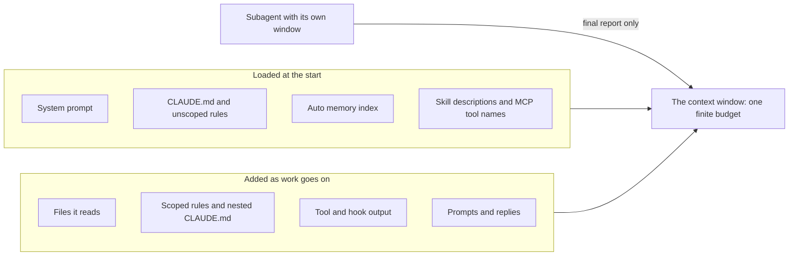

# Module 2 — Context engineering

*An agent is only as good as what it knows when a session starts and what it can still see as the session runs. This module is about giving it what it needs to know, and nothing that gets in the way. Lesson 2.1 treats the context window as a budget: what spends it (the system prompt, memory files, rules, referenced files, tool output, the conversation), how project memory is loaded and combined, what belongs in a `CLAUDE.md` and what does not, how to point at files precisely, how to teach an agent a private library such as `najmkit`, and how to keep a session clean with `/clear`, `/compact`, side questions and subagents. Its artefact is the project memory template and a pruning checklist. Lesson 2.2 is lab m02: you write the project memory for Najm Remit, a grader runs the commands you documented and checks every claim against the repository, and you run the same small ticket twice, with and without your file, to measure what it changed. Everything on the Najm side is fictional.*

> **Focus:** Context — giving the agent what it needs to know, and nothing that gets in the way.

---

# 2.1 — What the agent sees: the context budget, project memory, rules, references, compaction and subagents
*Level: 🟢 Beginner* · *Prerequisites: 1.1* · *Focus: Context*

## ⚡ In 60 seconds
- This is the habit **Context first**. The window is a **budget**: system prompt, memory, rules, files, tool output and conversation all spend it, and performance degrades as it fills.
- **Project memory** (`CLAUDE.md`, or `AGENTS.md`) loads every session. Keep what the agent cannot guess; ask of each line whether removing it would cause a mistake. Stay under 200 lines.
- Memory is **context, not enforcement**: a sentence asks, a hook or deny rule enforces.
- **Point, do not paste.** Name the file, function and question; give `najmkit` a docs file.
- Keep sessions clean: `/clear`, `/compact` with a focus, `/btw`, subagents. Rules that must survive go in the file.
- Biggest trap: pasting the README and architecture document into memory.

## 🧭 Why it matters
In her second week Lujain (graduate engineer) types the same paragraph into a fourth prompt: `pytest -q`, money is `Decimal`, commits look like `type(scope): subject`, and `najmkit` is ours, so read its docs. The fifth time she forgets the last clause, and the agent writes `audit.record(...)`, which does not exist (lesson 1.1's `hallucinated-api`). Tariq (engineering lead) does not coach her prompt: "Write it once, where the tool reads it at the start of every session."

A month later he has the opposite problem (constructed). Someone pasted the README, the architecture document and a style guide into `CLAUDE.md`: 400 lines, one page describing a `risk.py` that no longer exists. The documentation names "the over-specified CLAUDE.md" a failure pattern. Both stories have one cause: nobody decided what the agent should see.

## 📐 How it works

### 🟢 The essentials

**The window is a budget.** A model sees only its context (lesson 1.1). Every layer spends from a finite window, and some are paid before you type a word.

| Layer | On Remit |
|---|---|
| **System prompt** | The tool's instructions, skill descriptions, MCP tool names |
| **Memory files** | `CLAUDE.md`; the first 200 lines or 25KB of auto memory |
| **Rules** | `.claude/rules/*.md`, at launch or when matching files are touched |
| **Files** | `src/remit/fees.py`, once you name it or it reads it |
| **Tool output** | `pytest` results, `grep` hits, hook output |
| **Conversation** | Your prompts and its replies: it grows every turn |



Keep startup layers small, since every session pays for them, and pull in the rest precisely, since it stays. `/context` shows the grid and which memory files loaded. The best-practices page calls context "the most important resource to manage".

**Project memory** is Markdown put in front of your first prompt. In Claude Code it is `CLAUDE.md`, in four places.

| Scope | Path | Who gets it |
|---|---|---|
| Managed policy | `/etc/claude-code/CLAUDE.md` (Linux, WSL); macOS `/Library/Application Support/ClaudeCode/CLAUDE.md`; Windows `C:\Program Files\ClaudeCode\CLAUDE.md` | Everyone on the machine; it cannot be excluded |
| User | `~/.claude/CLAUDE.md` | You, in every project |
| Project | `./CLAUDE.md` or `./.claude/CLAUDE.md` | The team, through git |
| Local | `./CLAUDE.local.md` | You, in this project; add it to `.gitignore` yourself |

**Loading and precedence.** The `CLAUDE.md` and `CLAUDE.local.md` files in the working directory and every ancestor load at launch; those in subdirectories load on demand, when Claude reads, writes or edits a file there. **Nothing overrides anything.** All files are concatenated, ancestors first, and `CLAUDE.local.md` follows `CLAUDE.md` in its directory. If two files conflict, Claude may follow either: remove contradictions instead of relying on an order.

**What goes in.** Commands the agent cannot guess (the CLI needs `PYTHONPATH=src`; the tests do not), conventions that differ from the defaults (`type(scope): subject`, scope required), gotchas (`ledger.py` is legacy and untested) and pointers to docs. **What stays out.** Anything readable from the code, standard language conventions, long tutorials, and facts that change often: limits and fees live in `limits.py` and `fees.py`.

Two tests keep the file honest. The documentation targets **under 200 lines**, because longer files consume more context and reduce adherence. And for every line the best-practices page asks: **would removing this cause the agent to make mistakes?** If not, the line is noise.

### 🟡 Going deeper

**AGENTS.md.** Other tools read `AGENTS.md`, an open plain-Markdown "README for agents". Claude Code reads it directly from v2.1.277, but by default only when no `CLAUDE.md` or `CLAUDE.local.md` exists in the working directory or above (the `/config` setting "Project instructions" changes that). To share one file, write `AGENTS.md` and put `@AGENTS.md` inside a `CLAUDE.md`. These details moved in 2026: check the current documentation.

**The same job under another name.** In [Spec-Driven Development: A Spec-First Approach to AI-Native Engineering](https://developer.microsoft.com/blog/spec-driven-development-ai-native-engineering/), Microsoft describes a seven-step lifecycle whose first step is a *constitution*: principles and guardrails. Its companion post on GitHub Spec Kit, an open-source toolkit Microsoft created, explains the constitution file. In this course that is the job of project memory: standing rules the agent reads every session. Module 3 covers the other six steps. A company describing its own practice is not independent evidence; it shows the idea is current, not that a constitution improves results. Read the originals (linked below).

**Imports.** `@path/to/file` pulls a file in; imports nest four hops deep and are ignored inside code spans and fences. **Imports do not reduce context cost**: imported files load at launch. `@docs/najmkit.md` would put the whole page into every session; a plain pointer costs one line and is followed when it matters.

**Rules.** Files in `.claude/rules/` split memory by topic. One without `paths:` loads at launch; one with `paths:` loads only when Claude works on matching files, so a tests rule costs nothing while it edits `src/` (check the documentation for the exact glob syntax):

```markdown
---
paths:
  - "tests/**"
---
Tests are deterministic: use the fixtures in tests/conftest.py (fixed clock, sequential ids).
```

**Memory is context, not enforcement.** The model usually follows the file, and "usually" is not a control. The memory page says to use a `PreToolUse` hook to block an action whatever Claude decides; the best-practices page suggests "IMPORTANT" on the one line that must not be missed. Use it once: if everything shouts, nothing does. The file gives rule and reason; a hook or deny rule enforces (lesson 9.1; the guard hook is built in lesson 8.2). A deny rule lives in `.claude/settings.json`; it covers the built-in file tools and commands such as `cat`, not every subprocess: a layer, not a wall.

```json
{ "permissions": { "deny": ["Read(./.env)"] } }
```

**Point precisely.** A vague prompt makes the agent search, and the hits are paid for as tool output. A precise one names the file, function, the fact it cannot see and the answer wanted.

```text
The express fee looks wrong. Can you check the fee code?
```

```text
Read @src/remit/fees.py (explain_fee) and @tests/test_fees.py.
A QAR-INR express transfer of 500.00 costs 27.00: the 12.00 fee plus a 15.00 surcharge. Support says 12.00.
Change nothing. Tell me which line adds the surcharge, whether before or after the cap, and which test pins it down.
```

**Docs the agent can read.** What lives in someone's head is not in the window: keep docs in the repository and point to them. But documents drift. `docs/ARCHITECTURE.md` still lists a `risk.py` (`ls src/remit` shows none) and two KYC tiers with no monthly limit, while `limits.py` has three tiers and monthly limits. `docs/TOUR.md` says the code wins.

**Teaching the agent your private library.** `najmkit` is vendored and in no training set, so the agent guesses from names. Do not describe it in `CLAUDE.md`, where every session pays for it: write a complete page for a reader who has never seen it, and one line saying the page exists. `docs/najmkit.md` is the model: it says the library is internal, shows each signature with a sample result (`"TRF-9F3A1C7B2D40"`) and states the rules (log identifiers only).

### 🔴 Expert view

**Keeping the window clean.**

| Move | What it does | Use it when |
|---|---|---|
| `/clear` | Starts a new conversation | Between unrelated tasks |
| `/compact [instructions]` | Summarises: `/compact Focus on the API changes`; `/rewind` can summarise part | History long but still needed |
| `/btw [question]` | A side question that never enters the history | "What does `Money.zero` do?" |
| A subagent (Explore is read-only) | Own window; only its final report returns | A twenty-file investigation |

A subagent never sees your conversation; it gets its own system prompt, your task and, except Explore and Plan, your `CLAUDE.md`.

**What survives compaction.** The system prompt, the project-root `CLAUDE.md` (re-read from disk), unscoped rules, auto memory and the plan survive. **Instructions given only in conversation do not survive as written**, and scoped rules and nested `CLAUDE.md` files return only when their files are touched again.

**Context rot, carefully.** Lesson 1.1 gave the evidence (a Chroma vendor report; Liu et al. on 2023-era models). Neither tested coding agents, so neither gives a number for your repository.

**Treat memory like code.** A change to `CLAUDE.md` changes what every agent on the team is told: review the raw diff. Pillar Security, a security vendor, reported in 2025 that hidden Unicode in rules files could hide instructions from a human reviewer while Copilot and Cursor followed them. Prune on a schedule: `/doctor prompt-audit [path]` (v2.1.283 or later) audits instruction files for stale or conflicting content. Auto memory is local to one machine, so team rules belong in the project file, in git. When the agent errs, ask whether a line is missing, wrong, or a job for a hook; do not add a rule per mistake.

**When not to.** A ten-line scratch script needs no memory file, a one-off fact belongs in the prompt, and a rule the agent never breaks should go.

## 🧰 The toolkit
| Tool, practice or pattern | What it is and does | When to reach for it |
|---|---|---|
| **Project memory** | `CLAUDE.md` (or `AGENTS.md`): the short file loaded every session | Every repository an agent touches |
| **Path-scoped rules** | `.claude/rules/*.md` with `paths:`, loaded when matching files are touched | A rule for one folder |
| **Precise reference** | A prompt naming the file (`@path`), function and missing fact | Every non-trivial prompt |
| **Library docs file** | A complete page for code the model has never seen | An internal library |
| **Fresh session** | `/clear`, `/compact` with a focus, `/btw`, a subagent; `/context` to see why | Between tasks; when a session grows |
| **Pruning checklist** | Eight questions asked of a memory file | Monthly; after an incident |

## 🏛️ In practice at Najm Bank
Two artefacts: the **Project memory template** and the **Pruning checklist**. First, the example they come from.

**Before.** This is what you get when you ask a tool for a `CLAUDE.md` and add what the architecture document says (constructed for teaching, not recorded from a model). Every defect is checkable.

```markdown
# Najm Remit

### Project Overview
Najm Remit is a robust, scalable remittance platform for Najm Bank. It follows best practices.

### Project Structure

    src/remit/
    ├── money.py      # Money class
    ├── fees.py       # Fee schedules
    ├── risk.py       # Limits and name screening
    ├── ledger.py     # Double-entry ledger
    └── service.py    # RemitService
    tests/

### Commands
- Install: `pip install -r requirements.txt`
- Test: `make test`
- Lint: `ruff check .` and `black .`
- Run: `python -m remit quote QAR 500 INR`

### Architecture
There are two KYC tiers: T1 may send QAR 5,000 per day and T2 QAR 25,000. There is no monthly limit.
Limits and screening live in `src/remit/risk.py`.

### Code Style
- Follow PEP 8 and write clean, readable, maintainable code.
- Use type hints and docstrings. Use descriptive variable names.
- Be careful when changing financial logic.

### Git
- Use conventional commits, for example `feat: add quote endpoint`.
```

Lesson 2.2's grader runs the commands and checks the paths. Excerpt of its real output on that file, without hints:

```text
[FAIL] The documented commands run and work: `make test` (line 18): this repository has no Makefile; `ruff check .` (line 19): ...
[FAIL] Every file it points to exists: not in the repository: `risk.py` (line 11), `requirements.txt` (line 17), `src/remit/risk.py` (line 24)
```

Size is not the problem: it documents tools Remit lacks, repeats a stale document and omits what an agent cannot guess.

**After.** Twenty lines, and each passes the "would removing it cause a mistake?" test.

```markdown
# Najm Remit

Money-transfer service for the fictional Najm Bank. Python 3.11, standard library only, pytest.

### Commands
- All tests, from the repository root: `pytest -q`. One file: `pytest -q tests/test_fees.py`
- Command line: `PYTHONPATH=src python -m remit quote QAR 500 INR` (the tests do not need `PYTHONPATH`; the command line does)
- There is no linter, formatter or Makefile. Do not invent a command.

### Conventions
- IMPORTANT: money is `Decimal` through `Money` (`src/remit/money.py`), never `float`.
- Ids, time and audit events come from `najmkit`, our internal library, which is not in your training data. Read `docs/najmkit.md` first and do not guess names.
- Tests are named `tests/test_<module>.py`; `tests/conftest.py` gives a fixed clock and sequential ids. New behaviour needs a test.
- Commits: `type(scope): subject`, scope required and lower case, for example `fix(limits): count transfers made just after midnight`. `CONTRIBUTING.md` lists the types.
- Customer messages exist in English and Arabic (`src/remit/notify.py`). Change both.

### Gotchas
- `docs/ARCHITECTURE.md` is partly stale; the code wins. `docs/TOUR.md` is current.
- `src/remit/ledger.py` and `src/remit/screening.py` are legacy and untested. Read their docstrings first.

### Never
- Never edit, delete or skip a test to make it pass.
- Never write a secret or real customer data into code, tests, logs or commits.
- Never add a dependency, or call `uuid.uuid4()` or `datetime.now()` in service code.
- Never tell a customer that a name matched a sanctions list; a screening hit only says we need to review.
```

The commands ran. The `float` rule is stated once, with the one `IMPORTANT`. `najmkit` gets a pointer, not a copy, and the stale document is flagged, not quoted. The same grader passes it on every check.

**The Project memory template.** Copy it, delete what does not apply, run every command before you keep it.

```markdown
# <Project name>

<Two sentences: what it is, the runtime, what is fictional.>

### Commands
- <Run all tests, and from where>: `<command>`
- <Run one file or one test>: `<command>`
- <Anything that needs setup>: `<command>`
- <Tools that do NOT exist here>

### Conventions
- <A rule the agent would get wrong, with the reason in a few words>

### Gotchas
- <Something fragile or misleading; a document that is out of date>

### Never
- <Three to eight things that would hurt here>
```

**The Pruning checklist.** Tariq's rule (fictional): a memory change needs one other reviewer, and every file is pruned monthly.

```markdown
# Memory pruning checklist     File:        Reviewed:        By:
1. Run every command from a fresh shell and open every path. Does each work today?
2. For each line: would removing it cause a mistake? If not, delete it.
3. Can the agent read the line from the code? If so, delete it.
4. Does a line copy a document or a table of numbers? Point to it instead.
5. Does a line contradict another line or another memory file?
6. Was a line added after one bad run, or is it obeyed unprompted now?
7. Which rule is a promise the file cannot keep? Move it to a hook or deny rule.
8. Is the file under 200 lines, IMPORTANT used once or twice, and the diff free of odd Unicode or unknown links?
```

## 🛠️ Exercises
- 🟢 **Prune the "before" file.** *No agent.* *Done when:* every line has a verdict (keep, fix, delete) and a reason, and five claims are marked false or unrunnable with the command that showed it.
- 🟡 **Vague against precise.** *Needs an agent.* Ask the express-fee question both ways in fresh sessions. *Done when:* a table compares files read, minutes, whether the answer named the line, and `/context`.
- 🔴 **Survive a compaction.** *Needs an agent.* Give one rule only in conversation and one in `CLAUDE.md`, run `/compact`, then test both. *Done when:* a note records `claude --version`, what you saw and a short conclusion.

## ⚠️ Mistakes and traps
- **Pasting the docs into memory.** Paid every session, stale twice over. Point instead.
- **Documenting commands nobody ran.** Drafts can list tools the project lacks. Run each.
- **Treating the file as a lock.** A line can be ignored; use a hook or deny rule.
- **Unreviewed memory edits.** One hidden line steers every agent on the team.

## 🧾 Recap
- The window is a budget: keep startup layers small and pull in the rest precisely.
- Memory holds what the agent cannot guess, under 200 lines, each line passing "would removing it cause a mistake?"
- Memory files concatenate, nothing overrides anything, imports save no context, scoped rules load on demand.
- Memory asks, hooks enforce. Point to docs and check them against the code; keep sessions clean; review and prune memory like code.

## ✍️ Check yourself

**1. Lujain pastes the module table from `docs/ARCHITECTURE.md` into `CLAUDE.md`; an agent later edits a `risk.py` that does not exist. What is the best repair?**

- A. Add a note saying that `risk.py` has gone.
- B. Delete the table and point to `docs/TOUR.md`.
- C. Move the table into a path-scoped rule.
- D. Mark the table IMPORTANT so it is checked first.

<details><summary>Answer</summary>

**B.** The code already shows the modules, and a copy carries the document's drift into every session. Scoping and emphasis keep a false table. (🟡 Docs the agent can read.)

</details>

**2. Remit's `CLAUDE.md` says `type(scope): subject`; Lujain's `~/.claude/CLAUDE.md` says "no scopes". What happens in Remit?**

- A. The project file wins, being closer to the code.
- B. Her user file wins, being personal to her.
- C. Both load, and Claude may follow either.
- D. Claude refuses to start until they agree.

<details><summary>Answer</summary>

**C.** Nothing overrides anything: files are concatenated, and on a conflict Claude may follow either. (🟢 Loading and precedence.)

</details>

**3. Tariq adds `@docs/najmkit.md` to `CLAUDE.md` so that every session knows `najmkit`. What does that do?**

- A. It loads the whole page at launch, like pasting it.
- B. It loads the page only when a file mentions `najmkit`.
- C. It does nothing outside the user-level file.
- D. It loads the page once and keeps a summary.

<details><summary>Answer</summary>

**A.** Imported files load at launch, so imports do not reduce context cost. (🟡 Imports.)

</details>

**4. At turn 5 Lujain says "always show amounts with their currency". After auto-compaction the agent prints bare numbers. Why, and what is the fix?**

- A. Compaction deleted `CLAUDE.md`, so she must recreate it.
- B. Currency display is a model default that instructions cannot change.
- C. Auto memory was off, so she should switch it on.
- D. The rule lived only in the conversation; put it in `CLAUDE.md`.

<details><summary>Answer</summary>

**D.** Instructions given only in conversation do not survive compaction as written; `CLAUDE.md` is re-read from disk. (🔴 What survives compaction.)

</details>

**5. The team wants to be sure no agent reads `.env`. Which change fits best?**

- A. A deny rule for reading `.env`, plus a memory line saying why.
- B. NEVER READ .env in capitals at the top of `CLAUDE.md`.
- C. The same sentence in a path-scoped rule.
- D. A security policy file imported with `@`.

<details><summary>Answer</summary>

**A.** Memory asks; a deny rule or hook enforces. Capitals, scoping and imports remain text. (🟡 Memory is context, not enforcement.)

</details>

## 📚 References
- Claude Code documentation: memory https://code.claude.com/docs/en/memory, context window https://code.claude.com/docs/en/context-window, best practices https://code.claude.com/docs/en/best-practices, commands https://code.claude.com/docs/en/commands. AGENTS.md: https://agents.md
- [*System Design for Vibe Coders*, lesson 9.2 — Context engineering](../vibe/index.en.html#l9-2); [*Building AI Applications & Agents*, lesson 1.1 — The one idea: a stateless function, tokens, the context window and the messages list](../aiapps/index.html#/1.1); [*Secure AI & Application Security*, lesson 8.2 — Prompt injection and jailbreaks, direct and indirect](../secai/index.html#/8.2)
- **Go deeper.** Microsoft for Developers, "Spec-Driven Development: A Spec-First Approach to AI-Native Engineering": https://developer.microsoft.com/blog/spec-driven-development-ai-native-engineering/, and its companion "Diving Into Spec-Driven Development With GitHub Spec Kit": https://developer.microsoft.com/blog/spec-driven-development-spec-kit/. Chroma, "Context Rot": https://research.trychroma.com/context-rot. Liu et al., "Lost in the Middle": https://aclanthology.org/2024.tacl-1.9/. Pillar Security, "Rules File Backdoor": https://www.pillar.security/blog/new-vulnerability-in-github-copilot-and-cursor-how-hackers-can-weaponize-code-agents

---

# 2.2 — Lab: write the project memory for Najm Remit and measure what it changes
*Level: 🟢 Beginner* · *Prerequisites: 0.2, 2.1* · *Focus: Context*

## ⚡ In 60 seconds
- Lab m02: write `CLAUDE.md` (or `AGENTS.md`) for the starter repository, run one small ticket twice, without and with it, and record the difference in `ab-notes.md`.
- Needs an agent: **yes for the A/B part**; the no-agent path is a chat assistant or a colleague. The grader never needs one.
- The grader **runs the commands you documented** and checks Decimal money, the test layout, the commit rule, `najmkit`, every path and some claims against the code; it rejects stale facts, filler, secrets and hidden text.
- Traps: `docs/ARCHITECTURE.md` is partly out of date, `python -m remit` needs `PYTHONPATH=src`, and there is no linter or Makefile.
- The notes are checked for completeness and for quoting real lines of your file, never for "B won". "No difference" is valid.

## 🧭 Why it matters
Tariq, at the clinic: "Everyone believes a memory file helps. Show me." In METR's randomized trial (16 experienced developers on their own repositories, early-2025 tools; lesson 0.1) the developers believed they were faster while the clock said otherwise. One small trial proves nothing about your repository, but a feeling about a prompt is no sounder than a feeling about speed. The remedy is the same: measure, small and honest.

A wrong command or a stale pointer in a memory file is paid for in every session, so this grader does something unusual for a document: it executes what you wrote.

## 📐 How it works

### 🟢 The essentials

**Write it from the repository, not from memory.**
1. **Read what the team wrote:** `README.md`, `CONTRIBUTING.md`, `docs/TOUR.md`, `docs/najmkit.md`. Treat `docs/ARCHITECTURE.md` as a claim to check.
2. **Run things** from the repository root, as an agent will.
3. **List what an agent cannot guess:** how the CLI starts, the tools that do not exist, `najmkit`, the commit rule.
4. **Draft short,** from the template in lesson 2.1.
5. **Verify every line:** is it true today, and would deleting it cause a mistake?

```bash
cd ~/ainative/m02
pytest -q                          # 99 passed
python -m remit quote QAR 500 INR  # what an agent tries first
ls src/remit                       # is there a risk.py?
```

The second command fails in a fresh shell, and your file should say why:

```text
/usr/local/bin/python: No module named remit
```

`PYTHONPATH=src python -m remit quote QAR 500 INR` works. The tests get their path from `pyproject.toml`; the command line does not.

**An agent can draft; you verify.** Give it the reading list and the rules of the file, and make it show its work:

```text
Read README.md, CONTRIBUTING.md, docs/TOUR.md and docs/najmkit.md. Treat docs/ARCHITECTURE.md as possibly out of date: check anything you take from it against src/.
Draft CLAUDE.md in about 40 lines: commands an agent cannot guess, conventions that differ from the defaults, gotchas, a short never list, pointers to docs. Leave out anything readable from the code.
Run every command you put in it and show me the output. Quote the file behind each claim. Do not write the file yet.
```

`/init` is a fair start, but its output is a draft like any agent's: check it for commands the repository lacks, and let it write only `CLAUDE.md`.

### 🟡 Going deeper

**Design the experiment honestly.** One variable changes: the memory file. Same tool, model and prompt, a fresh session, two fresh copies. REMIT-252 (`quote --json`) lets the memory matter in several places: the easy way to print a `Decimal` as JSON is `float(...)` or `default=float`, which breaks the money rule; the CLI needs `PYTHONPATH=src`; the tests have a home, `tests/test_config_cli.py`; the commit has a rule.

**Measure six things:** the rows of the table in `ab-notes.md`. A *wrong turn* is each time you had to stop, correct or redirect the agent; count from the transcript.

**Name the confounders.** The agent in A may find `CONTRIBUTING.md` through the README; then the commit rule made no difference, and that is a finding. Your tool may keep notes between sessions (Claude Code's auto memory; `/memory` toggles it), and your user-level `~/.claude/CLAUDE.md` loads in both runs. The agent is not deterministic (lesson 1.1), and you know which run is which. One run each is an anecdote: repeat each twice if you can, and have a colleague count wrong turns from the diffs. If B is no better, that is a finding too.

**No agent?** Paste the ticket into a fresh chat twice, once with the repository files and once with your memory file too. Or time a colleague who has not read Remit, once with only the repository and once with your file. The colleague is the better test. No interactive session at all (a script, a CI job, an agent inside an agent)? Then you play the agent: the comparison is contaminated, so say so under *Limits*.

### 🔴 Expert view

**What the grader checks, and what it cannot.** The list is under *What the grader checks* below. It runs only `pytest` and `python -m remit`, in a throw-away copy with a temporary database; a pytest option it does not recognise fails the check unrun, and a command for a tool Remit lacks fails wherever you write it, a `text` block included. It compares only the claims it knows (rounding, decimal places, the ledger, the clock, dependencies, the old architecture facts), so other wrong facts pass. It cannot tell whether the file is *useful*, who wrote it, or whether the experiment happened: invented results pass. The A/B is where usefulness shows. The notes are never checked for B beating A, because that would reward invented improvements.

**The thresholds are guard rails, not targets.** A twelve-rule never list passes and may still be the over-specified file the documentation warns about. Lint the file, then read it as the agent would; use hooks for what must never happen (lesson 9.1).

## 🧰 The toolkit
| Tool, practice or pattern | What it is and does | When to reach for it |
|---|---|---|
| **Project memory** | `CLAUDE.md` or `AGENTS.md`: the short file loaded every session | Every repository an agent touches |
| **A/B memory test** | The same ticket with and without the file, in fresh copies | When you add or change a memory file |
| **Memory lint** | The grader's checks: run commands, resolve paths, compare claims | Before you commit a memory file |
| **Pruning checklist** | Eight questions asked of a memory file | Monthly; after an incident |
| **Agent log** | Prompt, what it did, what you corrected, minutes | After every session with an agent |

## 🏛️ In practice at Najm Bank
*Needs an agent: yes, for the A/B part (no-agent path above). The grader never needs one.*

**The ticket.** This is `TASK.md`, as Hessa (product owner) wrote it.

```text
# REMIT-251: write the project memory for Remit, then measure what it changes

**From:** Hessa, Product Owner, Najm Remit (with Tariq)
**To:** Payments Platform, new joiners
**Priority:** Medium. Every AI session on this repository starts from nothing.

Each of us re-types the same paragraph into every prompt: how to run the tests, what a commit message looks
like, that money is `Decimal`, that `najmkit` exists only here. Tariq wants it written down once, in the
repository, and wants to know whether it helps. There are two parts.

### Part 1: the memory file (required)

Write the project memory at the root of the repository: `CLAUDE.md` (Claude Code), or `AGENTS.md` if your
tool reads that. It is for the agent.

- **Short**: 15 to 150 non-blank lines, `@` imports included.
- **Useful**: the commands an agent cannot guess, the conventions that differ from the defaults (money,
  tests, commits, `najmkit`), the gotchas, and a short list of things it must never do.
- **True**: the grader runs every command you document from the repository root (only `pytest` and
  `python -m remit`; a command for a tool Remit lacks fails wherever it appears), and every file you name
  must exist. When a document and the code disagree, the code wins.
- **A pointer, not a copy**: send the agent to the docs. No filler, no secrets, no customer data, nothing hidden.

### Part 2: the A/B notes (required; needs an agent or a stand-in)

`lab-assets/ab-task.md` is a second, small ticket (REMIT-252). Do it twice with the same tool, model and
prompt, each in a fresh copy of the repository: once without your memory file, once with it. Fill in
`ab-notes.md` (its opening paragraph lists what the grader reads) and report what happened, including
"no difference". No agent? Use a chat assistant, or a colleague who has not read the repository.

### Done when

- `pytest -q` passes, and only `CLAUDE.md`, `AGENTS.md`, `.claude/CLAUDE.md`, `.claude/rules/*.md` and
  `ab-notes.md` changed (`docs/` or `.claude/settings.json` fails).
- The memory file passes the grader's checks, and `ab-notes.md` is complete.
- Your work is committed, with messages that follow `CONTRIBUTING.md`.
- Grade it from the `ailab` folder of the course repository, with its virtual environment active:
  `python -m ailab grade m02 --dir <this directory>`
```

**Start.** You need the setup from lesson 0.2.

```bash
cd system-design-for-vibe-coders/ainative/ailab      # with the virtual environment active
python -m ailab start m02 --dir ~/ainative/m02
cd ~/ainative/m02
```

**Your move, part 1: the file.** By hand: the five steps above. With an agent: the drafting prompt, then review the draft, correct it, run each command yourself and write the file. Grade it as often as you like: each failing line names what is wrong, never the answer. Commit with a message such as `docs(memory): add CLAUDE.md for coding agents`.

**Your move, part 2: the experiment.** Make two clean copies with no lab files, not even in git history, or the agent can read `TASK.md` and start writing a memory file. Copy your file into B only.

```bash
cd system-design-for-vibe-coders/ainative/ailab      # with the virtual environment active
for d in a b; do
  python -m ailab start m02 --dir ~/ainative/m02-$d > /dev/null
  (cd ~/ainative/m02-$d &&
   git rm -rq TASK.md ab-notes.md lab-assets &&
   git checkout -q --orphan clean &&                # a new history, without the lab commits
   git commit -qm "chore(lab): clean copy" &&
   git branch -qD main && git tag -d lab-start > /dev/null &&
   git reflog expire --expire=now --all)
done
cp ~/ainative/m02/CLAUDE.md ~/ainative/m02-b/       # or AGENTS.md, or the .claude folder
git -C ~/ainative/m02-b add -A
git -C ~/ainative/m02-b commit -qm "docs(memory): add project memory"
git -C ~/ainative/m02-a tag ab-start
git -C ~/ainative/m02-b tag ab-start
```

In each copy start your tool fresh in Manual mode (`claude --permission-mode manual`; the default depends on your version) and paste the text of `~/ainative/m02/lab-assets/ab-task.md` followed by "Plan first. Commit when the tests pass." Do not mention memory files. The ticket asks for `quote QAR 500 INR --json`: one line of JSON, amounts as strings, tests in the usual place, a commit that follows the rules. Afterwards, in each copy:

```bash
git add -A                                  # so new, uncommitted files count too
git diff --cached --numstat ab-start        # added, deleted, file: sum the first two columns for "Lines changed"
git log ab-start..HEAD --format=%s          # do the commit messages follow CONTRIBUTING.md?
pytest -q                                   # does the suite pass?
```

Then fill in `ab-notes.md` in `~/ainative/m02`; its opening paragraph lists what the grader reads.

- **Six rows, a cell per run.** Minutes, wrong turns, files and lines are numbers: `12`, `~10`, `0.4`, `<1` (under a minute), `none` (zero) and `57 (+56 -1)` all count. The last two rows are `yes` or `no`.
- **Five prose sections** (what differed, the line that mattered, a line that changed nothing, what you changed afterwards, the limits) need real words: 12 for what differed, 8 for the limits. "No difference: both runs made the same change" is enough; "Nothing yet." answers what you changed.
- **Two quotes.** In each quote section, copy one line exactly from your memory file into a block quote (`>`): 15 characters or more, a different line each. If no line mattered, quote the one most likely to have and say you could not show it. A line you deleted afterwards is fine: pruning is the point.

Commit the notes.

**What the grader checks.** That `pytest -q` passes and only `CLAUDE.md`, `AGENTS.md`, `.claude/CLAUDE.md`, `.claude/rules/*.md` and `ab-notes.md` changed (`docs/` or `.claude/settings.json` fails; a deny rule is lab m08's job). For the memory: 15 to 150 non-blank lines, imports included; every documented command exits 0; Decimal money with `float` forbidden, the test layout, the commit rule, and `najmkit` with a pointer to its docs and no invented names; a short, repository-specific never list; every path exists; no stale or false claims, filler or restated docs; no secrets, customer data, invisible characters or instructions to ignore rules or fetch and run code. Advisory: how the CLI finds the package, no limits, fees or rates, links only to places you know. For the notes and git: placeholders replaced, cells in the right form, the word minimums, two different quoted lines found in your memory; conventional messages, nothing uncommitted.

**Grade.** Run it from the `ailab` folder, not from `~/ainative/m02`; elsewhere you get `No module named ailab`.

```bash
cd system-design-for-vibe-coders/ainative/ailab      # with the virtual environment active
python -m ailab grade m02 --dir ~/ainative/m02
```

This is the real output on the starting state, with the fifteen further `waiting for a memory file` lines replaced by "…":

```text
[PASS] Your tests still pass: 99 passed
[FAIL] Only the memory file(s) and the notes changed: no files have changed yet
       hint: Make the change the ticket asks for.
[FAIL] A project memory file exists: none of CLAUDE.md, .claude/CLAUDE.md or AGENTS.md exists (or it is empty)
       hint: Create CLAUDE.md at the root of the repository (or AGENTS.md if your tool reads that).
[FAIL] The memory file is a sensible size: waiting for a memory file
…
[PASS] No secrets in the change
[FAIL] ab-notes.md is filled in: 20 TODO placeholders left
       hint: Fill every section. Report what happened, including 'no difference'. The grader checks completeness, not that the memory won; the opening paragraph of ab-notes.md lists what it reads.
[FAIL] The notes quote real lines of your memory: waiting for a memory file
[FAIL] Your commits follow CONTRIBUTING.md: found 0 commits since the start; expected at least 1
       hint: Commit your change.
[PASS] Everything is committed (nothing left over)

Lab m02: 3/21 required checks passed: NOT YET
```

Committing the "before" file from lesson 2.1 as `CLAUDE.md` gives `Lab m02: 9/21 required checks passed: NOT YET`, with the failures you saw there. A file that passes everything ends with `Lab m02: 21/21 required checks passed: PASSED`.

**Weekly deliverable.** In your notes repository, not in `~/ainative/m02`, commit `week-02/` with your final `CLAUDE.md` (or `AGENTS.md`), `ab-notes.md`, `m02-grade.txt` (the final grade output), `agent-log.md` and `pruning-checklist.md` (the lesson 2.1 checklist, filled in).

**Group session (60 minutes).** (1) Swap files and run your partner's commands from a fresh clone (10). (2) Your partner, new to Remit, finds where `--json` goes, once with only the repository and once with your file; time both (20). (3) Compare notes; each person deletes three lines (15). (4) Agree what every Najm memory file must contain, and who reviews changes to it (15).

**Debrief.** What did the agent get wrong, or nearly? What did your context miss? Which line would you have sworn mattered and did not? What did the grader catch?

**Agent log.** One entry for drafting the file and one for each run, in a short form of the lesson 0.1 format. No agent? Say what you did instead.

```markdown
Entry: <date>, REMIT-251, <memory draft | run A | run B>
Prompt:       <paste or summarise>
What it did:  <steps taken>
I corrected:  <what you fixed or redirected>
Minutes:      <honest total, including checking>
```

## 🛠️ Exercises
- 🟢 **Write it and lint it.** *No agent.* *Done when:* every memory check passes in `grade`, and each command in your file ran in your own shell first.
- 🟡 **Run the experiment.** *Needs an agent* (or a stand-in). *Done when:* `ab-notes.md` passes, with a limits paragraph naming one confounder from your own setup.
- 🔴 **Plant an error and watch.** *Needs an agent.* Put one false line (`make test` as the test command) in a copy of your file and give the agent a task that needs it. *Done when:* a note gives the minutes lost, what the agent did when the command failed and which check catches the line.

## ⚠️ Mistakes and traps
- **Copying a draft unrun.** The grader executes your commands, and so will your agent.
- **Trusting `docs/ARCHITECTURE.md`.** It is partly out of date; fixing it is another ticket, and the scope check fails if you do it here. `KIT_NOTES.md` belongs to the lab kit, not to your repository: do not point to it.
- **Copying the "after" file from lesson 2.1.** It would pass and teach you nothing. Write yours from the repository.
- **Leaving lab files in the A/B copies**, or in their git history. The agent may read `TASK.md`.
- **Reporting a win you did not see.** The notes are graded for completeness, not results.
- **Hiding a bad command.** `make test` in a `text` block is still a bad command: the lint reads it there, and so will your agent.

## 🧾 Recap
- **Context first**, as a lab: build the file from the repository. Read, run, draft short, verify.
- The grader executes your commands and checks paths and some claims; it cannot judge whether the file is useful.
- Measure with one variable changed: same tool, model and prompt, two fresh copies, six numbers.
- One run each is an anecdote. Report "no difference" if that is what you saw, and name the confounders.

## ✍️ Check yourself

**1. The grader fails "The documented commands run and work" and names `make test` on line 12. What is the right repair?**

- A. Install `make`, since the check looks for the tool.
- B. Delete the line and document `pytest -q`.
- C. Move the line into a `text` block, as an example.
- D. Rename it `make check`, which the grader allows.

<details><summary>Answer</summary>

**B.** Remit has no Makefile, so an agent would run the line and fail. A `text` block hides nothing: the lint reads it and so does the agent. (🔴 What the grader checks.)

</details>

**2. Lujain writes a 20-line `CLAUDE.md`, puts the real rules in `AGENTS.md` and adds no import. By default, what loads, and what does the lint say?**

- A. Both files, and the lint counts both.
- B. Only `AGENTS.md`, the open standard.
- C. Neither, because two memory files conflict.
- D. Only `CLAUDE.md`; the lint says `AGENTS.md` is ignored.

<details><summary>Answer</summary>

**D.** Claude Code reads `AGENTS.md` only when no `CLAUDE.md` exists. To share one file, put `@AGENTS.md` inside `CLAUDE.md`. (🟡 AGENTS.md, in lesson 2.1.)

</details>

**3. In one pair of runs, B took 14 minutes and one wrong turn; A took 22 minutes and three. What may you conclude?**

- A. The file saves a third of the time, so every repository needs one.
- B. B did better here; repeat the runs and have someone else count.
- C. The wrong-turn counts show which lines of the file mattered.
- D. The pair is void unless the two runs were simultaneous.

<details><summary>Answer</summary>

**B.** One pair is an anecdote: the agent is not deterministic and you know which run is which. (🟡 Name the confounders.)

</details>

**4. Which statement about the grader is correct?**

- A. It knows the A/B runs happened, because the table has numbers.
- B. It knows the file helps, because it compares the two columns.
- C. It checks that quoted lines exist, not that they mattered.
- D. It knows whether an agent wrote the file, from its wording.

<details><summary>Answer</summary>

**C.** It checks the notes' shape and that quotes are real lines. It cannot see who wrote the file, whether the runs happened or whether the memory helped. (🔴 What the grader checks.)

</details>

**5. The advisory line says your file documents `python -m remit` but not how Python finds the package. Why does that matter?**

- A. Unlike `pytest`, the command cannot import `remit` without `PYTHONPATH=src`.
- B. Python 3.11 cannot import from a folder called `src`.
- C. The command needs a network connection to find the package.
- D. `pytest` also needs `PYTHONPATH=src` to import `remit`.

<details><summary>Answer</summary>

**A.** The tests find `src` through `pyproject.toml`; the command line needs `PYTHONPATH=src` or an editable install, or it fails with `No module named remit`. (🟢 The essentials.)

</details>

## 📚 References
- Claude Code documentation: memory https://code.claude.com/docs/en/memory, best practices https://code.claude.com/docs/en/best-practices. AGENTS.md: https://agents.md
- The lab kit: https://github.com/Tamoura/system-design-for-vibe-coders/tree/main/ainative/ailab. Conventional Commits: https://www.conventionalcommits.org. Git: https://git-scm.com
- [*Software Testing*, lesson 6.2 — Tests as the specification for coding agents](../testing/index.html#/6.2)
- **Go deeper (evidence).** METR, "Measuring the Impact of Early-2025 AI on Experienced Open-Source Developer Productivity": https://metr.org/blog/2025-07-10-early-2025-ai-experienced-os-dev-study/
