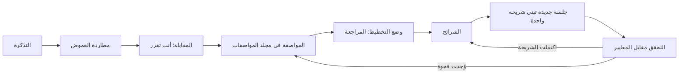

# الوحدة 3 — تحديد العمل (Specifying the work)

*تحوّل هذه الوحدة التذكرة (ticket) إلى شيء يستطيع الوكيل (agent) أن يبني منه وتستطيع أنت أن تتحقق (verify) على أساسه. يعلّمك الدرس 3.1 التطوير الموجَّه بالمواصفات (spec-driven development) على نجم ريميت (Najm Remit): لماذا ليست التذكرة مواصفة (why a ticket is not a spec)، والأجزاء العشرة للمواصفة (the ten parts of a spec)، وكيف تطارد الغموض في برمجيات الأموال (how to hunt ambiguity in money software) — التقريب (rounding) والقيم الحدّية (boundaries) والعملات (currencies) وأجزاء الرسوم (fee parts) والمناطق الزمنية (time zones) والعربية (Arabic) — وكيف تجعل الوكيل يحاورك قبل أن يخطط (make an agent interview you before it plans)، وكيف تراجع خطة (review a plan)، وكيف تقسّم العمل إلى شرائح (slice work) تتسع كل شريحة منها لسياق واحد (fits one context)، وكم من المواصفة يستحقه التغيير (how much spec a change deserves). وينتهي بمُنتَجين (two artefacts) هما قالب المواصفة (Spec template) وقائمة تحقق الخطة (Plan checklist)، ومعهما وصف Microsoft نفسها لدورة حياة من سبع خطوات (a seven-step lifecycle) مع ربط كل خطوة بمحتوى هذه الدورة (mapped onto this course). أما الدرس 3.2 فهو المختبر (the lab): ثلاث تذاكر غامضة (three vague tickets) من حصة (Hessa)، مالكة المنتج (product owner)، تصير ثلاث مواصفات (three specs) تُقيَّم دون اتصال (graded offline) على شكلها (on their shape) وعلى الوقائع التي يمكن فحصها مقابل المستودع (the facts that can be checked against the repository). والوكيل اختياري (An agent is optional)، بصفة محاوِر (as an interviewer). وكل ما يخص جانب نجم خيالي (Everything on the Najm side is fictional).*

> **التركيز (Focus):** Workflow — اكتب ما معنى «انتهى» (what done means) وما هو خارج النطاق (what is out of scope) وما الخطة (what the plan is) قبل تفويض أي شيء (before anything is delegated)، كي يلتقي تخمين الوكيل الواثق (an agent's confident guess) بمواصفة لا بفجوة (a spec instead of a gap).

---

# 3.1 — التطوير الموجَّه بالمواصفات: من التذكرة إلى معايير القبول والقيود وما ليس من الأهداف وخطة (Spec-driven development: from ticket to acceptance criteria, constraints, non-goals and a plan)
*المستوى (Level): 🟢 مبتدئ (Beginner)* · *المتطلبات (Prerequisites): 2.1* · *التركيز (Focus): Workflow*

## ⚡ الدرس في دقيقة (In 60 seconds)
- التذكرة (ticket) تعبّر عن أمنية (states a wish). أما **المواصفة (spec)** فتقول ما معنى «انتهى» (what done means)، فيستطيع الوكيل (agent) أن يبني منها وتستطيع أنت أن تتحقق (verify) على أساسها: العادة الثانية (habit two).
- للمواصفة عشرة أجزاء (ten parts)؛ وتستحق الأمثلة المحلولة (worked examples) والقرارات المكتوبة (written-down decisions) مكانها (earn their keep).
- طارد الغموض (Hunt ambiguity) في ست عائلات (six families): التقريب (rounding)، والقيم الحدّية (boundaries)، والعملة والممرات (currency and corridors)، وأجزاء الرسوم (fee parts)، والوقت والمناطق الزمنية (time and zones)، والعربية (Arabic).
- دع الوكيل يحاورك (interview you)، وراجع خطته كما تراجع الفروقات (review its plan like a diff)، وقسّم العمل إلى شرائح (slice work) بحيث تتسع كل قطعة لسياق واحد (each piece fits one context).
- مقدار المواصفة يتبع الخطر (How much spec follows the risk): الخطأ المطبعي (typo) لا يحتاج إليها، ومنطق الأموال (money logic) يحتاج إليها كلها.
- أكبر فخ (Biggest trap): مواصفة واثقة لم يقابلها أحد بالشيفرة (a confident spec nobody checked against the code). الشيفرة هي التي تنتصر (The code wins).

## 🧭 لماذا يهم (Why it matters)
في يوم ثلاثاء (On a Tuesday)، وهو يوم مُختلَق لا مسجَّل من نموذج حقيقي (a constructed day, not recorded from a real model)، تكتب حصة (Hessa)، مالكة المنتج (product owner)، التذكرة REMIT-288: «عملاء الفئة الأساسية (basic tier) يصلون باستمرار إلى حدهم اليومي (keep hitting their daily limit). ارفعوه إلى 3,000.» وتسلّمها لجين (Lujain)، المهندسة حديثة التخرج (graduate engineer)، لوكيلها (her agent). فتكون الفروقات (The diff) سطرًا واحدًا في `limits.py` وستة اختبارات معدَّلة (six edited tests). ويمرّ كل شيء (Everything passes). ثم تسأل ندى (Nada)، قائدة هندسة الجودة (quality engineering lead)، في المراجعة (in review): هل يبقى الحد الشهري (monthly limit) البالغ 8,000.00، فيبلغه عميل T1 في ثلاثة أيام؟ وهل يُسمح بـ3,000.00 بالضبط (exactly)؟ وأيّ الاختبارات الستة المعدَّلة كان المقصود تغييره (meant to change)؟ ولماذا تقول `docs/ARCHITECTURE.md` إن الحد 5,000؟ لم تجب التذكرة عن شيء من ذلك لأن حصة وجدتها بديهية (found them obvious)، ولم يسأل الوكيل عن شيء.

ثمن السؤال الذي لا جواب له (The price of an unanswered question) هو التخمين (the guess): فيبني الوكيل قراءة واحدة بالثقة نفسها التي يبني بها القراءة الصحيحة. وفي استبيان Stack Overflow للمطورين لعام 2025 (2025 Stack Overflow developer survey)، وهو بيانات أبلغ عنها المشاركون أنفسهم (self-reported)، كان أكبر مصدر إحباط من أدوات الذكاء الاصطناعي (top frustration with AI tools) مخرجات «شبه صحيحة، لكن ليست تمامًا» ("almost right, but not quite")، وهذا ما ينتجه سؤال حدّي بلا جواب (an unanswered boundary question): حد يرفض 3,000.00 بفارق سنت واحد (by one cent). أما المواصفة فتطرح الأسئلة قبل البناء (before the build)، حين يكون الجواب رخيصًا (when answering is cheap).

## 📐 كيف يعمل (How it works)

### 🟢 الأساسيات (The essentials)

**التذكرة ليست مواصفة (A ticket is not a spec).** تُكتب التذكرة لسجل المهام المتراكمة (backlog) وتترك مفتوحًا كل ما رآه كاتبها بديهيًا (whatever its writer found obvious). أما المواصفة (spec) فتُكتب لمن يبني ولمن يتحقق (whoever builds and whoever verifies): تقول ما معنى «انتهى» (what done means)، وما هو خارج النطاق (what is out of scope)، وما العمل في الحالات الصعبة (the hard cases). الزميل يسأل: «ماذا قصدت؟» ⁦(what did you mean?)⁩ أما الوكيل (agent) فيختار قراءة (picks a reading) — `misread-requirement`، الدرس 1.1 — ويبنيها.

**تشريح المواصفة (The anatomy of a spec).** عشرة أجزاء (Ten parts): الهدف (goal)، والسياق (context)، والسلوك (behaviour)، ومعايير القبول (acceptance criteria)، والقيود (constraints)، وما ليس من الأهداف (non-goals)، والقرارات والأسئلة المفتوحة (decisions and open questions)، والمخاطر (risks)، وخطة الاختبار (test plan)، والخطة (plan). السلوك جدول من الأمثلة المحلولة (worked examples) أو أسطر «معطى / عندما / إذن» (Given / When / Then): *معطى (Given) عميل من الفئة T1 أرسل اليوم 2,500.00، عندما (when) يحاول إرسال 500.01، إذن (then) يُرفض الطلب بالرمز `daily_limit_exceeded`.* السلوك يثبّت الأرقام (pins the numbers) والقرارات تثبّت المعنى (pin the meaning)، فهذان الجزآن يؤديان معظم العمل (do most of the work). ويطلب منك القالب (template) في قسم 🏛️ كل جزء (prompts for each part).

**ضعيف وقوي (Weak and strong).** النسخة الضعيفة (weak version) هي تذكرة حصة (Hessa). والنسخة القوية (strong version)، مختصرة إلى جوهرها (cut to its core):

```markdown
# REMIT-288: raise the daily limit for T1 customers
### Behaviour
| Sent today | Tries to send | Result |
|---|---|---|
| 0.00 | 3,000.00 | allowed: exactly the limit |
| 0.00 | 3,000.01 | refused: `daily_limit_exceeded` |
| 2,500.00 | 500.00 | allowed |
| 2,500.00 | 500.01 | refused: `daily_limit_exceeded` |
| 0.00 today, 7,500.00 this month | 600.00 | refused: `monthly_limit_exceeded` |
### Decisions and open questions
- The monthly limit stays 8,000.00. Assumption: the ticket says "daily". Hessa confirms.
- `docs/ARCHITECTURE.md` section 5 says 5,000 a day and no monthly limit. The code wins; the document gets its own fix.
- Six existing tests pin 2,000.00 (five in `tests/test_limits.py`, one in `tests/test_service.py`). They change with the constant, in one commit.
```

شُغِّل كل صف مقابل الشيفرة بعد التغيير (Every row was run against the code after the change).

**مطاردة الغموض في برمجيات الأموال (Hunting ambiguity in money software).** اقرأ كل تذكرة وهذه العائلات الست (six families) بجانبك؛ والعمود الأخير هو ما تقوله شيفرة ريميت (Remit's code) فعلًا.

| العائلة (Family) | اسأل (Ask) | ما تقوله الشيفرة (What the code says) |
|---|---|---|
| **التقريب (Rounding)** | أي قاعدة وأي اتجاه، وعلى ماذا تُطبَّق؟ ⁦(Which rule and direction, applied to what?)⁩ | التقريب إلى الأعلى عند المنتصف (half up) في كل مكان، عدا حصة الشريك في دفتر الأستاذ (the ledger's partner share) فهي بالتقريب إلى الزوجي (half-even)، وهي غرابة قديمة (an old quirk) |
| **القيم الحدّية (Boundaries)** | هل الحافة داخلة أم خارجة؟ ⁦(Is the edge in or out?)⁩ المبلغ كله أم الهامشي؟ ⁦(Whole amount or marginal?)⁩ | مستوى الرسوم (fee tier) بحسب المبلغ كله (by the whole amount)، `amount <= upto`؛ و`min_send` و`max_send` والحدود شاملة للطرفين (inclusive)؛ وينتهي عرض السعر (a quote expires) حين `now >= expires_at` |
| **العملة والممرات (Currency and corridors)** | بأي عملة هذا الرقم؟ ⁦(Which currency is this number in?)⁩ أي ممر وطريقة تسليم وفئة؟ ⁦(Which corridor, delivery method, tier?)⁩ | يدفع المرسلون بالريال القطري (QAR)؛ و`BDT` عملة بلا ممر (a currency without a corridor)؛ وقد يسعّر جدول رسوم واحد (one fee schedule) ممرين (two corridors) |
| **أجزاء الرسوم (Fee parts)** | «الرسوم» تعني أي أجزاء، وبأي ترتيب؟ ⁦("The fee" means which parts, in which order?)⁩ | الرسم الخام (raw fee)، ثم الحد الأدنى والسقف (minimum and cap)، ثم الرسم الإضافي للتحويل السريع (express surcharge) بعد السقف |
| **الوقت والمناطق الزمنية (Time and zones)** | منتصف ليل من؟ ⁦(Whose midnight?)⁩ أي ساعة؟ ⁦(Which clock?)⁩ وما «اليوم» و«الغد»؟ ⁦(What are "today" and "tomorrow"?)⁩ | تُخزَّن بالتوقيت العالمي (Stored in UTC)؛ ويمتد يوم قطر من 21:00 إلى 21:00 بتوقيت UTC، بلا توقيت صيفي (no daylight saving)؛ والساعة مُحقَنة (the clock is injected) |
| **العربية (Arabic)** | الأرقام والفواصل والأسماء والاتجاه؛ ومن يعتمد الصياغة؟ ⁦(Digits, separators, names, direction; who approves the wording?)⁩ | أرقام عربية-هندية (Arabic-Indic digits)؛ وتُدرَج الأسماء دون تغيير (names inserted unchanged)؛ والصياغة الإنجليزية مثبَّتة باختبارات (English wording pinned by tests) |



### 🟡 التعمق أكثر (Going deeper)

**«حاوِرني» ("Interview me").** لن يسألك الوكيل (agent) ما لم تطلب منه (unless asked). تصف صفحة أفضل الممارسات (best-practices page) أن تطلب من Claude أن يحاورك (interview you) — وتسمّي الأداة `AskUserQuestion` — ثم يكتب ملف مواصفة (spec file) مثل `SPEC.md`، ثم تبدأ جلسة جديدة (fresh session) للتنفيذ (to implement)؛ فراجع الوثائق الحالية (check the current documentation). وهذا موجّه (prompt) للتذكرة REMIT-288:

```text
I need a spec for REMIT-288 (ticket: specs/REMIT-288-ticket.md). Do not write code.
Read CONTRIBUTING.md, src/remit/limits.py and tests/test_limits.py first. Then interview me:
ask only what the code cannot answer, at most five questions at a time, and tell me what the
code says before each. Cover rounding, boundaries, currency, fee parts, time zones and Arabic
where they apply. When I say "you decide", record an assumption and who confirms it. When I
say "done", write specs/REMIT-288.md on specs/TEMPLATE.md. Do not invent file names.
```

مقتطف مُختلَق لا مسجَّل من نموذج حقيقي (A constructed excerpt, not recorded from a real model):

```text
Agent: limits.py allows used + amount <= limit, so exactly 3,000.00 passes. Wanted?
Me:    Yes.
Agent: The monthly limit is 8,000.00 and binds on day three. Does it stay?
Me:    The ticket says daily. Keep it, as an assumption for Hessa.
```

المحاوِر (The interviewer) لا يسأل إلا عما يخطر له (only what it thinks of)، فأبقِ العائلات الست (six families) بجانبك؛ ويميل أيضًا إلى موافقتك (tends to agree with you)، فتحقق من وقائعه (check its facts) وأبقِ القرارات لك (keep the decisions yours). ثم ابنِ في **جلسة جديدة (fresh session)**: فقد استهلكت المقابلة جزءًا من السياق (spent context)، والمواصفة هي خلاصتها المقطَّرة (its distilled result) — الوحدة 2 (Module 2).

**وضع التخطيط ومراجعة الخطة (Plan mode and plan review).** في Claude Code يتيح وضع التخطيط (plan mode) للوكيل أن يقرأ ويقترح دون تعديل ملفات المصدر (without editing source files)؛ وفي أدوات أخرى وضع مشابه (a similar mode)، فراجع أداتك (check yours). ادخله بالضغط على `Shift+Tab` حتى يُظهر شريط الحالة (status bar) `⏸ plan mode on`، أو بالأمر `claude --permission-mode plan`، أو بـ`/plan`. ويفتح `Ctrl+G` الخطة في محررك (opens the plan in your editor)؛ واعتمادها يبدأ العمل (approving it starts the work). وتنجو الخطة من ضغط السياق (The plan survives compaction). وإن كنت تستطيع وصف الفروقات (the diff) في جملة واحدة فتجاوز الخطة، كما تقول صفحة أفضل الممارسات (the best-practices page). وهذه خطة ضعيفة (A weak plan) كما يكتبها الوكلاء كثيرًا (as agents often write it):

```text
1. Update the limits configuration
2. Update the tests
3. Verify everything works
```

لا تسمّي ملفًّا (names no file)، ولا تبيّن أي الاختبارات يجوز تغييرها (which tests may change)، ولا فيها أمر ولا طريق للعودة (no way back). أما الخطة القوية (strong plan) للتذكرة REMIT-288 فتسمّي كل ملف، وتكتب الصفوف الفاشلة أولًا (writes the failing rows first)، ثم تُدخل الصفوف والثابت (constant) والاختبارات الستة القديمة معًا في إيداع واحد أخضر (one green commit)، وتنتهي بـ`pytest -q` وتراجع (a revert). وهذه قاعدة تقريبية في هذه الدورة (a rule of thumb of this course) لا حدٌّ مقيس (not a measured limit): إذا تجاوزت الخطة نحو عشر خطوات أو خمسة ملفات، فقسِّم إلى شرائح (slice).

**الشرائح (Slices).** تتسع الشريحة (slice) لسياق واحد (fits one context)، ويُتحقق منها وحدها (verified alone)، وتُدمج ويُتراجع عنها وحدها (merges and reverts alone)؛ فضع الأخطر أولًا (put the riskiest first). ويربط مؤلفو تقرير DORA لعام 2024 جزءًا من تراجع الاستقرار (stability dip) الذي رصدوه بزيادة حجم الدفعات (larger batch sizes)، وهو ارتباط في استبيان لا إثبات (a survey association, not proof). وينقسم ممر جديد (A new corridor) إلى أربع شرائح: الممر بحدّه الأدنى والأقصى (`corridors.py`)، وسعر صرفه وهامشه (its rate and margin) (`fx.py`)، وجدول رسومه (its fee schedule) (`fees.py`)، والوثائق (the documents).

**كم من المواصفة لكم من الخطر (How much spec for how much risk).**

| التغيير (Change) | ما تكتبه (What you write) |
|---|---|
| خطأ مطبعي في رسالة (A typo in a message) (REMIT-212) | لا شيء (Nothing): جملة واحدة للفروقات، ثم اقرأ الفروقات (one sentence for the diff, then read the diff) |
| صياغة بلغتين (Wording in two languages) | النصوص بحروفها (The exact texts)؛ ويوقّع قارئ من أهل اللغة (a native reader signs off) |
| الرسوم وأسعار الصرف والحدود ودفتر الأستاذ والخدمة (Fees, rates, limits, ledger, service) | المواصفة الكاملة (The full spec)، وخطة مراجَعة (a reviewed plan)، ومراجع بشري ثانٍ (a second human reviewer) |

**حيّة أم مؤقتة (Living or throwaway).** التغيير لمرة واحدة (A one-off change) يمكن أن يُبقي مواصفته في طلب الدمج (pull request) لأن الاختبارات تحمل المعايير (the tests carry the criteria). أما القواعد التي سيغيّرها آخرون، كالرسوم والحدود (fees and limits)، فاحتفظ بمواصفة قصيرة في `specs/` وحدّثها مع كل تغيير في السلوك (updated with every behaviour change): فالمواصفة القديمة (stale) مصدر ثانٍ للحقيقة (a second source of truth)، كما هي `docs/ARCHITECTURE.md` الآن.

### 🔴 نظرة الخبير (Expert view)

**التطوير الموجَّه بالمواصفات بوصفه ممارسة في الصناعة (Spec-driven development as industry practice).** تصف مدونة المطورين لدى Microsoft (Microsoft's developer blog)، في منشور من عام 2026، التطوير الموجَّه بالمواصفات بأنه الاتفاق على النية (agreeing intent) قبل أن يولّد الذكاء الاصطناعي الشيفرة، مع جعل المواصفات المنظَّمة (structured specs) مرجعًا مشتركًا (a shared reference) للناس ولأدوات الذكاء الاصطناعي. وتقدّم GitHub Spec Kit، وهي عدّة أدوات مفتوحة المصدر (open-source toolkit) أنشأتها Microsoft، وسيلةً لتطبيقه، وتسرد دورة حياة من سبع خطوات (a seven-step lifecycle):

| خطوة Microsoft (Microsoft's step) | في هذه الدورة (In this course) |
|---|---|
| الدستور: المبادئ والحواجز الوقائية (Constitution: principles and guardrails) | ذاكرة المشروع (project memory) و`CONTRIBUTING.md` (الوحدة 2 — Module 2) |
| التحديد (Specify) | قالب المواصفة (The Spec template) |
| التوضيح (Clarify) | مطاردة الغموض (the ambiguity hunt)، والمقابلة (the interview)، والقرارات (Decisions) |
| التخطيط (Plan) | وضع التخطيط (Plan mode) وقائمة تحقق الخطة (the Plan checklist) |
| المهام (Tasks) | الشرائح والخطوات الصغيرة (Slices and small steps)، وإيداع لكل منها (one commit each) |
| التنفيذ (Implement) | فوِّض شريحة واحدة في كل مرة (Delegate one slice at a time) (الوحدة 4 — Module 4) |
| التحقق (Validate) | الاختبارات والفروقات وتشغيل الشيفرة (Tests, the diff, running it) (الوحدة 5 — Module 5) |

يقول المنشور إن جودة المخرجات تتبع جودة المواصفة (output quality tracks spec quality) ويوصي بالبدء بتجربة أولية صغيرة (a small pilot first). ويضيف منشور آخر من Microsoft عن سجل مهام يبدأ بالمواصفة (a spec-first backlog) تحفظًا تشاركه هذه الدورة: أن الوكلاء الذين يحدّثون وثائق التصميم (agents that update design documents) قد ينحرفون عن المواصفات الأصلية (drift from the original specs). وهذا وصف تقدّمه شركة لممارستها الخاصة (a company describing its own practice) لا دليل مستقل (independent evidence) — اقرأ الأصل المرتبط أدناه (read the original, linked below) — وهو يدعم عادة لا أداة (a habit, not a tool): فأوامر Spec Kit نفسها `/specify` و`/plan` و`/tasks` (لا `/plan` الخاص بـ Claude Code) إحدى طرق اتباعها، ومجلد `specs/` مع وضع التخطيط (plan mode) طريقة أخرى. والمختبر 3.2 هو تجربتك الأولية (your pilot).

**أين تخطئ المواصفات (Where specs go wrong).** وصف الكيفية (Prescribing the how) — «استخدم قاموسًا من الإزاحات» ("use a dict of offsets") — وأنت تقصد السلوك (the behaviour): فيطيع الوكيل الحرف (obeys the letter). والتناقضات (Contradictions) التي يُختار لها فائز عشوائي (an arbitrary winner). والأمثلة المنسوخة من مخرجات الشيفرة نفسها (copied from the code's own output) فلا يستطيع أي اختبار نقضها (no test can contradict). ومواصفة بدل اختبار (a spec in place of a test): فالمعيار (criterion) وعد ما دام اختبار يسنده (only while a test holds it) ([*اختبار البرمجيات (Software Testing)*، الدرس 6.2 — الاختبارات بوصفها المواصفة لوكلاء البرمجة (Tests as the specification for coding agents)](../testing/index.ar.html#/6.2)).

## 🧰 الأدوات (The toolkit)
| الأداة أو الممارسة أو النمط (Tool, practice or pattern) | ما هي وماذا تفعل (What it is and does) | متى تلجأ إليها (When to reach for it) |
|---|---|---|
| **Spec template** — قالب المواصفة | عشرة أقسام (Ten sections)، من الهدف إلى الخطة (goal to plan)، في ملف تحت `specs/` | أي تغيير يتجاوز فروقات من جملة واحدة (beyond a one-sentence diff)؛ وفي منطق الأموال دائمًا (always for money logic) |
| **Plan checklist** — قائمة تحقق الخطة | ثمانية فحوص (Eight checks) تُجرى على الخطة قبل تعديل أي شيء (before anything is edited) | قبل أن تعتمد أي خطة (Before you approve any plan) |
| **Interview prompt** — موجّه المقابلة | يجعل الوكيل يسألك على دفعات صغيرة (question you in small batches) ثم يكتب المواصفة (write the spec) | بعد تذكرة غامضة (After a vague ticket)، وقبل وضع التخطيط (before plan mode) |
| **Ambiguity hunt** — مطاردة الغموض | ست عائلات من الأسئلة (Six families of questions) لتذاكر الأموال (money tickets) | عند قراءة أي تذكرة تمسّ الأموال (Reading any ticket that touches money) |
| **Plan mode** — وضع التخطيط | استكشاف واقتراح للقراءة فقط (Read-only exploration and proposal) | قبل التعديلات على تغيير محدَّد المواصفة (Before edits on a specified change) |
| **Slices** — الشرائح | قطع تتسع لسياق واحد (fit one context) ويُتحقق منها وحدها (verified alone) وتُدمج وحدها (merge alone) | حين تتجاوز الخطة عشر خطوات أو خمسة ملفات (When a plan passes ten steps or five files) |

## 🏛️ عمليًا في بنك نجم (In practice at Najm Bank)
يضع طارق (Tariq)، قائد الهندسة (engineering lead)، القاعدة: لا يبني وكيل منطق الأموال (money logic) من تذكرة، بل من مواصفة في `specs/` قرأها المراجع الثاني (second reviewer) أولًا. وتتبع ذلك مُنتَجان (Two artefacts). الأول `specs/TEMPLATE.md`، وهو الملف الذي يمنحك إياه المختبر (the file the lab gives you): استبدل كل `TODO` وأبقِ العناوين (keep the headings).

```markdown
# TODO: ticket id and title

### Goal
TODO: what changes, for whom, and why, in two sentences.

### Context
TODO: what a newcomer or an agent with no memory must know: real files and functions, the rules that apply.

### Behaviour
TODO: worked examples with exact inputs and outputs (a table or Given / When / Then), including the edges: the smallest amount, the exact boundary, one cent or one second either side, the other language.

### Acceptance criteria
TODO: one bullet each, every one a statement that a test or a command can prove or refute.

### Constraints
TODO: what must stay true: Decimal money, the rules of CONTRIBUTING.md, files you must not touch.

### Non-goals
TODO: what this change deliberately does not do.

### Decisions and open questions
TODO: one bullet per question the ticket leaves open, answered as a full sentence that names its subject, with the reason. If only someone else can know, label it an assumption and name who confirms it.

### Risks
TODO: what could go wrong in production, and how you would notice.

### Test plan
TODO: which test proves which criterion, and the command that runs them.

### Plan
TODO: the files you expect to touch; four to ten numbered steps, each one small change with one check (a failing test may share a green commit with its fix); how to roll back. Too big for ten steps: plan the first slice only.
```

والثاني **قائمة تحقق الخطة (Plan checklist)**. احفظها باسم `plan-checklist.md` وشغّلها على كل خطة (run it on every plan).

```markdown
# Plan checklist: review the plan like a diff, before anything is edited
- [ ] Files: every file is named, and exists (or is marked new).
- [ ] Steps: four to ten, numbered, one commit and one reading of the diff each.
- [ ] Order: the failing test is written, and seen failing, before the code it covers; both may land in one green commit.
- [ ] Checks: every step ends with a command or a diff you will read; one runs `pytest -q`.
- [ ] Scope: nothing outside the spec's files or inside its non-goals; no new dependency; no existing test edited unless the spec says so.
- [ ] Money logic: if it touches money.py, fees.py, fx.py, limits.py, ledger.py or service.py, a second human reviewer is named.
- [ ] Rollback: one revert, or a branch to delete.
- [ ] Size: past about ten steps or five files, slice it and plan the first slice only.
```

## 🛠️ التمارين (Exercises)
- 🟢 **طارد الأسئلة (Hunt the questions).** *لا يحتاج إلى وكيل (Needs no agent).* تذكرة حصة (Hessa) الجديدة: «REMIT-299: أعفِ العميل من الرسوم على أول تحويل له (waive the fee on a customer's first transfer)». *يكتمل عندما (Done when):* تُدرَج ثمانية أسئلة على الأقل (at least eight questions are listed)، كل منها موسوم بعائلته (tagged with a family) وبالملف في `src/remit/` الذي يحسمه (that settles it)، أو بالشخص الذي يجب أن يحسمه (or the person who must).
- 🟡 **راجع خطة (Review a plan).** *لا يحتاج إلى وكيل (Needs no agent).* شغّل قائمة تحقق الخطة (Plan checklist) على الخطة أدناه (the plan below)، وقد كُتبت للتذكرة REMIT-288. *يكتمل عندما (Done when):* يُعثر على ست مشكلات أو أكثر (six or more problems)، كل منها مربوطة ببند في القائمة (tied to a checklist line)، وتُعاد كتابة الخطة في ست خطوات أو أقل (six steps or fewer) تجتاز القائمة (passes it).
- 🔴 **من المعايير إلى اختبارات فاشلة (From criteria to failing tests).** *يجوز أن يكتب وكيل مسودة (An agent may draft).* في مستودع مؤقت (a throwaway repository) — من `ainative/ailab`: `python -m ailab start m03 --dir ~/ainative/sandbox-limits`؛ وتبدأ اختباراته خضراء (its tests start green) — اكتب صفوف السلوك الخمسة (the five Behaviour rows) على هيئة اختبارات pytest بالمساعدات (the helpers) الموجودة في `tests/test_limits.py`. *يكتمل عندما (Done when):* يفشل الصفان الأول والثالث على المستودع غير المعدَّل (on the unchanged repository) للسبب الذي تذكره المواصفة، وينجح الثلاثة الأخرى، وبعد تغيير الثابت (changing the constant) على فرع تجريبي (a scratch branch) تنجح الخمسة جميعًا.

```text
1. Read the codebase
2. Update the limits configuration
3. Update docs/ARCHITECTURE.md
4. Update tests/test_limits.py, tests/test_service.py, tests/test_fees.py and tests/test_notify.py
5. Update src/remit/limits.py
6. Refactor check_limits for readability
7. Add a warning at 80% of the limit
8. Add a new KYC tier T4
9. Run the tests
10. Fix anything that fails by adjusting the tests
11. Verify everything works and merge
```

## ⚠️ أخطاء وفخاخ (Mistakes and traps)
- **كتابة المواصفة بعد الشيفرة (Writing the spec after the code).** فتصف حينئذ ما بُني لا ما كان مقصودًا (what was built, not what was meant).
- **مواصفة تعيد صياغة التذكرة (A spec that restates the ticket).** أضف ما أغفلته (what it leaves out): الأمثلة (examples) والقرارات (decisions) وما ليس من الأهداف (non-goals).
- **اثنا عشر سؤالًا مفتوحًا تُسمّى مواصفة (Twelve open questions called a spec).** أجب عما تجيب عنه الشيفرة (Answer what the code answers)، واحسم الباقي بوصفه افتراضات موسومة (decide the rest as flagged assumptions)، ولا توقف البناء إلا عند ما يهم (block the build only on what matters).
- **الوثوق بوثيقة أكثر من الشيفرة (Trusting a document over the code).** تذكر وثيقة المعمارية (The architecture doc) وحدة لم تعد موجودة (a module that is gone). افتح الملف (Open the file).
- **ترك المحاوِر يقرر (Letting the interviewer decide).** إجاباته مسودة (a draft)؛ والقرارات لك (the decisions are yours).

## 🧾 الخلاصة (Recap)
- التذكرة أمنية (a wish)؛ والمواصفة تقول ما معنى «انتهى» (what done means) بأمثلة يستطيع اختبار أن يثبتها أو ينقضها (prove or refute).
- طارد الغموض (Hunt ambiguity) في ست عائلات (six families)؛ وأجب عن كل سؤال بجملة لا بسؤال (answer each in a sentence, not a question).
- حاوِر الوكيل قبل أن تخطط (Interview before you plan)، وراجع الخطة كما تراجع الفروقات (review the plan like a diff)، وقسّم إلى شرائح (slice) بحيث تُدمج كل قطعة وحدها (each piece merges alone).
- طابق المواصفة مع الخطر (Match the spec to the risk)، ولا تُبقِ مواصفة إلا ما دامت صحيحة (only while it is true).
- خطوات Microsoft السبع تقابلها محتويات هذه الدورة (map onto this course)؛ وهي رواية الشركة عن نفسها (a company's own account)، فجرّب العادة أولًا على نطاق صغير (pilot the habit).

## ✍️ اختبر نفسك (Check yourself)

**1. خطة الوكيل للتذكرة REMIT-288 هي: «1. حدّث إعدادات الحدود (Update the limits configuration). 2. حدّث الاختبارات (Update the tests). 3. تحقق من أن كل شيء يعمل (Verify everything works).» ما أفضل استجابة؟ ⁦(What is the best response?)⁩**

- A. اعتمدها كما هي (Approve it as it stands)، لأنها تغطي الشيفرة والاختبارات وفحصًا أخيرًا (a final check).
- B. أعدها إلى الوكيل (Send it back): لا ملفات (no files)، ولا اختبار فاشلًا أولًا (no failing test first)، ولا أمر (no command)، ولا تراجع (no rollback).
- C. اطلب عشرين خطوة على الأقل (at least twenty steps) حتى يُكتب كل تفصيل (every detail is written down).
- D. بدّل إلى وضع يتجاوز طلبات الإذن (a mode that skips prompts) كي ينتهي الوكيل أسرع.

<details><summary>الإجابة</summary>

**B.** تُراجَع الخطة كما تُراجَع الفروقات (A plan is reviewed like a diff): الملفات والترتيب والفحوص وطريق العودة (files, order, checks, a way back). ثلاثة أسطر تبدو كاملة (sound complete) (A)؛ والطول ليس دقة (length is not precision) (C). 🟡 وضع التخطيط ومراجعة الخطة (Plan mode and plan review).

</details>

**2. تطلب منك حصة (Hessa) تصحيح كلمة واحدة مكتوبة خطأ (correct one misspelt word) في الرسالة الإنجليزية `transfer_sent`. ماذا تكتب قبل أن تفوّض؟ ⁦(What do you write before delegating?)⁩**

- A. القالب الكامل ذو الأجزاء العشرة (The full ten-part template)، لأن ريميت خدمة أموال (a money service).
- B. خطة من ثماني خطوات مع تراجع (An eight-step plan with a rollback)، احتياطًا (to be safe).
- C. جملة واحدة تصف الفروقات (One sentence describing the diff)؛ ثم تقرأ الفروقات.
- D. لا شيء، وتقبل ملخص الوكيل (accept the agent's summary).

<details><summary>الإجابة</summary>

**C.** التغيير الصغير الظاهر (A tiny, visible change) يحتاج جملة واحدة وقراءة للفروقات (a read of the diff)؛ وتخطي القراءة (skipping the read) (D) ليس صوابًا أبدًا. 🟡 كم من المواصفة لكم من الخطر (How much spec for how much risk).

</details>

**3. تريد حصة (Hessa) ملخصًا في نهاية اليوم «عن اليوم» (an end-of-day summary "for today") لفريق المناوبة (the on-call team). أي غموض تحسمه أولًا لأنه يغيّر كل مجموع؟ ⁦(Which ambiguity do you settle first, because it changes every total?)⁩**

- A. أي مكتبة تسجيل (logging library) وأي صيغة مخرجات (output format) يستخدمها الملخص.
- B. هل تُقرَّب المبالغ إلى الأعلى عند المنتصف أم إلى الزوجي (half up or half even) في المجاميع (totals).
- C. هل يُترجَم الملخص أيضًا إلى العربية للفريق (translated into Arabic).
- D. منتصف ليل من ينهي «اليوم» (Whose midnight ends "today")، علمًا أن يوم قطر يمتد من 21:00 إلى 21:00 بتوقيت UTC.

<details><summary>الإجابة</summary>

**D.** «اليوم» يغيّر كل مجموع (changes every total). والتقريب (B) قاعدة معتمدة في الفريق أصلًا (already a house rule)، هي التقريب إلى الأعلى عند المنتصف (half up)، والمكتبة (A) هي الكيفية (the how)، والترجمة (C) تأتي بعد المحتوى (after the content). 🟢 مطاردة الغموض (Hunting ambiguity).

</details>

**4. تقول لجين (Lujain): «منشور Microsoft يثبت أن التطوير الموجَّه بالمواصفات يرفع الجودة» (proves spec-driven development raises quality). أي رد منصف؟ ⁦(Which reply is fair?)⁩**

- A. إنه تجربة مستقلة (an independent trial)، فاعتمد الخطوات السبع كلها دفعة واحدة (adopt all seven steps at once).
- B. ينطبق فقط على الفرق التي تستخدم GitHub Spec Kit عدّةَ أدوات لها (as their toolkit).
- C. إنه رواية الشركة عن نفسها (a company's own account): خذ العادة وطبّقها أولًا على نطاق صغير (pilot it small).
- D. يبيّن أن وضع التخطيط (plan mode) غير ضروري للعمل المحدَّد المواصفة أصلًا (already specified).

<details><summary>الإجابة</summary>

**C.** تصف Microsoft نهجها الخاص (its own approach) وتوصي بتجربة أولية (a pilot). وليست تجربة مستقلة (independent trial) (A)، ولا تحتاج العادة إلى عدّة أدوات بعينها (needs no one toolkit) (B). 🔴 التطوير الموجَّه بالمواصفات بوصفه ممارسة في الصناعة (Spec-driven development as industry practice).

</details>

**5. يقترح وكيل خطة من 14 خطوة تمسّ `fees.py` و`fx.py` و`notify.py` و`cli.py` وأربعة ملفات اختبار دفعة واحدة (at once). ماذا تفعل؟ ⁦(What do you do?)⁩**

- A. اعتمدها، لأن خطة طويلة كهذه تدل على أن الوكيل فهم المهمة (understood the task).
- B. اطلب من الوكيل دمج الخطوات معًا (merge steps together) كي تقل الإيداعات (fewer commits).
- C. شغّلها في الخلفية (in the background) وراجع النتيجة النهائية في النهاية (review the finished result).
- D. قسِّمها إلى شرائح (Slice it): خطِّط الشريحة الأولى، وتحقق منها وادمجها، ثم خطِّط التالية.

<details><summary>الإجابة</summary>

**D.** إذا تجاوزت الخطة نحو عشر خطوات أو خمسة ملفات فقسِّم إلى شرائح (slice) كي يُتحقق من كل قطعة ويُتراجع عنها وحدها (verified and reverted alone). والإيداعات الأكبر (Bigger commits) (B) والتشغيل بلا رقابة (an unattended run) (C) يعيقان المراجعة (hinder review). 🟡 الشرائح (Slices).

</details>

## 📚 المراجع (References)
- وثائق Claude Code (Claude Code documentation): أفضل الممارسات (best practices) https://code.claude.com/docs/en/best-practices; أوضاع الصلاحيات (permission modes) — وضع التخطيط (plan mode) https://code.claude.com/docs/en/permission-modes
- [*اختبار البرمجيات (Software Testing)*، الدرس 1.3 — المتطلبات وحالات الاختبار وتقارير العيوب: من معايير القبول إلى عيب يستطيع أحدهم إصلاحه (Requirements, test cases and bug reports: from acceptance criteria to a defect someone can fix)](../testing/index.ar.html#/1.3); [*بناء تطبيقات الذكاء الاصطناعي والوكلاء (Building AI Applications & Agents)*، الدرس 6.2 — مواصفات الوكيل ومعايير القبول: متطلبات يمكنك اختبارها (The agent specification and acceptance criteria: requirements you can test)](../aiapps/index.ar.html#/6.2)
- **للتعمق أكثر (Go deeper).** Microsoft for Developers، «التطوير الموجَّه بالمواصفات: نهج المواصفات أولًا للهندسة الأصيلة في الذكاء الاصطناعي» ("Spec-Driven Development: A Spec-First Approach to AI-Native Engineering"): https://developer.microsoft.com/blog/spec-driven-development-ai-native-engineering/; «الغوص في التطوير الموجَّه بالمواصفات مع GitHub Spec Kit» ("Diving Into Spec-Driven Development With GitHub Spec Kit"): https://developer.microsoft.com/blog/spec-driven-development-spec-kit/. وتقرير DORA لعام 2024 (DORA 2024 report): https://cloud.google.com/blog/products/devops-sre/announcing-the-2024-dora-report. واستبيان Stack Overflow للمطورين 2025، قسم الذكاء الاصطناعي (Stack Overflow Developer Survey 2025, AI section): https://survey.stackoverflow.co/2025/ai

---

# 3.2 — المختبر: حوِّل ثلاث تذاكر غامضة إلى مواصفات يستطيع الوكيل البناء منها (Lab: turn three vague tickets into specs an agent can build from)
*المستوى (Level): 🟢 مبتدئ (Beginner)* · *المتطلبات (Prerequisites): 2.2، 3.1* · *التركيز (Focus): Workflow*

## ⚡ الدرس في دقيقة (In 60 seconds)
- يمنحك المختبر m03 (Lab m03) ثلاث تذاكر غامضة (three vague tickets) من حصة (Hessa) وقالبًا (a template). وتكتب أنت `specs/T1.md` إلى `T3.md`. لا يُبنى شيء (Nothing is built).
- تخفي كل تذكرة أسئلة عن التقريب (rounding) والقيم الحدّية (boundaries) والعملة والممرات (currency and corridors) وأجزاء الرسوم (fee parts) والوقت (time) والعربية (Arabic). ويتحقق المُقيِّم (grader) من أن كل سؤال **مُجاب عنه (answered)** بجملة تسمّي موضوعها (names its subject). السؤال ليس جوابًا (A question is not an answer).
- ويفحص أيضًا الأقسام (sections)، والمعايير القابلة للفحص (checkable criteria)، والملفات الحقيقية (real files)، وقواعد الفريق (house rules)، والنسخ المكررة (copies)، وخطة من خطوات صغيرة تبدأ بالاختبار (a plan of small, test-first steps).
- هل يلزم وكيل؟ (Needs an agent): **لا (no)**. يجوز أن يحاورك وكيل أو يراجع مسودة (interview you or review a draft)، لكن المُقيِّم يرى الملف لا من كتبه (not who wrote it). خصِّص ساعتين إلى أربع ساعات (Budget two to four hours) — تقدير (an estimate) — تُصرف في الغالب على قراءة الشيفرة (mostly reading code).
- إشارة القرار (Decision cue): إن لم تستطع أن تقول ما تفعله الشيفرة عند الحافة (what the code does at an edge)، فلا تكتب المعيار بعد (do not write the criterion yet).

## 🧭 لماذا يهم (Why it matters)
في الربع الماضي (Last quarter) تتبّع طارق (Tariq) ثلاثة طلبات دمج (pull requests) أنجزها وكلاء و«عادت خاطئة» ("came back wrong") فأرجع سببها إلى تذاكرها (to their tickets)، وهي قصة مُختلَقة (a constructed story). ففي كل منها فعل الوكيل ما قالته التذكرة حرفيًا (exactly what the ticket said) باختيار قراءة لم يخترها أحد (picking a reading nobody had chosen): اتجاه تقريب (a rounding direction)، أو قيمة حدّية (a boundary)، أو منطقة زمنية (a time zone). ومنذ ذلك الحين لا يصل إلى الوكيل ما يمسّ الأموال (nothing that touches money) في هيئة تذكرة؛ بل تصله مواصفة (it arrives as a spec).

تركت حصة (Hessa) ثلاث تذاكر جديدة كُتبت على عجل (written in a hurry). اقرأها قراءة المتشكك (as a sceptic)، ودع الشيفرة تجيب عما تستطيع (let the code answer what it can)، واحسم الباقي كتابةً (decide the rest in writing)، وخطِّط البناء بخطوات صغيرة بما يكفي لفحصها (small enough to check). ويؤدي المُقيِّم (grader) دور الزميل الذي يظل يسأل «أي تقريب؟» ⁦("which rounding?")⁩ حتى تجيب.

## 📐 كيف يعمل (How it works)

### 🟢 الأساسيات (The essentials)

**ترتيب للعمل يتفادى إعادة العمل (An order of work that avoids rework).**
1. اقرأ التذكرة قراءة المتشكك (Read the ticket as a sceptic). ضع خطًّا تحت كل كلمة قد تحمل معنيين (Underline every word that could mean two things).
2. اقرأ الشيفرة وراء كل كلمة (Read the code behind each word) — في `docs/TOUR.md` جدول «أين تنظر عندما...» ⁦("Where to look when...")⁩ — وشغّلها (run it).
3. اكتب **القرارات (Decisions)** أولًا: جملة واحدة لكل سؤال (one sentence per question)، تسمّي موضوعها (naming its subject). وما لا يعرفه إلا إنسان يصير افتراضًا موسومًا له مالك (a flagged assumption with an owner). وحيث تتعارض ملاحظتان (two notes pull apart)، أو ملاحظة والشيفرة، اختر إحداهما، وقل لماذا، ووسمها (flag it).
4. اكتب **السلوك (Behaviour)** من القرارات، بأرقام ناتجة عن تشغيل الشيفرة (numbers produced by running the code).
5. اكتب معايير يستطيع اختبار أن يُفشلها (criteria a test could fail)، ثم القيود (constraints) وما ليس من الأهداف (non-goals) والمخاطر (risks).
6. اكتب **الخطة (plan)** أخيرًا، والاختبار أولًا (test first).

في الخطوة 2 اسأل الشيفرة نفسها (ask the code itself) من مجلد مختبرك (from your lab directory). وأبقِ النصوص البرمجية المؤقتة الأطول (longer scratch scripts) خارج المستودع: فكل ملف جديد فيه يُحتسب تغييرًا (counts as a change).

```bash
PYTHONPATH=src python -c "from remit.corridors import get_corridor; from remit.fees import explain_fee; from remit.money import Money; print(explain_fee(Money('700.00', 'QAR'), get_corridor('QAR', 'PKR')))"
PYTHONPATH=src python -c "from datetime import datetime, timezone; from remit.corridors import get_corridor; from remit.fx import fx_quote, StaticRateProvider; from remit.money import Money; print(fx_quote(Money('300.00', 'QAR'), get_corridor('QAR', 'PHP'), StaticRateProvider(), datetime(2026, 3, 2, 9, tzinfo=timezone.utc)))"
PYTHONPATH=src python -c "from datetime import datetime, timezone; from remit.limits import to_local; print(to_local(datetime(2026, 3, 2, 10, 0, tzinfo=timezone.utc)))"
```

```text
FeeBreakdown(schedule_id='STD-B', tier_index=0, raw=Money('20.50', 'QAR'), minimum_applied=False, cap_applied=False, base=Money('20.50', 'QAR'), surcharge=Money('0.00', 'QAR'), total=Money('20.50', 'QAR'))
FxQuote(rate=Decimal('15.2075'), receive=Money('4562.25', 'PHP'), expires_at=datetime.datetime(2026, 3, 2, 9, 1, tzinfo=datetime.timezone.utc))
2026-03-02 13:00:00+03:00
```

**ضعيف وقوي، سطرًا بسطر (Weak and strong, line by line).**

| الجزء (Part) | الضعيف (Weak) | القوي (Strong) |
|---|---|---|
| المعيار (Criterion) | «تُحسب الرسوم بشكل صحيح» (The fee is calculated correctly) | «`quote_fee(Money("700.00", "QAR"), get_corridor("QAR", "PKR"))` هي `Money("20.50", "QAR")`» |
| القرار (Decision) | «عالج التقريب كما ينبغي» (Handle rounding properly) | «تُقرَّب الرسوم إلى الأعلى عند المنتصف إلى 0.01 (rounded half up to 0.01) باستخدام `Decimal`، كما تفعل `Money` في كل مكان في ريميت (everywhere in Remit): يتحوّل 20.125 إلى 20.13» |

يمكن إثبات خطأ كل سطر قوي (Each strong line can be proved wrong).

### 🟡 التعمق أكثر (Going deeper)

**كيف يقرأ المُقيِّم مواصفة (How the grader reads a spec).** هو مجموعة أسئلة آلية (a set of mechanical questions) لا نموذج ذكاء اصطناعي (not a model). يقرأ كل بند قائمة وكل صف جدول وكل فقرة (every list item, table row and paragraph)، ويُسقط الجمل التي تنتهي بعلامة استفهام (drops sentences that end in a question mark)، ويتجاهل السطر الذي ليس سوى سلسلة كلمات مفتاحية (a string of keywords).

| الفحص (Check) | ما ينظر فيه (It looks at) | الطريقة المعتادة للإخفاق (The usual way to fail) |
|---|---|---|
| الأمثلة والمعايير (Examples, criteria) | مبالغ أو أوقات أو تواريخ دقيقة (Exact amounts, times or dates) (500.00 QAR، و10,000 INR، و18:00، و6pm، و2026-03-02)؛ وفي المعايير أيضًا قيمة أو اسم برمجي أو نص مقتبس (a value, code name or quoted text) | «تُعرض الرسوم بشكل صحيح» (The fee is shown correctly) |
| الملفات (Files) | كل مسار موجود (Every path exists)، أو تقف بجانبه كلمة «new» أو «no longer exists» | `src/remit/risk.py`، من وثيقة قديمة (from a stale document) |
| الأسئلة الخفية (Hidden questions) | جملة واحدة تجيب عن كل سؤال (One sentence that answers each) | قائمة أسئلة (A list of questions)؛ وسلسلة كلمات مفتاحية (a string of keywords) |
| الخطة (Plan) | من 4 إلى 10 خطوات مرقَّمة (numbered steps)، كل منها 45 كلمة و3 ملفات على الأكثر؛ الاختبار أولًا (test first) و`pytest` والتراجع (rollback) | «1. نفِّذ. 2. اختبر.» ⁦(1. Implement. 2. Test.)⁩ |
| النسخ (Copies) | لكل مواصفة نصها الخاص (its own text) | مواصفة واحدة ملصوقة ثلاث مرات (One spec pasted three times) |

العواقب (Consequences). جملة واحدة تجيب عن سؤال واحد (One sentence answers one question)، فأربعة قرارات تحتاج أربع جمل. السؤال لا يُحتسب أبدًا (A question never counts)، لكن الكلمات نفسها في صيغة تقرير قد تُحتسب (the same words as a statement can): «هل يشمل الإعفاء التحويلات السريعة؟» ⁦("Does the waiver cover express transfers?")⁩ لا تُحتسب (scores nothing)، أما «لا يشمل الإعفاء الرسم الإضافي للتحويل السريع» ("The waiver does not cover the express surcharge") فقد تُحتسب (can). ويجب أن يقع نصف الإجابات على الأقل في قسم القرارات (at least half the answers must sit in Decisions)، حيث ينظر المراجع (where a reviewer looks). وتُبلَّغ الأسئلة المفتوحة (Open questions) بحسب العائلة (reported by family)، مع عدد حين تضم العائلة عدة أسئلة (a count when a family holds several) مثل "boundaries (1 of 2)". والمُقيِّم يقرأ الكلمات لا المعنى (reads words, not meaning): فإن لم تُحتسب إجابة سليمة (a sound answer is not counted)، فقلها بوضوح أكثر (say it more plainly). ولست مضطرًا إلى كتابة العربية بنفسك (You need not write Arabic yourself): دع مترجمًا أو وكيلًا يصوغ مسودتها (have a translator or an agent draft it)، أو قل من يوفّرها (say who supplies it).

**الوكيل محاوِرًا (An agent as interviewer).** الهدف قائمة أسئلة أفضل (a better list of questions) لا مواصفة لم تكتبها (not a spec you did not write). ابدأ للقراءة فقط (Start read-only) (`claude --permission-mode plan`) واستخدم هذا الموجّه (prompt) لـ T1، ثم T2 وT3:

```text
Read specs/TEMPLATE.md, CONTRIBUTING.md, docs/TOUR.md, lab-assets/hessa-notes.md and
lab-assets/tickets/T1.md, then the code it points to. Do not edit any file. Interview me
about T1, at most five questions at a time; before each, quote the line of code or note
that bears on it. Tag each decision "from the code", "from the notes" or "my assumption".
When I say "done", print the list and stop.
```

إن صاغ وكيل المواصفة نفسها فما زلت تشغّل الشيفرة لكل رقم (run the code for every number) وتفتح كل ملف تسمّيه (open every file you name). ومن دون وكيل (With no agent) حاوِر نفسك بالعائلات الست (six families) من الدرس 3.1 وبملاحظات حصة (Hessa's notes).

### 🔴 نظرة الخبير (Expert view)

**ما لا يستطيع المُقيِّم معرفته (What the grader cannot tell).** لا يشغّل أمثلتك أبدًا (never runs your examples)، فقد ينجح جدول فيه رسم خاطئ (a table with a wrong fee can pass)، ويجتاز القرار حسن الصياغة (a well-worded decision) سواء أكان حكيمًا أم لا (whether or not it is wise). ولا يستطيع الحكم على العربية ولا على من كتب الملف (who wrote the file). والاختبار الحقيقي منفصل (The real test is separate): قابل جدول سلوك واحدًا بالشيفرة (check one Behaviour table against the code)، كما في الدرس 3.1.

**تدقيق الغموض (The ambiguity audit).** أعطِ مواصفتك المنتهية، لا التذكرة، إلى جلسة جديدة للقراءة فقط (a fresh read-only session): «اسرد كل قرار سيكون عليك تخمينه لبناء هذا، وكل عبارة تتعارض مع الشيفرة» ("List every decision you would have to guess to build this, and every statement that conflicts with the code"). كل تخمين فجوة (Each guess is a gap). وفي الفروقات (On diffs) تحذّر صفحة أفضل الممارسات (the best-practices page) من أن المراجعين «سيبلّغون عادةً عن بعضها حتى حين يكون العمل سليمًا» ("will usually report some, even when the work is sound")؛ فأبقِ فقط الفجوات التي تغيّر السلوك أو تناقض كلماتك (change behaviour or contradict your words).

## 🧰 الأدوات (The toolkit)
| الأداة أو الممارسة أو النمط (Tool, practice or pattern) | ما هي وماذا تفعل (What it is and does) | متى تلجأ إليها (When to reach for it) |
|---|---|---|
| **Spec template** — قالب المواصفة | `specs/TEMPLATE.md`: عشرة أقسام (ten sections) | كل مواصفة، هنا وبعدها (Every spec, here and after) |
| **Plan checklist** — قائمة تحقق الخطة | ثمانية فحوص على الخطة (Eight checks on a plan) قبل أن يعدّل الوكيل (before the agent edits) | قبل أن تلتزم بخطة (Before you commit to a plan) |
| **Interview prompt** — موجّه المقابلة | أسئلة للقراءة فقط (Read-only questions) على دفعات صغيرة (in small batches) مرتبطة بالشيفرة (tied to code) | بعد القراءة الأولى للتذكرة (After the first read of a ticket) |
| **Ambiguity audit** — تدقيق الغموض | جلسة جديدة (A fresh session) تسرد ما كان عليها أن تخمّنه (what it would have to guess) | قبل أن تذهب المواصفة إلى جلسة بناء (Before a spec goes to a build session) |
| **Seven-step map** — خريطة الخطوات السبع | أين تقع كل خطوة من دورة Microsoft (each step of Microsoft's lifecycle) في عملك | حين تتبنى العادة في فريق (When you adopt the habit on a team) |

## 🏛️ عمليًا في بنك نجم (In practice at Najm Bank)
**التذكرة (The ticket).** هذه هي `task.md` في العدّة (the kit)، كما كتبتها حصة (Hessa). ويكتبها `start` في مجلد مختبرك باسم `TASK.md`؛ والأحرف الكبيرة مهمة (capitals matter) على Linux وmacOS.

```text
# REMIT-330: turn three vague tickets into specs an agent can build from

**From:** Hessa, Product Owner, Najm Remit (with Tariq)
**To:** Payments Platform, new joiners
**Priority:** Medium. Three tickets are waiting, and I keep getting "what did you mean?" messages.

I wrote three tickets in a hurry (`lab-assets/tickets/T1.md` to `T3.md`, with my meeting notes in `lab-assets/hessa-notes.md`). Nobody, human or agent, can build from them as they stand: each hides questions that money software must answer first. My notes were typed on a phone and can pull in different directions; where they do, choose, say why and name who confirms.

**Please do not build anything.** Write one spec per ticket, `specs/T1.md` to `specs/T3.md`, on `specs/TEMPLATE.md`, keeping its ten sections. I need:

- **Behaviour**: at least three worked examples with exact amounts, times or dates (such as 500.00 QAR, 10,000 INR, 18:00, 6pm or 2026-03-02), edges included.
- **Acceptance criteria**: at least four, one per bullet, each a statement a test could prove or refute, two or more with an exact amount, time or date. "Works properly" is not a criterion.
- **Decisions and open questions**: every question the ticket leaves open, answered as one complete sentence that names its subject (a question is not an answer). The code wins over any document. If only a person can know (me, Finance, Ops), decide, call it an assumption and say who confirms it. For text customers read in Arabic, write the Arabic sentence or say who supplies it; a native reader approves it before release.
- **Plan**: four to ten numbered steps, each small enough for one commit and naming its file, test or command. The failing test is written and run before the code it covers; the two may share one green commit, because `CONTRIBUTING.md` wants the tests passing at every commit. Include a `pytest` run and a rollback. If the ticket needs more than ten steps, plan the first slice and name the later ones in one sentence.
- Constraints, non-goals and decisions are bullet lists (at least three constraints, two non-goals and three decisions). `CONTRIBUTING.md` applies, and money logic needs a second human reviewer: write "second human reviewer" and name who (Nada from quality engineering, or Tariq). No filler, no placeholders (replace every `TODO`), only files that exist unless you write "new" beside the file, and no copies: each spec has its own numbers and decisions.

### Done when

- The three specs are committed with messages that follow `CONTRIBUTING.md` (`type(scope): subject`; any lower-case scope works, for example `docs(specs): spec the Egypt fee offer`). Nothing else changed except `agent-log.md` (optional), and `pytest -q` passes.
- Grade from the `ainative/ailab` folder of the course repository, not from this directory: `python -m ailab grade m03 --dir <this directory>`. Lines marked (advisory) print FAIL until satisfied but never block PASSED.

An agent may interview you or review a draft, but you answer for every sentence: the grader checks the shape of a spec and the facts it can check, not whether your decisions are good.
```

التذاكر في `lab-assets/tickets/`: T1 (REMIT-341)، خصم 15% على رسومنا إلى مصر (15% off our fee to Egypt)؛ وT2 (REMIT-342)، دع العملاء يكتبون ما يجب أن تتلقاه عائلاتهم (let customers type what their family should receive)؛ وT3 (REMIT-343)، أخبر العملاء متى يكون الاستلام النقدي جاهزًا (tell customers when cash pickup will be ready).

**البداية (Start).**

```bash
# run every python -m ailab command from ainative/ailab
cd system-design-for-vibe-coders/ainative/ailab
python -m ailab start m03 --dir ~/ainative/m03
```

اعمل في `~/ainative/m03`، وانتقل إليها بـ`cd` لأجل git وpytest ومحررك (your editor). يحتوي الإيداع الابتدائي (The starting commit) على `lab-assets/` وفيه التذاكر وملاحظات حصة (tickets and Hessa's notes) و`specs/TEMPLATE.md` وملف `agent-log.md` ليس فيه إلا عناوينه (only its headings).

**دورك، دون حاجة إلى وكيل (Your move, no agent needed).** انسخ القالب (Copy the template) إلى `specs/T1.md` واتبع ترتيب العمل أعلاه (follow the order of work above). في الخطة اكتب الاختبار الفاشل خطوةً مستقلة (the failing test as its own step) لكن أودِعه مع الشيفرة التي تصلحه (commit it with the code that fixes it). أودِع كل مواصفة عند اكتمالها (Commit each spec when complete) برسالة مثل `docs(specs): spec the Egypt fee offer`، وقيِّم أثناء التقدم (grade as you go): فالمواصفة المنتهية تُظهر `T1 ok; waiting for specs/T2.md` في فحوص الشكل (the shape checks)، والمسودة تُظهر ما ينقصها بعد (what it still lacks).

**دورك، مع وكيل اختياريًا (Your move, with an agent, optional).** استخدم موجّه المقابلة أعلاه (the interview prompt) في وضع التخطيط (plan mode)، تذكرة واحدة لكل جلسة (one ticket per session)، ثم اكتب المواصفة بنفسك من القرارات التي طبعها (the decisions it printed). دوِّن في `agent-log.md` أي الأسئلة التي أثارها وكانت قد فاتتك (which questions it raised that you had missed) وأي الوقائع التي اقتبسها خطأً (which facts it quoted wrongly). ولا تدعه يعدّل المستودع أبدًا (Never let it edit the repository): فسيلتقطه فحص النطاق (the scope check)، والكتابة هي المختبر (the writing is the lab).

**ما يفحصه المُقيِّم (What the grader checks).** النظافة (Hygiene): لم يتغير إلا `specs/` و`agent-log.md`، والاختبارات تنجح (the tests pass)، والإيداعات تتبع `CONTRIBUTING.md`، ولا شيء غير مودَع (nothing uncommitted)، ولا أسرار (no secrets). الشكل (Shape): الأقسام (sections) والأمثلة (examples) والمعايير (criteria) والقوائم (lists)، بلا حشو (no filler) ولا نصوص نائبة (placeholders) ولا نسخ مكررة (copies). الوقائع (Facts): الملفات المسمّاة موجودة (the files named exist)، ولا قرار يخرق قاعدة من قواعد الفريق (breaks a house rule) — الأموال بنوع Decimal (Decimal money)، والتقريب إلى الأعلى عند المنتصف (half up)، والساعة المحقونة (injected clock)، ولا اعتمادية جديدة (no new dependency) — ومنطق الأموال يسمّي مراجعًا ثانيًا (names a second reviewer). ثم الأسئلة الخفية لكل تذكرة (the hidden questions per ticket)، والخطة (the plan). وتطبع الأسطر الاستشارية (Advisory lines) — المخاطر والسجل (risks, the log) — FAIL حتى تُستوفى لكنها لا تمنع PASSED أبدًا (never block). ولا يشغّل أمثلتك ولا يحكم على عربيتك (nor judges your Arabic).

**التقييم (Grade).**

```bash
# from the ainative/ailab folder, not from the lab directory
python -m ailab grade m03 --dir ~/ainative/m03
```

المخرجات الحقيقية على الحالة الابتدائية (The real output on the starting state)، مختصرة (abridged)؛ ويدل `...` على أسطر محذوفة (marks lines left out):

```text
[PASS] Only specs and the agent log changed: nothing changed
[PASS] The repository's tests still pass: 99 passed
[FAIL] All three specs exist: missing: specs/T1.md, specs/T2.md, specs/T3.md
...
[FAIL] Required sections are present: no specs yet
...
[FAIL] T1: hidden questions answered: waiting for specs/T1.md
[FAIL] T2: hidden questions answered: waiting for specs/T2.md
[FAIL] T3: hidden questions answered: waiting for specs/T3.md
...
[FAIL] Commit messages follow CONTRIBUTING.md: found 0 commits since the start; expected at least 1
       hint: Commit the specs, for example `git add -A && git commit -m "docs(specs): write the three specs"` (type(scope): subject, as CONTRIBUTING.md says).
[PASS] Everything is committed (nothing left over)
[PASS] No secrets in the change

Lab m03: 4/21 required checks passed: NOT YET
```

بعد مسودة أولى لـ T1 وحدها (After a first draft of T1 alone)، مقتطف من تشغيل حقيقي (an excerpt from a real run):

```text
[FAIL] Acceptance criteria are checkable: T1: 2 not checkable, for example "The saving is shown correctly on the quote."
[FAIL] Named files exist: T1: names files that do not exist: src/remit/discount.py
[FAIL] T1: hidden questions answered: 2 of 4 resolved; still open: fee parts (1 of 2), rounding
[FAIL] Plans are small numbered steps: T1 ok; waiting for specs/T2.md, specs/T3.md
```

تنتهي المجموعة الناجحة (A passing set) بـ`Lab m03: 21/21 required checks passed: PASSED`.

**المُخرَج الأسبوعي (Weekly deliverable).** في مستودع ملاحظاتك (In your notes repository)، لا في `~/ainative/m03`، أودِع `week-03/` ومعه `T1.md` و`T2.md` و`T3.md` و`m03-grade.txt` وهو ناتج التقييم النهائي (the final grade output)، و`seven-steps.md` من التمرين 🟡 (exercise)، و`plan-checklist.md` وهو قائمة التحقق من الدرس 3.1 مع نتيجة حقيقية واحدة من خططك (the lesson 3.1 checklist plus one real finding from your plans)، و`agent-log.md`.

**الجلسة الجماعية (Group session)، ومدتها 60 دقيقة (60 minutes).** (1) بادل شريكك مواصفة (Swap a spec with a partner) واسردا كل تخمين سيضطر إلى إجرائه (every guess they would have to make) (15). (2) قارن قرارات T1 لديكما (Compare your T1 decisions): أين اختلفتما (where did you differ)، ومن يؤكد (who confirms) (15). (3) اقرأ جملة T3 العربية على قارئ من أهل اللغة (Read T3's Arabic sentence to a native reader) (10). (4) قابل جدول سلوك واحدًا بالشيفرة (Check one Behaviour table against the code) (10). (5) اتفقوا على ثلاثة أسطر لقالب الفريق (Agree three lines for the team's template) (10).

**المراجعة الختامية (Debrief).** ماذا أخطأ فيه الوكيل، أو كاد؟ ⁦(What did the agent get wrong, or nearly?)⁩ ماذا فات سياقك أو مواصفتك؟ ⁦(What did your context or spec miss?)⁩ أي سؤال لم تجده إلا لأن الشيفرة خالفتك؟ ⁦(Which question did you find only because the code disagreed with you?)⁩ وما الذي لن يخبرك به المُقيِّم أبدًا؟ ⁦(What would the grader never tell you?)⁩

**سجل الوكيل (Agent log).** استخدم صيغة الدرس 0.1 (the lesson 0.1 format)، بإدخال واحد لكل جلسة مقابلة (one entry per interview session)؛ وإن لم تستخدم وكيلًا فقل ذلك (say so).

```markdown
# Agent log

Entry:
Prompt (paste or summarise):
What the agent did:
What I corrected:
What I checked myself:
Minutes:
Would I delegate it again?
```

## 🛠️ التمارين (Exercises)
- 🟢 **علِّق على تذكرة (Annotate a ticket).** *لا يحتاج إلى وكيل (Needs no agent).* خذ T2 وضع خطًّا تحت كل كلمة قد تحمل معنيين (every word that could mean two things). *يكتمل عندما (Done when):* يضم جدول ثمانية صفوف على الأقل (at least eight rows)، في كل صف الكلمة وعائلتها من الدرس 3.1 (its family) والملف في `src/remit/` أو الشخص الذي يحسمها (the person who settles it).
- 🟡 **اربط مواصفاتك بالخطوات السبع (Map your specs onto the seven steps).** *لا يحتاج إلى وكيل (Needs no agent)؛ وتفحصه مجموعتك (your group checks it) لا `ailab`.* استخدم خطوات Microsoft السبع من الدرس 3.1 (Microsoft's seven steps). *يكتمل عندما (Done when):* يحوي `seven-steps.md` صفًّا لكل خطوة (one row per step) يذكر أين تقع في مواصفاتك أو في ملف ذاكرة الوحدة 2 (Module 2's memory file)، ويسمّي خطوة واحدة على الأقل تخطيتها هنا ولماذا (names at least one step you skipped here and why)، ويقول في جملة واحدة ما ستكون عليه تجربة أولية صغيرة (a small pilot) في فريقك.
- 🔴 **شغّل تدقيق الغموض (Run the ambiguity audit).** *يحتاج إلى وكيل، أو زميل لم يرَ التذاكر (Needs an agent, or a colleague who has not seen the tickets).* أعطِ مواصفة T3 لجلسة جديدة للقراءة فقط (a fresh read-only session). *يكتمل عندما (Done when):* تُصنَّف تخميناتها (its guesses are sorted) إلى فجوات حقيقية (real gaps) تُضاف إلى القرارات، وتعارضات مع الشيفرة (conflicts with the code) تُصحَّح، وضوضاء (noise) تُستبعد مع ذكر السبب (dismissed with a reason)، وتبقى النتيجة خضراء (the grade stays green).

## ⚠️ أخطاء وفخاخ (Mistakes and traps)
- **كتابة الأرقام باليد (Writing numbers by hand).** سنت واحد خاطئ في جدول يصير هو المعيار (One wrong cent in a table becomes the criterion). شغّل الشيفرة (Run the code).
- **الإجابة بسؤال أو بجملة مبهمة (Answering with a question or a vague sentence).** عبارة «التقريب يُؤكَّد لاحقًا» ("Rounding to be confirmed") لا تحسم شيئًا (resolves nothing). اتخذ قرارًا (Decide)، ووسمه (flag it).
- **نسخ وثيقة قديمة (Copying a stale document).** تذكر `docs/ARCHITECTURE.md` وحدة لم تعد موجودة (names a module that is gone). افتح الملف أولًا (Open the file first).
- **تلقيم المُقيِّم بكلمات مفتاحية (Feeding the grader keywords).** قد يمرّرها (It may pass them)؛ لكن مجموعتك لن تمرّرها (your group will not).
- **إخفاء الافتراضات أو التعارضات (Hiding assumptions or conflicts).** الافتراض بلا مالك (An assumption without an owner) تخمين متنكّر في هيئة قرار (a guess dressed as a decision)؛ وملاحظتان متعارضتان تحتاجان إلى اختيار وسبب ومالك (a choice, a reason and an owner).

## 🧾 الخلاصة (Recap)
- احسم كتابةً (Decide in writing): جملة واحدة لكل سؤال، تسمّي موضوعها (naming its subject). السؤال ليس جوابًا (A question is not an answer).
- دع الشيفرة تجيب أولًا (Let the code answer first)، ودعها تنتج أرقامك (produce your numbers).
- الخطة أربع إلى عشر خطوات صغيرة مرقَّمة (four to ten small numbered steps)، والاختبار أولًا (test first)، مع تشغيل `pytest` وتراجع (a rollback).
- يستطيع الوكيل أن يحاورك (An agent can interview you)؛ أما القرارات والأرقام والعربية فتبقى لك (stay yours).
- يفحص المُقيِّم الشكل والوقائع القابلة للفحص (shape and checkable facts)؛ ويفحص الناس، وجلسة تدقيق جديدة (a fresh audit session)، الحكم (judgement).

## ✍️ اختبر نفسك (Check yourself)

**1. يسرد قسم القرارات (Decisions section) في مواصفة ستة بنود مثل «هل يجب أن يشمل الإعفاء التحويلات السريعة؟» ⁦("Should the waiver cover express transfers?")⁩ ويبلّغ المُقيِّم أنه لم يُجَب عن أي سؤال خفي (no hidden question answered). لماذا؟ ⁦(Why?)⁩**

- A. لا يقرأ المُقيِّم إلا قسم السياق (the Context section) حين يبحث عن القرارات.
- B. ستة بنود كثيرة في قسم واحد؛ والحد أربعة (four is the limit).
- C. السؤال ليس جوابًا (A question is not an answer): يحتاج كل بند إلى جملة تحسم (a sentence that decides).
- D. ينبغي أن تكون البنود مرقَّمة لا نقطية (numbered rather than bulleted).

<details><summary>الإجابة</summary>

**C.** يُسقط المُقيِّم الجمل التي تنتهي بعلامة استفهام (drops sentences that end in a question mark). اتخذ قرارًا (Decide)، وسمِّ من يؤكده (name who confirms it). 🟡 كيف يقرأ المُقيِّم مواصفة (How the grader reads a spec).

</details>

**2. يقول معيار «تُحسب الرسوم بشكل صحيح لكل الممرات» ("The fee is calculated correctly for all corridors")، ويقول المُقيِّم إنه غير قابل للفحص (not checkable). ما أفضل إصلاح؟ ⁦(What is the best fix?)⁩**

- A. أعطِ مُدخَلًا دقيقًا ومُخرَجًا دقيقًا (an exact input and the exact output) يستطيع اختبار مقارنتهما (a test could compare).
- B. أضف عبارة «كما ينبغي» ("properly") لتبدو الجملة أكثر حزمًا (sounds firmer).
- C. انقل الجملة إلى ما ليس من الأهداف (Non-goals)، حيث تُحتسب أقل (counts for less).
- D. احذف قسم معايير القبول (Acceptance criteria) وأبقِ الأمثلة المحلولة (worked examples) فقط.

<details><summary>الإجابة</summary>

**A.** يحتاج المعيار إلى قيمة أو اسم برمجي (a value or a code name) يستطيع اختبار فحصه. و«كما ينبغي» ("Properly") حشو (filler). 🟢 ضعيف وقوي (Weak and strong).

</details>

**3. يقول سياق لجين (Lujain's Context) إن الحدود تُفحص في `src/remit/risk.py`، وقد نُقل ذلك من `docs/ARCHITECTURE.md`. ويقول المُقيِّم إن الملف غير موجود (does not exist). فماذا الآن؟ ⁦(What now?)⁩**

- A. أنشئ ملف `risk.py` فارغًا كي تصير المواصفة صحيحة (becomes true).
- B. أبقِه، لأن وثيقة المعمارية (architecture document) هي المرجع في التصميم (the authority on design).
- C. ضع كلمة «new» على ذلك السطر كي يقبله الفحص (so the check accepts it).
- D. افتح الشيفرة، واعثر على موضع الحدود (where limits live)، وصحِّح المواصفة.

<details><summary>الإجابة</summary>

**D.** الحدود في `limits.py`؛ والوثيقة قديمة (stale) والشيفرة هي التي تنتصر (the code wins). والخياران A وC يتحايلان على الفحص (game the check) ويتركان المواصفة خاطئة. ⚠️ نسخ وثيقة قديمة (Copying a stale document).

</details>

**4. صاغ وكيلك قسم القرارات كله (drafted the whole Decisions section) والتقييم أخضر (the grade is green). ما الذي يظل مهمتك؟ ⁦(What is still your job?)⁩**

- A. لا شيء إطلاقًا، لأن التقييم الأخضر يعني أن القرارات صحيحة ونهائية (right and final).
- B. تحقق من كل قرار مقابل الشيفرة والملاحظات (Check each decision against the code and the notes)؛ وتحمّل مسؤولية الافتراضات (own the assumptions).
- C. اطلب من الوكيل أن يقيّم قراراته بنفسه (grade its own decisions) ويرجع إليك بتقرير.
- D. احذف كلمة «افتراض» ("assumption") من المواصفة لأنها توحي بعدم اليقين (looks uncertain).

<details><summary>الإجابة</summary>

**B.** يرى المُقيِّم الشكل لا الحكم ولا التأليف (shape, not judgement or authorship)؛ وأنت تُسأل عن كل جملة (you answer for every sentence). وإخفاء الافتراضات (Hiding assumptions) (D) يحوّل التخمينات إلى قرارات زائفة (false decisions). 🔴 ما لا يستطيع المُقيِّم معرفته (What the grader cannot tell).

</details>

**5. تقول خطة: «1. نفِّذ الخصم (Implement the discount) في `fees.py`. 2. اكتب الاختبارات (Write the tests).» يفشل فحص الخطة (The plan check fails). لماذا؟ ⁦(Why?)⁩**

- A. يجب أن تضم الخطط ثماني خطوات بالضبط (exactly eight steps)، لا أكثر ولا أقل.
- B. لا يجوز أن تسمّي الخطط ملفات (name files)، لأن الملفات تتغير أثناء البناء.
- C. يجب أن يسبق الاختبار الفاشل (The failing test) الشيفرة التي يُفترض أن يغطيها (the code that it is meant to cover).
- D. لا تُكتب الاختبارات إلا بعد أن يعتمد مراجع الشيفرة (a reviewer has approved the code).

<details><summary>الإجابة</summary>

**C.** يمنح الاختبار أولًا (Test first) البناء هدفًا (a target) ويثبت أن الاختبار قادر على الفشل (proves the test can fail). ويريد المُقيِّم أيضًا تشغيل `pytest` وتراجعًا (a rollback). 🟢 ترتيب للعمل (An order of work).

</details>

## 📚 المراجع (References)
- وثائق Claude Code (Claude Code documentation): أفضل الممارسات (best practices) https://code.claude.com/docs/en/best-practices; أوضاع الصلاحيات (permission modes) — وضع التخطيط (plan mode) https://code.claude.com/docs/en/permission-modes
- عدّة المختبر (The lab kit): https://github.com/Tamoura/system-design-for-vibe-coders/tree/main/ainative/ailab. وConventional Commits (الإيداعات التقليدية): https://www.conventionalcommits.org
- [*إدارة منتجات الذكاء الاصطناعي (AI Product Management)*، الدرس 5.1 — مواصفات منتج الذكاء الاصطناعي: السلوك ومعايير الجودة والتقييمات بوصفها متطلبات (The AI product spec: behaviour, quality bars and evals as requirements)](../aipm/index.ar.html#/5.1)
- **للتعمق أكثر (Go deeper).** Microsoft for Developers، «التطوير الموجَّه بالمواصفات: نهج المواصفات أولًا للهندسة الأصيلة في الذكاء الاصطناعي» ("Spec-Driven Development: A Spec-First Approach to AI-Native Engineering"): https://developer.microsoft.com/blog/spec-driven-development-ai-native-engineering/; «الغوص في التطوير الموجَّه بالمواصفات مع GitHub Spec Kit» ("Diving Into Spec-Driven Development With GitHub Spec Kit"): https://developer.microsoft.com/blog/spec-driven-development-spec-kit/; «من النهج الذي يبدأ بالمواصفة إلى الجاهزية للمؤسسات: توسيع GitHub Spec Kit» ("From Spec-First to Enterprise-Ready: Extending GitHub Spec Kit"): https://developer.microsoft.com/blog/from-spec-first-to-enterprise-ready-extending-github-spec-kit/
