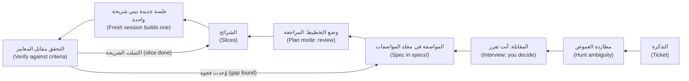

# الوحدة 3 — تحديد العمل

*تحوّل هذه الوحدة التذكرة إلى شيء يستطيع الوكيل (agent) أن يبني منه وتستطيع أنت أن تتحقق على أساسه. يعلّمك الدرس 3.1 التطوير الموجَّه بالمواصفات (spec-driven development) على نجم ريميت: لماذا ليست التذكرة مواصفة، والأجزاء العشرة للمواصفة، وكيف تطارد الغموض في برمجيات الأموال — التقريب والقيم الحدّية والعملات وأجزاء الرسوم والمناطق الزمنية والعربية — وكيف تجعل الوكيل يحاورك قبل أن يخطط، وكيف تراجع خطة، وكيف تقسّم العمل إلى شرائح تتسع كل شريحة منها لسياق واحد، وكم من المواصفة يستحقه التغيير. وينتهي بمُنتَجين هما قالب المواصفة وقائمة تحقق الخطة، ومعهما وصف Microsoft نفسها لدورة حياة من سبع خطوات مع ربط كل خطوة بمحتوى هذه الدورة. أما الدرس 3.2 فهو المختبر: ثلاث تذاكر غامضة من حصة، مالكة المنتج، تصير ثلاث مواصفات تُقيَّم دون اتصال على شكلها وعلى الوقائع التي يمكن فحصها مقابل المستودع. والوكيل اختياري، بصفة محاوِر. وكل ما يخص جانب نجم خيالي.*

> **التركيز:** Workflow — اكتب ما معنى «انتهى» وما هو خارج النطاق وما الخطة قبل تفويض أي شيء، كي يلتقي تخمين الوكيل الواثق بمواصفة لا بفجوة.

---

# 3.1 — التطوير الموجَّه بالمواصفات: من التذكرة إلى معايير القبول والقيود وما ليس من الأهداف وخطة
*المستوى: 🟢 مبتدئ* · *المتطلبات: 2.1* · *التركيز: Workflow*

**بعد هذا الدرس تستطيع** تحويل تذكرة غامضة إلى مواصفة بمعايير قبول وقيود وما ليس من الأهداف، ومراجعة خطة مقابل قائمة فحص. *مدة الدراسة: قراءة نحو 15 دقيقةً، وعمل تطبيقي نحو 75 دقيقةً (تقدير).*

## ⚡ الدرس في دقيقة
- التذكرة تعبّر عن أمنية. أما **المواصفة (spec)** فتقول ما معنى «انتهى»، فيستطيع الوكيل أن يبني منها وتستطيع أنت أن تتحقق على أساسها: العادة الثانية.
- للمواصفة عشرة أجزاء؛ وتستحق الأمثلة المحلولة والقرارات المكتوبة مكانها.
- طارد الغموض في ست عائلات: التقريب، والقيم الحدّية، والعملة والممرات، وأجزاء الرسوم، والوقت والمناطق الزمنية، والعربية.
- دع الوكيل يحاورك، وراجع خطته كما تراجع الفروقات، وقسّم العمل إلى شرائح بحيث تتسع كل قطعة لسياق واحد.
- مقدار المواصفة يتبع الخطر: الخطأ المطبعي لا يحتاج إليها، ومنطق الأموال يحتاج إليها كلها.
- أكبر فخ: مواصفة واثقة لم يقابلها أحد بالشيفرة. الشيفرة هي التي تنتصر.

## 🧭 لماذا يهم
في يوم ثلاثاء مُختلَق تكتب حصة، مالكة المنتج، التذكرة REMIT-288: «عملاء الفئة الأساسية يصلون باستمرار إلى حدهم اليومي. ارفعوه إلى 3,000.» وتسلّمها لجين، المهندسة حديثة التخرج، لوكيلها. فتكون الفروقات سطرًا واحدًا في `limits.py` وستة اختبارات معدَّلة. ويمرّ كل شيء. وفي المراجعة تسأل ندى، قائدة هندسة الجودة: هل يبقى الحد الشهري البالغ 8,000.00، فيبلغه عميل T1 في ثلاثة أيام؟ وهل يُسمح بـ3,000.00 بالضبط؟ وأيّ الاختبارات الستة المعدَّلة كان المقصود تغييره؟ ولماذا تقول `docs/ARCHITECTURE.md` إن الحد 5,000؟ لم تجب التذكرة عن شيء من ذلك (فحصة وجدتها بديهية)، ولم يسأل الوكيل عن شيء.

ثمن السؤال الذي لا جواب له هو التخمين: فيبني الوكيل قراءة واحدة بالثقة نفسها التي يبني بها القراءة الصحيحة. وفي استبيان Stack Overflow للمطورين لعام 2025، وهو بيانات أبلغ عنها المشاركون أنفسهم، كان أكبر مصدر إحباط من أدوات الذكاء الاصطناعي مخرجات «شبه صحيحة، لكن ليست تمامًا»، وهذا ما ينتجه سؤال حدّي بلا جواب: حد يرفض 3,000.00 بفارق سنت واحد. أما المواصفة فتطرح الأسئلة قبل البناء، حين يكون الجواب رخيصًا.

## 📐 كيف يعمل

### 🟢 الأساسيات

**التذكرة ليست مواصفة.** تُكتب التذكرة لسجل المهام المتراكمة وتترك مفتوحًا كل ما رآه كاتبها بديهيًا. أما المواصفة فتُكتب لمن يبني ولمن يتحقق: تقول ما معنى «انتهى»، وما هو خارج النطاق، وما العمل في الحالات الصعبة. الزميل يسأل: «ماذا قصدت؟» أما الوكيل فيختار قراءة — `misread-requirement`، الدرس 1.1 — ويبنيها.

**تشريح المواصفة.** عشرة أجزاء: الهدف، والسياق (context)، والسلوك، ومعايير القبول (acceptance criteria)، والقيود، وما ليس من الأهداف، والقرارات والأسئلة المفتوحة، والمخاطر، وخطة الاختبار، والخطة. السلوك جدول من الأمثلة المحلولة أو أسطر «معطى / عندما / إذن»: *معطى عميل من الفئة T1 أرسل اليوم 2,500.00، عندما يحاول إرسال 500.01، إذن يُرفض الطلب بالرمز `daily_limit_exceeded`.* السلوك يثبّت الأرقام والقرارات تثبّت المعنى، فهذان الجزآن يؤديان معظم العمل.

**ضعيف وقوي.** النسخة الضعيفة هي تذكرة حصة. والنسخة القوية، مختصرة إلى جوهرها:

```markdown
# REMIT-288: raise the daily limit for T1 customers
### Behaviour
| Sent today | Tries to send | Result |
|---|---|---|
| 0.00 | 3,000.00 | allowed: exactly the limit |
| 0.00 | 3,000.01 | refused: `daily_limit_exceeded` |
| 2,500.00 | 500.00 | allowed |
| 2,500.00 | 500.01 | refused: `daily_limit_exceeded` |
| 0.00 today, 7,500.00 this month | 600.00 | refused: `monthly_limit_exceeded` |
### Decisions and open questions
- The monthly limit stays 8,000.00. Assumption: the ticket says "daily". Hessa confirms.
- `docs/ARCHITECTURE.md` section 5 says 5,000 a day and no monthly limit. The code wins; the document gets its own fix.
- Six existing tests pin 2,000.00 (five in `tests/test_limits.py`, one in `tests/test_service.py`). They change with the constant, in one commit.
```

شُغِّل كل صف مقابل الشيفرة بعد التغيير.

**مطاردة الغموض في برمجيات الأموال.** اقرأ كل تذكرة وهذه العائلات الست بجانبك؛ والعمود الأخير هو ما تقوله شيفرة ريميت فعلًا.

| العائلة | اسأل | ما تقوله الشيفرة |
|---|---|---|
| **التقريب** | أي قاعدة وأي اتجاه، وعلى ماذا تُطبَّق؟ | التقريب إلى الأعلى عند المنتصف (half up) في كل مكان، عدا حصة الشريك في دفتر الأستاذ فهي بالتقريب إلى الزوجي (half-even)، وهي غرابة قديمة |
| **القيم الحدّية** | هل الحافة داخلة أم خارجة؟ المبلغ كله أم الهامشي؟ | مستوى الرسوم بحسب المبلغ كله، `amount <= upto`؛ و`min_send` و`max_send` والحدود شاملة للطرفين؛ وينتهي عرض السعر حين `now >= expires_at` |
| **العملة والممرات** | بأي عملة هذا الرقم؟ أي ممر وطريقة تسليم وفئة؟ | يدفع المرسلون بالريال القطري (QAR)؛ و`BDT` عملة بلا ممر؛ وقد يسعّر جدول رسوم واحد ممرين |
| **أجزاء الرسوم** | «الرسوم» تعني أي أجزاء، وبأي ترتيب؟ | الرسم الخام، ثم الحد الأدنى والسقف، ثم الرسم الإضافي للتحويل السريع بعد السقف |
| **الوقت والمناطق الزمنية** | منتصف ليل من؟ أي ساعة؟ وما «اليوم» و«الغد»؟ | تُخزَّن بالتوقيت العالمي؛ ويمتد يوم قطر من 21:00 إلى 21:00 بتوقيت UTC، بلا توقيت صيفي؛ والساعة مُحقَنة |
| **العربية** | الأرقام والفواصل والأسماء والاتجاه؛ ومن يعتمد الصياغة؟ | أرقام عربية-هندية (Arabic-Indic digits)؛ وتُدرَج الأسماء دون تغيير؛ والصياغة الإنجليزية مثبَّتة باختبارات |



### 🟡 التعمق أكثر

**«حاوِرني».** لن يسألك الوكيل ما لم تطلب منه. تصف صفحة أفضل الممارسات أن تطلب من Claude أن يحاورك — وتسمّي الأداة `AskUserQuestion` — ثم يكتب ملف مواصفة مثل `SPEC.md`، ثم تبدأ جلسة جديدة للتنفيذ؛ فراجع الوثائق الحالية. وهذا موجّه (prompt) للتذكرة REMIT-288:

```text
I need a spec for REMIT-288 (ticket: specs/REMIT-288-ticket.md). Do not write code.
Read CONTRIBUTING.md, src/remit/limits.py and tests/test_limits.py first. Then interview me:
ask only what the code cannot answer, at most five questions at a time, and tell me what the
code says before each. Cover rounding, boundaries, currency, fee parts, time zones and Arabic
where they apply. When I say "you decide", record an assumption and who confirms it. When I
say "done", write specs/REMIT-288.md on specs/TEMPLATE.md. Do not invent file names.
```

مقتطف مُختلَق لا مسجَّل من نموذج حقيقي:

```text
Agent: limits.py allows used + amount <= limit, so exactly 3,000.00 passes. Wanted?
Me:    Yes.
Agent: The monthly limit is 8,000.00 and binds on day three. Does it stay?
Me:    The ticket says daily. Keep it, as an assumption for Hessa.
```

المحاوِر لا يسأل إلا عما يخطر له، فأبقِ العائلات الست بجانبك؛ ويميل أيضًا إلى موافقتك، فتحقق من وقائعه وأبقِ القرارات لك. ثم ابنِ في **جلسة جديدة**: فقد استهلكت المقابلة جزءًا من السياق، والمواصفة هي خلاصتها المقطَّرة — الوحدة 2.

**وضع التخطيط ومراجعة الخطة.** في Claude Code يتيح وضع التخطيط (plan mode) للوكيل أن يقرأ ويقترح دون تعديل ملفات المصدر؛ وفي أدوات أخرى وضع مشابه، فراجع أداتك. ادخله بالضغط على `Shift+Tab` حتى يُظهر شريط الحالة (status bar) `⏸ plan mode on`، أو بالأمر `claude --permission-mode plan`، أو بـ`/plan`. ويفتح `Ctrl+G` الخطة في محررك؛ واعتمادها يبدأ العمل. وتنجو الخطة من ضغط السياق. وإن كنت تستطيع وصف الفروقات في جملة واحدة فتجاوز الخطة، كما تقول صفحة أفضل الممارسات. وهذه خطة ضعيفة كما يكتبها الوكلاء كثيرًا:

```text
1. Update the limits configuration
2. Update the tests
3. Verify everything works
```

لا تسمّي ملفًّا، ولا تبيّن أي الاختبارات يجوز تغييرها، ولا فيها أمر ولا طريق للعودة. أما الخطة القوية للتذكرة REMIT-288 فتسمّي كل ملف، وتكتب الصفوف الفاشلة أولًا، ثم تُدخل الصفوف والثابت والاختبارات الستة القديمة معًا في إيداع واحد أخضر، وتنتهي بـ`pytest -q` وتراجع. وهذه قاعدة تقريبية في هذه الدورة لا حدٌّ مقيس: إذا تجاوزت الخطة نحو عشر خطوات أو خمسة ملفات، فقسِّم إلى شرائح.

**الشرائح.** تتسع الشريحة لسياق واحد، ويُتحقق منها وحدها، وتُدمج ويُتراجع عنها وحدها؛ فضع الأخطر أولًا. ويربط مؤلفو تقرير DORA لعام 2024 جزءًا من تراجع الاستقرار الذي رصدوه بزيادة حجم الدفعات، وهو ارتباط في استبيان لا إثبات. وينقسم ممر جديد إلى أربع شرائح: الممر بحدّه الأدنى والأقصى (`corridors.py`)، وسعر صرفه وهامشه (`fx.py`)، وجدول رسومه (`fees.py`)، والوثائق.

**كم من المواصفة لكم من الخطر.**

| التغيير | ما تكتبه |
|---|---|
| خطأ مطبعي في رسالة (REMIT-212) | لا شيء: جملة واحدة للفروقات، ثم اقرأ الفروقات |
| صياغة بلغتين | النصوص بحروفها؛ ويوقّع قارئ من أهل اللغة |
| الرسوم وأسعار الصرف والحدود ودفتر الأستاذ والخدمة | المواصفة الكاملة، وخطة مراجَعة، ومراجع بشري ثانٍ |

**حيّة أم مؤقتة.** التغيير لمرة واحدة يمكن أن يُبقي مواصفته في طلب الدمج (pull request) لأن الاختبارات تحمل المعايير. أما القواعد التي سيغيّرها آخرون، كالرسوم والحدود، فاحتفظ بمواصفة قصيرة في `specs/` وحدّثها مع كل تغيير في السلوك: فالمواصفة القديمة مصدر ثانٍ للحقيقة، كما هي `docs/ARCHITECTURE.md` الآن.

### 🔴 نظرة الخبير

**التطوير الموجَّه بالمواصفات بوصفه ممارسة في الصناعة.** تصف مدونة المطورين لدى Microsoft، في منشور من عام 2026، التطوير الموجَّه بالمواصفات بأنه الاتفاق على النية قبل أن يولّد الذكاء الاصطناعي الشيفرة، مع جعل المواصفات المنظَّمة مرجعًا مشتركًا للناس ولأدوات الذكاء الاصطناعي. وتقدّم Spec Kit، عدّة الأدوات المفتوحة المصدر من GitHub، وسيلةً لتطبيقه، وتسرد دورة حياة من سبع خطوات:

| خطوة Microsoft | في هذه الدورة |
|---|---|
| الدستور: المبادئ والحواجز الوقائية | ذاكرة المشروع (project memory) و`CONTRIBUTING.md` (الوحدة 2) |
| التحديد | قالب المواصفة |
| التوضيح | مطاردة الغموض، والمقابلة، والقرارات |
| التخطيط | وضع التخطيط وقائمة تحقق الخطة |
| المهام | الشرائح والخطوات الصغيرة، وإيداع لكل منها |
| التنفيذ | فوِّض شريحة واحدة في كل مرة (الوحدة 4) |
| التحقق | الاختبارات والفروقات وتشغيل الشيفرة (الوحدة 5) |

يقول المنشور إن جودة المخرجات تتبع جودة المواصفة ويوصي بالبدء بتجربة تشغيلية (pilot) صغيرة. ويضيف منشور آخر من Microsoft عن سجل مهام يبدأ بالمواصفة تحفظًا: أن الوكلاء الذين يحدّثون وثائق التصميم قد ينحرفون عن المواصفات الأصلية. وهذا وصف تقدّمه شركة لممارستها الخاصة لا دليل مستقل — اقرأ الأصل — وهو يدعم عادة لا أداة: فأوامر Spec Kit نفسها `/specify` و`/plan` و`/tasks` (لا `/plan` الخاص بـ Claude Code) إحدى طرق اتباعها، ومجلد `specs/` مع وضع التخطيط طريقة أخرى. والمختبر 3.2 هو تجربتك التشغيلية.

**أين تخطئ المواصفات.** وصف الكيفية — «استخدم قاموسًا من الإزاحات» — وأنت تقصد السلوك: فيطيع الوكيل الحرف. والتناقضات التي يُختار لها فائز عشوائي. والأمثلة المنسوخة من مخرجات الشيفرة نفسها فلا يستطيع أي اختبار نقضها. ومواصفة بدل اختبار: فالمعيار وعد ما دام اختبار يسنده ([*اختبار البرمجيات (Software Testing)*، الدرس 6.2 — الاختبارات بوصفها المواصفة لوكلاء البرمجة](../testing/index.ar.html#/6.2)).

## 🧰 الأدوات
| الأداة أو الممارسة أو النمط | ما هي وماذا تفعل | متى تلجأ إليها |
|---|---|---|
| **Spec template** — قالب المواصفة | عشرة أقسام، من الهدف إلى الخطة، في ملف تحت `specs/` | أي تغيير يتجاوز فروقات من جملة واحدة؛ وفي منطق الأموال دائمًا |
| **Plan checklist** — قائمة تحقق الخطة | ثمانية فحوص تُجرى على الخطة قبل تعديل أي شيء | قبل أن تعتمد أي خطة |
| **Interview prompt** — موجّه المقابلة | يجعل الوكيل يسألك على دفعات صغيرة ثم يكتب المواصفة | بعد تذكرة غامضة، وقبل وضع التخطيط |
| **Ambiguity hunt** — مطاردة الغموض | ست عائلات من الأسئلة لتذاكر الأموال | عند قراءة أي تذكرة تمسّ الأموال |
| **Plan mode** — وضع التخطيط | استكشاف واقتراح للقراءة فقط | قبل التعديلات على تغيير محدَّد المواصفة |
| **Slices** — الشرائح | قطع تتسع لسياق واحد ويُتحقق منها وحدها وتُدمج وحدها | حين تتجاوز الخطة عشر خطوات أو خمسة ملفات |

## 🏛️ عمليًا في بنك نجم
يضع طارق، قائد الهندسة، القاعدة: لا يبني وكيل منطق الأموال من تذكرة، بل من مواصفة في `specs/` قرأها المراجع الثاني أولًا. وتتبع ذلك مُنتَجان. الأول `specs/TEMPLATE.md`، وهو الملف الذي يمنحك إياه المختبر: استبدل كل `TODO` وأبقِ العناوين.

```markdown
# TODO: ticket id and title

### Goal
TODO: what changes, for whom, and why, in two sentences.

### Context
TODO: what a newcomer or an agent with no memory must know: real files and functions, the rules that apply.

### Behaviour
TODO: worked examples with exact inputs and outputs (a table or Given / When / Then), including the edges: the smallest amount, the exact boundary, one cent or one second either side, the other language.

### Acceptance criteria
TODO: one bullet each, every one a statement that a test or a command can prove or refute.

### Constraints
TODO: what must stay true: Decimal money, the rules of CONTRIBUTING.md, files you must not touch.

### Non-goals
TODO: what this change deliberately does not do.

### Decisions and open questions
TODO: one bullet per question the ticket leaves open, answered as a full sentence that names its subject, with the reason. If only someone else can know, label it an assumption and name who confirms it.

### Risks
TODO: what could go wrong in production, and how you would notice.

### Test plan
TODO: which test proves which criterion, and the command that runs them.

### Plan
TODO: the files you expect to touch; four to ten numbered steps, each one small change with one check (a failing test may share a green commit with its fix); how to roll back. Too big for ten steps: plan the first slice only.
```

والثاني **قائمة تحقق الخطة**. احفظها باسم `plan-checklist.md` وشغّلها على كل خطة.

```markdown
# Plan checklist: review the plan like a diff, before anything is edited
- [ ] Files: every file is named, and exists (or is marked new).
- [ ] Steps: four to ten, numbered, one commit and one reading of the diff each.
- [ ] Order: the failing test is written, and seen failing, before the code it covers; both may land in one green commit.
- [ ] Checks: every step ends with a command or a diff you will read; one runs `pytest -q`.
- [ ] Scope: nothing outside the spec's files or inside its non-goals; no new dependency; no existing test edited unless the spec says so.
- [ ] Money logic: if it touches money.py, fees.py, fx.py, limits.py, ledger.py or service.py, a second human reviewer is named.
- [ ] Rollback: one revert, or a branch to delete.
- [ ] Size: past about ten steps or five files, slice it and plan the first slice only.
```

## 🛠️ التمارين
- 🟢 **طارد الأسئلة.** *لا يحتاج إلى وكيل.* تذكرة حصة الجديدة: «REMIT-299: أعفِ العميل من الرسوم على أول تحويل له». *يكتمل عندما:* تُدرَج ثمانية أسئلة على الأقل، كل منها موسوم بعائلته وبالملف في `src/remit/` الذي يحسمه، أو بالشخص الذي يجب أن يحسمه.
- 🟡 **راجع خطة.** *لا يحتاج إلى وكيل.* شغّل قائمة تحقق الخطة على الخطة أدناه، وقد كُتبت للتذكرة REMIT-288. *يكتمل عندما:* يُعثر على ست مشكلات أو أكثر، كل منها مربوطة ببند في القائمة، وتُعاد كتابة الخطة في ست خطوات أو أقل تجتاز القائمة.
- 🔴 **من المعايير إلى اختبارات فاشلة.** *يجوز أن يكتب وكيل مسودة.* في مستودع مؤقت — من `ainative/ailab`: `python -m ailab start m03 --dir ~/ainative/sandbox-limits`؛ وتبدأ اختباراته خضراء — اكتب صفوف السلوك الخمسة على هيئة اختبارات pytest بالمساعدات الموجودة في `tests/test_limits.py`. *يكتمل عندما:* يفشل الصفان الأول والثالث على المستودع غير المعدَّل للسبب الذي تذكره المواصفة، وينجح الثلاثة الأخرى، وبعد تغيير الثابت على فرع تجريبي تنجح الخمسة جميعًا.

```text
1. Read the codebase
2. Update the limits configuration
3. Update docs/ARCHITECTURE.md
4. Update tests/test_limits.py, tests/test_service.py, tests/test_fees.py and tests/test_notify.py
5. Update src/remit/limits.py
6. Refactor check_limits for readability
7. Add a warning at 80% of the limit
8. Add a new KYC tier T4
9. Run the tests
10. Fix anything that fails by adjusting the tests
11. Verify everything works and merge
```

## ⚠️ أخطاء وفخاخ
- **كتابة المواصفة بعد الشيفرة.** فتصف حينئذ ما بُني لا ما كان مقصودًا.
- **مواصفة تعيد صياغة التذكرة.** أضف ما أغفلته: الأمثلة والقرارات وما ليس من الأهداف.
- **اثنا عشر سؤالًا مفتوحًا تُسمّى مواصفة.** أجب عما تجيب عنه الشيفرة، واحسم الباقي بوصفه افتراضات موسومة، ولا توقف البناء إلا عند ما يهم.
- **الوثوق بوثيقة أكثر من الشيفرة.** تذكر وثيقة المعمارية وحدة لم تعد موجودة. افتح الملف.
- **ترك المحاوِر يقرر.** إجاباته مسودة؛ والقرارات لك.

## 🧾 الخلاصة
- التذكرة أمنية؛ والمواصفة تقول ما معنى «انتهى» بأمثلة يستطيع اختبار أن يثبتها أو ينقضها.
- طارد الغموض في ست عائلات؛ وأجب عن كل سؤال بجملة لا بسؤال.
- حاوِر الوكيل قبل أن تخطط، وراجع الخطة كما تراجع الفروقات، وقسّم إلى شرائح بحيث تُدمج كل قطعة وحدها.
- طابق المواصفة مع الخطر، ولا تُبقِ مواصفة إلا ما دامت صحيحة.
- خطوات Microsoft السبع تقابلها محتويات هذه الدورة؛ وهي رواية الشركة عن نفسها، فجرّب العادة أولًا على نطاق صغير.

## ✍️ اختبر نفسك

**1. خطة الوكيل للتذكرة REMIT-288 هي: «1. حدّث إعدادات الحدود. 2. حدّث الاختبارات. 3. تحقق من أن كل شيء يعمل.» ما أفضل استجابة؟**

- A. وافق عليها كما هي، لأنها تشمل الشيفرة والاختبارات وفحصًا أخيرًا.
- B. أعدها: لا ملفات، ولا اختبار فاشل أولًا، ولا أمر، ولا تراجع.
- C. اطلب عشرين خطوة على الأقل كي يُدوَّن كل تفصيل.
- D. بدّل إلى وضع يتجاوز طلبات الإذن كي ينتهي الوكيل أسرع.

<details><summary>الإجابة</summary>

**B.** تُراجَع الخطة كما تُراجَع الفروقات: الملفات والترتيب والفحوص وطريق العودة. ثلاثة أسطر تبدو كاملة (A)؛ والطول ليس دقة (C). (🟡 وضع التخطيط ومراجعة الخطة.)

</details>

**2. تطلب منك حصة تصحيح كلمة واحدة مكتوبة خطأ في الرسالة الإنجليزية `transfer_sent`. ماذا تكتب قبل أن تفوّض؟**

- A. القالب الكامل ذو الأجزاء العشرة، لأن ريميت خدمة أموال.
- B. خطة من ثماني خطوات مع تراجع، احتياطًا.
- C. جملة واحدة تصف الفروقات؛ ثم تقرأ الفروقات.
- D. لا شيء، وتقبل ملخص الوكيل.

<details><summary>الإجابة</summary>

**C.** التغيير الصغير الظاهر يحتاج جملة واحدة وقراءة للفروقات؛ وتخطي القراءة (D) ليس صوابًا أبدًا. (🟡 كم من المواصفة لكم من الخطر.)

</details>

**3. تريد حصة ملخصًا في نهاية اليوم «عن اليوم» لفريق المناوبة. أي غموض تحسمه أولًا لأنه يغيّر كل مجموع؟**

- A. أي مكتبة تسجيل وأي صيغة مخرجات ينبغي أن يستخدمها الملخص.
- B. هل تُقرَّب المبالغ إلى الأعلى عند المنتصف أم إلى الزوجي في المجاميع.
- C. هل ينبغي أن يُترجَم الملخص أيضًا إلى اللغة العربية من أجل الفريق.
- D. منتصف ليلِ مَن ينهي «اليوم»؛ ويوم قطر يمتد من 21:00 إلى 21:00 بتوقيت UTC.

<details><summary>الإجابة</summary>

**D.** «اليوم» يغيّر كل مجموع. والتقريب (B) قاعدة معتمدة في الفريق أصلًا، هي التقريب إلى الأعلى عند المنتصف، والمكتبة (A) هي الكيفية، والترجمة (C) تأتي بعد المحتوى. (🟢 مطاردة الغموض.)

</details>

**4. تقول لجين: «منشور Microsoft يثبت أن التطوير الموجَّه بالمواصفات يرفع الجودة». أي رد منصف؟**

- A. إنه تجربة مستقلة، فاعتمد الخطوات السبع كلها دفعة واحدة كما كُتبت.
- B. ينطبق فقط على الفرق التي تستخدم GitHub Spec Kit عدّةَ أدوات لها.
- C. إنه رواية الشركة عن نفسها: خذ العادة وجرّبها على نطاق صغير.
- D. يبيّن أن وضع التخطيط غير ضروري للعمل المحدَّد المواصفة أصلًا.

<details><summary>الإجابة</summary>

**C.** تصف Microsoft نهجها الخاص وتوصي بتجربة تشغيلية. وليست تجربة مستقلة (A)، ولا تحتاج العادة إلى عدّة أدوات بعينها (B). (🔴 التطوير الموجَّه بالمواصفات بوصفه ممارسة في الصناعة.)

</details>

**5. يقترح وكيل خطة من 14 خطوة تمسّ `fees.py` و`fx.py` و`notify.py` و`cli.py` وأربعة ملفات اختبار دفعة واحدة. ماذا تفعل؟**

- A. اعتمدها، لأن خطة طويلة كهذه تُظهر أن الوكيل فهم المهمة جيدًا.
- B. اطلب من الوكيل أن يدمج الخطوات معًا كي يقل عدد الإيداعات.
- C. شغّلها في الخلفية، وراجع النتيجة المكتملة في النهاية.
- D. قسّمها: خطّط الشريحة الأولى وتحقق منها وادمجها، ثم التالية.

<details><summary>الإجابة</summary>

**D.** إذا تجاوزت الخطة نحو عشر خطوات أو خمسة ملفات فقسِّم إلى شرائح كي يُتحقق من كل قطعة ويُتراجع عنها وحدها. والإيداعات الأكبر (B) والتشغيل بلا رقابة (C) يعيقان المراجعة. (🟡 الشرائح.)

</details>

## 📚 المراجع
- وثائق Claude Code: أفضل الممارسات https://code.claude.com/docs/en/best-practices; أوضاع الصلاحيات (permission modes) — وضع التخطيط https://code.claude.com/docs/en/permission-modes
- [*اختبار البرمجيات*، الدرس 1.3 — المتطلبات وحالات الاختبار وتقارير العيوب: من معايير القبول إلى عيب يستطيع أحدهم إصلاحه](../testing/index.ar.html#/1.3); [*بناء تطبيقات الذكاء الاصطناعي والوكلاء (Building AI Applications & Agents)*، الدرس 6.2 — مواصفات الوكيل ومعايير القبول: متطلبات يمكنك اختبارها](../aiapps/index.ar.html#/6.2)
- **للتعمق أكثر.** Microsoft for Developers، «التطوير الموجَّه بالمواصفات: نهج المواصفات أولًا للهندسة الأصيلة في الذكاء الاصطناعي»: https://developer.microsoft.com/blog/spec-driven-development-ai-native-engineering/; «الغوص في التطوير الموجَّه بالمواصفات مع GitHub Spec Kit»: https://developer.microsoft.com/blog/spec-driven-development-spec-kit/. وتقرير DORA لعام 2024 (DORA 2024 report): https://cloud.google.com/blog/products/devops-sre/announcing-the-2024-dora-report. واستبيان Stack Overflow للمطورين 2025، قسم الذكاء الاصطناعي: https://survey.stackoverflow.co/2025/ai

---

# 3.2 — المختبر: حوِّل ثلاث تذاكر غامضة إلى مواصفات يستطيع الوكيل البناء منها
*المستوى: 🟢 مبتدئ* · *المتطلبات: 2.2، 3.1* · *التركيز: Workflow*

**بعد هذا الدرس تستطيع** كتابة ثلاث مواصفات من تذاكر غامضة تنجح لدى المُقيِّم، وكل سؤال مفتوح فيها مُجاب عنه أو مُعلَّم ومُسنَد إلى مالك. *مدة الدراسة: قراءة نحو 15 دقيقةً، وعمل تطبيقي نحو 3 ساعات (تقدير).*

## ⚡ الدرس في دقيقة
- يمنحك المختبر m03 ثلاث تذاكر غامضة من حصة وقالبًا. وتكتب أنت `specs/T1.md` إلى `T3.md`. لا يُبنى شيء.
- تخفي كل تذكرة أسئلة عن التقريب والقيم الحدّية والعملة والممرات وأجزاء الرسوم والوقت والعربية. ويتحقق المُقيِّم (grader) من أن كل سؤال **مُجاب عنه** بجملة تسمّي موضوعها. السؤال ليس جوابًا.
- ويفحص أيضًا الأقسام، والمعايير القابلة للفحص، والملفات الحقيقية، وقواعد الفريق، والنسخ المكررة، وخطة من خطوات صغيرة تبدأ بالاختبار.
- هل يلزم وكيل؟: **لا**. يجوز أن يحاورك وكيل أو يراجع مسودة، لكن المُقيِّم يرى الملف لا من كتبه. خصِّص ساعتين إلى أربع ساعات — تقدير — تُصرف في الغالب على قراءة الشيفرة.
- إشارة القرار: إن لم تستطع أن تقول ما تفعله الشيفرة عند الحافة، فلا تكتب المعيار بعد.

## 🧭 لماذا يهم
في الربع الماضي تتبّع طارق ثلاثة طلبات دمج (pull requests) أنجزها وكلاء و«عادت خاطئة» فأرجع سببها إلى تذاكرها، وهي قصة مُختلَقة. ففي كل منها فعل الوكيل ما قالته التذكرة، مختارًا قراءة لم يخترها أحد: اتجاه تقريب، أو قيمة حدّية، أو منطقة زمنية. ومنذ ذلك الحين تصل تغييرات الأموال إلى الوكلاء مواصفاتٍ لا تذاكر.

تركت حصة ثلاث تذاكر جديدة كُتبت على عجل. اقرأها قراءة المتشكك، ودع الشيفرة تجيب عما تستطيع واحسم الباقي كتابةً. ويؤدي المُقيِّم دور الزميل الذي يظل يسأل «أي تقريب؟» حتى تجيب.

## 📐 كيف يعمل

### 🟢 الأساسيات

**ترتيب للعمل يتفادى إعادة العمل.**
1. اقرأ التذكرة قراءة المتشكك. ضع خطًّا تحت كل كلمة قد تحمل معنيين.
2. اقرأ الشيفرة وراء كل كلمة — في `docs/TOUR.md` جدول «أين تنظر عندما...» — وشغّلها.
3. اكتب **القرارات** أولًا: جملة واحدة لكل سؤال، تسمّي موضوعها. وما لا يعرفه إلا إنسان يصير افتراضًا موسومًا له مالك. وحيث تتعارض ملاحظتان، أو ملاحظة والشيفرة، اختر إحداهما، وقل لماذا، ووسمها.
4. اكتب **السلوك** من القرارات، بأرقام ناتجة عن تشغيل الشيفرة.
5. اكتب معايير يستطيع اختبار أن يُفشلها، ثم القيود وما ليس من الأهداف والمخاطر.
6. اكتب **الخطة** أخيرًا، والاختبار أولًا (test first).

في الخطوة 2 اسأل الشيفرة نفسها من مجلد مختبرك. وأبقِ النصوص البرمجية المؤقتة الأطول خارج المستودع: فكل ملف جديد فيه يُحتسب تغييرًا.

```bash
PYTHONPATH=src python -c "from remit.corridors import get_corridor; from remit.fees import explain_fee; from remit.money import Money; print(explain_fee(Money('700.00', 'QAR'), get_corridor('QAR', 'PKR')))"
PYTHONPATH=src python -c "from datetime import datetime, timezone; from remit.corridors import get_corridor; from remit.fx import fx_quote, StaticRateProvider; from remit.money import Money; print(fx_quote(Money('300.00', 'QAR'), get_corridor('QAR', 'PHP'), StaticRateProvider(), datetime(2026, 3, 2, 9, tzinfo=timezone.utc)))"
PYTHONPATH=src python -c "from datetime import datetime, timezone; from remit.limits import to_local; print(to_local(datetime(2026, 3, 2, 10, 0, tzinfo=timezone.utc)))"
```

```text
FeeBreakdown(schedule_id='STD-B', tier_index=0, raw=Money('20.50', 'QAR'), minimum_applied=False, cap_applied=False, base=Money('20.50', 'QAR'), surcharge=Money('0.00', 'QAR'), total=Money('20.50', 'QAR'))
FxQuote(rate=Decimal('15.2075'), receive=Money('4562.25', 'PHP'), expires_at=datetime.datetime(2026, 3, 2, 9, 1, tzinfo=datetime.timezone.utc))
2026-03-02 13:00:00+03:00
```

**ضعيف وقوي، سطرًا بسطر.**

| الجزء | الضعيف | القوي |
|---|---|---|
| المعيار | «تُحسب الرسوم بشكل صحيح» | «`quote_fee(Money("700.00", "QAR"), get_corridor("QAR", "PKR"))` هي `Money("20.50", "QAR")`» |
| القرار | «عالج التقريب كما ينبغي» | «تُقرَّب الرسوم إلى الأعلى عند المنتصف إلى 0.01 باستخدام `Decimal`، كما تفعل `Money` في كل مكان في ريميت: يتحوّل 20.125 إلى 20.13» |

يمكن إثبات خطأ كل سطر قوي.

### 🟡 التعمق أكثر

**كيف يقرأ المُقيِّم مواصفة.** هو مجموعة أسئلة آلية لا نموذج ذكاء اصطناعي. يقرأ كل بند قائمة وكل صف جدول وكل فقرة، ويُسقط الجمل التي تنتهي بعلامة استفهام، ويتجاهل السطر الذي ليس سوى سلسلة كلمات مفتاحية.

| الفحص | ما ينظر فيه | الطريقة المعتادة للإخفاق |
|---|---|---|
| الأمثلة والمعايير | مبالغ أو أوقات أو تواريخ دقيقة (500.00 QAR، و10,000 INR، و18:00، و6pm، و2026-03-02)؛ وفي المعايير أيضًا قيمة أو اسم برمجي أو نص مقتبس | «تُعرض الرسوم بشكل صحيح» |
| الملفات | كل مسار موجود، أو تقف بجانبه كلمة «new» أو «no longer exists» | `src/remit/risk.py`، من وثيقة قديمة |
| الأسئلة الخفية | جملة واحدة تجيب عن كل سؤال | قائمة أسئلة؛ وسلسلة كلمات مفتاحية |
| الخطة | من 4 إلى 10 خطوات مرقَّمة، كل منها 45 كلمة و3 ملفات على الأكثر؛ الاختبار أولًا و`pytest` والتراجع (rollback) | «1. نفِّذ. 2. اختبر.» |
| النسخ | لكل مواصفة نصها الخاص | مواصفة واحدة ملصوقة ثلاث مرات |

العواقب. جملة واحدة تجيب عن سؤال واحد، فأربعة قرارات تحتاج أربع جمل. السؤال لا يُحتسب أبدًا، لكن الكلمات نفسها في صيغة تقرير قد تُحتسب: «هل يشمل الإعفاء التحويلات السريعة؟» لا تُحتسب، أما «لا يشمل الإعفاء الرسم الإضافي للتحويل السريع» فقد تُحتسب. ويجب أن يقع نصف الإجابات على الأقل في قسم القرارات، حيث ينظر المراجع. وتُبلَّغ الأسئلة المفتوحة بحسب العائلة، مع عدد حين تضم العائلة عدة أسئلة مثل "boundaries (1 of 2)". والمُقيِّم يقرأ الكلمات لا المعنى: فإن لم تُحتسب إجابة سليمة، فقلها بوضوح أكثر. ولست مضطرًا إلى كتابة العربية بنفسك: دع مترجمًا أو وكيلًا يصوغ مسودتها، أو قل من يوفّرها.

**الوكيل محاوِرًا.** الهدف قائمة أسئلة أفضل لا مواصفة لم تكتبها. ابدأ للقراءة فقط (`claude --permission-mode plan`) واستخدم هذا الموجّه لـ T1، ثم T2 وT3:

```text
Read specs/TEMPLATE.md, CONTRIBUTING.md, docs/TOUR.md, lab-assets/hessa-notes.md and
lab-assets/tickets/T1.md, then the code it points to. Do not edit any file. Interview me
about T1, at most five questions at a time; before each, quote the line of code or note
that bears on it. Tag each decision "from the code", "from the notes" or "my assumption".
When I say "done", print the list and stop.
```

إن صاغ وكيل المواصفة نفسها فما زلت تشغّل الشيفرة لكل رقم وتفتح كل ملف تسمّيه. ومن دون وكيل حاوِر نفسك بالعائلات الست من الدرس 3.1 وبملاحظات حصة.

### 🔴 نظرة الخبير

**ما لا يستطيع المُقيِّم معرفته.** لا يشغّل أمثلتك أبدًا، فقد ينجح جدول فيه رسم خاطئ، ويجتاز القرار حسن الصياغة سواء أكان حكيمًا أم لا. ولا يستطيع الحكم على العربية ولا على من كتب الملف. والاختبار الحقيقي منفصل: قابل جدول سلوك واحدًا بالشيفرة، كما في الدرس 3.1.

**تدقيق الغموض.** أعطِ مواصفتك المنتهية، لا التذكرة، إلى جلسة جديدة للقراءة فقط: «اسرد كل قرار سيكون عليك تخمينه لبناء هذا، وكل عبارة تتعارض مع الشيفرة». كل تخمين فجوة. وعن مراجعة الفروقات تحذّر صفحة أفضل الممارسات من أن المراجعين «سيبلّغون عادةً عن بعضها حتى حين يكون العمل سليمًا»؛ فأبقِ فقط الفجوات التي تغيّر السلوك أو تناقض كلماتك.

## 🧰 الأدوات
| الأداة أو الممارسة أو النمط | ما هي وماذا تفعل | متى تلجأ إليها |
|---|---|---|
| **Spec template** — قالب المواصفة | `specs/TEMPLATE.md`: عشرة أقسام | كل مواصفة، هنا وبعدها |
| **Plan checklist** — قائمة تحقق الخطة | ثمانية فحوص على الخطة قبل أن يعدّل الوكيل | قبل أن تلتزم بخطة |
| **Interview prompt** — موجّه المقابلة | أسئلة للقراءة فقط على دفعات صغيرة مرتبطة بالشيفرة | بعد القراءة الأولى للتذكرة |
| **Ambiguity audit** — تدقيق الغموض | جلسة جديدة تسرد ما كان عليها أن تخمّنه | قبل أن تذهب المواصفة إلى جلسة بناء |
| **Seven-step map** — خريطة الخطوات السبع | أين تقع كل خطوة من دورة Microsoft في عملك | حين تتبنى العادة في فريق |

## 🏛️ عمليًا في بنك نجم
**التذكرة.** هذه هي `task.md` في العدّة، كما كتبتها حصة. ويكتبها `start` في مجلد مختبرك باسم `TASK.md`؛ والأحرف الكبيرة مهمة على Linux وmacOS.

```text
# REMIT-330: turn three vague tickets into specs an agent can build from

**From:** Hessa, Product Owner, Najm Remit (with Tariq)
**To:** Payments Platform, new joiners
**Priority:** Medium. Three tickets are waiting, and I keep getting "what did you mean?" messages.

I wrote three tickets in a hurry (`lab-assets/tickets/T1.md` to `T3.md`, with my meeting notes in `lab-assets/hessa-notes.md`). Nobody, human or agent, can build from them as they stand: each hides questions that money software must answer first. My notes were typed on a phone and can pull in different directions; where they do, choose, say why and name who confirms.

**Please do not build anything.** Write one spec per ticket, `specs/T1.md` to `specs/T3.md`, on `specs/TEMPLATE.md`, keeping its ten sections. I need:

- **Behaviour**: at least three worked examples with exact amounts, times or dates (such as 500.00 QAR, 10,000 INR, 18:00, 6pm or 2026-03-02), edges included.
- **Acceptance criteria**: at least four, one per bullet, each a statement a test could prove or refute, two or more with an exact amount, time or date. "Works properly" is not a criterion.
- **Decisions and open questions**: every question the ticket leaves open, answered as one complete sentence that names its subject (a question is not an answer). The code wins over any document. If only a person can know (me, Finance, Ops), decide, call it an assumption and say who confirms it. For text customers read in Arabic, write the Arabic sentence or say who supplies it; a native reader approves it before release.
- **Plan**: four to ten numbered steps, each small enough for one commit and naming its file, test or command. The failing test is written and run before the code it covers; the two may share one green commit, because `CONTRIBUTING.md` wants the tests passing at every commit. Include a `pytest` run and a rollback. If the ticket needs more than ten steps, plan the first slice and name the later ones in one sentence.
- Constraints, non-goals and decisions are bullet lists (at least three constraints, two non-goals and three decisions). `CONTRIBUTING.md` applies, and money logic needs a second human reviewer: write "second human reviewer" and name who (Nada from quality engineering, or Tariq). No filler, no placeholders (replace every `TODO`), only files that exist unless you write "new" beside the file, and no copies: each spec has its own numbers and decisions.

### Done when

- The three specs are committed with messages that follow `CONTRIBUTING.md` (`type(scope): subject`; any lower-case scope works, for example `docs(specs): spec the Egypt fee offer`). Nothing else changed except `agent-log.md` (optional), and `pytest -q` passes.
- Grade from the `ainative/ailab` folder of the course repository, not from this directory: `python -m ailab grade m03 --dir <this directory>`. Lines marked (advisory) print FAIL until satisfied but never block PASSED.

An agent may interview you or review a draft, but you answer for every sentence: the grader checks the shape of a spec and the facts it can check, not whether your decisions are good.
```

التذاكر في `lab-assets/tickets/`: T1 (REMIT-341)، خصم 15% على رسومنا إلى مصر؛ وT2 (REMIT-342)، دع العملاء يكتبون ما يجب أن تتلقاه عائلاتهم؛ وT3 (REMIT-343)، أخبر العملاء متى يكون الاستلام النقدي جاهزًا.

**البداية.**

```bash
# run every python -m ailab command from ainative/ailab
cd system-design-for-vibe-coders/ainative/ailab
python -m ailab start m03 --dir ~/ainative/m03
```

اعمل في `~/ainative/m03`، وانتقل إليها بـ`cd` لأجل git وpytest ومحررك. يحتوي الإيداع الابتدائي على `lab-assets/` وفيه التذاكر وملاحظات حصة و`specs/TEMPLATE.md` وملف `agent-log.md` ليس فيه إلا عناوينه.

**دورك، دون حاجة إلى وكيل.** انسخ القالب إلى `specs/T1.md` واتبع ترتيب العمل أعلاه. في الخطة اكتب الاختبار الفاشل خطوةً مستقلة لكن أودِعه مع الشيفرة التي تصلحه. أودِع كل مواصفة عند اكتمالها برسالة مثل `docs(specs): spec the Egypt fee offer`، وقيِّم أثناء التقدم: فالمواصفة المنتهية تُظهر `T1 ok; waiting for specs/T2.md` في فحوص الشكل، والمسودة تُظهر ما ينقصها بعد.

**دورك، مع وكيل اختياريًا.** استخدم موجّه المقابلة أعلاه في وضع التخطيط، تذكرة واحدة لكل جلسة، ثم اكتب المواصفة بنفسك من القرارات التي طبعها. دوِّن في `agent-log.md` أي الأسئلة التي أثارها وكانت قد فاتتك وأي الوقائع التي اقتبسها خطأً. ولا تدعه يعدّل المستودع أبدًا.

**ما يفحصه المُقيِّم.** النظافة: لم يتغير إلا `specs/` و`agent-log.md`، والاختبارات تنجح، والإيداعات تتبع `CONTRIBUTING.md`، ولا شيء غير مودَع، ولا أسرار. الشكل: الأقسام والأمثلة والمعايير والقوائم، بلا حشو ولا نصوص نائبة ولا نسخ مكررة. الوقائع: الملفات المسمّاة موجودة، ولا قرار يخرق قاعدة من قواعد الفريق — الأموال بنوع Decimal (Decimal money)، والتقريب إلى الأعلى عند المنتصف، والساعة المحقونة (injected clock)، ولا اعتمادية جديدة — ومنطق الأموال يسمّي مراجعًا ثانيًا. ثم الأسئلة الخفية لكل تذكرة، والخطة. وتطبع الأسطر الاستشارية — المخاطر والسجل — FAIL حتى تُستوفى لكنها لا تمنع PASSED أبدًا.

**التقييم.**

```bash
# from the ainative/ailab folder, not from the lab directory
python -m ailab grade m03 --dir ~/ainative/m03
```

المخرجات الحقيقية على الحالة الابتدائية، مختصرة؛ ويدل `...` على أسطر محذوفة:

```text
[PASS] Only specs and the agent log changed: nothing changed
[PASS] The repository's tests still pass: 99 passed
[FAIL] All three specs exist: missing: specs/T1.md, specs/T2.md, specs/T3.md
...
[FAIL] Required sections are present: no specs yet
...
[FAIL] T1: hidden questions answered: waiting for specs/T1.md
[FAIL] T2: hidden questions answered: waiting for specs/T2.md
[FAIL] T3: hidden questions answered: waiting for specs/T3.md
...
[FAIL] Commit messages follow CONTRIBUTING.md: found 0 commits since the start; expected at least 1
       hint: Commit the specs, for example `git add -A && git commit -m "docs(specs): write the three specs"` (type(scope): subject, as CONTRIBUTING.md says).
[PASS] Everything is committed (nothing left over)
[PASS] No secrets in the change

Lab m03: 4/21 required checks passed: NOT YET
```

بعد مسودة أولى لـ T1 وحدها، مقتطف من تشغيل حقيقي:

```text
[FAIL] Acceptance criteria are checkable: T1: 2 not checkable, for example "The saving is shown correctly on the quote."
[FAIL] Named files exist: T1: names files that do not exist: src/remit/discount.py
[FAIL] T1: hidden questions answered: 2 of 4 resolved; still open: fee parts (1 of 2), rounding
[FAIL] Plans are small numbered steps: T1 ok; waiting for specs/T2.md, specs/T3.md
```

تنتهي المجموعة الناجحة بـ`Lab m03: 21/21 required checks passed: PASSED`.

**المُخرَج الأسبوعي.** في مستودع ملاحظاتك، لا في `~/ainative/m03`، أودِع `week-03/` ومعه `T1.md` و`T2.md` و`T3.md` و`m03-grade.txt` وهو ناتج التقييم النهائي، و`seven-steps.md` من التمرين 🟡، و`plan-checklist.md` وهو قائمة التحقق من الدرس 3.1 مع نتيجة حقيقية واحدة من خططك، و`agent-log.md`.

**الجلسة الجماعية، ومدتها 60 دقيقة.** (1) بادل شريكك مواصفة واسردا كل تخمين سيضطر إلى إجرائه (15). (2) قارن قرارات T1 لديكما: أين اختلفتما، ومن يؤكد (15). (3) اقرأ جملة T3 العربية على قارئ من أهل اللغة (10). (4) قابل جدول سلوك واحدًا بالشيفرة (10). (5) اتفقوا على ثلاثة أسطر لقالب الفريق (10).

**المراجعة الختامية.** ماذا أخطأ فيه الوكيل، أو كاد؟ ماذا فات سياقك أو مواصفتك؟ أي سؤال لم تجده إلا لأن الشيفرة خالفتك؟ وما الذي لن يخبرك به المُقيِّم أبدًا؟

**سجل الوكيل (Agent log).** استخدم صيغة الدرس 0.1، بإدخال واحد لكل جلسة مقابلة؛ وإن لم تستخدم وكيلًا فقل ذلك.

```markdown
# Agent log

Entry:
Prompt (paste or summarise):
What the agent did:
What I corrected:
What I checked myself:
Minutes:
Would I delegate it again?
```

## 🛠️ التمارين
- 🟢 **علِّق على تذكرة.** *لا يحتاج إلى وكيل.* خذ T2 وضع خطًّا تحت كل كلمة قد تحمل معنيين. *يكتمل عندما:* يضم جدول ثمانية صفوف على الأقل، في كل صف الكلمة وعائلتها من الدرس 3.1 والملف في `src/remit/` أو الشخص الذي يحسمها.
- 🟡 **اربط مواصفاتك بالخطوات السبع.** *لا يحتاج إلى وكيل؛ وتفحصه مجموعتك لا `ailab`.* استخدم خطوات Microsoft السبع من الدرس 3.1. *يكتمل عندما:* يحوي `seven-steps.md` صفًّا لكل خطوة يذكر أين تقع في مواصفاتك أو في ملف ذاكرة الوحدة 2، ويسمّي خطوة واحدة على الأقل تخطيتها هنا ولماذا، ويقول في جملة واحدة ما ستكون عليه تجربة تشغيلية صغيرة في فريقك.
- 🔴 **شغّل تدقيق الغموض.** *يحتاج إلى وكيل، أو زميل لم يرَ التذاكر.* أعطِ مواصفة T3 لجلسة جديدة للقراءة فقط. *يكتمل عندما:* تُصنَّف تخميناتها إلى فجوات حقيقية تُضاف إلى القرارات، وتعارضات مع الشيفرة تُصحَّح، وضوضاء تُستبعد مع ذكر السبب، وتبقى النتيجة خضراء.

## ⚠️ أخطاء وفخاخ
- **كتابة الأرقام باليد.** سنت واحد خاطئ في جدول يصير هو المعيار. شغّل الشيفرة.
- **الإجابة بسؤال أو بجملة مبهمة.** عبارة «التقريب يُؤكَّد لاحقًا» لا تحسم شيئًا. اتخذ قرارًا، ووسمه.
- **نسخ وثيقة قديمة.** تذكر `docs/ARCHITECTURE.md` وحدة لم تعد موجودة. افتح الملف أولًا.
- **تلقيم المُقيِّم بكلمات مفتاحية.** قد يمرّرها؛ لكن مجموعتك لن تمرّرها.
- **إخفاء الافتراضات أو التعارضات.** الافتراض بلا مالك تخمين متنكّر في هيئة قرار؛ وملاحظتان متعارضتان تحتاجان إلى اختيار وسبب ومالك.

## 🧾 الخلاصة
- احسم كتابةً: جملة واحدة لكل سؤال، تسمّي موضوعها. السؤال ليس جوابًا.
- دع الشيفرة تجيب أولًا، ودعها تنتج أرقامك.
- الخطة أربع إلى عشر خطوات صغيرة مرقَّمة، والاختبار أولًا، مع تشغيل `pytest` وتراجع.
- يستطيع الوكيل أن يحاورك؛ أما القرارات والأرقام والعربية فتبقى لك.
- يفحص المُقيِّم الشكل والوقائع القابلة للفحص؛ ويفحص الناس، وجلسة تدقيق جديدة، الحكم.

## ✍️ اختبر نفسك

**1. يسرد قسم القرارات في مواصفة ستة بنود مثل «هل يجب أن يشمل الإعفاء التحويلات السريعة؟» ويبلّغ المُقيِّم أنه لم يُجَب عن أي سؤال خفي. لماذا؟**

- A. لا يقرأ المُقيِّم إلا قسم السياق حين يبحث عن القرارات.
- B. ستة بنود كثيرة في قسم واحد؛ والحد أربعة.
- C. السؤال ليس جوابًا: يحتاج كل بند إلى جملة تحسم.
- D. ينبغي أن تكون البنود مرقَّمة لا نقطية.

<details><summary>الإجابة</summary>

**C.** يُسقط المُقيِّم الجمل التي تنتهي بعلامة استفهام. اتخذ قرارًا، وسمِّ من يؤكده. (🟡 كيف يقرأ المُقيِّم مواصفة.)

</details>

**2. يقول معيار «تُحسب الرسوم بشكل صحيح لكل الممرات»، ويقول المُقيِّم إنه غير قابل للفحص. ما أفضل إصلاح؟**

- A. أعطِ مدخلًا دقيقًا ومخرجًا دقيقًا يستطيع اختبار مقارنتهما.
- B. أضف عبارة «كما ينبغي» لتبدو الجملة أكثر حزمًا.
- C. انقل الجملة إلى ما ليس من الأهداف، حيث تُحتسب أقل.
- D. احذف قسم معايير القبول بأكمله، ولا تُبقِ إلا الأمثلة المحلولة.

<details><summary>الإجابة</summary>

**A.** يحتاج المعيار إلى قيمة أو اسم برمجي يستطيع اختبار فحصه. و«كما ينبغي» حشو. (🟢 ضعيف وقوي.)

</details>

**3. يقول سياق لجين إن الحدود تُفحص في `src/remit/risk.py`، وقد نُقل ذلك من `docs/ARCHITECTURE.md`. ويقول المُقيِّم إن الملف غير موجود. فماذا الآن؟**

- A. أنشئ ملف `risk.py` فارغًا كي تصير المواصفة صحيحة.
- B. أبقِه، لأن وثيقة المعمارية هي المرجع في التصميم.
- C. ضع كلمة «new» على ذلك السطر كي يقبله الفحص.
- D. افتح الشيفرة، وجِد موضع الحدود، وصحِّح المواصفة.

<details><summary>الإجابة</summary>

**D.** الحدود في `limits.py`؛ والوثيقة قديمة والشيفرة هي التي تنتصر. والخياران A وC يتحايلان على الفحص ويتركان المواصفة خاطئة. ⚠️ نسخ وثيقة قديمة.

</details>

**4. صاغ وكيلك قسم القرارات كله والتقييم أخضر. ما الذي يظل مهمتك؟**

- A. لا شيء إطلاقًا، لأن التقييم الأخضر يعني أن القرارات كلها صحيحة ونهائية.
- B. تحقق من القرارات مقابل الشيفرة والملاحظات؛ وتحمّل مسؤولية الافتراضات.
- C. اطلب من الوكيل أن يقيّم قراراته بنفسه ويرجع إليك بتقرير.
- D. احذف كلمة «افتراض» من المواصفة لأنها توحي بعدم اليقين.

<details><summary>الإجابة</summary>

**B.** يرى المُقيِّم الشكل لا الحكم ولا التأليف؛ وأنت تُسأل عن كل جملة. وإخفاء الافتراضات (D) يحوّل التخمينات إلى قرارات زائفة. (🔴 ما لا يستطيع المُقيِّم معرفته.)

</details>

**5. تقول خطة: «1. نفِّذ الخصم في `fees.py`. 2. اكتب الاختبارات.» يفشل فحص الخطة. لماذا؟**

- A. يجب أن تسمّي كل خطوة دالة واحدة، لا ملفًا كاملًا مثل `fees.py`.
- B. لا يجوز أن تسمّي الخطط ملفات، لأن الملفات تتغير أثناء البناء.
- C. يجب أن يسبق الاختبار الفاشل الشيفرة التي يُفترض أن يغطيها.
- D. لا تُكتب الاختبارات إلا بعد أن يعتمد مراجع الشيفرة.

<details><summary>الإجابة</summary>

**C.** يمنح الاختبار أولًا البناء هدفًا ويثبت أن الاختبار قادر على الفشل. ويريد المُقيِّم أيضًا تشغيل `pytest` وتراجعًا. (🟢 ترتيب للعمل.)

</details>

## 📚 المراجع
- وثائق Claude Code: أفضل الممارسات https://code.claude.com/docs/en/best-practices; أوضاع الصلاحيات — وضع التخطيط https://code.claude.com/docs/en/permission-modes
- عدّة المختبر: https://github.com/Tamoura/system-design-for-vibe-coders/tree/main/ainative/ailab. وConventional Commits (الإيداعات التقليدية): https://www.conventionalcommits.org
- [*إدارة منتجات الذكاء الاصطناعي (AI Product Management)*، الدرس 5.1 — مواصفات منتج الذكاء الاصطناعي: السلوك ومعايير الجودة والتقييمات بوصفها متطلبات](../aipm/index.ar.html#/5.1)
- **للتعمق أكثر.** Microsoft for Developers، «التطوير الموجَّه بالمواصفات: نهج المواصفات أولًا للهندسة الأصيلة في الذكاء الاصطناعي»: https://developer.microsoft.com/blog/spec-driven-development-ai-native-engineering/; «الغوص في التطوير الموجَّه بالمواصفات مع GitHub Spec Kit»: https://developer.microsoft.com/blog/spec-driven-development-spec-kit/; «من النهج الذي يبدأ بالمواصفة إلى الجاهزية للمؤسسات: توسيع GitHub Spec Kit»: https://developer.microsoft.com/blog/from-spec-first-to-enterprise-ready-extending-github-spec-kit/
