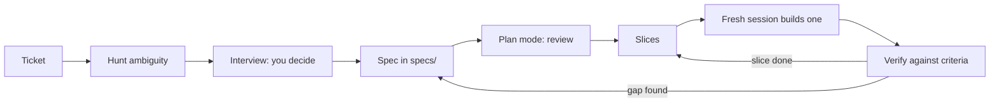

# Module 3 — Specifying the work

*This module turns a ticket into something an agent can build from and you can verify against. Lesson 3.1 teaches spec-driven development on Najm Remit: why a ticket is not a spec, the ten parts of a spec, how to hunt ambiguity in money software (rounding, boundaries, currencies, fee parts, time zones, Arabic), how to make an agent interview you before it plans, how to review a plan, how to slice work so each piece fits one context, and how much spec a change deserves. It ends with two artefacts, the Spec template and the Plan checklist, and with Microsoft's own description of a seven-step lifecycle mapped onto this course. Lesson 3.2 is the lab: three vague tickets from Hessa (product owner) become three specs, graded offline on their shape and on the facts that can be checked against the repository. An agent is optional, as an interviewer. Everything on the Najm side is fictional.*

> **Focus:** Workflow — write down what done means, what is out of scope and what the plan is before anything is delegated, so that an agent's confident guess meets a spec instead of a gap.

---

# 3.1 — Spec-driven development: from ticket to acceptance criteria, constraints, non-goals and a plan
*Level: 🟢 Beginner* · *Prerequisites: 2.1* · *Focus: Workflow*

## ⚡ In 60 seconds
- A ticket states a wish. A **spec** says what done means, so an agent can build from it and you can verify against it: habit two.
- A spec has ten parts; worked examples and written-down decisions earn their keep.
- Hunt ambiguity in six families: rounding, boundaries, currency and corridors, fee parts, time and zones, Arabic.
- Let the agent interview you, review its plan like a diff, and slice work so each piece fits one context.
- How much spec follows the risk: a typo needs none, money logic needs all of it.
- Biggest trap: a confident spec nobody checked against the code. The code wins.

## 🧭 Why it matters
On a Tuesday (a constructed day, not recorded from a real model) Hessa (product owner) writes REMIT-288: *"Customers on the basic tier keep hitting their daily limit. Raise it to 3,000."* Lujain (graduate engineer) gives it to her agent. The diff is one line in `limits.py` and six edited tests. Everything passes. Nada (quality engineering lead) then asks in review: does the monthly limit of 8,000.00 stay, so a T1 customer reaches it in three days? Is exactly 3,000.00 allowed? Which of the six edited tests were meant to change? Why does `docs/ARCHITECTURE.md` say 5,000? The ticket answered none, because Hessa found them obvious, and the agent asked none.

The price of an unanswered question is the guess: the agent builds one reading as confidently as the right one. In the 2025 Stack Overflow developer survey (self-reported), the top frustration with AI tools was output that is "almost right, but not quite", which is what an unanswered boundary question produces: a limit that refuses 3,000.00 by one cent. A spec asks the questions before the build, when answering is cheap.

## 📐 How it works

### 🟢 The essentials

**A ticket is not a spec.** A ticket is written for the backlog and leaves open whatever its writer found obvious. A spec is written for whoever builds and whoever verifies: it says what done means, what is out of scope and what to do in the hard cases. A colleague asks "what did you mean?". An agent picks a reading (`misread-requirement`, lesson 1.1) and builds it.

**The anatomy of a spec.** Ten parts: goal, context, behaviour, acceptance criteria, constraints, non-goals, decisions and open questions, risks, a test plan and a plan. Behaviour is a table of worked examples or Given / When / Then lines: *Given a T1 customer who has sent 2,500.00 today, when they try 500.01, then it is refused with `daily_limit_exceeded`.* Behaviour pins the numbers and decisions pin the meaning, so those two do most of the work. The template in the 🏛️ section prompts for each part.

**Weak and strong.** The weak version is Hessa's ticket. The strong version, cut to its core:

```markdown
# REMIT-288: raise the daily limit for T1 customers
### Behaviour
| Sent today | Tries to send | Result |
|---|---|---|
| 0.00 | 3,000.00 | allowed: exactly the limit |
| 0.00 | 3,000.01 | refused: `daily_limit_exceeded` |
| 2,500.00 | 500.00 | allowed |
| 2,500.00 | 500.01 | refused: `daily_limit_exceeded` |
| 0.00 today, 7,500.00 this month | 600.00 | refused: `monthly_limit_exceeded` |
### Decisions and open questions
- The monthly limit stays 8,000.00. Assumption: the ticket says "daily". Hessa confirms.
- `docs/ARCHITECTURE.md` section 5 says 5,000 a day and no monthly limit. The code wins; the document gets its own fix.
- Six existing tests pin 2,000.00 (five in `tests/test_limits.py`, one in `tests/test_service.py`). They change with the constant, in one commit.
```

Every row was run against the code after the change.

**Hunting ambiguity in money software.** Read every ticket with these six families beside you; the last column is what Remit's code already says.

| Family | Ask | What the code says |
|---|---|---|
| **Rounding** | Which rule and direction, applied to what? | Half up everywhere, except the ledger's partner share (half-even, an old quirk) |
| **Boundaries** | Is the edge in or out? Whole amount or marginal? | Fee tier by the whole amount, `amount <= upto`; `min_send`, `max_send` and limits inclusive; a quote expires when `now >= expires_at` |
| **Currency and corridors** | Which currency is this number in? Which corridor, delivery method, tier? | Senders pay in QAR; `BDT` is a currency without a corridor; one fee schedule can price two corridors |
| **Fee parts** | "The fee" means which parts, in which order? | Raw fee, then minimum and cap, then the express surcharge after the cap |
| **Time and zones** | Whose midnight? Which clock? What are "today" and "tomorrow"? | Stored in UTC; a Qatar day runs 21:00 to 21:00 UTC, no daylight saving; the clock is injected |
| **Arabic** | Digits, separators, names, direction; who approves the wording? | Arabic-Indic digits; names inserted unchanged; English wording pinned by tests |



### 🟡 Going deeper

**"Interview me".** An agent will not question you unless asked. The best-practices page describes asking Claude to interview you (it names the `AskUserQuestion` tool), write a spec file such as `SPEC.md`, then start a fresh session to implement; check the current documentation. A prompt for REMIT-288:

```text
I need a spec for REMIT-288 (ticket: specs/REMIT-288-ticket.md). Do not write code.
Read CONTRIBUTING.md, src/remit/limits.py and tests/test_limits.py first. Then interview me:
ask only what the code cannot answer, at most five questions at a time, and tell me what the
code says before each. Cover rounding, boundaries, currency, fee parts, time zones and Arabic
where they apply. When I say "you decide", record an assumption and who confirms it. When I
say "done", write specs/REMIT-288.md on specs/TEMPLATE.md. Do not invent file names.
```

A constructed excerpt, not recorded from a real model:

```text
Agent: limits.py allows used + amount <= limit, so exactly 3,000.00 passes. Wanted?
Me:    Yes.
Agent: The monthly limit is 8,000.00 and binds on day three. Does it stay?
Me:    The ticket says daily. Keep it, as an assumption for Hessa.
```

The interviewer asks only what it thinks of, so keep the six families beside you; it also tends to agree with you, so check its facts and keep the decisions yours. Then build in a **fresh session**: the interview spent context, and the spec is its distilled result (Module 2).

**Plan mode and plan review.** In Claude Code, plan mode lets the agent read and propose without editing source files (other tools have a similar mode; check yours). Enter it with `Shift+Tab` until the status bar shows `⏸ plan mode on`, with `claude --permission-mode plan`, or with `/plan`. `Ctrl+G` opens the plan in your editor; approving it starts the work. The plan survives compaction. If you could describe the diff in one sentence, the best-practices page says, skip the plan. A weak plan, as agents often write it:

```text
1. Update the limits configuration
2. Update the tests
3. Verify everything works
```

It names no file, does not say which tests may change, and has no command and no way back. A strong plan for REMIT-288 names every file, writes the failing rows first, then lands the rows, the constant and the six old tests as one green commit, and ends with `pytest -q` and a revert. A rule of thumb of this course, not a measured limit: past about ten steps or five files, slice.

**Slices.** A slice fits one context, is verified alone, and merges and reverts alone; put the riskiest first. DORA's 2024 authors tie part of the stability dip they saw to larger batch sizes (a survey association, not proof). A new corridor splits into four: the corridor with its minimum and maximum (`corridors.py`), its rate and margin (`fx.py`), its fee schedule (`fees.py`) and the documents.

**How much spec for how much risk.**

| Change | What you write |
|---|---|
| A typo in a message (REMIT-212) | Nothing: one sentence for the diff, then read the diff |
| Wording in two languages | The exact texts; a native reader signs off |
| Fees, rates, limits, ledger, service | The full spec, a reviewed plan, a second human reviewer |

**Living or throwaway.** A one-off change can keep its spec in the pull request, because the tests carry the criteria. For rules others will change, such as fees and limits, keep a short spec in `specs/`, updated with every behaviour change: a stale spec is a second source of truth, as `docs/ARCHITECTURE.md` now is.

### 🔴 Expert view

**Spec-driven development as industry practice.** Microsoft's developer blog (a 2026 post) describes spec-driven development as agreeing intent before an AI generates code, with structured specs as a shared reference for people and AI tools. It offers GitHub Spec Kit, an open-source toolkit Microsoft created, as a way to apply it, and lists a seven-step lifecycle:

| Microsoft's step | In this course |
|---|---|
| Constitution: principles and guardrails | Project memory and `CONTRIBUTING.md` (Module 2) |
| Specify | The Spec template |
| Clarify | The ambiguity hunt, the interview, Decisions |
| Plan | Plan mode and the Plan checklist |
| Tasks | Slices and small steps, one commit each |
| Implement | Delegate one slice at a time (Module 4) |
| Validate | Tests, the diff, running it (Module 5) |

The post says output quality tracks spec quality and recommends a small pilot first. A related Microsoft post on a spec-first backlog adds a caveat this course shares: agents that update design documents can drift from the original specs. This is a company describing its own practice, not independent evidence (read the original, linked below), and it supports a habit, not a tool: Spec Kit's own `/specify`, `/plan` and `/tasks` (not Claude Code's `/plan`) are one way to follow it, a `specs/` folder with plan mode another. Lab 3.2 is your pilot.

**Where specs go wrong.** Prescribing the how ("use a dict of offsets") when you mean the behaviour: the agent obeys the letter. Contradictions, which get an arbitrary winner. Examples copied from the code's own output, which no test can contradict. And a spec in place of a test: a criterion is a promise only while a test holds it ([*Software Testing*, lesson 6.2 — Tests as the specification for coding agents](../testing/index.html#/6.2)).

## 🧰 The toolkit
| Tool, practice or pattern | What it is and does | When to reach for it |
|---|---|---|
| **Spec template** | Ten sections, goal to plan, in a file under `specs/` | Any change beyond a one-sentence diff; always for money logic |
| **Plan checklist** | Eight checks to run on a plan before anything is edited | Before you approve any plan |
| **Interview prompt** | Has the agent question you in small batches, then write the spec | After a vague ticket, before plan mode |
| **Ambiguity hunt** | Six families of questions for money tickets | Reading any ticket that touches money |
| **Plan mode** | Read-only exploration and proposal | Before edits on a specified change |
| **Slices** | Pieces that fit one context, are verified alone and merge alone | When a plan passes ten steps or five files |

## 🏛️ In practice at Najm Bank
Tariq (engineering lead) sets the rule: no agent builds money logic from a ticket, only from a spec in `specs/` that the second reviewer has read first. Two artefacts follow. First `specs/TEMPLATE.md`, the file the lab gives you: replace every `TODO` and keep the headings.

```markdown
# TODO: ticket id and title

### Goal
TODO: what changes, for whom, and why, in two sentences.

### Context
TODO: what a newcomer or an agent with no memory must know: real files and functions, the rules that apply.

### Behaviour
TODO: worked examples with exact inputs and outputs (a table or Given / When / Then), including the edges: the smallest amount, the exact boundary, one cent or one second either side, the other language.

### Acceptance criteria
TODO: one bullet each, every one a statement that a test or a command can prove or refute.

### Constraints
TODO: what must stay true: Decimal money, the rules of CONTRIBUTING.md, files you must not touch.

### Non-goals
TODO: what this change deliberately does not do.

### Decisions and open questions
TODO: one bullet per question the ticket leaves open, answered as a full sentence that names its subject, with the reason. If only someone else can know, label it an assumption and name who confirms it.

### Risks
TODO: what could go wrong in production, and how you would notice.

### Test plan
TODO: which test proves which criterion, and the command that runs them.

### Plan
TODO: the files you expect to touch; four to ten numbered steps, each one small change with one check (a failing test may share a green commit with its fix); how to roll back. Too big for ten steps: plan the first slice only.
```

And the **Plan checklist**. Save it as `plan-checklist.md` and run it on every plan.

```markdown
# Plan checklist: review the plan like a diff, before anything is edited
- [ ] Files: every file is named, and exists (or is marked new).
- [ ] Steps: four to ten, numbered, one commit and one reading of the diff each.
- [ ] Order: the failing test is written, and seen failing, before the code it covers; both may land in one green commit.
- [ ] Checks: every step ends with a command or a diff you will read; one runs `pytest -q`.
- [ ] Scope: nothing outside the spec's files or inside its non-goals; no new dependency; no existing test edited unless the spec says so.
- [ ] Money logic: if it touches money.py, fees.py, fx.py, limits.py, ledger.py or service.py, a second human reviewer is named.
- [ ] Rollback: one revert, or a branch to delete.
- [ ] Size: past about ten steps or five files, slice it and plan the first slice only.
```

## 🛠️ Exercises
- 🟢 **Hunt the questions.** *Needs no agent.* Hessa's new ticket: "REMIT-299: waive the fee on a customer's first transfer." *Done when:* at least eight questions are listed, each tagged with a family and with the file in `src/remit/` that settles it, or the person who must.
- 🟡 **Review a plan.** *Needs no agent.* Run the Plan checklist on the plan below, written for REMIT-288. *Done when:* six or more problems are found, each tied to a checklist line, and the plan is rewritten in six steps or fewer that passes it.
- 🔴 **From criteria to failing tests.** *An agent may draft.* In a throwaway repository (from `ainative/ailab`: `python -m ailab start m03 --dir ~/ainative/sandbox-limits`; its tests start green), write the five Behaviour rows as pytest tests with the helpers in `tests/test_limits.py`. *Done when:* on the unchanged repository rows one and three fail for the reason the spec gives and the other three pass, and after changing the constant on a scratch branch all five pass.

```text
1. Read the codebase
2. Update the limits configuration
3. Update docs/ARCHITECTURE.md
4. Update tests/test_limits.py, tests/test_service.py, tests/test_fees.py and tests/test_notify.py
5. Update src/remit/limits.py
6. Refactor check_limits for readability
7. Add a warning at 80% of the limit
8. Add a new KYC tier T4
9. Run the tests
10. Fix anything that fails by adjusting the tests
11. Verify everything works and merge
```

## ⚠️ Mistakes and traps
- **Writing the spec after the code.** It then describes what was built, not what was meant.
- **A spec that restates the ticket.** Add what it leaves out: examples, decisions, non-goals.
- **Twelve open questions called a spec.** Answer what the code answers, decide the rest as flagged assumptions, and block the build only on what matters.
- **Trusting a document over the code.** The architecture doc names a module that is gone. Open the file.
- **Letting the interviewer decide.** Its answers are a draft; the decisions are yours.

## 🧾 Recap
- A ticket is a wish; a spec says what done means, with examples a test can prove or refute.
- Hunt ambiguity in six families; answer each in a sentence, not a question.
- Interview before you plan, review the plan like a diff, and slice so each piece merges alone.
- Match the spec to the risk, and keep a spec only while it is true.
- Microsoft's seven steps map onto this course; it is a company's own account, so pilot the habit.

## ✍️ Check yourself

**1. For REMIT-288 the agent's plan reads: "1. Update the limits configuration. 2. Update the tests. 3. Verify everything works." What is the best response?**

- A. Approve it as it stands, because it covers the code, the tests and a final check.
- B. Send it back: no files, no failing test first, no command, no rollback.
- C. Ask for at least twenty steps so that every detail is written down.
- D. Switch to a mode that skips prompts so the agent finishes sooner.

<details><summary>Answer</summary>

**B.** A plan is reviewed like a diff: files, order, checks, a way back. Three lines sound complete (A); length is not precision (C). (🟡 Plan mode and plan review.)

</details>

**2. Hessa asks you to correct one misspelt word in the English `transfer_sent` message. What do you write before delegating?**

- A. The full ten-part template, because Remit is a money service.
- B. An eight-step plan with a rollback, to be safe.
- C. One sentence describing the diff; then you read the diff.
- D. Nothing, and you accept the agent's summary.

<details><summary>Answer</summary>

**C.** A tiny, visible change needs one sentence and a read of the diff; skipping the read (D) is never right. (🟡 How much spec for how much risk.)

</details>

**3. Hessa wants an end-of-day summary "for today" for the on-call team. Which ambiguity do you settle first, because it changes every total?**

- A. Which logging library and output format the summary should use.
- B. Whether amounts are rounded half up or half even in the totals.
- C. Whether the summary should also be translated into Arabic for the team.
- D. Whose midnight ends "today", when a Qatar day runs 21:00 to 21:00 UTC.

<details><summary>Answer</summary>

**D.** "Today" changes every total. Rounding (B) is already a house rule (half up), a library (A) is the how, and translation (C) comes after the content. (🟢 Hunting ambiguity.)

</details>

**4. Lujain says: "Microsoft's post proves spec-driven development raises quality." Which reply is fair?**

- A. It is an independent trial, so adopt all seven steps at once.
- B. It only applies to teams that use GitHub Spec Kit as their toolkit.
- C. It is a company's own account: take the habit and pilot it small.
- D. It shows that plan mode is unnecessary for work that is already specified.

<details><summary>Answer</summary>

**C.** Microsoft describes its own approach and recommends a pilot. It is no independent trial (A), and the habit needs no one toolkit (B). (🔴 Spec-driven development as industry practice.)

</details>

**5. An agent proposes a 14-step plan touching `fees.py`, `fx.py`, `notify.py`, `cli.py` and four test files at once. What do you do?**

- A. Approve it, because such a long plan shows the agent understood the task.
- B. Ask the agent to merge steps together so that there are fewer commits.
- C. Run it in the background and review the finished result at the end.
- D. Slice it: plan the first slice, verify and merge it, then plan the next.

<details><summary>Answer</summary>

**D.** Past about ten steps or five files, slice so each piece is verified and reverted alone. Bigger commits (B) and an unattended run (C) hinder review. (🟡 Slices.)

</details>

## 📚 References
- Claude Code documentation: best practices https://code.claude.com/docs/en/best-practices; permission modes (plan mode) https://code.claude.com/docs/en/permission-modes
- [*Software Testing*, lesson 1.3 — Requirements, test cases and bug reports: from acceptance criteria to a defect someone can fix](../testing/index.html#/1.3); [*Building AI Applications & Agents*, lesson 6.2 — The agent specification and acceptance criteria: requirements you can test](../aiapps/index.html#/6.2)
- **Go deeper.** Microsoft for Developers, "Spec-Driven Development: A Spec-First Approach to AI-Native Engineering": https://developer.microsoft.com/blog/spec-driven-development-ai-native-engineering/; "Diving Into Spec-Driven Development With GitHub Spec Kit": https://developer.microsoft.com/blog/spec-driven-development-spec-kit/. DORA 2024 report: https://cloud.google.com/blog/products/devops-sre/announcing-the-2024-dora-report. Stack Overflow Developer Survey 2025, AI section: https://survey.stackoverflow.co/2025/ai

---

# 3.2 — Lab: turn three vague tickets into specs an agent can build from
*Level: 🟢 Beginner* · *Prerequisites: 2.2, 3.1* · *Focus: Workflow*

## ⚡ In 60 seconds
- Lab m03 gives you three vague tickets from Hessa and a template. You write `specs/T1.md` to `T3.md`. Nothing is built.
- Each ticket hides questions about rounding, boundaries, currency and corridors, fee parts, time and Arabic. The grader checks that each is **answered** in a sentence that names its subject. A question is not an answer.
- It also checks sections, checkable criteria, real files, house rules, copies and a plan of small, test-first steps.
- Needs an agent: **no**. One may interview you or review a draft, but the grader sees the file, not who wrote it. Budget two to four hours (an estimate), mostly reading code.
- Decision cue: if you cannot say what the code does at an edge, do not write the criterion yet.

## 🧭 Why it matters
Last quarter Tariq traced three agent pull requests that "came back wrong" to their tickets (a constructed story). In each, the agent had done exactly what the ticket said, by picking a reading nobody had chosen: a rounding direction, a boundary, a time zone. Since then, nothing that touches money reaches an agent as a ticket; it arrives as a spec.

Hessa has left three new tickets, written in a hurry. Read them as a sceptic, let the code answer what it can, decide the rest in writing, and plan the build in steps small enough to check. The grader plays the colleague who keeps asking "which rounding?" until you answer.

## 📐 How it works

### 🟢 The essentials

**An order of work that avoids rework.**
1. Read the ticket as a sceptic. Underline every word that could mean two things.
2. Read the code behind each word (`docs/TOUR.md` has a "Where to look when..." table) and run it.
3. Write the **Decisions** first: one sentence per question, naming its subject. What only a person can know becomes a flagged assumption with an owner. Where two notes pull apart, or a note and the code, choose one, say why and flag it.
4. Write **Behaviour** from the decisions, with numbers produced by running the code.
5. Write criteria a test could fail, then constraints, non-goals and risks.
6. Write the **plan** last, test first.

For step 2, ask the code itself, from your lab directory. Keep longer scratch scripts outside the repository: a new file in it counts as a change.

```bash
PYTHONPATH=src python -c "from remit.corridors import get_corridor; from remit.fees import explain_fee; from remit.money import Money; print(explain_fee(Money('700.00', 'QAR'), get_corridor('QAR', 'PKR')))"
PYTHONPATH=src python -c "from datetime import datetime, timezone; from remit.corridors import get_corridor; from remit.fx import fx_quote, StaticRateProvider; from remit.money import Money; print(fx_quote(Money('300.00', 'QAR'), get_corridor('QAR', 'PHP'), StaticRateProvider(), datetime(2026, 3, 2, 9, tzinfo=timezone.utc)))"
PYTHONPATH=src python -c "from datetime import datetime, timezone; from remit.limits import to_local; print(to_local(datetime(2026, 3, 2, 10, 0, tzinfo=timezone.utc)))"
```

```text
FeeBreakdown(schedule_id='STD-B', tier_index=0, raw=Money('20.50', 'QAR'), minimum_applied=False, cap_applied=False, base=Money('20.50', 'QAR'), surcharge=Money('0.00', 'QAR'), total=Money('20.50', 'QAR'))
FxQuote(rate=Decimal('15.2075'), receive=Money('4562.25', 'PHP'), expires_at=datetime.datetime(2026, 3, 2, 9, 1, tzinfo=datetime.timezone.utc))
2026-03-02 13:00:00+03:00
```

**Weak and strong, line by line.**

| Part | Weak | Strong |
|---|---|---|
| Criterion | "The fee is calculated correctly." | "`quote_fee(Money("700.00", "QAR"), get_corridor("QAR", "PKR"))` is `Money("20.50", "QAR")`." |
| Decision | "Handle rounding properly." | "Fees are rounded half up to 0.01 with `Decimal`, as `Money` does everywhere in Remit: 20.125 becomes 20.13." |

Each strong line can be proved wrong.

### 🟡 Going deeper

**How the grader reads a spec.** It is a set of mechanical questions, not a model. It reads every list item, table row and paragraph, drops sentences that end in a question mark, and ignores a line that is only a string of keywords.

| Check | It looks at | The usual way to fail |
|---|---|---|
| Examples, criteria | Exact amounts, times or dates (500.00 QAR, 10,000 INR, 18:00, 6pm, 2026-03-02); in criteria also a value, code name or quoted text | "The fee is shown correctly" |
| Files | Every path exists, or "new" or "no longer exists" stands beside it | `src/remit/risk.py`, from a stale document |
| Hidden questions | One sentence that answers each | A list of questions; a string of keywords |
| Plan | 4 to 10 numbered steps, each at most 45 words and 3 files; test first, `pytest`, rollback | "1. Implement. 2. Test." |
| Copies | Each spec has its own text | One spec pasted three times |

Consequences. One sentence answers one question, so four decisions need four sentences. A question never counts, but the same words as a statement can: "Does the waiver cover express transfers?" scores nothing, "The waiver does not cover the express surcharge" can. At least half the answers must sit in Decisions, where a reviewer looks. Open questions are reported by family, with a count when a family holds several ("boundaries (1 of 2)"). The grader reads words, not meaning: if a sound answer is not counted, say it more plainly. You need not write Arabic yourself: have a translator or an agent draft it, or say who supplies it.

**An agent as interviewer.** The aim is a better list of questions, not a spec you did not write. Start read-only (`claude --permission-mode plan`) and use this for T1, then T2 and T3:

```text
Read specs/TEMPLATE.md, CONTRIBUTING.md, docs/TOUR.md, lab-assets/hessa-notes.md and
lab-assets/tickets/T1.md, then the code it points to. Do not edit any file. Interview me
about T1, at most five questions at a time; before each, quote the line of code or note
that bears on it. Tag each decision "from the code", "from the notes" or "my assumption".
When I say "done", print the list and stop.
```

If an agent drafts the spec itself, you still run the code for every number and open every file you name. With no agent, interview yourself with the six families of lesson 3.1 and Hessa's notes.

### 🔴 Expert view

**What the grader cannot tell.** It never runs your examples, so a table with a wrong fee can pass, and a well-worded decision passes whether or not it is wise. It cannot judge the Arabic or who wrote the file. The real test is separate: check one Behaviour table against the code, as in lesson 3.1.

**The ambiguity audit.** Give your finished spec, not the ticket, to a fresh read-only session: "List every decision you would have to guess to build this, and every statement that conflicts with the code." Each guess is a gap. On diffs, the best-practices page warns that reviewers "will usually report some, even when the work is sound"; keep only gaps that change behaviour or contradict your words.

## 🧰 The toolkit
| Tool, practice or pattern | What it is and does | When to reach for it |
|---|---|---|
| **Spec template** | `specs/TEMPLATE.md`: ten sections | Every spec, here and after |
| **Plan checklist** | Eight checks on a plan before the agent edits | Before you commit to a plan |
| **Interview prompt** | Read-only questions in small batches, tied to code | After the first read of a ticket |
| **Ambiguity audit** | A fresh session lists what it would have to guess | Before a spec goes to a build session |
| **Seven-step map** | Where each step of Microsoft's lifecycle lives in your work | When you adopt the habit on a team |

## 🏛️ In practice at Najm Bank
**The ticket.** This is the kit's `task.md`, as Hessa wrote it. `start` writes it to your lab directory as `TASK.md` (capitals matter on Linux and macOS).

```text
# REMIT-330: turn three vague tickets into specs an agent can build from

**From:** Hessa, Product Owner, Najm Remit (with Tariq)
**To:** Payments Platform, new joiners
**Priority:** Medium. Three tickets are waiting, and I keep getting "what did you mean?" messages.

I wrote three tickets in a hurry (`lab-assets/tickets/T1.md` to `T3.md`, with my meeting notes in `lab-assets/hessa-notes.md`). Nobody, human or agent, can build from them as they stand: each hides questions that money software must answer first. My notes were typed on a phone and can pull in different directions; where they do, choose, say why and name who confirms.

**Please do not build anything.** Write one spec per ticket, `specs/T1.md` to `specs/T3.md`, on `specs/TEMPLATE.md`, keeping its ten sections. I need:

- **Behaviour**: at least three worked examples with exact amounts, times or dates (such as 500.00 QAR, 10,000 INR, 18:00, 6pm or 2026-03-02), edges included.
- **Acceptance criteria**: at least four, one per bullet, each a statement a test could prove or refute, two or more with an exact amount, time or date. "Works properly" is not a criterion.
- **Decisions and open questions**: every question the ticket leaves open, answered as one complete sentence that names its subject (a question is not an answer). The code wins over any document. If only a person can know (me, Finance, Ops), decide, call it an assumption and say who confirms it. For text customers read in Arabic, write the Arabic sentence or say who supplies it; a native reader approves it before release.
- **Plan**: four to ten numbered steps, each small enough for one commit and naming its file, test or command. The failing test is written and run before the code it covers; the two may share one green commit, because `CONTRIBUTING.md` wants the tests passing at every commit. Include a `pytest` run and a rollback. If the ticket needs more than ten steps, plan the first slice and name the later ones in one sentence.
- Constraints, non-goals and decisions are bullet lists (at least three constraints, two non-goals and three decisions). `CONTRIBUTING.md` applies, and money logic needs a second human reviewer: write "second human reviewer" and name who (Nada from quality engineering, or Tariq). No filler, no placeholders (replace every `TODO`), only files that exist unless you write "new" beside the file, and no copies: each spec has its own numbers and decisions.

### Done when

- The three specs are committed with messages that follow `CONTRIBUTING.md` (`type(scope): subject`; any lower-case scope works, for example `docs(specs): spec the Egypt fee offer`). Nothing else changed except `agent-log.md` (optional), and `pytest -q` passes.
- Grade from the `ainative/ailab` folder of the course repository, not from this directory: `python -m ailab grade m03 --dir <this directory>`. Lines marked (advisory) print FAIL until satisfied but never block PASSED.

An agent may interview you or review a draft, but you answer for every sentence: the grader checks the shape of a spec and the facts it can check, not whether your decisions are good.
```

The tickets are in `lab-assets/tickets/`: T1 (REMIT-341), 15% off our fee to Egypt; T2 (REMIT-342), let customers type what their family should receive; T3 (REMIT-343), tell customers when cash pickup will be ready.

**Start.**

```bash
# run every python -m ailab command from ainative/ailab
cd system-design-for-vibe-coders/ainative/ailab
python -m ailab start m03 --dir ~/ainative/m03
```

Work in `~/ainative/m03` (`cd` there for git, pytest and your editor). The starting commit holds `lab-assets/` (tickets and Hessa's notes), `specs/TEMPLATE.md` and an `agent-log.md` with only its headings.

**Your move (no agent needed).** Copy the template to `specs/T1.md` and follow the order of work above. In the plan, write the failing test as its own step but commit it with the code that fixes it. Commit each spec when complete, with a message such as `docs(specs): spec the Egypt fee offer`, and grade as you go: a finished spec shows `T1 ok; waiting for specs/T2.md` on the shape checks, and a draft shows what it still lacks.

**Your move (with an agent, optional).** Use the interview prompt above in plan mode, one ticket per session, then write the spec yourself from the decisions it printed. Note in `agent-log.md` which questions it raised that you had missed and which facts it quoted wrongly. Never let it edit the repository: the scope check would catch it, and the writing is the lab.

**What the grader checks.** Hygiene: only `specs/` and `agent-log.md` changed, the tests pass, commits follow `CONTRIBUTING.md`, nothing uncommitted, no secrets. Shape: sections, examples, criteria, lists, no filler, placeholders or copies. Facts: the files named exist, no decision breaks a house rule (Decimal money, half up, injected clock, no new dependency), money logic names a second reviewer. Then the hidden questions per ticket, and the plan. Advisory lines (risks, the log) print FAIL until satisfied but never block PASSED. It neither runs your examples nor judges your Arabic.

**Grade.**

```bash
# from the ainative/ailab folder, not from the lab directory
python -m ailab grade m03 --dir ~/ainative/m03
```

The real output on the starting state, abridged (`...` marks lines left out):

```text
[PASS] Only specs and the agent log changed: nothing changed
[PASS] The repository's tests still pass: 99 passed
[FAIL] All three specs exist: missing: specs/T1.md, specs/T2.md, specs/T3.md
...
[FAIL] Required sections are present: no specs yet
...
[FAIL] T1: hidden questions answered: waiting for specs/T1.md
[FAIL] T2: hidden questions answered: waiting for specs/T2.md
[FAIL] T3: hidden questions answered: waiting for specs/T3.md
...
[FAIL] Commit messages follow CONTRIBUTING.md: found 0 commits since the start; expected at least 1
       hint: Commit the specs, for example `git add -A && git commit -m "docs(specs): write the three specs"` (type(scope): subject, as CONTRIBUTING.md says).
[PASS] Everything is committed (nothing left over)
[PASS] No secrets in the change

Lab m03: 4/21 required checks passed: NOT YET
```

After a first draft of T1 alone, an excerpt from a real run:

```text
[FAIL] Acceptance criteria are checkable: T1: 2 not checkable, for example "The saving is shown correctly on the quote."
[FAIL] Named files exist: T1: names files that do not exist: src/remit/discount.py
[FAIL] T1: hidden questions answered: 2 of 4 resolved; still open: fee parts (1 of 2), rounding
[FAIL] Plans are small numbered steps: T1 ok; waiting for specs/T2.md, specs/T3.md
```

A passing set ends with `Lab m03: 21/21 required checks passed: PASSED`.

**Weekly deliverable.** In your notes repository, not in `~/ainative/m03`, commit `week-03/` with `T1.md`, `T2.md`, `T3.md`, `m03-grade.txt` (the final grade output), `seven-steps.md` (exercise 🟡), `plan-checklist.md` (the lesson 3.1 checklist plus one real finding from your plans) and `agent-log.md`.

**Group session (60 minutes).** (1) Swap a spec with a partner and list every guess they would have to make (15). (2) Compare your T1 decisions: where did you differ, and who confirms (15). (3) Read T3's Arabic sentence to a native reader (10). (4) Check one Behaviour table against the code (10). (5) Agree three lines for the team's template (10).

**Debrief.** What did the agent get wrong, or nearly? What did your context or spec miss? Which question did you find only because the code disagreed with you? What would the grader never tell you?

**Agent log.** Use the lesson 0.1 format, one entry per interview session; if you used no agent, say so.

```markdown
# Agent log

Entry:
Prompt (paste or summarise):
What the agent did:
What I corrected:
What I checked myself:
Minutes:
Would I delegate it again?
```

## 🛠️ Exercises
- 🟢 **Annotate a ticket.** *Needs no agent.* Take T2 and underline every word that could mean two things. *Done when:* a table has at least eight rows, each with the word, its family from lesson 3.1 and the file in `src/remit/` or the person who settles it.
- 🟡 **Map your specs onto the seven steps.** *Needs no agent; your group checks it, not `ailab`.* Use Microsoft's seven steps from lesson 3.1. *Done when:* `seven-steps.md` has one row per step saying where it lives in your specs or in Module 2's memory file, names at least one step you skipped here and why, and says in one sentence what a small pilot would be on your team.
- 🔴 **Run the ambiguity audit.** *Needs an agent, or a colleague who has not seen the tickets.* Give your T3 spec to a fresh read-only session. *Done when:* its guesses are sorted into real gaps (added to Decisions), conflicts with the code (fixed) and noise (dismissed with a reason), and the grade stays green.

## ⚠️ Mistakes and traps
- **Writing numbers by hand.** One wrong cent in a table becomes the criterion. Run the code.
- **Answering with a question or a vague sentence.** "Rounding to be confirmed" resolves nothing. Decide, and flag it.
- **Copying a stale document.** `docs/ARCHITECTURE.md` names a module that is gone. Open the file first.
- **Feeding the grader keywords.** It may pass them; your group will not.
- **Hiding assumptions or conflicts.** An assumption without an owner is a guess dressed as a decision; two notes that disagree need a choice, a reason and an owner.

## 🧾 Recap
- Decide in writing: one sentence per question, naming its subject. A question is not an answer.
- Let the code answer first, and let it produce your numbers.
- A plan is four to ten small numbered steps, test first, with a `pytest` run and a rollback.
- An agent can interview you; the decisions, the numbers and the Arabic stay yours.
- The grader checks shape and checkable facts; people, and a fresh audit session, check judgement.

## ✍️ Check yourself

**1. A spec's Decisions section lists six bullets such as "Should the waiver cover express transfers?". The grader reports no hidden question answered. Why?**

- A. The grader only reads the Context section when it looks for decisions.
- B. Six bullets are too many in one section; four is the limit.
- C. A question is not an answer: each needs a sentence that decides.
- D. The bullets should be numbered rather than bulleted.

<details><summary>Answer</summary>

**C.** The grader drops sentences that end in a question mark. Decide, and name who confirms it. (🟡 How the grader reads a spec.)

</details>

**2. A criterion reads "The fee is calculated correctly for all corridors", and the grader says it is not checkable. What is the best fix?**

- A. Give an exact input and the exact output a test could compare.
- B. Add the word "properly" so the sentence sounds firmer.
- C. Move the sentence to Non-goals, where it counts for less.
- D. Delete the Acceptance criteria section and keep only the worked examples.

<details><summary>Answer</summary>

**A.** A criterion needs a value or a code name a test can check. "Properly" is filler. (🟢 Weak and strong.)

</details>

**3. Lujain's Context says limits are checked in `src/remit/risk.py`, copied from `docs/ARCHITECTURE.md`. The grader says the file does not exist. What now?**

- A. Create an empty `risk.py` file so that the spec becomes true.
- B. Keep it, because the architecture document is the authority on design.
- C. Put the word "new" on that line so the check accepts it.
- D. Open the code, find where limits live, and correct the spec.

<details><summary>Answer</summary>

**D.** Limits are in `limits.py`; the document is stale and the code wins. A and C game the check and leave the spec wrong. (⚠️ Copying a stale document.)

</details>

**4. Your agent drafted the whole Decisions section and the grade is green. What is still your job?**

- A. Nothing at all, because a green grade means the decisions are right and final.
- B. Check each decision against the code and the notes; own the assumptions.
- C. Ask the agent to grade its own decisions and report back to you.
- D. Remove the word "assumption" from the spec, since it looks uncertain.

<details><summary>Answer</summary>

**B.** The grader sees shape, not judgement or authorship; you answer for every sentence. Hiding assumptions (D) turns guesses into false decisions. (🔴 What the grader cannot tell.)

</details>

**5. A plan says "1. Implement the discount in `fees.py`. 2. Write the tests." The plan check fails. Why?**

- A. Plans must have exactly eight steps, never more and never fewer than that.
- B. Plans may not name files, because files change during the build.
- C. The failing test must come before the code that it is meant to cover.
- D. Tests may only be written after a reviewer has approved the code.

<details><summary>Answer</summary>

**C.** Test first gives the build a target and proves the test can fail. The grader also wants a `pytest` run and a rollback. (🟢 An order of work.)

</details>

## 📚 References
- Claude Code documentation: best practices https://code.claude.com/docs/en/best-practices; permission modes (plan mode) https://code.claude.com/docs/en/permission-modes
- The lab kit: https://github.com/Tamoura/system-design-for-vibe-coders/tree/main/ainative/ailab. Conventional Commits: https://www.conventionalcommits.org
- [*AI Product Management*, lesson 5.1 — The AI product spec: behaviour, quality bars and evals as requirements](../aipm/index.html#/5.1)
- **Go deeper.** Microsoft for Developers, "Spec-Driven Development: A Spec-First Approach to AI-Native Engineering": https://developer.microsoft.com/blog/spec-driven-development-ai-native-engineering/; "Diving Into Spec-Driven Development With GitHub Spec Kit": https://developer.microsoft.com/blog/spec-driven-development-spec-kit/; "From Spec-First to Enterprise-Ready: Extending GitHub Spec Kit": https://developer.microsoft.com/blog/from-spec-first-to-enterprise-ready-extending-github-spec-kit/
