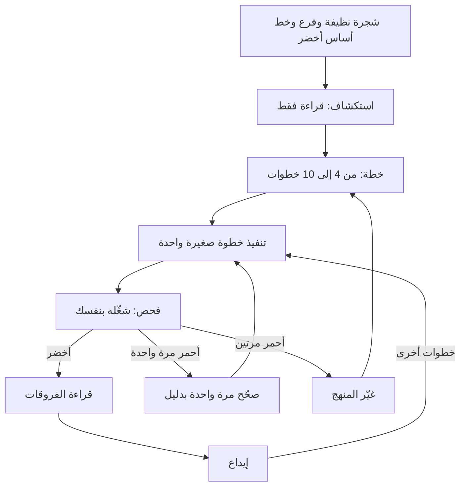

# الوحدة 4 — الحلقة اليومية (The daily loop)

*الوحدة 4 هي الدورة القصيرة المتكررة (the short, repeatable cycle) التي تنجز بها أنت ووكيلك (agent) عملًا حقيقيًا: استكشف (explore)، وخطّط (plan)، ونفّذ خطوة صغيرة واحدة (implement one small step)، وافحصها بنفسك (check it yourself)، واقرأ الفروقات (read the diff)، وأودِع (commit)، ثم ابدأ من جديد. الدرس 4.1 هو درس المفاهيم (the concept lesson) في فريق منصة المدفوعات (Payments Platform) ببنك نجم (Najm Bank): ما تفعله قبل الجلسة (before the session) — شجرة نظيفة (a clean tree) وفرع لكل مهمة (a branch per task) وخط أساس أخضر (a green baseline) — وسير العمل الذي توصي به وثائق Claude Code (the workflows the Claude Code documentation recommends)، ونقاط الاستعادة والرجوع (checkpoints and rewind)، ووضع التخطيط (plan mode)، وست إشارات تدل على أن الوكيل يضل الطريق (six cues that an agent is going astray)، وقاعدة الفشلين (the two-failure rule)، ومتى تتولى القيادة (when to take the wheel)، ونظافة الجلسة (session hygiene) وسجل الوكيل (the agent log)، مع خط زمني لجلسة تُعلَّم فيه التدخلات (a session timeline whose interventions are marked). وينتهي بمُنتَجين (two artefacts) هما قائمة تحقق الحلقة (the Loop checklist) وبطاقة إشارات المقاطعة (the Interruption cues card)، وبوصف Meta نفسها للتحقق بوصفه معيار «انتهى» (verification as the bar for done). أما الدرس 4.2 فهو المختبر (the lab): التذكرة REMIT-318 من حصة (Hessa)، مالكة المنتج (product owner)، تطلب من نجم ريميت (Najm Remit) أن ينبّه العميل، بالإنجليزية أو بالعربية، حين يبلغ به تحويل 80% من حده اليومي (80% of their daily limit). تكتب مواصفة (spec) وخطة (plan)، وتعمل بإيداعات صغيرة (small commits)، وتضيف اختبارات (tests)، ويشغّل المُقيِّم دون اتصال (offline grader) اختبارات قبول خفية (hidden acceptance tests) ويكسر ميزتك عمدًا (breaks your feature on purpose) ليرى هل تلحظ اختباراتك ذلك. والوكيل موصى به لا مطلوب (An agent is recommended, not required). وكل ما يخص جانب نجم خيالي (Everything on the Najm side is fictional).*

> **التركيز (Focus):** Workflow — العادة 3 (habit 3)، *خطوات صغيرة مُتحقَّق منها (Small verified steps)*: خذ خطوة صغيرة واحدة في كل مرة (one small step at a time)، وافحصها بنفسك (check it yourself)، واحتفظ بإيداع تعود إليه (keep a commit to return to)، وأوقف الوكيل مبكرًا لا متأخرًا (stop the agent early rather than late).

---

# 4.1 — استكشف وخطّط ونفّذ وافحص وأودِع: الخطوات الصغيرة ونقاط الاستعادة ومتى تتولى القيادة (Explore, plan, implement, check, commit: small steps, checkpoints and when to take the wheel)
*المستوى (Level): 🟡 متوسط (Intermediate)* · *المتطلبات (Prerequisites): 3.1* · *التركيز (Focus): Workflow*

## ⚡ الدرس في دقيقة (In 60 seconds)
- للحلقة اليومية (the daily loop) ست حركات (six moves): **الاستكشاف (explore)** للقراءة فقط (read-only)، و**التخطيط (plan)**، و**تنفيذ خطوة صغيرة واحدة (implement one small step)**، و**فحصها (check)** بنفسك، و**قراءة الفروقات (read the diff)**، و**الإيداع (commit)**. والوحدة هي الخطوة لا التذكرة (The unit is the step, not the ticket).
- حضّر أولًا (Prepare first): شجرة نظيفة (a clean tree)، وفرع لكل مهمة (a branch per task)، وخط أساس أخضر (a green baseline)، وجلسة جديدة (a fresh session).
- الإيداعات نقاط حفظ (Commits are save points). أما نقاط الاستعادة (Checkpoints) (`Esc` `Esc`، `/rewind`) فتتراجع مؤقتًا عن تعديلات الوكيل (briefly undo the agent's edits)؛ وهي لا تحل محل git (do not replace git).
- توقف عند أول إشارة (Stop at the first cue): التخبّط (thrashing)، أو تعديلات خارج النطاق (edits out of scope)، أو الأمر الفاشل نفسه (the same failing command)، أو اعتذارات بلا دليل (apologies without evidence). صحِّح مرة واحدة (Correct once). وبعد **محاولتين فاشلتين غيِّر المنهج (two failed attempts, change the approach)**: مهمة أصغر (smaller task)، وسياق جديد (fresh context)، ومواصفة أفضل (better spec).
- تولَّ القيادة (Take the wheel) حين تكون كتابة الإصلاح أسرع من شرحه (typing the fix is faster than explaining it)، أو حين لا يرى الوكيل ما تراه أنت (the agent cannot see what you can).
- أكبر فخ (Biggest trap): الانتظار (waiting).

## 🧭 لماذا يهم (Why it matters)
في يوم جمعة (On a Friday)، وهو يوم مُختلَق (a constructed day)، تعطي لجين (Lujain)، المهندسة حديثة التخرج (graduate engineer)، وكيلها (her agent) المهمة REMIT-269، وهي خيار `--since` للأمر `history`، في موجّه واحد (in one prompt) ثم تدخل اجتماعًا. وحين تعود تكون قد تغيّرت 14 ملفًا و612 سطرًا: الخيار نفسه (the option)، وإعادة هيكلة المحلِّل (a parser refactor)، وتنظيف في `fees.py` (a tidy-up)، وثلاثة اختبارات معدَّلة (three edited tests). كلها تنجح (All pass)؛ فتودعها (commits it) باسم `wip`. وتسأل ندى (Nada)، قائدة هندسة الجودة (quality engineering lead)، أيّ الأسطر الـ612 تحتاجها الميزة؟ فلا تستطيع لجين الجواب، وكان أحد الاختبارات المعدَّلة يحرس حدًّا بين مستويين من الرسوم (guard a fee-tier boundary). فيُقسَّم طلب الدمج (The pull request) إلى أربعة، ويستغرق فك ما أُدخل على `fees.py` (unpicking) أطول مما استغرقته الميزة (longer than the feature did).

لم يفعل الوكيل شيئًا غريبًا (Nothing the agent did was exotic). ما غاب هو الحلقة (The loop was missing): لا خطة تُقارَن بها الفروقات (no plan to hold the diff against)، ولا فحص بين الخطوات (no check between steps)، ولا إيداع تعود إليه (no commit to return to). وقد ربط تقرير DORA لعام 2024 ارتفاع اعتماد الذكاء الاصطناعي بانخفاض استقرار التسليم (lower delivery stability)، ويعزو مؤلفوه جزءًا من هذا الهبوط (dip) إلى أحجام الدفعات الأكبر (larger batch sizes)؛ وهذه ارتباطات استطلاعية (survey associations) لا إثبات للسبب (not proof of cause).

## 📐 كيف يعمل (How it works)

### 🟢 الأساسيات (The essentials)

**لفة واحدة (One lap).** تكون الخطوة صغيرة (A step is small) حين يكون لها سبب واحد للتغيير (one reason to change)، وفحص تستطيع تسميته في جملة (a check you can name in a sentence)، وفروقات تقرؤها في جلسة واحدة (a diff you can read in one sitting).



في كل لفة (In each lap) **أنت** تذكر فحص الخطوة أولًا (state the step's check first)، وتشغّله بنفسك (run it yourself)، وتقرأ `git diff` والاختبارات أولًا (tests first)، وتكتب رسالة الإيداع (the commit message). أما **الوكيل** فيقرأ ويقترح ويعدّل (reads, proposes and edits)، ولا يودع إلا إذا طُلب منه (commits only when asked).

**ما توصي به الوثائق (What the documentation recommends).** تتغير صفحة أفضل الممارسات (best-practices page) في Claude Code، فراجعها؛ وعبارات مثل «explore-plan-code-commit» أو «safe YOLO mode» ليست من عناوينها (are not its headings).

| عنوان الصفحة أو موضوعها (The page's heading or topic) | خلاصته (Its gist) | أين نجده هنا (Here) |
|---|---|---|
| **Explore first, then plan, then code** — استكشف أولًا ثم خطّط ثم اكتب الشيفرة | أربع مراحل (Four phases): الاستكشاف (Explore) والتخطيط (Plan) والتنفيذ (Implement) والإيداع (Commit). وضع التخطيط (plan mode): اضغط `Shift+Tab` حتى يظهر `⏸ plan mode on`، أو شغّل `claude --permission-mode plan`؛ ويفتح `Ctrl+G` الخطة في محررك (opens the plan in your editor). «إن كنت تستطيع وصف الفروقات في جملة واحدة فتجاوز الخطة» ⁦("If you could describe the diff in one sentence, skip the plan.")⁩ | هذا الدرس (This lesson) |
| **Give Claude a way to verify its work** — امنح Claude طريقة للتحقق من عمله | «أعطِ Claude فحصًا يستطيع تشغيله: اختبارات أو بناءً أو لقطة شاشة للمقارنة» (a check it can run: tests, a build, a screenshot to compare)، مثل «اكتب اختبارًا فاشلًا يعيد إنتاج المشكلة ثم أصلحها» (write a failing test that reproduces the issue, then fix it) | الدرس 5.1 (Lesson 5.1) |
| **Run autonomously with auto mode** — شغّل باستقلالية بالوضع التلقائي | يراجع مُصنِّف (a classifier) الأوامر قبل تشغيلها (reviews commands before they run)، مثل `claude --permission-mode auto -p "fix all lint errors"` | الدرس 8.1 (Lesson 8.1) |
| **Run multiple Claude sessions** — شغّل جلسات Claude متعددة | أشجار العمل (worktrees) وغيرها؛ وجلسة كاتب (a writer session) وجلسة مراجع (a reviewer session) في سياق جديد (fresh context) | الدرس 10.1 (Lesson 10.1) |
| **Run non-interactive mode; fan out across files** — شغّل الوضع غير التفاعلي؛ ووزّع العمل على الملفات | `claude -p` في التكامل المستمر (CI) أو السكربتات (scripts)، و`--allowedTools`، و`/batch` | الدرسان 9.1 و10.1 (Lessons 9.1 and 10.1) |
| **Adversarial review** — المراجعة الخصومية؛ موضوع وليس عنوانًا (a topic, not a heading) | وكيل فرعي (subagent) يراجع الفروقات (the diff) في سياق جديد (fresh context)؛ والمراجعون «سيبلّغون عادةً عن بعض الملاحظات حتى حين يكون العمل سليمًا» (will usually report some, even when the work is sound) | الدرس 5.1 (Lesson 5.1) |

**قبل الجلسة: نظافة git (Before the session: git hygiene).**

```bash
git status                                # clean?
git switch -c remit-269-history-since    # a branch per task
pytest -q                                 # the baseline is green before the agent starts
# ... the agent finishes one step ...
git diff --stat                           # which files? the ones the plan named?
git diff                                  # read it, tests included
pytest -q                                 # evidence, run by you
git add -p                                # stage what you read
git commit -m "feat(cli): filter history with --since"
```

- **فرع لكل مهمة وشجرة نظيفة (A branch per task and a clean tree)** يجعلان كل سطر في `git diff` من عمل الوكيل (the agent's). و**خط الأساس الأخضر (A green baseline)** يجعل أي اختبار أحمر لاحق خبرًا (makes a later red test news).
- **الإيداعات نقاط حفظ (Commits are save points)**، تُجرى حين تكون الخطوة خضراء (when a step is green). يتخلص `git restore <file>` من التعديلات غير المودَعة في ملف واحد (drops uncommitted edits to one file)؛ ويلغي `git revert <sha>` إيداعًا دون إعادة كتابة التاريخ (undoes a commit without rewriting history).
- **Conventional Commits.** يطلب `CONTRIBUTING.md` في ريميت (Remit) الصيغة `type(scope): subject`: نوعًا من قائمة محددة (a listed type)، ونطاقًا إلزاميًا بأحرف صغيرة (a required lower-case scope)، وموضوعًا بصيغة الأمر دون نقطة في آخره (an imperative subject without a full stop)، وسطرًا أول (header) لا يتجاوز 72 حرفًا (up to 72 characters). والمواصفة العامة (The public specification) تجعل النطاق اختياريًا (optional)؛ وريميت أكثر صرامة (stricter).

**وضع التخطيط ومتى تتجاوزه (Plan mode, and when to skip it).** في وضع التخطيط (plan mode) يستكشف الوكيل ويقترح لكنه لا يعدّل ملفات المصدر (does not edit source files). استخدمه للعمل الذي يمتد عبر عدة ملفات (spans files) أو لشيفرة لا تفهمها بعد (code you do not yet understand)؛ وتجاوزه حين تكون الفروقات جملة واحدة (the one-sentence diff).

### 🟡 التعمق أكثر (Going deeper)

**نقاط الاستعادة والرجوع (Checkpoints and rewind).** وقت كتابة هذا (At the time of writing) (2026)، يسجّل Claude Code نقطة استعادة (checkpoint) لكل موجّه (prompt) يبدأ دورة (a turn)، ويحتفظ بأحدث 100 منها (keeps the 100 most recent)، وتنتهي صلاحيتها بعد نحو 30 يومًا من آخر لقطة (snapshot) للجلسة. افتح القائمة بـ`Esc` `Esc` على موجّه فارغ (on an empty prompt)، أو بـ`/rewind`: استعد الشيفرة أو المحادثة أو كليهما (restore code, conversation or both)، أو لخّص (summarise). أما تغييرات Bash (`rm` و`mv` و`cp`) والتعديلات من خارج الأداة (outside edits) والجلسات الأخرى فلا تُتتبَّع (are not tracked)، وتقول الوثائق إن نقاط الاستعادة ليست بديلًا عن git (not a substitute for git).

**إشارات أن الوكيل يضل الطريق (Cues that an agent is going astray).** تسرد البطاقة في قسم 🏛️ ست إشارات (six). توقف عند أولاها (Stop at the first).

وجدت Anthropic، الشركة المطوِّرة لـ Claude Code (the maker of Claude Code)، أن خمسة مساعدين أظهروا المجاملة المفرطة (sycophancy) باطّراد، أي ميلًا نحو رأي المستخدم (a pull towards the user's view)، في أربع مهام لتوليد النصوص (four text-generation tasks) (Sharma وآخرون، ICLR 2024). عبارة «أنت محق» ⁦("You're right")⁩ ليست دليلًا، أما تشغيل الاختبار (a test run) فدليل — وهذه هي العادة 4 (habit 4)، *ثق بالدليل لا بالطلاقة (Trust evidence, not fluency)*.

**سلّم التدخل (The intervention ladder)** على البطاقة؛ فاستخدم أدنى درجة تنفع (the lowest rung that works). يوقف `Esc` الوكيل في الطرفية (stops the agent in the terminal) — وراجع الوثائق لواجهتك (check the documentation for your interface)؛ والرجوع (rewinding) يكون بـ`/rewind` أو `git restore` أو بإيداع (a commit). يحتاج التصحيح (A correction) إلى موضع وسبب وفحص (a place, a reason and a check). الضعيف (Weak): *«هذا خطأ، حاول مرة أخرى» ⁦("That is wrong, try again.")⁩* لا يضيف معلومة (adds no information)، فتحصل على المحاولة نفسها بصياغة أخرى (the same attempt reworded). والقوي (Strong): *«يحلّل `history` المعامل `since` على أنه `datetime` ساذج (naive)، وهو ما يرفضه المخزن (the store rejects). ابنِه بـ`QATAR_TZ` من `remit.limits`، ثم شغّل `pytest -q tests/test_config_cli.py`.»*

**قاعدة الفشلين (The two-failure rule).** بعد محاولتين فاشلتين (two failed attempts) في خطوة، نادرًا ما تنفع ثالثة في السياق نفسه (a third in the same context rarely helps): فهو يحمل الآن منهجين خاطئين (two wrong approaches)، وتسرد صفحة أفضل الممارسات (best-practices page) «التصحيح المتكرر» ("Correcting over and over") بين أنماط الفشل (failure patterns). غيِّر شيئًا واحدًا: اجعل المهمة **أصغر (smaller)**، أو ابدأ **سياقًا جديدًا (fresh context)** بـ`/clear` ثم جملة واحدة (one sentence) عمّا تعلمته، أو اكتب **مواصفة أفضل (better spec)** تتضمن الواقعة الناقصة (the missing fact) أو مثالًا (an example) أو الاختبار الفاشل (the failing test). وهذه قاعدة تقريبية في الدورة (the course's rule of thumb) لا حدٌّ موثَّق (not a documented limit).

**متى تتولى القيادة (When to take the wheel).** تولَّها حين تكون كتابة الإصلاح أسرع من شرحه (typing the fix is faster than explaining it)؛ وحين يكون السبب واقعةً لا يعرفها غيرك (a fact only you hold) — كمنتصف ليل قطر (the Qatar midnight) أو قاعدة عمل (a business rule) — أو لا يرى الوكيل ما تراه أنت (a screen)؛ وحين لا تستطيع بعد التحقق من تغيير في مسار الأموال (a money-path change)؛ وحين فشلت محاولتان (two attempts failed)؛ أو حين تتمرن على مهارة تريد الاحتفاظ بها (a skill you want to keep) (الدرس 13.1). وليس هذا فشلًا (It is not failure): أصلح السطر الصعب (fix the hard line)، ثم أعد لوحة المفاتيح إلى الوكيل ليكتب الاختبارات (hand the keyboard back for the tests).

**نظافة الجلسة (Session hygiene).** مهمة واحدة لكل جلسة (One task per session)؛ وتسمّي الصفحة عكس ذلك «جلسة كل شيء في آن واحد» ("The kitchen sink session"). استخدم `/clear` بين المهام (between tasks)، و`/compact Focus on the CLI changes` حين تملأ مهمة طويلة النافذة (fills the window)، و`/context` لترى ما حُمِّل (to see what is loaded)؛ وأرسل التحقيقات (investigations) إلى وكلاء فرعيين (subagents) لا يعيدون إلا تقريرًا (return a report only).

**سجل الوكيل (The agent log).** بعد كل مهمة بمساعدة الذكاء الاصطناعي (AI-assisted task) دوّن الموجّه (the prompt) والنتيجة (the result) وتصحيحاتك (your corrections) وفحوصك (your checks) والدقائق (the minutes). كن صادقًا في الدقائق (Be honest about the minutes): فالسجل ساعتك (the log is your clock)، وإحساسك بالسرعة ليس كذلك (your feeling of speed is not).

**خط زمني لجلسة تُعلَّم فيه التدخلات (A session timeline with the interventions marked).** مُختلَق للتذكرة REMIT-269؛ ليس مسجَّلًا من نموذج حقيقي (not recorded from a real model)، والأوقات مخترَعة (the times are invented).

| الوقت (Time) | الحركة (Move) | ما حدث (What happened) | الإشارة (Cue) | التدخل (Intervention) |
|---|---|---|---|---|
| 09:12 | التخطيط (Plan) | سبع خطوات (Seven steps)؛ الخطوة 6 تنقل المحلِّل (moves the parser) والخطوة 7 تعدّل README | خطوات خارج النطاق (Out-of-scope steps) | `Ctrl+G`: احذف الاثنتين (delete both)؛ وأضف «التاريخ هو بداية ذلك اليوم القطري» ("a date is the start of that Qatar day") |
| 09:31 | الخطوة 2 (Step 2) | `datetime` ساذج (naive)؛ يرفع المخزن (the store raises) الخطأ `datetimes must be timezone-aware`؛ ويضيف الوكيل `try/except` ثم يعدّل الاختبار (edits the test) | التخبّط (Thrashing)؛ اختبار معدَّل (a test edited) | `Esc`؛ و`/rewind` للشيفرة والمحادثة معًا (code and conversation)؛ أعد الصياغة (restate): استخدم توقيت قطر (use Qatar time) |
| 09:44 | الخطوة 2 (Step 2) | أمر `pytest` نفسه ثلاث مرات (three times) | الأمر الفاشل نفسه (Same failing command) | تتولى القيادة (You take the wheel): اقرأ تتبّع الاستثناء (the traceback)، وأصلح سطرين، وأودِع |
| 09:52 | الخطوة 3 (Step 3) | تفشل محاولتان في اختبار نص المساعدة (the help-text test) | فشلان (Two failures) | جلسة جديدة (New session)، ومواصفة من فقرة واحدة (a one-paragraph spec)، وخطوة أصغر (a smaller step) |
| 10:05 | المراجعة (Review) | يسرد `git diff --stat` الملف `fees.py` | تعديل خارج النطاق (Out-of-scope edit) | `git restore src/remit/fees.py` |
| 10:10 | الإغلاق (Close) | أخضر (Green)؛ طلب الدمج موسوم (labelled) بـ`AI-assisted`؛ السجل (log): 70 دقيقة و5 تدخلات (interventions) | | |

### 🔴 نظرة الخبير (Expert view)

**«انتهى» تعني «متحقَّق منه» (Done means verified).** تصف مدونة الهندسة في Meta (Meta's engineering blog) فريقًا صغيرًا بنى تطبيق Forum بوكيل ذكاء اصطناعي مشارِكًا (an AI agent as a participant). وتذكر Meta أنها قاست النجاح بتغييرات جاهزة للإنتاج (production-ready changes) لا بحجم الشيفرة (not code volume)، وأنها وضعت المعيار «عند التحقق لا عند الترجمة البرمجية» ("at verification rather than compilation"): فالمهمة لا تكتمل إلا بعد أن تنجح الاختبارات الآلية والفحوص البصرية (automated tests and visual checks)، لا حين تُترجَم الشيفرة بنجاح (when the code compiles). وتذكر أيضًا أنه حين كرر الوكيل خطأ أكثر من مرتين (repeated a mistake more than twice)، رمّز الفريق التصحيح مرة واحدة للجميع (encoded the correction once, for everyone). وهدف Meta هو «الإنسان على الحلقة» ("human-on-the-loop"): يدير الوكيل دورة التخطيط والبناء والاختبار والتصحيح (the plan, build, test and correct cycle) بينما يضع المهندس الهدف ويعتمد النتيجة (sets the goal and approves the result). ويسمّي المنشور هذا هدفًا لا حالة منجزة (a target, not a finished state). وكل ذلك رواية شركة عن ممارستها الخاصة (a company's account of its own practice) لا دليل مستقل (not independent evidence). وتنتقل العادات معنا: «انتهى» فحص شغّلته أنت (a check you ran)، والتصحيح الذي تكرره للمرة الثالثة (a correction you make a third time) مكانه `CLAUDE.md` أو اختبار أو خطّاف (a hook) (الوحدتان 2 و9).

**اجعل التوقف مشروطًا (Gate the stop).** يتوقف الوكيل حين يظن أنه انتهى (An agent stops when it believes it is done). وتسمّي الصفحة ثلاث طرق تجعل «انتهى» تتطلب فحصك (make "done" require your check): شرط `/goal`، أو خطاف التوقف (a Stop hook)، أو وكيل فرعي للتحقق (a verification subagent) — ويغطي الدرس 9.1 الخطاطيف (hooks) والوكلاء الفرعيين (subagents) لا `/goal`، فراجع الوثائق الحالية (check the current documentation).

**ما طول الرسن (How long a leash).** الوضع الافتراضي في الدورة (The course's default) هو الوضع اليدوي (Manual) أو وضع `acceptEdits` مع فحص بعد كل خطوة (a check after every step)؛ أما الوضع الذي يبدأ به Claude Code فيعتمد على إصداره وخطته ومزوّده (version, plan and provider)، فاقرأ شريط الحالة (status bar). تؤتي الأرسان الأطول (Longer leashes) — الوضع التلقائي (auto mode) والتشغيل في الخلفية (background) والتشغيل غير التفاعلي (headless runs) — ثمارها حين يكون العمل محدَّد المواصفة وقابلًا للفحص ورخيص الإهمال (specified, checkable and cheap to throw away)، لكنك تفقد الإشارات (you lose the cues) لأنك لا تستطيع مقاطعة ما لا تراقبه (cannot interrupt what you are not watching): فأتمِت الفحوص (automate the checks). وتقول الوثائق إن الوضع التلقائي «لا يضمن الأمان» ("does not guarantee safety").

**متى لا تشغّل الحلقة كاملة (When not to run the full loop).** للفروقات ذات الجملة الواحدة (a one-sentence diff) اقرأ الفروقات وأودِع. وللتجربة الاستكشافية المؤقتة (a throwaway spike) احذف الفرع بعد ذلك (delete the branch afterwards). ولا تنقذ الحلقة تذكرة غامضة (cannot rescue a vague ticket): فإن انتهت كل لفة بعبارة «ليس هذا ما قصدته» ("not what I meant")، فعد إلى الدرس 3.1.

## 🧰 الأدوات (The toolkit)
| الأداة أو الممارسة أو النمط (Tool, practice or pattern) | ما هي وماذا تفعل (What it is and does) | متى تلجأ إليها (When to reach for it) |
|---|---|---|
| **Loop checklist** — قائمة تحقق الحلقة | صفحة واحدة (One page): قبل الجلسة (before the session)، وفي كل لفة (each lap)، وبعد الخطوة الأخيرة (after the last step) | كل مهمة (Every task) |
| **Interruption cues** — إشارات المقاطعة | بطاقة (A card): ست إشارات (six cues)، والسلّم (the ladder)، وقاعدة الفشلين (the two-failure rule) | كلما عمل وكيل وأنت تراقبه (Whenever an agent works while you watch) |
| **Plan mode** — وضع التخطيط | استكشاف للقراءة فقط (Read-only exploration) وخطة قابلة للتحرير (an editable plan) (`Shift+Tab`، `/plan`) | تعديلات متعددة الملفات (Multi-file edits)؛ وشيفرة غير مألوفة (unfamiliar code) |
| **Checkpoints and rewind** — نقاط الاستعادة والرجوع | تراجع لكل موجّه (A per-prompt undo) عن تعديلات الوكيل (the agent's edits) (`Esc` `Esc`، `/rewind`) | دورة سيئة داخل لفة (A bad turn inside a lap) |
| **Branch per task** — فرع لكل مهمة | فرع واحد لكل تذكرة (One branch per ticket)، من شجرة نظيفة (from a clean tree) | كل مهمة (Every task) |
| **Conventional Commits** — صيغة الإيداعات المتعارف عليها | `type(scope): subject`، كما يعرّفها `CONTRIBUTING.md` (as defined) | كل إيداع (Every commit) |
| **Agent log** — سجل الوكيل | الموجّه والنتيجة والتصحيحات والفحوص والدقائق (Prompt, result, corrections, checks, minutes) | بعد كل مهمة بمساعدة الذكاء الاصطناعي (After every AI-assisted task) |

## 🏛️ عمليًا في بنك نجم (In practice at Najm Bank)
يفتتح طارق (Tariq)، قائد الهندسة (engineering lead)، العيادة الأسبوعية (the weekly clinic) ببطاقتين (two cards). الأولى هي **قائمة تحقق الحلقة (Loop checklist)**؛ انسخها باسم `loop-checklist.md`.

```markdown
# Loop checklist (one lap = one small step)

Before the session
- [ ] Clean tree; on a branch for this task, not main; `pytest -q` green; a fresh session.
- [ ] "Done means" is written down: a spec, or a sentence and the files in scope.

Explore and plan
- [ ] Read-only first; the files and functions the agent names exist.
- [ ] Four to ten steps, one commit and one check each, the failing test first; anything out of scope is deleted.

Each lap
- [ ] I can state this step's check in one sentence before the agent edits.
- [ ] I ran the check myself; I did not rely on "all tests pass".
- [ ] I read `git diff --stat`, then the diff, tests first. No existing test was edited.
- [ ] I commit while green, as `type(scope): subject`.

Interrupt
- [ ] I stopped at the first cue and corrected once, with evidence.
- [ ] After two failed attempts I changed the approach: smaller, fresh, better spec.

After the last step
- [ ] `git diff main --stat` is what I expected; the pull request is labelled `AI-assisted`.
- [ ] Money logic has a second human reviewer. Agent log entry, with minutes.
- [ ] A correction I made a third time is now a rule, a test or a hook.
```

والثانية بطاقة **إشارات المقاطعة (Interruption cues)**. أبقها بجانب الطرفية (next to the terminal).

```text
INTERRUPTION CUES - stop at the first one
1 Thrashing         the same lines edited back and forth; a test flipping red and green
2 Out of scope      a file you did not name; a test edited; "while I'm here" tidying
3 Same failing run  the identical command again, with no new idea
4 Apology loop      "You're right, I apologise", then no run, or the same mistake
5 Plan drift        step 5 while you approved steps 1 and 2; a new approach, unannounced
6 No evidence       "all tests pass" and no test run in view

LADDER  1 stop (Esc) and say what you saw    2 correct once: file, line, reason
        3 rewind (/rewind, git restore)       4 take the wheel for this step
        5 after two failures: smaller task, fresh context, better spec
```

وقاعدة العيادة (The clinic's rule): لا طلب دمج (pull request) دون قائمة تحقق مملوءة (a filled checklist)، ولا «الوكيل هو من فعلها» ("the agent did it") في المراجعة (in review).

## 🛠️ التمارين (Exercises)
- 🟢 **علِّم خطًا زمنيًا (Mark a timeline).** *بلا وكيل (No agent).* اكتب خطًا زمنيًا من ستة أسطر (a six-line timeline) لآخر جلسة بمساعدة الذكاء الاصطناعي (your last AI-assisted session). *يكتمل عندما (Done when):* يسمّي كل سطر حركة (names a move)، ويسمّي سطران إشارة لاحظتها متأخرًا (a cue you noticed late) والدرجة التي كان ينبغي استخدامها (the rung you should have used).
- 🟡 **شغّل الحلقة على تغيير صغير (Run the loop on a small change).** *الوكيل اختياري (Agent optional).* أنشئ بيئة تجريبية خضراء (a green sandbox) (من مجلد `ailab`: `python -m ailab start m00 --dir ~/ainative/sandbox`، ثم `python -m ailab solve m00 --dir ~/ainative/sandbox`). في البيئة التجريبية (In the sandbox)، على فرع (on a branch)، أضف `--since YYYY-MM-DD` إلى `history`؛ فالتاريخ يعني بداية ذلك اليوم بتوقيت قطر (the start of that Qatar day). (جرّب `PYTHONPATH=src python -m remit history --customer C001` بعد `customer add` و`send`.) *يكتمل عندما (Done when):* يكون لديك ثلاثة إيداعات خضراء أو أكثر بصيغة ريميت (three or more green commits in the Remit format)، وتكون القائمة معلَّمة (the checklist is ticked) بالأوامر التي شغّلتها، ويقول سطر واحد ما الذي يجب تغييره (what to change).
- 🔴 **تمرّن على مقاطعة (Rehearse an interruption).** *يحتاج وكيلًا (Needs an agent).* في البيئة التجريبية أعطِ الوكيل موجّهًا (a prompt) يدعو إلى توسّع النطاق (invites scope creep) («اجعل واجهة سطر الأوامر أجمل» — "make the CLI nicer")، بلا خطة (with no plan)، وراقب. *يكتمل عندما (Done when):* تذكر ملاحظاتك أول إشارة ووقتها (the first cue and its time) والدرجة التي استخدمتها وما الذي كانت قاعدة الفشلين (the two-failure rule) ستغيّره، ويكون الفرع عند إيداع أخضر (at a green commit).

## ⚠️ أخطاء وفخاخ (Mistakes and traps)
- **انتظار انتهاء مهمة كبيرة (Waiting for a large task to finish).** كل دقيقة تضيف شيفرة عليك فكّها (Each minute adds code to unpick)؛ فقاطع عند أول إشارة (interrupt at the first cue).
- **التخطيط لفروقات من جملة واحدة، أو تجاوز الخطة لتغيير في عشرة ملفات (Planning a one-sentence diff, or skipping the plan for a ten-file one).** طابِق الخطة بحجم الفروقات (Match the plan to the diff).
- **اعتبار نقاط الاستعادة نسخة احتياطية (Treating checkpoints as a backup).** تغييرات Bash غير متتبَّعة (untracked) واللقطات (snapshots) تنتهي صلاحيتها؛ فأودِع (commit).
- **تصحيح ثالث في السياق نفسه، أو الإصلاح نفسه في كل موجّه (A third correction in the same context, or the same fix in every prompt).** غيِّر المنهج (Change the approach)، وانقل التصحيح إلى `CLAUDE.md` أو اختبار أو خطّاف (a hook).

## 🧾 الخلاصة (Recap)
- الحلقة (The loop): استكشف، خطّط، نفّذ خطوة صغيرة (implement a small step)، افحص، اقرأ الفروقات (read the diff)، أودِع، على فرع نظيف (a clean branch) بخط أساس أخضر (a green baseline).
- الإيداعات نقاط حفظ (save points)؛ ونقاط الاستعادة (checkpoints) تراجع قصير العمر (a short-lived undo).
- توقف عند أول إشارة (the first cue)، وصحِّح مرة واحدة (correct once)، وبعد فشلين غيِّر المنهج (change the approach).
- تولَّ القيادة (Take the wheel) حين تعرف الإصلاح (know the fix)، أو تحمل واقعة يفتقدها الوكيل (hold a fact the agent lacks)، أو لا تستطيع التحقق بعد (cannot yet verify).
- «انتهى» تعني متحقَّق منه لا مُترجَم برمجيًا (Done means verified, not compiled)؛ والتصحيح المكرَّر أكثر من مرتين (made more than twice) مكانه قاعدة دائمة (a durable rule).

## ✍️ اختبر نفسك (Check yourself)

**1. بعد عشر دقائق من بدء الجلسة (Ten minutes in)، شغّل الوكيل أمر `pytest` الفاشل نفسه ثلاث مرات (three times) دون أن يغيّر شيئًا بين التشغيلات (changed nothing between runs). ماذا تفعل؟ ⁦(What do you do?)⁩**

- A. اتركه يواصل (Let it carry on)، لأن تشغيلًا رابعًا قد ينجح دون أي تغيير (a fourth run may pass without any change).
- B. اضغط `Esc`، واقرأ تتبّع الاستثناء (the traceback)، وقرّر هل تتولى القيادة (take the wheel).
- C. بدّل إلى وضع يتجاوز الموافقات (a mode that skips approvals) كي تعمل إعادة المحاولات دون إشراف (run unattended).
- D. اطلب منه أن يودع الحالة الحالية (commit the current state) كي يُحفظ العمل غير المكتمل (the half-finished work is saved).

<details><summary>الإجابة</summary>

**B.** الأمر الفاشل نفسه بلا فكرة جديدة (with no new idea) إشارة إلى التوقف (a cue to stop)؛ وتتبّع الاستثناء (the traceback) دليل يتجاهله الوكيل (evidence the agent ignores). 🟡 الإشارات والسلّم (Cues and the ladder).

</details>

**2. فشلت محاولة الوكيل الثانية في خطوة بعد تصحيحك (The agent's second attempt at a step failed after your correction). ما أفضل خطوة تالية؟ ⁦(What is the best next move?)⁩**

- A. صحِّحه مرة ثالثة (a third time) بالكلمات نفسها لكن بأحرف كبيرة (in capitals) كي ينتبه.
- B. ارجع (Rewind) عن كل ما أُنجز اليوم وابدأ التذكرة كلها من الصفر (from scratch).
- C. اطلب من الوكيل أن يعتذر (apologise) وأن يعد بمزيد من الحذر في المرة القادمة (to be more careful next time).
- D. غيِّر المنهج (Change the approach): قسّم الخطوة (split the step)، أو ابدأ من جديد (start fresh)، أو أضف واقعة ناقصة (a missing fact).

<details><summary>الإجابة</summary>

**D.** بعد فشلين نادرًا ما تنفع محاولة ثالثة في السياق نفسه (a third try in the same context rarely helps)؛ غيِّر المهمة أو السياق أو المواصفة (the task, the context or the spec). الأحرف الكبيرة والاعتذارات تضيف كلمات لا معلومات (add words, not information). 🟡 قاعدة الفشلين (The two-failure rule).

</details>

**3. تقول لجين (Lujain) إن `Esc` `Esc` تجعل الإيداعات (commits) غير ضرورية لأنها تستطيع الرجوع عن أي شيء (rewind anything). ما الرد الصحيح؟ ⁦(What is the right reply?)⁩**

- A. لا (No): تغييرات Bash والتعديلات من الخارج غير متتبَّعة (are not tracked)، وgit هو نقطة الحفظ (the save point).
- B. نعم (Yes): تحتفظ نقاط الاستعادة بكل تغيير لمدة عام (for a year)، أيًّا كانت الأداة التي أجرته (whichever tool made the change).
- C. نعم، ما دام الوكيل يعدّل الملفات فقط (only edits files) ولا يشغّل أي أمر في الصدفة (shell command) إطلاقًا.
- D. لا (No): تغطي نقاط الاستعادة الفرع الرئيسي وحده (only the main branch) وتُحذف كل ليلة عند منتصف الليل (deleted every night at midnight).

<details><summary>الإجابة</summary>

**A.** تغييرات Bash والتعديلات من الخارج غير متتبَّعة (untracked)، واللقطات تنتهي صلاحيتها (snapshots expire)، وgit هو نقطة الحفظ الحقيقية (the real save point). 🟡 نقاط الاستعادة والرجوع (Checkpoints and rewind).

</details>

**4. تفتح حصة (Hessa)، مالكة المنتج (product owner)، تذكرة لإصلاح كلمة واحدة مكتوبة خطأ في رسالة إنجليزية (one misspelt word in an English message). أي نهج يناسب؟ ⁦(Which approach fits?)⁩**

- A. خطة من سبع خطوات (A seven-step plan) في وضع التخطيط (plan mode)، مع نقطة استعادة (checkpoint) بعد كل خطوة.
- B. جلسة جديدة (A fresh session) لكل جملة في التذكرة، للحفاظ على صغر السياق (to keep the context small).
- C. صِف الفروقات في جملة واحدة (Describe the diff in one sentence)، ونفّذها، واقرأ `git diff`، واختبر، وأودِع.
- D. شغّله في الخلفية (in the background) وراجع النتيجة في عيادة الأسبوع القادم (next week's clinic).

<details><summary>الإجابة</summary>

**C.** تقول الصفحة تجاوز الخطة إن استطعت وصف الفروقات في جملة واحدة (describe the diff in one sentence)؛ وتبقى تقرأ الفروقات وتشغّل الفحص (run the check). 🟢 وضع التخطيط ومتى تتجاوزه (Plan mode, and when to skip it).

</details>

**5. يقول زميل إن منشور Meta عن Forum يثبت أن الوكلاء ذوي الإعداد الجيد لا يحتاجون إلى مراجعة بشرية (need no human review). ما الرد المنصف؟ ⁦(What is a fair response?)⁩**

- A. أثبتت Meta أن المراجعة غير ضرورية (unnecessary) متى صار إعداد الوكيل جيدًا بما يكفي.
- B. هذه رواية Meta نفسها (Meta's own account)، وهي تسمّي «الإنسان على الحلقة» (human-on-the-loop) هدفًا لا نتيجة (a target, not a result).
- C. يغطي المنشور لغة برمجة واحدة فقط (only one programming language)، فلا ينطبق منه شيء هنا.
- D. الفحوص البصرية (visual checks) وحدها هي المهمة؛ وتعدّ Meta الاختبارات الآلية (automated tests) إضافات اختيارية (optional extras).

<details><summary>الإجابة</summary>

**B.** رواية الشركة عن ممارستها (A company's account of its own practice) ليست دليلًا مستقلًا (not independent evidence)، وMeta نفسها تصف الهدف بأنه غير مكتمل (unfinished). 🔴 «انتهى» تعني «متحقَّق منه» (Done means verified).

</details>

## 📚 المراجع (References)
- وثائق Claude Code (Claude Code documentation): أفضل الممارسات (best practices) https://code.claude.com/docs/en/best-practices; ونقاط الاستعادة والرجوع (checkpointing and rewind) https://code.claude.com/docs/en/checkpointing; وأوضاع الصلاحيات (permission modes) ومنها وضع التخطيط (plan mode) https://code.claude.com/docs/en/permission-modes; ونافذة السياق (the context window) https://code.claude.com/docs/en/context-window
- Git: https://git-scm.com/docs. وConventional Commits 1.0.0: https://www.conventionalcommits.org
- [*اختبار البرمجيات (Software Testing)*، الدرس 6.2 — الاختبارات بوصفها مواصفة لوكلاء البرمجة (Tests as the specification for coding agents)](../testing/index.ar.html#/6.2)
- **تعمّق أكثر (Go deeper).** Engineering at Meta، «كيف بنت Meta تطبيق Forum بالهندسة الأصيلة في الذكاء الاصطناعي» ("How Meta Built Forum With AI-Native Engineering"): https://engineering.fb.com/2026/10/15/ml-applications/how-meta-built-forum-ai-native-engineering/ — اقرأ الأصل (read the original)؛ فهذا الدرس لم يعرفه إلا من ملخص (this lesson knew it only from a summary). Anthropic، «Towards Understanding Sycophancy in Language Models»: https://www.anthropic.com/research/towards-understanding-sycophancy-in-language-models. وDORA، تقرير 2024 (2024 report): https://cloud.google.com/blog/products/devops-sre/announcing-the-2024-dora-report.

---

# 4.2 — المختبر: أرسل ميزة صغيرة عبر الحلقة كاملة (Lab: ship a small feature through the whole loop)
*المستوى (Level): 🟡 متوسط (Intermediate)* · *المتطلبات (Prerequisites): 3.2، 4.1* · *التركيز (Focus): Workflow*

## ⚡ الدرس في دقيقة (In 60 seconds)
- **المختبر m04 (Lab m04).** تذكرة حصة (Hessa) REMIT-318: حين يبلغ تحويل ناجح (a successful transfer) بالعميل 80% من حده اليومي (80% of their daily limit) أو أكثر، أرسل رسالة ثانية (a second message) بالإنجليزية أو بالعربية. نحو 25 سطرًا من الشيفرة (About 25 lines of code)، وخمس طرق سهلة للخطأ فيها (five easy ways to get them wrong).
- تشغّل الحلقة كاملة (You run the whole loop): استكشاف (explore)، ومواصفة مع خطة (a spec with a plan)، وإيداعات صغيرة خضراء (small green commits)، واختبارات تفشل بدون الميزة (tests that fail without the feature)، وسجل وكيل (an agent log).
- **يحتاج إلى وكيل (Needs an agent): لا (no)؛ موصى به لا مطلوب (recommended, not required).** لا يستطيع المُقيِّم (The grader) أن يعرف من كتب الشيفرة (who typed the code).
- يشغّل المُقيِّم اختبارات قبول خفية (hidden acceptance tests)، ثم يكسر التحذير عمدًا (breaks the warning on purpose) ليرى هل تلحظ اختباراتك ذلك. ولا يستطيع أن يعرف هل قرأت الفروقات (read the diff) أو قرّرت جيدًا (decided well).

## 🧭 لماذا يهم (Why it matters)
يكتب وكيل لجين (Lujain) تحذير الحد (the limit warning) في أربع دقائق. يبدو صحيحًا وينجح في كل اختبار (passes every test)، بما فيها الاختبارات التي كتبها الوكيل بنفسه. لكنه يفشل عند 80% بالضبط (fails at exactly 80%)، ويعرض 100% لعميل عند 99.95%، ويطبع أرقامًا غربية (Western digits) لعملاء العربية، ويحوّل انقطاع البوابة (a gateway outage) إلى انهيار (a crash) بعد أن انتقلت الأموال (after the money has moved). ولا تثبت مجموعة اختبارات خضراء (A green suite) شيئًا من هذا: فالاختبارات القديمة سبقت الميزة (predate the feature)، واختبارات الوكيل لا تفحص إلا الحالات التي خطرت له (only the cases it thought of).

## 📐 كيف يعمل (How it works)

### 🟢 الأساسيات (The essentials)

المختبر هو الحلقة في سبع خطوات (the loop in seven steps) — والترتيب نصيحة لا إلزام (the order is advice):

| الخطوة (Step) | ما تفعله (You do) | الدليل (Evidence) |
|---|---|---|
| 1. الاستكشاف (Explore) | شغّل `pytest -q`. واقرأ `send` في `service.py`، و`LimitResult` في `limits.py`، و`render` في `notify.py` | تستطيع أن تقول ما يشمله `daily_used` (what it includes) |
| 2. المواصفة والخطة (Spec and plan) | انسخ `specs/TEMPLATE.md` إلى `specs/REMIT-318.md`؛ واحسم ما تتركه التذكرة مفتوحًا (settle what the ticket leaves open) — أين يعيش المنطق (where the logic lives) والنسبة المئوية دون أعداد عشرية عائمة (the percentage without floats)؛ وخطّط نحو خمس خطوات (plan about five steps) | مواصفة مودَعة (A committed spec) |
| 3. الرسالة (The message) | القالب (The template)، مع اختبارات لنصه الدقيق (tests of its exact text) | إيداع أخضر (A green commit) |
| 4. القرار (The decision) | متى تنبّه (When to warn) وماذا تعرض (what to show)، مع اختبارات على جانبي الخط (tests either side of the line) | إيداع أخضر (A green commit) |
| 5. الحالات الحدّية (The edges) | عميل عربي (Arabic customer)، وتحويل مرفوض (refused transfer)، وفشل التسليم (failed delivery) | إيداع أخضر (A green commit) |
| 6. اكسرها (Break it) | أعد `src` إلى حالة `lab-start` وشغّل اختباراتك الجديدة: التي تحتاج إلى التحذير يجب أن تفشل (must fail) | أحمر لسبب صحيح (Red, for the right reason) |
| 7. الإغلاق (Close) | اقرأ `git diff lab-start --stat`، وحدّث الوثائق إن شئت (update the docs if you wish)، واكتب السجل (write the log)، وقيِّم (grade) | درجة وسجل (A grade and a log) |

### 🟡 التعمق أكثر (Going deeper)

**الفروقات الخطرة (The risky diff).** فيما يلي ما قد يكتبه وكيل متعجّل (a hurried agent) للخطوة 4؛ والشيفرة مُختلَقة لا مسجَّلة (constructed, not recorded) ولا تُنسخ (do not copy). ابحث عن خمسة عيوب (five defects) قبل أن تواصل القراءة.

```python
        ratio = limits.daily_used / limits.daily_limit
        if ratio >= 0.8:
            self.notifier.notify(customer, "limit_warning", percent=round(ratio * 100),
                                 remaining=limits.daily_limit - limits.daily_used)
```

(1) `limits.daily_used` هو الموضع **قبل** هذا التحويل (the position **before** this transfer)، فيأتي التحذير متأخرًا بتحويل واحد (one transfer late). (2) تُقارَن قيمة `Decimal` بعدد عشري عائم (a float) مقارنةً دقيقة (compared exactly)، و`Decimal("0.8") >= 0.8` تساوي `False`: فلا يحصل 80% بالضبط على تحذير (gets no warning). (3) تقرّب `round` النسبة المئوية بدل أن تقرّبها إلى الأسفل (instead of rounding it down). (4) يُستدعى كائن الإشعارات (The notifier) مباشرة، فيفلت فشل التسليم (a delivery failure) من `send` بعد أن حُفظ التحويل (after the transfer was saved). (5) النسبة المئوية من النوع `int` لا تُوطَّن (is not localised)، فيرى عملاء العربية أرقامًا غربية (Western digits). الدليل يتفوق على القراءة (Evidence beats reading): يستغرق فحص العيب 2 عشر ثوانٍ (ten seconds). ابحث عن هذه الخمسة في أي فروقات يكتبها وكيل (any agent diff).

```text
>>> from decimal import Decimal
>>> Decimal("1600.00") / Decimal("2000.00") >= 0.8
False
```

**الموجّه الغامض والموجّه المحدَّد (The vague prompt and the specified one).** عبارة *«أضف تحذيرًا عند 80% من الحد اليومي»* ("Add a warning at 80% of the daily limit") تترك للوكيل اختيار قراءة (choose a reading)، وكل خيار مما سبق قراءة قد يخطئ فيها (one it can get wrong). أما الموجّه المحدَّد (Specified):

```text
Read TASK.md and specs/REMIT-318.md, then service.py (send), limits.py and notify.py.
Implement step 4 only: the decision in RemitService.send. The position in `limits` is BEFORE
this transfer; add the amount just sent. Decimal only, no floats. Send the message through the
existing best-effort helper. Failing tests first, then the code. Do not touch fees.py or any
existing test, and do not commit. Show me the diff when pytest -q is green.
```

### 🔴 نظرة الخبير (Expert view)

**كيف يحكم المُقيِّم على اختباراتك (How the grader judges your tests).** فحص «تفشل اختباراتك الجديدة عند إزالة التحذير» ("Your new tests fail when the warning is removed") يعيد كل ملف خارج `tests/` إلى حالة `lab-start` ويشغّل اختباراتك الجديدة (your new tests). وفحص «تلاحظ اختباراتك تحذيرًا مكسورًا» ("Your tests notice a broken warning") يشغّلها سبع مرات أخرى (seven more times) على شيفرتك أنت، وفي كل مرة يُطبَّق كسر متعمَّد واحد (one deliberate breakage) على البرنامج أثناء تشغيله بوساطة إضافة اختبار (a test plugin): التحذير الذي لا يُسلَّم أبدًا (the warning never delivered)، والنص بلا أرقامه (the text without its numbers)، والنسبة المئوية أعلى بواحد (the percentage one too high)، وعملاء العربية الذين يتلقون الإنجليزية (Arabic customers given English)، والأرقام الغربية في النص العربي (Western digits in Arabic)، وخط 80% أعلى قليلًا أو أدنى قليلًا (the 80% line a little too high or too low). يجب اكتشاف خمسة من سبعة (Five of seven must be caught)، ومنها كسرا خط 80% كلاهما (both 80%-line breakages): فالتذكرة تطلب أن تثبّت مجموعًا أدنى من الخط بقليل وآخر عليه تمامًا (a total just under the line and one exactly on it)، واختبارات الصياغة وحدها لا تمس الخط أبدًا (never touch the line). وهذه فكرة اختبار الطفرات (the mutation idea) من [*اختبار البرمجيات (Software Testing)*، الدرس 2.3 — هل اختباراتك جيدة فعلًا؟ ⁦(Are your tests any good?)⁩](../testing/index.ar.html#/2.3)، مطبَّقة على أطراف البرنامج (applied at the edges of the program) فتعمل أيًّا كان شكل شيفرتك (whatever your code looks like).

**ما لا يستطيعه (What it cannot do).** لا يعرف أن تصميمك جيد (your design is good) ولا أن مواصفتك حكيمة (your spec wise) ولا أنك قرأت الفروقات (that you read the diff). فإن استخدمت اختباراتك مُخطِرًا زائفًا (a fake notifier) لا يستدعي `render` أبدًا، فبعض الكسور لا يمكن أن تصل إليها (cannot reach them). والنجاح ليس مراجعة (A pass is not a review): ففي فريق حقيقي (in a real team) يحتاج `service.py` إلى مراجع بشري ثانٍ (a second human reviewer)، ويحمل طلب الدمج (pull request) الوسم `AI-assisted`.

## 🧰 الأدوات (The toolkit)
| الأداة أو الممارسة أو النمط (Tool, practice or pattern) | ما هي وماذا تفعل (What it is and does) | متى تلجأ إليها (When to reach for it) |
|---|---|---|
| **Spec template** — قالب المواصفة | عشرة أقسام (Ten sections)، من الهدف إلى الخطة (goal to plan)، في `specs/` | قبل أن يكتب الوكيل الشيفرة (Before the agent writes code) |
| **Mutation check** — فحص الطفرات | اكسر الميزة عمدًا (Break the feature on purpose) وانظر هل تلاحظ الاختبارات ذلك (whether the tests notice) | حين يحتاج منطق الأموال أو نص العميل إلى اختبارات حادّة (tests that bite) |
| **Agent log** — سجل الوكيل | الموجّه والنتيجة والتصحيحات والفحوص والدقائق (Prompt, result, corrections, checks, minutes) | بعد كل جلسة (After every session) |

## 🏛️ عمليًا في بنك نجم (In practice at Najm Bank)
*يحتاج إلى وكيل (Needs an agent): لا (no)؛ موصى به لا مطلوب (recommended, not required).* **مسار بلا وكيل (No-agent path):** نفّذ كل خطوة بنفسك، أو اطلب من مساعد محادثة (a chat assistant) شروحًا وراجع شيفرتك بنفسك؛ فالمُقيِّم لا يفحص إلا المستودع (checks the repository only). وفي الحالتين اكتب السجل (write the log).

**التذكرة (The ticket).** هذا ملف `task.md` من العدة (the kit)، كما كتبته حصة (Hessa). يكتبه الأمر `start` في مجلد مختبرك باسم `TASK.md`، فالأحرف الكبيرة مهمة (capitals matter) في Linux وmacOS.

> ```text
> # REMIT-318: warn customers when a transfer takes them to 80% of their daily limit
>
> **From:** Hessa, Product Owner, Najm Remit
> **To:** Payments Platform
> **Priority:** Medium. Support sees this complaint every week.
>
> Customers hit their daily sending limit without warning. The first they hear of it is "It would
> take you over your sending limit", on a transfer that failed, while the family at home waits.
> Let them see it coming.
>
> ## What I need
>
> When a transfer **succeeds** and brings the customer's total for the day to **80% of their daily
> limit or more**, send one more notification straight after "transfer sent". It says how much of
> the limit they have used and how much they can still send today.
>
> 1. **The day** is the Qatar day, as `limits.py` defines it. **The total** is the amounts sent
>    today (not fees) plus the transfer just made. **The limit** is the daily limit of their KYC tier.
> 2. **80% counts**: exactly 80% gets the warning, one cent less does not. Exactly 100% is allowed,
>    and warned.
> 3. **Every** successful transfer at 80% or more gets the warning, not only the first to cross.
> 4. Only the **daily** limit matters; being near the monthly limit sends nothing.
> 5. A refused or held transfer sends no warning, only the usual "transfer failed" message.
> 6. The warning is in the customer's language, `en` or `ar`.
> 7. The percentage is a whole number, **rounded down**: at 99.95% the customer sees 99%, never 100%.
> 8. Best effort, like "transfer sent": if it cannot be delivered the transfer still stands, `send`
>    returns normally, and the failure is audited like other notification failures.
>
> ## The interface, exactly
>
> - A new template `limit_warning` in `notify.TEMPLATES`, in `en` and `ar`, with the placeholders
>   `{name}`, `{percent}` (a whole number, passed as a `Decimal`) and `{remaining}` (a `Money` in
>   QAR: the limit minus the total).
> - The content team's wording, **character for character**. Copy and paste both lines into your code
>   and your tests; the Arabic uses `٪` and `،`:
>   - English: `Hi {name}, this transfer takes you to {percent}% of your daily sending limit. You can send {remaining} more today.`
>   - Arabic: `مرحباً {name}، بهذا التحويل وصلت إلى {percent}٪ من حد الإرسال اليومي. يمكنك اليوم إرسال مبلغ إضافي أقصاه {remaining}.`
> - So `render("limit_warning", "en", name="Bilal Khan", percent=Decimal(85), remaining=Money("300.00", "QAR"))`
>   says `85%` and `300.00 QAR`. In Arabic every digit is an Arabic-Indic digit, as in our other messages.
> - `RemitService.send` keeps its signature and `SendResult` its fields (`notified` still reports only
>   the "transfer sent" message). The warning goes through the notifier like any message: for a
>   warned transfer, `InMemoryNotifier.sent` ends with `transfer_sent`, then `limit_warning`. The
>   existing messages do not change.
> - Not in scope: changing limits, fees, rates, screening or the ledger; special wording at 100%; new
>   channels or dependencies.
>
> ## Done when
>
> - `specs/REMIT-318.md` (from `specs/TEMPLATE.md`, with your plan) is committed before any code. It
>   records your decisions where this ticket is silent, for example whether to warn when "transfer sent"
>   itself failed to deliver, and where a failed warning's audit entry falls. Either is accepted.
> - You worked in **small steps**: three commits or more (the spec commit counts), each with `pytest -q`
>   green and a message as `CONTRIBUTING.md` says (any lower-case scope, such as `docs(specs):`),
>   nothing left uncommitted. The project memory lets an agent commit only when the task asks; this
>   one does: ask it to, or commit yourself.
> - You added tests and did not edit the old ones. They fail if the warning is removed and they pin
>   the behaviour: the exact message in both languages, the percentage, totals just under and
>   exactly at 80% (through `send`), and nothing sent when a transfer is refused.
> - You touched only: `src/remit/notify.py`, `src/remit/service.py`, a helper in `src/remit/limits.py`
>   or one new module under `src/remit/`, `tests/`, `specs/`, `docs/`, `agent-log.md` and the memory
>   file (`CLAUDE.md` or `AGENTS.md`); under `src/`, at most four files and 120 changed lines. Money is
>   `Decimal`; no secrets. Money logic needs a second human reviewer, and AI-assisted work carries the
>   label (`CONTRIBUTING.md`).
> - `agent-log.md` has an entry (one line, if you used no AI tool). You read every diff and can explain
>   every line.
> - Grade it from the `ailab` folder of the course repository, with your branch checked out in this
>   directory: `python -m ailab grade m04 --dir <this directory>`
> ```

**البدء (Start).**

```bash
cd ~/system-design-for-vibe-coders/ainative/ailab      # with the virtual environment of lesson 0.2 active
python -m ailab start m04 --dir ~/ainative/m04
cd ~/ainative/m04
git switch -c remit-318-limit-warning
pytest -q
```

القالب الابتدائي أخضر (The starter is green): ينجح 99 اختبارًا. وهو يضم `CLAUDE.md`، وهو ذاكرة المشروع (the project memory) من المختبر 2.2، و`specs/TEMPLATE.md`، و`agent-log.md` غير معبّأ (unfilled)، و`TASK.md`، مودَعة باسم «Lab starting state» ومعلَّمة بالوسم `lab-start` (tagged)؛ وتقارن الخطوتان 6 و7 والمُقيِّم مع هذا الوسم (compare with that tag). يقرأ المُقيِّم الفرع المسحوب في `~/ainative/m04` (the branch checked out)، فقيِّم على فرع مهمتك (grade on your task branch). وإن كانت أداتك تقرأ `AGENTS.md` فانسخ ملف الذاكرة (the memory file) أو اربطه (copy or link).

**دورك (Your move).** اتبع الخطوات السبع (Follow the seven steps). استكشف أولًا (Explore first)، في وضع التخطيط (plan mode) إن كنت تستخدم Claude Code، وسجّل في المواصفة ما تتركه التذكرة مفتوحًا (what the ticket leaves open). وأودِع المواصفة (Commit the spec). ومع الوكيل أعطه خطوة واحدة في كل موجّه (one step per prompt)، كما في الموجّه المحدَّد أعلاه؛ فملف الذاكرة يتيح له أن يودع فقط عند الطلب (commit only when asked)، فاطلب منه ذلك أو أودِع بنفسك. ثم خطوة واحدة في كل لفة (one step per lap): اختبار فاشل (failing test)، فشيفرة، فتشغيلك `pytest -q` بنفسك، فـ`git diff`، فإيداع بصيغة `type(scope): subject`. توقف عند أول إشارة على البطاقة (the first cue on the card).

الخطوة 6 هي التي يتخطاها الناس (Step 6 is the one people skip). في `~/ainative/m04`، بعد الإيداع، شغّل `git restore --source=lab-start --staged --worktree src` لإعادة الشيفرة إلى حالتها (to put the code back)، ثم شغّل اختباراتك الجديدة. والتي تتوقع تحذيرًا (expect a warning) يجب أن تفشل؛ أما اختبارات «لا تحذير عند 79.99%» ("no warning at 79.99%") أو «لا شيء يُرسل عند الرفض» ("nothing sent on a refusal") فتبقى خضراء، وهذا هو المطلوب (as they should). ثم يعيد `git restore --source=HEAD --staged --worktree src` ميزتك (brings your feature back).

**ما يفحصه المُقيِّم (What the grader checks).** المطلوب (Required): تنجح مجموعة الاختبارات (the suite passes)؛ لم يُعدَّل أي اختبار قديم أو أداة تجهيز (fixture) أو ثابت (no old test, fixture or constant was edited)؛ وتنجح اختبارات القبول الخفية (hidden acceptance tests) — قواعد التذكرة وصياغتها وواجهتها (the rules, wording and interface)، باللغتين وفي فئات KYC الثلاث (all three KYC tiers)؛ وتفشل اختباراتك الجديدة بدون التحذير وتكشف خمسة من سبعة كسور (catch five of seven breakages)، منها كسرا خط 80% كلاهما (both 80%-line ones included)؛ ولم يتغير إلا الملفات التي يسردها `TASK.md`، بما لا يزيد على أربعة ملفات و120 سطرًا متغيرًا تحت `src/` (at most four files and 120 changed lines)؛ ولا إضافة لأعداد عشرية عائمة (no float added)؛ وثلاثة إيداعات أو أكثر برسائل ريميت (three or more commits with Remit messages)؛ ولا شيء غير مودَع (nothing uncommitted)؛ ولا أسرار (no secrets). والاستشاري (Advisory): مواصفة وخطة (a spec and plan)، والمواصفة قبل الشيفرة (spec before code)، وكل إيداع أخضر (every commit green)، ولا إيداع يضيف أكثر من 200 سطر (over 200 lines)، ولا `except` شاملة (no blanket)، وإدخال في السجل (a log entry).

**التقييم (Grade).**

```bash
cd ~/system-design-for-vibe-coders/ainative/ailab
python -m ailab grade m04 --dir ~/ainative/m04
```

يستغرق التقييم نحو خمس ثوانٍ (about five seconds): إذ يعيد تشغيل اختباراتك (re-runs your tests). وعلى حالة القالب الابتدائي (On the starter state) تبدأ المخرجات الحقيقية (the real output) هكذا، وهي مختصرة (abridged)؛ فالأسطر الاستشارية (the advisory lines) تأتي بعد الأسطر المطلوبة (the required ones):

```text
[PASS] The whole test suite passes: 99 passed
[FAIL] The warning works as the ticket describes: 30 of 46 hidden checks failed: test_the_limit_warning_template_exists_in_english_and_arabic, test_the_english_wording_is_the_approved_wording, test_the_arabic_wording_is_the_approved_wording_with_arabic_digits, test_the_decision_and_the_numbers_match_the_rule_for_many_amounts[T1-1600.00-True] (+26 more)
       hint: Re-read the ticket line by line: the rules, the interface and the approved wording. Which one do your tests not check?
[... ten more required lines and six advisory lines ...]

Lab m04: 5/12 required checks passed: NOT YET
```

المخرجات الحقيقية (Real output) لميزة صحيحة لا تفحص اختباراتها إلا أن «شيئًا ما أُرسل» ("something was sent"):

```text
[PASS] Your new tests fail when the warning is removed: 1 new test fails without the warning, as they should
[FAIL] Your tests notice a broken warning: your tests catch 1 of 7 deliberate defects; they miss: the 80% line sits a little too high, the 80% line sits a little too low, the warning text loses its numbers (+3 more)
       hint: Pin the exact message in both languages and its numbers, and the 80% line through `RemitService.send`: one total a cent under it (no warning), one exactly on it (a warning).

Lab m04: 11/12 required checks passed: NOT YET
```

ومع اختبارات سليمة (With sound tests) يكون السطر الأخير `Lab m04: 12/12 required checks passed: PASSED`.

**المُخرَج الأسبوعي للوحدة 4 (Weekly deliverable, Module 4).** في مستودع المختبر (In the lab repository): فرعك المؤلف من إيداعات صغيرة (your branch of small commits). وفي مستودع ملاحظاتك (In your notes repository): المجلد `week-04/` ويضم `loop-checklist.md` وقد عُلِّمت بنودها (ticked)، و`timeline.md`، وهو جدول مثل جدول الدرس 4.1 (a table like lesson 4.1's): الوقت (Time)، والحركة (Move)، وما حدث (What happened)، والإشارة (Cue)، والتدخل (Intervention)؛ و`agent-log.md`؛ و`m04-grade.txt` — من مجلد `ailab` أضف `> <notes>/week-04/m04-grade.txt` إلى أمر التقييم (the grade command).

**الجلسة الجماعية (Group session) (60 دقيقة).** (1) تبادلوا `git log --oneline lab-start..HEAD`: هل يروي كل إيداع خطوة واحدة؟ ⁦(does each commit tell one step?)⁩ (10) (2) تبادلوا الاختبارات (Swap tests): اكسر ميزة شريكك يدويًا بطريقة واحدة (break your partner's feature by hand in one way)؛ هل يلاحظ اختبار ذلك؟ ⁦(does a test notice?)⁩ (20) (3) قارنوا الخطوط الزمنية (Compare timelines): أول إشارة والدرجة المستخدمة (first cue, rung used) (15) (4) اتفقوا على سطر واحد لقائمة تحقق الفريق (one line for the team checklist) (10) (5) سجلات الوكيل (Agent logs) (5).

**المراجعة الختامية (Debrief).** ما الذي أخطأ فيه الوكيل، وما الذي لم تره إلا بتشغيله؟ ⁦(What did the agent get wrong, and what did you only see by running it?)⁩ ما الذي فات سياقك أو مواصفتك؟ ⁦(What did your context or spec miss?)⁩ أي إشارة لاحظتها أخيرًا، وأين كان ينبغي أن تنطبق قاعدة الفشلين؟ ⁦(Which cue did you notice last, and where should the two-failure rule have applied?)⁩ كم دقيقة ذهبت إلى التحقق؟ ⁦(How many minutes went to verifying?)⁩

**سجل الوكيل (Agent log).** يحوي `agent-log.md` في القالب الابتدائي هذه الحقول (these fields)؛ املأ إدخالًا واحدًا لكل جلسة (one entry per session) (مثلًا «REMIT-318, step 4»).

```text
Entry:
Prompt (paste or summarise):
What the agent did:
What I corrected:
What I checked myself:
Minutes (you / agent / checking):
Would I delegate it again?
```

## 🛠️ التمارين (Exercises)
- 🟢 **بيدك (By hand).** *بلا وكيل (No agent).* أنجز المختبر دون أداة (without a tool). *يكتمل عندما (Done when):* يطبع `grade` الكلمة `PASSED`، ويكون لديك ثلاثة إيداعات على الأقل (at least three commits)، ويقول سجلك ما استغرق أطول وقت (what took longest).
- 🟡 **مع وكيل، والإشارات (With an agent, and the cues).** *الوكيل موصى به (Agent recommended).* أعد المختبر في مجلد جديد (a fresh directory)، في وضع التخطيط (plan mode)، بخطوة واحدة في كل لفة (one step per lap). *يكتمل عندما (Done when):* تظهر `PASSED` مرة أخرى، ويعلّم `timeline.md` إشارة (marks a cue)، ويقارن جدول بين المحاولتين من حيث الدقائق والتدخلات (minutes and interventions).
- 🔴 **اكسر ميزتك بنفسك (Break your own feature).** *الوكيل اختياري (Optional agent).* في مستودعك المنتهي (finished repository) أدخِل كل عيب من عيوب الفروقات الخطرة (the risky diff) بالتتابع (in turn). *يكتمل عندما (Done when):* يقول جدول هل فشل اختبار (whether a test failed) وأيّها (which one)، وما أضفته لكل عيب أفلت (slipped through).

## ⚠️ أخطاء وفخاخ (Mistakes and traps)
- **اختبارات كُتبت بعد الشيفرة ولم تُرَ فاشلة قط (Tests written after the code, never seen failing).** شغّلها على `lab-start`.
- **تصديق «كل الاختبارات تنجح» من الوكيل (Trusting "all tests pass" from the agent).** شغّل `pytest -q` بنفسك، واقرأ الفروقات (read the diff).
- **تعديل اختبار قديم ليصير أخضر (Editing an old test to go green).** هذه إشارة (a cue): الشيفرة خاطئة (the code is wrong).
- **إيداع واحد في النهاية (One commit at the end).** ثلاثة إيداعات خضراء صغيرة (Three small green commits) جزء من المهمة.

## 🧾 الخلاصة (Recap)
- المواصفة والخطة أولًا (Spec and plan first)؛ ثم الاختبار الفاشل (failing test) فالشيفرة فتشغيلك بنفسك (your own run) فالفروقات (the diff) فالإيداع (a commit).
- قارن قيم Decimal بقيم Decimal، وأضف التحويل الذي أُجري للتوّ (the transfer just made)، وقرّب إلى الأسفل (round down)، ووطِّن الأرقام (localise digits)، واستخدم مسار أفضل جهد (the best-effort path).
- للاختبار قيمة حين يفشل بدون الميزة (fails without the feature) وحين يجعله كسر متعمَّد يفشل (a deliberate breakage makes it fail).

## ✍️ اختبر نفسك (Check yourself)

**1. ميزتك تعمل، لكن المُقيِّم يُفشل فحص «تفشل اختباراتك الجديدة عند إزالة التحذير» ("Your new tests fail when the warning is removed")؛ إذ تنجح كل اختباراتك الجديدة بدونه (all of your new tests pass without it). ماذا يخبرك ذلك؟ ⁦(What does that tell you?)⁩**

- A. المُقيِّم مخطئ (The grader is wrong): المجموعة خضراء، فلا بد أن الاختبارات الجديدة تعمل (the new tests must be working).
- B. الميزة أصغر من أن تحتاج اختبارات خاصة بها (too small to need tests of its own)، فلم تكن هناك حاجة إليها.
- C. اختباراتك تعتمد على أداة تجهيز (a fixture) لا تملكها الشيفرة الابتدائية بعد (the starter code does not have yet).
- D. اختباراتك لا تعتمد على الميزة أبدًا (never depend on the feature)، فلن تلاحظ غيابها (would not notice it missing).

<details><summary>الإجابة</summary>

**D.** الاختبار الذي ينجح قبل أن توجد الميزة لا يثبت شيئًا (proves nothing): اجعل كلًا منها يفشل أولًا (make each fail first)، ثم ابنِ. والمجموعة الخضراء (A green suite) (A) لا تُظهر أن الاختبارات الجديدة حادّة (bite). 🔴 كيف يحكم المُقيِّم على اختباراتك (How the grader judges your tests).

</details>

**2. فروقات (diff) كتبها وكيل للخطوة 4 تحسب `ratio = limits.daily_used / limits.daily_limit` وتنبّه (warns) حين `ratio >= 0.8`. ما الخطأ فيها؟ ⁦(What is wrong with it?)⁩**

- A. لا خطأ فيها (Nothing is wrong): تحوّل Python العدد العشري العائم 0.8 (the float 0.8) إلى Decimal قبل أن تجري المقارنة.
- B. تقارن Decimal بعدد عشري عائم (a float)، فيفشل 80% بالضبط، وتُغفل هذا التحويل (leaves out this transfer).
- C. تستخدم الحد اليومي (the daily limit)، لكن الحد الشهري (the monthly limit) هو المهم في هذه التذكرة.
- D. تضيف الرسوم (the fee) إلى المجموع فيصل التحذير مبكرًا (arrives early)؛ كما أنها تقرّب النسبة المئوية (rounds the percentage).

<details><summary>الإجابة</summary>

**B.** تُقارَن Decimal بعدد عشري عائم مقارنة دقيقة (compared with a float exactly)، و`Decimal("0.8") >= 0.8` تساوي False؛ و`daily_used` هو الموضع قبل هذا التحويل (the position before this transfer). 🟡 الفروقات الخطرة (The risky diff).

</details>

**3. أي تاريخ إيداعات يقبله المختبر دليلًا على العمل بخطوات صغيرة؟ ⁦(Which history would the lab accept as working in small steps?)⁩**

- A. إيداع واحد (One commit)، `feat(service): add warning`، يضم المواصفة والشيفرة والاختبارات.
- B. أربعة إيداعات (Four commits) بأسماء wip وwip2 وfix وfinal، أُنجزت كلما بدا العمل منتهيًا (whenever the work seemed done).
- C. إيداع للمواصفة (A spec commit) ثم ثلاثة إيداعات خضراء (three green commits): الرسالة والقرار واختبارات الحالات الحدّية (message, decision, edge tests).
- D. إيداعان (Two commits): كل الاختبارات في الأول، ثم كل الشيفرة في الثاني.

<details><summary>الإجابة</summary>

**C.** يطلب المختبر ثلاثة إيداعات خضراء أو أكثر بصيغة ريميت (three or more green commits in the Remit format)، ويُحتسب إيداع المواصفة (the spec commit included). والإيداع الكبير الواحد (One big commit) (A) والأسماء الغامضة (vague names) (B) يخفقان في ذلك. 🟢 الأساسيات (The essentials).

</details>

**4. يقول المُقيِّم إنك تكشف 3 من 7 كسور (catch 3 of 7 breakages) وإنك تفوّت «يعرض النص العربي أرقامًا غربية» ("Arabic text shows Western digits"). ما أفضل خطوة تالية؟ ⁦(What is the best next step?)⁩**

- A. أضف اختبارًا للرسالة العربية الدقيقة (the exact Arabic message)، بأرقام عربية-هندية (Arabic-Indic digits) ودون أي رقم ASCII.
- B. تجاهله (Skip it): فالصياغة العربية من عمل فريق المحتوى (the content team's job).
- C. عدّل إضافة المُقيِّم (the grader's plugin) حتى لا ينطبق الكسر بعد الآن (no longer applies).
- D. غيّر الشيفرة لتطبع أرقامًا غربية (Western digits)، فلا يغيّر الكسر شيئًا (changes nothing).

<details><summary>الإجابة</summary>

**A.** يبقى الكسر حيًّا (survives) فقط إن لم يثبّت أي اختبار أرقام النص العربي (pins the digits of the Arabic text)، فثبّتها. وإضعاف المُقيِّم (weakening the grader) (C) أو الميزة (D) يُفقد الغرض معناه (defeats the point). 🔴 كيف يحكم المُقيِّم على اختباراتك (How the grader judges your tests).

</details>

**5. أي عبارة عن الدرجة صحيحة؟ ⁦(Which statement about the grade is correct?)⁩**

- A. يستطيع أن يعرف من تاريخ الإيداعات والطوابع الزمنية (the commit history and the timestamps) هل كتب وكيل الشيفرة.
- B. يبيّن أن الميزة صحيحة لكل مدخل ممكن (every possible input)، بما فيها غير المألوفة (unusual ones).
- C. يفحص النتيجة (the result)، لا من كتبها ولا هل كانت قراراتك حكيمة (whether your decisions were wise).
- D. يؤكد أنك قرأت كل فروقات بعناية (read each diff carefully) قبل أن تودعها في الفرع.

<details><summary>الإجابة</summary>

**C.** تقيِّم العدة (The kit) المستودع (grades the repository). ولا تستطيع أن ترى التأليف (authorship) ولا القراءة (reading) ولا الحكم (judgement)، والنجاح ليس مراجعة (a pass is not a review). 🔴 ما لا يستطيعه (What it cannot do).

</details>

## 📚 المراجع (References)
- ملف README الخاص بـ ailab (The ailab README): https://github.com/Tamoura/system-design-for-vibe-coders/tree/main/ainative/ailab
- وثائق Claude Code (Claude Code documentation): أفضل الممارسات (best practices) https://code.claude.com/docs/en/best-practices; ونقاط الاستعادة (checkpointing) https://code.claude.com/docs/en/checkpointing
- Python: وحدة `decimal` (module) https://docs.python.org/3/library/decimal.html; وpytest https://docs.pytest.org; وConventional Commits https://www.conventionalcommits.org
