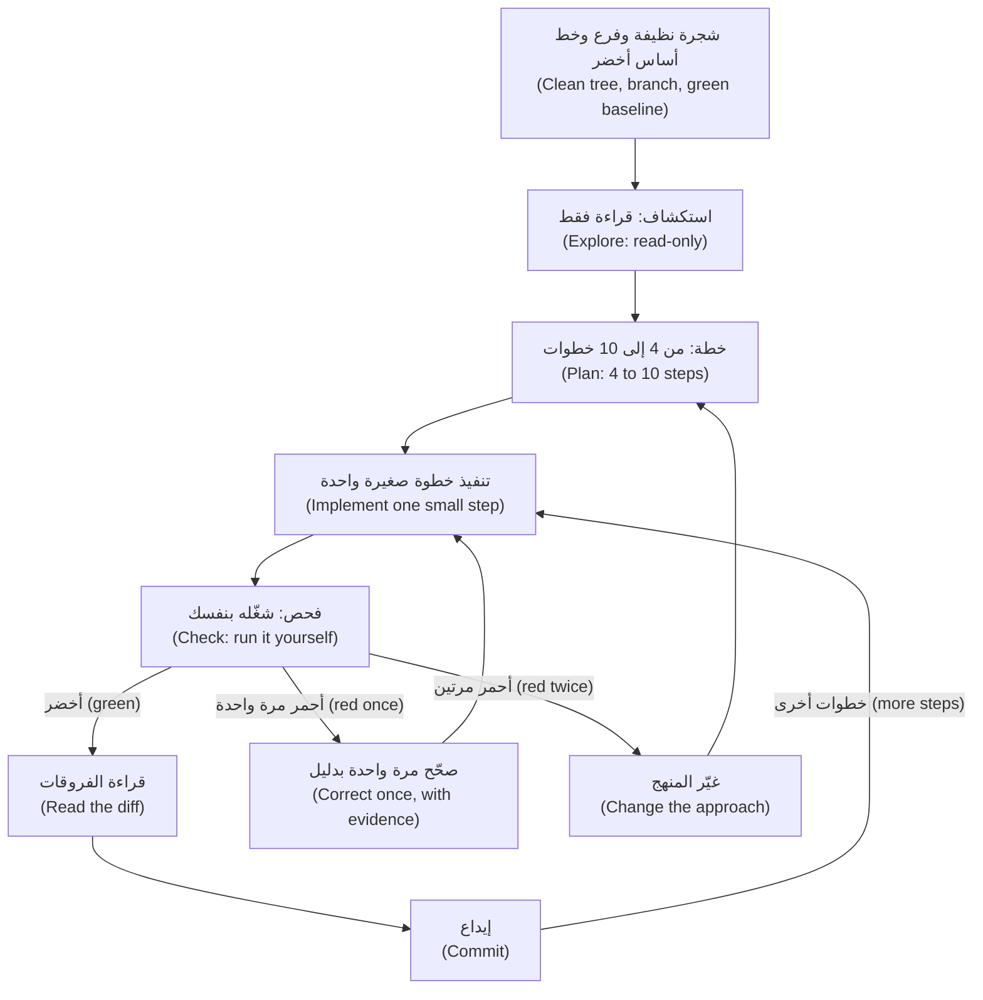

# الوحدة 4 — الحلقة اليومية

*الوحدة 4 هي الدورة القصيرة المتكررة التي تنجز بها أنت ووكيلك (agent) عملًا حقيقيًا: استكشف (explore)، وخطّط (plan)، ونفّذ خطوة صغيرة واحدة، وافحصها بنفسك، واقرأ الفروقات (read the diff)، وأودِع (commit)، ثم ابدأ من جديد. الدرس 4.1 هو درس المفاهيم الذي تدور أحداثه في فريق منصة المدفوعات (Payments Platform) ببنك نجم (Najm Bank): ما تفعله قبل الجلسة — شجرة نظيفة وفرع لكل مهمة وخط أساس أخضر — وسير العمل الذي توصي به وثائق Claude Code، ونقاط الاستعادة والرجوع (checkpoints and rewind)، ووضع التخطيط (plan mode)، وست إشارات تدل على أن الوكيل يضل الطريق، وقاعدة الفشلين، ومتى تتولى القيادة، ونظافة الجلسة (session hygiene) وسجل الوكيل، مع خط زمني لجلسة تُعلَّم فيه التدخلات. وينتهي بمُنتَجين (two artefacts) هما قائمة تحقق الحلقة وبطاقة إشارات المقاطعة، وبوصف Meta نفسها للتحقق بوصفه معيار «انتهى». أما الدرس 4.2 فهو المختبر: التذكرة REMIT-318 من حصة (Hessa)، مالكة المنتج (product owner)، تطلب من نجم ريميت (Najm Remit) أن ينبّه العميل، بالإنجليزية أو بالعربية، حين يبلغ به تحويل 80% من حده اليومي (80% of their daily limit). تكتب مواصفة (spec) وخطة، وتعمل بإيداعات صغيرة (small commits)، وتضيف اختبارات (tests)، ويشغّل المُقيِّم دون اتصال (offline grader) اختبارات قبول خفية (hidden acceptance tests) ويكسر ميزتك عمدًا ليرى هل تلحظ اختباراتك ذلك. والوكيل موصى به لا مطلوب. وكل ما يخص جانب نجم خيالي.*

> **التركيز (Focus):** Workflow — العادة 3 (habit 3)، *خطوات صغيرة مُتحقَّق منها (Small verified steps)*: خذ خطوة صغيرة واحدة في كل مرة، وافحصها بنفسك، واحتفظ بإيداع تعود إليه، وأوقف الوكيل مبكرًا لا متأخرًا.

---

# 4.1 — استكشف وخطّط ونفّذ وافحص وأودِع: الخطوات الصغيرة ونقاط الاستعادة ومتى تتولى القيادة
*المستوى (Level): 🟡 متوسط (Intermediate)* · *المتطلبات (Prerequisites): 3.1* · *التركيز: Workflow*

## ⚡ الدرس في دقيقة (In 60 seconds)
- للحلقة اليومية ست حركات (six moves): **الاستكشاف (explore)** للقراءة فقط (read-only)، و**التخطيط (plan)**، و**تنفيذ خطوة صغيرة واحدة (implement one small step)**، و**فحصها (check)** بنفسك، و**قراءة الفروقات (read the diff)**، و**الإيداع (commit)**. والوحدة هي الخطوة لا التذكرة.
- حضّر أولًا (Prepare first): شجرة نظيفة، وفرع لكل مهمة، وخط أساس أخضر، وجلسة جديدة.
- الإيداعات نقاط حفظ. أما نقاط الاستعادة (Checkpoints) (`Esc` `Esc`، `/rewind`) فتتراجع مؤقتًا عن تعديلات الوكيل؛ وهي لا تحل محل git.
- توقف عند أول إشارة: التخبّط (thrashing)، أو تعديلات خارج النطاق، أو الأمر الفاشل نفسه، أو اعتذارات بلا دليل. صحِّح مرة واحدة (Correct once). وبعد **محاولتين فاشلتين غيِّر المنهج (two failed attempts, change the approach)**: مهمة أصغر (smaller task)، وسياق جديد (fresh context)، ومواصفة أفضل (better spec).
- تولَّ القيادة (Take the wheel) حين تكون كتابة الإصلاح أسرع من شرحه، أو حين لا يرى الوكيل ما تراه أنت.
- أكبر فخ (Biggest trap): الانتظار (waiting).

## 🧭 لماذا يهم
في يوم جمعة، وهو يوم مُختلَق، تعطي لجين (Lujain)، المهندسة حديثة التخرج (graduate engineer)، وكيلها التذكرة REMIT-269، وهي خيار `--since` للأمر `history`، في موجّه واحد ثم تدخل اجتماعًا. وحين تعود يكون قد تغيّر 14 ملفًا و612 سطرًا (14 files and 612 lines have changed): الخيار نفسه، وإعادة هيكلة المحلِّل، وتنظيف في `fees.py`، وثلاثة اختبارات معدَّلة. كلها تنجح؛ فتودعها (commits it) باسم `wip`. وتسأل ندى (Nada)، قائدة هندسة الجودة (quality engineering lead)، أيّ الأسطر الـ612 تحتاجها الميزة (which of the 612 lines the feature needs)؟ فلا تستطيع لجين الجواب، وكان أحد الاختبارات المعدَّلة يحرس حدًّا بين مستويين من الرسوم. فيُقسَّم طلب الدمج إلى أربعة، ويستغرق فك ما أُدخل على `fees.py` (unpicking) أطول مما استغرقته الميزة.

لم يفعل الوكيل شيئًا غريبًا. ما غاب هو الحلقة: لا خطة تُقارَن بها الفروقات، ولا فحص بين الخطوات، ولا إيداع تعود إليه. وقد ربط تقرير DORA لعام 2024 ارتفاع اعتماد الذكاء الاصطناعي بانخفاض استقرار التسليم (lower delivery stability)، ويعزو مؤلفوه جزءًا من هذا الهبوط (dip) إلى أحجام الدفعات الأكبر (larger batch sizes)؛ وهذه ارتباطات استطلاعية (survey associations) لا إثبات للسبب.

## 📐 كيف يعمل

### 🟢 الأساسيات

**لفة واحدة (One lap).** تكون الخطوة صغيرة حين يكون لها سبب واحد للتغيير، وفحص تستطيع تسميته في جملة، وفروقات تقرؤها في جلسة واحدة.



في كل لفة **أنت** تذكر فحص الخطوة أولًا، وتشغّله بنفسك، وتقرأ `git diff` والاختبارات أولًا (tests first)، وتكتب رسالة الإيداع. أما **الوكيل** فيقرأ ويقترح ويعدّل، ولا يودع إلا إذا طُلب منه.

**ما توصي به الوثائق (What the documentation recommends).** تتغير صفحة أفضل الممارسات (best-practices page) في Claude Code، فراجعها؛ وعبارات مثل «explore-plan-code-commit» أو «safe YOLO mode» ليست من عناوينها.

| عنوان الصفحة أو موضوعها | خلاصته | أين نجده هنا |
|---|---|---|
| **Explore first, then plan, then code** — استكشف أولًا ثم خطّط ثم اكتب الشيفرة | أربع مراحل (Four phases): الاستكشاف والتخطيط والتنفيذ (Implement) والإيداع. وضع التخطيط: اضغط `Shift+Tab` حتى يظهر `⏸ plan mode on`، أو شغّل `claude --permission-mode plan`؛ ويفتح `Ctrl+G` الخطة في محررك. «إن كنت تستطيع وصف الفروقات في جملة واحدة فتجاوز الخطة» ⁦⁩ | هذا الدرس |
| **Give Claude a way to verify its work** — امنح Claude طريقة للتحقق من عمله | «أعطِ Claude فحصًا يستطيع تشغيله: اختبارات أو بناءً أو لقطة شاشة للمقارنة»، مثل «اكتب اختبارًا فاشلًا يعيد إنتاج المشكلة ثم أصلحها» | الدرس 5.1 (Lesson 5.1) |
| **Run autonomously with auto mode** — شغّل باستقلالية بالوضع التلقائي | يراجع مُصنِّف الأوامر قبل تشغيلها، مثل `claude --permission-mode auto -p "fix all lint errors"` | الدرس 8.1 (Lesson 8.1) |
| **Run multiple Claude sessions** — شغّل جلسات Claude متعددة | أشجار العمل (worktrees) وغيرها؛ وجلسة كاتب وجلسة مراجع في سياق جديد | الدرس 10.1 (Lesson 10.1) |
| **Run non-interactive mode; fan out across files** — شغّل الوضع غير التفاعلي؛ ووزّع العمل على الملفات | `claude -p` في التكامل المستمر (CI) أو السكربتات (scripts)، و`--allowedTools`، و`/batch` | الدرسان 9.1 و10.1 (Lessons 9.1 and 10.1) |
| **Adversarial review** — المراجعة الخصومية؛ موضوع وليس عنوانًا | وكيل فرعي (subagent) يراجع الفروقات في سياق جديد؛ والمراجعون «سيبلّغون عادةً عن بعض الملاحظات حتى حين يكون العمل سليمًا» | الدرس 5.1 (Lesson 5.1) |

**قبل الجلسة: نظافة git (Before the session: git hygiene).**

```bash
git status                                # clean?
git switch -c remit-269-history-since    # a branch per task
pytest -q                                 # the baseline is green before the agent starts
# ... the agent finishes one step ...
git diff --stat                           # which files? the ones the plan named?
git diff                                  # read it, tests included
pytest -q                                 # evidence, run by you
git add -p                                # stage what you read
git commit -m "feat(cli): filter history with --since"
```

- **فرع لكل مهمة وشجرة نظيفة (A branch per task and a clean tree)** يجعلان كل سطر في `git diff` من عمل الوكيل. و**خط الأساس الأخضر (A green baseline)** يجعل أي اختبار أحمر لاحق خبرًا.
- **الإيداعات نقاط حفظ (Commits are save points)**، تُجرى حين تكون الخطوة خضراء. يتخلص `git restore <file>` من التعديلات غير المودَعة في ملف واحد؛ ويلغي `git revert <sha>` إيداعًا دون إعادة كتابة التاريخ.
- **Conventional Commits.** يطلب `CONTRIBUTING.md` في ريميت (Remit) الصيغة `type(scope): subject`: نوعًا من قائمة محددة، ونطاقًا إلزاميًا بأحرف صغيرة، وموضوعًا بصيغة الأمر دون نقطة في آخره، وسطرًا أول (header) لا يتجاوز 72 حرفًا (up to 72 characters). والمواصفة العامة تجعل النطاق اختياريًا؛ وريميت أكثر صرامة.

**وضع التخطيط ومتى تتجاوزه (Plan mode, and when to skip it).** في وضع التخطيط يستكشف الوكيل ويقترح لكنه لا يعدّل ملفات المصدر. استخدمه للعمل الذي يمتد عبر عدة ملفات (spans files) أو لشيفرة لا تفهمها بعد؛ وتجاوزه حين يمكن وصف الفروقات بجملة واحدة.

### 🟡 التعمق أكثر (Going deeper)

**نقاط الاستعادة والرجوع (Checkpoints and rewind).** وقت كتابة هذا (2026)، يسجّل Claude Code نقطة استعادة (checkpoint) لكل موجّه (prompt) يبدأ دورة، ويحتفظ بأحدث 100 منها (keeps the 100 most recent)، وتنتهي صلاحيتها بعد نحو 30 يومًا من آخر لقطة (snapshot) للجلسة. افتح القائمة بـ`Esc` `Esc` على موجّه فارغ، أو بـ`/rewind`: استعد الشيفرة أو المحادثة أو كليهما، أو لخّص (summarise). أما تغييرات Bash (`rm` و`mv` و`cp`) والتعديلات من خارج الأداة (outside edits) والجلسات الأخرى فلا تُتتبَّع، وتقول الوثائق إن نقاط الاستعادة ليست بديلًا عن git.

**إشارات تدل على أن الوكيل يضل الطريق (Cues that an agent is going astray).** تسرد البطاقة في قسم 🏛️ ست إشارات. توقف عند أولاها.

وجدت Anthropic، الشركة المطوِّرة لـ Claude Code، أن خمسة مساعدين أظهروا المجاملة المفرطة (sycophancy) باطّراد، أي ميلًا نحو رأي المستخدم، في أربع مهام لتوليد النصوص (Sharma وآخرون، ICLR 2024). عبارة «أنت محق» ⁦("You're right")⁩ ليست دليلًا، أما تشغيل الاختبار فدليل — وهذه هي العادة 4 (habit 4)، *ثق بالدليل لا بالطلاقة (Trust evidence, not fluency)*.

**سلّم التدخل (The intervention ladder)** على البطاقة؛ فاستخدم أدنى درجة تنفع. يوقف `Esc` الوكيل في الطرفية — وراجع الوثائق لواجهتك؛ والرجوع (rewinding) يكون بـ`/rewind` أو `git restore` أو بإيداع. يحتاج التصحيح إلى موضع وسبب وفحص. الضعيف (Weak): *«هذا خطأ، حاول مرة أخرى» ⁦⁩* لا يضيف معلومة، فتحصل على المحاولة نفسها بصياغة أخرى. والقوي (Strong): *«يحلّل `history` المعامل `since` على أنه `datetime` ساذج (naive)، وهو ما يرفضه المخزن. ابنِه بـ`QATAR_TZ` من `remit.limits`، ثم شغّل `pytest -q tests/test_config_cli.py`.»*

**قاعدة الفشلين (The two-failure rule).** بعد محاولتين فاشلتين في خطوة، نادرًا ما تنفع ثالثة في السياق نفسه: فهو يحمل الآن منهجين خاطئين، وتسرد صفحة أفضل الممارسات «التصحيح مرارًا وتكرارًا» بين أنماط الفشل (failure patterns). غيِّر شيئًا واحدًا: اجعل المهمة **أصغر (smaller)**، أو ابدأ **سياقًا جديدًا (fresh context)** بـ`/clear` ثم جملة واحدة (one sentence) عمّا تعلمته، أو اكتب **مواصفة أفضل (better spec)** تتضمن الواقعة الناقصة أو مثالًا أو الاختبار الفاشل. وهذه قاعدة تقريبية في الدورة لا حدٌّ موثَّق.

**متى تتولى القيادة (When to take the wheel).** تولَّها حين تكون كتابة الإصلاح أسرع من شرحه؛ وحين يكون السبب واقعةً لا يعرفها غيرك — كمنتصف ليل قطر أو قاعدة عمل — أو حين لا يستطيع الوكيل رؤية ما تراه أنت، كشاشة؛ وحين لا تستطيع بعد التحقق من تغيير في مسار الأموال؛ وحين فشلت محاولتان؛ أو حين تتمرن على مهارة تريد الاحتفاظ بها (الدرس 13.1). وليس هذا فشلًا: أصلح السطر الصعب، ثم أعد لوحة المفاتيح إلى الوكيل ليكتب الاختبارات.

**نظافة الجلسة (Session hygiene).** مهمة واحدة لكل جلسة؛ وتسمّي الصفحة عكس ذلك «جلسة كل شيء في آن واحد». استخدم `/clear` بين المهام (between tasks)، و`/compact Focus on the CLI changes` حين تملأ مهمة طويلة النافذة، و`/context` لترى ما حُمِّل؛ وأرسل التحقيقات (investigations) إلى وكلاء فرعيين (subagents) لا يعيدون إلا تقريرًا.

**سجل الوكيل (The agent log).** بعد كل مهمة بمساعدة الذكاء الاصطناعي (AI-assisted task) دوّن الموجّه والنتيجة وتصحيحاتك وفحوصك والدقائق. كن صادقًا في الدقائق: فالسجل ساعتك، وإحساسك بالسرعة ليس كذلك.

**خط زمني لجلسة تُعلَّم فيه التدخلات (A session timeline with the interventions marked).** مُختلَق (Constructed) للتذكرة REMIT-269؛ ليس مسجَّلًا من نموذج حقيقي، والأوقات مخترَعة.

| الوقت (Time) | الحركة (Move) | ما حدث | الإشارة (Cue) | التدخل (Intervention) |
|---|---|---|---|---|
| 09:12 | التخطيط | سبع خطوات (Seven steps)؛ الخطوة 6 تنقل المحلِّل والخطوة 7 تعدّل README | خطوات خارج النطاق (Out-of-scope steps) | `Ctrl+G`: احذف الاثنتين (delete both)؛ وأضف «التاريخ هو بداية ذلك اليوم القطري» |
| 09:31 | الخطوة 2 (Step 2) | `datetime` ساذج؛ يرفع المخزن الخطأ `datetimes must be timezone-aware`؛ ويضيف الوكيل `try/except` ثم يعدّل الاختبار | التخبّط؛ اختبار معدَّل | `Esc`؛ و`/rewind` للشيفرة والمحادثة معًا؛ أعد الصياغة (restate): استخدم توقيت قطر |
| 09:44 | الخطوة 2 (Step 2) | أمر `pytest` نفسه ثلاث مرات (three times) | الأمر الفاشل نفسه | تتولى القيادة: اقرأ تتبّع الاستثناء، وأصلح سطرين، وأودِع |
| 09:52 | الخطوة 3 (Step 3) | تفشل محاولتان في اختبار نص المساعدة | فشلان (Two failures) | جلسة جديدة (New session)، ومواصفة من فقرة واحدة، وخطوة أصغر |
| 10:05 | المراجعة (Review) | يسرد `git diff --stat` الملف `fees.py` | تعديل خارج النطاق (Out-of-scope edit) | `git restore src/remit/fees.py` |
| 10:10 | الإغلاق (Close) | أخضر (Green)؛ طلب الدمج (pull request) موسوم بـ`AI-assisted`؛ السجل (log): 70 دقيقة و5 تدخلات (interventions) | | |

### 🔴 نظرة الخبير (Expert view)

**«انتهى» تعني «متحقَّق منه» (Done means verified).** تصف مدونة الهندسة في Meta فريقًا صغيرًا بنى تطبيق Forum بوكيل ذكاء اصطناعي مشارِكًا. وتذكر Meta أنها قاست النجاح بتغييرات جاهزة للإنتاج (production-ready changes) لا بحجم الشيفرة، وأنها وضعت المعيار «عند التحقق لا عند الترجمة البرمجية»: فالمهمة لا تكتمل إلا بعد أن تنجح الاختبارات الآلية والفحوص البصرية، لا حين تُترجَم الشيفرة بنجاح. وتذكر أيضًا أنه حين كرر الوكيل خطأ أكثر من مرتين، رمّز الفريق التصحيح مرة واحدة للجميع. وهدف Meta هو «الإنسان على الحلقة» ("human-on-the-loop"): يدير الوكيل دورة التخطيط والبناء والاختبار والتصحيح بينما يضع المهندس الهدف ويعتمد النتيجة. ويسمّي المنشور هذا هدفًا لا حالة منجزة. وكل ذلك رواية شركة عن ممارستها الخاصة لا دليل مستقل. وتنطبق العادات نفسها على عملنا: «انتهى» فحص شغّلته أنت، والتصحيح الذي تكرره للمرة الثالثة مكانه `CLAUDE.md` أو اختبار أو خطاف (الوحدتان 2 و9).

**اجعل التوقف مشروطًا (Gate the stop).** يتوقف الوكيل حين يظن أنه انتهى. وتسمّي الصفحة ثلاث طرق تجعل إعلان «انتهى» مشروطًا بفحصك: شرط `/goal`، أو خطاف التوقف، أو وكيل فرعي للتحقق — ويغطي الدرس 9.1 الخطاطيف (hooks) والوكلاء الفرعيين لا `/goal`، فراجع الوثائق الحالية (check the current documentation).

**ما طول الرسن (How long a leash).** الوضع الافتراضي في الدورة هو الوضع اليدوي (Manual) أو وضع `acceptEdits` مع فحص بعد كل خطوة؛ أما الوضع الذي يبدأ به Claude Code فيعتمد على إصداره وخطته ومزوّده، فاقرأ شريط الحالة (status bar). تؤتي الأرسان الأطول (Longer leashes) — الوضع التلقائي (auto mode) والتشغيل في الخلفية (background) والتشغيل غير التفاعلي (headless runs) — ثمارها حين يكون العمل محدَّد المواصفة وقابلًا للفحص وقليل الكلفة عند التخلص منه، لكنك تفقد الإشارات لأنك لا تستطيع مقاطعة ما لا تراقبه: فأتمِت الفحوص. وتقول الوثائق إن الوضع التلقائي «لا يضمن الأمان».

**متى لا تشغّل الحلقة كاملة (When not to run the full loop).** للفروقات ذات الجملة الواحدة اقرأ الفروقات وأودِع. وللتجربة الاستكشافية المؤقتة احذف الفرع بعد ذلك. ولا تنقذ الحلقة تذكرة غامضة: فإن انتهت كل لفة بعبارة «ليس هذا ما قصدته» ("not what I meant")، فعد إلى الدرس 3.1.

## 🧰 الأدوات
| الأداة أو الممارسة أو النمط (Tool, practice or pattern) | ما هي وماذا تفعل | متى تلجأ إليها |
|---|---|---|
| **Loop checklist** — قائمة تحقق الحلقة | صفحة واحدة (One page): قبل الجلسة، وفي كل لفة (each lap)، وبعد الخطوة الأخيرة | كل مهمة (Every task) |
| **Interruption cues** — إشارات المقاطعة | بطاقة: ست إشارات (six cues)، والسلّم، وقاعدة الفشلين | كلما عمل وكيل وأنت تراقبه |
| **Plan mode** — وضع التخطيط | استكشاف للقراءة فقط (Read-only exploration) وخطة قابلة للتحرير (`Shift+Tab`، `/plan`) | تعديلات متعددة الملفات (Multi-file edits)؛ وشيفرة غير مألوفة (unfamiliar code) |
| **Checkpoints and rewind** — نقاط الاستعادة والرجوع | تراجع لكل موجّه عن تعديلات الوكيل (`Esc` `Esc`، `/rewind`) | دورة سيئة داخل لفة |
| **Branch per task** — فرع لكل مهمة | فرع واحد لكل تذكرة، من شجرة نظيفة | كل مهمة |
| **Conventional Commits** — صيغة الإيداعات المتعارف عليها | `type(scope): subject`، كما يعرّفها `CONTRIBUTING.md` | كل إيداع (Every commit) |
| **Agent log** — سجل الوكيل | الموجّه والنتيجة والتصحيحات والفحوص والدقائق | بعد كل مهمة بمساعدة الذكاء الاصطناعي |

## 🏛️ عمليًا في بنك نجم
يفتتح طارق (Tariq)، قائد الهندسة (engineering lead)، العيادة الأسبوعية ببطاقتين (two cards). الأولى هي **قائمة تحقق الحلقة (Loop checklist)**؛ انسخها باسم `loop-checklist.md`.

```markdown
# Loop checklist (one lap = one small step)

Before the session
- [ ] Clean tree; on a branch for this task, not main; `pytest -q` green; a fresh session.
- [ ] "Done means" is written down: a spec, or a sentence and the files in scope.

Explore and plan
- [ ] Read-only first; the files and functions the agent names exist.
- [ ] Four to ten steps, one commit and one check each, the failing test first; anything out of scope is deleted.

Each lap
- [ ] I can state this step's check in one sentence before the agent edits.
- [ ] I ran the check myself; I did not rely on "all tests pass".
- [ ] I read `git diff --stat`, then the diff, tests first. No existing test was edited.
- [ ] I commit while green, as `type(scope): subject`.

Interrupt
- [ ] I stopped at the first cue and corrected once, with evidence.
- [ ] After two failed attempts I changed the approach: smaller, fresh, better spec.

After the last step
- [ ] `git diff main --stat` is what I expected; the pull request is labelled `AI-assisted`.
- [ ] Money logic has a second human reviewer. Agent log entry, with minutes.
- [ ] A correction I made a third time is now a rule, a test or a hook.
```

والثانية بطاقة **إشارات المقاطعة (Interruption cues)**. أبقها بجانب الطرفية.

```text
INTERRUPTION CUES - stop at the first one
1 Thrashing         the same lines edited back and forth; a test flipping red and green
2 Out of scope      a file you did not name; a test edited; "while I'm here" tidying
3 Same failing run  the identical command again, with no new idea
4 Apology loop      "You're right, I apologise", then no run, or the same mistake
5 Plan drift        step 5 while you approved steps 1 and 2; a new approach, unannounced
6 No evidence       "all tests pass" and no test run in view

LADDER  1 stop (Esc) and say what you saw    2 correct once: file, line, reason
        3 rewind (/rewind, git restore)       4 take the wheel for this step
        5 after two failures: smaller task, fresh context, better spec
```

وقاعدة العيادة: لا طلب دمج دون قائمة تحقق مملوءة، ولا «الوكيل هو من فعلها» في المراجعة.

## 🛠️ التمارين (Exercises)
- 🟢 **علِّم خطًا زمنيًا (Mark a timeline).** *بلا وكيل.* اكتب خطًا زمنيًا من ستة أسطر لآخر جلسة بمساعدة الذكاء الاصطناعي. *يكتمل عندما (Done when):* يسمّي كل سطر حركة، ويسمّي سطران إشارة لاحظتها متأخرًا والدرجة التي كان ينبغي استخدامها.
- 🟡 **شغّل الحلقة على تغيير صغير (Run the loop on a small change).** *الوكيل اختياري (Agent optional).* أنشئ بيئة معزولة خضراء (من مجلد `ailab`: `python -m ailab start m00 --dir ~/ainative/sandbox`، ثم `python -m ailab solve m00 --dir ~/ainative/sandbox`). في البيئة المعزولة، على فرع، أضف `--since YYYY-MM-DD` إلى `history`؛ فالتاريخ يعني بداية ذلك اليوم بتوقيت قطر. (جرّب `PYTHONPATH=src python -m remit history --customer C001` بعد `customer add` و`send`.) *يكتمل عندما:* يكون لديك ثلاثة إيداعات خضراء أو أكثر بصيغة ريميت، وتكون القائمة معلَّمة بالأوامر التي شغّلتها، ويقول سطر واحد ما الذي يجب تغييره.
- 🔴 **تمرّن على مقاطعة (Rehearse an interruption).** *يحتاج وكيلًا (Needs an agent).* في البيئة المعزولة أعطِ الوكيل موجّهًا يدعو إلى توسّع النطاق، بلا خطة، وراقب. *يكتمل عندما:* تذكر ملاحظاتك أول إشارة ووقتها والدرجة التي استخدمتها وما الذي كانت قاعدة الفشلين ستغيّره، ويكون الفرع عند إيداع أخضر.

## ⚠️ أخطاء وفخاخ (Mistakes and traps)
- **انتظار انتهاء مهمة كبيرة (Waiting for a large task to finish).** كل دقيقة تضيف شيفرة عليك فكّها؛ فقاطع عند أول إشارة.
- **التخطيط لفروقات من جملة واحدة، أو تجاوز الخطة لتغيير في عشرة ملفات (Planning a one-sentence diff, or skipping the plan for a ten-file one).** طابِق الخطة بحجم الفروقات.
- **اعتبار نقاط الاستعادة نسخة احتياطية (Treating checkpoints as a backup).** تغييرات Bash غير متتبَّعة (untracked) واللقطات (snapshots) تنتهي صلاحيتها؛ فأودِع.
- **تصحيح ثالث في السياق نفسه، أو الإصلاح نفسه في كل موجّه (A third correction in the same context, or the same fix in every prompt).** غيِّر المنهج (Change the approach)، وانقل التصحيح إلى `CLAUDE.md` أو اختبار أو خطاف.

## 🧾 الخلاصة (Recap)
- الحلقة: استكشف، خطّط، نفّذ خطوة صغيرة، افحص، اقرأ الفروقات، أودِع، على فرع نظيف بخط أساس أخضر.
- الإيداعات نقاط حفظ (save points)؛ ونقاط الاستعادة تراجع قصير العمر.
- توقف عند أول إشارة، وصحِّح مرة واحدة، وبعد فشلين غيِّر المنهج.
- تولَّ القيادة حين تعرف الإصلاح، أو تحمل واقعة يفتقدها الوكيل، أو لا تستطيع التحقق بعد.
- «انتهى» تعني «متحقَّق منه» لا «مُترجَم برمجيًا»؛ والتصحيح المكرَّر أكثر من مرتين مكانه قاعدة دائمة.

## ✍️ اختبر نفسك (Check yourself)

**1. بعد عشر دقائق من بدء الجلسة (Ten minutes in)، شغّل الوكيل أمر `pytest` الفاشل نفسه ثلاث مرات (three times) دون أن يغيّر شيئًا بين التشغيلات (changed nothing between runs). ماذا تفعل؟ ⁦(What do you do?)⁩**

- A. اتركه يواصل، لأن تشغيلًا رابعًا قد ينجح دون أي تغيير.
- B. اضغط `Esc`، واقرأ تتبّع الاستثناء، وقرّر هل تتولى القيادة (take the wheel).
- C. بدّل إلى وضع يتجاوز الموافقات كي تعمل إعادة المحاولات دون إشراف (run unattended).
- D. اطلب منه أن يودع الحالة الحالية كي يُحفظ العمل غير المكتمل.

<details><summary>الإجابة</summary>

**B.** الأمر الفاشل نفسه بلا فكرة جديدة إشارة إلى التوقف؛ وتتبّع الاستثناء دليل يتجاهله الوكيل. 🟡 الإشارات والسلّم.

</details>

**2. فشلت محاولة الوكيل الثانية في خطوة بعد تصحيحك (The agent's second attempt at a step failed after your correction). ما أفضل خطوة تالية؟ ⁦(What is the best next move?)⁩**

- A. صحِّحه مرة ثالثة بالكلمات نفسها لكن بأحرف كبيرة كي ينتبه.
- B. ارجع (Rewind) عن كل ما أُنجز اليوم وابدأ التذكرة كلها من الصفر.
- C. اطلب من الوكيل أن يعتذر (apologise) وأن يعد بمزيد من الحذر في المرة القادمة.
- D. غيِّر المنهج (Change the approach): قسّم الخطوة، أو ابدأ من جديد (start fresh)، أو أضف واقعة ناقصة.

<details><summary>الإجابة</summary>

**D.** بعد فشلين نادرًا ما تنفع محاولة ثالثة في السياق نفسه؛ غيِّر المهمة أو السياق أو المواصفة. الأحرف الكبيرة والاعتذارات تضيف كلمات لا معلومات. 🟡 قاعدة الفشلين.

</details>

**3. تقول لجين (Lujain) إن `Esc` `Esc` تجعل الإيداعات (commits) غير ضرورية لأنها تستطيع الرجوع عن أي شيء (rewind anything). ما الرد الصحيح؟ ⁦(What is the right reply?)⁩**

- A. لا: تغييرات Bash والتعديلات من الخارج غير متتبَّعة، وgit هو نقطة الحفظ.
- B. نعم: تحتفظ نقاط الاستعادة بكل تغيير لمدة عام، أيًّا كانت الأداة التي أجرته.
- C. نعم، ما دام الوكيل يعدّل الملفات فقط ولا يشغّل أي أمر في الصدفة (shell command) إطلاقًا.
- D. لا: تغطي نقاط الاستعادة الفرع الرئيسي وحده وتُحذف كل ليلة عند منتصف الليل.

<details><summary>الإجابة</summary>

**A.** تغييرات Bash والتعديلات من الخارج غير متتبَّعة (untracked)، واللقطات تنتهي صلاحيتها (snapshots expire)، وgit هو نقطة الحفظ الحقيقية. 🟡 نقاط الاستعادة والرجوع (Checkpoints and rewind).

</details>

**4. تفتح حصة (Hessa)، مالكة المنتج (product owner)، تذكرة لإصلاح كلمة واحدة مكتوبة خطأ في رسالة إنجليزية (one misspelt word in an English message). أي نهج يناسب؟ ⁦(Which approach fits?)⁩**

- A. خطة من سبع خطوات في وضع التخطيط (plan mode)، مع نقطة استعادة (checkpoint) بعد كل خطوة.
- B. جلسة جديدة لكل جملة في التذكرة، للحفاظ على صغر السياق.
- C. صِف الفروقات في جملة واحدة، ونفّذها، واقرأ `git diff`، واختبر، وأودِع.
- D. شغّله في الخلفية وراجع النتيجة في عيادة الأسبوع القادم.

<details><summary>الإجابة</summary>

**C.** تقول الصفحة تجاوز الخطة إن استطعت وصف الفروقات في جملة واحدة؛ ويبقى عليك أن تقرأ الفروقات وتشغّل الفحص. 🟢 وضع التخطيط ومتى تتجاوزه.

</details>

**5. يقول زميل إن منشور Meta عن Forum يثبت أن الوكلاء ذوي الإعداد الجيد لا يحتاجون إلى مراجعة بشرية (need no human review). ما الرد المنصف؟ ⁦(What is a fair response?)⁩**

- A. أثبتت Meta أن المراجعة غير ضرورية (unnecessary) متى صار إعداد الوكيل جيدًا بما يكفي.
- B. هذه رواية Meta نفسها، وهي تسمّي «الإنسان على الحلقة» (human-on-the-loop) هدفًا لا نتيجة.
- C. يغطي المنشور لغة برمجة واحدة فقط، فلا ينطبق منه شيء هنا.
- D. الفحوص البصرية (visual checks) وحدها هي المهمة؛ وتعدّ Meta الاختبارات الآلية (automated tests) إضافات اختيارية (optional extras) لفرق صغيرة (small teams).

<details><summary>الإجابة</summary>

**B.** رواية الشركة عن ممارستها ليست دليلًا مستقلًا، وMeta نفسها تصف الهدف بأنه غير مكتمل (unfinished). 🔴 «انتهى» تعني «متحقَّق منه».

</details>

## 📚 المراجع (References)
- وثائق Claude Code (Claude Code documentation): أفضل الممارسات (best practices) https://code.claude.com/docs/en/best-practices; ونقاط الاستعادة والرجوع https://code.claude.com/docs/en/checkpointing; وأوضاع الصلاحيات (permission modes) ومنها وضع التخطيط https://code.claude.com/docs/en/permission-modes; ونافذة السياق https://code.claude.com/docs/en/context-window
- Git: https://git-scm.com/docs. وConventional Commits 1.0.0: https://www.conventionalcommits.org
- [*اختبار البرمجيات (Software Testing)*، الدرس 6.2 — الاختبارات بوصفها مواصفة لوكلاء البرمجة](../testing/index.ar.html#/6.2)
- **تعمّق أكثر (Go deeper).** Engineering at Meta، «كيف بنت Meta تطبيق Forum بالهندسة الأصيلة في الذكاء الاصطناعي»: https://engineering.fb.com/2026/10/15/ml-applications/how-meta-built-forum-ai-native-engineering/ — اقرأ الأصل؛ فهذا الدرس لم يعرفه إلا من ملخص. Anthropic، «نحو فهم المجاملة المفرطة في النماذج اللغوية»: https://www.anthropic.com/research/towards-understanding-sycophancy-in-language-models. وDORA، تقرير 2024 (2024 report): https://cloud.google.com/blog/products/devops-sre/announcing-the-2024-dora-report.

---

# 4.2 — المختبر: أطلق ميزة صغيرة عبر الحلقة بأكملها
*المستوى: 🟡 متوسط* · *المتطلبات: 3.2، 4.1* · *التركيز: Workflow*

## ⚡ الدرس في دقيقة (In 60 seconds)
- **المختبر m04 (Lab m04).** تذكرة حصة REMIT-318: حين يبلغ تحويل ناجح بالعميل 80% من حده اليومي (80% of their daily limit) أو أكثر، أرسل رسالة ثانية بالإنجليزية أو بالعربية. نحو 25 سطرًا من الشيفرة (About 25 lines of code)، وخمس طرق سهلة للخطأ فيها.
- تشغّل الحلقة كاملة: استكشاف، ومواصفة مع خطة، وإيداعات صغيرة خضراء، واختبارات تفشل بدون الميزة، وسجل وكيل.
- **يحتاج إلى وكيل (Needs an agent): لا (no)؛ والوكيل موصى به لا مطلوب (recommended, not required).** لا يستطيع المُقيِّم أن يعرف من كتب الشيفرة.
- يشغّل المُقيِّم اختبارات قبول خفية، ثم يكسر التحذير عمدًا ليرى هل تلحظ اختباراتك ذلك. ولا يستطيع أن يعرف هل قرأت الفروقات أو قرّرت جيدًا (decided well).

## 🧭 لماذا يهم
يكتب وكيل لجين تحذير الحد في أربع دقائق. يبدو صحيحًا وينجح في كل اختبار، بما فيها الاختبارات التي كتبها الوكيل بنفسه. لكنه يفشل عند 80% بالضبط (fails at exactly 80%)، ويعرض 100% لعميل عند 99.95%، ويطبع أرقامًا غربية (Western digits) لعملاء العربية، ويحوّل انقطاع البوابة إلى انهيار بعد أن انتقلت الأموال. ولا تثبت مجموعة اختبارات خضراء شيئًا من هذا: فالاختبارات القديمة سبقت الميزة، واختبارات الوكيل لا تفحص إلا الحالات التي خطرت له.

## 📐 كيف يعمل

### 🟢 الأساسيات

المختبر هو الحلقة في سبع خطوات — والترتيب نصيحة لا إلزام:

| الخطوة (Step) | ما تفعله | الدليل (Evidence) |
|---|---|---|
| 1. الاستكشاف | شغّل `pytest -q`. واقرأ `send` في `service.py`، و`LimitResult` في `limits.py`، و`render` في `notify.py` | تستطيع أن تقول ما يشمله `daily_used` |
| 2. المواصفة والخطة (Spec and plan) | انسخ `specs/TEMPLATE.md` إلى `specs/REMIT-318.md`؛ واحسم ما تتركه التذكرة مفتوحًا — أين يعيش المنطق والنسبة المئوية دون أعداد عشرية عائمة؛ وخطّط نحو خمس خطوات | مواصفة مودَعة |
| 3. الرسالة | القالب، مع اختبارات لنصه الدقيق | إيداع أخضر |
| 4. القرار | متى تنبّه وماذا تعرض، مع اختبارات على جانبي الخط | إيداع أخضر |
| 5. الحالات الحدّية | عميل عربي (Arabic customer)، وتحويل مرفوض (refused transfer)، وفشل التسليم (failed delivery) | إيداع أخضر |
| 6. اكسرها (Break it) | أعد `src` إلى حالة `lab-start` وشغّل اختباراتك الجديدة: الاختبارات التي تحتاج إلى التحذير يجب أن تفشل | أحمر لسبب صحيح |
| 7. الإغلاق | اقرأ `git diff lab-start --stat`، وحدّث الوثائق إن شئت، واكتب السجل، وقيِّم (grade) | درجة وسجل |

### 🟡 التعمق أكثر

**الفروقات الخطرة (The risky diff).** فيما يلي ما قد يكتبه وكيل متعجّل للخطوة 4؛ والشيفرة مُختلَقة لا مسجَّلة ولا تُنسخ. ابحث عن خمسة عيوب (five defects) قبل أن تواصل القراءة.

```python
        ratio = limits.daily_used / limits.daily_limit
        if ratio >= 0.8:
            self.notifier.notify(customer, "limit_warning", percent=round(ratio * 100),
                                 remaining=limits.daily_limit - limits.daily_used)
```

(1) `limits.daily_used` هو الموضع **قبل** هذا التحويل، فيأتي التحذير متأخرًا بتحويل واحد. (2) تُقارَن قيمة `Decimal` بعدد عشري عائم مقارنةً دقيقة (compared exactly)، و`Decimal("0.8") >= 0.8` تساوي `False`: فلا يحصل 80% بالضبط على تحذير. (3) تقرّب `round` النسبة المئوية بدل أن تقرّبها إلى الأسفل. (4) يُستدعى المُخطِر مباشرة، فيفلت فشل التسليم من `send` بعد أن حُفظ التحويل. (5) النسبة المئوية من النوع `int` لا تُوطَّن، فيرى عملاء العربية أرقامًا غربية. الدليل يتفوق على القراءة: يكفيك عشر ثوانٍ لفحص العيب 2 (defect 2 takes ten seconds to check). ابحث عن هذه الخمسة في أي فروقات يكتبها وكيل.

```text
>>> from decimal import Decimal
>>> Decimal("1600.00") / Decimal("2000.00") >= 0.8
False
```

**الموجّه الغامض والموجّه المحدَّد (The vague prompt and the specified one).** عبارة *«أضف تحذيرًا عند 80% من الحد اليومي»* ("Add a warning at 80% of the daily limit") تترك للوكيل اختيار قراءة، وكل اختيار مما سبق قد يخطئ فيه. أما الموجّه المحدَّد (Specified):

```text
Read TASK.md and specs/REMIT-318.md, then service.py (send), limits.py and notify.py.
Implement step 4 only: the decision in RemitService.send. The position in `limits` is BEFORE
this transfer; add the amount just sent. Decimal only, no floats. Send the message through the
existing best-effort helper. Failing tests first, then the code. Do not touch fees.py or any
existing test, and do not commit. Show me the diff when pytest -q is green.
```

### 🔴 نظرة الخبير

**كيف يحكم المُقيِّم على اختباراتك (How the grader judges your tests).** فحص «تفشل اختباراتك الجديدة عند إزالة التحذير» يعيد كل ملف خارج `tests/` إلى حالة `lab-start` ويشغّل اختباراتك الجديدة. وفحص «تلاحظ اختباراتك تحذيرًا مكسورًا» يشغّلها سبع مرات أخرى على شيفرتك أنت، وفي كل مرة يُطبَّق كسر متعمَّد واحد على البرنامج أثناء تشغيله بوساطة إضافة اختبار: التحذير الذي لا يُسلَّم أبدًا، والنص بلا أرقامه، والنسبة المئوية أعلى بواحد، وعملاء العربية الذين يتلقون الإنجليزية، والأرقام الغربية في النص العربي، وخط 80% أعلى قليلًا أو أدنى قليلًا (the 80% line a little too high or too low). يجب اكتشاف خمسة من سبعة، ومنها كسرا خط 80% كلاهما (both 80%-line breakages): فالتذكرة تطلب أن تثبّت مجموعًا أدنى من الخط بقليل وآخر عليه تمامًا، واختبارات الصياغة وحدها لا تمس الخط أبدًا. وهذه فكرة اختبار الطفرات من [*اختبار البرمجيات*، الدرس 2.3 — هل اختباراتك جيدة فعلًا؟ ⁦⁩](../testing/index.ar.html#/2.3)، مطبَّقة على أطراف البرنامج فتعمل أيًّا كان شكل شيفرتك.

**ما لا يستطيعه (What it cannot do).** لا يعرف أن تصميمك جيد ولا أن مواصفتك حكيمة ولا أنك قرأت الفروقات. فإن استخدمت اختباراتك مُخطِرًا زائفًا لا يستدعي `render` أبدًا، فبعض الكسور لا يمكن أن تصل إليها. والنجاح ليس مراجعة: ففي فريق حقيقي يحتاج `service.py` إلى مراجع بشري ثانٍ، ويحمل طلب الدمج الوسم `AI-assisted`.

## 🧰 الأدوات
| الأداة أو الممارسة أو النمط | ما هي وماذا تفعل | متى تلجأ إليها |
|---|---|---|
| **Spec template** — قالب المواصفة | عشرة أقسام (Ten sections)، من الهدف إلى الخطة، في `specs/` | قبل أن يكتب الوكيل الشيفرة |
| **Mutation check** — فحص الطفرات | اكسر الميزة عمدًا وانظر هل تلاحظ الاختبارات ذلك | حين يحتاج منطق الأموال أو نص العميل إلى اختبارات تكشف الخلل فعلًا |
| **Agent log** — سجل الوكيل | الموجّه والنتيجة والتصحيحات والفحوص والدقائق | بعد كل جلسة |

## 🏛️ عمليًا في بنك نجم
*يحتاج إلى وكيل: لا؛ والوكيل موصى به لا مطلوب.* **مسار بلا وكيل (No-agent path):** نفّذ كل خطوة بنفسك، أو اطلب من مساعد محادثة شروحًا وراجع شيفرتك بنفسك؛ فالمُقيِّم لا يفحص إلا المستودع. وفي الحالتين اكتب السجل.

**التذكرة (The ticket).** هذا ملف `task.md` من العدة، كما كتبته حصة. يكتبه الأمر `start` في مجلد مختبرك باسم `TASK.md`، فالأحرف الكبيرة مهمة (capitals matter) في Linux وmacOS.

> ```text
> # REMIT-318: warn customers when a transfer takes them to 80% of their daily limit
>
> **From:** Hessa, Product Owner, Najm Remit
> **To:** Payments Platform
> **Priority:** Medium. Support sees this complaint every week.
>
> Customers hit their daily sending limit without warning. The first they hear of it is "It would
> take you over your sending limit", on a transfer that failed, while the family at home waits.
> Let them see it coming.
>
> ## What I need
>
> When a transfer **succeeds** and brings the customer's total for the day to **80% of their daily
> limit or more**, send one more notification straight after "transfer sent". It says how much of
> the limit they have used and how much they can still send today.
>
> 1. **The day** is the Qatar day, as `limits.py` defines it. **The total** is the amounts sent
>    today (not fees) plus the transfer just made. **The limit** is the daily limit of their KYC tier.
> 2. **80% counts**: exactly 80% gets the warning, one cent less does not. Exactly 100% is allowed,
>    and warned.
> 3. **Every** successful transfer at 80% or more gets the warning, not only the first to cross.
> 4. Only the **daily** limit matters; being near the monthly limit sends nothing.
> 5. A refused or held transfer sends no warning, only the usual "transfer failed" message.
> 6. The warning is in the customer's language, `en` or `ar`.
> 7. The percentage is a whole number, **rounded down**: at 99.95% the customer sees 99%, never 100%.
> 8. Best effort, like "transfer sent": if it cannot be delivered the transfer still stands, `send`
>    returns normally, and the failure is audited like other notification failures.
>
> ## The interface, exactly
>
> - A new template `limit_warning` in `notify.TEMPLATES`, in `en` and `ar`, with the placeholders
>   `{name}`, `{percent}` (a whole number, passed as a `Decimal`) and `{remaining}` (a `Money` in
>   QAR: the limit minus the total).
> - The content team's wording, **character for character**. Copy and paste both lines into your code
>   and your tests; the Arabic uses `٪` and `،`:
>   - English: `Hi {name}, this transfer takes you to {percent}% of your daily sending limit. You can send {remaining} more today.`
>   - Arabic: `مرحباً {name}، بهذا التحويل وصلت إلى {percent}٪ من حد الإرسال اليومي. يمكنك اليوم إرسال مبلغ إضافي أقصاه {remaining}.`
> - So `render("limit_warning", "en", name="Bilal Khan", percent=Decimal(85), remaining=Money("300.00", "QAR"))`
>   says `85%` and `300.00 QAR`. In Arabic every digit is an Arabic-Indic digit, as in our other messages.
> - `RemitService.send` keeps its signature and `SendResult` its fields (`notified` still reports only
>   the "transfer sent" message). The warning goes through the notifier like any message: for a
>   warned transfer, `InMemoryNotifier.sent` ends with `transfer_sent`, then `limit_warning`. The
>   existing messages do not change.
> - Not in scope: changing limits, fees, rates, screening or the ledger; special wording at 100%; new
>   channels or dependencies.
>
> ## Done when
>
> - `specs/REMIT-318.md` (from `specs/TEMPLATE.md`, with your plan) is committed before any code. It
>   records your decisions where this ticket is silent, for example whether to warn when "transfer sent"
>   itself failed to deliver, and where a failed warning's audit entry falls. Either is accepted.
> - You worked in **small steps**: three commits or more (the spec commit counts), each with `pytest -q`
>   green and a message as `CONTRIBUTING.md` says (any lower-case scope, such as `docs(specs):`),
>   nothing left uncommitted. The project memory lets an agent commit only when the task asks; this
>   one does: ask it to, or commit yourself.
> - You added tests and did not edit the old ones. They fail if the warning is removed and they pin
>   the behaviour: the exact message in both languages, the percentage, totals just under and
>   exactly at 80% (through `send`), and nothing sent when a transfer is refused.
> - You touched only: `src/remit/notify.py`, `src/remit/service.py`, a helper in `src/remit/limits.py`
>   or one new module under `src/remit/`, `tests/`, `specs/`, `docs/`, `agent-log.md` and the memory
>   file (`CLAUDE.md` or `AGENTS.md`); under `src/`, at most four files and 120 changed lines. Money is
>   `Decimal`; no secrets. Money logic needs a second human reviewer, and AI-assisted work carries the
>   label (`CONTRIBUTING.md`).
> - `agent-log.md` has an entry (one line, if you used no AI tool). You read every diff and can explain
>   every line.
> - Grade it from the `ailab` folder of the course repository, with your branch checked out in this
>   directory: `python -m ailab grade m04 --dir <this directory>`
> ```

**البدء (Start).**

```bash
cd ~/system-design-for-vibe-coders/ainative/ailab      # with the virtual environment of lesson 0.2 active
python -m ailab start m04 --dir ~/ainative/m04
cd ~/ainative/m04
git switch -c remit-318-limit-warning
pytest -q
```

المستودع الابتدائي أخضر: ينجح 99 اختبارًا. ويضم `CLAUDE.md`، وهو ذاكرة المشروع من المختبر 2.2، و`specs/TEMPLATE.md`، و`agent-log.md` غير معبّأ، و`TASK.md`، مودَعة باسم «Lab starting state» ومعلَّمة بالوسم `lab-start` (tagged)؛ وتقارن الخطوتان 6 و7 والمُقيِّم مع هذا الوسم. يقرأ المُقيِّم الفرع الحالي في `~/ainative/m04`، فقيِّم على فرع مهمتك. وإن كانت أداتك تقرأ `AGENTS.md` فانسخ ملف الذاكرة أو اربطه.

**دورك (Your move).** اتبع الخطوات السبع. استكشف أولًا (Explore first)، في وضع التخطيط إن كنت تستخدم Claude Code، وسجّل في المواصفة ما تتركه التذكرة مفتوحًا. وأودِع المواصفة. ومع الوكيل، أعطه خطوة واحدة في كل موجّه، كما في الموجّه المحدَّد أعلاه؛ فملف الذاكرة يتيح له أن يودع فقط عند الطلب، فاطلب منه ذلك أو أودِع بنفسك. ثم خطوة واحدة في كل لفة: اختبار فاشل (failing test)، فشيفرة، فتشغيلك `pytest -q` بنفسك، فـ`git diff`، فإيداع بصيغة `type(scope): subject`. توقف عند أول إشارة على البطاقة.

الخطوة 6 هي التي يتخطاها الناس (Step 6 is the one people skip). في `~/ainative/m04`، بعد الإيداع، شغّل `git restore --source=lab-start --staged --worktree src` لإعادة الشيفرة إلى حالتها، ثم شغّل اختباراتك الجديدة. والاختبارات التي تتوقع تحذيرًا يجب أن تفشل؛ أما اختبارات «لا تحذير عند 79.99%» ("no warning at 79.99%") أو «لا شيء يُرسل عند الرفض» فتبقى خضراء، وهذا هو المطلوب. ثم يعيد `git restore --source=HEAD --staged --worktree src` ميزتك.

**ما يفحصه المُقيِّم (What the grader checks).** المطلوب (Required): تنجح مجموعة الاختبارات؛ لم يُعدَّل أي اختبار قديم أو أداة تجهيز (fixture) أو ثابت؛ وتنجح اختبارات القبول الخفية — قواعد التذكرة وصياغتها وواجهتها، باللغتين وفي فئات KYC الثلاث؛ وتفشل اختباراتك الجديدة بدون التحذير وتكشف خمسة من سبعة كسور، منها كسرا خط 80% كلاهما (both 80%-line ones included)؛ ولم يتغير إلا الملفات التي يسردها `TASK.md`، بما لا يزيد على أربعة ملفات و120 سطرًا متغيرًا تحت `src/` (at most four files and 120 changed lines)؛ ولا إضافة لأعداد عشرية عائمة؛ وثلاثة إيداعات أو أكثر برسائل ريميت؛ ولا شيء غير مودَع (nothing uncommitted)؛ ولا أسرار. والاستشاري (Advisory): مواصفة وخطة، والمواصفة قبل الشيفرة، وكل إيداع أخضر، ولا إيداع يضيف أكثر من 200 سطر (over 200 lines)، ولا `except` شاملة، وإدخال في السجل.

**التقييم (Grade).**

```bash
cd ~/system-design-for-vibe-coders/ainative/ailab
python -m ailab grade m04 --dir ~/ainative/m04
```

يستغرق التقييم نحو خمس ثوانٍ: إذ يعيد تشغيل اختباراتك. وعلى حالة المستودع الابتدائي تبدأ المخرجات الحقيقية هكذا، وهي مختصرة (abridged)؛ فالأسطر الاستشارية تأتي بعد الأسطر المطلوبة:

```text
[PASS] The whole test suite passes: 99 passed
[FAIL] The warning works as the ticket describes: 30 of 46 hidden checks failed: test_the_limit_warning_template_exists_in_english_and_arabic, test_the_english_wording_is_the_approved_wording, test_the_arabic_wording_is_the_approved_wording_with_arabic_digits, test_the_decision_and_the_numbers_match_the_rule_for_many_amounts[T1-1600.00-True] (+26 more)
       hint: Re-read the ticket line by line: the rules, the interface and the approved wording. Which one do your tests not check?
[... ten more required lines and six advisory lines ...]

Lab m04: 5/12 required checks passed: NOT YET
```

المخرجات الحقيقية (Real output) لميزة صحيحة لا تفحص اختباراتها إلا أن «شيئًا ما أُرسل»:

```text
[PASS] Your new tests fail when the warning is removed: 1 new test fails without the warning, as they should
[FAIL] Your tests notice a broken warning: your tests catch 1 of 7 deliberate defects; they miss: the 80% line sits a little too high, the 80% line sits a little too low, the warning text loses its numbers (+3 more)
       hint: Pin the exact message in both languages and its numbers, and the 80% line through `RemitService.send`: one total a cent under it (no warning), one exactly on it (a warning).

Lab m04: 11/12 required checks passed: NOT YET
```

ومع اختبارات سليمة يكون السطر الأخير `Lab m04: 12/12 required checks passed: PASSED`.

**المُخرَج الأسبوعي للوحدة 4 (Weekly deliverable, Module 4).** في مستودع المختبر: فرعك المؤلف من إيداعات صغيرة. وفي مستودع ملاحظاتك: المجلد `week-04/` ويضم `loop-checklist.md` وقد عُلِّمت بنودها، و`timeline.md`، وهو جدول مثل جدول الدرس 4.1 (a table like lesson 4.1's): الوقت، والحركة، وما حدث، والإشارة، والتدخل؛ و`agent-log.md`؛ و`m04-grade.txt` — من مجلد `ailab` أضف `> <notes>/week-04/m04-grade.txt` إلى أمر التقييم.

**الجلسة الجماعية (Group session) (60 دقيقة).** (1) تبادلوا `git log --oneline lab-start..HEAD`: هل يروي كل إيداع خطوة واحدة؟ ⁦⁩ (10) (2) تبادلوا الاختبارات (Swap tests): اكسر ميزة شريكك يدويًا بطريقة واحدة؛ هل يلاحظ اختبار ذلك؟ ⁦⁩ (20) (3) قارنوا الخطوط الزمنية (Compare timelines): أول إشارة والدرجة المستخدمة (15) (4) اتفقوا على سطر واحد لقائمة تحقق الفريق (10) (5) سجلات الوكيل (Agent logs) (5).

**المراجعة الختامية (Debrief).** ما الذي أخطأ فيه الوكيل، وما الذي لم تره إلا بتشغيله؟ ⁦⁩ ما الذي فات سياقك أو مواصفتك؟ ⁦⁩ أي إشارة لاحظتها أخيرًا، وأين كان ينبغي أن تنطبق قاعدة الفشلين؟ ⁦⁩ كم دقيقة ذهبت إلى التحقق؟ ⁦⁩

**سجل الوكيل (Agent log).** يحوي `agent-log.md` في المستودع الابتدائي هذه الحقول؛ املأ إدخالًا واحدًا لكل جلسة (مثلًا «REMIT-318, step 4»).

```text
Entry:
Prompt (paste or summarise):
What the agent did:
What I corrected:
What I checked myself:
Minutes (you / agent / checking):
Would I delegate it again?
```

## 🛠️ التمارين
- 🟢 **يدويًا (By hand).** *بلا وكيل.* أنجز المختبر دون أداة. *يكتمل عندما:* يطبع `grade` الكلمة `PASSED`، ويكون لديك ثلاثة إيداعات على الأقل، ويقول سجلك ما استغرق أطول وقت.
- 🟡 **مع وكيل، والإشارات (With an agent, and the cues).** *الوكيل موصى به (Agent recommended).* أعد المختبر في مجلد جديد، في وضع التخطيط، بخطوة واحدة في كل لفة. *يكتمل عندما:* تظهر `PASSED` مرة أخرى، ويعلّم `timeline.md` إشارة، ويقارن جدول بين المحاولتين من حيث الدقائق والتدخلات.
- 🔴 **اكسر ميزتك بنفسك (Break your own feature).** *الوكيل اختياري (Optional agent).* في مستودعك المكتمل (finished repository) أدخِل كل عيب من عيوب الفروقات الخطرة بالتتابع. *يكتمل عندما:* يقول جدول هل فشل اختبار وأيّها، وما أضفته لكل عيب أفلت (slipped through).

## ⚠️ أخطاء وفخاخ
- **اختبارات كُتبت بعد الشيفرة ولم تُرَ فاشلة قط (Tests written after the code, never seen failing).** شغّلها على `lab-start`.
- **تصديق «كل الاختبارات تنجح» من الوكيل (Trusting "all tests pass" from the agent).** شغّل `pytest -q` بنفسك، واقرأ الفروقات.
- **تعديل اختبار قديم ليصير أخضر (Editing an old test to go green).** هذه إشارة: الشيفرة خاطئة.
- **إيداع واحد في النهاية (One commit at the end).** ثلاثة إيداعات خضراء صغيرة جزء من المهمة.

## 🧾 الخلاصة
- المواصفة والخطة أولًا؛ ثم الاختبار الفاشل فالشيفرة فتشغيلك بنفسك فالفروقات فالإيداع.
- قارن قيم Decimal بقيم Decimal، وأضف التحويل الذي أُجري للتوّ، وقرّب إلى الأسفل (round down)، ووطِّن الأرقام (localise digits)، واستخدم مسار أفضل جهد.
- للاختبار قيمة حين يفشل بدون الميزة وحين يجعله كسر متعمَّد يفشل.

## ✍️ اختبر نفسك

**1. ميزتك تعمل، لكن المُقيِّم يُفشل فحص «تفشل اختباراتك الجديدة عند إزالة التحذير» ("Your new tests fail when the warning is removed")؛ إذ تنجح كل اختباراتك الجديدة بدونه (all of your new tests pass without it). ماذا يخبرك ذلك؟ ⁦(What does that tell you?)⁩**

- A. المُقيِّم مخطئ: المجموعة خضراء، فلا بد أن الاختبارات الجديدة تعمل.
- B. الميزة أصغر من أن تحتاج اختبارات خاصة بها، فلم تكن هناك حاجة إليها.
- C. اختباراتك كلها تعتمد على أداة تجهيز لا تملكها الشيفرة الابتدائية بعد.
- D. اختباراتك لا تعتمد على الميزة أبدًا، فلن تلاحظ غيابها.

<details><summary>الإجابة</summary>

**D.** الاختبار الذي ينجح قبل أن توجد الميزة لا يثبت شيئًا (proves nothing): اجعل كلًا منها يفشل أولًا، ثم ابنِ. والمجموعة الخضراء لا تُظهر أن الاختبارات الجديدة تكشف الخلل فعلًا (bite). 🔴 كيف يحكم المُقيِّم على اختباراتك.

</details>

**2. فروقات (diff) كتبها وكيل للخطوة 4 تحسب `ratio = limits.daily_used / limits.daily_limit` وتنبّه (warns) حين `ratio >= 0.8`. ما الخطأ فيها؟ ⁦(What is wrong with it?)⁩**

- A. لا خطأ فيها: تحوّل Python العدد العشري العائم 0.8 (the float 0.8) إلى Decimal قبل أن تجري المقارنة.
- B. تقارن Decimal بعدد عشري عائم، فيفشل 80% بالضبط، وتُغفل هذا التحويل.
- C. تستخدم الحد اليومي، لكن الحد الشهري هو المهم في هذه التذكرة.
- D. تضيف الرسوم إلى المجموع فيصل التحذير مبكرًا (arrives early)؛ كما أنها تقرّب النسبة المئوية.

<details><summary>الإجابة</summary>

**B.** تُقارَن Decimal بعدد عشري عائم مقارنة دقيقة، و`Decimal("0.8") >= 0.8` تساوي False؛ و`daily_used` هو الموضع قبل هذا التحويل. 🟡 الفروقات الخطرة.

</details>

**3. أي تاريخ إيداعات يقبله المختبر دليلًا على العمل بخطوات صغيرة؟ ⁦(Which history would the lab accept as working in small steps?)⁩**

- A. إيداع واحد (One commit)، `feat(service): add warning`، يضم المواصفة والشيفرة والاختبارات.
- B. أربعة إيداعات (Four commits) بأسماء wip وwip2 وfix وfinal، أُنجزت كلما بدا العمل منتهيًا.
- C. إيداع للمواصفة ثم ثلاثة إيداعات خضراء: الرسالة والقرار واختبارات الحالات الحدّية.
- D. إيداعان (Two commits): كل الاختبارات في الأول، ثم كل الشيفرة في الثاني.

<details><summary>الإجابة</summary>

**C.** يطلب المختبر ثلاثة إيداعات خضراء أو أكثر بصيغة ريميت، ويُحتسب إيداع المواصفة. والإيداع الكبير الواحد (One big commit) والأسماء الغامضة (vague names) (B) يخفقان في ذلك. 🟢 الأساسيات.

</details>

**4. يقول المُقيِّم إنك تكشف 3 من 7 كسور (catch 3 of 7 breakages) وإنك تفوّت «يعرض النص العربي أرقامًا غربية» ("Arabic text shows Western digits"). ما أفضل خطوة تالية؟ ⁦(What is the best next step?)⁩**

- A. أضف اختبارًا للرسالة العربية الدقيقة، بأرقام عربية-هندية (Arabic-Indic digits) ودون أي رقم ASCII.
- B. تجاهله (Skip it): فالصياغة العربية من عمل فريق المحتوى.
- C. عدّل إضافة المُقيِّم حتى لا ينطبق الكسر بعد الآن.
- D. غيّر الشيفرة لتطبع أرقامًا غربية (Western digits)، فلا يغيّر الكسر شيئًا (changes nothing).

<details><summary>الإجابة</summary>

**A.** يبقى الكسر حيًّا (survives) فقط إن لم يثبّت أي اختبار أرقام النص العربي، فثبّتها. وإضعاف المُقيِّم (C) أو الميزة (D) يُفقد الغرض معناه. 🔴 كيف يحكم المُقيِّم على اختباراتك.

</details>

**5. أي عبارة عن الدرجة صحيحة؟ ⁦(Which statement about the grade is correct?)⁩**

- A. يستطيع أن يعرف من تاريخ الإيداعات والطوابع الزمنية هل كتب وكيل الشيفرة.
- B. يبيّن أن الميزة صحيحة لكل مدخل ممكن، بما فيها غير المألوفة (unusual ones).
- C. يفحص النتيجة، لا من كتبها ولا هل كانت قراراتك حكيمة.
- D. يؤكد أنك قرأت الفروقات كلها بعناية قبل أن تودعها في الفرع.

<details><summary>الإجابة</summary>

**C.** تقيِّم العدة المستودع. ولا تستطيع أن ترى التأليف (authorship) ولا القراءة (reading) ولا الحكم (judgement)، والنجاح ليس مراجعة. 🔴 ما لا يستطيعه.

</details>

## 📚 المراجع
- ملف README الخاص بـ ailab: https://github.com/Tamoura/system-design-for-vibe-coders/tree/main/ainative/ailab
- وثائق Claude Code: أفضل الممارسات https://code.claude.com/docs/en/best-practices; ونقاط الاستعادة (checkpointing) https://code.claude.com/docs/en/checkpointing
- Python: وحدة `decimal` (module) https://docs.python.org/3/library/decimal.html; وpytest https://docs.pytest.org; وConventional Commits https://www.conventionalcommits.org
