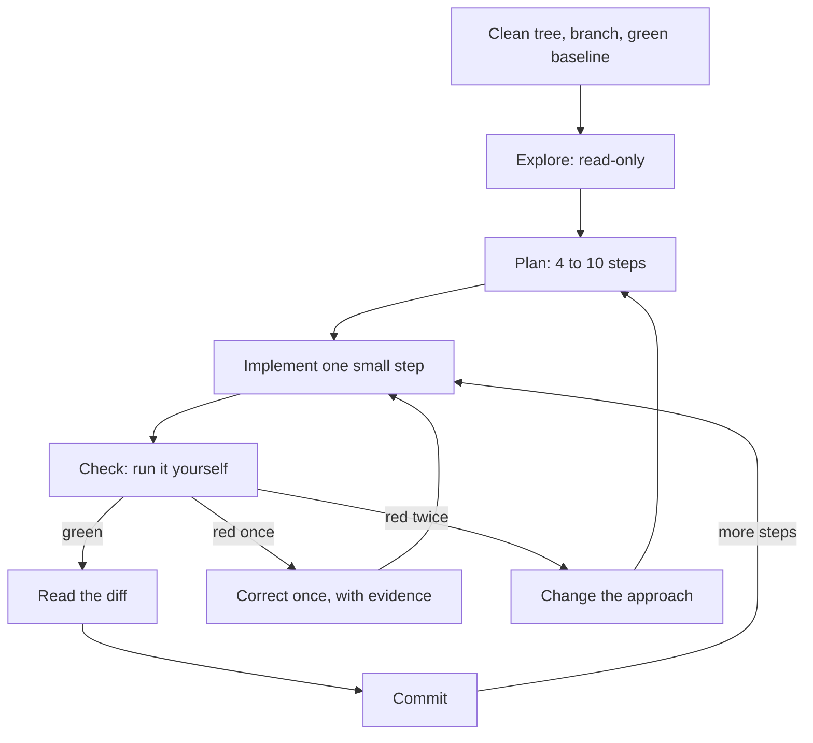

# Module 4 — The daily loop

*Module 4 is the short, repeatable cycle in which you and your agent get real work shipped: explore, plan, implement one small step, check it yourself, read the diff, commit, and start again. Lesson 4.1 is the concept lesson, set on the Payments Platform team at Najm Bank: what to do before the session (a clean tree, a branch per task, a green baseline), the workflows the Claude Code documentation recommends, checkpoints and rewind, plan mode, six cues that an agent is going astray, the two-failure rule, when to take the wheel, session hygiene and the agent log, with a session timeline whose interventions are marked. It ends with two artefacts, the Loop checklist and the Interruption cues card, and with Meta's own description of verification as the bar for done. Lesson 4.2 is the lab: REMIT-318, a ticket from Hessa (product owner), asks Remit to warn a customer, in English or Arabic, when a transfer takes them to 80% of their daily limit. You write a spec and a plan, work in small commits, add tests, and the offline grader runs hidden acceptance tests and breaks your feature on purpose to see whether your tests notice. An agent is recommended, not required. Everything on the Najm side is fictional.*

> **Focus:** Workflow — habit 3, *Small verified steps*: take one small step at a time, check it yourself, keep a commit to return to, and stop the agent early rather than late.

---

# 4.1 — Explore, plan, implement, check, commit: small steps, checkpoints and when to take the wheel
*Level: 🟡 Intermediate* · *Prerequisites: 3.1* · *Focus: Workflow*

## ⚡ In 60 seconds
- The daily loop has six moves: **explore** (read-only), **plan**, **implement one small step**, **check** it yourself, **read the diff**, **commit**. The unit is the step, not the ticket.
- Prepare first: a clean tree, a branch per task, a green baseline, a fresh session.
- Commits are save points. Checkpoints (`Esc` `Esc`, `/rewind`) briefly undo the agent's edits; they do not replace git.
- Stop at the first cue: thrashing, edits out of scope, the same failing command, apologies without evidence. Correct once. After **two failed attempts, change the approach**: smaller task, fresh context, better spec.
- Take the wheel when typing the fix is faster than explaining it, or the agent cannot see what you can.
- Biggest trap: waiting.

## 🧭 Why it matters
On a Friday (a constructed day) Lujain (graduate engineer) gives her agent REMIT-269, a `--since` option for `history`, in one prompt and goes into a meeting. When she returns, 14 files and 612 lines have changed: the option, a parser refactor, a tidy-up of `fees.py` and three edited tests. All pass; she commits it as `wip`. Nada (quality engineering lead) asks which of the 612 lines the feature needs; Lujain cannot say, and one edited test used to guard a fee-tier boundary. The pull request is split into four, and unpicking `fees.py` takes longer than the feature did.

Nothing the agent did was exotic. The loop was missing: no plan to hold the diff against, no check between steps, no commit to return to. DORA's 2024 report associated higher AI adoption with lower delivery stability, and its authors link part of that dip to larger batch sizes; these are survey associations, not proof of cause.

## 📐 How it works

### 🟢 The essentials

**One lap.** A step is small when it has one reason to change, a check you can name in a sentence and a diff you can read in one sitting.



In each lap **you** state the step's check first, run it yourself, read `git diff` (tests first) and write the commit message. **The agent** reads, proposes and edits, and commits only when asked.

**What the documentation recommends.** The Claude Code best-practices page changes, so check it; labels such as "explore-plan-code-commit" or "safe YOLO mode" are not its headings.

| The page's heading or topic | Its gist | Here |
|---|---|---|
| **Explore first, then plan, then code** | Four phases: Explore, Plan, Implement, Commit. Plan mode: `Shift+Tab` until `⏸ plan mode on`, or `claude --permission-mode plan`; `Ctrl+G` opens the plan in your editor. "If you could describe the diff in one sentence, skip the plan." | This lesson |
| **Give Claude a way to verify its work** | "Give Claude a check it can run: tests, a build, a screenshot to compare", such as "write a failing test that reproduces the issue, then fix it" | Lesson 5.1 |
| **Run autonomously with auto mode** | A classifier reviews commands before they run, for example `claude --permission-mode auto -p "fix all lint errors"` | Lesson 8.1 |
| **Run multiple Claude sessions** | Worktrees and more; a writer session and a reviewer session in a fresh context | Lesson 10.1 |
| **Run non-interactive mode; fan out across files** | `claude -p` in CI or scripts, `--allowedTools`, `/batch` | Lessons 9.1 and 10.1 |
| **Adversarial review** (a topic, not a heading) | A subagent reviews the diff in a fresh context; reviewers "will usually report some, even when the work is sound" | Lesson 5.1 |

**Before the session: git hygiene.**

```bash
git status                                # clean?
git switch -c remit-269-history-since    # a branch per task
pytest -q                                 # the baseline is green before the agent starts
# ... the agent finishes one step ...
git diff --stat                           # which files? the ones the plan named?
git diff                                  # read it, tests included
pytest -q                                 # evidence, run by you
git add -p                                # stage what you read
git commit -m "feat(cli): filter history with --since"
```

- **A branch per task and a clean tree** make every line of `git diff` the agent's. **A green baseline** makes a later red test news.
- **Commits are save points**, made when a step is green. `git restore <file>` drops uncommitted edits to one file; `git revert <sha>` undoes a commit without rewriting history.
- **Conventional Commits.** Remit's `CONTRIBUTING.md` asks for `type(scope): subject`: a listed type, a required lower-case scope, an imperative subject without a full stop, a header up to 72 characters. The public specification makes the scope optional; Remit is stricter.

**Plan mode, and when to skip it.** In plan mode the agent explores and proposes but does not edit source files. Use it for work that spans files or code you do not yet understand; skip it for the one-sentence diff.

### 🟡 Going deeper

**Checkpoints and rewind.** At the time of writing (2026), Claude Code records a checkpoint for each prompt that starts a turn, keeps the 100 most recent and expires them about 30 days after the session's last snapshot. Open the menu with `Esc` `Esc` on an empty prompt, or `/rewind`: restore code, conversation or both, or summarise. Bash changes (`rm`, `mv`, `cp`), outside edits and other sessions are not tracked, and the documentation says checkpoints are not a substitute for git.

**Cues that an agent is going astray.** The card in the 🏛️ section lists six. Stop at the first.

Anthropic, the maker of Claude Code, found that five assistants consistently showed sycophancy, a pull towards the user's view, across four text-generation tasks (Sharma and others, ICLR 2024). "You're right" is not evidence; a test run is (habit 4, *Trust evidence, not fluency*).

**The intervention ladder** is on the card; use the lowest rung that works. `Esc` stops the agent in the terminal (check the documentation for your interface); rewinding is `/rewind`, `git restore` or a commit. A correction needs a place, a reason and a check. Weak: *"That is wrong, try again."* It adds no information, so you get the same attempt reworded. Strong: *"`history` parses `since` as a naive `datetime`, which the store rejects. Build it with `QATAR_TZ` from `remit.limits`, then run `pytest -q tests/test_config_cli.py`."*

**The two-failure rule.** After two failed attempts at a step, a third in the same context rarely helps: it now holds two wrong approaches, and the best-practices page lists "Correcting over and over" among its failure patterns. Change one thing: make the task **smaller**, start a **fresh context** (`/clear`, then one sentence on what you learned) or write a **better spec** with the missing fact, an example or the failing test. This is the course's rule of thumb, not a documented limit.

**When to take the wheel.** Take it when typing the fix is faster than explaining it; when the cause is a fact only you hold (the Qatar midnight, a business rule) or the agent cannot see what you see (a screen); when you cannot yet verify a money-path change; when two attempts failed; or when you are practising a skill you want to keep (lesson 13.1). It is not failure: fix the hard line, then hand the keyboard back for the tests.

**Session hygiene.** One task per session; the page calls the opposite "The kitchen sink session". Use `/clear` between tasks, `/compact Focus on the CLI changes` when a long task fills the window and `/context` to see what is loaded; send investigations to subagents, which return a report only.

**The agent log.** After each AI-assisted task, note the prompt, the result, your corrections, your checks and the minutes. Be honest about the minutes: the log is your clock, and your feeling of speed is not.

**A session timeline with the interventions marked.** Constructed for REMIT-269; not recorded from a real model, and the times are invented.

| Time | Move | What happened | Cue | Intervention |
|---|---|---|---|---|
| 09:12 | Plan | Seven steps; step 6 moves the parser, step 7 edits the README | Out-of-scope steps | `Ctrl+G`: delete both; add "a date is the start of that Qatar day" |
| 09:31 | Step 2 | A naive `datetime`; the store raises `datetimes must be timezone-aware`; the agent adds `try/except`, then edits the test | Thrashing; a test edited | `Esc`; `/rewind` code and conversation; restate: use Qatar time |
| 09:44 | Step 2 | The same `pytest` command three times | Same failing command | You take the wheel: read the traceback, fix two lines, commit |
| 09:52 | Step 3 | Two attempts at the help-text test fail | Two failures | New session, a one-paragraph spec, a smaller step |
| 10:05 | Review | `git diff --stat` lists `fees.py` | Out-of-scope edit | `git restore src/remit/fees.py` |
| 10:10 | Close | Green; pull request labelled `AI-assisted`; log: 70 minutes, 5 interventions | | |

### 🔴 Expert view

**Done means verified.** Meta's engineering blog describes a small team building its Forum app with an AI agent as a participant. Meta reports that it measured success by production-ready changes, not code volume, and set the bar "at verification rather than compilation": a task is complete only after automated tests and visual checks pass, not when the code compiles. It also reports that when the agent repeated a mistake more than twice, the team encoded the correction once, for everyone. Meta's target is "human-on-the-loop": the agent runs the plan, build, test and correct cycle while an engineer sets the goal and approves the result. The post calls this a target, not a finished state. All of it is a company's account of its own practice, not independent evidence. The habits carry over: "done" is a check you ran, and a correction you make a third time belongs in `CLAUDE.md`, a test or a hook (Modules 2 and 9).

**Gate the stop.** An agent stops when it believes it is done. The page names three ways to make "done" require your check: a `/goal` condition, a Stop hook or a verification subagent (lesson 9.1 covers hooks and subagents, not `/goal`; check the current documentation).

**How long a leash.** The course's default is Manual or `acceptEdits` mode with a check after every step; the mode Claude Code starts in depends on its version, plan and provider, so read the status bar. Longer leashes (auto mode, background and headless runs) pay when the work is specified, checkable and cheap to throw away, but you lose the cues, since you cannot interrupt what you are not watching: automate the checks. The documentation says auto mode "does not guarantee safety".

**When not to run the full loop.** For a one-sentence diff, read the diff and commit. For a throwaway spike, delete the branch afterwards. The loop cannot rescue a vague ticket: if every lap ends in "not what I meant", return to lesson 3.1.

## 🧰 The toolkit
| Tool, practice or pattern | What it is and does | When to reach for it |
|---|---|---|
| **Loop checklist** | One page: before the session, each lap, after the last step | Every task |
| **Interruption cues** | A card: six cues, the ladder, the two-failure rule | Whenever an agent works while you watch |
| **Plan mode** | Read-only exploration and an editable plan (`Shift+Tab`, `/plan`) | Multi-file edits; unfamiliar code |
| **Checkpoints and rewind** | A per-prompt undo of the agent's edits (`Esc` `Esc`, `/rewind`) | A bad turn inside a lap |
| **Branch per task** | One branch per ticket, from a clean tree | Every task |
| **Conventional Commits** | `type(scope): subject`, as `CONTRIBUTING.md` defines it | Every commit |
| **Agent log** | Prompt, result, corrections, checks, minutes | After every AI-assisted task |

## 🏛️ In practice at Najm Bank
Tariq (engineering lead) opens the weekly clinic with two cards. The first is the **Loop checklist**; copy it as `loop-checklist.md`.

```markdown
# Loop checklist (one lap = one small step)

Before the session
- [ ] Clean tree; on a branch for this task, not main; `pytest -q` green; a fresh session.
- [ ] "Done means" is written down: a spec, or a sentence and the files in scope.

Explore and plan
- [ ] Read-only first; the files and functions the agent names exist.
- [ ] Four to ten steps, one commit and one check each, the failing test first; anything out of scope is deleted.

Each lap
- [ ] I can state this step's check in one sentence before the agent edits.
- [ ] I ran the check myself; I did not rely on "all tests pass".
- [ ] I read `git diff --stat`, then the diff, tests first. No existing test was edited.
- [ ] I commit while green, as `type(scope): subject`.

Interrupt
- [ ] I stopped at the first cue and corrected once, with evidence.
- [ ] After two failed attempts I changed the approach: smaller, fresh, better spec.

After the last step
- [ ] `git diff main --stat` is what I expected; the pull request is labelled `AI-assisted`.
- [ ] Money logic has a second human reviewer. Agent log entry, with minutes.
- [ ] A correction I made a third time is now a rule, a test or a hook.
```

The second is the **Interruption cues** card. Keep it next to the terminal.

```text
INTERRUPTION CUES - stop at the first one
1 Thrashing         the same lines edited back and forth; a test flipping red and green
2 Out of scope      a file you did not name; a test edited; "while I'm here" tidying
3 Same failing run  the identical command again, with no new idea
4 Apology loop      "You're right, I apologise", then no run, or the same mistake
5 Plan drift        step 5 while you approved steps 1 and 2; a new approach, unannounced
6 No evidence       "all tests pass" and no test run in view

LADDER  1 stop (Esc) and say what you saw    2 correct once: file, line, reason
        3 rewind (/rewind, git restore)       4 take the wheel for this step
        5 after two failures: smaller task, fresh context, better spec
```

The clinic's rule: no pull request without a filled checklist, and no "the agent did it" in review.

## 🛠️ Exercises
- 🟢 **Mark a timeline.** *No agent.* Write a six-line timeline of your last AI-assisted session. *Done when:* each line names a move, and two name a cue you noticed late and the rung you should have used.
- 🟡 **Run the loop on a small change.** *Agent optional.* Make a green sandbox (from the `ailab` folder: `python -m ailab start m00 --dir ~/ainative/sandbox`, then `python -m ailab solve m00 --dir ~/ainative/sandbox`). In the sandbox, on a branch, add `--since YYYY-MM-DD` to `history`; a date means the start of that Qatar day. (Try `PYTHONPATH=src python -m remit history --customer C001` after `customer add` and `send`.) *Done when:* you have three or more green commits in the Remit format, the checklist is ticked with the commands you ran, and one line says what to change.
- 🔴 **Rehearse an interruption.** *Needs an agent.* In the sandbox, give the agent a prompt that invites scope creep ("make the CLI nicer"), with no plan, and watch. *Done when:* your notes give the first cue and its time, the rung you used and what the two-failure rule would have changed, and the branch is at a green commit.

## ⚠️ Mistakes and traps
- **Waiting for a large task to finish.** Each minute adds code to unpick; interrupt at the first cue.
- **Planning a one-sentence diff, or skipping the plan for a ten-file one.** Match the plan to the diff.
- **Treating checkpoints as a backup.** Bash changes are untracked and snapshots expire; commit.
- **A third correction in the same context, or the same fix in every prompt.** Change the approach, and move the correction into `CLAUDE.md`, a test or a hook.

## 🧾 Recap
- The loop: explore, plan, implement a small step, check, read the diff, commit, on a clean branch with a green baseline.
- Commits are save points; checkpoints are a short-lived undo.
- Stop at the first cue, correct once, and after two failures change the approach.
- Take the wheel when you know the fix, hold a fact the agent lacks, or cannot yet verify.
- Done means verified, not compiled; a correction made more than twice belongs in a durable rule.

## ✍️ Check yourself

**1. Ten minutes in, the agent has run the same failing `pytest` command three times and changed nothing between runs. What do you do?**

- A. Let it carry on, because a fourth run may pass without any change.
- B. Press `Esc`, read the traceback and decide whether to take the wheel.
- C. Switch to a mode that skips approvals so the retries run unattended.
- D. Ask it to commit the current state so the half-finished work is saved.

<details><summary>Answer</summary>

**B.** The same failing command with no new idea is a cue to stop; the traceback is evidence the agent ignores. (🟡 Cues and the ladder.)

</details>

**2. The agent's second attempt at a step failed after your correction. What is the best next move?**

- A. Correct it a third time, using the same words but in capitals so it notices.
- B. Rewind everything done today and begin the whole ticket again from scratch.
- C. Ask the agent to apologise and to promise to be more careful next time.
- D. Change the approach: split the step, start fresh or add a missing fact.

<details><summary>Answer</summary>

**D.** After two failures a third try in the same context rarely helps; change the task, the context or the spec. Capitals and apologies add words, not information. (🟡 The two-failure rule.)

</details>

**3. Lujain says `Esc` `Esc` makes commits unnecessary, because she can rewind anything. What is the right reply?**

- A. No: Bash changes and outside edits are not tracked, and git is the save point.
- B. Yes: checkpoints keep every change for a year, whichever tool made the change.
- C. Yes, as long as the agent only edits files and never runs a shell command at all.
- D. No: checkpoints cover only the main branch and are deleted every night at midnight.

<details><summary>Answer</summary>

**A.** Bash changes and outside edits are untracked, snapshots expire, and git is the real save point. (🟡 Checkpoints and rewind.)

</details>

**4. Hessa (product owner) files a ticket to fix one misspelt word in an English message. Which approach fits?**

- A. A seven-step plan in plan mode, with a checkpoint after every single step.
- B. A fresh session for each sentence of the ticket, to keep the context small.
- C. Describe the diff in one sentence, make it, read `git diff`, test, commit.
- D. Run it in the background and review the result at next week's clinic.

<details><summary>Answer</summary>

**C.** The page says to skip the plan if you could describe the diff in one sentence; you still read the diff and run the check. (🟢 Plan mode, and when to skip it.)

</details>

**5. A colleague says Meta's Forum post proves that agents with a good setup need no human review. What is a fair response?**

- A. Meta has shown that review is unnecessary once the agent's setup is good enough.
- B. It is Meta's own account, and it calls human-on-the-loop a target, not a result.
- C. The post covers only one programming language, so none of it can apply here.
- D. Only the visual checks matter; Meta treats automated tests as optional extras.

<details><summary>Answer</summary>

**B.** A company's account of its own practice is not independent evidence, and Meta calls the target unfinished. (🔴 Done means verified.)

</details>

## 📚 References
- Claude Code documentation: best practices https://code.claude.com/docs/en/best-practices; checkpointing and rewind https://code.claude.com/docs/en/checkpointing; permission modes (plan mode) https://code.claude.com/docs/en/permission-modes; the context window https://code.claude.com/docs/en/context-window
- Git: https://git-scm.com/docs. Conventional Commits 1.0.0: https://www.conventionalcommits.org
- [*Software Testing*, lesson 6.2 — Tests as the specification for coding agents](../testing/index.html#/6.2)
- **Go deeper.** Engineering at Meta, "How Meta Built Forum With AI-Native Engineering": https://engineering.fb.com/2026/10/15/ml-applications/how-meta-built-forum-ai-native-engineering/ (read the original; this lesson knew it only from a summary). Anthropic, "Towards Understanding Sycophancy in Language Models": https://www.anthropic.com/research/towards-understanding-sycophancy-in-language-models. DORA, 2024 report: https://cloud.google.com/blog/products/devops-sre/announcing-the-2024-dora-report.

---

# 4.2 — Lab: ship a small feature through the whole loop
*Level: 🟡 Intermediate* · *Prerequisites: 3.2, 4.1* · *Focus: Workflow*

## ⚡ In 60 seconds
- **Lab m04.** Hessa's ticket REMIT-318: when a successful transfer takes a customer to 80% of their daily limit or more, send a second message, in English or Arabic. About 25 lines of code, and five easy ways to get them wrong.
- You run the whole loop: explore, a spec with a plan, small green commits, tests that fail without the feature, an agent log.
- **Needs an agent: no (recommended, not required).** The grader cannot tell who typed the code.
- The grader runs hidden acceptance tests, then breaks the warning on purpose to see whether your tests notice. It cannot tell whether you read the diff or decided well.

## 🧭 Why it matters
Lujain's agent writes the limit warning in four minutes. It looks right and passes every test, including the ones the agent wrote. It also fails at exactly 80%, shows 100% to a customer at 99.95%, prints Western digits to Arabic customers, and turns a gateway outage into a crash after the money has moved. A green suite proves none of this: the old tests predate the feature, and the agent's tests check only the cases it thought of.

## 📐 How it works

### 🟢 The essentials

The lab is the loop in seven steps (the order is advice):

| Step | You do | Evidence |
|---|---|---|
| 1. Explore | Run `pytest -q`. Read `send` in `service.py`, `LimitResult` in `limits.py`, `render` in `notify.py` | You can say what `daily_used` includes |
| 2. Spec and plan | Copy `specs/TEMPLATE.md` to `specs/REMIT-318.md`; settle what the ticket leaves open (where the logic lives, the percentage without floats); plan about five steps | A committed spec |
| 3. The message | The template, with tests of its exact text | A green commit |
| 4. The decision | When to warn, what to show, with tests either side of the line | A green commit |
| 5. The edges | Arabic customer, refused transfer, failed delivery | A green commit |
| 6. Break it | Put `src` back to its `lab-start` state and run your new tests: those that need the warning must fail | Red, for the right reason |
| 7. Close | Read `git diff lab-start --stat`, update the docs if you wish, write the log, grade | A grade and a log |

### 🟡 Going deeper

**The risky diff.** Below is what a hurried agent might write for step 4 (constructed, not recorded; do not copy). Find five defects before reading on.

```python
        ratio = limits.daily_used / limits.daily_limit
        if ratio >= 0.8:
            self.notifier.notify(customer, "limit_warning", percent=round(ratio * 100),
                                 remaining=limits.daily_limit - limits.daily_used)
```

(1) `limits.daily_used` is the position **before** this transfer, so the warning comes one transfer late. (2) A `Decimal` compared with a float is compared exactly, and `Decimal("0.8") >= 0.8` is `False`: exactly 80% gets no warning. (3) `round` rounds the percentage instead of rounding it down. (4) The notifier is called directly, so a delivery failure escapes `send` after the transfer was saved. (5) An `int` percentage is not localised, so Arabic customers see Western digits. Evidence beats reading: defect 2 takes ten seconds to check. Look for these five in any agent diff.

```text
>>> from decimal import Decimal
>>> Decimal("1600.00") / Decimal("2000.00") >= 0.8
False
```

**The vague prompt and the specified one.** *"Add a warning at 80% of the daily limit"* leaves the agent to choose a reading, and each choice above is one it can get wrong. Specified:

```text
Read TASK.md and specs/REMIT-318.md, then service.py (send), limits.py and notify.py.
Implement step 4 only: the decision in RemitService.send. The position in `limits` is BEFORE
this transfer; add the amount just sent. Decimal only, no floats. Send the message through the
existing best-effort helper. Failing tests first, then the code. Do not touch fees.py or any
existing test, and do not commit. Show me the diff when pytest -q is green.
```

### 🔴 Expert view

**How the grader judges your tests.** "Your new tests fail when the warning is removed" puts every file outside `tests/` back to its `lab-start` state and runs your new tests. "Your tests notice a broken warning" runs them seven more times on your own code, each time with one deliberate breakage applied to the running program by a test plugin: the warning never delivered, the text without its numbers, the percentage one too high, Arabic customers given English, Western digits in Arabic, the 80% line a little too high or too low. Five of seven must be caught, and both 80%-line breakages among them: the ticket asks you to pin a total just under the line and one exactly on it, and wording tests alone never touch the line. This is the mutation idea from [*Software Testing*, lesson 2.3 — Are your tests any good?](../testing/index.html#/2.3), applied at the edges of the program so it works whatever your code looks like.

**What it cannot do.** It does not know your design is good, your spec wise or that you read the diff. If your tests use a fake notifier that never calls `render`, some breakages cannot reach them. A pass is not a review: in a real team `service.py` needs a second human reviewer and the pull request carries the `AI-assisted` label.

## 🧰 The toolkit
| Tool, practice or pattern | What it is and does | When to reach for it |
|---|---|---|
| **Spec template** | Ten sections, goal to plan, in `specs/` | Before the agent writes code |
| **Mutation check** | Break the feature on purpose and see whether the tests notice | When money logic or customer text needs tests that bite |
| **Agent log** | Prompt, result, corrections, checks, minutes | After every session |

## 🏛️ In practice at Najm Bank
*Needs an agent: no (recommended, not required).* **No-agent path:** do every step yourself, or ask a chat assistant for explanations and review your own code; the grader checks the repository only. Either way, write the log.

**The ticket.** This is the kit's `task.md`, as Hessa wrote it. `start` writes it to your lab directory as `TASK.md` (capitals matter on Linux and macOS).

> ```text
> # REMIT-318: warn customers when a transfer takes them to 80% of their daily limit
>
> **From:** Hessa, Product Owner, Najm Remit
> **To:** Payments Platform
> **Priority:** Medium. Support sees this complaint every week.
>
> Customers hit their daily sending limit without warning. The first they hear of it is "It would
> take you over your sending limit", on a transfer that failed, while the family at home waits.
> Let them see it coming.
>
> ## What I need
>
> When a transfer **succeeds** and brings the customer's total for the day to **80% of their daily
> limit or more**, send one more notification straight after "transfer sent". It says how much of
> the limit they have used and how much they can still send today.
>
> 1. **The day** is the Qatar day, as `limits.py` defines it. **The total** is the amounts sent
>    today (not fees) plus the transfer just made. **The limit** is the daily limit of their KYC tier.
> 2. **80% counts**: exactly 80% gets the warning, one cent less does not. Exactly 100% is allowed,
>    and warned.
> 3. **Every** successful transfer at 80% or more gets the warning, not only the first to cross.
> 4. Only the **daily** limit matters; being near the monthly limit sends nothing.
> 5. A refused or held transfer sends no warning, only the usual "transfer failed" message.
> 6. The warning is in the customer's language, `en` or `ar`.
> 7. The percentage is a whole number, **rounded down**: at 99.95% the customer sees 99%, never 100%.
> 8. Best effort, like "transfer sent": if it cannot be delivered the transfer still stands, `send`
>    returns normally, and the failure is audited like other notification failures.
>
> ## The interface, exactly
>
> - A new template `limit_warning` in `notify.TEMPLATES`, in `en` and `ar`, with the placeholders
>   `{name}`, `{percent}` (a whole number, passed as a `Decimal`) and `{remaining}` (a `Money` in
>   QAR: the limit minus the total).
> - The content team's wording, **character for character**. Copy and paste both lines into your code
>   and your tests; the Arabic uses `٪` and `،`:
>   - English: `Hi {name}, this transfer takes you to {percent}% of your daily sending limit. You can send {remaining} more today.`
>   - Arabic: `مرحباً {name}، بهذا التحويل وصلت إلى {percent}٪ من حد الإرسال اليومي. يمكنك اليوم إرسال مبلغ إضافي أقصاه {remaining}.`
> - So `render("limit_warning", "en", name="Bilal Khan", percent=Decimal(85), remaining=Money("300.00", "QAR"))`
>   says `85%` and `300.00 QAR`. In Arabic every digit is an Arabic-Indic digit, as in our other messages.
> - `RemitService.send` keeps its signature and `SendResult` its fields (`notified` still reports only
>   the "transfer sent" message). The warning goes through the notifier like any message: for a
>   warned transfer, `InMemoryNotifier.sent` ends with `transfer_sent`, then `limit_warning`. The
>   existing messages do not change.
> - Not in scope: changing limits, fees, rates, screening or the ledger; special wording at 100%; new
>   channels or dependencies.
>
> ## Done when
>
> - `specs/REMIT-318.md` (from `specs/TEMPLATE.md`, with your plan) is committed before any code. It
>   records your decisions where this ticket is silent, for example whether to warn when "transfer sent"
>   itself failed to deliver, and where a failed warning's audit entry falls. Either is accepted.
> - You worked in **small steps**: three commits or more (the spec commit counts), each with `pytest -q`
>   green and a message as `CONTRIBUTING.md` says (any lower-case scope, such as `docs(specs):`),
>   nothing left uncommitted. The project memory lets an agent commit only when the task asks; this
>   one does: ask it to, or commit yourself.
> - You added tests and did not edit the old ones. They fail if the warning is removed and they pin
>   the behaviour: the exact message in both languages, the percentage, totals just under and
>   exactly at 80% (through `send`), and nothing sent when a transfer is refused.
> - You touched only: `src/remit/notify.py`, `src/remit/service.py`, a helper in `src/remit/limits.py`
>   or one new module under `src/remit/`, `tests/`, `specs/`, `docs/`, `agent-log.md` and the memory
>   file (`CLAUDE.md` or `AGENTS.md`); under `src/`, at most four files and 120 changed lines. Money is
>   `Decimal`; no secrets. Money logic needs a second human reviewer, and AI-assisted work carries the
>   label (`CONTRIBUTING.md`).
> - `agent-log.md` has an entry (one line, if you used no AI tool). You read every diff and can explain
>   every line.
> - Grade it from the `ailab` folder of the course repository, with your branch checked out in this
>   directory: `python -m ailab grade m04 --dir <this directory>`
> ```

**Start.**

```bash
cd ~/system-design-for-vibe-coders/ainative/ailab      # with the virtual environment of lesson 0.2 active
python -m ailab start m04 --dir ~/ainative/m04
cd ~/ainative/m04
git switch -c remit-318-limit-warning
pytest -q
```

The starter is green: 99 tests pass. It holds `CLAUDE.md` (the project memory from lab 2.2), `specs/TEMPLATE.md`, an unfilled `agent-log.md` and `TASK.md`, committed as "Lab starting state" and tagged `lab-start`; steps 6 and 7 and the grader compare with that tag. The grader reads the branch checked out in `~/ainative/m04`, so grade on your task branch. If your tool reads `AGENTS.md`, copy or link the memory file.

**Your move.** Follow the seven steps. Explore first, in plan mode if you use Claude Code, and record in the spec what the ticket leaves open. Commit the spec. With an agent, give it one step per prompt, as in the specified prompt above; the memory file lets it commit only when asked, so ask it to, or commit yourself. Then one step per lap: failing test, code, `pytest -q` yourself, `git diff`, commit as `type(scope): subject`. Stop at the first cue on the card.

Step 6 is the one people skip. In `~/ainative/m04`, after committing, run `git restore --source=lab-start --staged --worktree src` to put the code back, then run your new tests. Those that expect a warning must fail; "no warning at 79.99%" or "nothing sent on a refusal" tests stay green, as they should. Then `git restore --source=HEAD --staged --worktree src` brings your feature back.

**What the grader checks.** Required: the suite passes; no old test, fixture or constant was edited; the hidden acceptance tests (the rules, wording and interface of the ticket, in both languages and all three KYC tiers); your new tests fail without the warning and catch five of seven breakages, both 80%-line ones included; only the files `TASK.md` lists changed, with at most four files and 120 changed lines under `src/`; no float added; three or more commits with Remit messages; nothing uncommitted; no secrets. Advisory: a spec and plan, spec before code, every commit green, no commit adding over 200 lines, no blanket `except`, a log entry.

**Grade.**

```bash
cd ~/system-design-for-vibe-coders/ainative/ailab
python -m ailab grade m04 --dir ~/ainative/m04
```

Grading takes about five seconds: it re-runs your tests. On the starter state the real output starts like this (abridged; the advisory lines come after the required ones):

```text
[PASS] The whole test suite passes: 99 passed
[FAIL] The warning works as the ticket describes: 30 of 46 hidden checks failed: test_the_limit_warning_template_exists_in_english_and_arabic, test_the_english_wording_is_the_approved_wording, test_the_arabic_wording_is_the_approved_wording_with_arabic_digits, test_the_decision_and_the_numbers_match_the_rule_for_many_amounts[T1-1600.00-True] (+26 more)
       hint: Re-read the ticket line by line: the rules, the interface and the approved wording. Which one do your tests not check?
[... ten more required lines and six advisory lines ...]

Lab m04: 5/12 required checks passed: NOT YET
```

Real output for a correct feature whose tests only check that "something was sent":

```text
[PASS] Your new tests fail when the warning is removed: 1 new test fails without the warning, as they should
[FAIL] Your tests notice a broken warning: your tests catch 1 of 7 deliberate defects; they miss: the 80% line sits a little too high, the 80% line sits a little too low, the warning text loses its numbers (+3 more)
       hint: Pin the exact message in both languages and its numbers, and the 80% line through `RemitService.send`: one total a cent under it (no warning), one exactly on it (a warning).

Lab m04: 11/12 required checks passed: NOT YET
```

With sound tests the last line reads `Lab m04: 12/12 required checks passed: PASSED`.

**Weekly deliverable (Module 4).** In the lab repository, your branch of small commits. In your notes repository, `week-04/` with `loop-checklist.md` (ticked), `timeline.md` (a table like lesson 4.1's: Time, Move, What happened, Cue, Intervention), `agent-log.md` and `m04-grade.txt` (from the `ailab` folder, add `> <notes>/week-04/m04-grade.txt` to the grade command).

**Group session (60 minutes).** (1) Swap `git log --oneline lab-start..HEAD`: does each commit tell one step? (10) (2) Swap tests: break your partner's feature by hand in one way; does a test notice? (20) (3) Compare timelines: first cue, rung used (15) (4) Agree one line for the team checklist (10) (5) Agent logs (5).

**Debrief.** What did the agent get wrong, and what did you only see by running it? What did your context or spec miss? Which cue did you notice last, and where should the two-failure rule have applied? How many minutes went to verifying?

**Agent log.** The starter's `agent-log.md` has these fields; fill one entry per session (for example, "REMIT-318, step 4").

```text
Entry:
Prompt (paste or summarise):
What the agent did:
What I corrected:
What I checked myself:
Minutes (you / agent / checking):
Would I delegate it again?
```

## 🛠️ Exercises
- 🟢 **By hand.** *No agent.* Do the lab without a tool. *Done when:* `grade` prints `PASSED`, you have at least three commits, and your log says what took longest.
- 🟡 **With an agent, and the cues.** *Agent recommended.* Redo it in a fresh directory, in plan mode, one step per lap. *Done when:* `PASSED` again, `timeline.md` marks a cue, and a table compares both attempts on minutes and interventions.
- 🔴 **Break your own feature.** *Optional agent.* In your finished repository, introduce each defect of the risky diff in turn. *Done when:* a table says whether a test failed, which one, and what you added for any that slipped through.

## ⚠️ Mistakes and traps
- **Tests written after the code, never seen failing.** Run them against `lab-start`.
- **Trusting "all tests pass" from the agent.** Run `pytest -q` yourself, and read the diff.
- **Editing an old test to go green.** It is a cue: the code is wrong.
- **One commit at the end.** Three small green commits are part of the task.

## 🧾 Recap
- Spec and plan first; then failing test, code, your own run, the diff, a commit.
- Compare Decimals with Decimals, add the transfer just made, round down, localise digits, and use the best-effort path.
- A test is worth something when it fails without the feature and when a deliberate breakage makes it fail.

## ✍️ Check yourself

**1. Your feature works, but the grader fails "Your new tests fail when the warning is removed": all of your new tests pass without it. What does that tell you?**

- A. The grader is wrong: the suite is green, so the new tests must be working.
- B. The feature is too small to need tests of its own, so none were needed.
- C. Your tests depend on a fixture that the starter code does not have yet.
- D. Your tests never depend on the feature, so they would not notice it missing.

<details><summary>Answer</summary>

**D.** A test that passes before the feature exists proves nothing: make each fail first, then build. A green suite (A) does not show that the new tests bite. (🔴 How the grader judges your tests.)

</details>

**2. An agent's diff for step 4 computes `ratio = limits.daily_used / limits.daily_limit` and warns when `ratio >= 0.8`. What is wrong with it?**

- A. Nothing is wrong: Python converts the float 0.8 to a Decimal before it makes the comparison.
- B. It compares a Decimal with a float, so exactly 80% fails, and it leaves out this transfer.
- C. It uses the daily limit, but the monthly limit is the one that matters for this ticket.
- D. It adds the fee to the total, so the warning arrives early; it also rounds the percentage.

<details><summary>Answer</summary>

**B.** A Decimal is compared with a float exactly, and `Decimal("0.8") >= 0.8` is False; `daily_used` is the position before this transfer. (🟡 The risky diff.)

</details>

**3. Which history would the lab accept as working in small steps?**

- A. One commit, `feat(service): add warning`, holding the spec, the code and the tests.
- B. Four commits named wip, wip2, fix and final, made whenever the work seemed done.
- C. A spec commit, then three green commits: message, decision, edge tests.
- D. Two commits: all the tests in the first, then all of the code in the second.

<details><summary>Answer</summary>

**C.** The lab asks for three or more green commits in the Remit format, the spec commit included. One big commit (A) and vague names (B) fail that. (🟢 The essentials.)

</details>

**4. The grader says you catch 3 of 7 breakages and misses "Arabic text shows Western digits". What is the best next step?**

- A. Add a test of the exact Arabic message, with Arabic-Indic digits and no ASCII digit.
- B. Skip it: the Arabic wording is the content team's job.
- C. Edit the grader's plugin until the breakage no longer applies.
- D. Change the code to print Western digits, so the breakage changes nothing.

<details><summary>Answer</summary>

**A.** The breakage survives only if no test pins the digits of the Arabic text, so pin them. Weakening the grader (C) or the feature (D) defeats the point. (🔴 How the grader judges your tests.)

</details>

**5. Which statement about the grade is correct?**

- A. It can tell from the commit history and the timestamps whether an agent wrote the code.
- B. It shows that the feature is correct for every possible input, including unusual ones.
- C. It checks the result, not who wrote it or whether your decisions were wise.
- D. It confirms that you read each diff carefully before you committed it to the branch.

<details><summary>Answer</summary>

**C.** The kit grades the repository. It cannot see authorship, reading or judgement, and a pass is not a review. (🔴 What it cannot do.)

</details>

## 📚 References
- The ailab README: https://github.com/Tamoura/system-design-for-vibe-coders/tree/main/ainative/ailab
- Claude Code documentation: best practices https://code.claude.com/docs/en/best-practices; checkpointing https://code.claude.com/docs/en/checkpointing
- Python: the `decimal` module https://docs.python.org/3/library/decimal.html; pytest https://docs.pytest.org; Conventional Commits https://www.conventionalcommits.org
