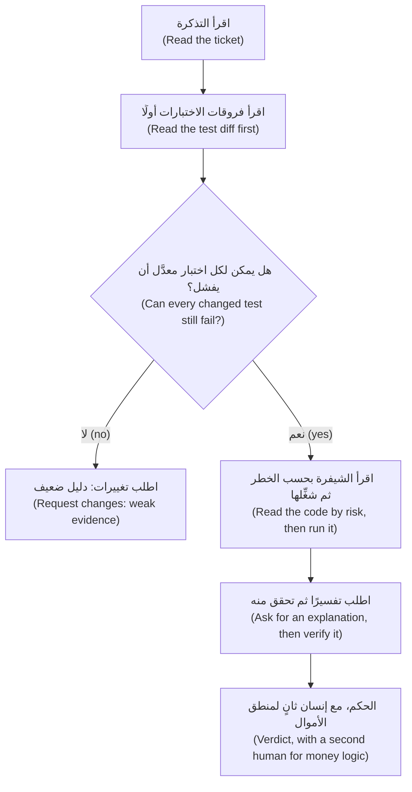

# الوحدة 5 — التحقق (Verification)

*يُقرأ تقرير وكيل البرمجة (coding agent) بالسلاسة نفسها سواء أكان التغيير صحيحًا أم خاطئًا، فلا يخبرك بأيهما إلا الدليل (evidence): اختبار يمكن أن يفشل، وفروقات (diff) قرأتها، وتشغيل (run) شاهدته. وتدور هذه الوحدة حول الحصول على ذلك الدليل بسرعة وإنفاقه بما يتناسب مع الخطر. الدرس 5.1 هو الدرس المفاهيمي: الاختبارات بوصفها المواصفة وحلقة الاختبار أولًا مع الوكيل، والطرق التسع التي تنجح بها الشيفرة المكتوبة بالذكاء الاصطناعي وهي خاطئة، وقراءة الفروقات بحسب الخطر، ومراجعة محلولة لطلب دمج (pull request) أخضر وخاطئ، وكيفية مراجعة فروقات ضخمة، واختبارا الطفرات والخصائص حَكَمين، والتحقق المتناسب (proportional verification)، والثقة المُعايَرة (calibrated trust)، وقائمة تحقق مراجعة طلبات الدمج المكتوبة بالذكاء الاصطناعي. أما الدرس 5.2 فهو المختبر: فتح وكيل لجين (Lujain)، المهندسة حديثة التخرج (graduate engineer)، طلب دمج لتذكرة خصم الولاء الخاصة بحصة (Hessa)، مالكة المنتج (product owner)، والمجموعة الاختبارية (suite) خضراء، وأنت المراجع الثاني. تكتب المراجعة (review) ثم تصلح الفرع. وكل ما يخص جانب نجم خيالي.*

> **التركيز (Focus):** Verify — العادة الرابعة (habit 4)، *ثق بالدليل لا بالطلاقة (Trust evidence, not fluency)*: تحقّق مما أنتجه الوكيل بالاختبارات والفروقات والتشغيل قبل أن يُشحَن، وقرِّر كم من الفحص يستحقه كل تغيير.

---

# 5.1 — ثق بالدليل لا بالطلاقة: الاختبارات بوصفها المواصفة وقراءة الفروقات وطرق نجاح شيفرة الذكاء الاصطناعي وهي خاطئة
*المستوى (Level): 🟡 متوسط (Intermediate)* · *المتطلبات (Prerequisites): 4.1* · *التركيز: Verify*

## ⚡ الدرس في دقيقة (In 60 seconds)
- **الطلاقة لا تعني الصحة (Fluent is not true).** الملخص (summary) والفروقات وعبارة «كل الاختبارات تنجح» تُقرأ جيدًا في الحالتين. أما الدليل فكان يمكن أن يأتي بعكس ذلك: اختبار يمكن أن يفشل، وفروقات قرأتها، وتشغيل شاهدته.
- **الاختبارات هي المواصفة (Tests are the specification).** اعتمدها (Approve them) من معايير القبول (acceptance criteria) *قبل* أن ينفّذ الوكيل، وأودِعها (commit them)، واعتبر أي تعديل لاحق عليها ملاحظة.
- **تسع طرق متكررة (Nine recurring ways)** تنجح بها شيفرة الذكاء الاصطناعي وهي خاطئة، من اختبارات لا تؤكد شيئًا إلى زحف النطاق (scope creep).
- **اقرأ بالترتيب (Read in order):** التذكرة (ticket)، ثم الاختبارات (tests)، ثم الشيفرة بحسب الخطر (code by risk) — الصحة (correctness)، والأمان (security)، والنطاق (scope)، وقابلية الصيانة (maintainability)، والاقتران الخفي (hidden coupling) — ثم شغِّلها (run it). والنموذج الثاني يضيف أسئلة لا أحكامًا.
- **أنفق بما يتناسب (Spend in proportion):** منطق الأموال (money logic) ينال كل الفحوص، والخطأ المطبعي (typo) لا ينالها. والشيفرة المدموجة دون تحقق هي دين التحقق (verification debt).

## 🧭 لماذا يهم
تجعل لجين، المهندسة حديثة التخرج، وكيلها ينجز REMIT-227 في دقائق: عرض سعر الصرف في رسالة «تم إرسال التحويل» ("transfer sent"). يمسّ طلب الدمج أربعة ملفات ويقول «كل الاختبارات تنجح». وهي كذلك: 99 اختبارًا نجح (99 passed). يطرح طارق (Tariq)، قائد الهندسة (engineering lead)، سؤالًا واحدًا: «أي اختبار يحمرّ لو كان الرقم العربي خاطئًا؟» ⁦⁩ لا تستطيع لجين تسمية اختبار واحد. تنتهي الرسالة العربية بسعر الصرف بأرقام غربية (Western digits)، والاختبار الذي كان يمنع ذلك جرى تضييقه بهدوء (quietly narrowed).

نشرت METR في مارس 2026 «كثير من طلبات الدمج الناجحة في SWE-bench لن تُدمج في الفرع الرئيسي»: راجع مشرفو ثلاثة مستودعات رقعًا (patches) اجتازت مُقيِّمًا آليًا، ولم تكن نسبة كبيرة منها لتُدمج، وتحذّر METR من أن هذا يخص مجموعة فرعية واحدة من معيار واحد، وإطار تشغيل واحدًا (one harness)، ومحاولة واحدة. ويفهرس [*اختبار البرمجيات (Software Testing)*، الدرس 6.1 — التحقق من الشيفرة المولَّدة بالذكاء الاصطناعي (Verifying AI-generated code)](../testing/index.ar.html#/6.1) هذه الإخفاقات؛ وهذا الدرس هو الروتين.

## 📐 كيف يعمل

### 🟢 الأساسيات

**ثق بالدليل لا بالطلاقة (Trust evidence, not fluency).** اسأل عن أي فحص (check): *لو كان التغيير خاطئًا، فهل كان هذا سيبدو مختلفًا؟ ⁦⁩* الوصف (description) والشارة الخضراء (green badge) والفروقات المرتبة (tidy diff) تبدو متطابقة في الحالتين؛ أما اختبار يفشل عند الخلل فلا.

**اجعل المعيار عند التحقق (Set the bar at verification).** في [*كيف بنت Meta تطبيق Forum بهندسة أصيلة في الذكاء الاصطناعي*](https://engineering.fb.com/2026/10/15/ml-applications/how-meta-built-forum-ai-native-engineering/) تصف Meta فريقًا صغيرًا يبني تطبيق Forum الخاص بها بوكيل ذكاء اصطناعي مشاركًا. وتذكر أنها لا تعدّ المهمة مكتملة إلا بعد نجاح الاختبارات الآلية (automated tests) والفحوص البصرية (visual checks)، لا حين تُترجَم الشيفرة برمجيًا، وتقيس النجاح بتغييرات جاهزة للإنتاج (production-ready changes) لا بحجم الشيفرة (code volume). وهذه شركة تصف ممارستها الخاصة، فاقرأ الأصل: مثال على معيار لا دليل على أنه ينجح. وفي ريميت (Remit)، عبارة «تُترجَم برمجيًا» لا تعني «انتهى»: تحتاج إلى اختبار يمكن أن يفشل، وإلى تشغيل بلا شاشة تقرأ فيه السطر العربي بنفسك.

**الاختبارات هي المواصفة (Tests are the specification).** يحوّل الاختبار معيار القبول (acceptance criterion) (الدرس 3.1) إلى شيء تستطيع الآلة أن تحاسب الوكيل عليه. ويشرحه [*اختبار البرمجيات*، الدرس 6.2 — الاختبارات بوصفها المواصفة لوكلاء البرمجة](../testing/index.ar.html#/6.2) بعمق؛ وهذه هي الحلقة.

1. **اكتب الاختبارات أو اعتمدها (Write or approve the tests)** انطلاقًا من التذكرة. يجوز أن يكتب الوكيل مسودتها (draft them)؛ وتتحقق أنت من كل قيمة متوقعة بمقابلتها بالتذكرة لا بالشيفرة.
2. **شاهدها تفشل للسبب الصحيح (Watch them fail for the right reason).** خطأ الاستيراد أحمر لكنه لا يثبت شيئًا (proves nothing). وتستخدم صفحة أفضل الممارسات (best-practices page) في Claude Code النمط نفسه: اختبار فاشل يعيد إنتاج المشكلة، ثم الإصلاح.
3. **أودِع الاختبارات وحدها (Commit the tests alone)**، لتكون لها حالة معروفة وسليمة.
4. **قل للوكيل أن ينفّذ لا أن يعدّلها (Tell the agent to implement, not to edit them).** قد تفيد قاعدة منع (deny rule) مثل `Edit(tests/**)` في `.claude/settings.json`؛ لكنها تشمل أدوات التحرير المدمجة في Claude لا كل عملية فرعية (every subprocess)، فراجع وثائق الصلاحيات. والحارس الحقيقي هو الخطوة 5.
5. **راجع: يجب أن تكون فروقات الاختبارات منذ الخطوة 3 فارغة (Review: the test diff since step 3 must be empty).** الاختبار المتغيّر ملاحظة (finding) حتى يُفسَّر (until explained).

**تسع طرق تنجح بها شيفرة الذكاء الاصطناعي وهي خاطئة (Nine ways AI code passes while wrong).**

| الطريقة (Way) | في ريميت | ما يكشفها |
|---|---|---|
| لا تؤكد شيئًا (Asserts nothing) | `service.send(...)`، ثم `print(result)` | أي سطر يمكن أن يفشل؟ ⁦⁩ |
| تستبدل الوحدة قيد الاختبار بمحاكاة | `patch("remit.service.check_limits", ...)` إلى «مسموح» ("allowed")، ثم تؤكد أن الإرسال مسموح | لا تُحاكِ إلا الحواف: الساعة والمُخطِر (clock, notifier) |
| تعالج المثال معالجة خاصة | `if amount == Money("500.01", "QAR"): return Money("12.50", "QAR")` | نوِّع المدخلات (Vary inputs): القيم الحدّية (boundaries)، ومسح متدرج |
| تُضعف اختبارًا أو تحذفه | يتحوّل `==` إلى `>=`؛ أو يُضيَّق حارس؛ أو يُتجاوز اختبار أو يختفي | قارن فروقات الاختبارات؛ وشغِّل القديمة على الشيفرة الجديدة |
| تُقرّ خللًا | يُعاد توليد النص المتوقع من المخرجات | قارن كل توقّع بالتذكرة |
| تبتلع استثناءً | `except Exception: pass` حول `audit.log_event`؛ وتقول `docs/najmkit.md` إن فشل كتابة سجل التدقيق يُعدّ فشلًا | ابحث عن المعالجات الواسعة (broad handlers)؛ واختبر مسار الخطأ |
| مال بنوع float (Float money) | `receive = float(send) * 22.572` | استخدم Decimal والتقريب إلى الأعلى عند المنتصف؛ واختبر حالات التعادل |
| اعتمادية مخترعة (Invented dependency) | `from najm_utils import round_half_up`، قريب مقنع من najmkit | المكتبة القياسية فقط (Standard library only)؛ وتحقق من وجود الأسماء الجديدة |
| زحف النطاق | إضافة حقل تعيد تنسيق 300 سطر في `screening.py` أيضًا (also reformats 300 lines) | قابل الملفات بالتذكرة؛ وتغيير واحد لكل طلب دمج |

الاسم المخترَع خطر على سلسلة التوريد (supply-chain risk) أيضًا. فقد قاس Spracklen وآخرون (USENIX Security 2025) هلوسة الحزم (package hallucination) عبر 16 نموذجًا مولِّدًا للشيفرة (16 code-generating models)، وهو قياس مخبري للأسماء لا لعمليات التثبيت. ويستطيع أحدهم تسجيل اسم كهذا ثم الانتظار، وهذه حزمة مُهلوَسة؛ وتعود إليها الوحدة 8 (Module 8).

### 🟡 التعمق أكثر (Going deeper)

**اقرأ الفروقات بحسب الخطر (Read a diff by risk).** بعد الاختبارات، اقرأ الشيفرة مرة لكل سؤال، وقل في المراجعة حين تتخطى سؤالًا.

| الخطر (Risk) | السؤال |
|---|---|
| **الصحة (Correctness)** | هل هي صحيحة عند الحواف: القيمة الحدّية (boundary) (500.00 أو 500.01)، والتقريب (rounding)، ومسار الخطأ (error path)، والعربية (Arabic)؟ |
| **الأمان (Security)** | هل من سر جديد (secret)، أو اعتمادية (dependency)، أو مدخل (input)، أو ملف (file)، أو وصول إلى الشبكة أو الصدفة؟ |
| **النطاق (Scope)** | هل كل سطر مُغيَّر لازم لهذه التذكرة؟ |
| **قابلية الصيانة (Maintainability)** | هل يستطيع الشخص التالي، أو الوكيل التالي، أن يتبعها (follow it)؟ |
| **الاقتران الخفي (Hidden coupling)** | من غيرك يقرأ هذا الثابت (constant) أو القالب (template) أو الحدث (event)؟ |

**مراجعة محلولة: خضراء وخاطئة (A worked review: green, and wrong).** كتبت حصة، مالكة المنتج، التذكرة REMIT-227: *أضف سعر الصرف إلى رسالة «تم إرسال التحويل» جملةً أخيرة. بالإنجليزية: `Rate: 22.5720.` وبالعربية: `سعر الصرف: ٢٢٫٥٧٢٠.` تستخدم الرسائل العربية الأرقام العربية-الهندية (Arabic-Indic digits). لا تغيّر كلمات أخرى.* يفتح وكيل لجين طلب دمج يقول إن 99 اختبارًا تنجح. وهذه هي الفروقات، بلا أسطر السياق (context lines) ولا مقاطع اختبارات الإنجليزية ولا التغيير ذي السطر الواحد في `tests/test_service.py`؛ فهي تتبع الصياغة:

```diff
--- a/src/remit/notify.py
@@ -43 +43 @@ TEMPLATES: dict[str, dict[str, str]] = {
-            "Hi {name}, your transfer {transfer_id} was sent. "
+            "Hi {name}, your transfer {transfer_id} has been sent. "
@@ -45 +45 @@ TEMPLATES: dict[str, dict[str, str]] = {
-            "You paid {send_amount} plus a fee of {fee}."
+            "You paid {send_amount} plus a fee of {fee}. Rate: {rate}."
@@ -50 +50 @@ TEMPLATES: dict[str, dict[str, str]] = {
-            "المبلغ المرسل: {send_amount}، والرسوم: {fee}."
+            "المبلغ المرسل: {send_amount}، والرسوم: {fee}. سعر الصرف: {rate}."
--- a/src/remit/service.py
@@ -182,0 +183 @@ class RemitService:
+            rate=str(fx.rate),
--- a/tests/test_notify.py
@@ -23,0 +24 @@ SENT = dict(
+    rate="22.5720",
@@ -40 +41 @@ def test_transfer_sent_in_arabic_uses_arabic_indic_digits():
-        "المبلغ المرسل: ٥٠٠٫٠٠ ريال قطري، والرسوم: ١٢٫٠٠ ريال قطري."
+        "المبلغ المرسل: ٥٠٠٫٠٠ ريال قطري، والرسوم: ١٢٫٠٠ ريال قطري. سعر الصرف: 22.5720."
@@ -42 +43 @@ def test_transfer_sent_in_arabic_uses_arabic_indic_digits():
-    amounts = text.split("TRF-000001")[1]
+    amounts = text.split("TRF-000001")[1].split("سعر الصرف")[0]
```

1. **التذكرة أولًا (Ticket first).** القاعدة المهمة: الأرقام العربية (Arabic digits).
2. **الاختبارات أولًا (Tests first).** ملفان من الملفات الأربعة هما اختبارات. التوقع العربي الجديد هو مخرجات الشيفرة نفسها بما فيها الأرقام الغربية، والحارس القديم — «لا أرقام غربية في المبالغ» — يتوقف الآن قبل الجملة الجديدة. كانت تلك قاعدة التذكرة في صورة اختبار، ضُيِّقت حتى لم يعد يستطيع أن يفشل: مانع للدمج.
3. **بحسب الخطر (By risk).** *الصحة:* `rate=str(fx.rate)`، لكن `render` تُوطِّن (localises) قيم `Decimal` و`Money` فقط وتُدرج أي شيء آخر دون تغيير. *النطاق:* عبارة «has been sent» تعيد صياغة جملة قالت التذكرة ألا تُمسّ. *الاقتران (Coupling):* تطبع واجهة سطر الأوامر هذا القالب أيضًا. *الأمان* و*قابلية الصيانة:* لا شيء (nothing).
4. **شغِّلها (Run it).** المجموعة الاختبارية خضراء، فشغِّل السلوك في مجلد عملك m00 بصفة عميل ناطق بالعربية، في قاعدة بيانات للتجربة (يتجاهل git الملفات `*.db`). المخرجات مختصرة (abridged)؛ والمعرّف عشوائي:

   ```bash
   export PYTHONPATH=src REMIT_DB=scratch.db
   python -m remit customer add --id C003 --name "Mariam Saleh" --kyc T3 --lang ar
   python -m remit send --customer C003 QAR 500 INR --recipient "Ravi Kumar"
   ```

   ```text
   [notification to C003 (ar)] مرحباً Mariam Saleh، تم إرسال تحويلك TRF-09CE8A0B7BEC. ... والرسوم: ١٢٫٠٠ ريال قطري. سعر الصرف: 22.5720.
   ```

5. **اشرح ثم تحقق (Explain-and-verify).** لا تسأل «هل أنت متأكد؟» ⁦⁩ (سيقول نعم)، بل اسأل: «لماذا `str(fx.rate)`؟ وأين تنسّق `render` سعر الصرف للعربية؟» إجابة معقولة: «تنسّق `render` الأرقام بحسب اللغة». وهذا صحيح لقيمة `Decimal`: إذ تعطي `format_number(Decimal("22.5720"), "ar")` القيمة `٢٢٫٥٧٢٠`. لكن `str(fx.rate)` هي `22.5720`، والسلسلة النصية تُدرج كما هي.

6. **قرِّر (Decide).** اطلب تغييرات (Request changes): الأرقام، والحارس المضيَّق، والصياغة. ولو كُتبت الاختبارات أولًا من التذكرة لوُجد اختبار وحدة — تنتهي `render` مع `Decimal` بـ`سعر الصرف: ٢٢٫٥٧٢٠.` — واختبار عبر `send` الحقيقية:

   ```python
   # tests/test_rate_line.py (written from REMIT-227 before any code)
   from remit.money import Money


   def test_an_arabic_customer_gets_the_rate_in_arabic_digits_from_the_real_send(service, notifier):
       service.send("C003", Money("500", "QAR"), "INR", "Ravi Kumar")  # C003 Mariam is Arabic-speaking
       (note,) = notifier.sent
       assert note.text.endswith(" سعر الصرف: ٢٢٫٥٧٢٠.")
   ```

   على فرع الوكيل ينجح اختبار الوحدة ويفشل هذا الاختبار: فاختبار الوحدة يسلّم `render` قيمة `Decimal`، ولذلك لا يبلغ الخلل إلا الاختبار الذي يمر عبر `send`. **الاختبارات عند نقطة الفصل تلتقط عيب نقطة الفصل (Tests at the seam catch the seam).**

**مراجعة فروقات كبيرة (Reviewing a big diff).** حين تبلغ مئات الأسطر، اعمل بهذا الترتيب.



- **قلِّصه أولًا (Shrink it first).** طلب الدمج الذي يخلط تغييرين يعود ليُقسَّم. وهذه هي العادة 3 (habit 3)، *خطوات صغيرة متحقق منها (Small verified steps)*.
- **رتّب الملفات بحسب الخطر (Sort files by risk)** لا بالاسم: منطق الأموال والاختبارات أولًا، والتنسيق (formatting) أخيرًا.
- **شغِّل الاختبارات القديمة على الشيفرة الجديدة (Run the old tests on the new code):** `git show main:tests/test_fees.py > tests/test_old.py`، ثم شغِّله واحذفه. الأحمر يعني تغييرًا في السلوك يجب تفسيره.
- **النموذج الثاني يضيف أسئلة (A second model adds questions).** في Claude Code الأمر `/code-review` ونمط الكاتب والمراجع بجلسة جديدة. وتحذّر صفحة أفضل الممارسات الخاصة بها من أن المراجعين «سيبلّغون عادةً عن بعض الملاحظات حتى حين يكون العمل سليمًا»: تحقق من كل ملاحظة، وأبقِ الحكم لنفسك، وتجنب `--fix`.

### 🔴 نظرة الخبير (Expert view)

**حُكّام لا يتعبون (Judges that do not get tired).** يكسر *اختبار الطفرات (mutation testing)* الشيفرة عمدًا ويتأكد من أن اختبارًا يلاحظ ذلك؛ ويصوغ *الاختبار القائم على الخصائص (property-based testing)* قاعدة ويجرّب مدخلات كثيرة ([*اختبار البرمجيات*، الدرس 2.3 — هل اختباراتك جيدة فعلًا؟ ⁦⁩](../testing/index.ar.html#/2.3)). يدويًا، في نسخة للتجربة: غيّر `amount <= tier.upto` إلى `<` في `fees.py` فيفشل 9 اختبارات؛ وبدّل `ROUNDING` إلى التقريب إلى الزوجي (half-even) فيفشل 4؛ وغيّر `PARTNER_SHARE` في دفتر الأستاذ من 0.30 إلى 0.35 فتنجح **كل الاختبارات الـ99 (all 99 pass)**. لا شيء يفحص مبالغ دفتر الأستاذ: والوكيل الذي يعيد هيكلته لن يجد حَكَمًا.

**التحقق المتناسب (Proportional verification).** أنفق حيث يكون الخطأ مكلفًا (expensive) وصعب التراجع عنه. خطأ مطبعي في نص مساعدة يحتاج إلى قراءة وتشغيل المجموعة الاختبارية. أما `money.py` والرسوم (fees) وأسعار الصرف (FX) والحدود (limits) ودفتر الأستاذ و`service.py` فتحتاج كل ما سبق، وقيمة حدّية وتعادل تقريب مفحوصين يدويًا، وفحص طفرات أو خصائص، و**إنسانًا ثانيًا (a second human)** (CONTRIBUTING.md). وتضيف الاعتماديات (Dependencies) والأسرار (secrets) والصلاحيات (permissions) فحوص الوحدة 8 (Module 8's checks). ومتى *لا* تفعل ذلك: تغيير من جملة واحدة في شيفرة جيدة التغطية (well-covered code) لا يحتاج إلى مراجعة عدائية (adversarial review) — وتقول صفحة أفضل الممارسات الشيء نفسه عن الخطط — والنموذج الأولي المؤقت لا يحتاج إلى اختبارات.

**الثقة المُعايَرة ودين التحقق (Calibrated trust and verification debt).** الثقة سجل لا مزاج: احسب في سجل الوكيل (agent log) ما احتاجه كل نوع من المهام من تصحيح. في تجربة METR العشوائية لعام 2025 (METR's 2025 randomized trial) — 16 مطورًا من ذوي الخبرة في المصادر المفتوحة (16 experienced open-source developers) في مستودعاتهم الناضجة بأدوات أوائل 2025 (early-2025 tools) — اعتقد المطورون بعد ذلك أن الذكاء الاصطناعي سرّع عملهم بنحو 20% بينما استغرقت المهام وقتًا أطول بنسبة 19% مع السماح به (took 19% longer with AI allowed)؛ وتقول METR إن النتائج قد تختلف في أماكن أخرى. و*دين التحقق* مصطلح هذه الدورة لشيفرة مدموجة لم يتحقق أحد من سلوكها. وتتراكم عليه فوائد (accrues interest) لأن الوكيل التالي يقرأ تلك الشيفرة بوصفها حقيقة. وتسدّده باختبارات التوصيف (characterization tests) (الدرس 7.1) وطلبات دمج أصغر ووقت للمراجعة (review time).

## 🧰 الأدوات
| الأداة أو الممارسة أو النمط (Tool, practice or pattern) | ما هي وماذا تفعل | متى تلجأ إليها |
|---|---|---|
| **AI pull-request review checklist** — قائمة تحقق مراجعة طلبات الدمج المكتوبة بالذكاء الاصطناعي | صفحة واحدة (One page): التذكرة، والاختبارات، والخطر، والتشغيل، والقرار | كل طلب دمج كتبه الذكاء الاصطناعي |
| **Test-first loop** — حلقة الاختبار أولًا | اعتمد اختبارات فاشلة، وأودِعها، ثم دع الوكيل ينفّذ | سلوك جديد بمعايير واضحة |
| **Diff by risk** — الفروقات بحسب الخطر | خمس قراءات (Five passes): الصحة والأمان والنطاق وقابلية الصيانة والاقتران | أي فروقات تتجاوز بضعة أسطر |
| **Explain-and-verify** — اشرح ثم تحقق | اسأل لماذا الجزء الأخطر صحيح، ثم افحص كل ادعاء | مقطع مفاجئ أو كبير |
| **Second-model review** — مراجعة النموذج الثاني | مراجع بسياق جديد، مثل `/code-review`، يضيف أسئلة | بعد مراجعتك أنت، لا بدلًا منها |
| **Mutation check** — فحص الطفرات | اكسر الشيفرة عمدًا (Break the code on purpose)؛ وانظر هل يفشل اختبار | اختبارات منطق الأموال |

## 🏛️ عمليًا في بنك نجم
تملك ندى (Nada)، قائدة هندسة الجودة (quality engineering lead)، المُنتَج: **قائمة تحقق مراجعة طلبات الدمج المكتوبة بالذكاء الاصطناعي (AI pull-request review checklist)**. وهي موجودة في قالب طلب الدمج لكل مستودع في منصة المدفوعات (Payments Platform)، بجانب الوسم (label) `AI-assisted`. يؤشّر عليها المؤلف والمراجع؛ والسطر غير المؤشَّر عليه يحتاج إلى سبب. احفظها باسم `docs/review-checklist.md`.

```markdown
# AI pull-request review checklist

**Before the diff**
- [ ] I read the ticket and can state "done" without the description. The `AI-assisted` label is on.

**Part 1: tests first**
- [ ] I read the test diff before the code. Each changed expectation matches the ticket, not just the new output.
- [ ] No test was deleted, skipped, loosened or narrowed. Each new test can fail and does not patch the code it tests.
- [ ] I can name the test that goes red if the main behaviour is wrong.

**Part 2: code by risk**
- [ ] Correctness: boundaries, rounding (Decimal, half up), Arabic digits, error paths. No broad `except`, no float money.
- [ ] Security: no secret, new dependency, or new network, file or shell access.
- [ ] Scope: every changed line is needed. Coupling: who else reads this constant, template or event?

**Part 3: run it**
- [ ] I ran the suite and the new behaviour by hand, in both languages where text is involved. For money logic I checked a boundary and a rounding tie.

**Part 4: decide**
- [ ] I verified an explanation of the riskiest hunk. A second-model review only added questions.
- [ ] Money logic: a second human has approved. Verdict: approve / approve with comments / request changes.
```

استخدمها بما يتناسب: كلها لوحدات الأموال (money modules)، والجزآن 1 و4 لتغيير النصوص.

## 🛠️ التمارين (Exercises)
- 🟢 **أعد بناء طلب الدمج الأخضر الخاطئ (Rebuild the green, wrong pull request).** *بلا وكيل.* في مجلد عملك m00 المنتهي (your finished m00 work directory)، أنشئ فرعًا (branch) وطبّق الفروقات أعلاه، مع الصياغة الإنجليزية التي تركتها (`has been sent` و`Rate: 22.5720.` في `tests/test_notify.py` و`tests/test_service.py`). اكتب اختبار الوحدة واختبار `send`. *يكتمل عندما (Done when):* تنجح الاختبارات الـ99 الموجودة (the 99 existing tests pass)، وينجح اختبار الوحدة لديك، ويفشل اختبار `send`، وتشرح جملتان السبب (`str` مقابل `Decimal`).
- 🟡 **الاختبار أولًا مع وكيل (Test-first with an agent).** *يحتاج إلى وكيل (Needs an agent)*؛ فإن لم يتوفر وكيل فاكتب الشيفرة بنفسك وراجعها بعد يوم. التذكرة REMIT-233: يطبع `python -m remit quote ... --express` أيضًا سطر `Express:` مع الرسم الإضافي. اكتب المعايير والاختبارات، واجعلها تفشل للسبب الصحيح، وأودِعها، ثم دع الوكيل ينفّذ. *يكتمل عندما:* يأتي إيداع الاختبارات أولًا، ويكون ناتج `git diff <test commit> -- tests` فارغًا، وتنتهي قائمة التحقق.
- 🔴 **الطفرات يدويًا (Mutation by hand).** *بلا وكيل.* في نسخة للتجربة، طبّق الطفرات الثلاث (three mutations) من نظرة الخبير واحدة تلو الأخرى؛ فالتقريب إلى الزوجي يحتاج إلى استيراد `ROUND_HALF_EVEN` من `decimal`؛ ثم شغِّل `pytest -q`. *يكتمل عندما:* يعرض جدول كل طفرة وعدد الاختبارات الفاشلة واسم اختبار فاشل واحد، وتقول فقرة ماذا تعني الطفرة الناجية لوكيل يعيد هيكلة دفتر الأستاذ.

## ⚠️ أخطاء وفخاخ (Mistakes and traps)
- **مراجعة الوصف (Reviewing the description).** إنه ادعاء الوكيل. اقرأ التذكرة والاختبارات والفروقات.
- **الوثوق بعبارة «الاختبارات تنجح» (Trusting "tests pass").** الأخضر لا يبيّن أن اختبارًا يستطيع أن يفشل. أي اختبار يحمرّ؟ ⁦⁩
- **ترك الوكيل يحدّث الاختبارات (Letting the agent update the tests).** التوقع المتغيّر هو أعلى إشارة في الفروقات؛ قابِله بالتذكرة.
- **أن تطلب من المؤلف مراجعة نفسه (Asking the author to review itself).** سياقه يشاركه نقاطه العمياء (blind spots)؛ فاستخدم جلسة جديدة بعد مراجعتك.

## 🧾 الخلاصة (Recap)
- الدليل كان يمكن أن يخرج بعكس ذلك؛ أما الطلاقة (fluency) فلا (could not).
- اعتمد الاختبارات أولًا وأودِعها؛ وأي تعديل عليها ملاحظة.
- تسعة أنماط (Nine patterns) تجعل شيفرة الذكاء الاصطناعي تنجح وهي خاطئة؛ ومعظمها يظهر في فروقات الاختبارات.
- اقرأ التذكرة فالاختبارات فالشيفرة بحسب الخطر؛ ثم شغِّلها؛ وتحقق من التفسير. والنموذج الثاني يضيف أسئلة لا أحكامًا.
- طابِق الفحص مع نطاق الضرر؛ وعايِر الثقة من سجل؛ وسدِّد دين التحقق.

## ✍️ اختبر نفسك (Check yourself)

**1. طلب دمج أخضر (99 اختبارًا نجح — 99 passed) لكن فروقات اختباراته تغيّر ثلاثة نصوص متوقعة (three expected strings) واختبار حارس (a guard test). ماذا يفعل المراجع أولًا؟ ⁦(What does the reviewer do first?)⁩**

- A. يتحقق من أن النصوص الجديدة تبدو معقولة (look sensible)، ثم يعتمد طلب الدمج
- B. يقابل كل توقّع متغيّر والحارس بالتذكرة
- C. يشغّل المجموعة الاختبارية كاملة مرة أخرى ليتأكد من ثبات النتيجة الخضراء
- D. يسأل الوكيل عن مدى ثقته في التوقعات الجديدة ويكتفي بجوابه

<details><summary>الإجابة</summary>

**B.** التوقعات المنسوخة من المخرجات الجديدة لا تبيّن إلا ما تفعله الشيفرة؛ والتذكرة هي المواصفة. وإعادة التشغيل (Re-running) أو طلب الثقة لا يضيفان دليلًا. 🟡 مراجعة محلولة.

</details>

**2. غيّرت `PARTNER_SHARE` في دفتر الأستاذ (the ledger) من 0.30 إلى 0.35 وما زالت الاختبارات الـ99 كلها تنجح (all 99 tests still pass). ماذا يخبرك ذلك؟ ⁦(What does that tell you?)⁩**

- A. دفتر الأستاذ صحيح، لأن المجموعة كلها عملت ولم تجد مشكلة
- B. كان التغيير أصغر من أن يهم، فيمكن تجاهل الطفرة
- C. لا شيء يفحص حصة الشريك، فلا حَكَم لإعادة هيكلة دفتر الأستاذ
- D. كان التشغيل غير مستقر، فيجب تكراره حتى يفشل اختبار

<details><summary>الإجابة</summary>

**C.** الطفرة الناجية تعني أن المجموعة لا تستطيع التمييز بين الشيفرة السليمة والمعطوبة. 🔴 حُكّام لا يتعبون.

</details>

**3. طلب دمج من وكيل بـ600 سطر (A 600-line agent pull request) يغيّر `fees.py` و`ledger.py` وملفي اختبار، ويعيد تنسيق `screening.py`. لديك 30 دقيقة. ما الخطة؟ ⁦(What is the plan?)⁩**

- A. اقرأ فروقات الاختبارات، ثم مقاطع الأموال، وشغِّله، واطلب فصل إعادة التنسيق
- B. اقرأ كل ملف بالترتيب الأبجدي (alphabetical order) كي لا يُتخطى شيء
- C. تصفّح الفروقات كلها مرة واحدة واعتمده إن لم يبدُ شيء غريبًا
- D. اطلب من نموذج ثانٍ مراجعته واعتمده إن لم يجد شيئًا

<details><summary>الإجابة</summary>

**A.** الاختبارات أولًا، ثم ترتيب الخطر (risk order)، ثم التشغيل؛ وإعادة التنسيق زحف نطاق (scope creep) يخفي التغييرات الحقيقية. والخيارات الأخرى تتجاهل الخطر (ignore risk) أو تفتقر إلى الدليل (lack evidence). 🟡 مراجعة فروقات كبيرة (Reviewing a big diff).

</details>

**4. لا يستطيع طارق (Tariq) أن يراجع بعمق (in depth) إلا واحدًا من أربعة طلبات دمج كتبها وكلاء اليوم. أيها؟ ⁦(Which one?)⁩**

- A. إعادة صياغة نص المساعدة لأمر quote في أداة سطر الأوامر
- B. صياغة جديدة (New wording) لإشعار الفشل الإنجليزي الذي يتلقاه العملاء
- C. إصلاح docstring داخل صفحة توثيق najmkit
- D. تغيير في كيفية تطبيق سقف الرسوم على التحويلات السريعة (express transfers)

<details><summary>الإجابة</summary>

**D.** الرسوم منطق أموال (money logic): مكلفة (costly)، وصعبة التراجع، وتحتاج إلى إنسان ثانٍ (CONTRIBUTING.md). والخيارات الأخرى تحتاج إلى قراءة وتشغيل المجموعة. 🔴 التحقق المتناسب (Proportional verification).

</details>

**5. يعيد نموذج ثانٍ (A second model) سبع ملاحظات (seven findings) على فرعك. تؤكد اثنتين، وتجد ثلاثًا خاطئة، ولا تستطيع الحكم على اثنتين. ماذا تفعل؟ ⁦(What do you do?)⁩**

- A. ثق بالنتيجة كلها، لأن نموذجًا مختلفًا لا يشاركك نقاطك العمياء في هذه الحالة
- B. أبقِ الاثنتين اللتين أكدتهما، وتحقق من الباقي أو أسقطه، وتحمّل الحكم
- C. أصلح الملاحظات السبع كلها كي تعود المراجعة التالية نظيفة
- D. اطرح المراجعة، لأن ثلاث ملاحظات خاطئة تثبت أنها بلا فائدة

<details><summary>الإجابة</summary>

**B.** النموذج الثاني يقدّم أسئلة (supplies questions)، وبعضها خاطئ. تحقق من كل واحدة وسجّل معدل الإصابة. وإصلاح ملاحظات لم يُتحقق منها يضيف عيوبًا (adds defects)؛ وطرحها كلها يضيّع الحقيقية. 🟡 مراجعة فروقات كبيرة (Reviewing a big diff).

</details>

## 📚 المراجع (References)
- وثائق Claude Code (Claude Code documentation): أفضل الممارسات (best practices) — التحقق ونمط الكاتب والمراجع: https://code.claude.com/docs/en/best-practices; الأوامر (commands) — `/code-review`: https://code.claude.com/docs/en/commands; الصلاحيات: https://code.claude.com/docs/en/permissions
- git: `git diff` ونطاقات المراجعات (revision ranges): https://git-scm.com/docs/git-diff; وpytest: https://docs.pytest.org/
- [*اختبار البرمجيات*، الدرس 6.1 — التحقق من الشيفرة المولَّدة بالذكاء الاصطناعي](../testing/index.ar.html#/6.1)؛ [*اختبار البرمجيات*، الدرس 6.2 — الاختبارات بوصفها المواصفة لوكلاء البرمجة](../testing/index.ar.html#/6.2)؛ [*اختبار البرمجيات*، الدرس 2.3 — هل اختباراتك جيدة فعلًا؟ ⁦⁩](../testing/index.ar.html#/2.3)؛ [*الذكاء الاصطناعي الآمن وأمان التطبيقات (Secure AI & Application Security)*، الدرس 6.3 — تأمين الشيفرة المولَّدة بالذكاء الاصطناعي (Securing AI-generated code)](../secai/index.ar.html#/6.3)
- **للتعمق أكثر (Go deeper).** Engineering at Meta، «كيف بنت Meta تطبيق Forum بهندسة أصيلة في الذكاء الاصطناعي» — رواية الشركة عن نفسها: https://engineering.fb.com/2026/10/15/ml-applications/how-meta-built-forum-ai-native-engineering/ · METR، «كثير من طلبات الدمج الناجحة في SWE-bench لن تُدمج في الفرع الرئيسي»: https://metr.org/notes/2026-03-10-many-swe-bench-passing-prs-would-not-be-merged-into-main/ · METR، دراسة المطورين في أوائل 2025 (early-2025 developer study): https://metr.org/blog/2025-07-10-early-2025-ai-experienced-os-dev-study/ · Perry وآخرون، «هل يكتب المستخدمون شيفرة أقل أمانًا مع مساعدات الذكاء الاصطناعي؟» ⁦⁩ — دراسة مستخدمين لمساعد مبكر: https://arxiv.org/pdf/2211.03622 · Spracklen وآخرون، «لدينا حزمة لك!» ⁦⁩: https://www.usenix.org/conference/usenixsecurity25/presentation/spracklen

---

# 5.2 — المختبر: راجع طلب دمج كتبه وكيل
*المستوى: 🟡 متوسط* · *المتطلبات: 4.2، 5.1* · *التركيز: Verify*

## ⚡ الدرس في دقيقة (In 60 seconds)
- **المختبر m05 (Lab m05).** يضعك `ailab start` على الفرع `agent/loyalty-discount`: بنى وكيل لجين تذكرة خصم الولاء (loyalty-discount ticket) لحصة (REMIT-229)، والمجموعة الاختبارية **خضراء (green)**.
- **أنت المراجع البشري الثاني (You are the second human reviewer).** اكتب `review.md`: حكمًا، وما شغّلته، وملاحظات (findings) بـ**الملف والسطر والخطورة (file, line and severity)**، ثم أصلح الفرع بإيداعات صغيرة (small commits).
- **هل يلزم وكيل (Needs an agent): لا (no).** كل شيء يتم يدويًا بـ`git` و`pytest`؛ ومراجع النموذج الثاني إضافة.
- **يقرأ المُقيِّم (grader) مراجعتك أولًا (The grader reads your review first).** يطابق الملاحظات مع ثماني مشكلات مزروعة بحسب الملف والسطر القريب والكلمات المفتاحية، ثم يشغّل اختبارات خفية (hidden tests) وفحوصًا ساكنة (static checks) على إصلاحك.
- **يفحص النتيجة لا تفكيرك (It checks the result, not your thinking).** خطِّط لنحو ساعتين.

## 🧭 لماذا يهم
في يوم الخميس ينتظر طارق طلبي دمج (pull requests) من وكلاء. تكتب لجين على الأول: «التكامل المستمر (CI) أخضر والوكيل يقول إنه اتبع التذكرة» ⁦⁩ ومنطق الأموال يحتاج إلى إنسان ثانٍ، وهذا الإنسان لديه 40 دقيقة. ويصوغ تقرير DORA لعام 2025 الذكاء الاصطناعي بوصفه شيئًا «يضخّم ما هو موجود أصلًا»؛ وهذه قراءتنا لا نتيجة من DORA: فمن دون عادة المراجعة يشحن الفريق شيفرة غير مراجَعة أسرع.

هذا المختبر هو ذلك الخميس، مع إخفاء ورقة الإجابات. المجموعة الاختبارية خضراء عمدًا. ومهمتك أن تكتشف هل *كان يمكن أن تفشل (could have failed)*، وما الذي لم تنظر فيه قط.

## 📐 كيف يعمل

### 🟢 الأساسيات

**اقرأ فرعًا من سطر الأوامر (Read a branch from the command line)** في مجلد عملك. تبدأ على فرع الوكيل؛ و`main` هو الشيفرة قبله. وتعني النقاط الثلاث (Three dots) «ما أضافه الفرع منذ أن غادر `main`»، وهذا يبقى صحيحًا إن تقدّم `main`:

```bash
git log --oneline main..agent/loyalty-discount      # the commits (the top one is the kit's empty marker)
git diff main...agent/loyalty-discount --stat       # the files
git diff main...agent/loyalty-discount              # the whole change
git show main:tests/test_fees.py                    # a file as it was before the branch
pytest -q                                           # run it yourself
```

**ثلاث وثائق وثلاث مهام (Three documents, three jobs).** `lab-assets/ticket-REMIT-229.md` هي المواصفة. و`lab-assets/pull-request.md` هو ما يدّعيه الوكيل — والفرع مُنشأ لأغراض التعليم لا مسجَّل من نموذج حقيقي — فتحقق من كل جملة. والفروقات هي ما جرى فعلًا. والمراجعة هي الفجوة بينها. اقرأ التذكرة، ثم الاختبارات، ثم الشيفرة بحسب الخطر (الدرس 5.1)، واكتب الملاحظات (write findings) وأنت تتقدم.

### 🟡 التعمق أكثر

**الملاحظة ادعاء مدعوم بدليل (A finding is a claim with evidence).** نسختان ضعيفة وقوية من ملاحظة واحدة — واسم الاختبار مخترَع:

```text
Weak:   Tests could be better.
Strong: tests/test_limits.py:41  major  test_over_limit_is_rejected has no assert, so it passes
        whatever check_limits returns. Fix: assert result.allowed is False and the reason.
```

لكل ملاحظة في `review.md` خمسة أجزاء (five parts): **الملف (File)**، و**السطر (Line)** وهو السطر في نسخة الفرع من الملف، أو `-` حين تكون المشكلة شيئًا حُذف؛ و**الخطورة (Severity)**، و**المشكلة (Problem)**، و**الإصلاح (Fix)**. ويحدد القالب (`lab-assets/review-template.md`) التخطيط؛ أبقِ عناوينه كما هي: Verdict وWhat I ran وFindings. المراجعة نص مشترك: أشِر إلى السر بالملف والسطر ولا تنسخ قيمته أبدًا.

| الخطورة | المعنى (Meaning) | مثال في موضع آخر (Example elsewhere) |
|---|---|---|
| **مانع (blocker)** | لا يجوز دمجه كما هو: مال خاطئ (money wrong)، أو سر مكشوف، أو عيب مخفي | سنت خاطئ في رسم |
| **كبيرة (major)** | أصلح قبل الدمج | خطأ مُبتلَع |
| **صغيرة (minor)** | أصلح قريبًا (Fix soon) | اختبار أضعف من أن يفشل |
| **طفيفة (nit)** | ذوق (Taste) | اسم متغير |

قيِّم بحسب الضرر إن شُحن لا بحسب صعوبة الإصلاح. المراجع الذي يصف كل شيء بأنه مانع يُتجاهل؛ ومن يصف اعتمادًا مسرَّبًا بأنه طفيف لم يقرأ الموقف. ويُسقط المُقيِّم كليهما: تقييمات أدنى من الضرر، ومراجعة كل ملاحظاتها موانع — فالاختبار الأضعف من أن يفشل كبيرة في أقصى الأحوال.

**مراجع النموذج الثاني، وهو اختياري (A second-model reviewer, optional).** عند تشغيل Claude Code في مجلد المختبر، يراجع `/code-review high agent/loyalty-discount` فرعًا — تجنّب `--fix` الذي يعدّل الشيفرة، وتجنّب `--comment`؛ وتبيّن الوثائق ما الذي يقارنه. وتنفع أيضًا جلسة جديدة في الوضع غير التفاعلي (يعلّمها الدرس 9.1): مرّر `git diff main...agent/loyalty-discount` إلى `claude -p` مع موجّه (prompt) يسمّي `lab-assets/ticket-REMIT-229.md`. ليس لديها من يوافق على الأوامر ما لم تسمح بها (انظر `--allowedTools`)، فلا ترى ما لا يُظهره إلا التشغيل. هذه الفروقات آمنة؛ أما الحقيقية فنص غير موثوق (untrusted text)، وتنصح صفحة الأمان بعدم تمرير محتوى غير موثوق مباشرة إلى Claude. أجرِ مراجعتك أنت أولًا، وتحقق من الشيفرة لكل ملاحظة تضيفها، وعُدّ الحقيقية منها للمناقشة الختامية.

### 🔴 نظرة الخبير

**كيف يقرأ المُقيِّم مراجعتك (How the grader reads your review).** يقسّم قسم Findings إلى كتل — تصلح العناوين وصفوف الجداول وبنود القوائم — ويجد الملف والسطر والخطورة في كل كتلة، ويقرن كل ملاحظة بمشكلة مزروعة واحدة على الأكثر. وتُحتسب الملاحظة حين تسمّي الملف الصحيح وتشير إلى موضع يبعد أسطرًا قليلة عن المشكلة أو تستخدم كلمات تسمّيها، فقل بوضوح ما الخطأ. والملاحظة في الملف الخطأ لا تُحتسب أبدًا، ولا تغطي ملاحظة واحدة مشكلتين. وتُقبل الملاحظات الإضافية التي لا يستطيع الحكم عليها. وتطلب الأسطر الاستشارية المشكلات الثماني كلها، ومتابعة لا يستطيع أي إيداع إنجازها.

**ما لا يستطيع معرفته (What it cannot tell).** لا يستطيع أن يعرف هل *فهمتَ* ملاحظة، بل فقط أن المراجعة تذكرها في المكان الصحيح. ومراجعة محشوّة بالكلمات المفتاحية تجتاز هذا النصف ولا تعلّمك شيئًا: فالمُقيِّم شريك تدريب لا بوابة، ونصف الإصلاح يشغّل شيفرتك مقابل اختبارات كُتبت من التذكرة لا تستطيع الكلمات المفتاحية تزييفها (cannot fake). وعادتان تُبقيانه أمينًا: يسرد **What I ran** أوامر حقيقية ومخرجاتها، وتقول كل ملاحظة كيف عرفت.

**الإصلاح دون إعادة كتابة (Fixing without rewriting).** الإصلاح إيداعات صغيرة على الفرع. اترك خلفك اختبارات تفشل على نسخة الوكيل: يعيد المُقيِّم شيفرة الوكيل، ويشغّل اختباراتك الجديدة أو المعدَّلة، ويريد أن يحمرّ اثنان منها على الأقل. وهذه قاعدة الاختبار أولًا مطبّقة بالعكس.

## 🧰 الأدوات
| الأداة أو الممارسة أو النمط | ما هي وماذا تفعل | متى تلجأ إليها |
|---|---|---|
| **Three-dot diff** — فروقات النقاط الثلاث | `git diff main...branch`: ما أضافه الفرع فقط منذ تفرّعه | عند مراجعة أي فرع |
| **Review template** — قالب المراجعة | الحكم، وما شغّلته، والملاحظات بالملف والسطر والخطورة والمشكلة والإصلاح (Verdict, what I ran, findings with file, line, severity, problem, fix) | كل مراجعة مكتوبة |
| **Old tests, new code** — اختبارات قديمة على شيفرة جديدة | شغِّل اختبارات `main` على شيفرة الفرع | حين عُدّلت الاختبارات أو أُزيلت |
| **Second-model review** — مراجعة النموذج الثاني | مراجع بسياق جديد يضيف أسئلة تتحقق منها أنت بعد ذلك | بعد مراجعتك أنت |
| **Agent log** — سجل الوكيل | الموجّه، وما فعله، وما صحّحته، والوقت المستغرق | كل مختبر بمساعدة وكيل (Every agent-assisted lab) |

## 🏛️ عمليًا في بنك نجم
**هل يلزم وكيل (Needs an agent): لا (no).** نفّذ المختبر يدويًا بـ`git` و`pytest` ومحرر؛ ومراجع النموذج الثاني إضافة اختيارية. لا يهتم المُقيِّم بكيفية إنتاج العمل.

**التذكرة (The ticket).** تذكرة طارق في `TASK.md`:

```text
# REMIT-238: second review of the loyalty-discount pull request, then fix it

**From:** Tariq, Engineering Lead, Payments Platform
**To:** You, as the second human reviewer
**Priority:** Normal. This is money logic: nothing merges without you.

Lujain asked Claude Code to build Hessa's ticket REMIT-229 (the loyalty discount on fees;
the ticket is in `lab-assets/`). The result is the branch `agent/loyalty-discount`. Its
description, also in `lab-assets/`, says all tests pass. You are on that branch now.

No rubber stamp and no rewrite: I want a review I can act on, then a branch I can merge.

**What I need**

1. **A review, in `review.md`** at the top of the repository. Start from
   `lab-assets/review-template.md`. It has a verdict (`approve`, `approve with comments`
   or `request changes`), a list of what you ran (the commands and what they showed, at
   least three words) and a list of findings. Each finding gives the **file**, the **line**,
   a **severity** (`blocker`, `major`, `minor` or `nit`), the **problem** and the **fix**.
   One finding per problem, backed by evidence. Compare the branch with `main`
   (`git diff main...agent/loyalty-discount`), the ticket and the description. Read the
   diff, not just the summary, and run the code: Hessa's examples are a handful of cases,
   not the whole behaviour.
2. **The fix, as commits on this branch.** Stay on it: the grader looks at what is checked
   out. Fix what you found, in small commits. Keep the interface the pull request
   introduced (`quote_fee(..., loyalty_tier=...)` and `RemitService.quote(..., customer_id=...)`),
   touch only the files the pull request already changes, plus tests and docs, and do not add
   a dependency, not even for tests. Make the branch's tests honest too: if the bugs you found
   came back, at least two of your new or changed tests should fail (a parametrized test
   counts once per case). Put back any test the branch deleted, unchanged.
3. **Commit messages** that follow `CONTRIBUTING.md`: `type(scope): subject`, any lower-case
   module or area as the scope (`fees`, say), a header of at most 72 characters, no full stop.
   Everything committed, except that `review.md` may stay uncommitted if you prefer.

**Notes**

* Use whatever helps: `git`, `pytest`, an AI reviewer as a second pair of eyes. It can miss
  things and invent others, so check each point before it goes into your review. You are
  accountable for what you sign.
* A review is shared text. If you find a secret, name the file and line; never copy its
  value into `review.md`, a test or any other file.
* Do not install or download a package to check it. Read the repository and its docs.
* Do not "fix" the pull request by editing the ticket's rules or by weakening a test.
* When you think you are done, grade it from the `ailab` folder of the course repository:
  `python -m ailab grade m05 --dir <this directory>`
```

**البداية (Start).**

```bash
cd ainative/ailab
python -m ailab start m05 --dir ~/ainative/m05
cd ~/ainative/m05
git log --oneline main..agent/loyalty-discount
```

**دورك (Your move).** (1) اقرأ التذكرة والوصف في `lab-assets/`. (2) اقرأ الفروقات بحسب قائمة التحقق، والاختبارات أولًا. (3) شغِّل المجموعة الاختبارية، ثم السلوك. أمثلة التذكرة الأربعة هي المسار السعيد؛ والعيوب تختبئ في مدخلات لا تسردها. ولا تستطيع واجهة سطر الأوامر تسعير فئة ولاء — فلا خيار عميل في `python -m remit quote` — فاستدعِ الشيفرة من Python، من مجلد العمل:

```bash
PYTHONPATH=src python
```

```python
from remit.corridors import get_corridor
from remit.fees import quote_fee
from remit.money import Money

inr = get_corridor("QAR", "INR")
print(quote_fee(Money("1000", "QAR"), inr, loyalty_tier="silver"))  # the ticket says 18.00
```

الآن نوِّع المدخلات: مبالغ أخرى، والفئتين كلتيهما (both tiers)، و`express=True`، واسم فئة لا تسرده التذكرة. احسب كل جواب من قواعد التذكرة بـ`Decimal` وقارن؛ فحلقة على مبالغ كثيرة مقابل بضعة أسطر من حسابك الخاص تجد ما لا يجده مثال واحد. قراءة الشيفرة تكفي *لتسجيل* ملاحظة؛ أما تشغيلها فـ*يثبتها (proves it)*. (4) اكتب `review.md` أثناء تقدمك. (5) شغِّل اختياريًا مراجعة نموذج ثانٍ وتحقق من نقاطها. (6) أصلح الفرع بإيداعات صغيرة: ثلاثة أو أربعة تكفي، فالمُقيِّم يفحص الرسائل لا التقسيم، ثم قيِّم (grade). ومع وكيل، أعطه *ملاحظاتك*، واطلب إصلاحًا واحدًا في كل مرة واقرأ كل مجموعة فروقات (read every diff): فهو الذي كتب المشكلة، وقد يكتب التالية. لا تصلح قبل أن تراجع: فالإصلاح يمحو دليلك.

**ما يفحصه المُقيِّم (What the grader checks).** المراجعة: الأقسام الثلاثة (**What I ran** بثلاث كلمات على الأقل)، وملف كل ملاحظة وسطرها وخطورتها، وحكم يطلب تغييرات، وستة على الأقل من المشكلات الثماني المزروعة، وخطورات تناسب الضرر. الإصلاح — ولا يُقيَّم إلا بعد اجتياز المراجعة: اختبارات الفرع نفسه؛ واختبارات قبول خفية (hidden acceptance tests) كُتبت من REMIT-229؛ وقواعد الشيفرة في CONTRIBUTING.md: مال بنوع Decimal (Decimal money)، والمكتبة القياسية فقط، ولا سر في أي ملف بما فيه مراجعتك؛ وقائمة تحقق الدرس 5.1 بقدر ما تستطيع الآلة قراءته؛ واختباران على الأقل من اختباراتك يفشلان على نسخة الوكيل؛ والملفات التي يمسّها طلب الدمج فقط مع الاختبارات والوثائق؛ ورسائل الإيداع (commit messages)؛ وكل شيء مودَع (everything committed). ويُعلَّم الإصلاح الذي يتجاوز نحو 300 سطر مغيَّر (A fix past about 300 changed lines is flagged) على سبيل الاستشارة (advisory).

**التقييم (Grade).** من `ainative/ailab` مرة أخرى (المجلد الذي شغّلت منه `start`): `python -m ailab grade m05 --dir ~/ainative/m05`. على الحالة الابتدائية، قبل أن تكتب أي شيء، يسرد 17 فحصًا (lists 17 checks). المقتطف (excerpt) التالي يخفي الباقي: تقول أسطر المراجعة الأخرى «لا يوجد review.md بعد» وأسطر الإصلاح التسعة الأخرى «لم يُفحص بعد»:

```text
[FAIL] review.md has a verdict, what you ran and findings: review.md does not exist
       hint: Start from lab-assets/review-template.md and keep its three headings: Verdict, What I ran, Findings.
...
[FAIL] The branch's own tests pass: not checked yet: the review comes first
       hint: Finish review.md (verdict, findings, severities). The fix is graded once the review is complete.
...
Lab m05: 0/13 required checks passed: NOT YET
```

حين تكون المراجعة والإصلاح صحيحين معًا (both right) ينتهي الأمر نفسه هكذا. هذا مقتطف من تشغيل الحل المرجعي للعدّة نفسها، وستختلف أرقامك:

```text
[PASS] Your review covers the problems in the pull request: your findings cover 8 of 8 problems the grader knows about (and 1 more finding the grader cannot judge, which may still be fair)
[PASS] Your tests would have caught the agent's bugs: 5 new or changed tests fail on the agent's version of the code
...
Lab m05: 13/13 required checks passed: PASSED
```

**المُخرَج الأسبوعي (Weekly deliverable).** إيداعات إصلاحك على `agent/loyalty-discount` و`review.md` سواء أودعتها أم لا، في مجلد عملك. احتفظ بسجل الوكيل مع ملاحظاتك، أو باسم `docs/agent-log-m05.md` إن كانت مجموعتك تجمعها.

**الجلسة الجماعية (Group session)، ومدتها 60 دقيقة (60 minutes).** (1) عشر دقائق: اقرأ حكمك (verdict) وأسوأ ملاحظتين. (2) عشرون: قارنوا المراجعات (compare reviews). أي ملاحظة قدّمها شخص واحد فقط؟ ⁦⁩ (3) خمس عشرة: مراجعات النموذج الثاني. كم ملاحظة كانت حقيقية أو خاطئة أو غير مزروعة لكنها عادلة؟ ⁦⁩ (4) عشر: اتفقوا على سطر واحد يُضاف إلى قائمة تحقق الفريق. (5) خمس: سجلات الوكلاء (agent logs).

**أسئلة المناقشة الختامية (Debrief questions).**
- ماذا أخطأ فيه الوكيل، وأيّ تلك الأخطاء لم تستطع رؤيته إلا بالتشغيل أو بالمقارنة مع التذكرة؟ ⁦⁩
- ما الذي لم تخبر به التذكرة أو سياق المستودع الوكيلَ مما كان سيمنع ذلك؟ ⁦⁩
- أي جزء من المجموعة الخضراء جعلك تثق بالفرع، وما الذي لم تغطّه؟ ⁦⁩
- أين اختلفت خطورتك عن خطورة زميل، وما الذي كان سيحسم الأمر؟ ⁦⁩

**قالب سجل الوكيل (Agent log template).**

```text
Task:            (e.g. second-model review of agent/loyalty-discount)
Prompt:          (what you asked, in one or two lines)
What it did:     (findings returned, files touched)
What you corrected: (which findings were wrong or missing, and how you knew)
Time spent:      (you / the agent)
```

## 🛠️ التمارين
- 🟢 **مراجعة فقط (Review only).** *بلا وكيل.* نفّذ الخطوات من 1 إلى 4 من «دورك» ثم قيِّم. *يكتمل عندما:* تكون الأسطر الخمسة الأولى من `ailab grade m05` هي `[PASS]`، دون أن تتلصص على `ailab solve` (without peeking).
- 🟡 **مراجعة وإصلاح (Review and fix).** *الوكيل اختياري (Agent optional).* أصلح الفرع في ثلاثة إيداعات صغيرة على الأقل تتبع CONTRIBUTING.md، واترك اختبارات تفشل على نسخة الوكيل. *يكتمل عندما:* ينتهي `ailab grade m05` بـ`PASSED` ويُقرأ `git log --oneline lab-start..HEAD` كأنه قصة.
- 🔴 **قِس نموذجًا ثانيًا (Measure a second model).** *يحتاج إلى وكيل.* بعد مراجعتك أنت وقبل أن تصلح أي شيء، شغِّل مراجعة نموذج ثانٍ في جلسة جديدة وقارنها بملاحظاتك المؤكدة. *يكتمل عندما:* يعرض جدول ملاحظاته صحيحةً أو خاطئةً أو غير مزروعة، ومعدل إصابته، وقاعدة فريق من سطر واحد تقول متى تشغّله وماذا تفعل بمخرجاته.

## ⚠️ أخطاء وفخاخ
- **مراجعة الوصف (Reviewing the description).** عبارة «كل الاختبارات الـ105 تنجح» ("All 105 tests pass") ادعاء. قارنها بالتذكرة والفروقات.
- **الإصلاح قبل المراجعة (Fixing before reviewing).** الإصلاح يمحو دليلك. راجع، ثم أصلح.
- **ملاحظات بلا مكان (Findings without a place).** عبارة «الاختبارات ضعيفة» لا يمكن العمل بها ولا مطابقتها. سمِّ الملف والسطر وما الخطأ.
- **تصنيف كل شيء مانعًا (Rating everything a blocker).** إذا كان كل شيء عاجلًا فلا شيء عاجل.
- **إصلاح الاختبارات لتطابق الشيفرة (Fixing the tests to match the code).** تعديل اختبار أو التذكرة للحصول على الأخضر هو بالضبط ما جئت لتضبطه.
- **تصديق النموذج الثاني (Believing the second model).** يبلّغ عن ملاحظات سواء أكان العمل سليمًا أم لا. تحقق قبل أن تنسخ سطرًا.

## 🧾 الخلاصة
- المجموعة الخضراء تبيّن أن الاختبارات تنجح؛ أما المراجعة فتسأل هل كان يمكن أن تفشل وما الذي لم تنظر فيه قط.
- التذكرة هي المواصفة والوصف ادعاء: اقرأ التذكرة، ثم الادعاءات، ثم الفروقات.
- الملاحظة تسمّي ملفًا وسطرًا وخطورة ومشكلة وإصلاحًا، مع دليل. أصلح بإيداعات صغيرة واترك اختبارات كانت ستلتقط عيوب الوكيل.
- يفحص المُقيِّم الذكر والنتائج لا الفهم: فالتعلم في الدليل الذي تجمعه.

## ✍️ اختبر نفسك

**1. تقدّم `main` منذ تفرّع الوكيل (since the agent branched). أي أمر يعرض فروقات موحَّدة واحدة (one combined diff) لكل ما غيّره فرع الوكيل، ولا شيء مما اكتسبه `main` منذئذ؟ ⁦(Which command shows one combined diff of everything the agent's branch changed, and none of what main gained since?)⁩**

- A. `git diff main...agent/loyalty-discount`
- B. `git diff main agent/loyalty-discount`
- C. `git log main..agent/loyalty-discount --stat`
- D. `git show agent/loyalty-discount`

<details><summary>الإجابة</summary>

**A.** تقارن النقاط الثلاث (Three dots) الفرع بنقطة أساس الدمج، فلا تظهر التغييرات اللاحقة على `main`. أما وسيطان عاديان فيقارنان الرأسين ويخلطان تقدّم `main`؛ و`git log --stat` لكل إيداع (per commit)، و`git show` لا يعرض إلا الرأس. 🟢 اقرأ فرعًا.

</details>

**2. في مستودع آخر تجد مفتاح API (an API key) مودَعًا في ملف مصدر ضمن طلب دمج كتبه وكيل. كيف تقيّمه، وماذا تطلب؟ ⁦(How do you rate it, and what do you ask for?)⁩**

- A. طفيفة (Nit): انقل المفتاح إلى ثابت في ملف مشترك
- B. صغيرة (Minor): أضف تعليقًا يقول إن المفتاح يجب ألا يُعاد استخدامه
- C. مانع (Blocker): أزِله، وبدِّل المفتاح لأنه في السجل، واقرأه من البيئة
- D. كبيرة (Major): احذف السطر الآن ودع المؤلف يضيف مفتاحًا مختلفًا في طلب الدمج التالي

<details><summary>الإجابة</summary>

**C.** السر المودَع يستطيع قراءته كل من يملك المستودع أو سجله، فيمنع الدمج ويجب استبدال المفتاح لا حذفه فقط. 🟡 الملاحظة ادعاء مدعوم بدليل.

</details>

**3. تكتب ثماني ملاحظات دقيقة (eight accurate findings) بملفاتها وأسطرها وخطوراتها، لكن حكمك هو «اعتماد مع تعليقات» ("approve with comments"). ماذا يفعل `ailab grade` بالمراجعة؟ ⁦(What does ailab grade do with the review?)⁩**

- A. يجيزها (Passes it)، لأن الملاحظات هي ما يعدّه المُقيِّم
- B. يُسقط فحص الملاحظات، لأن الحكم لا يجوز أن يُخلط بالملاحظات
- C. يُسقط فحص الخطورة، لأن الخطورات لا تناسب الحكم
- D. يُسقط فحص الحكم، لأن هذه المشكلات يجب ألا تُعتمد

<details><summary>الإجابة</summary>

**D.** يفحص المُقيِّم القرار منفصلًا عن الملاحظات: فالحكم الذي لا يطلب تغييرات يسقط حتى حين تكون كل ملاحظة صحيحة. 🔴 كيف يقرأ المُقيِّم مراجعتك.

</details>

**4. تسرد مراجعة النموذج الثاني (second-model review) لديك مشكلة لم تجدها. ما الخطوة التالية الصحيحة؟ ⁦(What is the right next step?)⁩**

- A. أضفها إلى مراجعتك، لأن النموذج الثاني يرى ما فاتك
- B. افحص الشيفرة أو شغِّلها، ولا تضفها إلا إن استطعت تأكيدها (confirm it)
- C. تجاهلها، لأن مراجعتك أنت وحدها تُحتسب في الحكم
- D. اسأل النموذج نفسه هل هو متأكد، وأضفها إن قال نعم بلا تحقق

<details><summary>الإجابة</summary>

**B.** النموذج الثاني يقدّم أسئلة (supplies questions)، بعضها خاطئ. أكِّد كل واحدة بنفسك فتصير ملاحظتك أنت. والسؤال مجددًا يعطي الطلاقة نفسها لا الدليل. 🟡 مراجع النموذج الثاني.

</details>

**5. أصلحت الفرع وكتبت خمسة اختبارات جديدة (five new tests) تنجح كلها على إصلاحك. يبلّغ المُقيِّم (grader): «اختباراتك كانت ستلتقط عيوب الوكيل: لا اختبار جديد أو معدَّل يفشل على نسخة الوكيل من الشيفرة» ("Your tests would have caught the agent's bugs: 0 new or changed tests fail on the agent's version of the code"). ما أفضل خطوة تالية؟ ⁦(What is the best next step?)⁩**

- A. اكتب اختبارات من ملاحظاتك تفشل على نسخة الوكيل من الشيفرة
- B. أضف اختبارات أخرى من النوع نفسه، لأن العدد يرتفع بعددها
- C. علِّم الاختبارات بوصفها إخفاقات متوقعة (expected failures) كي تتوقف عن احتسابها ضدك
- D. تراجَع عن إصلاحك كي يكون للاختبارات ما تفشل عليه

<details><summary>الإجابة</summary>

**A.** يعيد المُقيِّم شيفرة الوكيل ويشغّل اختباراتك الجديدة أو المعدَّلة؛ والاختبار الذي يفشل هناك كان سيلتقط عيبًا. والصفر يعني أن اختباراتك لا تؤكد إلا ما أصاب فيه الوكيل أصلًا. والخيارات الأخرى لا تغيّر ذلك. 🔴 الإصلاح دون إعادة كتابة.

</details>

## 📚 المراجع
- وثائق Claude Code، أفضل الممارسات — نمط الكاتب والمراجع والتحقق: https://code.claude.com/docs/en/best-practices; الأوامر — `/code-review`: https://code.claude.com/docs/en/commands; الوضع غير التفاعلي (headless mode) — `claude -p`: https://code.claude.com/docs/en/headless; الأمان: https://code.claude.com/docs/en/security
- git: `git diff` ونطاقات المراجعات: https://git-scm.com/docs/git-diff و https://git-scm.com/docs/gitrevisions; والإيداعات التقليدية (Conventional Commits): https://www.conventionalcommits.org/; وpytest: https://docs.pytest.org/
- DORA، حالة تطوير البرمجيات بمساعدة الذكاء الاصطناعي 2025 (2025 State of AI-assisted Software Development) — الإعلان (announcement): https://cloud.google.com/blog/products/ai-machine-learning/announcing-the-2025-dora-report
- [*اختبار البرمجيات*، الدرس 6.1 — التحقق من الشيفرة المولَّدة بالذكاء الاصطناعي](../testing/index.ar.html#/6.1)؛ [*الذكاء الاصطناعي الآمن وأمان التطبيقات*، الدرس 6.3 — تأمين الشيفرة المولَّدة بالذكاء الاصطناعي](../secai/index.ar.html#/6.3)
