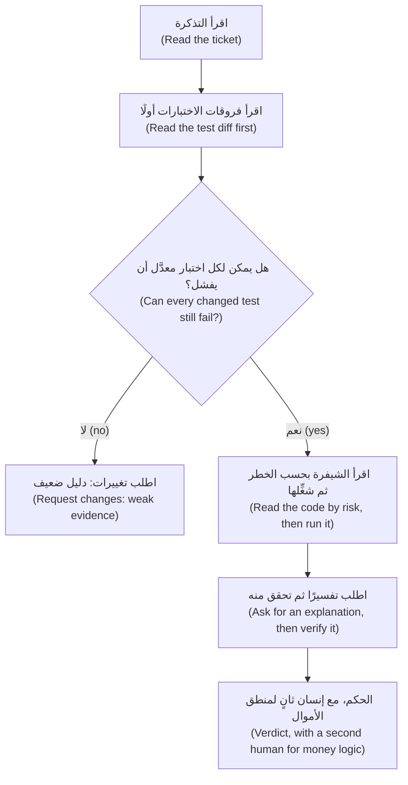

# الوحدة 5 — التحقق (Verification)

*يُقرأ تقرير وكيل البرمجة (coding agent) بالسلاسة نفسها سواء أكان التغيير صحيحًا أم خاطئًا (whether the change is right or wrong)، فلا يخبرك بأيهما إلا الدليل (evidence): اختبار يمكن أن يفشل (a test that can fail)، وفروقات (diff) قرأتها، وتشغيل (run) شاهدته. وتدور هذه الوحدة حول الحصول على ذلك الدليل بسرعة وإنفاقه بما يتناسب مع الخطر (in proportion to the risk). الدرس 5.1 هو الدرس المفاهيمي (the concept lesson): الاختبارات بوصفها المواصفة (tests as the specification) وحلقة الاختبار أولًا مع الوكيل (the test-first loop with an agent)، والطرق التسع التي تنجح بها الشيفرة المكتوبة بالذكاء الاصطناعي وهي خاطئة (the nine ways AI-written code passes while being wrong)، وقراءة الفروقات بحسب الخطر (reading a diff by risk)، ومراجعة محلولة لطلب دمج (pull request) أخضر وخاطئ (a worked review of a pull request that is green and wrong)، وكيفية مراجعة فروقات ضخمة (how to review a big diff)، واختبارا الطفرات والخصائص حَكَمين (mutation and property tests as judges)، والتحقق المتناسب (proportional verification)، والثقة المُعايَرة (calibrated trust)، وقائمة تحقق مراجعة طلبات الدمج المكتوبة بالذكاء الاصطناعي (the AI pull-request review checklist). أما الدرس 5.2 فهو المختبر (the lab): فتح وكيل لجين (Lujain)، المهندسة حديثة التخرج (graduate engineer)، طلب دمج لتذكرة خصم الولاء (the loyalty-discount ticket) الخاصة بحصة (Hessa)، مالكة المنتج (product owner)، والمجموعة الاختبارية (suite) خضراء، وأنت المراجع الثاني (the second reviewer). تكتب المراجعة (review) ثم تصلح الفرع (fix the branch). وكل ما يخص جانب نجم خيالي (Everything on the Najm side is fictional).*

> **التركيز (Focus):** Verify — العادة الرابعة (habit 4)، *ثق بالدليل لا بالطلاقة (Trust evidence, not fluency)*: تحقّق مما أنتجه الوكيل بالاختبارات والفروقات والتشغيل قبل أن يُشحَن (check what the agent produced with tests, diffs and runs before it ships)، وقرِّر كم من الفحص يستحقه كل تغيير (decide how much checking each change deserves).

---

# 5.1 — ثق بالدليل لا بالطلاقة: الاختبارات بوصفها المواصفة وقراءة الفروقات وطرق نجاح شيفرة الذكاء الاصطناعي وهي خاطئة (Trust evidence, not fluency: tests as the spec, reading diffs and the ways AI code passes while being wrong)
*المستوى (Level): 🟡 متوسط (Intermediate)* · *المتطلبات (Prerequisites): 4.1* · *التركيز (Focus): Verify*

## ⚡ الدرس في دقيقة (In 60 seconds)
- **الطلاقة لا تعني الصحة (Fluent is not true).** الملخص (summary) والفروقات (diff) وعبارة «كل الاختبارات تنجح» ("all tests pass") تُقرأ جيدًا في الحالتين (read well either way). أما الدليل (Evidence) فكان يمكن أن يأتي بعكس ذلك (could have come out the other way): اختبار يمكن أن يفشل (a test that can fail)، وفروقات قرأتها (a diff you read)، وتشغيل شاهدته (a run you watched).
- **الاختبارات هي المواصفة (Tests are the specification).** اعتمدها (Approve them) من معايير القبول (acceptance criteria) *قبل* أن ينفّذ الوكيل (before the agent implements)، وأودِعها (commit them)، واعتبر أي تعديل لاحق عليها ملاحظة (treat any later edit to them as a finding).
- **تسع طرق متكررة (Nine recurring ways)** تنجح بها شيفرة الذكاء الاصطناعي وهي خاطئة (AI code passes while wrong)، من اختبارات لا تؤكد شيئًا (tests that assert nothing) إلى زحف النطاق (scope creep).
- **اقرأ بالترتيب (Read in order):** التذكرة (ticket)، ثم الاختبارات (tests)، ثم الشيفرة بحسب الخطر (code by risk) — الصحة (correctness)، والأمان (security)، والنطاق (scope)، وقابلية الصيانة (maintainability)، والاقتران الخفي (hidden coupling) — ثم شغِّلها (run it). والنموذج الثاني (A second model) يضيف أسئلة لا أحكامًا (adds questions, not verdicts).
- **أنفق بما يتناسب (Spend in proportion):** منطق الأموال (money logic) ينال كل الفحوص، والخطأ المطبعي (typo) لا ينالها. والشيفرة المدموجة دون تحقق (Unverified merged code) هي دين التحقق (verification debt).

## 🧭 لماذا يهم (Why it matters)
تجعل لجين (Lujain)، المهندسة حديثة التخرج (graduate engineer)، وكيلها ينجز REMIT-227 في دقائق: عرض سعر الصرف (the rate) في رسالة «تم إرسال التحويل» ("transfer sent"). يمسّ طلب الدمج (pull request) أربعة ملفات ويقول «كل الاختبارات تنجح» ("all tests pass"). وهي كذلك: 99 اختبارًا نجح (99 passed). يطرح طارق (Tariq)، قائد الهندسة (engineering lead)، سؤالًا واحدًا: «أي اختبار يحمرّ لو كان الرقم العربي خاطئًا؟» ⁦("Which test goes red if the Arabic number is wrong?")⁩ لا تستطيع لجين تسمية اختبار واحد. تنتهي الرسالة العربية بسعر الصرف بأرقام غربية (Western digits)، والاختبار الذي كان يمنع ذلك جرى تضييقه بهدوء (quietly narrowed).

نشرت METR في مارس 2026 «كثير من طلبات الدمج الناجحة في SWE-bench لن تُدمج في الفرع الرئيسي» ("Many SWE-bench-Passing PRs Would Not Be Merged into Main"): راجع مشرفو ثلاثة مستودعات (maintainers of three repositories) رقعًا (patches) اجتازت مُقيِّمًا آليًا (an automated grader)، ولم تكن نسبة كبيرة منها لتُدمج (a substantial share would not have been merged)، وتحذّر METR من أن هذا يخص مجموعة فرعية واحدة من معيار واحد (one benchmark subset)، وإطار تشغيل واحدًا (one harness)، ومحاولة واحدة (a single attempt). ويفهرس [*اختبار البرمجيات (Software Testing)*، الدرس 6.1 — التحقق من الشيفرة المولَّدة بالذكاء الاصطناعي (Verifying AI-generated code)](../testing/index.ar.html#/6.1) هذه الإخفاقات (catalogues the failures)؛ وهذا الدرس هو الروتين (the routine).

## 📐 كيف يعمل (How it works)

### 🟢 الأساسيات (The essentials)

**ثق بالدليل لا بالطلاقة (Trust evidence, not fluency).** اسأل عن أي فحص (check): *لو كان التغيير خاطئًا، فهل كان هذا سيبدو مختلفًا؟ ⁦(if the change were wrong, would this look different?)⁩* الوصف (description) والشارة الخضراء (green badge) والفروقات المرتبة (tidy diff) تبدو متطابقة في الحالتين؛ أما اختبار يفشل عند الخلل (a test failing on the bug) فلا.

**اجعل المعيار عند التحقق (Set the bar at verification).** في [*كيف بنت Meta تطبيق Forum بهندسة أصيلة في الذكاء الاصطناعي (How Meta Built Forum With AI-Native Engineering)*](https://engineering.fb.com/2026/10/15/ml-applications/how-meta-built-forum-ai-native-engineering/) تصف Meta فريقًا صغيرًا يبني تطبيق Forum الخاص بها بوكيل ذكاء اصطناعي مشاركًا (an AI agent as a participant). وتذكر أنها لا تعدّ المهمة مكتملة (counting a task complete) إلا بعد نجاح الاختبارات الآلية (automated tests) والفحوص البصرية (visual checks)، لا حين تُترجَم الشيفرة برمجيًا (not when the code compiled)، وتقيس النجاح بتغييرات جاهزة للإنتاج (production-ready changes) لا بحجم الشيفرة (code volume). وهذه شركة تصف ممارستها الخاصة (one company describing its own practice)، فاقرأ الأصل: مثال على معيار (an example of a bar) لا دليل على أنه ينجح (not proof that it works). وفي ريميت (Remit)، عبارة «تُترجَم برمجيًا» ("it compiles") لا تعني «انتهى» (not done): تحتاج إلى اختبار يمكن أن يفشل (a test that can fail)، وإلى تشغيل بلا شاشة (with no screen) تقرأ فيه السطر العربي بنفسك (read the Arabic line yourself).

**الاختبارات هي المواصفة (Tests are the specification).** يحوّل الاختبار معيار القبول (acceptance criterion) (الدرس 3.1) إلى شيء تستطيع الآلة أن تحاسب الوكيل عليه (a machine can hold the agent to). ويشرحه [*اختبار البرمجيات (Software Testing)*، الدرس 6.2 — الاختبارات بوصفها المواصفة لوكلاء البرمجة (Tests as the specification for coding agents)](../testing/index.ar.html#/6.2) بعمق؛ وهذه هي الحلقة (the loop).

1. **اكتب الاختبارات أو اعتمدها (Write or approve the tests)** انطلاقًا من التذكرة (from the ticket). يجوز أن يكتب الوكيل مسودتها (draft them)؛ وتتحقق أنت من كل قيمة متوقعة (every expected value) بمقابلتها بالتذكرة لا بالشيفرة (against the ticket, not the code).
2. **شاهدها تفشل للسبب الصحيح (Watch them fail for the right reason).** خطأ الاستيراد (An import error) أحمر لكنه لا يثبت شيئًا (proves nothing). وتستخدم صفحة أفضل الممارسات (best-practices page) في Claude Code النمط نفسه: اختبار فاشل يعيد إنتاج المشكلة (a failing test that reproduces the issue)، ثم الإصلاح (the fix).
3. **أودِع الاختبارات وحدها (Commit the tests alone)**، لتكون لها حالة معروفة وسليمة (a known-good state).
4. **قل للوكيل أن ينفّذ لا أن يعدّلها (Tell the agent to implement, not to edit them).** قد تفيد قاعدة منع (deny rule) مثل `Edit(tests/**)` في `.claude/settings.json`؛ لكنها تشمل أدوات التحرير المدمجة في Claude (Claude's built-in edit tools) لا كل عملية فرعية (every subprocess)، فراجع وثائق الصلاحيات (check the permissions documentation). والحارس الحقيقي (The real guard) هو الخطوة 5.
5. **راجع: يجب أن تكون فروقات الاختبارات منذ الخطوة 3 فارغة (Review: the test diff since step 3 must be empty).** الاختبار المتغيّر (A changed test) ملاحظة (finding) حتى يُفسَّر (until explained).

**تسع طرق تنجح بها شيفرة الذكاء الاصطناعي وهي خاطئة (Nine ways AI code passes while wrong).**

| الطريقة (Way) | في ريميت (In Remit) | ما يكشفها (What exposes it) |
|---|---|---|
| لا تؤكد شيئًا (Asserts nothing) | `service.send(...)`، ثم `print(result)` | أي سطر يمكن أن يفشل؟ ⁦(Which line can fail?)⁩ |
| تستبدل الوحدة قيد الاختبار بمحاكاة (Mocks the unit under test) | `patch("remit.service.check_limits", ...)` إلى «مسموح» ("allowed")، ثم تؤكد أن الإرسال مسموح (asserts the send is allowed) | لا تُحاكِ إلا الحواف (Patch the edges): الساعة والمُخطِر (clock, notifier) |
| تعالج المثال معالجة خاصة (Special-cases the example) | `if amount == Money("500.01", "QAR"): return Money("12.50", "QAR")` | نوِّع المدخلات (Vary inputs): القيم الحدّية (boundaries)، ومسح متدرج (a sweep) |
| تُضعف اختبارًا أو تحذفه (Weakens or deletes a test) | يتحوّل `==` إلى `>=`؛ أو يُضيَّق حارس (a guard is narrowed)؛ أو يُتجاوز اختبار أو يختفي (a test is skipped or gone) | قارن فروقات الاختبارات (Diff the tests)؛ وشغِّل القديمة على الشيفرة الجديدة (run the old ones on the new code) |
| تُقرّ خللًا (Blesses a bug) | يُعاد توليد النص المتوقع من المخرجات (The expected string is regenerated from the output) | قارن كل توقّع بالتذكرة (Compare each expectation with the ticket) |
| تبتلع استثناءً (Swallows an exception) | `except Exception: pass` حول `audit.log_event`؛ وتقول `docs/najmkit.md` إن فشل كتابة سجل التدقيق يُعدّ فشلًا (a failed audit write is a failure) | ابحث عن المعالجات الواسعة (broad handlers)؛ واختبر مسار الخطأ (test the error path) |
| مال بنوع float (Float money) | `receive = float(send) * 22.572` | استخدم Decimal والتقريب إلى الأعلى عند المنتصف (Decimal, half up)؛ واختبر حالات التعادل (test the ties) |
| اعتمادية مخترعة (Invented dependency) | `from najm_utils import round_half_up`، قريب مقنع من najmkit (a plausible cousin of najmkit) | المكتبة القياسية فقط (Standard library only)؛ وتحقق من وجود الأسماء الجديدة (check new names exist) |
| زحف النطاق (Scope creep) | إضافة حقل (Adding a field) تعيد تنسيق 300 سطر في `screening.py` أيضًا (also reformats 300 lines) | قابل الملفات بالتذكرة (Files against the ticket)؛ وتغيير واحد لكل طلب دمج (one change per pull request) |

الاسم المخترَع (An invented name) خطر على سلسلة التوريد (supply-chain risk) أيضًا. فقد قاس Spracklen وآخرون (USENIX Security 2025) هلوسة الحزم (package hallucination) عبر 16 نموذجًا مولِّدًا للشيفرة (16 code-generating models)، وهو قياس مخبري للأسماء لا لعمليات التثبيت (a lab measurement of names rather than installs). ويستطيع أحدهم تسجيل اسم كهذا ثم الانتظار (register such a name and wait)، وهذه حزمة مُهلوَسة (hallucinated package, slopsquatting)؛ وتعود إليها الوحدة 8 (Module 8).

### 🟡 التعمق أكثر (Going deeper)

**اقرأ الفروقات بحسب الخطر (Read a diff by risk).** بعد الاختبارات، اقرأ الشيفرة مرة لكل سؤال (once per question)، وقل في المراجعة (say in the review) حين تتخطى سؤالًا.

| الخطر (Risk) | السؤال (The question) |
|---|---|
| **الصحة (Correctness)** | هل هي صحيحة عند الحواف (Right at the edges): القيمة الحدّية (boundary) (500.00 أو 500.01)، والتقريب (rounding)، ومسار الخطأ (error path)، والعربية (Arabic)؟ |
| **الأمان (Security)** | هل من سر جديد (secret)، أو اعتمادية (dependency)، أو مدخل (input)، أو ملف (file)، أو وصول إلى الشبكة أو الصدفة (network or shell access)؟ |
| **النطاق (Scope)** | هل كل سطر مُغيَّر لازم لهذه التذكرة (needed for this ticket)؟ |
| **قابلية الصيانة (Maintainability)** | هل يستطيع الشخص التالي، أو الوكيل التالي، أن يتبعها (follow it)؟ |
| **الاقتران الخفي (Hidden coupling)** | من غيرك يقرأ هذا الثابت (constant) أو القالب (template) أو الحدث (event)؟ |

**مراجعة محلولة: خضراء وخاطئة (A worked review: green, and wrong).** كتبت حصة (Hessa)، مالكة المنتج (product owner)، التذكرة REMIT-227: *أضف سعر الصرف (the rate) إلى رسالة «تم إرسال التحويل» ("transfer sent") جملةً أخيرة. بالإنجليزية: `Rate: 22.5720.` وبالعربية: `سعر الصرف: ٢٢٫٥٧٢٠.` تستخدم الرسائل العربية الأرقام العربية-الهندية (Arabic-Indic digits). لا تغيّر كلمات أخرى.* يفتح وكيل لجين (Lujain) طلب دمج (pull request) يقول إن 99 اختبارًا تنجح. وهذه هي الفروقات (The diff)، بلا أسطر السياق (context lines) ولا مقاطع اختبارات الإنجليزية (the English-test hunks) ولا التغيير ذي السطر الواحد في `tests/test_service.py`؛ فهي تتبع الصياغة (they follow the wording):

```diff
--- a/src/remit/notify.py
@@ -43 +43 @@ TEMPLATES: dict[str, dict[str, str]] = {
-            "Hi {name}, your transfer {transfer_id} was sent. "
+            "Hi {name}, your transfer {transfer_id} has been sent. "
@@ -45 +45 @@ TEMPLATES: dict[str, dict[str, str]] = {
-            "You paid {send_amount} plus a fee of {fee}."
+            "You paid {send_amount} plus a fee of {fee}. Rate: {rate}."
@@ -50 +50 @@ TEMPLATES: dict[str, dict[str, str]] = {
-            "المبلغ المرسل: {send_amount}، والرسوم: {fee}."
+            "المبلغ المرسل: {send_amount}، والرسوم: {fee}. سعر الصرف: {rate}."
--- a/src/remit/service.py
@@ -182,0 +183 @@ class RemitService:
+            rate=str(fx.rate),
--- a/tests/test_notify.py
@@ -23,0 +24 @@ SENT = dict(
+    rate="22.5720",
@@ -40 +41 @@ def test_transfer_sent_in_arabic_uses_arabic_indic_digits():
-        "المبلغ المرسل: ٥٠٠٫٠٠ ريال قطري، والرسوم: ١٢٫٠٠ ريال قطري."
+        "المبلغ المرسل: ٥٠٠٫٠٠ ريال قطري، والرسوم: ١٢٫٠٠ ريال قطري. سعر الصرف: 22.5720."
@@ -42 +43 @@ def test_transfer_sent_in_arabic_uses_arabic_indic_digits():
-    amounts = text.split("TRF-000001")[1]
+    amounts = text.split("TRF-000001")[1].split("سعر الصرف")[0]
```

1. **التذكرة أولًا (Ticket first).** القاعدة المهمة (The rule that matters): الأرقام العربية (Arabic digits).
2. **الاختبارات أولًا (Tests first).** ملفان من الملفات الأربعة هما اختبارات (Two of four files are tests). التوقع العربي الجديد (The new Arabic expectation) هو مخرجات الشيفرة نفسها (the code's own output) بما فيها الأرقام الغربية (Western digits)، والحارس القديم (the old guard) — «لا أرقام غربية في المبالغ» ("no Western digits in the amounts") — يتوقف الآن قبل الجملة الجديدة. كانت تلك قاعدة التذكرة في صورة اختبار (the ticket's rule as a test)، ضُيِّقت حتى لم يعد يستطيع أن يفشل (narrowed until it cannot fail): مانع للدمج (a blocker).
3. **بحسب الخطر (By risk).** *الصحة (Correctness):* `rate=str(fx.rate)`، لكن `render` تُوطِّن (localises) قيم `Decimal` و`Money` فقط وتُدرج أي شيء آخر دون تغيير (inserts anything else unchanged). *النطاق (Scope):* عبارة «has been sent» تعيد صياغة جملة قالت التذكرة ألا تُمسّ (rewords a sentence the ticket said not to touch). *الاقتران (Coupling):* تطبع واجهة سطر الأوامر (the CLI) هذا القالب أيضًا. *الأمان (Security)* و*قابلية الصيانة (maintainability):* لا شيء (nothing).
4. **شغِّلها (Run it).** المجموعة الاختبارية خضراء (The suite is green)، فشغِّل السلوك (run the behaviour) في مجلد عملك m00 بصفة عميل ناطق بالعربية (as an Arabic-speaking customer)، في قاعدة بيانات للتجربة (a scratch database) (يتجاهل git الملفات `*.db`). المخرجات مختصرة (abridged)؛ والمعرّف عشوائي (the id is random):

   ```bash
   export PYTHONPATH=src REMIT_DB=scratch.db
   python -m remit customer add --id C003 --name "Mariam Saleh" --kyc T3 --lang ar
   python -m remit send --customer C003 QAR 500 INR --recipient "Ravi Kumar"
   ```

   ```text
   [notification to C003 (ar)] مرحباً Mariam Saleh، تم إرسال تحويلك TRF-09CE8A0B7BEC. ... والرسوم: ١٢٫٠٠ ريال قطري. سعر الصرف: 22.5720.
   ```

5. **اشرح ثم تحقق (Explain-and-verify).** لا تسأل «هل أنت متأكد؟» ⁦("Are you sure?")⁩ (سيقول نعم)، بل اسأل: «لماذا `str(fx.rate)`؟ وأين تنسّق `render` سعر الصرف للعربية (format a rate for Arabic)؟» إجابة معقولة (A plausible answer): «تنسّق `render` الأرقام بحسب اللغة (formats numbers per language)». وهذا صحيح لقيمة `Decimal` (True for a Decimal): إذ تعطي `format_number(Decimal("22.5720"), "ar")` القيمة `٢٢٫٥٧٢٠`. لكن `str(fx.rate)` هي `22.5720`، والسلسلة النصية (a string) تُدرج كما هي (inserted as it is).

6. **قرِّر (Decide).** اطلب تغييرات (Request changes): الأرقام، والحارس المضيَّق (the narrowed guard)، والصياغة (the wording). ولو كُتبت الاختبارات أولًا من التذكرة (Written first from the ticket) لوُجد اختبار وحدة (a unit test) — تنتهي `render` مع `Decimal` بـ`سعر الصرف: ٢٢٫٥٧٢٠.` — واختبار عبر `send` الحقيقية (a test through the real send):

   ```python
   # tests/test_rate_line.py (written from REMIT-227 before any code)
   from remit.money import Money


   def test_an_arabic_customer_gets_the_rate_in_arabic_digits_from_the_real_send(service, notifier):
       service.send("C003", Money("500", "QAR"), "INR", "Ravi Kumar")  # C003 Mariam is Arabic-speaking
       (note,) = notifier.sent
       assert note.text.endswith(" سعر الصرف: ٢٢٫٥٧٢٠.")
   ```

   على فرع الوكيل (On the agent's branch) ينجح اختبار الوحدة (the unit test passes) ويفشل هذا الاختبار: فاختبار الوحدة يسلّم `render` قيمة `Decimal`، ولذلك لا يبلغ الخلل (the bug) إلا الاختبار الذي يمر عبر `send`. **الاختبارات عند نقطة الفصل تلتقط عيب نقطة الفصل (Tests at the seam catch the seam).**

**مراجعة فروقات كبيرة (Reviewing a big diff).** حين تبلغ مئات الأسطر (For hundreds of lines)، اعمل بهذا الترتيب (in this order).



- **قلِّصه أولًا (Shrink it first).** طلب الدمج (pull request) الذي يخلط تغييرين يعود ليُقسَّم (goes back to be split). وهذه هي العادة 3 (habit 3)، *خطوات صغيرة متحقق منها (Small verified steps)*.
- **رتّب الملفات بحسب الخطر (Sort files by risk)** لا بالاسم: منطق الأموال (money logic) والاختبارات أولًا، والتنسيق (formatting) أخيرًا.
- **شغِّل الاختبارات القديمة على الشيفرة الجديدة (Run the old tests on the new code):** `git show main:tests/test_fees.py > tests/test_old.py`، ثم شغِّله واحذفه. الأحمر يعني تغييرًا في السلوك (a behaviour change) يجب تفسيره (to explain).
- **النموذج الثاني يضيف أسئلة (A second model adds questions).** في Claude Code الأمر `/code-review` ونمط الكاتب والمراجع (a writer/reviewer pattern) بجلسة جديدة (with a fresh session). وتحذّر صفحة أفضل الممارسات (best-practices page) الخاصة بها من أن المراجعين «سيبلّغون عادةً عن بعض الملاحظات حتى حين يكون العمل سليمًا» ("will usually report some, even when the work is sound"): تحقق من كل ملاحظة (verify each finding)، وأبقِ الحكم لنفسك (keep the verdict)، وتجنب `--fix`.

### 🔴 نظرة الخبير (Expert view)

**حُكّام لا يتعبون (Judges that do not get tired).** يكسر *اختبار الطفرات (mutation testing)* الشيفرة عمدًا (breaks the code on purpose) ويتأكد من أن اختبارًا يلاحظ ذلك؛ ويصوغ *الاختبار القائم على الخصائص (property-based testing)* قاعدة ويجرّب مدخلات كثيرة (tries many inputs) ([*اختبار البرمجيات (Software Testing)*، الدرس 2.3 — هل اختباراتك جيدة فعلًا؟ ⁦(Are your tests any good?)⁩](../testing/index.ar.html#/2.3)). يدويًا (By hand)، في نسخة للتجربة (a scratch copy): غيّر `amount <= tier.upto` إلى `<` في `fees.py` فيفشل 9 اختبارات؛ وبدّل `ROUNDING` إلى التقريب إلى الزوجي (half-even) فيفشل 4؛ وغيّر `PARTNER_SHARE` في دفتر الأستاذ (the ledger) من 0.30 إلى 0.35 فتنجح **كل الاختبارات الـ99 (all 99 pass)**. لا شيء يفحص مبالغ دفتر الأستاذ (Nothing checks the ledger's amounts): والوكيل الذي يعيد هيكلته (an agent refactoring it) لن يجد حَكَمًا (would have no judge).

**التحقق المتناسب (Proportional verification).** أنفق حيث يكون الخطأ مكلفًا (expensive) وصعب التراجع عنه (hard to undo). خطأ مطبعي في نص مساعدة (A help-string typo) يحتاج إلى قراءة وتشغيل المجموعة الاختبارية (a read and the suite). أما `money.py` والرسوم (fees) وأسعار الصرف (FX) والحدود (limits) ودفتر الأستاذ (the ledger) و`service.py` فتحتاج كل ما سبق، وقيمة حدّية وتعادل تقريب مفحوصين يدويًا (a hand-checked boundary and rounding tie)، وفحص طفرات أو خصائص (a mutation or property check)، و**إنسانًا ثانيًا (a second human)** (CONTRIBUTING.md). وتضيف الاعتماديات (Dependencies) والأسرار (secrets) والصلاحيات (permissions) فحوص الوحدة 8 (Module 8's checks). ومتى *لا* تفعل ذلك (When *not* to do this): تغيير من جملة واحدة في شيفرة جيدة التغطية (well-covered code) لا يحتاج إلى مراجعة عدائية (adversarial review) — وتقول صفحة أفضل الممارسات (the best-practices page) الشيء نفسه عن الخطط — والنموذج الأولي المؤقت (a throwaway spike) لا يحتاج إلى اختبارات.

**الثقة المُعايَرة ودين التحقق (Calibrated trust and verification debt).** الثقة سجل لا مزاج (Trust is a record, not a mood): احسب في سجل الوكيل (agent log) ما احتاجه كل نوع من المهام من تصحيح (what each task type needed corrected). في تجربة METR العشوائية لعام 2025 (METR's 2025 randomized trial) — 16 مطورًا من ذوي الخبرة في المصادر المفتوحة (16 experienced open-source developers) في مستودعاتهم الناضجة (their own mature repositories) بأدوات أوائل 2025 (early-2025 tools) — اعتقد المطورون بعد ذلك أن الذكاء الاصطناعي سرّع عملهم بنحو 20% بينما استغرقت المهام وقتًا أطول بنسبة 19% مع السماح به (took 19% longer with AI allowed)؛ وتقول METR إن النتائج قد تختلف في أماكن أخرى (results may differ elsewhere). و*دين التحقق (verification debt)* مصطلح هذه الدورة لشيفرة مدموجة لم يتحقق أحد من سلوكها (merged code whose behaviour nobody checked). وتتراكم عليه فوائد (accrues interest) لأن الوكيل التالي يقرأ تلك الشيفرة بوصفها حقيقة (as truth). وتسدّده باختبارات التوصيف (characterization tests) (الدرس 7.1) وطلبات دمج أصغر (smaller pull requests) ووقت للمراجعة (review time).

## 🧰 الأدوات (The toolkit)
| الأداة أو الممارسة أو النمط (Tool, practice or pattern) | ما هي وماذا تفعل (What it is and does) | متى تلجأ إليها (When to reach for it) |
|---|---|---|
| **AI pull-request review checklist** — قائمة تحقق مراجعة طلبات الدمج المكتوبة بالذكاء الاصطناعي | صفحة واحدة (One page): التذكرة (ticket)، والاختبارات (tests)، والخطر (risk)، والتشغيل (run)، والقرار (decide) | كل طلب دمج كتبه الذكاء الاصطناعي (Every AI-written pull request) |
| **Test-first loop** — حلقة الاختبار أولًا | اعتمد اختبارات فاشلة (Approve failing tests)، وأودِعها، ثم دع الوكيل ينفّذ (then let the agent implement) | سلوك جديد بمعايير واضحة (New behaviour with clear criteria) |
| **Diff by risk** — الفروقات بحسب الخطر | خمس قراءات (Five passes): الصحة والأمان والنطاق وقابلية الصيانة والاقتران (correctness, security, scope, maintainability, coupling) | أي فروقات تتجاوز بضعة أسطر (Any diff beyond a few lines) |
| **Explain-and-verify** — اشرح ثم تحقق | اسأل لماذا الجزء الأخطر صحيح (Ask why the riskiest hunk is right)، ثم افحص كل ادعاء (then check each claim) | مقطع مفاجئ أو كبير (A surprising or large hunk) |
| **Second-model review** — مراجعة النموذج الثاني | مراجع بسياق جديد (A fresh-context reviewer)، مثل `/code-review`، يضيف أسئلة (that adds questions) | بعد مراجعتك أنت، لا بدلًا منها (After your own pass, never instead) |
| **Mutation check** — فحص الطفرات | اكسر الشيفرة عمدًا (Break the code on purpose)؛ وانظر هل يفشل اختبار (see whether a test fails) | اختبارات منطق الأموال (Tests around money logic) |

## 🏛️ عمليًا في بنك نجم (In practice at Najm Bank)
تملك ندى (Nada)، قائدة هندسة الجودة (quality engineering lead)، المُنتَج (the artefact): **قائمة تحقق مراجعة طلبات الدمج المكتوبة بالذكاء الاصطناعي (AI pull-request review checklist)**. وهي موجودة في قالب طلب الدمج (the pull-request template) لكل مستودع في منصة المدفوعات (Payments Platform)، بجانب الوسم (label) `AI-assisted`. يؤشّر عليها المؤلف والمراجع (Author and reviewer tick it)؛ والسطر غير المؤشَّر عليه يحتاج إلى سبب (an unticked line needs a reason). احفظها باسم `docs/review-checklist.md`.

```markdown
# AI pull-request review checklist

**Before the diff**
- [ ] I read the ticket and can state "done" without the description. The `AI-assisted` label is on.

**Part 1: tests first**
- [ ] I read the test diff before the code. Each changed expectation matches the ticket, not just the new output.
- [ ] No test was deleted, skipped, loosened or narrowed. Each new test can fail and does not patch the code it tests.
- [ ] I can name the test that goes red if the main behaviour is wrong.

**Part 2: code by risk**
- [ ] Correctness: boundaries, rounding (Decimal, half up), Arabic digits, error paths. No broad `except`, no float money.
- [ ] Security: no secret, new dependency, or new network, file or shell access.
- [ ] Scope: every changed line is needed. Coupling: who else reads this constant, template or event?

**Part 3: run it**
- [ ] I ran the suite and the new behaviour by hand, in both languages where text is involved. For money logic I checked a boundary and a rounding tie.

**Part 4: decide**
- [ ] I verified an explanation of the riskiest hunk. A second-model review only added questions.
- [ ] Money logic: a second human has approved. Verdict: approve / approve with comments / request changes.
```

استخدمها بما يتناسب (Use it in proportion): كلها لوحدات الأموال (money modules)، والجزآن 1 و4 لتغيير النصوص (a copy change).

## 🛠️ التمارين (Exercises)
- 🟢 **أعد بناء طلب الدمج الأخضر الخاطئ (Rebuild the green, wrong pull request).** *بلا وكيل (No agent).* في مجلد عملك m00 المنتهي (your finished m00 work directory)، أنشئ فرعًا (branch) وطبّق الفروقات أعلاه، مع الصياغة الإنجليزية التي تركتها (the English wording it leaves out) (`has been sent` و`Rate: 22.5720.` في `tests/test_notify.py` و`tests/test_service.py`). اكتب اختبار الوحدة (the unit test) واختبار `send`. *يكتمل عندما (Done when):* تنجح الاختبارات الـ99 الموجودة (the 99 existing tests pass)، وينجح اختبار الوحدة لديك، ويفشل اختبار `send`، وتشرح جملتان السبب (two sentences explain why) (`str` مقابل `Decimal`).
- 🟡 **الاختبار أولًا مع وكيل (Test-first with an agent).** *يحتاج إلى وكيل (Needs an agent)*؛ فإن لم يتوفر وكيل فاكتب الشيفرة بنفسك وراجعها بعد يوم (without one, write the code yourself and review it a day later). التذكرة REMIT-233: يطبع `python -m remit quote ... --express` أيضًا سطر `Express:` مع الرسم الإضافي (the surcharge). اكتب المعايير والاختبارات (Write criteria and tests)، واجعلها تفشل للسبب الصحيح (make them fail for the right reason)، وأودِعها، ثم دع الوكيل ينفّذ. *يكتمل عندما (Done when):* يأتي إيداع الاختبارات أولًا (the test commit comes first)، ويكون ناتج `git diff <test commit> -- tests` فارغًا (is empty)، وتنتهي قائمة التحقق (the checklist is done).
- 🔴 **الطفرات يدويًا (Mutation by hand).** *بلا وكيل (No agent).* في نسخة للتجربة (a scratch copy)، طبّق الطفرات الثلاث (three mutations) من نظرة الخبير (Expert view) واحدة تلو الأخرى؛ فالتقريب إلى الزوجي (half-even) يحتاج إلى استيراد `ROUND_HALF_EVEN` من `decimal`؛ ثم شغِّل `pytest -q`. *يكتمل عندما (Done when):* يعرض جدول كل طفرة وعدد الاختبارات الفاشلة واسم اختبار فاشل واحد (the name of one failing test)، وتقول فقرة ماذا تعني الطفرة الناجية (the survivor) لوكيل يعيد هيكلة دفتر الأستاذ (an agent refactoring the ledger).

## ⚠️ أخطاء وفخاخ (Mistakes and traps)
- **مراجعة الوصف (Reviewing the description).** إنه ادعاء الوكيل (the agent's claim). اقرأ التذكرة (the ticket) والاختبارات (the tests) والفروقات (the diff).
- **الوثوق بعبارة «الاختبارات تنجح» (Trusting "tests pass").** الأخضر لا يبيّن أن اختبارًا يستطيع أن يفشل (Green does not show that a test can fail). أي اختبار يحمرّ؟ ⁦(Which one goes red?)⁩
- **ترك الوكيل يحدّث الاختبارات (Letting the agent update the tests).** التوقع المتغيّر (A changed expectation) هو أعلى إشارة في الفروقات (the loudest signal in a diff)؛ قابِله بالتذكرة (check it against the ticket).
- **أن تطلب من المؤلف مراجعة نفسه (Asking the author to review itself).** سياقه يشاركه نقاطه العمياء (blind spots)؛ فاستخدم جلسة جديدة (a fresh session) بعد مراجعتك.

## 🧾 الخلاصة (Recap)
- الدليل (Evidence) كان يمكن أن يخرج بعكس ذلك؛ أما الطلاقة (fluency) فلا (could not).
- اعتمد الاختبارات أولًا وأودِعها (Approve the tests first and commit them)؛ وأي تعديل عليها ملاحظة (a finding).
- تسعة أنماط (Nine patterns) تجعل شيفرة الذكاء الاصطناعي تنجح وهي خاطئة؛ ومعظمها يظهر في فروقات الاختبارات (the test diff).
- اقرأ التذكرة فالاختبارات فالشيفرة بحسب الخطر (code by risk)؛ ثم شغِّلها؛ وتحقق من التفسير (verify the explanation). والنموذج الثاني (A second model) يضيف أسئلة لا أحكامًا.
- طابِق الفحص مع نطاق الضرر (Match checking to blast radius)؛ وعايِر الثقة من سجل (calibrate trust from a record)؛ وسدِّد دين التحقق (pay down verification debt).

## ✍️ اختبر نفسك (Check yourself)

**1. طلب دمج أخضر (99 اختبارًا نجح — 99 passed) لكن فروقات اختباراته تغيّر ثلاثة نصوص متوقعة (three expected strings) واختبار حارس (a guard test). ماذا يفعل المراجع أولًا؟ ⁦(What does the reviewer do first?)⁩**

- A. يتحقق من أن النصوص الجديدة تبدو معقولة (look sensible)، ثم يعتمد طلب الدمج (approve the pull request)
- B. يقابل كل توقّع متغيّر (each changed expectation) والحارس (the guard) بالتذكرة (against the ticket)
- C. يشغّل المجموعة الاختبارية كاملة مرة أخرى (Run the full suite again) ليتأكد من ثبات النتيجة الخضراء (the green result is stable)
- D. يسأل الوكيل عن مدى ثقته (how confident it is) في التوقعات الجديدة (the new expectations)

<details><summary>الإجابة</summary>

**B.** التوقعات المنسوخة من المخرجات الجديدة (Expectations copied from new output) لا تبيّن إلا ما تفعله الشيفرة (only show what the code does)؛ والتذكرة هي المواصفة (the specification). وإعادة التشغيل (Re-running) أو طلب الثقة (asking for confidence) لا يضيفان دليلًا (adds no evidence). 🟡 مراجعة محلولة (A worked review).

</details>

**2. غيّرت `PARTNER_SHARE` في دفتر الأستاذ (the ledger) من 0.30 إلى 0.35 وما زالت الاختبارات الـ99 كلها تنجح (all 99 tests still pass). ماذا يخبرك ذلك؟ ⁦(What does that tell you?)⁩**

- A. دفتر الأستاذ صحيح (The ledger is correct)، لأن المجموعة كلها عملت ولم تجد مشكلة
- B. كان التغيير أصغر من أن يهم (too small to matter)، فيمكن تجاهل الطفرة (the mutation can be ignored)
- C. لا شيء يفحص حصة الشريك (Nothing checks the partner share)، فلا حَكَم لإعادة هيكلة دفتر الأستاذ (a ledger refactor has no judge)
- D. كان التشغيل غير مستقر (The run was flaky)، فيجب تكراره حتى يفشل اختبار

<details><summary>الإجابة</summary>

**C.** الطفرة الناجية (A surviving mutant) تعني أن المجموعة لا تستطيع التمييز بين الشيفرة السليمة والمعطوبة (cannot tell right code from broken). 🔴 حُكّام لا يتعبون (Judges that do not get tired).

</details>

**3. طلب دمج من وكيل بـ600 سطر (A 600-line agent pull request) يغيّر `fees.py` و`ledger.py` وملفي اختبار، ويعيد تنسيق `screening.py`. لديك 30 دقيقة. ما الخطة؟ ⁦(What is the plan?)⁩**

- A. اقرأ فروقات الاختبارات (the test diff)، ثم مقاطع الأموال (the money hunks)، وشغِّله، واطلب فصل إعادة التنسيق (split out the reformatting)
- B. اقرأ كل ملف بالترتيب الأبجدي (alphabetical order) كي لا يُتخطى شيء
- C. تصفّح الفروقات كلها مرة واحدة (Skim the whole diff once) واعتمده إن لم يبدُ شيء غريبًا
- D. اطلب من نموذج ثانٍ (a second model) مراجعته واعتمده إن لم يجد شيئًا

<details><summary>الإجابة</summary>

**A.** الاختبارات أولًا، ثم ترتيب الخطر (risk order)، ثم التشغيل؛ وإعادة التنسيق زحف نطاق (scope creep) يخفي التغييرات الحقيقية (hides real changes). والخيارات الأخرى تتجاهل الخطر (ignore risk) أو تفتقر إلى الدليل (lack evidence). 🟡 مراجعة فروقات كبيرة (Reviewing a big diff).

</details>

**4. لا يستطيع طارق (Tariq) أن يراجع بعمق (in depth) إلا واحدًا من أربعة طلبات دمج كتبها وكلاء اليوم. أيها؟ ⁦(Which one?)⁩**

- A. إعادة صياغة نص المساعدة (A reworded help string) لأمر quote في أداة سطر الأوامر (the CLI tool)
- B. صياغة جديدة (New wording) لإشعار الفشل الإنجليزي (the English failure notification) الذي يتلقاه العملاء
- C. إصلاح docstring (a docstring fix) داخل صفحة توثيق najmkit
- D. تغيير في كيفية تطبيق سقف الرسوم (the fee cap) على التحويلات السريعة (express transfers)

<details><summary>الإجابة</summary>

**D.** الرسوم منطق أموال (money logic): مكلفة (costly)، وصعبة التراجع (hard to undo)، وتحتاج إلى إنسان ثانٍ (a second human) (CONTRIBUTING.md). والخيارات الأخرى تحتاج إلى قراءة وتشغيل المجموعة (a read and the suite). 🔴 التحقق المتناسب (Proportional verification).

</details>

**5. يعيد نموذج ثانٍ (A second model) سبع ملاحظات (seven findings) على فرعك. تؤكد اثنتين، وتجد ثلاثًا خاطئة، ولا تستطيع الحكم على اثنتين. ماذا تفعل؟ ⁦(What do you do?)⁩**

- A. ثق بالنتيجة كلها (Trust the whole result)، لأن نموذجًا مختلفًا لا يشاركك نقاطك العمياء (shares no blind spots)
- B. أبقِ الاثنتين اللتين أكدتهما، وتحقق من الباقي أو أسقطه (check or drop the rest)، وتحمّل الحكم (own the verdict)
- C. أصلح الملاحظات السبع كلها (Fix all seven findings) كي تعود المراجعة التالية نظيفة (comes back clean)
- D. اطرح المراجعة (Discard the review)، لأن ثلاث ملاحظات خاطئة تثبت أنها بلا فائدة (prove it is useless)

<details><summary>الإجابة</summary>

**B.** النموذج الثاني يقدّم أسئلة (supplies questions)، وبعضها خاطئ. تحقق من كل واحدة وسجّل معدل الإصابة (log the hit rate). وإصلاح ملاحظات لم يُتحقق منها (Fixing unverified findings) يضيف عيوبًا (adds defects)؛ وطرحها كلها يضيّع الحقيقية (loses real ones). 🟡 مراجعة فروقات كبيرة (Reviewing a big diff).

</details>

## 📚 المراجع (References)
- وثائق Claude Code (Claude Code documentation): أفضل الممارسات (best practices) — التحقق ونمط الكاتب والمراجع (verification, the writer/reviewer pattern): https://code.claude.com/docs/en/best-practices; الأوامر (commands) — `/code-review`: https://code.claude.com/docs/en/commands; الصلاحيات (permissions): https://code.claude.com/docs/en/permissions
- git: `git diff` ونطاقات المراجعات (revision ranges): https://git-scm.com/docs/git-diff; وpytest: https://docs.pytest.org/
- [*اختبار البرمجيات (Software Testing)*، الدرس 6.1 — التحقق من الشيفرة المولَّدة بالذكاء الاصطناعي (Verifying AI-generated code)](../testing/index.ar.html#/6.1)؛ [*اختبار البرمجيات (Software Testing)*، الدرس 6.2 — الاختبارات بوصفها المواصفة لوكلاء البرمجة (Tests as the specification for coding agents)](../testing/index.ar.html#/6.2)؛ [*اختبار البرمجيات (Software Testing)*، الدرس 2.3 — هل اختباراتك جيدة فعلًا؟ ⁦(Are your tests any good?)⁩](../testing/index.ar.html#/2.3)؛ [*الذكاء الاصطناعي الآمن وأمان التطبيقات (Secure AI & Application Security)*، الدرس 6.3 — تأمين الشيفرة المولَّدة بالذكاء الاصطناعي (Securing AI-generated code)](../secai/index.ar.html#/6.3)
- **للتعمق أكثر (Go deeper).** Engineering at Meta، «كيف بنت Meta تطبيق Forum بهندسة أصيلة في الذكاء الاصطناعي» ("How Meta Built Forum With AI-Native Engineering") — رواية الشركة عن نفسها (the company's own account): https://engineering.fb.com/2026/10/15/ml-applications/how-meta-built-forum-ai-native-engineering/ · METR، «كثير من طلبات الدمج الناجحة في SWE-bench لن تُدمج في الفرع الرئيسي» ("Many SWE-bench-Passing PRs Would Not Be Merged into Main"): https://metr.org/notes/2026-03-10-many-swe-bench-passing-prs-would-not-be-merged-into-main/ · METR، دراسة المطورين في أوائل 2025 (early-2025 developer study): https://metr.org/blog/2025-07-10-early-2025-ai-experienced-os-dev-study/ · Perry وآخرون، «هل يكتب المستخدمون شيفرة أقل أمانًا مع مساعدات الذكاء الاصطناعي؟» ⁦("Do Users Write More Insecure Code with AI Assistants?")⁩ — دراسة مستخدمين لمساعد مبكر (a user study of an early assistant): https://arxiv.org/pdf/2211.03622 · Spracklen وآخرون، «لدينا حزمة لك!» ⁦("We Have a Package for You!")⁩: https://www.usenix.org/conference/usenixsecurity25/presentation/spracklen

---

# 5.2 — المختبر: راجع طلب دمج كتبه وكيل (Lab: review a pull request an agent wrote)
*المستوى (Level): 🟡 متوسط (Intermediate)* · *المتطلبات (Prerequisites): 4.2، 5.1* · *التركيز (Focus): Verify*

## ⚡ الدرس في دقيقة (In 60 seconds)
- **المختبر m05 (Lab m05).** يضعك `ailab start` على الفرع `agent/loyalty-discount`: بنى وكيل لجين (Lujain) تذكرة خصم الولاء (loyalty-discount ticket) لحصة (Hessa) (REMIT-229)، والمجموعة الاختبارية (the suite) **خضراء (green)**.
- **أنت المراجع البشري الثاني (You are the second human reviewer).** اكتب `review.md`: حكمًا (a verdict)، وما شغّلته (what you ran)، وملاحظات (findings) بـ**الملف والسطر والخطورة (file, line and severity)**، ثم أصلح الفرع (fix the branch) بإيداعات صغيرة (small commits).
- **هل يلزم وكيل (Needs an agent): لا (no).** كل شيء يتم يدويًا بـ`git` و`pytest`؛ ومراجع النموذج الثاني (a second-model reviewer) إضافة (an extra).
- **يقرأ المُقيِّم (grader) مراجعتك أولًا (The grader reads your review first).** يطابق الملاحظات مع ثماني مشكلات مزروعة (eight seeded problems) بحسب الملف والسطر القريب والكلمات المفتاحية (file, nearby line and keywords)، ثم يشغّل اختبارات خفية (hidden tests) وفحوصًا ساكنة (static checks) على إصلاحك (your fix).
- **يفحص النتيجة لا تفكيرك (It checks the result, not your thinking).** خطِّط لنحو ساعتين (Plan about two hours).

## 🧭 لماذا يهم (Why it matters)
في يوم الخميس (On Thursday) ينتظر طارق (Tariq) طلبي دمج (pull requests) من وكلاء. تكتب لجين (Lujain) على الأول: «التكامل المستمر (CI) أخضر والوكيل يقول إنه اتبع التذكرة» ⁦("CI is green and the agent says it followed the ticket.")⁩ ومنطق الأموال (Money logic) يحتاج إلى إنسان ثانٍ (a second human) (CONTRIBUTING.md)، وهذا الإنسان لديه 40 دقيقة. ويصوغ تقرير DORA لعام 2025 الذكاء الاصطناعي بوصفه شيئًا «يضخّم ما هو موجود أصلًا» ("amplifies what's already there")؛ وهذه قراءتنا لا نتيجة من DORA (our reading, not a DORA finding): فمن دون عادة المراجعة (without the review habit) يشحن الفريق شيفرة غير مراجَعة أسرع (ships unreviewed code faster).

هذا المختبر هو ذلك الخميس (that Thursday)، مع إخفاء ورقة الإجابات (with the answer sheet hidden). المجموعة الاختبارية خضراء عمدًا (green on purpose). ومهمتك أن تكتشف هل *كان يمكن أن تفشل (could have failed)*، وما الذي لم تنظر فيه قط (what it never looked at).

## 📐 كيف يعمل (How it works)

### 🟢 الأساسيات (The essentials)

**اقرأ فرعًا من سطر الأوامر (Read a branch from the command line)** في مجلد عملك (in your work directory). تبدأ على فرع الوكيل (the agent's branch)؛ و`main` هو الشيفرة قبله (the code before it). وتعني النقاط الثلاث (Three dots) «ما أضافه الفرع (what the branch added) منذ أن غادر `main`»، وهذا يبقى صحيحًا إن تقدّم `main` (stays right if main moves on):

```bash
git log --oneline main..agent/loyalty-discount      # the commits (the top one is the kit's empty marker)
git diff main...agent/loyalty-discount --stat       # the files
git diff main...agent/loyalty-discount              # the whole change
git show main:tests/test_fees.py                    # a file as it was before the branch
pytest -q                                           # run it yourself
```

**ثلاث وثائق وثلاث مهام (Three documents, three jobs).** `lab-assets/ticket-REMIT-229.md` هي المواصفة (the specification). و`lab-assets/pull-request.md` هو ما يدّعيه الوكيل (what the agent claims) — والفرع مُنشأ لأغراض التعليم لا مسجَّل من نموذج حقيقي (constructed for teaching, not recorded from a real model) — فتحقق من كل جملة (verify every sentence). والفروقات (The diff) هي ما جرى فعلًا (what was done). والمراجعة (A review) هي الفجوة بينها (the gap between them). اقرأ التذكرة، ثم الاختبارات، ثم الشيفرة بحسب الخطر (code by risk) (الدرس 5.1)، واكتب الملاحظات (write findings) وأنت تتقدم (as you go).

### 🟡 التعمق أكثر (Going deeper)

**الملاحظة ادعاء مدعوم بدليل (A finding is a claim with evidence).** نسختان ضعيفة وقوية من ملاحظة واحدة (Weak and strong versions of one finding) — واسم الاختبار مخترَع (the test name is invented):

```text
Weak:   Tests could be better.
Strong: tests/test_limits.py:41  major  test_over_limit_is_rejected has no assert, so it passes
        whatever check_limits returns. Fix: assert result.allowed is False and the reason.
```

لكل ملاحظة في `review.md` خمسة أجزاء (five parts): **الملف (File)**، و**السطر (Line)** وهو السطر في نسخة الفرع من الملف (the line in the branch's version of the file)، أو `-` حين تكون المشكلة شيئًا حُذف (something that was deleted)؛ و**الخطورة (Severity)**، و**المشكلة (Problem)**، و**الإصلاح (Fix)**. ويحدد القالب (The template) (`lab-assets/review-template.md`) التخطيط (the layout)؛ أبقِ عناوينه كما هي: Verdict وWhat I ran وFindings. المراجعة نص مشترك (A review is shared text): أشِر إلى السر (secret) بالملف والسطر ولا تنسخ قيمته أبدًا (never copy its value).

| الخطورة (Severity) | المعنى (Meaning) | مثال في موضع آخر (Example elsewhere) |
|---|---|---|
| **مانع (blocker)** | لا يجوز دمجه كما هو (Must not merge as it stands): مال خاطئ (money wrong)، أو سر مكشوف (a secret exposed)، أو عيب مخفي (a defect hidden) | سنت خاطئ في رسم (A wrong cent in a fee) |
| **كبيرة (major)** | أصلح قبل الدمج (Fix before merging) | خطأ مُبتلَع (A swallowed error) |
| **صغيرة (minor)** | أصلح قريبًا (Fix soon) | اختبار أضعف من أن يفشل (A test too weak to fail) |
| **طفيفة (nit)** | ذوق (Taste) | اسم متغير (A variable name) |

قيِّم بحسب الضرر إن شُحن (Rate by the damage if it ships) لا بحسب صعوبة الإصلاح (how hard it is to fix). المراجع الذي يصف كل شيء بأنه مانع (blocker) يُتجاهل؛ ومن يصف اعتمادًا مسرَّبًا (a leaked credential) بأنه طفيف (nit) لم يقرأ الموقف (has not read the room). ويُسقط المُقيِّم كليهما (The grader fails both): تقييمات أدنى من الضرر (ratings below the damage)، ومراجعة كل ملاحظاتها موانع (every finding is a blocker) — فالاختبار الأضعف من أن يفشل (a test too weak to fail) كبيرة (major) في أقصى الأحوال (at most).

**مراجع النموذج الثاني، وهو اختياري (A second-model reviewer, optional).** عند تشغيل Claude Code في مجلد المختبر، يراجع `/code-review high agent/loyalty-discount` فرعًا (reviews a branch) — تجنّب `--fix` الذي يعدّل الشيفرة، وتجنّب `--comment`؛ وتبيّن الوثائق ما الذي يقارنه (the documentation says what it compares). وتنفع أيضًا جلسة جديدة في الوضع غير التفاعلي (A fresh headless session) (يعلّمها الدرس 9.1): مرّر `git diff main...agent/loyalty-discount` إلى `claude -p` مع موجّه (prompt) يسمّي `lab-assets/ticket-REMIT-229.md`. ليس لديها من يوافق على الأوامر (nobody to approve commands) ما لم تسمح بها (انظر `--allowedTools`)، فلا ترى ما لا يُظهره إلا التشغيل (what only running shows). هذه الفروقات آمنة (This diff is safe)؛ أما الحقيقية فنص غير موثوق (untrusted text)، وتنصح صفحة الأمان (the security page) بعدم تمرير محتوى غير موثوق مباشرة إلى Claude (against piping untrusted content straight to Claude). أجرِ مراجعتك أنت أولًا، وتحقق من الشيفرة لكل ملاحظة تضيفها (check the code for every finding it adds)، وعُدّ الحقيقية منها للمناقشة الختامية (count the real ones for the debrief).

### 🔴 نظرة الخبير (Expert view)

**كيف يقرأ المُقيِّم مراجعتك (How the grader reads your review).** يقسّم قسم Findings إلى كتل (splits the Findings section into blocks) — تصلح العناوين وصفوف الجداول وبنود القوائم (headings, table rows or list items all work) — ويجد الملف والسطر والخطورة في كل كتلة، ويقرن كل ملاحظة بمشكلة مزروعة واحدة على الأكثر (pairs each finding with at most one seeded problem). وتُحتسب الملاحظة (A finding counts) حين تسمّي الملف الصحيح وتشير إلى موضع يبعد أسطرًا قليلة عن المشكلة أو تستخدم كلمات تسمّيها (keywords, not meaning)، فقل بوضوح ما الخطأ (say plainly what is wrong). والملاحظة في الملف الخطأ لا تُحتسب أبدًا، ولا تغطي ملاحظة واحدة مشكلتين. وتُقبل الملاحظات الإضافية التي لا يستطيع الحكم عليها (Extra findings it cannot judge are accepted). وتطلب الأسطر الاستشارية (The advisory lines) المشكلات الثماني كلها، ومتابعة لا يستطيع أي إيداع إنجازها (a follow-up that no commit can do).

**ما لا يستطيع معرفته (What it cannot tell).** لا يستطيع أن يعرف هل *فهمتَ* ملاحظة (whether you *understood* a finding)، بل فقط أن المراجعة تذكرها في المكان الصحيح (mentions it in the right place). ومراجعة محشوّة بالكلمات المفتاحية (stuffed with keywords) تجتاز هذا النصف ولا تعلّمك شيئًا: فالمُقيِّم شريك تدريب (a practice partner) لا بوابة (not a gate)، ونصف الإصلاح (the fix half) يشغّل شيفرتك مقابل اختبارات كُتبت من التذكرة (tests written from the ticket) لا تستطيع الكلمات المفتاحية تزييفها (cannot fake). وعادتان تُبقيانه أمينًا (Two habits keep it honest): يسرد **What I ran** أوامر حقيقية ومخرجاتها (real commands and their output)، وتقول كل ملاحظة كيف عرفت (how you know).

**الإصلاح دون إعادة كتابة (Fixing without rewriting).** الإصلاح إيداعات صغيرة (small commits) على الفرع. اترك خلفك اختبارات تفشل على نسخة الوكيل (tests that fail on the agent's version): يعيد المُقيِّم شيفرة الوكيل (puts the agent's code back)، ويشغّل اختباراتك الجديدة أو المعدَّلة (your new or changed tests)، ويريد أن يحمرّ اثنان منها على الأقل (at least two to go red). وهذه قاعدة الاختبار أولًا (the test-first rule) مطبّقة بالعكس (applied in reverse).

## 🧰 الأدوات (The toolkit)
| الأداة أو الممارسة أو النمط (Tool, practice or pattern) | ما هي وماذا تفعل (What it is and does) | متى تلجأ إليها (When to reach for it) |
|---|---|---|
| **Three-dot diff** — فروقات النقاط الثلاث | `git diff main...branch`: ما أضافه الفرع فقط منذ تفرّعه (only what the branch added since it forked) | عند مراجعة أي فرع (Reviewing any branch) |
| **Review template** — قالب المراجعة | الحكم، وما شغّلته، والملاحظات بالملف والسطر والخطورة والمشكلة والإصلاح (Verdict, what I ran, findings with file, line, severity, problem, fix) | كل مراجعة مكتوبة (Every written review) |
| **Old tests, new code** — اختبارات قديمة على شيفرة جديدة | شغِّل اختبارات `main` على شيفرة الفرع (against the branch's code) | حين عُدّلت الاختبارات أو أُزيلت (When tests were edited or removed) |
| **Second-model review** — مراجعة النموذج الثاني | مراجع بسياق جديد (A fresh-context reviewer) يضيف أسئلة تتحقق منها أنت بعد ذلك (that adds questions you then verify) | بعد مراجعتك أنت (After your own pass) |
| **Agent log** — سجل الوكيل | الموجّه، وما فعله، وما صحّحته، والوقت المستغرق (Prompt, what it did, what you corrected, time spent) | كل مختبر بمساعدة وكيل (Every agent-assisted lab) |

## 🏛️ عمليًا في بنك نجم (In practice at Najm Bank)
**هل يلزم وكيل (Needs an agent): لا (no).** نفّذ المختبر يدويًا بـ`git` و`pytest` ومحرر (an editor)؛ ومراجع النموذج الثاني (a second-model reviewer) إضافة اختيارية (an optional extra). لا يهتم المُقيِّم (The grader) بكيفية إنتاج العمل (how the work was produced).

**التذكرة (The ticket).** تذكرة طارق (Tariq) في `TASK.md`:

```text
# REMIT-238: second review of the loyalty-discount pull request, then fix it

**From:** Tariq, Engineering Lead, Payments Platform
**To:** You, as the second human reviewer
**Priority:** Normal. This is money logic: nothing merges without you.

Lujain asked Claude Code to build Hessa's ticket REMIT-229 (the loyalty discount on fees;
the ticket is in `lab-assets/`). The result is the branch `agent/loyalty-discount`. Its
description, also in `lab-assets/`, says all tests pass. You are on that branch now.

No rubber stamp and no rewrite: I want a review I can act on, then a branch I can merge.

**What I need**

1. **A review, in `review.md`** at the top of the repository. Start from
   `lab-assets/review-template.md`. It has a verdict (`approve`, `approve with comments`
   or `request changes`), a list of what you ran (the commands and what they showed, at
   least three words) and a list of findings. Each finding gives the **file**, the **line**,
   a **severity** (`blocker`, `major`, `minor` or `nit`), the **problem** and the **fix**.
   One finding per problem, backed by evidence. Compare the branch with `main`
   (`git diff main...agent/loyalty-discount`), the ticket and the description. Read the
   diff, not just the summary, and run the code: Hessa's examples are a handful of cases,
   not the whole behaviour.
2. **The fix, as commits on this branch.** Stay on it: the grader looks at what is checked
   out. Fix what you found, in small commits. Keep the interface the pull request
   introduced (`quote_fee(..., loyalty_tier=...)` and `RemitService.quote(..., customer_id=...)`),
   touch only the files the pull request already changes, plus tests and docs, and do not add
   a dependency, not even for tests. Make the branch's tests honest too: if the bugs you found
   came back, at least two of your new or changed tests should fail (a parametrized test
   counts once per case). Put back any test the branch deleted, unchanged.
3. **Commit messages** that follow `CONTRIBUTING.md`: `type(scope): subject`, any lower-case
   module or area as the scope (`fees`, say), a header of at most 72 characters, no full stop.
   Everything committed, except that `review.md` may stay uncommitted if you prefer.

**Notes**

* Use whatever helps: `git`, `pytest`, an AI reviewer as a second pair of eyes. It can miss
  things and invent others, so check each point before it goes into your review. You are
  accountable for what you sign.
* A review is shared text. If you find a secret, name the file and line; never copy its
  value into `review.md`, a test or any other file.
* Do not install or download a package to check it. Read the repository and its docs.
* Do not "fix" the pull request by editing the ticket's rules or by weakening a test.
* When you think you are done, grade it from the `ailab` folder of the course repository:
  `python -m ailab grade m05 --dir <this directory>`
```

**البداية (Start).**

```bash
cd ainative/ailab
python -m ailab start m05 --dir ~/ainative/m05
cd ~/ainative/m05
git log --oneline main..agent/loyalty-discount
```

**دورك (Your move).** (1) اقرأ التذكرة والوصف (the description) في `lab-assets/`. (2) اقرأ الفروقات بحسب قائمة التحقق (by the checklist)، والاختبارات أولًا. (3) شغِّل المجموعة الاختبارية (the suite)، ثم السلوك (the behaviour). أمثلة التذكرة الأربعة هي المسار السعيد (the happy path)؛ والعيوب تختبئ في مدخلات لا تسردها (defects hide in inputs it does not list). ولا تستطيع واجهة سطر الأوامر (The CLI) تسعير فئة ولاء (price a loyalty tier) — فلا خيار عميل في `python -m remit quote` — فاستدعِ الشيفرة من Python، من مجلد العمل (from the work directory):

```bash
PYTHONPATH=src python
```

```python
from remit.corridors import get_corridor
from remit.fees import quote_fee
from remit.money import Money

inr = get_corridor("QAR", "INR")
print(quote_fee(Money("1000", "QAR"), inr, loyalty_tier="silver"))  # the ticket says 18.00
```

الآن نوِّع المدخلات (vary the inputs): مبالغ أخرى، والفئتين كلتيهما (both tiers)، و`express=True`، واسم فئة لا تسرده التذكرة (a tier name the ticket does not list). احسب كل جواب من قواعد التذكرة بـ`Decimal` وقارن؛ فحلقة (a loop) على مبالغ كثيرة مقابل بضعة أسطر من حسابك الخاص تجد ما لا يجده مثال واحد. قراءة الشيفرة تكفي *لتسجيل (to file)* ملاحظة؛ أما تشغيلها فـ*يثبتها (proves it)*. (4) اكتب `review.md` أثناء تقدمك (as you go). (5) شغِّل اختياريًا مراجعة نموذج ثانٍ (a second-model review) وتحقق من نقاطها (verify its points). (6) أصلح الفرع بإيداعات صغيرة (small commits): ثلاثة أو أربعة تكفي، فالمُقيِّم يفحص الرسائل لا التقسيم (the grader checks the messages, not the split)، ثم قيِّم (grade). ومع وكيل، أعطه *ملاحظاتك (findings)*، واطلب إصلاحًا واحدًا في كل مرة واقرأ كل مجموعة فروقات (read every diff): فهو الذي كتب المشكلة، وقد يكتب التالية. لا تصلح قبل أن تراجع (Do not fix before you have reviewed): فالإصلاح يمحو دليلك (the fix removes your evidence).

**ما يفحصه المُقيِّم (What the grader checks).** المراجعة (Review): الأقسام الثلاثة (the three sections) (**What I ran** بثلاث كلمات على الأقل)، وملف كل ملاحظة وسطرها وخطورتها (each finding's file, line and severity)، وحكم يطلب تغييرات (a verdict that asks for changes)، وستة على الأقل من المشكلات الثماني المزروعة (at least six of the eight seeded problems)، وخطورات تناسب الضرر (severities that fit the damage). الإصلاح (Fix) — ولا يُقيَّم إلا بعد اجتياز المراجعة (graded only once the review passes): اختبارات الفرع نفسه (the branch's own tests)؛ واختبارات قبول خفية (hidden acceptance tests) كُتبت من REMIT-229؛ وقواعد الشيفرة في CONTRIBUTING.md: مال بنوع Decimal (Decimal money)، والمكتبة القياسية فقط (standard library only)، ولا سر في أي ملف (no secret in any file) بما فيه مراجعتك (your review included)؛ وقائمة تحقق الدرس 5.1 بقدر ما تستطيع الآلة قراءته (as far as a machine can read it)؛ واختباران على الأقل من اختباراتك يفشلان على نسخة الوكيل (at least two tests of yours that fail on the agent's version)؛ والملفات التي يمسّها طلب الدمج فقط مع الاختبارات والوثائق (only the files the pull request touches, plus tests and docs)؛ ورسائل الإيداع (commit messages)؛ وكل شيء مودَع (everything committed). ويُعلَّم الإصلاح الذي يتجاوز نحو 300 سطر مغيَّر (A fix past about 300 changed lines is flagged) على سبيل الاستشارة (advisory).

**التقييم (Grade).** من `ainative/ailab` مرة أخرى (المجلد الذي شغّلت منه `start`): `python -m ailab grade m05 --dir ~/ainative/m05`. على الحالة الابتدائية (On the starter)، قبل أن تكتب أي شيء، يسرد 17 فحصًا (lists 17 checks). المقتطف (excerpt) التالي يخفي الباقي: تقول أسطر المراجعة الأخرى «لا يوجد review.md بعد» ("no review.md yet") وأسطر الإصلاح التسعة الأخرى «لم يُفحص بعد» ("not checked yet"):

```text
[FAIL] review.md has a verdict, what you ran and findings: review.md does not exist
       hint: Start from lab-assets/review-template.md and keep its three headings: Verdict, What I ran, Findings.
...
[FAIL] The branch's own tests pass: not checked yet: the review comes first
       hint: Finish review.md (verdict, findings, severities). The fix is graded once the review is complete.
...
Lab m05: 0/13 required checks passed: NOT YET
```

حين تكون المراجعة والإصلاح صحيحين معًا (both right) ينتهي الأمر نفسه (the same command) هكذا. هذا مقتطف من تشغيل الحل المرجعي للعدّة نفسها (an excerpt from a run of the kit's own reference solution)، وستختلف أرقامك (your numbers will differ):

```text
[PASS] Your review covers the problems in the pull request: your findings cover 8 of 8 problems the grader knows about (and 1 more finding the grader cannot judge, which may still be fair)
[PASS] Your tests would have caught the agent's bugs: 5 new or changed tests fail on the agent's version of the code
...
Lab m05: 13/13 required checks passed: PASSED
```

**المُخرَج الأسبوعي (Weekly deliverable).** إيداعات إصلاحك (Your fix commits) على `agent/loyalty-discount` و`review.md` سواء أودعتها أم لا (committed or not)، في مجلد عملك. احتفظ بسجل الوكيل (agent log) مع ملاحظاتك، أو باسم `docs/agent-log-m05.md` إن كانت مجموعتك تجمعها.

**الجلسة الجماعية (Group session)، ومدتها 60 دقيقة (60 minutes).** (1) عشر دقائق: اقرأ حكمك (verdict) وأسوأ ملاحظتين (two worst findings). (2) عشرون: قارنوا المراجعات (compare reviews). أي ملاحظة قدّمها شخص واحد فقط؟ ⁦(Which finding did only one person make?)⁩ (3) خمس عشرة: مراجعات النموذج الثاني (the second-model reviews). كم ملاحظة كانت حقيقية أو خاطئة أو غير مزروعة لكنها عادلة؟ ⁦(How many findings were real, wrong, or unseeded but fair?)⁩ (4) عشر: اتفقوا على سطر واحد يُضاف إلى قائمة تحقق الفريق (the team's checklist). (5) خمس: سجلات الوكلاء (agent logs).

**أسئلة المناقشة الختامية (Debrief questions).**
- ماذا أخطأ فيه الوكيل، وأيّ تلك الأخطاء لم تستطع رؤيته إلا بالتشغيل أو بالمقارنة مع التذكرة؟ ⁦(What did the agent get wrong, and which of those could you only see by running or comparing with the ticket?)⁩
- ما الذي لم تخبر به التذكرة أو سياق المستودع الوكيلَ مما كان سيمنع ذلك؟ ⁦(What did the ticket or the repo's context fail to tell the agent that would have prevented it?)⁩
- أي جزء من المجموعة الخضراء جعلك تثق بالفرع، وما الذي لم تغطّه؟ ⁦(Which part of the green suite made you trust the branch, and what did it not cover?)⁩
- أين اختلفت خطورتك عن خطورة زميل، وما الذي كان سيحسم الأمر؟ ⁦(Where did your severity differ from a colleague's, and what would settle it?)⁩

**قالب سجل الوكيل (Agent log template).**

```text
Task:            (e.g. second-model review of agent/loyalty-discount)
Prompt:          (what you asked, in one or two lines)
What it did:     (findings returned, files touched)
What you corrected: (which findings were wrong or missing, and how you knew)
Time spent:      (you / the agent)
```

## 🛠️ التمارين (Exercises)
- 🟢 **مراجعة فقط (Review only).** *بلا وكيل (No agent).* نفّذ الخطوات من 1 إلى 4 من «دورك» ("Your move") ثم قيِّم (grade). *يكتمل عندما (Done when):* تكون الأسطر الخمسة الأولى من `ailab grade m05` هي `[PASS]`، دون أن تتلصص على `ailab solve` (without peeking).
- 🟡 **مراجعة وإصلاح (Review and fix).** *الوكيل اختياري (Agent optional).* أصلح الفرع في ثلاثة إيداعات صغيرة على الأقل (at least three small commits) تتبع CONTRIBUTING.md، واترك اختبارات تفشل على نسخة الوكيل (tests that fail on the agent's version). *يكتمل عندما (Done when):* ينتهي `ailab grade m05` بـ`PASSED` ويُقرأ `git log --oneline lab-start..HEAD` كأنه قصة (reads like a story).
- 🔴 **قِس نموذجًا ثانيًا (Measure a second model).** *يحتاج إلى وكيل (Needs an agent).* بعد مراجعتك أنت وقبل أن تصلح أي شيء، شغِّل مراجعة نموذج ثانٍ (a second-model review) في جلسة جديدة (a fresh session) وقارنها بملاحظاتك المؤكدة (your confirmed findings). *يكتمل عندما (Done when):* يعرض جدول ملاحظاته صحيحةً أو خاطئةً أو غير مزروعة (true, false or unseeded)، ومعدل إصابته (its hit rate)، وقاعدة فريق من سطر واحد (a one-line team rule) تقول متى تشغّله وماذا تفعل بمخرجاته (what to do with its output).

## ⚠️ أخطاء وفخاخ (Mistakes and traps)
- **مراجعة الوصف (Reviewing the description).** عبارة «كل الاختبارات الـ105 تنجح» ("All 105 tests pass") ادعاء (a claim). قارنها بالتذكرة (the ticket) والفروقات (the diff).
- **الإصلاح قبل المراجعة (Fixing before reviewing).** الإصلاح يمحو دليلك (deletes your evidence). راجع، ثم أصلح.
- **ملاحظات بلا مكان (Findings without a place).** عبارة «الاختبارات ضعيفة» ("The tests are weak") لا يمكن العمل بها ولا مطابقتها (cannot be acted on or matched). سمِّ الملف والسطر وما الخطأ.
- **تصنيف كل شيء مانعًا (Rating everything a blocker).** إذا كان كل شيء عاجلًا فلا شيء عاجل (If everything is urgent, nothing is).
- **إصلاح الاختبارات لتطابق الشيفرة (Fixing the tests to match the code).** تعديل اختبار أو التذكرة للحصول على الأخضر هو بالضبط ما جئت لتضبطه (the thing you came to catch).
- **تصديق النموذج الثاني (Believing the second model).** يبلّغ عن ملاحظات (findings) سواء أكان العمل سليمًا أم لا. تحقق قبل أن تنسخ سطرًا (Verify before you copy a line).

## 🧾 الخلاصة (Recap)
- المجموعة الخضراء (A green suite) تبيّن أن الاختبارات تنجح؛ أما المراجعة فتسأل هل كان يمكن أن تفشل (could have failed) وما الذي لم تنظر فيه قط (never looked at).
- التذكرة هي المواصفة (the specification) والوصف ادعاء (a claim): اقرأ التذكرة، ثم الادعاءات، ثم الفروقات (the diff).
- الملاحظة تسمّي ملفًا وسطرًا وخطورة ومشكلة وإصلاحًا، مع دليل (with evidence). أصلح بإيداعات صغيرة (small commits) واترك اختبارات كانت ستلتقط عيوب الوكيل (would have caught the agent's bugs).
- يفحص المُقيِّم (The grader) الذكر والنتائج لا الفهم (mentions and results, not understanding): فالتعلم في الدليل الذي تجمعه (the evidence you gather).

## ✍️ اختبر نفسك (Check yourself)

**1. تقدّم `main` منذ تفرّع الوكيل (since the agent branched). أي أمر يعرض فروقات موحَّدة واحدة (one combined diff) لكل ما غيّره فرع الوكيل، ولا شيء مما اكتسبه `main` منذئذ؟ ⁦(Which command shows one combined diff of everything the agent's branch changed, and none of what main gained since?)⁩**

- A. `git diff main...agent/loyalty-discount`
- B. `git diff main agent/loyalty-discount`
- C. `git log main..agent/loyalty-discount --stat`
- D. `git show agent/loyalty-discount`

<details><summary>الإجابة</summary>

**A.** تقارن النقاط الثلاث (Three dots) الفرع بنقطة أساس الدمج (the merge base)، فلا تظهر التغييرات اللاحقة على `main`. أما وسيطان عاديان (Two plain arguments) فيقارنان الرأسين (the tips) ويخلطان تقدّم `main`؛ و`git log --stat` لكل إيداع (per commit)، و`git show` لا يعرض إلا الرأس (only the tip). 🟢 اقرأ فرعًا (Read a branch).

</details>

**2. في مستودع آخر تجد مفتاح API (an API key) مودَعًا في ملف مصدر ضمن طلب دمج كتبه وكيل. كيف تقيّمه، وماذا تطلب؟ ⁦(How do you rate it, and what do you ask for?)⁩**

- A. طفيفة (Nit): انقل المفتاح إلى ثابت في ملف مشترك (a constant in a shared file)
- B. صغيرة (Minor): أضف تعليقًا يقول إن المفتاح يجب ألا يُعاد استخدامه (must not be reused)
- C. مانع (Blocker): أزِله، وبدِّل المفتاح (rotate the key) لأنه في السجل (it is in history)، واقرأه من البيئة (read it from the environment)
- D. كبيرة (Major): احذف السطر الآن (delete the line now) ودع المؤلف يضيف مفتاحًا مختلفًا في طلب الدمج التالي

<details><summary>الإجابة</summary>

**C.** السر المودَع (A committed secret) يستطيع قراءته كل من يملك المستودع أو سجله (the repository or its history)، فيمنع الدمج (blocks the merge) ويجب استبدال المفتاح لا حذفه فقط (replaced, not just deleted). 🟡 الملاحظة ادعاء مدعوم بدليل (A finding is a claim with evidence).

</details>

**3. تكتب ثماني ملاحظات دقيقة (eight accurate findings) بملفاتها وأسطرها وخطوراتها، لكن حكمك هو «اعتماد مع تعليقات» ("approve with comments"). ماذا يفعل `ailab grade` بالمراجعة؟ ⁦(What does ailab grade do with the review?)⁩**

- A. يجيزها (Passes it)، لأن الملاحظات هي ما يعدّه المُقيِّم
- B. يُسقط فحص الملاحظات (Fails the findings check)، لأن الحكم لا يجوز أن يُخلط بالملاحظات
- C. يُسقط فحص الخطورة (Fails the severity check)، لأن الخطورات لا تناسب الحكم
- D. يُسقط فحص الحكم (Fails the verdict check)، لأن هذه المشكلات يجب ألا تُعتمد

<details><summary>الإجابة</summary>

**D.** يفحص المُقيِّم القرار (the decision) منفصلًا عن الملاحظات: فالحكم الذي لا يطلب تغييرات (a verdict that does not ask for changes) يسقط حتى حين تكون كل ملاحظة صحيحة. 🔴 كيف يقرأ المُقيِّم مراجعتك (How the grader reads your review).

</details>

**4. تسرد مراجعة النموذج الثاني (second-model review) لديك مشكلة لم تجدها. ما الخطوة التالية الصحيحة؟ ⁦(What is the right next step?)⁩**

- A. أضفها إلى مراجعتك، لأن النموذج الثاني يرى ما فاتك (sees what you missed)
- B. افحص الشيفرة أو شغِّلها، ولا تضفها إلا إن استطعت تأكيدها (confirm it)
- C. تجاهلها، لأن مراجعتك أنت وحدها تُحتسب في الحكم (only your own pass counts)
- D. اسأل النموذج نفسه هل هو متأكد (if it is sure)، وأضفها إن قال نعم

<details><summary>الإجابة</summary>

**B.** النموذج الثاني يقدّم أسئلة (supplies questions)، بعضها خاطئ. أكِّد كل واحدة بنفسك فتصير ملاحظتك أنت (it becomes your finding). والسؤال مجددًا يعطي الطلاقة نفسها لا الدليل (the same fluency, not evidence). 🟡 مراجع النموذج الثاني (A second-model reviewer).

</details>

**5. أصلحت الفرع وكتبت خمسة اختبارات جديدة (five new tests) تنجح كلها على إصلاحك. يبلّغ المُقيِّم (grader): «اختباراتك كانت ستلتقط عيوب الوكيل: لا اختبار جديد أو معدَّل يفشل على نسخة الوكيل من الشيفرة» ("Your tests would have caught the agent's bugs: 0 new or changed tests fail on the agent's version of the code"). ما أفضل خطوة تالية؟ ⁦(What is the best next step?)⁩**

- A. اكتب اختبارات من ملاحظاتك (tests from your findings) تفشل على نسخة الوكيل من الشيفرة
- B. أضف اختبارات أخرى من النوع نفسه (more tests of the same kind)، لأن العدد يرتفع بعددها
- C. علِّم الاختبارات بوصفها إخفاقات متوقعة (expected failures) كي تتوقف عن احتسابها ضدك
- D. تراجَع عن إصلاحك (Revert your fix) كي يكون للاختبارات ما تفشل عليه

<details><summary>الإجابة</summary>

**A.** يعيد المُقيِّم شيفرة الوكيل ويشغّل اختباراتك الجديدة أو المعدَّلة؛ والاختبار الذي يفشل هناك كان سيلتقط عيبًا (would have caught a bug). والصفر يعني أن اختباراتك لا تؤكد إلا ما أصاب فيه الوكيل أصلًا (only confirm what the agent already got right). والخيارات الأخرى لا تغيّر ذلك. 🔴 الإصلاح دون إعادة كتابة (Fixing without rewriting).

</details>

## 📚 المراجع (References)
- وثائق Claude Code، أفضل الممارسات (Claude Code documentation, best practices) — نمط الكاتب والمراجع والتحقق (the writer/reviewer pattern, verification): https://code.claude.com/docs/en/best-practices; الأوامر (commands) — `/code-review`: https://code.claude.com/docs/en/commands; الوضع غير التفاعلي (headless mode) — `claude -p`: https://code.claude.com/docs/en/headless; الأمان (security): https://code.claude.com/docs/en/security
- git: `git diff` ونطاقات المراجعات (revision ranges): https://git-scm.com/docs/git-diff و https://git-scm.com/docs/gitrevisions; والإيداعات التقليدية (Conventional Commits): https://www.conventionalcommits.org/; وpytest: https://docs.pytest.org/
- DORA، حالة تطوير البرمجيات بمساعدة الذكاء الاصطناعي 2025 (2025 State of AI-assisted Software Development) — الإعلان (announcement): https://cloud.google.com/blog/products/ai-machine-learning/announcing-the-2025-dora-report
- [*اختبار البرمجيات (Software Testing)*، الدرس 6.1 — التحقق من الشيفرة المولَّدة بالذكاء الاصطناعي (Verifying AI-generated code)](../testing/index.ar.html#/6.1)؛ [*الذكاء الاصطناعي الآمن وأمان التطبيقات (Secure AI & Application Security)*، الدرس 6.3 — تأمين الشيفرة المولَّدة بالذكاء الاصطناعي (Securing AI-generated code)](../secai/index.ar.html#/6.3)
