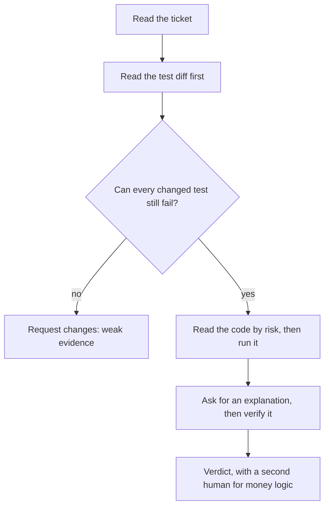

# Module 5 — Verification

*A coding agent's report reads equally well whether the change is right or wrong, so the only thing that tells you which is evidence: a test that can fail, a diff you read, a run you watched. This module is about getting that evidence fast and spending it in proportion to the risk. Lesson 5.1 is the concept lesson: tests as the specification and the test-first loop with an agent, the nine ways AI-written code passes while being wrong, reading a diff by risk, a worked review of a pull request that is green and wrong, how to review a big diff, mutation and property tests as judges, proportional verification, calibrated trust, and the AI pull-request review checklist. Lesson 5.2 is the lab: the agent of Lujain (graduate engineer) has opened a pull request for the loyalty-discount ticket of Hessa (product owner), the suite is green, and you are the second reviewer. You write the review, then fix the branch. Everything on the Najm side is fictional.*

> **Focus:** Verify — habit 4, *Trust evidence, not fluency*: check what the agent produced with tests, diffs and runs before it ships, and decide how much checking each change deserves.

---

# 5.1 — Trust evidence, not fluency: tests as the spec, reading diffs and the ways AI code passes while being wrong
*Level: 🟡 Intermediate* · *Prerequisites: 4.1* · *Focus: Verify*

## ⚡ In 60 seconds
- **Fluent is not true.** A summary, a diff and "all tests pass" read well either way. Evidence could have come out the other way: a test that can fail, a diff you read, a run you watched.
- **Tests are the specification.** Approve them from the acceptance criteria *before* the agent implements, commit them, and treat any later edit to them as a finding.
- **Nine recurring ways** AI code passes while wrong, from tests that assert nothing to scope creep.
- **Read in order:** ticket, tests, code by risk (correctness, security, scope, maintainability, hidden coupling), then run it. A second model adds questions, not verdicts.
- **Spend in proportion:** money logic gets everything, a typo does not. Unverified merged code is verification debt.

## 🧭 Why it matters
Lujain (graduate engineer) has her agent finish REMIT-227 in minutes: show the rate in the "transfer sent" message. The pull request touches four files and says "all tests pass". They do: 99 passed. Tariq (engineering lead) asks one question: "Which test goes red if the Arabic number is wrong?" Lujain cannot name one. The Arabic message ends with the rate in Western digits, and the test forbidding that was quietly narrowed.

In March 2026 METR published "Many SWE-bench-Passing PRs Would Not Be Merged into Main": maintainers of three repositories reviewed patches that had passed an automated grader, and a substantial share would not have been merged (METR cautions: one benchmark subset, one harness, a single attempt). [*Software Testing*, lesson 6.1 — Verifying AI-generated code](../testing/index.html#/6.1) catalogues the failures; this lesson is the routine.

## 📐 How it works

### 🟢 The essentials

**Trust evidence, not fluency.** Ask of any check: *if the change were wrong, would this look different?* A description, a green badge and a tidy diff look the same either way; a test failing on the bug does not.

**Set the bar at verification.** In [*How Meta Built Forum With AI-Native Engineering*](https://engineering.fb.com/2026/10/15/ml-applications/how-meta-built-forum-ai-native-engineering/), Meta describes a small team building its Forum app with an AI agent as a participant. It reports counting a task complete only after automated tests and visual checks passed, not when the code compiled, and measuring success in production-ready changes rather than code volume. This is one company describing its own practice, so read the original: an example of a bar, not proof that it works. For Remit, "it compiles" is not done: you need a test that can fail and, with no screen, a run where you read the Arabic line yourself.

**Tests are the specification.** A test turns an acceptance criterion (lesson 3.1) into something a machine can hold the agent to. [*Software Testing*, lesson 6.2 — Tests as the specification for coding agents](../testing/index.html#/6.2) teaches it in depth; here is the loop.

1. **Write or approve the tests** from the ticket. The agent may draft them; you check every expected value against the ticket, not the code.
2. **Watch them fail for the right reason.** An import error is red but proves nothing. Claude Code's best-practices page uses the same pattern: a failing test that reproduces the issue, then the fix.
3. **Commit the tests alone,** so they have a known-good state.
4. **Tell the agent to implement, not to edit them.** A deny rule such as `Edit(tests/**)` in `.claude/settings.json` can help; it covers Claude's built-in edit tools, not every subprocess (check the permissions documentation). The real guard is step 5.
5. **Review: the test diff since step 3 must be empty.** A changed test is a finding until explained.

**Nine ways AI code passes while wrong.**

| Way | In Remit | What exposes it |
|---|---|---|
| Asserts nothing | `service.send(...)`, then `print(result)` | Which line can fail? |
| Mocks the unit under test | `patch("remit.service.check_limits", ...)` to "allowed", then asserts the send is allowed | Patch the edges (clock, notifier) only |
| Special-cases the example | `if amount == Money("500.01", "QAR"): return Money("12.50", "QAR")` | Vary inputs: boundaries, a sweep |
| Weakens or deletes a test | `==` becomes `>=`; a guard is narrowed; a test is skipped or gone | Diff the tests; run the old ones on the new code |
| Blesses a bug | The expected string is regenerated from the output | Compare each expectation with the ticket |
| Swallows an exception | `except Exception: pass` around `audit.log_event` (`docs/najmkit.md`: a failed audit write is a failure) | Search for broad handlers; test the error path |
| Float money | `receive = float(send) * 22.572` | Decimal, half up; test the ties |
| Invented dependency | `from najm_utils import round_half_up`, a plausible cousin of najmkit | Standard library only; check new names exist |
| Scope creep | Adding a field also reformats 300 lines of `screening.py` | Files against the ticket; one change per pull request |

An invented name is also a supply-chain risk. Spracklen et al. (USENIX Security 2025) measured package hallucination across 16 code-generating models, a lab measurement of names rather than installs. Someone can register such a name and wait (slopsquatting); Module 8 returns to it.

### 🟡 Going deeper

**Read a diff by risk.** After the tests, read the code once per question, and say in the review when you skip one.

| Risk | The question |
|---|---|
| **Correctness** | Right at the edges: boundary (500.00 or 500.01), rounding, error path, Arabic? |
| **Security** | A new secret, dependency, input, file, network or shell access? |
| **Scope** | Is every changed line needed for this ticket? |
| **Maintainability** | Can the next person, or agent, follow it? |
| **Hidden coupling** | Who else reads this constant, template or event? |

**A worked review: green, and wrong.** Hessa (product owner) wrote REMIT-227: *add the rate to the "transfer sent" message as its last sentence. English: `Rate: 22.5720.` Arabic: `سعر الصرف: ٢٢٫٥٧٢٠.` Arabic messages use Arabic-Indic digits. Do not change other words.* Lujain's agent opens a pull request that says 99 tests pass. The diff, without context lines, the English-test hunks or the one-line change in `tests/test_service.py` (they follow the wording):

```diff
--- a/src/remit/notify.py
@@ -43 +43 @@ TEMPLATES: dict[str, dict[str, str]] = {
-            "Hi {name}, your transfer {transfer_id} was sent. "
+            "Hi {name}, your transfer {transfer_id} has been sent. "
@@ -45 +45 @@ TEMPLATES: dict[str, dict[str, str]] = {
-            "You paid {send_amount} plus a fee of {fee}."
+            "You paid {send_amount} plus a fee of {fee}. Rate: {rate}."
@@ -50 +50 @@ TEMPLATES: dict[str, dict[str, str]] = {
-            "المبلغ المرسل: {send_amount}، والرسوم: {fee}."
+            "المبلغ المرسل: {send_amount}، والرسوم: {fee}. سعر الصرف: {rate}."
--- a/src/remit/service.py
@@ -182,0 +183 @@ class RemitService:
+            rate=str(fx.rate),
--- a/tests/test_notify.py
@@ -23,0 +24 @@ SENT = dict(
+    rate="22.5720",
@@ -40 +41 @@ def test_transfer_sent_in_arabic_uses_arabic_indic_digits():
-        "المبلغ المرسل: ٥٠٠٫٠٠ ريال قطري، والرسوم: ١٢٫٠٠ ريال قطري."
+        "المبلغ المرسل: ٥٠٠٫٠٠ ريال قطري، والرسوم: ١٢٫٠٠ ريال قطري. سعر الصرف: 22.5720."
@@ -42 +43 @@ def test_transfer_sent_in_arabic_uses_arabic_indic_digits():
-    amounts = text.split("TRF-000001")[1]
+    amounts = text.split("TRF-000001")[1].split("سعر الصرف")[0]
```

1. **Ticket first.** The rule that matters: Arabic digits.
2. **Tests first.** Two of four files are tests. The new Arabic expectation is the code's own output, Western digits included, and the old guard ("no Western digits in the amounts") now stops before the new sentence. That was the ticket's rule as a test, narrowed until it cannot fail: a blocker.
3. **By risk.** *Correctness:* `rate=str(fx.rate)`, but `render` localises only `Decimal` and `Money` values and inserts anything else unchanged. *Scope:* "has been sent" rewords a sentence the ticket said not to touch. *Coupling:* the CLI prints this template too. *Security*, *maintainability:* nothing.
4. **Run it.** The suite is green, so run the behaviour in your m00 work directory as an Arabic-speaking customer, in a scratch database (git ignores `*.db`). Output abridged; the id is random:

   ```bash
   export PYTHONPATH=src REMIT_DB=scratch.db
   python -m remit customer add --id C003 --name "Mariam Saleh" --kyc T3 --lang ar
   python -m remit send --customer C003 QAR 500 INR --recipient "Ravi Kumar"
   ```

   ```text
   [notification to C003 (ar)] مرحباً Mariam Saleh، تم إرسال تحويلك TRF-09CE8A0B7BEC. ... والرسوم: ١٢٫٠٠ ريال قطري. سعر الصرف: 22.5720.
   ```

5. **Explain-and-verify.** Not "Are you sure?" (it will say yes) but "Why `str(fx.rate)`? Where does `render` format a rate for Arabic?" A plausible answer: `render` formats numbers per language. True for a `Decimal`: `format_number(Decimal("22.5720"), "ar")` gives `٢٢٫٥٧٢٠`. But `str(fx.rate)` is `22.5720`, and a string is inserted as it is.

6. **Decide.** Request changes: the digits, the narrowed guard, the wording. Written first from the ticket, there would be a unit test (`render` with a `Decimal` ends in `سعر الصرف: ٢٢٫٥٧٢٠.`) and a test through the real `send`:

   ```python
   # tests/test_rate_line.py (written from REMIT-227 before any code)
   from remit.money import Money


   def test_an_arabic_customer_gets_the_rate_in_arabic_digits_from_the_real_send(service, notifier):
       service.send("C003", Money("500", "QAR"), "INR", "Ravi Kumar")  # C003 Mariam is Arabic-speaking
       (note,) = notifier.sent
       assert note.text.endswith(" سعر الصرف: ٢٢٫٥٧٢٠.")
   ```

   On the agent's branch the unit test passes and this one fails: the unit test hands `render` a `Decimal`, so only the test through `send` reaches the bug. **Tests at the seam catch the seam.**

**Reviewing a big diff.** For hundreds of lines, work in this order.



- **Shrink it first.** A pull request that mixes two changes goes back to be split (habit 3, *Small verified steps*).
- **Sort files by risk,** not name: money logic and tests first, formatting last.
- **Run the old tests on the new code:** `git show main:tests/test_fees.py > tests/test_old.py`, run it, delete it. Red means a behaviour change to explain.
- **A second model adds questions.** Claude Code has `/code-review` and a writer/reviewer pattern with a fresh session. Its best-practices page warns that reviewers "will usually report some, even when the work is sound": verify each finding, keep the verdict, skip `--fix`.

### 🔴 Expert view

**Judges that do not get tired.** *Mutation testing* breaks the code on purpose and checks that a test notices; *property-based testing* states a rule and tries many inputs ([*Software Testing*, lesson 2.3 — Are your tests any good?](../testing/index.html#/2.3)). By hand, in a scratch copy: change `amount <= tier.upto` to `<` in `fees.py` and 9 tests fail; switch `ROUNDING` to half-even and 4 fail; change the ledger's `PARTNER_SHARE` from 0.30 to 0.35 and **all 99 pass**. Nothing checks the ledger's amounts: an agent refactoring it would have no judge.

**Proportional verification.** Spend where a mistake is expensive and hard to undo. A help-string typo needs a read and the suite. `money.py`, fees, FX, limits, the ledger and `service.py` need everything above, a hand-checked boundary and rounding tie, a mutation or property check and **a second human** (CONTRIBUTING.md). Dependencies, secrets and permissions add Module 8's checks. When *not* to do this: a one-sentence change in well-covered code needs no adversarial review (the best-practices page says the same about plans), and a throwaway spike needs no tests.

**Calibrated trust and verification debt.** Trust is a record, not a mood: tally in your agent log what each task type needed corrected. In METR's 2025 randomized trial (16 experienced open-source developers in their own mature repositories, early-2025 tools), developers believed afterwards that AI had sped them up by about 20% while tasks took 19% longer with AI allowed; METR says results may differ elsewhere. *Verification debt* is this course's term for merged code whose behaviour nobody checked. It accrues interest, because the next agent reads that code as truth. Pay it down with characterization tests (lesson 7.1), smaller pull requests and review time.

## 🧰 The toolkit
| Tool, practice or pattern | What it is and does | When to reach for it |
|---|---|---|
| **AI pull-request review checklist** | One page: ticket, tests, risk, run, decide | Every AI-written pull request |
| **Test-first loop** | Approve failing tests, commit them, then let the agent implement | New behaviour with clear criteria |
| **Diff by risk** | Five passes: correctness, security, scope, maintainability, coupling | Any diff beyond a few lines |
| **Explain-and-verify** | Ask why the riskiest hunk is right, then check each claim | A surprising or large hunk |
| **Second-model review** | A fresh-context reviewer, such as `/code-review`, that adds questions | After your own pass, never instead |
| **Mutation check** | Break the code on purpose; see whether a test fails | Tests around money logic |

## 🏛️ In practice at Najm Bank
Nada (quality engineering lead) owns the artefact: the **AI pull-request review checklist**. It sits in the pull-request template of every Payments Platform repository, beside the `AI-assisted` label. Author and reviewer tick it; an unticked line needs a reason. Save it as `docs/review-checklist.md`.

```markdown
# AI pull-request review checklist

**Before the diff**
- [ ] I read the ticket and can state "done" without the description. The `AI-assisted` label is on.

**Part 1: tests first**
- [ ] I read the test diff before the code. Each changed expectation matches the ticket, not just the new output.
- [ ] No test was deleted, skipped, loosened or narrowed. Each new test can fail and does not patch the code it tests.
- [ ] I can name the test that goes red if the main behaviour is wrong.

**Part 2: code by risk**
- [ ] Correctness: boundaries, rounding (Decimal, half up), Arabic digits, error paths. No broad `except`, no float money.
- [ ] Security: no secret, new dependency, or new network, file or shell access.
- [ ] Scope: every changed line is needed. Coupling: who else reads this constant, template or event?

**Part 3: run it**
- [ ] I ran the suite and the new behaviour by hand, in both languages where text is involved. For money logic I checked a boundary and a rounding tie.

**Part 4: decide**
- [ ] I verified an explanation of the riskiest hunk. A second-model review only added questions.
- [ ] Money logic: a second human has approved. Verdict: approve / approve with comments / request changes.
```

Use it in proportion: all of it for money modules, Parts 1 and 4 for a copy change.

## 🛠️ Exercises
- 🟢 **Rebuild the green, wrong pull request.** *No agent.* In your finished m00 work directory, branch and apply the diff above, plus the English wording it leaves out (`has been sent` and `Rate: 22.5720.` in `tests/test_notify.py` and `tests/test_service.py`). Write the unit test and the `send` test. *Done when:* the 99 existing tests pass, your unit test passes, the `send` test fails, and two sentences explain why (`str` versus `Decimal`).
- 🟡 **Test-first with an agent.** *Needs an agent* (without one, write the code yourself and review it a day later). Ticket REMIT-233: `python -m remit quote ... --express` also prints an `Express:` line with the surcharge. Write criteria and tests, make them fail for the right reason, commit them, then let the agent implement. *Done when:* the test commit comes first, `git diff <test commit> -- tests` is empty, and the checklist is done.
- 🔴 **Mutation by hand.** *No agent.* In a scratch copy, apply the three mutations from the Expert view one at a time (half-even needs `ROUND_HALF_EVEN` imported from `decimal`) and run `pytest -q`. *Done when:* a table gives each mutation, how many tests fail and the name of one failing test, and a paragraph says what the survivor means for an agent refactoring the ledger.

## ⚠️ Mistakes and traps
- **Reviewing the description.** It is the agent's claim. Read the ticket, the tests and the diff.
- **Trusting "tests pass".** Green does not show that a test can fail. Which one goes red?
- **Letting the agent update the tests.** A changed expectation is the loudest signal in a diff; check it against the ticket.
- **Asking the author to review itself.** Its context shares its blind spots; use a fresh session after your pass.

## 🧾 Recap
- Evidence could have come out the other way; fluency could not.
- Approve the tests first and commit them; any edit to them is a finding.
- Nine patterns make AI code pass while wrong; most show in the test diff.
- Read ticket, tests, code by risk; run it; verify the explanation. A second model adds questions, not verdicts.
- Match checking to blast radius; calibrate trust from a record; pay down verification debt.

## ✍️ Check yourself

**1. A pull request is green (99 passed) but its test diff changes three expected strings and a guard test. What does the reviewer do first?**

- A. Check that the new strings look sensible, then approve the pull request
- B. Check each changed expectation and the guard against the ticket
- C. Run the full suite again to confirm that the green result is stable
- D. Ask the agent how confident it is in the new expectations

<details><summary>Answer</summary>

**B.** Expectations copied from new output only show what the code does; the ticket is the specification. Re-running or asking for confidence adds no evidence. (🟡 A worked review.)

</details>

**2. You change the ledger's `PARTNER_SHARE` from 0.30 to 0.35 and all 99 tests still pass. What does that tell you?**

- A. The ledger is correct, since the whole suite ran and found no problem
- B. The change was too small to matter, so the mutation can be ignored
- C. Nothing checks the partner share, so a ledger refactor has no judge
- D. The run was flaky, so it should be repeated until a test fails

<details><summary>Answer</summary>

**C.** A surviving mutant means the suite cannot tell right code from broken. (🔴 Judges that do not get tired.)

</details>

**3. A 600-line agent pull request changes `fees.py`, `ledger.py` and two test files, and reformats `screening.py`. You have 30 minutes. What is the plan?**

- A. Read the test diff, then the money hunks, run it, and ask to split out the reformatting
- B. Read every file in alphabetical order so that nothing is skipped
- C. Skim the whole diff once and approve it if nothing looks odd
- D. Ask a second model to review it and approve if it finds nothing

<details><summary>Answer</summary>

**A.** Tests first, then risk order, then a run; the reformatting is scope creep that hides real changes. The others ignore risk or lack evidence. (🟡 Reviewing a big diff.)

</details>

**4. Tariq can review only one of four agent pull requests in depth today. Which one?**

- A. A reworded help string for the quote command in the CLI tool
- B. New wording for the English failure notification customers get
- C. A docstring fix inside the najmkit documentation page
- D. A change to how the fee cap applies to express transfers

<details><summary>Answer</summary>

**D.** Fees are money logic: costly, hard to undo, and needing a second human (CONTRIBUTING.md). The others need a read and the suite. (🔴 Proportional verification.)

</details>

**5. A second model returns seven findings on your branch. You confirm two, find three wrong and cannot judge two. What do you do?**

- A. Trust the whole result, because a different model shares no blind spots
- B. Keep the two you confirmed, check or drop the rest, own the verdict
- C. Fix all seven findings so that the next review comes back clean
- D. Discard the review, since three wrong findings prove it is useless

<details><summary>Answer</summary>

**B.** A second model supplies questions, and some are wrong. Verify each and log the hit rate. Fixing unverified findings adds defects; discarding all loses real ones. (🟡 Reviewing a big diff.)

</details>

## 📚 References
- Claude Code documentation: best practices (verification, the writer/reviewer pattern): https://code.claude.com/docs/en/best-practices; commands (`/code-review`): https://code.claude.com/docs/en/commands; permissions: https://code.claude.com/docs/en/permissions
- git: `git diff` and revision ranges: https://git-scm.com/docs/git-diff; pytest: https://docs.pytest.org/
- [*Software Testing*, lesson 6.1 — Verifying AI-generated code](../testing/index.html#/6.1); [*Software Testing*, lesson 6.2 — Tests as the specification for coding agents](../testing/index.html#/6.2); [*Software Testing*, lesson 2.3 — Are your tests any good?](../testing/index.html#/2.3); [*Secure AI & Application Security*, lesson 6.3 — Securing AI-generated code](../secai/index.html#/6.3)
- **Go deeper.** Engineering at Meta, "How Meta Built Forum With AI-Native Engineering" (the company's own account): https://engineering.fb.com/2026/10/15/ml-applications/how-meta-built-forum-ai-native-engineering/ · METR, "Many SWE-bench-Passing PRs Would Not Be Merged into Main": https://metr.org/notes/2026-03-10-many-swe-bench-passing-prs-would-not-be-merged-into-main/ · METR, early-2025 developer study: https://metr.org/blog/2025-07-10-early-2025-ai-experienced-os-dev-study/ · Perry et al., "Do Users Write More Insecure Code with AI Assistants?" (a user study of an early assistant): https://arxiv.org/pdf/2211.03622 · Spracklen et al., "We Have a Package for You!": https://www.usenix.org/conference/usenixsecurity25/presentation/spracklen

---

# 5.2 — Lab: review a pull request an agent wrote
*Level: 🟡 Intermediate* · *Prerequisites: 4.2, 5.1* · *Focus: Verify*

## ⚡ In 60 seconds
- **Lab m05.** `ailab start` puts you on the branch `agent/loyalty-discount`: Lujain's agent built Hessa's loyalty-discount ticket (REMIT-229), and the suite is **green**.
- **You are the second human reviewer.** Write `review.md` (a verdict, what you ran, findings with **file, line and severity**), then fix the branch in small commits.
- **Needs an agent: no.** Everything works by hand with `git` and `pytest`; a second-model reviewer is an extra.
- **The grader reads your review first.** It matches findings to eight seeded problems by file, nearby line and keywords, then runs hidden tests and static checks on your fix.
- **It checks the result, not your thinking.** Plan about two hours.

## 🧭 Why it matters
On Thursday Tariq has two agent pull requests waiting. Lujain writes on the first: "CI is green and the agent says it followed the ticket." Money logic needs a second human (CONTRIBUTING.md), and that human has 40 minutes. DORA's 2025 report frames AI as something that "amplifies what's already there"; our reading, not a DORA finding: without the review habit, a team ships unreviewed code faster.

This lab is that Thursday, with the answer sheet hidden. The suite is green on purpose. Your job is to find out whether it *could have failed*, and what it never looked at.

## 📐 How it works

### 🟢 The essentials

**Read a branch from the command line** (in your work directory). You start on the agent's branch; `main` is the code before it. Three dots mean "what the branch added since it left `main`", which stays right if `main` moves on:

```bash
git log --oneline main..agent/loyalty-discount      # the commits (the top one is the kit's empty marker)
git diff main...agent/loyalty-discount --stat       # the files
git diff main...agent/loyalty-discount              # the whole change
git show main:tests/test_fees.py                    # a file as it was before the branch
pytest -q                                           # run it yourself
```

**Three documents, three jobs.** `lab-assets/ticket-REMIT-229.md` is the specification. `lab-assets/pull-request.md` is what the agent claims (the branch is constructed for teaching, not recorded from a real model): verify every sentence. The diff is what was done. A review is the gap between them. Read the ticket, then the tests, then the code by risk (lesson 5.1), and write findings as you go.

### 🟡 Going deeper

**A finding is a claim with evidence.** Weak and strong versions of one finding (the test name is invented):

```text
Weak:   Tests could be better.
Strong: tests/test_limits.py:41  major  test_over_limit_is_rejected has no assert, so it passes
        whatever check_limits returns. Fix: assert result.allowed is False and the reason.
```

Each finding in `review.md` has five parts: **File**, **Line** (the line in the branch's version of the file, or `-` when the problem is something that was deleted), **Severity**, **Problem** and **Fix**. The template (`lab-assets/review-template.md`) has the layout; keep its headings Verdict, What I ran and Findings. A review is shared text: refer to a secret by file and line and never copy its value.

| Severity | Meaning | Example elsewhere |
|---|---|---|
| **blocker** | Must not merge as it stands: money wrong, a secret exposed, a defect hidden | A wrong cent in a fee |
| **major** | Fix before merging | A swallowed error |
| **minor** | Fix soon | A test too weak to fail |
| **nit** | Taste | A variable name |

Rate by the damage if it ships, not by how hard it is to fix. A reviewer who marks everything blocker is ignored; one who marks a leaked credential a nit has not read the room. The grader fails both: ratings below the damage, and a review where every finding is a blocker (a test too weak to fail is a major at most).

**A second-model reviewer (optional).** With Claude Code started in the lab directory, `/code-review high agent/loyalty-discount` reviews a branch (skip `--fix`, which edits code, and `--comment`; the documentation says what it compares). A fresh headless session works too (lesson 9.1 teaches it): pipe `git diff main...agent/loyalty-discount` into `claude -p` with a prompt that names `lab-assets/ticket-REMIT-229.md`. It has nobody to approve commands unless you allow them (see `--allowedTools`), so it cannot see what only running shows. This diff is safe; a real one is untrusted text, and the security page advises against piping untrusted content straight to Claude. Do your own pass first, check the code for every finding it adds, and count the real ones for the debrief.

### 🔴 Expert view

**How the grader reads your review.** It splits the Findings section into blocks (headings, table rows or list items all work), finds the file, line and severity in each, and pairs each finding with at most one seeded problem. A finding counts when it names the right file and either points within a few lines of the problem or uses words that name it (keywords, not meaning, so say plainly what is wrong). A finding in the wrong file never counts, and one finding cannot cover two problems. Extra findings it cannot judge are accepted. The advisory lines ask for all eight problems, and for a follow-up that no commit can do.

**What it cannot tell.** It cannot tell whether you *understood* a finding, only that the review mentions it in the right place. A review stuffed with keywords would pass this half and teach you nothing: the grader is a practice partner, not a gate, and the fix half runs your code against tests written from the ticket, which keywords cannot fake. Two habits keep it honest: **What I ran** lists real commands and their output, and every finding says how you know.

**Fixing without rewriting.** The fix is small commits on the branch. Leave tests behind that fail on the agent's version: the grader puts the agent's code back, runs your new or changed tests, and wants at least two to go red. That is the test-first rule applied in reverse.

## 🧰 The toolkit
| Tool, practice or pattern | What it is and does | When to reach for it |
|---|---|---|
| **Three-dot diff** | `git diff main...branch`: only what the branch added since it forked | Reviewing any branch |
| **Review template** | Verdict, what I ran, findings with file, line, severity, problem, fix | Every written review |
| **Old tests, new code** | Run `main`'s tests against the branch's code | When tests were edited or removed |
| **Second-model review** | A fresh-context reviewer that adds questions you then verify | After your own pass |
| **Agent log** | Prompt, what it did, what you corrected, time spent | Every agent-assisted lab |

## 🏛️ In practice at Najm Bank
**Needs an agent: no.** Do the lab by hand with `git`, `pytest` and an editor; a second-model reviewer is an optional extra. The grader does not care how the work was produced.

**The ticket.** Tariq's ticket is in `TASK.md`:

```text
# REMIT-238: second review of the loyalty-discount pull request, then fix it

**From:** Tariq, Engineering Lead, Payments Platform
**To:** You, as the second human reviewer
**Priority:** Normal. This is money logic: nothing merges without you.

Lujain asked Claude Code to build Hessa's ticket REMIT-229 (the loyalty discount on fees;
the ticket is in `lab-assets/`). The result is the branch `agent/loyalty-discount`. Its
description, also in `lab-assets/`, says all tests pass. You are on that branch now.

No rubber stamp and no rewrite: I want a review I can act on, then a branch I can merge.

**What I need**

1. **A review, in `review.md`** at the top of the repository. Start from
   `lab-assets/review-template.md`. It has a verdict (`approve`, `approve with comments`
   or `request changes`), a list of what you ran (the commands and what they showed, at
   least three words) and a list of findings. Each finding gives the **file**, the **line**,
   a **severity** (`blocker`, `major`, `minor` or `nit`), the **problem** and the **fix**.
   One finding per problem, backed by evidence. Compare the branch with `main`
   (`git diff main...agent/loyalty-discount`), the ticket and the description. Read the
   diff, not just the summary, and run the code: Hessa's examples are a handful of cases,
   not the whole behaviour.
2. **The fix, as commits on this branch.** Stay on it: the grader looks at what is checked
   out. Fix what you found, in small commits. Keep the interface the pull request
   introduced (`quote_fee(..., loyalty_tier=...)` and `RemitService.quote(..., customer_id=...)`),
   touch only the files the pull request already changes, plus tests and docs, and do not add
   a dependency, not even for tests. Make the branch's tests honest too: if the bugs you found
   came back, at least two of your new or changed tests should fail (a parametrized test
   counts once per case). Put back any test the branch deleted, unchanged.
3. **Commit messages** that follow `CONTRIBUTING.md`: `type(scope): subject`, any lower-case
   module or area as the scope (`fees`, say), a header of at most 72 characters, no full stop.
   Everything committed, except that `review.md` may stay uncommitted if you prefer.

**Notes**

* Use whatever helps: `git`, `pytest`, an AI reviewer as a second pair of eyes. It can miss
  things and invent others, so check each point before it goes into your review. You are
  accountable for what you sign.
* A review is shared text. If you find a secret, name the file and line; never copy its
  value into `review.md`, a test or any other file.
* Do not install or download a package to check it. Read the repository and its docs.
* Do not "fix" the pull request by editing the ticket's rules or by weakening a test.
* When you think you are done, grade it from the `ailab` folder of the course repository:
  `python -m ailab grade m05 --dir <this directory>`
```

**Start.**

```bash
cd ainative/ailab
python -m ailab start m05 --dir ~/ainative/m05
cd ~/ainative/m05
git log --oneline main..agent/loyalty-discount
```

**Your move.** (1) Read the ticket and the description in `lab-assets/`. (2) Read the diff by the checklist, tests first. (3) Run the suite, then the behaviour. The ticket's four examples are the happy path; defects hide in inputs it does not list. The CLI cannot price a loyalty tier (`python -m remit quote` has no customer option), so call the code from Python, from the work directory:

```bash
PYTHONPATH=src python
```

```python
from remit.corridors import get_corridor
from remit.fees import quote_fee
from remit.money import Money

inr = get_corridor("QAR", "INR")
print(quote_fee(Money("1000", "QAR"), inr, loyalty_tier="silver"))  # the ticket says 18.00
```

Now vary the inputs: other amounts, both tiers, `express=True`, a tier name the ticket does not list. Work out each answer from the ticket's rules with `Decimal` and compare; a loop over many amounts against a few lines of your own arithmetic finds what one example cannot. Reading the code is enough to *file* a finding; running it *proves* it. (4) Write `review.md` as you go. (5) Optionally run a second-model review and verify its points. (6) Fix the branch in small commits (three or four are plenty; the grader checks the messages, not the split) and grade. With an agent, give it your *findings*, ask for one fix at a time and read every diff: it wrote the problem, and it can write the next one. Do not fix before you have reviewed: the fix removes your evidence.

**What the grader checks.** Review: the three sections (**What I ran** with at least three words), each finding's file, line and severity, a verdict that asks for changes, at least six of the eight seeded problems found, and severities that fit the damage. Fix (graded only once the review passes): the branch's own tests; hidden acceptance tests written from REMIT-229; CONTRIBUTING.md's code rules (Decimal money, standard library only, no secret in any file, your review included); the lesson 5.1 checklist as far as a machine can read it; at least two tests of yours that fail on the agent's version; only the files the pull request touches, plus tests and docs; commit messages; everything committed. A fix past about 300 changed lines is flagged (advisory).

**Grade.** From `ainative/ailab` again (the folder you ran `start` from): `python -m ailab grade m05 --dir ~/ainative/m05`. On the starter, before you have written anything, it lists 17 checks (excerpt; the other review lines say "no review.md yet" and the other nine fix lines "not checked yet"):

```text
[FAIL] review.md has a verdict, what you ran and findings: review.md does not exist
       hint: Start from lab-assets/review-template.md and keep its three headings: Verdict, What I ran, Findings.
...
[FAIL] The branch's own tests pass: not checked yet: the review comes first
       hint: Finish review.md (verdict, findings, severities). The fix is graded once the review is complete.
...
Lab m05: 0/13 required checks passed: NOT YET
```

When the review and the fix are both right, the same command ends like this (an excerpt from a run of the kit's own reference solution; your numbers will differ):

```text
[PASS] Your review covers the problems in the pull request: your findings cover 8 of 8 problems the grader knows about (and 1 more finding the grader cannot judge, which may still be fair)
[PASS] Your tests would have caught the agent's bugs: 5 new or changed tests fail on the agent's version of the code
...
Lab m05: 13/13 required checks passed: PASSED
```

**Weekly deliverable.** Your fix commits on `agent/loyalty-discount` and `review.md` (committed or not), in your work directory. Keep your agent log with your notes, or as `docs/agent-log-m05.md` if your group collects them.

**Group session (60 minutes).** (1) Ten minutes: read out your verdict and two worst findings. (2) Twenty: compare reviews. Which finding did only one person make? (3) Fifteen: the second-model reviews. How many findings were real, wrong, or unseeded but fair? (4) Ten: agree one line to add to the team's checklist. (5) Five: agent logs.

**Debrief questions.**
- What did the agent get wrong, and which of those could you only see by running or comparing with the ticket?
- What did the ticket or the repo's context fail to tell the agent that would have prevented it?
- Which part of the green suite made you trust the branch, and what did it not cover?
- Where did your severity differ from a colleague's, and what would settle it?

**Agent log template.**

```text
Task:            (e.g. second-model review of agent/loyalty-discount)
Prompt:          (what you asked, in one or two lines)
What it did:     (findings returned, files touched)
What you corrected: (which findings were wrong or missing, and how you knew)
Time spent:      (you / the agent)
```

## 🛠️ Exercises
- 🟢 **Review only.** *No agent.* Do steps 1 to 4 of "Your move" and grade. *Done when:* the first five lines of `ailab grade m05` are `[PASS]`, without peeking at `ailab solve`.
- 🟡 **Review and fix.** *Agent optional.* Fix the branch in at least three small commits that follow CONTRIBUTING.md, and leave tests that fail on the agent's version. *Done when:* `ailab grade m05` ends `PASSED` and `git log --oneline lab-start..HEAD` reads like a story.
- 🔴 **Measure a second model.** *Needs an agent.* After your own pass and before you fix anything, run a second-model review in a fresh session and compare it with your confirmed findings. *Done when:* a table gives its findings as true, false or unseeded, its hit rate, and a one-line team rule for when to run it and what to do with its output.

## ⚠️ Mistakes and traps
- **Reviewing the description.** "All 105 tests pass" is a claim. Compare it with the ticket and the diff.
- **Fixing before reviewing.** The fix deletes your evidence. Review, then fix.
- **Findings without a place.** "The tests are weak" cannot be acted on or matched. Name the file, the line and what is wrong.
- **Rating everything a blocker.** If everything is urgent, nothing is.
- **Fixing the tests to match the code.** Editing a test or the ticket to get green is the thing you came to catch.
- **Believing the second model.** It reports findings whether or not the work is sound. Verify before you copy a line.

## 🧾 Recap
- A green suite shows that the tests pass; a review asks whether they could have failed and what they never looked at.
- The ticket is the specification and the description is a claim: read the ticket, then the claims, then the diff.
- A finding names a file, a line, a severity, a problem and a fix, with evidence. Fix in small commits and leave tests that would have caught the agent's bugs.
- The grader checks mentions and results, not understanding: the learning is in the evidence you gather.

## ✍️ Check yourself

**1. `main` has moved on since the agent branched. Which command shows one combined diff of everything the agent's branch changed, and none of what `main` gained since?**

- A. `git diff main...agent/loyalty-discount`
- B. `git diff main agent/loyalty-discount`
- C. `git log main..agent/loyalty-discount --stat`
- D. `git show agent/loyalty-discount`

<details><summary>Answer</summary>

**A.** Three dots compare the branch with the merge base, so later changes on `main` do not appear. Two plain arguments compare the tips and mix in `main`'s progress; `git log --stat` is per commit, and `git show` shows only the tip. (🟢 Read a branch.)

</details>

**2. In another repository you find an API key committed in a source file of an agent's pull request. How do you rate it, and what do you ask for?**

- A. Nit: move the key into a constant in a shared file
- B. Minor: add a comment saying the key must not be reused
- C. Blocker: remove it, rotate the key (it is in history), read it from the environment
- D. Major: delete the line now and let the author add a different key in the next pull request

<details><summary>Answer</summary>

**C.** A committed secret is readable by everyone with the repository or its history, so it blocks the merge and the key must be replaced, not just deleted. (🟡 A finding is a claim with evidence.)

</details>

**3. You write eight accurate findings with files, lines and severities, but your verdict is "approve with comments". What does `ailab grade` do with the review?**

- A. Passes it, because the findings are what the grader counts
- B. Fails the findings check, since a verdict cannot be mixed with findings
- C. Fails the severity check, because the severities do not fit the verdict
- D. Fails the verdict check, because these problems must not be approved

<details><summary>Answer</summary>

**D.** The grader checks the decision separately from the findings: a verdict that does not ask for changes fails even when every finding is right. (🔴 How the grader reads your review.)

</details>

**4. Your second-model review lists a problem you did not find. What is the right next step?**

- A. Add it to your review, because a second model sees what you missed
- B. Check the code or run it, and add it only if you can confirm it
- C. Ignore it, because only your own pass counts toward the verdict
- D. Ask the same model if it is sure, and add it if it says yes

<details><summary>Answer</summary>

**B.** A second model supplies questions, some of them wrong. Confirm each yourself and it becomes your finding. Asking again gives the same fluency, not evidence. (🟡 A second-model reviewer.)

</details>

**5. You fixed the branch and wrote five new tests that all pass on your fix. The grader reports "Your tests would have caught the agent's bugs: 0 new or changed tests fail on the agent's version of the code". What is the best next step?**

- A. Write tests from your findings that fail on the agent's version of the code
- B. Add more tests of the same kind, since the count rises with their number
- C. Mark the tests as expected failures so that they stop counting against you
- D. Revert your fix so that the tests have something to fail against

<details><summary>Answer</summary>

**A.** The grader puts the agent's code back and runs your new or changed tests; a test that fails there would have caught a bug. Zero means your tests only confirm what the agent already got right. The other options do not change that. (🔴 Fixing without rewriting.)

</details>

## 📚 References
- Claude Code documentation, best practices (the writer/reviewer pattern, verification): https://code.claude.com/docs/en/best-practices; commands (`/code-review`): https://code.claude.com/docs/en/commands; headless mode (`claude -p`): https://code.claude.com/docs/en/headless; security: https://code.claude.com/docs/en/security
- git: `git diff` and revision ranges: https://git-scm.com/docs/git-diff and https://git-scm.com/docs/gitrevisions; Conventional Commits: https://www.conventionalcommits.org/; pytest: https://docs.pytest.org/
- DORA, 2025 State of AI-assisted Software Development (announcement): https://cloud.google.com/blog/products/ai-machine-learning/announcing-the-2025-dora-report
- [*Software Testing*, lesson 6.1 — Verifying AI-generated code](../testing/index.html#/6.1); [*Secure AI & Application Security*, lesson 6.3 — Securing AI-generated code](../secai/index.html#/6.3)
