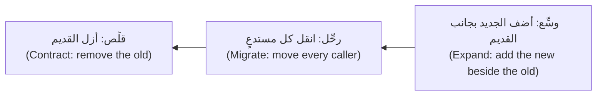

# الوحدة 7 — الشيفرة الموروثة وإعادة الهيكلة والترحيل

*معظم الشيفرة التي تهم في أي بنك كتبها أشخاص غادروا، ولا يجرؤ أحد على لمسها. ويغيّر وكلاء البرمجة اقتصاديات العمل في اتجاهين معًا: فهم يجعلون التغيير الآلي عبر ملفات كثيرة رخيصًا، ويجعلون «تنظيفًا لا ضرر منه» لوحدة لا تفهمها لا يتجاوز جملة واحدة. وتدور هذه الوحدة حول تغيير هذه الشيفرة بأمان. الدرس 7.1 هو الدرس المفاهيمي: اختبارات التوصيف (characterization tests) التي تثبّت ما تفعله الشيفرة اليوم بما فيه سلوكياتها الغريبة؛ ونقاط الفصل؛ ونمط التينة الخانقة (strangler fig) والتوسيع ثم التقليص (expand and contract)؛ والخطوات الصغيرة ولماذا لا تشترك إعادة الهيكلة (refactor) مع تغيير السلوك في إيداع واحد (commit)؛ وما يجيده الوكلاء — أدوات التحويل الآلي (codemods)، وترحيلات واجهات البرمجة (API migrations)، وصياغة مسودات الاختبارات — وأين يكونون خطرين — تغيير السلوك الصامت، والفروقات الضخمة، و«تحسين» سلوك غريب يعتمد عليه فريق آخر؛ والحكم على شبكة الأمان بفحص الطفرات (mutation check)؛ ومراجعة فروقات كبيرة؛ ومتى تترك الشيفرة الموروثة وشأنها. والمُنتَج هو قالب خطة إعادة الهيكلة. أما الدرس 7.2 فهو المختبر: دفتر الأستاذ الموروث في نجم ريميت بلا اختبارات ويحتفظ بدفاتره في متغيرات على مستوى الوحدة. تثبّت سلوكه، ثم تزيل الحالة العامة (global state) بإعادة الهيكلة، ثم ترحِّل المكتبة الداخلية najmkit من الإصدار 1 إلى الإصدار 2، بينما يتولى وكيل العمل الآلي ويحاسبك المُقيِّم (grader) على السلوكيات الغريبة. وكل ما يخص جانب نجم خيالي.*

> **التركيز:** Workflow, Verify — العادة 3، *خطوات صغيرة متحقق منها*: غيّر شيفرة لا تفهمها كاملة بتثبيت ما تفعله أولًا، ثم تحرّك بخطوات صغيرة بما يكفي لفحصها، مع وكيل ينجز العمل الآلي.

---

# 7.1 — تغيير شيفرة لا تفهمها: اختبارات التوصيف ونقاط الفصل وإعادة الهيكلة التدريجية وترحيلات بحجم الوكيل
*المستوى: 🟡 متوسط (Intermediate)* · *المتطلبات: 5.1، 6.1* · *التركيز: Workflow, Verify*

**بعد هذا الدرس تستطيع** كتابة اختبارات توصيف تثبّت سلوك وحدة موروثة بسلوكياتها الغريبة، وإظهار طفرة تلتقطها. *مدة الدراسة: نحو 110 دقيقة (تقدير).*

## ⚡ الدرس في دقيقة
- **الشيفرة الموروثة هي شيفرة لا تستطيع تغييرها بثقة**، وغالبًا لأنها بلا اختبارات. ابدأ بـ*التثبيت*: يسجّل **اختبار التوصيف (characterization test)** ما تفعله الشيفرة اليوم بما فيه سلوكياتها الغريبة، حتى تلك التي تراها خاطئة.
- **ثم تحرّك بخطوات صغيرة** عبر **نقطة فصل**، مع نمط التينة الخانقة والتوسيع ثم التقليص. ولا تشترك إعادة الهيكلة مع تغيير السلوك في إيداع واحد.
- **الوكلاء (Agents) أقوياء في الآلي** — إعادة التسمية، وأدوات التحويل الآلي، والمسودات الأولى للاختبارات — و**خطرون في الصامت**: «ترتيب» يحوّل سلوكًا غريبًا إلى سلوك عادي.
- **احكم على الشبكة** بفحص الطفرات؛ وراجع على نطاق واسع بالقاعدة والاختبارات وعيّنة.
- الإشارة: لا شبكة، فلا تفويض. الفخ: مجموعة اختبارية خضراء لم تلمس الشيفرة قط.

## 🧭 لماذا يهم
في يوم الأربعاء — يوم مصطنع لا مسجَّل من نموذج حقيقي — تطلب لجين، المهندسة حديثة التخرج، من وكيلها أن «يجعل `ledger.py` متسقًا مع بقية ريميت». ويُقرأ الملخص جيدًا: تستخدم حصة الشريك دالة التقريب المشتركة، ولا أثر جانبيًا (side effect) لـ`balance()`، وتُرجع `journal()` القائمة مباشرة. ويطبع `pytest -q` العبارة `99 passed`، لأن لا اختبار يؤكد شيئًا عن دفتر الأستاذ (غيّر الدرس 5.1 قيمة `PARTNER_SHARE` إلى 0.35 وراقب الاختبارات الـ99 تبقى خضراء). وبعد ثلاثة أسابيع تجد المالية أن مستحق الشريك يختلف بسنت واحد عن الصحيح في بعض التحويلات، ولا يستطيع أحد أن يقول أي إيداع تسبب بذلك.

يعرّف مايكل فيذرز (Michael Feathers) في كتابه *العمل بفعالية مع الشيفرة الموروثة* (2004) الشيفرة الموروثة (legacy code) بأنها شيفرة بلا اختبارات: فبدونها لا تستطيع أن تعرف هل حافظ التغيير على السلوك، مهما بدا مقروءًا. والوكلاء سلاح ذو حدين: فهم يجعلون الترتيب وشبكة الأمان رخيصين. الاختبارات سريعة الصياغة بطيئة الثقة: والعادة 4، *ثق بالدليل لا بالطلاقة*، تنطبق على الشبكة أيضًا.

## 📐 كيف يعمل

### 🟢 الأساسيات

**ما اختبار التوصيف.** إنه يسجّل ما تفعله الشيفرة لا ما ينبغي أن تفعله. وطريقة فيذرز، كما يصفها في مدونته: اكتب اختبارًا بتوقّع مؤقت، وشغّله، ودع الفشل يخبرك بالقيمة الحقيقية. وهذا على حالة التعادل في دفتر الأستاذ:

```python
from decimal import Decimal

from remit import ledger
from remit.money import Money


def test_a_tied_partner_share_rounds_to_the_even_cent():  # Q-LED-1
    entries = ledger.post_transfer("TRF-1", "C001", Money("500", "QAR"), Money("10.15", "QAR"))
    # entries: debit, payout, fee income, partner share; 0 is a placeholder
    assert entries[3]["amount"] == Decimal("0")
```

```text
E       AssertionError: assert Decimal('3.04') == Decimal('0')
```

ثلاثون بالمئة من 10.15 تساوي 3.045. يقرّب دفتر الأستاذ حصة الشريك إلى الزوجي عند المنتصف (half-even) فيخرج 3.04؛ وتقرّب بقية ريميت إلى الأعلى عند المنتصف (half-up) وكانت ستقول 3.05. تضع `3.04` وتسمّي السلوك الغريب في تعليق. أنت لم تقل إنه صحيح، بل قلت فقط إن أرقام المالية تعتمد عليه. ويسرد نص توثيق دفتر الأستاذ أربعة سلوكيات غريبة كهذه:

| المعرّف | السلوك الغريب | اختبار يثبّته |
|---|---|---|
| Q-LED-1 | تُقرَّب حصة الشريك البالغة 30% إلى الزوجي عند المنتصف | رسم قدره 10.15 يعطي حصة 3.04 |
| Q-LED-2 | استدعاء `balance()` لحساب غير معروف ينشئ ذلك الحساب | بعد `balance("NOPE")` تسرده `accounts()` |
| Q-LED-3 | الدفاتر على مستوى الوحدة ومشتركة؛ وتأتي المعرّفات والأوقات من najmkit | تتراكم القيود في دفتر واحد؛ وتجري معرّفات القيود من `JNL-000001` فصاعدًا (يغيّر الدرس 7.2 المشاركة عمدًا) |
| Q-LED-4 | الريال القطري QAR فقط (QAR only)، وأرصدة `Decimal` مجرّدة، ولا تُرحَّل الأطراف الصفرية | مبلغ بالجنيه المصري EGP يرفع `CurrencyMismatch` |

سلوك واحد لكل اختبار، يُسمّى باسمه، مع تعليق يذكر مصدره؛ ولا يقوم أحد بـ«إصلاح» أحدها. اختبار التوصيف الذي يبدأ بالفشل هو تغيير في السلوك؛ ويقرر إنسان هل هو مرغوب.

**خطوات صغيرة آمنة.** (1) ثبّت السلوك. (2) غيّر البنية على خطوات، كل منها إيداع يترك الاختبارات خضراء. (3) غيّر السلوك، إن اضطررت، في إيداعه الخاص مع تغيير الاختبار الخاص به. والسبب هو المراجعة: فالفروقات (diff) التي تنقل الشيفرة فقط يمكن الحكم عليها بعبارة «لم تتغير الاختبارات»؛ أما التي تغيّر أيضًا قاعدة تقريب فلا يمكن.

**ما يجيده الوكلاء وما لا يجيدونه.**

| المهمة | الملاءمة | الحارس |
|---|---|---|
| إعادة تسمية دالة عبر أربعين ملفًا | قوية | قاعدة تستطيع صياغتها؛ شغّل المجموعة الاختبارية، وابحث عن الاسم القديم |
| صياغة مسودة اختبارات توصيف لوحدة بلا اختبارات | قوية، إن قرأتها | الثقة بها مكلفة؛ شغّل فحص الطفرات |
| تطبيق تغيير موثَّق في واجهة البرمجة | جيدة | الملاحظات هي المواصفة؛ قابل الملخص بها |
| «تنظيف» وحدة موروثة أو «جعلها متسقة» | خطرة | لا قاعدة يُقابَل بها، فتُحوَّل السلوكيات الغريبة إلى سلوك عادي |

### 🟡 التعمق أكثر

**نقاط الفصل.** *نقطة الفصل* (seam) مكان تستطيع أن تغيّر عنده ما يفعله البرنامج دون تحرير ذلك المكان؛ وتحتاج إلى واحدة قبل أن تستطيع اختبار أي شيء موصول أو استبداله. وفي ريميت ثلاث. *نقطة فصل الكائن (object seam)* (مصطلح فيذرز): مرِّر الشيء من الخارج، كما يفعل `RemitService(..., ledger=None)` في المختبر. و*نقطة الفصل العامة (global seam)* (تسمية هذه الدورة): تتيح najmkit للاختبار تركيب ساعة ثابتة ومعرّفات متسلسلة. و*نقطة فصل الاختبار (test seam)* (وهي تسميتنا أيضًا): محوّل صغير يمنح اختباراتك طريقة واحدة للوصول إلى شيفرة توشك بنيتها أن تتغير؛ ويعيد محوّل المختبر وحدة موروثة مغلَّفة اليوم، و`Ledger` بعد إعادة الهيكلة، فتعمل الاختبارات نفسها على الحالتين.

**نمط التينة الخانقة بأي حجم.** يستبدل نمط التينة الخانقة عند مارتن فاولر (Martin Fowler) نظامًا قديمًا بأن ينمّي الجديد حوله ويُخرج القديم من الخدمة قطعةً قطعة، وهو مفضَّل على إعادة الكتابة دفعة واحدة لأنه يخفض المخاطر. وعلى مستوى الوحدة: (أ) أضف الصنف الجديد خلف الدوال القديمة؛ (ب) انقل المستدعين واحدًا واحدًا؛ (ج) احذف الدوال القديمة حين لا يستدعيها شيء. وكل خطوة إيداع أخضر قابل للتراجع عنه.

**التوسيع ثم التقليص** (ويسمى أيضًا التغيير المتوازي) هو الفكرة نفسها لواجهة أو صيغة تخزين.



لا توسّع وتقلّص في خطوة واحدة، وإلا فلن تجد لحظة يعمل فيها القديم والجديد معًا. في الدرس 7.2 يقوم سالم، من هندسة المنصة، بالتوسيع — إذ تحتفظ najmkit 2 بالأسماء القديمة بوصفها أغلفة تحذيرية (warning wrappers) — ثم ترحِّل أنت مواضع الاستدعاء، ثم تقلّص. ويحوّل `pytest -W error::DeprecationWarning` الاستدعاء القديم إلى خطأ يُظهر موضع استدعائه، لكن فقط بعد ترحيل `tests/conftest.py`، وهو إعداد الاختبارات المشترك: وإلى ذلك الحين يفشل كل اختبار في أدوات التجهيز (fixtures) الخاصة به.

**ملخص الاعتمادية ادعاء.** يلخّص وكيل ملاحظات najmkit بعبارة «سبع إعادات تسمية ولا شيء آخر». وتقول الملاحظات أيضًا إن `audit.emit` يرفض أي قيمة لا يستطيع JSON حملها، بينما كان الإصدار 1 يستدعي `str()` عليها. والترحيل الذي هو إعادة تسمية فقط يفشل فشلًا ظاهرًا؛ أما الفشل الصامت فهو الإصلاح «المرتَّب»، أي `str(amount.amount)` بدل `str(amount)`: أخضر حيثما لا يثبّت أي اختبار ذلك السطر، بينما يتوقف محلل فريق الاحتيال، الذي يقرأ `"500.00 QAR"`، عن المطابقة. اقرأ الملاحظات بحثًا عن كلمات السلوك مثل *يرفع الآن* و*لم يعد*، وثبّت المخرجات التي تقرؤها الفرق الأخرى.

**الفروقات الخطرة والفروقات المراجَعة.** «ترتيب» لدفتر الأستاذ، مختصر إلى تغييراته الثلاثة (مصطنع؛ والمقاطع تحريرات حقيقية):

```diff
-    partner = (fee.amount * PARTNER_SHARE).quantize(_CENT, rounding=ROUND_HALF_EVEN)  # Q-LED-1
+    partner = quantize(fee.amount * PARTNER_SHARE)  # same rounding as the rest of Remit
...
-    if account not in _BALANCES:
-        _BALANCES[account] = Decimal("0")
-    return _BALANCES[account]
+    return _BALANCES.get(account, Decimal("0"))
...
-    return list(_JOURNAL)
+    return _JOURNAL
```

كل مقطع (hunk) يمكن الدفاع عنه منفردًا. دون شبكة أمان: `99 passed`. ومع اختبار تثبيت واحد لكل مقطع:

```text
FAILED tests/test_ledger_pins.py::test_a_tied_partner_share_rounds_to_the_even_cent
FAILED tests/test_ledger_pins.py::test_asking_for_an_unknown_account_creates_it
FAILED tests/test_ledger_pins.py::test_the_journal_is_a_copy - assert 0 == 4
3 failed, 99 passed in 0.38s
```

كل فشل سؤال لإنسان — «هل نعتمد على هذا؟» — لا اختبار يُصلَح.

**خطوة آمنة واحدة، مطلوبة صراحةً.** الضعيف: «أعد هيكلة ledger.py لإزالة الحالة العامة وجعله أنظف» والقوي:

```text
Goal: the "Ledger class" step of docs/refactoring-plan.md. In src/remit/ledger.py add a class Ledger
that holds the balances and the journal on the instance. For now keep post_transfer, balance, accounts,
journal and reset as module functions that call one shared Ledger (a later step deletes them). Do not
change behaviour: same amounts, rounding, errors, ids and timestamps. The quirks in the module
docstring are intended; do not fix them. Edit nothing under tests/ and no other module. When pytest -q
is green, commit (this ticket asks for it, as CLAUDE.md allows). If a test in
tests/test_ledger_*.py fails, stop and show me the failure.
```

الموجّه أو `CLAUDE.md` سياق (context) لا إنفاذ. وبعد إيداع الاختبارات، تكون قاعدة منع (deny rule) على `Edit(tests/test_ledger_*.py)` في `.claude/settings.json` أقرب إلى سياج (راجع وثائق الصلاحيات؛ ويظل بوسع Bash تحرير الملفات، فاستمر في فحص الفروقات).

### 🔴 نظرة الخبير

**احكم على الشبكة.** يكسر فحص الطفرات الشيفرة عمدًا ويسأل هل يفشل اختبار. يدويًا، في نسخة للتجربة: ضع `rounding="ROUND_HALF_UP"` مكان `rounding=ROUND_HALF_EVEN` (فـ`ROUND_HALF_UP` المجرد غير مستورد: والطفرة التي تنهار تُفشل كل اختبار ولا تثبت شيئًا)، أو غيّر `PARTNER_SHARE` إلى 0.35. وكل طفرة ناجية سلوك لم تثبّته بعد، أو تغيير مكافئ لا يراه أحد: سؤال لا حكم. ويكسر مُقيِّم الدرس 7.2 دفتر الأستاذ الأصلي بست عشرة طريقة؛ ويعلّم [*اختبار البرمجيات (Software Testing)*، الدرس 2.3 — هل اختباراتك جيدة فعلًا؟](../testing/index.ar.html#/2.3) هذه التقنية.

**المراجعة على نطاق واسع.** لا يمكن قراءة فروقات آلية من أربعين ملفًا سطرًا سطرًا. (1) راجع *القاعدة*: التعليمة أو، في أداة التحويل الآلي (codemod)، السكربت (شغّله مرتين؛ ينبغي ألا يغيّر التشغيل الثاني شيئًا). (2) اقرأ الاختبارات كاملة. (3) خذ عيّنة من الفروقات: أول المقاطع (hunks) وآخرها وأخطر الملفات. (4) أتمت الباقي: المجموعة الاختبارية عند كل إيداع، والتحذيرات بوصفها أخطاء (warnings as errors)، وبحث عن الأسماء القديمة، و`git diff --stat`. علامات التوقف: ملف اختبار متغيّر في إيداع إعادة هيكلة، ومقطع لا تستطيع تفسيره.

**وحدات بحجم الوكيل.** الوحدة قاعدة واحدة على مجموعة محدودة من الملفات، صغيرة بما يكفي للتحقق منها في جلسة واحدة. ولقائمة طويلة، تعرض صفحة أفضل الممارسات في Claude Code توزيعًا متفرعًا في الوضع غير التفاعلي يعلّمه الدرس 9.1 (لدى الأدوات الأخرى ما يكافئه)؛ ومُكيَّفًا مع إعادة التسمية هذه (`files.txt` من `grep -l`):

```bash
for file in $(cat files.txt); do
  claude -p "In $file move every najmkit v1 call to the v2 name in docs/najmkit-v2-migration.md. Keep every audit line unchanged. Change nothing else. Return OK or FAIL." \
    --allowedTools "Read,Edit" \
    --permission-mode dontAsk \
    --max-turns 8
done
```

والعبارة OK أو FAIL التي يطبعها هي ادعاء الوكيل لا دليل، فراجع الفروقات المجمَّعة كما سبق. وثلاثون موضع استدعاء في خمسة ملفات تحتاج جلسة واحدة لا حلقة.

**متى تترك الشيفرة الموروثة وشأنها.** يكلّف التثبيت وإعادة الهيكلة وقتًا وانتباه مراجعة. فإن كانت الوحدة مستقرة، وتقع خلف واجهة نظيفة، ولا شيء في خارطة الطريق يحتاجها، فوثّق سلوكياتها الغريبة، وسيِّجها بسطر في ذاكرة المشروع وقاعدة مراجعة، وأنفق الأسبوع في مكان آخر. وإن كان لا بد من إزالتها فاخنقها. إعادة الكتابة رخيصة الإنتاج الآن، وباهظة التحقق كما كانت دائمًا.

## 🧰 الأدوات
| الأداة أو الممارسة أو النمط | ما هي وماذا تفعل | متى تلجأ إليها |
|---|---|---|
| **Characterization test** — اختبار التوصيف عند فيذرز (Feathers) | يسجّل ما تفعله الشيفرة اليوم بما فيه السلوكيات الغريبة | قبل تغيير شيفرة بلا شبكة أمان |
| **Seam** — نقطة الفصل عند فيذرز | مكان لتغيير السلوك دون التحرير فيه | حين يكون شيء موصولًا ويجب اختباره أو استبداله |
| **Strangler fig** — نمط التينة الخانقة عند فاولر (Fowler) | نمِّ البديل حول الشيفرة القديمة وأخرجها من الخدمة قطعةً قطعة | استبدال وحدة دون إعادة كتابة |
| **Expand and contract** — التوسيع ثم التقليص | أضف الجديد بجانب القديم، وانقل المستدعين، وأزل القديم | إعادة تسمية واجهة البرمجة (API renames)، وترقيات الاعتماديات، وصيغ التخزين |
| **Codemod** — أداة التحويل الآلي | سكربت يعيد كتابة الشيفرة بقاعدة، قابل لإعادة التشغيل | التغيير نفسه في ملفات كثيرة |
| **Mutation check** — فحص الطفرات | اكسر الشيفرة عمدًا وانظر هل يفشل اختبار | الحكم على مجموعة اختبارات التوصيف |
| **Refactoring plan template** — قالب خطة إعادة الهيكلة | صفحة واحدة: الثوابت، وشبكة الأمان، والخطوات، والتفويض، والمراجعة، والتراجع (rollback) | قبل أي تغيير في شيفرة موروثة أو شيفرة أموال |

## 🏛️ عمليًا في بنك نجم
يضع طارق، قائد الهندسة، القاعدة لمنصة المدفوعات: فكل تغيير في وحدة موروثة، أو ترحيل اعتمادية، يبدأ بخطة إعادة هيكلة قبل أي شيفرة؛ ثم يشترط CONTRIBUTING.md مراجعًا بشريًا ثانيًا لمنطق الأموال مثل `ledger.py` و`service.py`. والمُنتَج هو **قالب خطة إعادة الهيكلة**: احفظه باسم `docs/refactoring-plan.md` (يشحنه المختبر باسم `lab-assets/refactoring-plan-template.md`).

```markdown
# Refactoring plan: <name of the change>

**Owner:** <you> · **Second reviewer:** <name> · **Agent and mode:** <tool, plan mode or not> · **Labelled AI-assisted:** yes / no

### 1. Why, and what must not change
- Why (the ticket, the incident, what it unblocks):
- Must not change, quirks included (each with how you know):
- May change, and who agreed:

### 2. What I do not understand yet
- Open questions, and how I will answer each (read, run, ask, test):

### 3. The safety net
- Characterization tests: where, how many, what they pin:
- How I know the net is good (mutation check, survivors):
- Not covered, and why that is acceptable:

### 4. The seams and the steps
One commit per step, tests green after each. A refactor step never changes behaviour.

| # | Step | Kind (refactor, migration, behaviour) | Check after the step | Commit message |
|---|---|---|---|---|
| 1 | | | | |

### 5. Delegation
- For the agent (mechanical, a rule I can state):
- I keep (judgement, money logic, any quirk):
- The instruction: scope, "do not change behaviour", "do not edit the pinned tests", when to stop:

### 6. Review at scale
- Read in full:
- Sampled by hand:
- Automated (suite per commit, warnings as errors, search for old names, diff size):

### 7. Rollback and done
- Undo means reverting the commit. I stop and ask when:
- Done means:
```

املأه قبل العمل، بضعة أسطر لكل قسم؛ وصُغ مسودة القسم 4 مع وكيلك في وضع التخطيط (plan mode) (Shift+Tab، أو `claude --permission-mode plan`)، حيث يقترح ولا يحرّر شيئًا. وفي تغيير موجز المورّد الذي يطلبه TODO القديم في `screening.py`، يسرد القسم 1 العناصر Q-SCR-1 إلى Q-SCR-4 بوصفها *يجب ألا تتغير*.

## 🛠️ التمارين
- 🟢 **ثبّت سلوكين غريبين يدويًا.** *بلا وكيل.* في أي مجلد مختبر — مجلد m00 لديك مثلًا — اكتب اختبارين لـ`remit.ledger` بطريقة القيمة المؤقتة: حصة الشريك في حالة التعادل لرسم قدره 10.15 (Q-LED-1) و`balance("NOPE")` (Q-LED-2). *يكتمل عندما:* ينجح كلاهما بالقيم الحقيقية مع تعليق يسمّي السلوك الغريب، ويؤدي ضبط `rounding="ROUND_HALF_UP"` في نسخة للتجربة إلى فشل الأول.
- 🟡 **صُغ ثم احكم.** *يحتاج إلى وكيل* (أو اكتب الاختبارات بنفسك). اطلب اختبارات توصيف لـ`screening.py`؛ ثم اكسر `FUZZY_PERCENT` و`MIN_FUZZY_LEN` و`MAX_TOKENS` واحدًا تلو الآخر في نسخة للتجربة. *يكتمل عندما:* يسرد جدول كل اختبار والسلوك الغريب الذي يثبّته والطفرات التي التقطها، إضافة إلى اختبار واحد رفضته وسبب ذلك.
- 🔴 **خطِّط لإعادة تسمية.** *يحتاج إلى وكيل في الخطوة الأخيرة.* خطِّط لإعادة تسمية `Customer.kyc_tier` إلى `kyc_level`: فهي مستخدمة في النموذج، والمخزن — وهي أيضًا عمود في قاعدة بيانات، في خطوة لاحقة — واستدعاء الحدود في الخدمة، وسطر الأوامر، والاختبارات. *يكتمل عندما:* يُملأ القالب؛ ويعيد الوكيل تسمية الخاصية في نسخة للتجربة؛ وتنجح فحوص قسمك 6؛ وتسمّي شيئًا واحدًا أخطأ فيه الوكيل، أو تقول إنه لم يخطئ في شيء.

## ⚠️ أخطاء وفخاخ
- **التنظيف قبل التثبيت.** الترتيب يبدو معقولًا والمجموعة الاختبارية خضراء. ثبّت أولًا وشغّل فحص الطفرات.
- **كتابة الاختبار الذي تتمناه.** «اختبار توصيف» يتوقع التقريب إلى الأعلى عند المنتصف يفشل في اليوم الأول. سجّل ما تفعله الشيفرة؛ وارفع الفرق بوصفه قرارًا.
- **ترك الوكيل يعدّل الاختبارات المثبَّتة.** التوقع المتغيّر في إيداع إعادة هيكلة هو أوضح إشارة في الفروقات. امنعه؛ وافحص `git diff <tests commit> -- tests`.
- **خلط إعادة الهيكلة بتغيير السلوك.** لم يعد بوسع المراجعين الاعتماد على «الاختبارات لم تتحرك».
- **الوثوق بملخص سجل التغييرات.** اقرأ الملاحظات بحثًا عن كلمات السلوك؛ وشغّل مع التحذيرات بوصفها أخطاء.
- **قراءة أربعين ملفًا سطرًا سطرًا، أو عدم قراءة أي منها.** راجع القاعدة والاختبارات وعيّنة.

## 🧾 الخلاصة
- لا تغيير بلا شبكة أمان موثوقة: ثبّت السلوك أولًا بما فيه السلوكيات الغريبة، ولا «تُصلح» أبدًا اختبارًا مثبَّتًا.
- تحرّك بخطوات صغيرة خضراء مودَعة؛ واخنق (strangle) ووسِّع ثم قلِّص بدل إعادة الكتابة؛ وأبقِ إعادات الهيكلة (refactors) والترحيلات وتغييرات السلوك منفصلة.
- يتألق الوكلاء في التغيير الآلي والمسودات الأولى للاختبارات؛ ويفشلون في التحويل الصامت للسلوك الغريب إلى سلوك عادي والتنظيفات غير المطلوبة.
- احكم على الشبكة بفحص الطفرات؛ وراجع على نطاق واسع بالقاعدة والاختبارات والعيّنة والأتمتة. وأحيانًا اتركها وشأنها.

## ✍️ اختبر نفسك

**1. «يرتّب» وكيلٌ `ledger.py` ويطبع `pytest -q` العبارة `99 passed`. ماذا يخبرك ذلك عن دفتر الأستاذ؟**

- A. لم يتغير شيء، لأن المجموعة الخضراء تثبت أن السلوك هو نفسه
- B. لم يتغير إلا ما تؤكده الاختبارات الـ99، ولا يؤكد أي منها شيئًا عن دفتر الأستاذ
- C. كان الوكيل حذرًا، لأن عمليات الترتيب في المشاريع المختبرة نادرًا ما تفشل في الواقع
- D. الترتيب آمن، شريطة أن يقول الوكيل إنه حافظ على السلوك

<details><summary>الإجابة</summary>

**B.** المجموعة الاختبارية دليل فقط عمّا تؤكده، ولا يؤكد أي من الاختبارات الـ99 رصيدًا في دفتر الأستاذ. ثبّت أولًا. 🟢 الأساسيات.

</details>

**2. يفشل اختبار توصيف بقيمة مؤقتة لرسم قدره 10.15 بالرسالة `3.04 == 0`. وأنت تعتقد أن 3.05 هي الصحيحة. ماذا تفعل؟**

- A. ضع 3.05 في الاختبار وأصلح الشيفرة، لتتفق معك المجموعة الاختبارية
- B. احذف الاختبار، لأن اختبار التوصيف يجب ألا يخالفك
- C. ضع 3.04، وسمِّ السلوك الغريب، وارفع 3.05 قرارًا منفصلًا
- D. ضع 3.04 دون تعليق، وغيّر الشيفرة في الإيداع نفسه

<details><summary>الإجابة</summary>

**C.** يسجّل الاختبار ما تفعله الشيفرة؛ أما هل ينبغي أن تختلف فقرار إنسان، في إيداع مستقل. والخيارات الأخرى تخفي السلوك الغريب أو تخلطه بإعادة هيكلة. 🟢 الأساسيات.

</details>

**3. تأتي najmkit 2 بالأسماء القديمة أغلفةً تحذّر. متى تحذف الأغلفة؟**

- A. حين لا يستدعي شيء الأسماء القديمة بعد الآن، في خطوة التقليص
- B. في خطوة التوسيع، لتكون الأسماء الجديدة غير ملتبسة
- C. في أول إيداع ترحيل، لتفشل مواضع الاستدعاء المنسية فورًا
- D. أبدًا، لأن خدمة أخرى قد تستخدمها يومًا ما

<details><summary>الإجابة</summary>

**A.** يضيف التوسيع الجديد بجانب القديم، وترحِّل المستدعين، وبعد ذلك فقط يزيل التقليص القديم. والحذف المبكر يزيل اللحظة التي يعمل فيها الاثنان معًا. 🟡 التوسيع ثم التقليص.

</details>

**4. يلخّص وكيل ملاحظات ترقية najmkit بعبارة «سبع إعادات تسمية ولا تغييرات أخرى». ما الخطوة التالية السليمة؟**

- A. اقبله، لأن إعادة التسمية هي العمل كله وتلتقط المجموعة الاختبارية الباقي تمامًا
- B. اطلب من الوكيل تأكيد الملخص، ثم رحِّل مواضع الاستدعاء كلها
- C. اقرأ العنوان الأول وثق بجدول إعادة التسمية الذي يليه
- D. اقرأ الملاحظات بحثًا عن تغييرات السلوك، وشغّل مع التحذيرات بوصفها أخطاء، وثبّت المخرجات

<details><summary>الإجابة</summary>

**D.** الملخص ادعاء؛ وقد تحمل الملاحظات تغيير سلوك أسقطه، والمخرجات التي تقرؤها فرق أخرى تحتاج اختبارها الخاص. وسؤال الوكيل مرة أخرى يكرر الطلاقة. 🟡 ملخص الاعتمادية ادعاء.

</details>

**5. لم يتغير `screening.py` منذ سنة، ويقع خلف دالة واحدة، ولا تحتاجه أي تذكرة. ويريد زميل تثبيته وإعادة كتابته في هذا السبرنت. ما أفضل جواب؟**

- A. نعم: الوكيل يجعل إعادة الكتابة رخيصة، فسقطت حجة التكلفة
- B. اتركها، ودوّن سلوكياتها الغريبة، وسيِّجها، وعد إليها حين تحتاجها تذكرة
- C. أعد كتابتها مع الوكيل لكن تخطَّ الاختبارات، فالوحدة القديمة لم تكن لها اختبارات أيضًا
- D. نعم، إن وعد الوكيل بأن كل سلوك سيُحفظ

<details><summary>الإجابة</summary>

**B.** يكلّف التثبيت وإعادة الهيكلة أيامًا، وقد لا تردّ وحدة مستقرة ومعزولة بلا طلب ذلك. اخنقها حين يصل تغيير حقيقي. 🔴 متى تترك الشيفرة الموروثة وشأنها.

</details>

## 📚 المراجع
- وثائق Claude Code: أفضل الممارسات — وضع التخطيط والتوزيع المتفرع والتحقق: https://code.claude.com/docs/en/best-practices; الوضع غير التفاعلي (headless mode): https://code.claude.com/docs/en/headless; الصلاحيات: https://code.claude.com/docs/en/permissions; الأوامر: https://code.claude.com/docs/en/commands
- تحذيرات Python: https://docs.python.org/3/library/warnings.html; ومرشحات تحذيرات pytest: https://docs.pytest.org/en/stable/how-to/capture-warnings.html; ومارتن فاولر، «تطبيق التينة الخانقة»: https://martinfowler.com/bliki/StranglerFigApplication.html
- [*اختبار البرمجيات*، الدرس 2.3 — هل اختباراتك جيدة فعلًا؟](../testing/index.ar.html#/2.3)؛ [*اختبار البرمجيات*، الدرس 6.2 — الاختبارات بوصفها المواصفة لوكلاء البرمجة](../testing/index.ar.html#/6.2)؛ [*تصميم الأنظمة لمبرمجي الفايب (System Design for Vibe Coders)*، الدرس 9.7 — تدقيق الشيفرة ومراجعتها بسرعة الوكلاء](../vibe/index.ar.html#l9-7)
- **للتعمق أكثر.** مايكل فيذرز، *العمل بفعالية مع الشيفرة الموروثة* (2004) ومقاله «اختبار التوصيف» ("Characterization Testing"): https://michaelfeathers.silvrback.com/characterization-testing · كنت بيك (Kent Beck)، *رتّب أولًا؟* (2023)، عن الترتيبات الصغيرة القابلة للتراجع ومتى تُجرى · GitClear، «جودة شيفرة مساعد الذكاء الاصطناعي: بيانات 2025» ("AI Copilot Code Quality: 2025 Data") — بيانات رصدية من مورّد: في 2024 تجاوز النسخ واللصق الشيفرة المنقولة: https://www.gitclear.com/ai_assistant_code_quality_2025_research

---

# 7.2 — المختبر: روِّض وحدة بلا اختبارات، ثم أعد هيكلتها، ثم رحِّل اعتمادية
*المستوى: 🟡 متوسط* · *المتطلبات: 6.2، 7.1* · *التركيز: Workflow, Verify*

**بعد هذا الدرس تستطيع** تثبيت وحدة بلا اختبارات، وإعادة هيكلتها في إيداعات خضراء، وترحيل اعتمادية حتى ينجح المُقيِّم. *مدة الدراسة: نحو 110 دقيقة (تقدير).*

## ⚡ الدرس في دقيقة
- **المختبر m07** على نجم ريميت: دفتر الأستاذ الموروث بلا اختبارات ويحتفظ بدفاتر على مستوى الوحدة. ثلاثة أجزاء: **ثبّته** باختبارات التوصيف، و**أعد هيكلته** (`class Ledger`، `RemitService(..., ledger=None)`)، و**رحِّل** najmkit من الإصدار 1 إلى 2.
- **هل يلزم وكيل: نعم — موصى به لا مطلوب.** مسار بلا وكيل هو المختبر كله يدويًا؛ ويفحص المُقيِّم النتيجة لا من أنتجها.
- الواجهة بعد إعادة الهيكلة **ثابتة** في التذكرة؛ ويجب أن تنجح اختباراتك قبلها وبعدها، عبر نقطة فصل صغيرة.
- يكسر المُقيِّم دفتر الأستاذ الأصلي بست عشرة طريقة، ويشغّل مجموعة اختبارات خفية على إعادة هيكلتك، ويقارن أسطر التدقيق حرفًا بحرف. خطِّط لبضع ساعات.

## 🧭 لماذا يهم
في يوم الاثنين تحمل حصة، مالكة المنتج، طلب المالية: تحتاج المطابقة الليلية إلى خدمتين في عملية واحدة، لكل منهما دفاترها الخاصة. وجواب طارق هو هذا المختبر في جملة: «لا يلمس أحد `ledger.py` بلا اختبارات، ولن أراجع أربعمئة سطر من فروقات الوكيل ثقةً بها.» وتحمل التذكرة نفسها najmkit 2، لأن لوحة متابعة فريق الاحتيال تقرأ أسطر التدقيق وسيوقفها تحويل «مرتَّب» واحد عن المطابقة بصمت. يستطيع الوكيل إنجاز الأجزاء الآلية في ساعة؛ أما تقرير ما يجب ألا يتغير، وإثبات أنه لم يتغير، فهو الجزء الذي لا يستطيعه غيرك.

## 📐 كيف يعمل

### 🟢 الأساسيات

**اقرأ أولًا.** يسرد نص التوثيق في `ledger.py` العناصر Q-LED-1 إلى Q-LED-4؛ ويعرض `git show lab-start:src/remit/ledger.py` الأصل دائمًا، ويستخدم المُقيِّم النسخة نفسها. ويطبع `pytest -q` العبارة `99 passed` وقائمة طويلة من تحذيرات `DeprecationWarning` من najmkit 2: وهي أول قائمة مهام ترحيل جزئية (لا تظهر إلا الاستدعاءات التي تبلغها اختباراتك).

**الجزء 1: ثبّته.** تمنح نقطة الفصل `ledger_port.py` اختباراتك الدالتين `make_ledger()` و`ledger_of(service)`، وهما تعملان قبل الجزء 2 وبعده. استخدم طريقة القيمة المؤقتة من الدرس 7.1، أو اطبع دفعة من القيم الحقيقية مرة واحدة من سكربت للتجربة. غطِّ السلوكيات الغريبة الأربعة وما حولها من تفاصيل: ترتيب القيود الأربعة، وأنواع الأخطاء ورسائلها، وما يتركه قيد مرفوض خلفه، وما يفعله `send` حين يفشل المخزن (يسميه نص توثيق الخدمة D-SVC-1). عشرة اختبارات هي الحد الأدنى؛ وثلاثون اختبارًا صغيرًا تغطية شاملة. لا تستدعِ `make_ledger()` بعد `send` في الاختبار نفسه: فقبل إعادة الهيكلة يمحو الدفاتر المشتركة. ومع وكيل، اطلب سلوكًا واحدًا في كل مرة: «ثبّت Q-LED-2 فقط، في tests/test_ledger_basics.py، عبر make_ledger(). ضع قيمة مؤقتة في التأكيد، وشغّله، وانسخ القيمة التي ترجعها الشيفرة. لا تغيّر شيئًا تحت src/.» ⁦("Pin Q-LED-2 only, in tests/test_ledger_basics.py, through make_ledger(). Put a placeholder in the assertion, run it, and copy the value the code returns. Change nothing under src/.")⁩ ثم اقرأ كل اختبار واحذف كل ما لا يؤكد شيئًا.

**الجزءان 2 و3.** اتبع ترتيب التينة الخانقة (strangler order) من الدرس 7.1 وأودِع كل خطوة خضراء. وللترحيل، يضم `docs/najmkit-v2-migration.md` إعادات التسمية وتغيير سلوك واحدًا وترتيبًا مقترحًا: رحِّل `tests/conftest.py` أولًا (يشغّل كل اختبار أدوات التجهيز الخاصة به)، ثم شغّل `pytest -W error::DeprecationWarning`. ولا يسمح `CLAUDE.md` في مستودعك بالإيداعات وتعديل الاختبارات إلا حين تطلبها مهمة؛ وهذه التذكرة تطلبها، فقل ذلك في موجّهاتك.

### 🟡 التعمق أكثر

**للجزء 3 شبكة أمانه الخاصة.** تثبّت المجموعة المرئية سطر تدقيق واحدًا (`transfer.sent`). وقبل أن تلمس موضع استدعاء، ثبّت الأحداث الثلاثة كلها التي تكتبها ريميت، حرفًا بحرف، بساعة ثابتة ومعرّفات متسلسلة (تمنحك أداة التجهيز `service` و`audit.configure(tmp_path / "audit.jsonl")` كليهما). عندها تصبح عبارة «لم تتغير اختبارات التدقيق» فحص ترحيلك.

**خطوة الترحيل.** الضعيف: «رحِّل ريميت إلى najmkit 2.» والقوي:

```text
Goal: the migration step of docs/refactoring-plan.md. Move every use of a najmkit v1 name in src/remit and
tests to the v2 name in docs/najmkit-v2-migration.md, starting with tests/conftest.py. Read that file first.
A clock object's .now() method is not a renamed function; only the module-level clock functions are.
audit.emit takes JSON values only: convert a Money so that each audit line stays exactly as it was. Change
no other behaviour, edit no test except to follow a rename, and leave src/najmkit alone for now. Run
pytest -W error::DeprecationWarning, show me the output, and commit when it is green.
```

**راجع كل خطوة بالطريقة نفسها.** يكون `git diff <tests commit> -- tests/test_ledger_*.py` فارغًا (أو يُظهر إعادة تسمية)؛ ويسمّي `git diff --stat` الملفات التي ينبغي أن تمسّها الخطوة فقط؛ والمجموعة الاختبارية خضراء؛ والبحث عن الأسماء القديمة فارغ. اقرأ مقاطع `service.py` و`ledger.py` بنفسك؛ وخذ عيّنة من الباقي. والاختبار المثبَّت الذي يحمرّ وجد تغييرًا في السلوك: استعد السلوك، ولا تعدّل الاختبار ولا تدع الوكيل يعدّله، ودوّن أي خلاف لتذكرة منفصلة.

### 🔴 نظرة الخبير

**كيف يقرأ المُقيِّم عملك.** يعيد بناء دفتر الأستاذ الأصلي من الوسم `lab-start` ويشغّل اختباراتك عليه، وعلى نسخة مطابقة أُعيدت كتابتها بتعليقات وأسماء خاصة أخرى (فلا يستطيع اختبار أن يتعرف على الملف ببصمته)، وعلى ست عشرة نسخة معطوبة، توصف كل منها بسلوك مثل «يُرفض الرسم السالب»؛ وتُسمّى الطفرات الناجية. وكل تشغيل هو `pytest -q` كما يشغّله التكامل المستمر.

**ما لا يستطيع معرفته.** هل فهمتَ سلوكًا غريبًا، أو تحركت بخطوات صغيرة بدل قفزة واحدة أودعتها ثلاث مرات (فهو يفحص فقط أن كل إيداع يغيّر ملفًا وأن الاختبارات تأتي أولًا). وهل غيّرت إعادة هيكلتك سلوكًا لم يثبّته أحد. ومجموعة اختبارات تنسخ القيم من الشيفرة تنجح ولا تعلّم شيئًا إن لم تسأل قط لماذا. والمُقيِّم شريك تدريب لا بوابة.

## 🧰 الأدوات
| الأداة أو الممارسة أو النمط | ما هي وماذا تفعل | متى تلجأ إليها |
|---|---|---|
| **Characterization test** — اختبار التوصيف عند فيذرز | يسجّل ما يفعله دفتر الأستاذ اليوم بما فيه السلوكيات الغريبة | قبل أول تعديل على `ledger.py` |
| **Seam** — نقطة الفصل عند فيذرز | `ledger_port.py`، ثم `ledger=None` | اختبارات تعمل قبل إعادة الهيكلة وبعدها |
| **Strangler fig** — نمط التينة الخانقة عند فاولر | صنف خلف الدوال القديمة، ونقل المستدعين، وحذف القديمة | إعادة الهيكلة في الجزء 2 |
| **Expand and contract** — التوسيع ثم التقليص | najmkit 2 بجانب 1، ونقل مواضع الاستدعاء، وحذف الأسماء القديمة | الترحيل في الجزء 3 |
| **Mutation check** — فحص الطفرات | اكسر دفتر الأستاذ الأصلي عمدًا؛ هل يفشل اختبار؟ | الحكم على مجموعة الجزء 1 |
| **Agent log** — سجل الوكيل | الموجّه (prompt)، وما فعله، وما صحّحته، والوقت | كل مختبر بمساعدة وكيل |

## 🏛️ عمليًا في بنك نجم
**هل يلزم وكيل: نعم — موصى به لا مطلوب.** مسار بلا وكيل هو المختبر كله يدويًا بـ`git` و`pytest` ومحرر (الجزء 3 نحو ثلاثين موضع استدعاء). يوفّر الوكيل الوقت في الاختبارات وإعادة التسمية، ويضيف خطرًا تحديدًا حيث لهذه الوحدة سلوكيات غريبة.

**التذكرة.** تذكرة طارق في `TASK.md`:

```text
# REMIT-372: make the ledger safe to change, then move Remit to najmkit 2

**From:** Tariq, Engineering Lead, Payments Platform (Hessa's business reason is at the end)
**To:** You, and your AI coding tool if you use one
**Priority:** Normal. Money logic: a second human reviews it before it merges.

`src/remit/ledger.py` is Remit's oldest code and has no tests. Its books live in module-level
variables, so a process can have exactly one set of books. Finance's reconciliation job needs two
`RemitService` objects in one process, each with its own ledger. And najmkit 3 will remove najmkit 1.

Three parts. Do Part 1 first and commit it before you change anything under `src/`; commit every
later step separately. **Behaviour must not change anywhere**, quirks included, except where this
ticket says so. Read the docstring of `ledger.py` first.

### Part 1: pin what the ledger does now

1. Copy `lab-assets/ledger_port.py` to `tests/ledger_port.py`: a seam with `make_ledger()` (a fresh
   ledger) and `ledger_of(service)` (the ledger a service posts to), working before and after Part 2.
2. Write characterization tests in **new files named `tests/test_ledger_*.py`**, importing the seam as
   `from ledger_port import ledger_of, make_ledger` (`tests.ledger_port` fails under `pytest -q`, which
   CI runs). They say what the code does today, quirks included (values, order, error types and
   messages), not what you think it should do. Reach the ledger only through the seam. Part 2 changes
   Q-LED-3's shared books on purpose: pin the rest of it.
3. They must pass on the code as it is now and, unchanged, after Part 2. The grader runs them on the
   original and on broken copies of it, so test behaviour, never the source text: it wants at least ten
   tests that catch at least 13 of 16 breaks, and ignores your edits to `tests/conftest.py`.
   `python lab-assets/try_mutation.py` runs your tests on the original; given a file, a text and a
   replacement, it breaks the original there and says whether they noticed.

### Part 2: remove the module-level state

After the refactor the interface is exactly this:

    # src/remit/ledger.py
    class Ledger:
        def __init__(self) -> None: ...                       # no arguments needed
        def post_transfer(self, transfer_id: str, customer_id: str, send_amount: Money, fee: Money) -> list[dict]: ...
        def balance(self, account: str) -> Decimal: ...
        def accounts(self) -> list[str]: ...
        def journal(self) -> list[dict]: ...

    # src/remit/service.py
    class RemitService:
        def __init__(self, store, rates, watchlist, clock, notifier, ledger: Ledger | None = None) -> None: ...
        # self.ledger is the Ledger in use; ledger=None means a fresh Ledger() for this service

- State belongs to the instance: no changing module-level variables, no mutable class attributes,
  no module-level default instance.
- The module functions `post_transfer`, `balance`, `accounts`, `journal` and `reset` are removed.
  The constants and `customer_account()` stay.
- Entry ids and times still come from najmkit as today, so two ledgers in one process share one id
  sequence. `tests/conftest.py` stops calling `ledger.reset()`.
- The one deliberate change: two `Ledger` objects no longer share their books.

### Part 3: najmkit 1 to 2

The vendored najmkit is 2.0.0. `docs/najmkit-v2-migration.md` lists the renames and one change in
behaviour; the old names still work but warn.

- Move every use of an old name in `src/remit` and `tests` to the new one. Remit's audit files are
  read by the fraud team's parser: the lines must come out byte for byte as today.
- Then delete the deprecated names from `src/najmkit` and update the documents that are now untrue:
  `docs/najmkit.md` (still version 1) and any that call the ledger untested or module-level.

### Rules

- Commits follow `CONTRIBUTING.md`: at least three that change something, each leaving `pytest -q`
  green; the one that adds your ledger tests changes nothing under `src/`. Never mix a refactor and a
  migration in one commit (your reviewer checks that). Commit everything.
- Edit an existing test only to follow a rename or the removed `reset()`. This ticket asks for those
  edits and for commits, which `CLAUDE.md` allows when a task asks: tell your AI tool, and say why in
  the commit body.
- Touch only `ledger.py`, `service.py`, `store.py` and `cli.py` in `src/remit`, `src/najmkit`, `tests`,
  `docs`, `scripts`, `README.md`, `CLAUDE.md`, `AGENTS.md`, `.claude`, and `pyproject.toml` or
  `.github/workflows` if you make warnings-as-errors permanent.
- Recommended: fill in `lab-assets/refactoring-plan-template.md` as `docs/refactoring-plan.md` first.
- Use any help you like, an AI coding tool included. You are accountable for every line.

**Why now (Hessa):** the nightly reconciliation compares two sets of books, and the audit lines feed
the fraud team's dashboard. Neither can change on the day we ship.

When you think you are done, from the `ailab` folder of the course repository:
`python -m ailab grade m07 --dir <this directory>`
```

**البداية.**

```bash
cd ainative/ailab                     # in your clone of the course repository
python -m ailab start m07 --dir ~/ainative/m07
cd ~/ainative/m07                     # the lab repository: work, run pytest and commit here
git log --oneline          # "Lab starting state" on top of "Initial state"
pytest -q                  # 99 passed, plus the DeprecationWarnings
```

**دورك.** (1) اقرأ نص التوثيق والملاحظات والتذكرة؛ واملأ قالب الخطة (في وضع التخطيط، إن استخدمت وكيلًا). (2) الجزء 1: الاختبارات أولًا (tests first)، في إيداع واحد؛ واكسر الأصل يدويًا (`lab-assets/try_mutation.py`) لتحكم عليها. (3) الجزء 2: خطوات صغيرة، وإيداع لكل منها. (4) الجزء 3: ثبّت أسطر التدقيق، ورحِّل، وقلِّص، وحدِّث الوثائق. (5) قيِّم. ومع وكيل، أعطه خطوة واحدة في كل مرة، وامنع تعديل الاختبارات المثبَّتة، واقرأ الفروقات كلها: فهو يكتب «تحسينًا» يصلح سلوكًا غريبًا بالطلاقة نفسها التي يكتب بها إعادة تسمية.

**ما يفحصه المُقيِّم.** الجزء 1: عشرة اختبارات على الأقل لدفتر الأستاذ تنجح على الأصل وتلتقط 13 من 16 نسخة معطوبة؛ وتنجح المجموعة تحت `pytest -q`؛ ولا يُحذف اختبار. الجزء 2: نحو خمسين فحصًا خفيًا على `Ledger` والخدمة؛ ولا حالة على مستوى الوحدة ولا خاصية صنف قابلة للتغيير ولا دالة وحدة قديمة. الجزء 3: لا يبقى اسم najmkit قديم — بفحص يراعي الاستيراد — ولا يُعرَّف؛ وأسطر التدقيق والمعرّفات دون تغيير، تُقارَن نصًّا. العملية: الملفات المسموح بها فقط، ومعيار رسائل الإيداع (Conventional Commits)، وثلاثة إيداعات تغيّر ملفًا والاختبارات أولًا، ولا شيء غير مودَع، ولا أسرار. الفحوص الإرشادية: التقاط العيوب الستة عشر كلها، وكل إيداع أخضر، ولا وثيقة متقادمة، وأقسام الخطة.

**التقييم.** من `ainative/ailab`: `python -m ailab grade m07 --dir ~/ainative/m07`. على الحالة الابتدائية (مختصرة: تُقطع الأسطر الطويلة بـ`...`):

```text
[FAIL] You wrote characterization tests for the ledger: no tests/test_ledger_*.py file was added yet
[PASS] The whole suite passes: 99 passed
[FAIL] The Ledger class keeps every quirk: 35 of 36 hidden checks failed: test_a_ledger_is_created_with_no_arguments_and_starts_empty, ... (+31 more)
[FAIL] The ledger keeps no state at module level: ledger.py line 44: module-level `_BALANCES` holds a mutable container, ...
[FAIL] Small steps: at least three commits: 0 new commits since the start
Lab m07: 5/17 required checks passed: NOT YET
```

محاولة أولى: عشرة اختبارات لا تفحص إلا المسار السعيد (مخرجات حقيقية، مختصرة):

```text
[PASS] Your ledger tests describe the original ledger: they pass on the code as it was at the start (10 tests)
[FAIL] Your ledger tests catch defects in the original ledger: your tests catch 1 of 16 deliberate defects; they miss: the partner's share is rounded half-even, not half-up, the partner's share is 30% of the fee, asking for the balance of an unknown account creates it (+12 more)
```

حين تكون الأجزاء الثلاثة كلها صحيحة، ينتهي الأمر نفسه هكذا (مقتطف من تشغيل حقيقي؛ وستختلف أعدادك):

```text
[PASS] Your ledger tests catch defects in the original ledger: your tests catch 16 of 16 deliberate defects
[PASS] The Ledger class keeps every quirk: 36 hidden checks passed
[PASS] Small steps: at least three commits: 8 commits that change something, the ledger tests first
Lab m07: 17/17 required checks passed: PASSED
```

**المُخرَج الأسبوعي.** أودِع، في ثلاثة إيداعات على الأقل: `docs/refactoring-plan.md`؛ و`tests/ledger_port.py` و`tests/test_ledger_*.py`؛ وإعادة الهيكلة؛ وترحيل najmkit مع الوثائق المحدَّثة. واحتفظ بسجل الوكيل (agent log) في ملاحظاتك أو باسم `docs/agent-log-m07.md`.

**الجلسة الجماعية، ومدتها 60 دقيقة.** (1) عشر دقائق: يسمّي كل شخص السلوك الغريب الذي وجده أخيرًا وكيف. (2) عشرون: تبادلوا مجموعات الجزء 1 واكسروا دفتر بعضكم بطريقة جديدة واحدة؛ أي مجموعة اختبارات لاحظت ذلك؟ (3) خمس عشرة: قارنوا الخطط وتعليمات الوكيل. (4) عشر: اتفقوا على قاعدة واحدة للوحدات الموروثة في `CLAUDE.md`. (5) خمس: السجلات.

**أسئلة المناقشة الختامية.**
- ماذا أخطأ فيه الوكيل: سلوك غريب أم اختبار أم إعادة تسمية؟ كيف اكتشفت ذلك؟
- ما الذي فات خطتك أو سياقك مما كان سيمنع ذلك؟

**قالب سجل الوكيل (Agent log template).**

```text
Task:            (e.g. Part 3, move call sites to najmkit 2)
Prompt:          (what you asked, in one or two lines)
What it did:     (files touched, size of the diff)
What you corrected: (what you reverted or changed, and how you knew)
Time spent:      (you / the agent)
```

## 🛠️ التمارين
- 🟢 **ثبّته.** *بلا وكيل.* نفّذ الجزء 1 فقط. *يكتمل عندما:* تكون الأسطر الأربعة الأولى من `ailab grade m07` هي `[PASS]` وقائمة الطفرات الناجية فارغة.
- 🟡 **ثبّت وأعد الهيكلة.** *الوكيل اختياري.* نفّذ الجزأين 1 و2 في أربعة إيداعات على الأقل. *يكتمل عندما:* ينجح سطرا `Ledger` والخدمة، وتنجح المجموعة الاختبارية، وكل إيداع أخضر.
- 🔴 **التذكرة كلها، مع القياس.** *يحتاج إلى وكيل.* نفّذ الأجزاء الثلاثة كلها، مفوِّضًا الخطوات الآلية. *يكتمل عندما:* ينتهي التقييم بـ`PASSED`؛ وتُملأ الخطة؛ ويُظهر سجل وكيلك، لكل جزء، شيئًا واحدًا تراجعت عنه أو فحصته؛ وتكتب سطرًا واحدًا لملف `CLAUDE.md` الخاص بالفريق عن الوحدات الموروثة.

## ⚠️ أخطاء وفخاخ
- **اختبارات موجَّهة إلى الصنف الجديد.** إذا كُتبت بعد إعادة الهيكلة فلا تستطيع وصف الأصل. اكتبها أولًا، عبر نقطة الفصل.
- **قبول الاختبارات المولَّدة دون قراءتها.** فهي تسجّل أي شيء ترجعه الشيفرة؛ وبعضها لا يؤكد شيئًا. اقرأ كل توقع.
- **البحث والاستبدال على `.now()`.** تحتفظ كائنات الساعة (Clock objects) بـ`.now()`؛ وإنما أُعيدت تسمية دالة الوحدة فقط.
- **إيداع واحد لكل شيء.** قيمة المراجعة في الفصل: الاختبارات والبنية والترحيل.
- **وثائق متقادمة.** يصف `docs/najmkit.md` و`README.md` وملاحظات المعمارية و`CLAUDE.md` شيفرة زالت؛ والوكيل التالي يصدّقها.

## 🧾 الخلاصة
- ثبّت أولًا، عبر نقطة فصل تنجو من إعادة الهيكلة، واحكم على التثبيتات بكسر الأصل.
- أعد الهيكلة بخطوات خضراء؛ ورحِّل بالتوسيع ثم التقليص؛ ولا تقلّص إلا حين لا يستدعي شيء الأسماء القديمة.
- أعطِ الوكيل (agent) خطوة واحدة وثابتًا ونطاقًا وقاعدة توقف، وامنع تعديل الاختبارات المثبَّتة.
- ثبّت المخرجات التي تقرؤها الفرق الأخرى قبل أن ترحِّل. ويفحص المُقيِّم النتيجة لا فهمك.

## ✍️ اختبر نفسك

**1. تنجح اختبارات دفتر الأستاذ العشرون لديك على إعادة هيكلتك، لكن المُقيِّم يقول إنها لا تصف دفتر الأستاذ الأصلي. لماذا؟**

- A. الاختبارات بطيئة جدًا، فانتهت مهلة المُقيِّم قبل أن يكمل عمله بالكامل
- B. الاختبارات تؤكد القليل جدًا، فلا يرى المُقيِّم قيمًا حقيقية
- C. تحتاج الاختبارات إلى الصنف الجديد `Ledger` أو إلى `conftest.py` معدَّل
- D. تشترك الاختبارات في ملف مع نقطة الفصل، ويرفض المُقيِّم تشغيله

<details><summary>الإجابة</summary>

**C.** يعيد المُقيِّم بناء الشيفرة الأصلية من الوسم `lab-start` ويشغّل ملفات اختباراتك الجديدة هناك مع `conftest.py` الأصلي، فلا يمكن أن تنجح اختبارات تحتاج الصنف الجديد أو أداة تجهيز متغيّرة. استخدم نقطة الفصل. 🟢 الجزء 1.

</details>

**2. يقول المُقيِّم إن اختباراتك «تلتقط 9 من 16 عيبًا متعمدًا» ويسمّي ثلاثة سلوكيات تفوتها. ما أفضل خطوة تالية؟**

- A. اكتب اختبارًا لكل سلوك مسمّى، مشغِّلًا الأصل لترى قيمته
- B. انسخ الاختبارات الخفية من العدّة، لأنها لا بد أن تلتقط كل عيب
- C. احذف اختبارات حتى يعمل الفحص أسرع، فكلما قلّت الاختبارات قلّ ما يُشغَّل وتنتهي المهمة أسرع
- D. اطلب من الوكيل أكبر عدد ممكن من الاختبارات واحتفظ بما ينجح منها

<details><summary>الإجابة</summary>

**A.** الطفرة الناجية سلوك لم تثبّته؛ والمخرجات تسمّيه، وتعطيك طريقة القيمة المؤقتة القيمة. ونسخ الاختبارات الخفية يُفسد التدريب. 🔴 كيف يقرأ المُقيِّم عملك.

</details>

**3. بعد ترحيل إعادة تسمية فقط يرفع `audit.emit` الخطأ `TypeError` عند تمرير `Money`. أي إصلاح يُبقي كل سطر تدقيق كما كان؟**

- A. مرِّر `float(amount.amount)`، وهو الرقم دون نص العملة
- B. مرِّر `amount.amount`، وهو `Decimal` أصلًا ولذلك دقيق تمامًا
- C. مرِّر `str(amount.amount)`، وهو نص أكثر ترتيبًا دون العملة
- D. مرِّر `str(amount)`، لأن الإصدار 1 كتب `str()` للكائن

<details><summary>الإجابة</summary>

**D.** كان الإصدار 1 يستدعي `str()` على `Money` فيعطي `"500.00 QAR"`، وهو ما يقرؤه محلل فريق الاحتيال. وأي تحويل آخر يغيّر السطر؛ وكان اختبار تدقيق مكتوب أولًا سيُظهر ذلك. 🟡 للجزء 3 شبكة أمانه الخاصة.

</details>

**4. تجعل إعادة هيكلتك اختبارًا مثبَّتًا يحمرّ، ويعرض الوكيل تحديث الاختبار ليطابق الشيفرة الجديدة. ماذا تفعل؟**

- A. اقبل، لأن الشيفرة أحدث من الاختبار
- B. تراجع عن الخطوة وابحث أي تغيير بدّل السلوك
- C. اقبل، لكن سجّل القيمة الجديدة في الخطة
- D. احذف الاختبار، لأن إعادة الهيكلة جعلته متقادمًا

<details><summary>الإجابة</summary>

**B.** الاختبار المثبَّت الأحمر داخل إعادة هيكلة وجد تغييرًا في السلوك. استعده؛ وإن رأيت أن القديم خاطئ فارفع ذلك منفصلًا. وتعديل الاختبار أو حذفه يزيل الدليل. 🟡 راجع كل خطوة بالطريقة نفسها.

</details>

**5. تنجز الأجزاء الثلاثة كلها في إيداع واحد وتنجح كل الفحوص إلا واحدًا. أيها يفشل، ولماذا يهم؟**

- A. «لم يُحذف أي اختبار موجود»، لأن ضغط الإيداعات في إيداع واحد يخفي أي الاختبارات انتقلت
- B. «لم تتغير إلا الملفات التي تحتاجها هذه التذكرة»، لأن إيداعًا واحدًا يمسّ أكثر مما ينبغي
- C. «تخرج أسطر التدقيق والمعرّفات كما كانت»، لأن ضغط الإيداعات يغيّر التاريخ
- D. «خطوات صغيرة: ثلاثة إيداعات على الأقل»، لأن المراجعة تعتمد على الفصل

<details><summary>الإجابة</summary>

**D.** يرى المُقيِّم الإيداعات لا التفكير، لذلك يطلب ثلاثة تغيّر شيئًا. والمغزى الحقيقي هو المراجعة: فالاختبارات والبنية والترحيل في إيداعات خضراء منفصلة يمكن الحكم على كل منها بعبارة «الاختبارات لم تتحرك». 🔴 ما لا يستطيع معرفته.

</details>

## 📚 المراجع
- وثائق Claude Code: أفضل الممارسات — وضع التخطيط والتحقق: https://code.claude.com/docs/en/best-practices
- مرشحات تحذيرات pytest: https://docs.pytest.org/en/stable/how-to/capture-warnings.html; وتحذيرات Python: https://docs.python.org/3/library/warnings.html; ومعيار رسائل الإيداع: https://www.conventionalcommits.org/
- [*اختبار البرمجيات*، الدرس 2.3 — هل اختباراتك جيدة فعلًا؟](../testing/index.ar.html#/2.3)؛ [*اختبار البرمجيات*، الدرس 6.2 — الاختبارات بوصفها المواصفة لوكلاء البرمجة](../testing/index.ar.html#/6.2)
