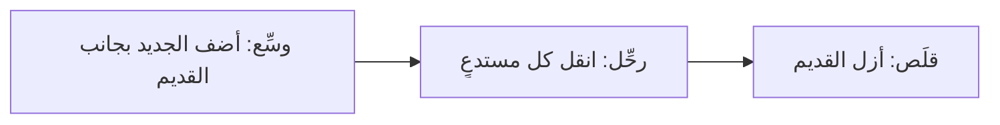

# الوحدة 7 — الشيفرة الموروثة وإعادة الهيكلة والترحيل (Legacy, refactoring and migration)

*معظم الشيفرة (code) التي تهم في أي بنك كتبها أشخاص غادروا، ولا يجرؤ أحد على لمسها. ويغيّر وكلاء البرمجة (coding agents) اقتصاديات العمل في اتجاهين معًا: فهم يجعلون التغيير الآلي (mechanical change) عبر ملفات كثيرة رخيصًا، ويجعلون «تنظيفًا لا ضرر منه» ("harmless cleanup") لوحدة لا تفهمها لا يتجاوز جملة واحدة. وتدور هذه الوحدة حول تغيير هذه الشيفرة بأمان. الدرس 7.1 هو الدرس المفاهيمي: اختبارات التوصيف (characterization tests) التي تثبّت ما تفعله الشيفرة اليوم (pin what the code does today) بما فيه سلوكياتها الغريبة (quirks included)؛ ونقاط الفصل (seams)؛ ونمط التينة الخانقة (strangler fig) والتوسيع ثم التقليص (expand and contract)؛ والخطوات الصغيرة (small steps) ولماذا لا تشترك إعادة الهيكلة (refactor) مع تغيير السلوك (behaviour change) في إيداع واحد (commit)؛ وما يجيده الوكلاء (what agents are good at) — أدوات التحويل الآلي (codemods)، وترحيلات واجهات البرمجة (API migrations)، وصياغة مسودات الاختبارات (drafting tests) — وأين يكونون خطرين (where they are dangerous) — تغيير السلوك الصامت (silent behaviour change)، والفروقات الضخمة (huge diffs)، و«تحسين» سلوك غريب يعتمد عليه فريق آخر ("improving" a quirk that another team relies on)؛ والحكم على شبكة الأمان (safety net) بفحص الطفرات (mutation check)؛ ومراجعة فروقات كبيرة (reviewing a big diff)؛ ومتى تترك الشيفرة الموروثة (legacy) وشأنها (when to leave legacy alone). والمُنتَج (artefact) هو قالب خطة إعادة الهيكلة (Refactoring plan template). أما الدرس 7.2 فهو المختبر (the lab): دفتر الأستاذ الموروث (legacy ledger) في نجم ريميت (Najm Remit) بلا اختبارات (has no tests) ويحتفظ بدفاتره في متغيرات على مستوى الوحدة (module-level variables). تثبّت سلوكه، ثم تزيل الحالة العامة (global state) بإعادة الهيكلة، ثم ترحِّل المكتبة الداخلية (migrate the internal library) najmkit من الإصدار 1 إلى الإصدار 2 (from version 1 to version 2)، بينما يتولى وكيل العمل الآلي (mechanical work) ويحاسبك المُقيِّم (grader) على السلوكيات الغريبة. وكل ما يخص جانب نجم خيالي (Everything on the Najm side is fictional).*

> **التركيز (Focus):** Workflow, Verify — العادة 3 (habit 3)، *خطوات صغيرة متحقق منها (Small verified steps)*: غيّر شيفرة لا تفهمها كاملة (change code you do not fully understand) بتثبيت ما تفعله أولًا (by pinning what it does first)، ثم تحرّك بخطوات صغيرة بما يكفي لفحصها (moving in steps small enough to check)، مع وكيل ينجز العمل الآلي (with an agent doing the mechanical work).

---

# 7.1 — تغيير شيفرة لا تفهمها: اختبارات التوصيف ونقاط الفصل وإعادة الهيكلة التدريجية وترحيلات بحجم الوكيل (Changing code you do not understand: characterization tests, seams, incremental refactors and agent-sized migrations)
*المستوى (Level): 🟡 متوسط (Intermediate)* · *المتطلبات (Prerequisites): 5.1، 6.1* · *التركيز (Focus): Workflow, Verify*

## ⚡ الدرس في دقيقة (In 60 seconds)
- **الشيفرة الموروثة (Legacy) هي شيفرة لا تستطيع تغييرها بثقة (code you cannot change with confidence)**، وغالبًا لأنها بلا اختبارات (no tests). ابدأ بـ*التثبيت (pinning)*: يسجّل **اختبار التوصيف (characterization test)** ما تفعله الشيفرة اليوم (what the code does today) بما فيه سلوكياتها الغريبة (quirks included)، حتى تلك التي تراها خاطئة.
- **ثم تحرّك بخطوات صغيرة (Then move in small steps)** عبر **نقطة فصل (seam)**، مع نمط التينة الخانقة (strangler fig) والتوسيع ثم التقليص (expand and contract). ولا تشترك إعادة الهيكلة (refactor) مع تغيير السلوك (behaviour change) في إيداع واحد (commit).
- **الوكلاء (Agents) أقوياء في الآلي (strong at the mechanical)** — إعادة التسمية (renames)، وأدوات التحويل الآلي (codemods)، والمسودات الأولى للاختبارات (first drafts of tests) — و**خطرون في الصامت (dangerous at the silent)**: «ترتيب» ("tidy") يحوّل سلوكًا غريبًا إلى سلوك عادي (normalises a quirk).
- **احكم على الشبكة (Judge the net)** بفحص الطفرات (mutation check)؛ وراجع على نطاق واسع (review at scale) بالقاعدة (the rule) والاختبارات (the tests) وعيّنة (a sample).
- الإشارة (Cue): لا شبكة، فلا تفويض (no net, no delegation). الفخ (Trap): مجموعة اختبارية خضراء لم تلمس الشيفرة قط (a green suite that never touched the code).

## 🧭 لماذا يهم (Why it matters)
في يوم الأربعاء — يوم مصطنع لا مسجَّل من نموذج حقيقي (a constructed day, not recorded from a real model) — تطلب لجين (Lujain)، المهندسة حديثة التخرج (graduate engineer)، من وكيلها أن «يجعل `ledger.py` متسقًا مع بقية ريميت (consistent with the rest of Remit)». ويُقرأ الملخص جيدًا: تستخدم حصة الشريك (the partner share) دالة التقريب المشتركة (the shared rounding helper)، ولا أثر جانبيًا (side effect) لـ`balance()`، وتُرجع `journal()` القائمة مباشرة (returns the list directly). ويطبع `pytest -q` العبارة `99 passed`، لأن لا اختبار يؤكد شيئًا عن دفتر الأستاذ (asserts anything about the ledger) (غيّر الدرس 5.1 قيمة `PARTNER_SHARE` إلى 0.35 وراقب الاختبارات الـ99 تبقى خضراء (watched all 99 stay green)). وبعد ثلاثة أسابيع تجد المالية (Finance) أن مستحق الشريك (the partner payable) يختلف بسنت واحد عن الصحيح في بعض التحويلات (a cent out on some transfers)، ولا يستطيع أحد أن يقول أي إيداع (commit) تسبب بذلك.

يعرّف مايكل فيذرز (Michael Feathers) في كتابه *العمل بفعالية مع الشيفرة الموروثة (Working Effectively with Legacy Code)* (2004) الشيفرة الموروثة (legacy code) بأنها شيفرة بلا اختبارات (code without tests): فبدونها لا تستطيع أن تعرف هل حافظ التغيير على السلوك (preserved behaviour)، مهما بدا مقروءًا. والوكلاء سلاح ذو حدين (Agents cut both ways): فهم يجعلون الترتيب (tidying) وشبكة الأمان (the net) رخيصين. الاختبارات سريعة الصياغة بطيئة الثقة (quick to draft, slow to trust): والعادة 4 (habit 4)، *ثق بالدليل لا بالطلاقة (Trust evidence, not fluency)*، تنطبق على الشبكة أيضًا.

## 📐 كيف يعمل (How it works)

### 🟢 الأساسيات (The essentials)

**ما اختبار التوصيف (What a characterization test is).** إنه يسجّل ما تفعله الشيفرة لا ما ينبغي أن تفعله (records what the code does, not what it should do). وطريقة فيذرز (Feathers's method)، كما يصفها في مدونته (as he describes it on his blog): اكتب اختبارًا بتوقّع مؤقت (a test with a placeholder expectation)، وشغّله، ودع الفشل يخبرك بالقيمة الحقيقية (let the failure tell you the real value). وهذا على حالة التعادل (tie case) في دفتر الأستاذ (the ledger):

```python
from decimal import Decimal

from remit import ledger
from remit.money import Money


def test_a_tied_partner_share_rounds_to_the_even_cent():  # Q-LED-1
    entries = ledger.post_transfer("TRF-1", "C001", Money("500", "QAR"), Money("10.15", "QAR"))
    # entries: debit, payout, fee income, partner share; 0 is a placeholder
    assert entries[3]["amount"] == Decimal("0")
```

```text
E       AssertionError: assert Decimal('3.04') == Decimal('0')
```

ثلاثون بالمئة من 10.15 تساوي 3.045. يقرّب دفتر الأستاذ (The ledger) حصة الشريك (the partner's share) إلى الزوجي عند المنتصف (half-even) فيخرج 3.04؛ وتقرّب بقية ريميت (the rest of Remit) إلى الأعلى عند المنتصف (half-up) وكانت ستقول 3.05. تضع `3.04` وتسمّي السلوك الغريب (name the quirk) في تعليق (in a comment). أنت لم تقل إنه صحيح (not said it is right)، بل قلت فقط إن أرقام المالية (Finance's numbers) تعتمد عليه. ويسرد نص توثيق دفتر الأستاذ (The ledger's docstring) أربعة سلوكيات غريبة كهذه (four such quirks):

| المعرّف (Id) | السلوك الغريب (The quirk) | اختبار يثبّته (A test that pins it) |
|---|---|---|
| Q-LED-1 | تُقرَّب حصة الشريك البالغة 30% إلى الزوجي عند المنتصف (the partner's 30% share is rounded half-even) | رسم قدره 10.15 يعطي حصة 3.04 (a fee of 10.15 gives a share of 3.04) |
| Q-LED-2 | استدعاء `balance()` لحساب غير معروف (of an unknown account) ينشئ ذلك الحساب (creates it) | بعد `balance("NOPE")` تسرده `accounts()` (lists it) |
| Q-LED-3 | الدفاتر على مستوى الوحدة ومشتركة (books are module-level and shared)؛ وتأتي المعرّفات والأوقات من najmkit (ids and times come from najmkit) | تتراكم القيود في دفتر واحد (postings accumulate in one ledger)؛ وتجري معرّفات القيود (entry ids) من `JNL-000001` فصاعدًا (onward) (يغيّر الدرس 7.2 المشاركة عمدًا (changes the sharing on purpose)) |
| Q-LED-4 | الريال القطري QAR فقط (QAR only)، وأرصدة `Decimal` مجرّدة (bare balances)، ولا تُرحَّل الأطراف الصفرية (zero legs not posted) | مبلغ بالجنيه المصري EGP يرفع `CurrencyMismatch` (an EGP amount raises) |

سلوك واحد لكل اختبار (One behaviour per test)، يُسمّى باسمه، مع تعليق يذكر مصدره (a comment naming its source)؛ ولا يقوم أحد بـ«إصلاح» ("fixes") أحدها. اختبار التوصيف (A characterization test) الذي يبدأ بالفشل هو تغيير في السلوك (a behaviour change)؛ ويقرر إنسان (a human decides) هل هو مرغوب.

**خطوات صغيرة آمنة (Small safe steps).** (1) ثبّت السلوك (Pin the behaviour). (2) غيّر البنية (Change the structure) على خطوات، كل منها إيداع (commit) يترك الاختبارات خضراء (leaves the tests green). (3) غيّر السلوك، إن اضطررت، في إيداعه الخاص مع تغيير الاختبار الخاص به (in its own commit with its own test change). والسبب هو المراجعة (review): فالفروقات (diff) التي تنقل الشيفرة فقط يمكن الحكم عليها بعبارة «لم تتغير الاختبارات» ("the tests did not change")؛ أما التي تغيّر أيضًا قاعدة تقريب (a rounding rule) فلا يمكن.

**ما يجيده الوكلاء وما لا يجيدونه (What agents are good at, and not).**

| المهمة (Task) | الملاءمة (Fit) | الحارس (The guard) |
|---|---|---|
| إعادة تسمية دالة عبر أربعين ملفًا (rename a function across forty files) | قوية (Strong) | قاعدة تستطيع صياغتها (a rule you can state)؛ شغّل المجموعة الاختبارية (run the suite)، وابحث عن الاسم القديم (search for the old name) |
| صياغة مسودة اختبارات توصيف لوحدة بلا اختبارات (draft characterization tests for an untested module) | قوية، إن قرأتها (strong, if you read them) | الثقة بها مكلفة (costly to trust)؛ شغّل فحص الطفرات (mutation check) |
| تطبيق تغيير موثَّق في واجهة البرمجة (apply a documented API change) | جيدة (Good) | الملاحظات هي المواصفة (the notes are the spec)؛ قابل الملخص بها (check the summary against them) |
| «تنظيف» ("clean up") وحدة موروثة أو «جعلها متسقة» ("make consistent") | خطرة (Dangerous) | لا قاعدة يُقابَل بها (no rule to check against)، فتُحوَّل السلوكيات الغريبة إلى سلوك عادي (quirks get normalised) |

### 🟡 التعمق أكثر (Going deeper)

**نقاط الفصل (Seams).** *نقطة الفصل (seam)* مكان تستطيع أن تغيّر عنده ما يفعله البرنامج دون تحرير ذلك المكان (change what the program does without editing that place)؛ وتحتاج إلى واحدة قبل أن تستطيع اختبار أي شيء موصول (anything wired in) أو استبداله. وفي ريميت (Remit) ثلاث. *نقطة فصل الكائن (object seam)* (مصطلح فيذرز (Feathers's term)): مرِّر الشيء من الخارج (pass the thing in)، كما يفعل `RemitService(..., ledger=None)` في المختبر. و*نقطة الفصل العامة (global seam)* (تسمية هذه الدورة (this course's label)): تتيح najmkit للاختبار تركيب ساعة ثابتة (a fixed clock) ومعرّفات متسلسلة (sequential ids). و*نقطة فصل الاختبار (test seam)* (وهي تسميتنا أيضًا (also ours)): محوّل صغير (a small adapter) يمنح اختباراتك طريقة واحدة للوصول إلى شيفرة توشك بنيتها أن تتغير (code whose shape is about to change)؛ ويعيد محوّل المختبر وحدة موروثة مغلَّفة (a wrapped legacy module) اليوم، و`Ledger` بعد إعادة الهيكلة، فتعمل الاختبارات نفسها على الحالتين (so the same tests run on both).

**نمط التينة الخانقة بأي حجم (The strangler fig, at any size).** يستبدل نمط التينة الخانقة (strangler fig) عند مارتن فاولر (Martin Fowler) نظامًا قديمًا بأن ينمّي الجديد حوله ويُخرج القديم من الخدمة قطعةً قطعة (retiring the old piece by piece)، وهو مفضَّل على إعادة الكتابة دفعة واحدة (big-bang rewrite) لأنه يخفض المخاطر. وعلى مستوى الوحدة (At module scale): (أ) أضف الصنف الجديد خلف الدوال القديمة (add the new class behind the old functions)؛ (ب) انقل المستدعين واحدًا واحدًا (move callers one at a time)؛ (ج) احذف الدوال القديمة حين لا يستدعيها شيء (delete the old functions when nothing calls them). وكل خطوة إيداع أخضر قابل للتراجع عنه (a green, revertible commit).

**التوسيع ثم التقليص (Expand and contract)** (ويسمى أيضًا التغيير المتوازي (parallel change)) هو الفكرة نفسها لواجهة (an interface) أو صيغة تخزين (stored format).



لا توسّع وتقلّص في خطوة واحدة (Never expand and contract in one step)، وإلا فلن تجد لحظة يعمل فيها القديم والجديد معًا (no moment when both work). في الدرس 7.2 يقوم سالم (Salem)، من هندسة المنصة (platform engineering)، بالتوسيع (expands) — إذ تحتفظ najmkit 2 بالأسماء القديمة بوصفها أغلفة تحذيرية (warning wrappers) — ثم ترحِّل أنت مواضع الاستدعاء (migrate the call sites)، ثم تقلّص (contract). ويحوّل `pytest -W error::DeprecationWarning` الاستدعاء القديم إلى خطأ يُظهر موضع استدعائه (an error showing its call site)، لكن فقط بعد ترحيل `tests/conftest.py`، وهو إعداد الاختبارات المشترك (the shared test setup): وإلى ذلك الحين يفشل كل اختبار في أدوات التجهيز (fixtures) الخاصة به.

**ملخص الاعتمادية ادعاء (A dependency summary is a claim).** يلخّص وكيل ملاحظات najmkit (the najmkit notes) بعبارة «سبع إعادات تسمية ولا شيء آخر» ("seven renames, nothing else"). وتقول الملاحظات أيضًا إن `audit.emit` يرفض أي قيمة لا يستطيع JSON حملها (refuses any value JSON cannot hold)، بينما كان الإصدار 1 يستدعي `str()` عليها. والترحيل الذي هو إعادة تسمية فقط يفشل فشلًا ظاهرًا (A rename-only migration fails loudly)؛ أما الفشل الصامت (the quiet failure) فهو الإصلاح «المرتَّب» (the tidy fix)، أي `str(amount.amount)` بدل `str(amount)`: أخضر حيثما لا يثبّت أي اختبار ذلك السطر (green wherever no test pins the line)، بينما يتوقف محلل فريق الاحتيال (the fraud team's parser)، الذي يقرأ `"500.00 QAR"`، عن المطابقة (stops matching). اقرأ الملاحظات بحثًا عن كلمات السلوك (behaviour words) مثل *يرفع الآن (now raises)* و*لم يعد (no longer)*، وثبّت المخرجات التي تقرؤها الفرق الأخرى (pin the output other teams read).

**الفروقات الخطرة والفروقات المراجَعة (The risky diff and the reviewed one).** «ترتيب» ("tidy") لدفتر الأستاذ (the ledger)، مختصر إلى تغييراته الثلاثة (trimmed to its three changes) (مصطنع (constructed)؛ والمقاطع تحريرات حقيقية (the hunks are real edits)):

```diff
-    partner = (fee.amount * PARTNER_SHARE).quantize(_CENT, rounding=ROUND_HALF_EVEN)  # Q-LED-1
+    partner = quantize(fee.amount * PARTNER_SHARE)  # same rounding as the rest of Remit
...
-    if account not in _BALANCES:
-        _BALANCES[account] = Decimal("0")
-    return _BALANCES[account]
+    return _BALANCES.get(account, Decimal("0"))
...
-    return list(_JOURNAL)
+    return _JOURNAL
```

كل مقطع (hunk) يمكن الدفاع عنه منفردًا. دون شبكة أمان (Without a net): `99 passed`. ومع اختبار تثبيت واحد لكل مقطع (one pinning test per hunk):

```text
FAILED tests/test_ledger_pins.py::test_a_tied_partner_share_rounds_to_the_even_cent
FAILED tests/test_ledger_pins.py::test_asking_for_an_unknown_account_creates_it
FAILED tests/test_ledger_pins.py::test_the_journal_is_a_copy - assert 0 == 4
3 failed, 99 passed in 0.38s
```

كل فشل سؤال لإنسان (a question for a human) — «هل نعتمد على هذا؟» ⁦("do we depend on this?")⁩ — لا اختبار يُصلَح (not a test to repair).

**خطوة آمنة واحدة، مطلوبة صراحةً (One safe step, asked for).** الضعيف (Weak): «أعد هيكلة ledger.py لإزالة الحالة العامة وجعله أنظف» ⁦("Refactor ledger.py to remove the global state and make it cleaner.")⁩ والقوي (Strong):

```text
Goal: the "Ledger class" step of docs/refactoring-plan.md. In src/remit/ledger.py add a class Ledger
that holds the balances and the journal on the instance. For now keep post_transfer, balance, accounts,
journal and reset as module functions that call one shared Ledger (a later step deletes them). Do not
change behaviour: same amounts, rounding, errors, ids and timestamps. The quirks in the module
docstring are intended; do not fix them. Edit nothing under tests/ and no other module. When pytest -q
is green, commit (this ticket asks for it, as CLAUDE.md allows). If a test in
tests/test_ledger_*.py fails, stop and show me the failure.
```

الموجّه (A prompt) أو `CLAUDE.md` سياق (context) لا إنفاذ (not enforcement). وبعد إيداع الاختبارات (Once the tests are committed)، تكون قاعدة منع (deny rule) على `Edit(tests/test_ledger_*.py)` في `.claude/settings.json` أقرب إلى سياج (closer to a fence) (راجع وثائق الصلاحيات (check the permissions documentation)؛ ويظل بوسع Bash تحرير الملفات (Bash can still edit files)، فاستمر في فحص الفروقات (so keep checking the diff)).

### 🔴 نظرة الخبير (Expert view)

**احكم على الشبكة (Judge the net).** يكسر فحص الطفرات (A mutation check) الشيفرة عمدًا (breaks the code on purpose) ويسأل هل يفشل اختبار (asks whether a test fails). يدويًا (By hand)، في نسخة للتجربة (in a scratch copy): ضع `rounding="ROUND_HALF_UP"` مكان `rounding=ROUND_HALF_EVEN` (فـ`ROUND_HALF_UP` المجرد غير مستورد (is not imported): والطفرة التي تنهار (a mutant that crashes) تُفشل كل اختبار ولا تثبت شيئًا)، أو غيّر `PARTNER_SHARE` إلى 0.35. وكل طفرة ناجية (survivor) سلوك لم تثبّته بعد (a behaviour you have not pinned)، أو تغيير مكافئ لا يراه أحد (an equivalent change nobody can see): سؤال لا حكم (a question, not a verdict). ويكسر مُقيِّم الدرس 7.2 (Lesson 7.2's grader) دفتر الأستاذ الأصلي (the original ledger) بست عشرة طريقة (sixteen ways)؛ ويعلّم [*اختبار البرمجيات (Software Testing)*، الدرس 2.3 — هل اختباراتك جيدة فعلًا؟ ⁦(Are your tests any good?)⁩](../testing/index.ar.html#/2.3) هذه التقنية (teaches the technique).

**المراجعة على نطاق واسع (Review at scale).** لا يمكن قراءة فروقات آلية من أربعين ملفًا سطرًا سطرًا (A forty-file mechanical diff cannot be read line by line). (1) راجع *القاعدة (the rule)*: التعليمة (the instruction) أو، في أداة التحويل الآلي (codemod)، السكربت (the script) (شغّله مرتين (run it twice)؛ ينبغي ألا يغيّر التشغيل الثاني شيئًا (the second run should change nothing)). (2) اقرأ الاختبارات كاملة (Read the tests in full). (3) خذ عيّنة من الفروقات (Sample the diff): أول المقاطع (hunks) وآخرها وأخطر الملفات (the riskiest files). (4) أتمت الباقي (Automate the rest): المجموعة الاختبارية عند كل إيداع (the suite on every commit)، والتحذيرات بوصفها أخطاء (warnings as errors)، وبحث عن الأسماء القديمة (a search for the old names)، و`git diff --stat`. علامات التوقف (Stop signs): ملف اختبار متغيّر في إيداع إعادة هيكلة (a changed test file in a refactor commit)، ومقطع لا تستطيع تفسيره (a hunk you cannot explain).

**وحدات بحجم الوكيل (Agent-sized units).** الوحدة (A unit) قاعدة واحدة على مجموعة محدودة من الملفات (one rule over a bounded set of files)، صغيرة بما يكفي للتحقق منها في جلسة واحدة (small enough to verify in one sitting). ولقائمة طويلة (For a long list)، تعرض صفحة أفضل الممارسات (best-practices page) في Claude Code توزيعًا متفرعًا في الوضع غير التفاعلي (a headless fan-out) يعلّمه الدرس 9.1 (لدى الأدوات الأخرى ما يكافئه (other tools have equivalents))؛ ومُكيَّفًا مع إعادة التسمية هذه (adapted to this rename) (`files.txt` من `grep -l`):

```bash
for file in $(cat files.txt); do
  claude -p "In $file move every najmkit v1 call to the v2 name in docs/najmkit-v2-migration.md. Keep every audit line unchanged. Change nothing else. Return OK or FAIL." \
    --allowedTools "Read,Edit" \
    --permission-mode dontAsk \
    --max-turns 8
done
```

والعبارة OK أو FAIL التي يطبعها هي ادعاء الوكيل لا دليل (is the agent's claim, not evidence)، فراجع الفروقات المجمَّعة (review the combined diff) كما سبق. وثلاثون موضع استدعاء (Thirty call sites) في خمسة ملفات تحتاج جلسة واحدة (one session) لا حلقة (not a loop).

**متى تترك الشيفرة الموروثة وشأنها (When to leave legacy alone).** يكلّف التثبيت وإعادة الهيكلة وقتًا وانتباه مراجعة (cost time and review attention). فإن كانت الوحدة مستقرة (stable)، وتقع خلف واجهة نظيفة (sits behind a clean interface)، ولا شيء في خارطة الطريق (roadmap) يحتاجها، فوثّق سلوكياتها الغريبة (document its quirks)، وسيِّجها (fence it) بسطر في ذاكرة المشروع (a memory line) وقاعدة مراجعة (a review rule)، وأنفق الأسبوع في مكان آخر. وإن كان لا بد من إزالتها فاخنقها (If it must go, strangle it). إعادة الكتابة (A rewrite) رخيصة الإنتاج الآن (cheap to produce now)، وباهظة التحقق كما كانت دائمًا (as expensive as ever to verify).

## 🧰 الأدوات (The toolkit)
| الأداة أو الممارسة أو النمط (Tool, practice or pattern) | ما هي وماذا تفعل (What it is and does) | متى تلجأ إليها (When to reach for it) |
|---|---|---|
| **Characterization test** — اختبار التوصيف عند فيذرز (Feathers) | يسجّل ما تفعله الشيفرة اليوم (records what code does today) بما فيه السلوكيات الغريبة (quirks included) | قبل تغيير شيفرة بلا شبكة أمان (before changing code without a net) |
| **Seam** — نقطة الفصل عند فيذرز (Feathers) | مكان لتغيير السلوك دون التحرير فيه (a place to change behaviour without editing there) | حين يكون شيء موصولًا ويجب اختباره أو استبداله (wired in and must be tested or replaced) |
| **Strangler fig** — نمط التينة الخانقة عند فاولر (Fowler) | نمِّ البديل حول الشيفرة القديمة (grow the replacement around the old code) وأخرجها من الخدمة قطعةً قطعة (retire it piece by piece) | استبدال وحدة دون إعادة كتابة (replacing a module without a rewrite) |
| **Expand and contract** — التوسيع ثم التقليص | أضف الجديد بجانب القديم (add the new beside the old)، وانقل المستدعين (move callers)، وأزل القديم (remove the old) | إعادة تسمية واجهة البرمجة (API renames)، وترقيات الاعتماديات (dependency upgrades)، وصيغ التخزين (stored formats) |
| **Codemod** — أداة التحويل الآلي | سكربت يعيد كتابة الشيفرة بقاعدة (a script that rewrites code by a rule)، قابل لإعادة التشغيل (re-runnable) | التغيير نفسه في ملفات كثيرة (the same change in many files) |
| **Mutation check** — فحص الطفرات | اكسر الشيفرة عمدًا (break the code on purpose) وانظر هل يفشل اختبار (see whether a test fails) | الحكم على مجموعة اختبارات التوصيف (judging a characterization suite) |
| **Refactoring plan template** — قالب خطة إعادة الهيكلة | صفحة واحدة (one page): الثوابت (invariants)، وشبكة الأمان (net)، والخطوات (steps)، والتفويض (delegation)، والمراجعة (review)، والتراجع (rollback) | قبل أي تغيير في شيفرة موروثة أو شيفرة أموال (before any change to legacy or money code) |

## 🏛️ عمليًا في بنك نجم (In practice at Najm Bank)
يضع طارق (Tariq)، قائد الهندسة (engineering lead)، القاعدة لمنصة المدفوعات (Payments Platform): فكل تغيير في وحدة موروثة (a change to a legacy module)، أو ترحيل اعتمادية (a dependency migration)، يبدأ بخطة إعادة هيكلة (a refactoring plan) قبل أي شيفرة؛ ثم يشترط CONTRIBUTING.md مراجعًا بشريًا ثانيًا (a second human reviewer) لمنطق الأموال (money logic) مثل `ledger.py` و`service.py`. والمُنتَج (The artefact) هو **قالب خطة إعادة الهيكلة (Refactoring plan template)**: احفظه باسم `docs/refactoring-plan.md` (يشحنه المختبر (the lab ships it) باسم `lab-assets/refactoring-plan-template.md`).

```markdown
# Refactoring plan: <name of the change>

**Owner:** <you> · **Second reviewer:** <name> · **Agent and mode:** <tool, plan mode or not> · **Labelled AI-assisted:** yes / no

### 1. Why, and what must not change
- Why (the ticket, the incident, what it unblocks):
- Must not change, quirks included (each with how you know):
- May change, and who agreed:

### 2. What I do not understand yet
- Open questions, and how I will answer each (read, run, ask, test):

### 3. The safety net
- Characterization tests: where, how many, what they pin:
- How I know the net is good (mutation check, survivors):
- Not covered, and why that is acceptable:

### 4. The seams and the steps
One commit per step, tests green after each. A refactor step never changes behaviour.

| # | Step | Kind (refactor, migration, behaviour) | Check after the step | Commit message |
|---|---|---|---|---|
| 1 | | | | |

### 5. Delegation
- For the agent (mechanical, a rule I can state):
- I keep (judgement, money logic, any quirk):
- The instruction: scope, "do not change behaviour", "do not edit the pinned tests", when to stop:

### 6. Review at scale
- Read in full:
- Sampled by hand:
- Automated (suite per commit, warnings as errors, search for old names, diff size):

### 7. Rollback and done
- Undo means reverting the commit. I stop and ask when:
- Done means:
```

املأه قبل العمل (Fill it in before the work)، بضعة أسطر لكل قسم؛ وصُغ مسودة القسم 4 مع وكيلك في وضع التخطيط (plan mode) (Shift+Tab، أو `claude --permission-mode plan`)، حيث يقترح ولا يحرّر شيئًا (it proposes and edits nothing). وفي تغيير موجز المورّد (the vendor-feed change) الذي يطلبه TODO القديم (the old TODO) في `screening.py`، يسرد القسم 1 العناصر Q-SCR-1 إلى Q-SCR-4 بوصفها *يجب ألا تتغير (must not change)*.

## 🛠️ التمارين (Exercises)
- 🟢 **ثبّت سلوكين غريبين يدويًا (Pin two quirks by hand).** *بلا وكيل (No agent).* في أي مجلد مختبر (any lab directory) — مجلد m00 لديك مثلًا (your m00 one, say) — اكتب اختبارين لـ`remit.ledger` بطريقة القيمة المؤقتة (the placeholder method): حصة الشريك في حالة التعادل (the tied partner share) لرسم قدره 10.15 (Q-LED-1) و`balance("NOPE")` (Q-LED-2). *يكتمل عندما (Done when):* ينجح كلاهما بالقيم الحقيقية (both pass with the real values) مع تعليق يسمّي السلوك الغريب (a comment naming the quirk)، ويؤدي ضبط `rounding="ROUND_HALF_UP"` في نسخة للتجربة (in a scratch copy) إلى فشل الأول (makes the first fail).
- 🟡 **صُغ ثم احكم (Draft, then judge).** *يحتاج إلى وكيل (Needs an agent)* (أو اكتب الاختبارات بنفسك (or write the tests yourself)). اطلب اختبارات توصيف (characterization tests) لـ`screening.py`؛ ثم اكسر `FUZZY_PERCENT` و`MIN_FUZZY_LEN` و`MAX_TOKENS` واحدًا تلو الآخر في نسخة للتجربة (one at a time in a scratch copy). *يكتمل عندما (Done when):* يسرد جدول كل اختبار والسلوك الغريب الذي يثبّته والطفرات التي التقطها (the mutations it caught)، إضافة إلى اختبار واحد رفضته وسبب ذلك (plus one test you rejected and why).
- 🔴 **خطِّط لإعادة تسمية (Plan a rename).** *يحتاج إلى وكيل في الخطوة الأخيرة (Needs an agent for the last step).* خطِّط لإعادة تسمية `Customer.kyc_tier` إلى `kyc_level`: فهي مستخدمة في النموذج (the model)، والمخزن (the store) — وهي أيضًا عمود في قاعدة بيانات (a database column)، في خطوة لاحقة (a later step) — واستدعاء الحدود في الخدمة (the service's limits call)، وسطر الأوامر (the command line)، والاختبارات (the tests). *يكتمل عندما (Done when):* يُملأ القالب (the template is filled in)؛ ويعيد الوكيل تسمية الخاصية (renames the attribute) في نسخة للتجربة؛ وتنجح فحوص قسمك 6 (your section 6 checks pass)؛ وتسمّي شيئًا واحدًا أخطأ فيه الوكيل، أو تقول إنه لم يخطئ في شيء (or say none).

## ⚠️ أخطاء وفخاخ (Mistakes and traps)
- **التنظيف قبل التثبيت (Cleaning before pinning).** الترتيب (The tidy) يبدو معقولًا والمجموعة الاختبارية خضراء (the suite green). ثبّت أولًا (Pin first) وشغّل فحص الطفرات (a mutation check).
- **كتابة الاختبار الذي تتمناه (Writing the test you wish for).** «اختبار توصيف» ("characterization") يتوقع التقريب إلى الأعلى عند المنتصف (expects half-up) يفشل في اليوم الأول (fails on day one). سجّل ما تفعله الشيفرة (Record what the code does)؛ وارفع الفرق بوصفه قرارًا (raise the difference as a decision).
- **ترك الوكيل يعدّل الاختبارات المثبَّتة (Letting the agent edit the pinned tests).** التوقع المتغيّر (A changed expectation) في إيداع إعادة هيكلة هو أوضح إشارة في الفروقات (the loudest signal in the diff). امنعه (Forbid it)؛ وافحص `git diff <tests commit> -- tests`.
- **خلط إعادة الهيكلة بتغيير السلوك (Mixing a refactor and a behaviour change).** لم يعد بوسع المراجعين الاعتماد على «الاختبارات لم تتحرك» ("the tests did not move").
- **الوثوق بملخص سجل التغييرات (Trusting a changelog summary).** اقرأ الملاحظات بحثًا عن كلمات السلوك (behaviour words)؛ وشغّل مع التحذيرات بوصفها أخطاء (warnings as errors).
- **قراءة أربعين ملفًا سطرًا سطرًا، أو عدم قراءة أي منها (Reading forty files line by line, or none).** راجع القاعدة (the rule) والاختبارات (the tests) وعيّنة (a sample).

## 🧾 الخلاصة (Recap)
- لا تغيير بلا شبكة أمان موثوقة (No trustworthy net, no change): ثبّت السلوك أولًا (pin behaviour first) بما فيه السلوكيات الغريبة (quirks included)، ولا «تُصلح» ("fix") أبدًا اختبارًا مثبَّتًا (a pinned test).
- تحرّك بخطوات صغيرة خضراء مودَعة (small, green, committed steps)؛ واخنق (strangle) ووسِّع ثم قلِّص (expand and contract) بدل إعادة الكتابة (rather than rewrite)؛ وأبقِ إعادات الهيكلة (refactors) والترحيلات (migrations) وتغييرات السلوك (behaviour changes) منفصلة.
- يتألق الوكلاء (Agents) في التغيير الآلي (mechanical change) والمسودات الأولى للاختبارات (first drafts of tests)؛ ويفشلون في التحويل الصامت للسلوك الغريب إلى سلوك عادي (silent normalisation) والتنظيفات غير المطلوبة (unasked cleanups).
- احكم على الشبكة (Judge the net) بفحص الطفرات (mutation check)؛ وراجع على نطاق واسع (review at scale) بالقاعدة والاختبارات والعيّنة والأتمتة (rule, tests, sample and automation). وأحيانًا اتركها وشأنها (leave it alone).

## ✍️ اختبر نفسك (Check yourself)

**1. «يرتّب» ("tidies") وكيلٌ `ledger.py` ويطبع `pytest -q` العبارة `99 passed`. ماذا يخبرك ذلك عن دفتر الأستاذ؟ ⁦(What does that tell you about the ledger?)⁩**

- A. لم يتغير شيء (Nothing changed)، لأن المجموعة الخضراء (a green suite) تثبت أن السلوك هو نفسه
- B. لم يتغير إلا ما تؤكده الاختبارات الـ99 (what the 99 tests assert)، ولا يؤكد أي منها شيئًا عن دفتر الأستاذ (none assert anything on the ledger)
- C. كان الوكيل حذرًا (The agent was careful)، لأن عمليات الترتيب (tidy-ups) في المشاريع المختبرة (tested projects) نادرًا ما تفشل
- D. الترتيب آمن (The tidy is safe)، شريطة أن يقول الوكيل إنه حافظ على السلوك (preserved behaviour)

<details><summary>الإجابة</summary>

**B.** المجموعة الاختبارية (A suite) دليل فقط عمّا تؤكده (evidence only about what it asserts)، ولا يؤكد أي من الاختبارات الـ99 رصيدًا في دفتر الأستاذ (a ledger balance). ثبّت أولًا (Pin first). 🟢 الأساسيات (The essentials).

</details>

**2. يفشل اختبار توصيف بقيمة مؤقتة (A placeholder characterization test) لرسم قدره 10.15 بالرسالة `3.04 == 0`. وأنت تعتقد أن 3.05 هي الصحيحة. ماذا تفعل؟ ⁦(What do you do?)⁩**

- A. ضع 3.05 في الاختبار وأصلح الشيفرة (fix the code)، لتتفق معك المجموعة الاختبارية (so the suite agrees with you)
- B. احذف الاختبار (Delete the test)، لأن اختبار التوصيف (a characterization test) يجب ألا يخالفك (must not disagree with you)
- C. ضع 3.04، وسمِّ السلوك الغريب (name the quirk)، وارفع 3.05 قرارًا منفصلًا (as a separate decision)
- D. ضع 3.04 دون تعليق (without a comment)، وغيّر الشيفرة في الإيداع نفسه (in the same commit)

<details><summary>الإجابة</summary>

**C.** يسجّل الاختبار ما تفعله الشيفرة (records what the code does)؛ أما هل ينبغي أن تختلف فقرار إنسان (a decision for a human)، في إيداع مستقل (in its own commit). والخيارات الأخرى تخفي السلوك الغريب (hide the quirk) أو تخلطه بإعادة هيكلة (mix it into a refactor). 🟢 الأساسيات (The essentials).

</details>

**3. تأتي najmkit 2 بالأسماء القديمة أغلفةً تحذّر (the old names as wrappers that warn). متى تحذف الأغلفة؟ ⁦(When do you delete the wrappers?)⁩**

- A. حين لا يستدعي شيء الأسماء القديمة بعد الآن (nothing calls the old names)، في خطوة التقليص (the contract step)
- B. في خطوة التوسيع (the expand step)، لتكون الأسماء الجديدة غير ملتبسة (unambiguous)
- C. في أول إيداع ترحيل (the first migration commit)، لتفشل مواضع الاستدعاء المنسية فورًا (missed call sites fail at once)
- D. أبدًا (Never)، لأن خدمة أخرى قد تستخدمها يومًا ما (might still use them one day)

<details><summary>الإجابة</summary>

**A.** يضيف التوسيع الجديد بجانب القديم (Expand adds the new beside the old)، وترحِّل المستدعين (you migrate the callers)، وبعد ذلك فقط يزيل التقليص القديم (contract removes the old). والحذف المبكر يزيل اللحظة التي يعمل فيها الاثنان معًا (the moment when both work). 🟡 التوسيع ثم التقليص (Expand and contract).

</details>

**4. يلخّص وكيل ملاحظات ترقية najmkit (the najmkit upgrade notes) بعبارة «سبع إعادات تسمية ولا تغييرات أخرى» ("seven renames, no other changes"). ما الخطوة التالية السليمة؟ ⁦(What is the sound next move?)⁩**

- A. اقبله (Accept it)، لأن إعادة التسمية هي العمل كله (renames are the whole job) وتلتقط المجموعة الاختبارية الباقي (the suite catches the rest)
- B. اطلب من الوكيل تأكيد الملخص (confirm the summary)، ثم رحِّل مواضع الاستدعاء كلها (migrate all of the call sites)
- C. اقرأ العنوان الأول (the first heading) وثق بجدول إعادة التسمية الذي يليه (the rename table)
- D. اقرأ الملاحظات بحثًا عن تغييرات السلوك (behaviour changes)، وشغّل مع التحذيرات بوصفها أخطاء (warnings as errors)، وثبّت المخرجات (pin output)

<details><summary>الإجابة</summary>

**D.** الملخص ادعاء (A summary is a claim)؛ وقد تحمل الملاحظات تغيير سلوك أسقطه، والمخرجات التي تقرؤها فرق أخرى تحتاج اختبارها الخاص (needs its own test). وسؤال الوكيل مرة أخرى يكرر الطلاقة (repeats the fluency). 🟡 ملخص الاعتمادية ادعاء (A dependency summary is a claim).

</details>

**5. لم يتغير `screening.py` منذ سنة (has not changed in a year)، ويقع خلف دالة واحدة (sits behind one function)، ولا تحتاجه أي تذكرة (no ticket needs it). ويريد زميل تثبيته وإعادة كتابته في هذا السبرنت (sprint). ما أفضل جواب؟ ⁦(What is the best answer?)⁩**

- A. نعم (Yes): الوكيل يجعل إعادة الكتابة رخيصة، فسقطت حجة التكلفة (the cost argument has gone)
- B. اتركها (Leave it)، ودوّن سلوكياتها الغريبة (note its quirks)، وسيِّجها (fence it)، وعد إليها حين تحتاجها تذكرة (revisit when a ticket needs it)
- C. أعد كتابتها مع الوكيل (Rewrite it with the agent) لكن تخطَّ الاختبارات (skip the tests)، فالوحدة القديمة لم تكن لها اختبارات أيضًا (as the old module had none either)
- D. نعم (Yes)، إن وعد الوكيل بأن كل سلوك سيُحفظ (every behaviour will be preserved)

<details><summary>الإجابة</summary>

**B.** يكلّف التثبيت وإعادة الهيكلة أيامًا (cost days)، وقد لا تردّ وحدة مستقرة ومعزولة بلا طلب ذلك (a stable, isolated module with no demand may not repay them). اخنقها (Strangle it) حين يصل تغيير حقيقي. 🔴 متى تترك الشيفرة الموروثة وشأنها (When to leave legacy alone).

</details>

## 📚 المراجع (References)
- وثائق Claude Code (Claude Code documentation): أفضل الممارسات (best practices) — وضع التخطيط والتوزيع المتفرع والتحقق (plan mode, fan-out, verification): https://code.claude.com/docs/en/best-practices; الوضع غير التفاعلي (headless mode): https://code.claude.com/docs/en/headless; الصلاحيات (permissions): https://code.claude.com/docs/en/permissions; الأوامر (commands): https://code.claude.com/docs/en/commands
- تحذيرات Python (Python warnings): https://docs.python.org/3/library/warnings.html; ومرشحات تحذيرات pytest (pytest warning filters): https://docs.pytest.org/en/stable/how-to/capture-warnings.html; ومارتن فاولر (Martin Fowler)، «تطبيق التينة الخانقة» ("Strangler Fig Application"): https://martinfowler.com/bliki/StranglerFigApplication.html
- [*اختبار البرمجيات (Software Testing)*، الدرس 2.3 — هل اختباراتك جيدة فعلًا؟ ⁦(Are your tests any good?)⁩](../testing/index.ar.html#/2.3)؛ [*اختبار البرمجيات (Software Testing)*، الدرس 6.2 — الاختبارات بوصفها المواصفة لوكلاء البرمجة (Tests as the specification for coding agents)](../testing/index.ar.html#/6.2)؛ [*تصميم الأنظمة لمبرمجي الفايب (System Design for Vibe Coders)*، الدرس 9.7 — تدقيق الشيفرة ومراجعتها بسرعة الوكلاء (Code audit and review at agent speed)](../vibe/index.ar.html#l9-7)
- **للتعمق أكثر (Go deeper).** مايكل فيذرز (Michael Feathers)، *العمل بفعالية مع الشيفرة الموروثة (Working Effectively with Legacy Code)* (2004) ومقاله «اختبار التوصيف» ("Characterization Testing"): https://michaelfeathers.silvrback.com/characterization-testing · كنت بيك (Kent Beck)، *رتّب أولًا؟ ⁦(Tidy First?)⁩* (2023)، عن الترتيبات الصغيرة القابلة للتراجع ومتى تُجرى (on small, reversible tidyings and when to make them) · GitClear، «جودة شيفرة مساعد الذكاء الاصطناعي: بيانات 2025» ("AI Copilot Code Quality: 2025 Data") — بيانات رصدية من مورّد (a vendor's observational data): في 2024 تجاوز النسخ واللصق الشيفرة المنقولة (in 2024, copy/paste exceeded moved code): https://www.gitclear.com/ai_assistant_code_quality_2025_research

---

# 7.2 — المختبر: روِّض وحدة بلا اختبارات، ثم أعد هيكلتها، ثم رحِّل اعتمادية (Lab: tame an untested module, refactor it, then migrate a dependency)
*المستوى (Level): 🟡 متوسط (Intermediate)* · *المتطلبات (Prerequisites): 6.2، 7.1* · *التركيز (Focus): Workflow, Verify*

## ⚡ الدرس في دقيقة (In 60 seconds)
- **المختبر m07 (Lab m07)** على نجم ريميت (Najm Remit): دفتر الأستاذ الموروث (the legacy ledger) بلا اختبارات (has no tests) ويحتفظ بدفاتر على مستوى الوحدة (module-level books). ثلاثة أجزاء (Three parts): **ثبّته (pin)** باختبارات التوصيف (characterization tests)، و**أعد هيكلته (refactor)** (`class Ledger`، `RemitService(..., ledger=None)`)، و**رحِّل (migrate)** najmkit من الإصدار 1 إلى 2.
- **هل يلزم وكيل (Needs an agent): نعم (yes) — موصى به لا مطلوب (recommended, not required).** مسار بلا وكيل (The no-agent path) هو المختبر كله يدويًا (the whole lab by hand)؛ ويفحص المُقيِّم (the grader) النتيجة لا من أنتجها (not who produced it).
- الواجهة بعد إعادة الهيكلة (The post-refactor interface) **ثابتة (fixed)** في التذكرة (in the ticket)؛ ويجب أن تنجح اختباراتك قبلها وبعدها (pass before and after it)، عبر نقطة فصل صغيرة (a small seam).
- يكسر المُقيِّم (The grader) دفتر الأستاذ الأصلي بست عشرة طريقة (breaks the original ledger sixteen ways)، ويشغّل مجموعة اختبارات خفية (a hidden suite) على إعادة هيكلتك، ويقارن أسطر التدقيق (audit lines) حرفًا بحرف (byte for byte). خطِّط لبضع ساعات (Plan a few hours).

## 🧭 لماذا يهم (Why it matters)
في يوم الاثنين (On Monday) تحمل حصة (Hessa)، مالكة المنتج (product owner)، طلب المالية (Finance's request): تحتاج المطابقة الليلية (the nightly reconciliation) إلى خدمتين في عملية واحدة (two services in one process)، لكل منهما دفاترها الخاصة (its own books). وجواب طارق (Tariq's answer) هو هذا المختبر في جملة: «لا يلمس أحد `ledger.py` بلا اختبارات (without tests)، ولن أراجع أربعمئة سطر من فروقات الوكيل (four hundred lines of agent diff) ثقةً بها.» وتحمل التذكرة نفسها najmkit 2، لأن لوحة متابعة فريق الاحتيال (the fraud team's dashboard) تقرأ أسطر التدقيق (audit lines) وسيوقفها تحويل «مرتَّب» ("tidy") واحد عن المطابقة بصمت (quietly stop it matching). يستطيع الوكيل إنجاز الأجزاء الآلية (the mechanical parts) في ساعة؛ أما تقرير ما يجب ألا يتغير (deciding what must not change)، وإثبات أنه لم يتغير، فهو الجزء الذي لا يستطيعه غيرك (the part only you can do).

## 📐 كيف يعمل (How it works)

### 🟢 الأساسيات (The essentials)

**اقرأ أولًا (Read first).** يسرد نص التوثيق (docstring) في `ledger.py` العناصر Q-LED-1 إلى Q-LED-4؛ ويعرض `git show lab-start:src/remit/ledger.py` الأصل دائمًا، ويستخدم المُقيِّم (the grader) النسخة نفسها. ويطبع `pytest -q` العبارة `99 passed` وقائمة طويلة من تحذيرات `DeprecationWarning` من najmkit 2: وهي أول قائمة مهام ترحيل جزئية (a first, partial migration to-do list) (لا تظهر إلا الاستدعاءات التي تبلغها اختباراتك (only calls your tests reach appear)).

**الجزء 1: ثبّته (Part 1: pin it).** تمنح نقطة الفصل (The seam) `ledger_port.py` اختباراتك الدالتين `make_ledger()` و`ledger_of(service)`، وهما تعملان قبل الجزء 2 وبعده (work before and after Part 2). استخدم طريقة القيمة المؤقتة (placeholder method) من الدرس 7.1، أو اطبع دفعة من القيم الحقيقية مرة واحدة (print a batch of real values once) من سكربت للتجربة (a scratch script). غطِّ السلوكيات الغريبة الأربعة وما حولها من تفاصيل (the four quirks and the details around them): ترتيب القيود الأربعة (the order of the four entries)، وأنواع الأخطاء ورسائلها (error types and messages)، وما يتركه قيد مرفوض خلفه (what a refused posting leaves behind)، وما يفعله `send` حين يفشل المخزن (when the store fails) (يسميه نص توثيق الخدمة (the service docstring) D-SVC-1). عشرة اختبارات هي الحد الأدنى؛ وثلاثون اختبارًا صغيرًا تغطية شاملة (thirty small ones is thorough). لا تستدعِ `make_ledger()` بعد `send` في الاختبار نفسه: فقبل إعادة الهيكلة يمحو الدفاتر المشتركة (it wipes the shared books). ومع وكيل، اطلب سلوكًا واحدًا في كل مرة (ask for one behaviour at a time): «ثبّت Q-LED-2 فقط، في tests/test_ledger_basics.py، عبر make_ledger(). ضع قيمة مؤقتة في التأكيد، وشغّله، وانسخ القيمة التي ترجعها الشيفرة. لا تغيّر شيئًا تحت src/.» ⁦("Pin Q-LED-2 only, in tests/test_ledger_basics.py, through make_ledger(). Put a placeholder in the assertion, run it, and copy the value the code returns. Change nothing under src/.")⁩ ثم اقرأ كل اختبار (read every test) واحذف كل ما لا يؤكد شيئًا (delete any that asserts nothing).

**الجزءان 2 و3 (Parts 2 and 3).** اتبع ترتيب التينة الخانقة (strangler order) من الدرس 7.1 وأودِع كل خطوة خضراء (commit each green step). وللترحيل (For the migration)، يضم `docs/najmkit-v2-migration.md` إعادات التسمية وتغيير سلوك واحدًا وترتيبًا مقترحًا: رحِّل `tests/conftest.py` أولًا (يشغّل كل اختبار أدوات التجهيز الخاصة به (every test runs its fixtures))، ثم شغّل `pytest -W error::DeprecationWarning`. ولا يسمح `CLAUDE.md` في مستودعك بالإيداعات وتعديل الاختبارات إلا حين تطلبها مهمة (only when a task asks)؛ وهذه التذكرة تطلبها، فقل ذلك في موجّهاتك (say so in your prompts).

### 🟡 التعمق أكثر (Going deeper)

**للجزء 3 شبكة أمانه الخاصة (Part 3 has its own net).** تثبّت المجموعة المرئية (The visible suite) سطر تدقيق واحدًا (one audit line) (`transfer.sent`). وقبل أن تلمس موضع استدعاء (a call site)، ثبّت الأحداث الثلاثة كلها التي تكتبها ريميت (pin all three events Remit writes)، حرفًا بحرف (character for character)، بساعة ثابتة (a fixed clock) ومعرّفات متسلسلة (sequential ids) (تمنحك أداة التجهيز `service` و`audit.configure(tmp_path / "audit.jsonl")` كليهما (give you both)). عندها تصبح عبارة «لم تتغير اختبارات التدقيق» ("the audit tests did not change") فحص ترحيلك (your migration check).

**خطوة الترحيل (The migration step).** الضعيف (Weak): «رحِّل ريميت إلى najmkit 2.» ⁦("Migrate Remit to najmkit 2.")⁩ والقوي (Strong):

```text
Goal: the migration step of docs/refactoring-plan.md. Move every use of a najmkit v1 name in src/remit and
tests to the v2 name in docs/najmkit-v2-migration.md, starting with tests/conftest.py. Read that file first.
A clock object's .now() method is not a renamed function; only the module-level clock functions are.
audit.emit takes JSON values only: convert a Money so that each audit line stays exactly as it was. Change
no other behaviour, edit no test except to follow a rename, and leave src/najmkit alone for now. Run
pytest -W error::DeprecationWarning, show me the output, and commit when it is green.
```

**راجع كل خطوة بالطريقة نفسها (Review every step alike).** يكون `git diff <tests commit> -- tests/test_ledger_*.py` فارغًا (is empty) (أو يُظهر إعادة تسمية (or shows a rename))؛ ويسمّي `git diff --stat` الملفات التي ينبغي أن تمسّها الخطوة فقط (names only the files the step should touch)؛ والمجموعة الاختبارية خضراء (the suite is green)؛ والبحث عن الأسماء القديمة فارغ (a search for the old names is empty). اقرأ مقاطع (hunks) `service.py` و`ledger.py` بنفسك؛ وخذ عيّنة من الباقي (sample the rest). والاختبار المثبَّت الذي يحمرّ (A pinned test that goes red) وجد تغييرًا في السلوك (found a behaviour change): استعد السلوك (restore the behaviour)، ولا تعدّل الاختبار (do not edit the test) ولا تدع الوكيل يعدّله، ودوّن أي خلاف لتذكرة منفصلة (note any disagreement for a separate ticket).

### 🔴 نظرة الخبير (Expert view)

**كيف يقرأ المُقيِّم عملك (How the grader reads your work).** يعيد بناء دفتر الأستاذ الأصلي (rebuilds the original ledger) من الوسم `lab-start` (tag) ويشغّل اختباراتك عليه، وعلى نسخة مطابقة (an identical copy) أُعيدت كتابتها بتعليقات وأسماء خاصة أخرى (rewritten with other comments and private names) (فلا يستطيع اختبار أن يتعرف على الملف ببصمته (so a test cannot fingerprint the file))، وعلى ست عشرة نسخة معطوبة (sixteen broken copies)، توصف كل منها بسلوك مثل «يُرفض الرسم السالب» ("a negative fee is refused")؛ وتُسمّى الطفرات الناجية (survivors are named). وكل تشغيل هو `pytest -q` كما يشغّله التكامل المستمر (as CI runs it).

**ما لا يستطيع معرفته (What it cannot tell).** هل فهمتَ سلوكًا غريبًا (whether you understood a quirk)، أو تحركت بخطوات صغيرة بدل قفزة واحدة أودعتها ثلاث مرات (one leap committed three times) (فهو يفحص فقط أن كل إيداع يغيّر ملفًا وأن الاختبارات تأتي أولًا (it checks only that each commit changes a file and that the tests come first)). وهل غيّرت إعادة هيكلتك سلوكًا لم يثبّته أحد (changed a behaviour nobody pinned). ومجموعة اختبارات تنسخ القيم من الشيفرة (A suite that copies values out of the code) تنجح ولا تعلّم شيئًا إن لم تسأل قط لماذا (if you never asked why). والمُقيِّم شريك تدريب (a practice partner) لا بوابة (not a gate).

## 🧰 الأدوات (The toolkit)
| الأداة أو الممارسة أو النمط (Tool, practice or pattern) | ما هي وماذا تفعل (What it is and does) | متى تلجأ إليها (When to reach for it) |
|---|---|---|
| **Characterization test** — اختبار التوصيف عند فيذرز (Feathers) | يسجّل ما يفعله دفتر الأستاذ اليوم (records what the ledger does today) بما فيه السلوكيات الغريبة (quirks included) | قبل أول تعديل على `ledger.py` (before the first edit) |
| **Seam** — نقطة الفصل عند فيذرز (Feathers) | `ledger_port.py`، ثم `ledger=None` | اختبارات تعمل قبل إعادة الهيكلة وبعدها (tests that run before and after a refactor) |
| **Strangler fig** — نمط التينة الخانقة عند فاولر (Fowler) | صنف خلف الدوال القديمة (class behind the old functions)، ونقل المستدعين (callers moved)، وحذف القديمة (old ones deleted) | إعادة الهيكلة في الجزء 2 (the refactor in Part 2) |
| **Expand and contract** — التوسيع ثم التقليص | najmkit 2 بجانب 1 (beside 1)، ونقل مواضع الاستدعاء (call sites moved)، وحذف الأسماء القديمة (old names deleted) | الترحيل في الجزء 3 (the migration in Part 3) |
| **Mutation check** — فحص الطفرات | اكسر دفتر الأستاذ الأصلي عمدًا (break the original ledger on purpose)؛ هل يفشل اختبار؟ ⁦(does a test fail?)⁩ | الحكم على مجموعة الجزء 1 (judging your Part 1 suite) |
| **Agent log** — سجل الوكيل | الموجّه (prompt)، وما فعله (what it did)، وما صحّحته (what you corrected)، والوقت (time) | كل مختبر بمساعدة وكيل (every agent-assisted lab) |

## 🏛️ عمليًا في بنك نجم (In practice at Najm Bank)
**هل يلزم وكيل (Needs an agent): نعم (yes) — موصى به لا مطلوب (recommended, not required).** مسار بلا وكيل (The no-agent path) هو المختبر كله يدويًا (the whole lab by hand) بـ`git` و`pytest` ومحرر (an editor) (الجزء 3 نحو ثلاثين موضع استدعاء (about thirty call sites)). يوفّر الوكيل الوقت في الاختبارات وإعادة التسمية (saves time on tests and renames)، ويضيف خطرًا تحديدًا حيث لهذه الوحدة سلوكيات غريبة (adds risk exactly where this module has quirks).

**التذكرة (The ticket).** تذكرة طارق (Tariq's ticket) في `TASK.md`:

```text
# REMIT-372: make the ledger safe to change, then move Remit to najmkit 2

**From:** Tariq, Engineering Lead, Payments Platform (Hessa's business reason is at the end)
**To:** You, and your AI coding tool if you use one
**Priority:** Normal. Money logic: a second human reviews it before it merges.

`src/remit/ledger.py` is Remit's oldest code and has no tests. Its books live in module-level
variables, so a process can have exactly one set of books. Finance's reconciliation job needs two
`RemitService` objects in one process, each with its own ledger. And najmkit 3 will remove najmkit 1.

Three parts. Do Part 1 first and commit it before you change anything under `src/`; commit every
later step separately. **Behaviour must not change anywhere**, quirks included, except where this
ticket says so. Read the docstring of `ledger.py` first.

### Part 1: pin what the ledger does now

1. Copy `lab-assets/ledger_port.py` to `tests/ledger_port.py`: a seam with `make_ledger()` (a fresh
   ledger) and `ledger_of(service)` (the ledger a service posts to), working before and after Part 2.
2. Write characterization tests in **new files named `tests/test_ledger_*.py`**, importing the seam as
   `from ledger_port import ledger_of, make_ledger` (`tests.ledger_port` fails under `pytest -q`, which
   CI runs). They say what the code does today, quirks included (values, order, error types and
   messages), not what you think it should do. Reach the ledger only through the seam. Part 2 changes
   Q-LED-3's shared books on purpose: pin the rest of it.
3. They must pass on the code as it is now and, unchanged, after Part 2. The grader runs them on the
   original and on broken copies of it, so test behaviour, never the source text: it wants at least ten
   tests that catch at least 13 of 16 breaks, and ignores your edits to `tests/conftest.py`.
   `python lab-assets/try_mutation.py` runs your tests on the original; given a file, a text and a
   replacement, it breaks the original there and says whether they noticed.

### Part 2: remove the module-level state

After the refactor the interface is exactly this:

    # src/remit/ledger.py
    class Ledger:
        def __init__(self) -> None: ...                       # no arguments needed
        def post_transfer(self, transfer_id: str, customer_id: str, send_amount: Money, fee: Money) -> list[dict]: ...
        def balance(self, account: str) -> Decimal: ...
        def accounts(self) -> list[str]: ...
        def journal(self) -> list[dict]: ...

    # src/remit/service.py
    class RemitService:
        def __init__(self, store, rates, watchlist, clock, notifier, ledger: Ledger | None = None) -> None: ...
        # self.ledger is the Ledger in use; ledger=None means a fresh Ledger() for this service

- State belongs to the instance: no changing module-level variables, no mutable class attributes,
  no module-level default instance.
- The module functions `post_transfer`, `balance`, `accounts`, `journal` and `reset` are removed.
  The constants and `customer_account()` stay.
- Entry ids and times still come from najmkit as today, so two ledgers in one process share one id
  sequence. `tests/conftest.py` stops calling `ledger.reset()`.
- The one deliberate change: two `Ledger` objects no longer share their books.

### Part 3: najmkit 1 to 2

The vendored najmkit is 2.0.0. `docs/najmkit-v2-migration.md` lists the renames and one change in
behaviour; the old names still work but warn.

- Move every use of an old name in `src/remit` and `tests` to the new one. Remit's audit files are
  read by the fraud team's parser: the lines must come out byte for byte as today.
- Then delete the deprecated names from `src/najmkit` and update the documents that are now untrue:
  `docs/najmkit.md` (still version 1) and any that call the ledger untested or module-level.

### Rules

- Commits follow `CONTRIBUTING.md`: at least three that change something, each leaving `pytest -q`
  green; the one that adds your ledger tests changes nothing under `src/`. Never mix a refactor and a
  migration in one commit (your reviewer checks that). Commit everything.
- Edit an existing test only to follow a rename or the removed `reset()`. This ticket asks for those
  edits and for commits, which `CLAUDE.md` allows when a task asks: tell your AI tool, and say why in
  the commit body.
- Touch only `ledger.py`, `service.py`, `store.py` and `cli.py` in `src/remit`, `src/najmkit`, `tests`,
  `docs`, `scripts`, `README.md`, `CLAUDE.md`, `AGENTS.md`, `.claude`, and `pyproject.toml` or
  `.github/workflows` if you make warnings-as-errors permanent.
- Recommended: fill in `lab-assets/refactoring-plan-template.md` as `docs/refactoring-plan.md` first.
- Use any help you like, an AI coding tool included. You are accountable for every line.

**Why now (Hessa):** the nightly reconciliation compares two sets of books, and the audit lines feed
the fraud team's dashboard. Neither can change on the day we ship.

When you think you are done, from the `ailab` folder of the course repository:
`python -m ailab grade m07 --dir <this directory>`
```

**البداية (Start).**

```bash
cd ainative/ailab                     # in your clone of the course repository
python -m ailab start m07 --dir ~/ainative/m07
cd ~/ainative/m07                     # the lab repository: work, run pytest and commit here
git log --oneline          # "Lab starting state" on top of "Initial state"
pytest -q                  # 99 passed, plus the DeprecationWarnings
```

**دورك (Your move).** (1) اقرأ نص التوثيق والملاحظات والتذكرة (Read the docstring, the notes and the ticket)؛ واملأ قالب الخطة (fill in the plan template) (في وضع التخطيط (in plan mode)، إن استخدمت وكيلًا (if you use an agent)). (2) الجزء 1: الاختبارات أولًا (tests first)، في إيداع واحد؛ واكسر الأصل يدويًا (break the original by hand) (`lab-assets/try_mutation.py`) لتحكم عليها. (3) الجزء 2: خطوات صغيرة (small steps)، وإيداع لكل منها. (4) الجزء 3: ثبّت أسطر التدقيق (pin the audit lines)، ورحِّل (migrate)، وقلِّص (contract)، وحدِّث الوثائق (update the documents). (5) قيِّم (Grade). ومع وكيل، أعطه خطوة واحدة في كل مرة (one step at a time)، وامنع تعديل الاختبارات المثبَّتة (forbid edits to the pinned tests)، واقرأ الفروقات كلها (read every diff): فهو يكتب «تحسينًا» يصلح سلوكًا غريبًا (a quirk-fixing "improvement") بالطلاقة نفسها التي يكتب بها إعادة تسمية (as fluently as a rename).

**ما يفحصه المُقيِّم (What the grader checks).** الجزء 1: عشرة اختبارات على الأقل لدفتر الأستاذ (at least ten ledger tests) تنجح على الأصل وتلتقط 13 من 16 نسخة معطوبة (catch 13 of 16 broken copies)؛ وتنجح المجموعة تحت `pytest -q`؛ ولا يُحذف اختبار (no test deleted). الجزء 2: نحو خمسين فحصًا خفيًا (about fifty hidden checks) على `Ledger` والخدمة؛ ولا حالة على مستوى الوحدة (no module-level state) ولا خاصية صنف قابلة للتغيير (mutable class attribute) ولا دالة وحدة قديمة (old module function). الجزء 3: لا يبقى اسم najmkit قديم (no old najmkit name left) — بفحص يراعي الاستيراد (an import-aware scan) — ولا يُعرَّف؛ وأسطر التدقيق والمعرّفات دون تغيير (audit lines and ids unchanged)، تُقارَن نصًّا (compared as text). العملية (Process): الملفات المسموح بها فقط (allowed files only)، ومعيار رسائل الإيداع (Conventional Commits)، وثلاثة إيداعات تغيّر ملفًا والاختبارات أولًا (three commits that change a file with the tests first)، ولا شيء غير مودَع (nothing uncommitted)، ولا أسرار (no secrets). الفحوص الإرشادية (Advisory): التقاط العيوب الستة عشر كلها (all sixteen defects caught)، وكل إيداع أخضر (every commit green)، ولا وثيقة متقادمة (no stale document)، وأقسام الخطة (the plan's sections).

**التقييم (Grade).** من `ainative/ailab`: `python -m ailab grade m07 --dir ~/ainative/m07`. على الحالة الابتدائية (On the starter) (مختصرة (abridged): تُقطع الأسطر الطويلة بـ`...`):

```text
[FAIL] You wrote characterization tests for the ledger: no tests/test_ledger_*.py file was added yet
[PASS] The whole suite passes: 99 passed
[FAIL] The Ledger class keeps every quirk: 35 of 36 hidden checks failed: test_a_ledger_is_created_with_no_arguments_and_starts_empty, ... (+31 more)
[FAIL] The ledger keeps no state at module level: ledger.py line 44: module-level `_BALANCES` holds a mutable container, ...
[FAIL] Small steps: at least three commits: 0 new commits since the start
Lab m07: 5/17 required checks passed: NOT YET
```

محاولة أولى (A first attempt): عشرة اختبارات لا تفحص إلا المسار السعيد (only check the happy path) (مخرجات حقيقية (real output)، مختصرة (abridged)):

```text
[PASS] Your ledger tests describe the original ledger: they pass on the code as it was at the start (10 tests)
[FAIL] Your ledger tests catch defects in the original ledger: your tests catch 1 of 16 deliberate defects; they miss: the partner's share is rounded half-even, not half-up, the partner's share is 30% of the fee, asking for the balance of an unknown account creates it (+12 more)
```

حين تكون الأجزاء الثلاثة كلها صحيحة (When all three parts are right)، ينتهي الأمر نفسه هكذا (the same command ends like this) (مقتطف من تشغيل حقيقي (excerpt of a real run)؛ وستختلف أعدادك (your counts will differ)):

```text
[PASS] Your ledger tests catch defects in the original ledger: your tests catch 16 of 16 deliberate defects
[PASS] The Ledger class keeps every quirk: 36 hidden checks passed
[PASS] Small steps: at least three commits: 8 commits that change something, the ledger tests first
Lab m07: 17/17 required checks passed: PASSED
```

**المُخرَج الأسبوعي (Weekly deliverable).** أودِع، في ثلاثة إيداعات على الأقل (in at least three commits): `docs/refactoring-plan.md`؛ و`tests/ledger_port.py` و`tests/test_ledger_*.py`؛ وإعادة الهيكلة (the refactor)؛ وترحيل najmkit مع الوثائق المحدَّثة (with updated docs). واحتفظ بسجل الوكيل (agent log) في ملاحظاتك أو باسم `docs/agent-log-m07.md`.

**الجلسة الجماعية (Group session)، ومدتها 60 دقيقة (60 minutes).** (1) عشر دقائق: يسمّي كل شخص السلوك الغريب الذي وجده أخيرًا وكيف (names the quirk they found last, and how). (2) عشرون: تبادلوا مجموعات الجزء 1 (swap Part 1 suites) واكسروا دفتر بعضكم بطريقة جديدة واحدة (break each other's ledger one new way)؛ أي مجموعة اختبارات لاحظت ذلك؟ ⁦(whose suite noticed?)⁩ (3) خمس عشرة: قارنوا الخطط وتعليمات الوكيل (compare plans and agent instructions). (4) عشر: اتفقوا على قاعدة واحدة للوحدات الموروثة (one legacy-module rule) في `CLAUDE.md`. (5) خمس: السجلات (logs).

**أسئلة المناقشة الختامية (Debrief questions).**
- ماذا أخطأ فيه الوكيل: سلوك غريب أم اختبار أم إعادة تسمية؟ كيف اكتشفت ذلك؟ ⁦(What did the agent get wrong: a quirk, a test or a rename? How did you find out?)⁩
- ما الذي فات خطتك أو سياقك مما كان سيمنع ذلك؟ ⁦(What did your plan or context miss that would have prevented it?)⁩

**قالب سجل الوكيل (Agent log template).**

```text
Task:            (e.g. Part 3, move call sites to najmkit 2)
Prompt:          (what you asked, in one or two lines)
What it did:     (files touched, size of the diff)
What you corrected: (what you reverted or changed, and how you knew)
Time spent:      (you / the agent)
```

## 🛠️ التمارين (Exercises)
- 🟢 **ثبّته (Pin it).** *بلا وكيل (No agent).* نفّذ الجزء 1 فقط (Do Part 1 only). *يكتمل عندما (Done when):* تكون الأسطر الأربعة الأولى من `ailab grade m07` هي `[PASS]` وقائمة الطفرات الناجية فارغة (the survivors list is empty).
- 🟡 **ثبّت وأعد الهيكلة (Pin and refactor).** *الوكيل اختياري (Agent optional).* نفّذ الجزأين 1 و2 في أربعة إيداعات على الأقل (at least four commits). *يكتمل عندما (Done when):* ينجح سطرا `Ledger` والخدمة (service lines pass)، وتنجح المجموعة الاختبارية (the suite passes)، وكل إيداع أخضر (every commit is green).
- 🔴 **التذكرة كلها، مع القياس (The whole ticket, measured).** *يحتاج إلى وكيل (Needs an agent).* نفّذ الأجزاء الثلاثة كلها، مفوِّضًا الخطوات الآلية (delegating the mechanical steps). *يكتمل عندما (Done when):* ينتهي التقييم بـ`PASSED`؛ وتُملأ الخطة (the plan is filled in)؛ ويُظهر سجل وكيلك، لكل جزء، شيئًا واحدًا تراجعت عنه أو فحصته (one thing you reverted or checked)؛ وتكتب سطرًا واحدًا لملف `CLAUDE.md` الخاص بالفريق عن الوحدات الموروثة (about legacy modules).

## ⚠️ أخطاء وفخاخ (Mistakes and traps)
- **اختبارات موجَّهة إلى الصنف الجديد (Tests aimed at the new class).** إذا كُتبت بعد إعادة الهيكلة (Written after the refactor) فلا تستطيع وصف الأصل (cannot describe the original). اكتبها أولًا (Write them first)، عبر نقطة الفصل (through the seam).
- **قبول الاختبارات المولَّدة دون قراءتها (Accepting generated tests unread).** فهي تسجّل أي شيء ترجعه الشيفرة (record whatever the code returns)؛ وبعضها لا يؤكد شيئًا (some assert nothing). اقرأ كل توقع (Read every expectation).
- **البحث والاستبدال على `.now()` (Search and replace).** تحتفظ كائنات الساعة (Clock objects) بـ`.now()`؛ وإنما أُعيدت تسمية دالة الوحدة فقط (only the module function was renamed).
- **إيداع واحد لكل شيء (One commit for everything).** قيمة المراجعة (The review value) في الفصل (the separation): الاختبارات والبنية والترحيل (tests, structure, migration).
- **وثائق متقادمة (Stale documents).** يصف `docs/najmkit.md` و`README.md` وملاحظات المعمارية (the architecture notes) و`CLAUDE.md` شيفرة زالت (describe code that is gone)؛ والوكيل التالي يصدّقها (the next agent believes them).

## 🧾 الخلاصة (Recap)
- ثبّت أولًا (Pin first)، عبر نقطة فصل تنجو من إعادة الهيكلة (a seam that survives the refactor)، واحكم على التثبيتات بكسر الأصل (judge the pins by breaking the original).
- أعد الهيكلة بخطوات خضراء (Refactor in green steps)؛ ورحِّل بالتوسيع ثم التقليص (expand and contract)؛ ولا تقلّص إلا حين لا يستدعي شيء الأسماء القديمة (nothing calls the old names).
- أعطِ الوكيل (agent) خطوة واحدة وثابتًا (an invariant) ونطاقًا (a scope) وقاعدة توقف (a stop rule)، وامنع تعديل الاختبارات المثبَّتة (forbid edits to the pinned tests).
- ثبّت المخرجات التي تقرؤها الفرق الأخرى (Pin the output other teams read) قبل أن ترحِّل. ويفحص المُقيِّم (The grader) النتيجة لا فهمك (the result, not your understanding).

## ✍️ اختبر نفسك (Check yourself)

**1. تنجح اختبارات دفتر الأستاذ العشرون لديك (Your twenty ledger tests) على إعادة هيكلتك (pass on your refactor)، لكن المُقيِّم يقول إنها لا تصف دفتر الأستاذ الأصلي (do not describe the original ledger). لماذا؟ ⁦(Why?)⁩**

- A. الاختبارات بطيئة جدًا (too slow)، فانتهت مهلة المُقيِّم (timed out) قبل أن يكمل
- B. الاختبارات تؤكد القليل جدًا (assert too little)، فلا يرى المُقيِّم قيمًا حقيقية (no real values)
- C. تحتاج الاختبارات إلى الصنف الجديد `Ledger` أو إلى `conftest.py` معدَّل (an edited)
- D. تشترك الاختبارات في ملف مع نقطة الفصل (share a file with the seam)، ويرفض المُقيِّم تشغيله (refuses to run)

<details><summary>الإجابة</summary>

**C.** يعيد المُقيِّم بناء الشيفرة الأصلية (rebuilds the original code) من الوسم `lab-start` ويشغّل ملفات اختباراتك الجديدة هناك مع `conftest.py` الأصلي، فلا يمكن أن تنجح اختبارات تحتاج الصنف الجديد (need the new class) أو أداة تجهيز متغيّرة (a changed fixture). استخدم نقطة الفصل (Use the seam). 🟢 الجزء 1 (Part 1).

</details>

**2. يقول المُقيِّم إن اختباراتك «تلتقط 9 من 16 عيبًا متعمدًا» ("catch 9 of 16 deliberate defects") ويسمّي ثلاثة سلوكيات تفوتها (names three behaviours they miss). ما أفضل خطوة تالية؟ ⁦(What is the best next step?)⁩**

- A. اكتب اختبارًا لكل سلوك مسمّى (a test for each named behaviour)، مشغِّلًا الأصل لترى قيمته (running the original to see its value)
- B. انسخ الاختبارات الخفية (hidden tests) من العدّة (the kit)، لأنها لا بد أن تلتقط كل عيب
- C. احذف اختبارات حتى يعمل الفحص أسرع (Delete tests)، فكلما قلّت الاختبارات قلّ ما يُشغَّل (fewer tests mean less to run)
- D. اطلب من الوكيل أكبر عدد ممكن من الاختبارات (as many tests as possible) واحتفظ بما ينجح منها (keep whichever pass)

<details><summary>الإجابة</summary>

**A.** الطفرة الناجية (A survivor) سلوك لم تثبّته (a behaviour you have not pinned)؛ والمخرجات تسمّيه، وتعطيك طريقة القيمة المؤقتة (the placeholder method) القيمة. ونسخ الاختبارات الخفية يُفسد التدريب (defeats the practice). 🔴 كيف يقرأ المُقيِّم عملك (How the grader reads your work).

</details>

**3. بعد ترحيل إعادة تسمية فقط (a rename-only migration) يرفع `audit.emit` الخطأ `TypeError` عند تمرير `Money`. أي إصلاح يُبقي كل سطر تدقيق كما كان؟ ⁦(Which fix keeps every audit line as before?)⁩**

- A. مرِّر `float(amount.amount)`، وهو الرقم دون نص العملة (without the currency text)
- B. مرِّر `amount.amount`، وهو `Decimal` أصلًا ولذلك دقيق (so is exact)
- C. مرِّر `str(amount.amount)`، وهو نص أكثر ترتيبًا دون العملة (a tidier string without the currency)
- D. مرِّر `str(amount)`، لأن الإصدار 1 كتب `str()` للكائن (of the object)

<details><summary>الإجابة</summary>

**D.** كان الإصدار 1 يستدعي `str()` على `Money` فيعطي `"500.00 QAR"`، وهو ما يقرؤه محلل فريق الاحتيال (the fraud team's parser). وأي تحويل آخر يغيّر السطر (changes the line)؛ وكان اختبار تدقيق مكتوب أولًا سيُظهر ذلك (an audit test written first would show it). 🟡 للجزء 3 شبكة أمانه الخاصة (Part 3 has its own net).

</details>

**4. تجعل إعادة هيكلتك اختبارًا مثبَّتًا (a pinned test) يحمرّ، ويعرض الوكيل تحديث الاختبار ليطابق الشيفرة الجديدة (update the test to match the new code). ماذا تفعل؟ ⁦(What do you do?)⁩**

- A. اقبل (Accept)، لأن الشيفرة أحدث من الاختبار
- B. تراجع عن الخطوة (Revert the step) وابحث أي تغيير بدّل السلوك (altered the behaviour)
- C. اقبل (Accept)، لكن سجّل القيمة الجديدة في الخطة (record the new value in the plan)
- D. احذف الاختبار (Delete the test)، لأن إعادة الهيكلة جعلته متقادمًا (obsolete)

<details><summary>الإجابة</summary>

**B.** الاختبار المثبَّت الأحمر داخل إعادة هيكلة وجد تغييرًا في السلوك (has found a behaviour change). استعده؛ وإن رأيت أن القديم خاطئ فارفع ذلك منفصلًا (raise that separately). وتعديل الاختبار أو حذفه يزيل الدليل (removes the evidence). 🟡 راجع كل خطوة بالطريقة نفسها (Review every step alike).

</details>

**5. تنجز الأجزاء الثلاثة كلها في إيداع واحد (a single commit) وتنجح كل الفحوص إلا واحدًا. أيها يفشل، ولماذا يهم؟ ⁦(Which one fails, and why does it matter?)⁩**

- A. «لم يُحذف أي اختبار موجود» ("No existing test was deleted")، لأن ضغط الإيداعات في إيداع واحد يخفي أي الاختبارات انتقلت (squashing hides which tests moved)
- B. «لم تتغير إلا الملفات التي تحتاجها هذه التذكرة» ("Only the files this ticket needs changed")، لأن إيداعًا واحدًا يمسّ أكثر مما ينبغي (one commit touches too much)
- C. «تخرج أسطر التدقيق والمعرّفات كما كانت» ("The audit lines and ids come out as before")، لأن ضغط الإيداعات يغيّر التاريخ (squashing alters history)
- D. «خطوات صغيرة: ثلاثة إيداعات على الأقل» ("Small steps: at least three commits")، لأن المراجعة تعتمد على الفصل (depends on the separation)

<details><summary>الإجابة</summary>

**D.** يرى المُقيِّم الإيداعات لا التفكير (can see commits, not thinking)، لذلك يطلب ثلاثة تغيّر شيئًا (asks for three that change something). والمغزى الحقيقي هو المراجعة (the real point is review): فالاختبارات والبنية والترحيل في إيداعات خضراء منفصلة يمكن الحكم على كل منها بعبارة «الاختبارات لم تتحرك» ("the tests did not move"). 🔴 ما لا يستطيع معرفته (What it cannot tell).

</details>

## 📚 المراجع (References)
- وثائق Claude Code (Claude Code documentation): أفضل الممارسات (best practices) — وضع التخطيط والتحقق (plan mode, verification): https://code.claude.com/docs/en/best-practices
- مرشحات تحذيرات pytest (pytest warning filters): https://docs.pytest.org/en/stable/how-to/capture-warnings.html; وتحذيرات Python (Python warnings): https://docs.python.org/3/library/warnings.html; ومعيار رسائل الإيداع (Conventional Commits): https://www.conventionalcommits.org/
- [*اختبار البرمجيات (Software Testing)*، الدرس 2.3 — هل اختباراتك جيدة فعلًا؟ ⁦(Are your tests any good?)⁩](../testing/index.ar.html#/2.3)؛ [*اختبار البرمجيات (Software Testing)*، الدرس 6.2 — الاختبارات بوصفها المواصفة لوكلاء البرمجة (Tests as the specification for coding agents)](../testing/index.ar.html#/6.2)
