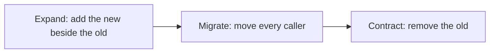

# Module 7 — Legacy, refactoring and migration

*Most of the code that matters at a bank was written by people who have left, and nobody dares to touch it. Coding agents change the economics in two directions at once: they make mechanical change across many files cheap, and they make a "harmless cleanup" of a module you do not understand one sentence long. This module is about changing such code safely. Lesson 7.1 is the concept lesson: characterization tests that pin what the code does today, quirks included; seams; the strangler fig and expand and contract; small steps, and why a refactor never shares a commit with a behaviour change; what agents are good at (codemods, API migrations, drafting tests) and where they are dangerous (silent behaviour change, huge diffs, "improving" a quirk that another team relies on); judging a safety net with a mutation check; reviewing a big diff; and when to leave legacy alone. The artefact is the Refactoring plan template. Lesson 7.2 is the lab: the legacy ledger of Najm Remit has no tests and keeps its books in module-level variables. You pin its behaviour, refactor the global state away, then migrate the internal library najmkit from version 1 to version 2, with an agent doing the mechanical work and the grader holding you to the quirks.*

> **Focus:** Workflow, Verify — habit 3, *small verified steps*: change code you do not fully understand by pinning what it does first, then moving in steps small enough to check, with an agent doing the mechanical work.

---

# 7.1 — Changing code you do not understand: characterization tests, seams, incremental refactors and agent-sized migrations
*Level: 🟡 Intermediate* · *Prerequisites: 5.1, 6.1* · *Focus: Workflow, Verify*

## ⚡ In 60 seconds
- **Legacy is code you cannot change with confidence**, usually because it has no tests. Start by *pinning*: a **characterization test** records what the code does today, quirks included, even the ones you think are wrong.
- **Then move in small steps** through a **seam**, with the strangler fig and expand and contract. A refactor never shares a commit with a behaviour change.
- **Agents are strong at the mechanical** (renames, codemods, first drafts of tests) and **dangerous at the silent**: a "tidy" that normalises a quirk.
- **Judge the net** with a mutation check; review at scale by the rule, the tests, a sample.
- Cue: no net, no delegation. Trap: a green suite that never touched the code.

## 🧭 Why it matters
On a Wednesday (a constructed day, not recorded from a real model) Lujain asks her agent to "make `ledger.py` consistent with the rest of Remit". The summary reads well: the partner share uses the shared rounding helper, `balance()` has no side effect, `journal()` returns the list directly. `pytest -q` prints `99 passed`, and of course it does: no test asserts anything about the ledger (lesson 5.1 changed `PARTNER_SHARE` to 0.35 and watched all 99 stay green). Three weeks later Finance finds the partner payable a cent out on some transfers, and nobody can say which commit did it.

Michael Feathers, in *Working Effectively with Legacy Code* (2004), defines legacy code as code without tests: without tests you cannot tell whether a change preserved behaviour, however well it reads. Agents cut both ways: they make tidying cheap and the net cheap. Tests are quick to draft, slow to trust: habit 4, *trust evidence, not fluency*, applies to the net too.

## 📐 How it works

### 🟢 The essentials

**What a characterization test is.** It records what the code does, not what it should do. Feathers's method, as he describes it on his blog: write a test with a placeholder expectation, run it, and let the failure tell you the real value. Against the ledger's tie case:

```python
from decimal import Decimal

from remit import ledger
from remit.money import Money


def test_a_tied_partner_share_rounds_to_the_even_cent():  # Q-LED-1
    entries = ledger.post_transfer("TRF-1", "C001", Money("500", "QAR"), Money("10.15", "QAR"))
    # entries: debit, payout, fee income, partner share; 0 is a placeholder
    assert entries[3]["amount"] == Decimal("0")
```

```text
E       AssertionError: assert Decimal('3.04') == Decimal('0')
```

Thirty percent of 10.15 is 3.045. The ledger rounds the partner's share half-even and gets 3.04; the rest of Remit rounds half-up and would say 3.05. You put `3.04` in and name the quirk in a comment. You have not said it is right, only that Finance's numbers depend on it. The ledger's docstring lists four such quirks:

| Id | The quirk | A test that pins it |
|---|---|---|
| Q-LED-1 | The partner's 30% share is rounded half-even | A fee of 10.15 gives a share of 3.04 |
| Q-LED-2 | `balance()` of an unknown account creates it | After `balance("NOPE")`, `accounts()` lists it |
| Q-LED-3 | Books are module-level; ids and times come from najmkit | Two postings accumulate; entry ids run `JNL-000001` onward |
| Q-LED-4 | QAR only, bare `Decimal` balances, zero legs not posted | An EGP amount raises `CurrencyMismatch` |

One behaviour per test, named after it, with a comment naming its source; and nobody "fixes" one. A characterization test that starts failing is a behaviour change; a human decides whether it is wanted.

**Small safe steps.** (1) Pin the behaviour. (2) Change the structure in steps, each a commit that leaves the tests green. (3) Change behaviour, if you must, in its own commit with its own test change. The reason is review: a diff that only moves code can be judged by "the tests did not change"; one that also changes a rounding rule cannot.

**What agents are good at, and not.**

| Task | Fit | The guard |
|---|---|---|
| Rename a function across forty files | Strong | A rule you can state; run the suite, search for the old name |
| Draft characterization tests for an untested module | Strong, if you read them | Cheap to generate, costly to trust; run a mutation check |
| Apply a documented API change | Good | The notes are the spec; check the agent's summary against them |
| "Clean up" or "make consistent" a legacy module | Dangerous | No rule to check against, so quirks get normalised or "fixed" |

### 🟡 Going deeper

**Seams.** A *seam* is a place where you can change what the program does without editing that place; you need one before you can test or replace anything wired in. Remit has three. An *object seam* (Feathers's term): pass the thing in, as the lab's `RemitService(..., ledger=None)` does. A *global seam* (this course's label): najmkit lets a test install a fixed clock and sequential ids. A *test seam* (also ours): a small adapter that gives your tests one way to reach code whose shape is about to change; the lab's adapter returns a wrapped legacy module today and a `Ledger` after the refactor, so the same tests run on both.

**The strangler fig, at any size.** Martin Fowler's strangler fig replaces an old system by growing the new one around it and retiring the old piece by piece, preferred to a big-bang rewrite mainly because it lowers risk. At module scale: (a) add the new class behind the old functions; (b) move callers one at a time; (c) delete the old functions when nothing calls them. Each step is a green, revertible commit.

**Expand and contract** (also called parallel change) is the same idea for an interface or stored format.



Never expand and contract in one step, or there is no moment when both work. In lesson 7.2 Salem's team expands (najmkit 2 keeps the old names as warning wrappers), you migrate the call sites, then you contract. `pytest -W error::DeprecationWarning` turns each remaining old call into an error at its call site.

**A dependency summary is a claim.** Suppose an agent summarises the najmkit notes as "seven renames, nothing else". The notes also say `audit.emit` refuses any value JSON cannot hold, where version 1 called `str()` on it. A rename-only migration fails loudly; the quiet failure is the tidy fix, `str(amount.amount)` for `str(amount)`: green wherever no test pins the line, while the fraud team's parser, which reads `"500.00 QAR"`, stops matching. Read the notes for behaviour words (*now raises*, *no longer*) and pin the output other teams read.

**The risky diff and the reviewed one.** A "tidy" of the ledger, trimmed to its three changes (constructed; the hunks are real edits):

```diff
-    partner = (fee.amount * PARTNER_SHARE).quantize(_CENT, rounding=ROUND_HALF_EVEN)  # Q-LED-1
+    partner = quantize(fee.amount * PARTNER_SHARE)  # same rounding as the rest of Remit
...
-    if account not in _BALANCES:
-        _BALANCES[account] = Decimal("0")
-    return _BALANCES[account]
+    return _BALANCES.get(account, Decimal("0"))
...
-    return list(_JOURNAL)
+    return _JOURNAL
```

Each hunk is defensible alone. Without a net: `99 passed`. With one pinning test per hunk:

```text
FAILED tests/test_ledger_pins.py::test_a_tied_partner_share_rounds_to_the_even_cent
FAILED tests/test_ledger_pins.py::test_asking_for_an_unknown_account_creates_it
FAILED tests/test_ledger_pins.py::test_the_journal_is_a_copy - assert 0 == 4
3 failed, 99 passed in 0.38s
```

Each failure is a question for a human ("do we depend on this?"), not a test to repair.

**One safe step, asked for.** Weak: "Refactor ledger.py to remove the global state and make it cleaner." Strong:

```text
Goal: step 2 of docs/refactoring-plan.md. In src/remit/ledger.py add a class Ledger that holds the
balances and the journal on the instance. Keep post_transfer, balance, accounts, journal and reset as
module functions that call one shared Ledger. Do not change behaviour: same amounts, rounding, errors,
ids and timestamps. The quirks in the module docstring are intended; do not fix them.
Do not edit any file under tests/ or any other module. Run pytest -q when you finish. If a test in
tests/test_ledger_*.py fails, stop and show me the failure.
```

A prompt or `CLAUDE.md` is context, not enforcement. Once the tests are committed, a deny rule on `Edit(tests/test_ledger_*.py)` in `.claude/settings.json` is closer to a fence (check the permissions documentation; Bash is not a security boundary, so keep checking the diff).

### 🔴 Expert view

**Judge the net.** A mutation check breaks the code on purpose and asks whether a test fails. By hand, in a scratch copy: switch `ROUND_HALF_EVEN` to half-up, or change `PARTNER_SHARE` to 0.35. Each survivor is a behaviour you have not pinned, or an equivalent change nobody can see: a question, not a verdict. Lesson 7.2's grader breaks the original ledger sixteen ways; [*Software Testing*, lesson 2.3 — Are your tests any good?](../testing/index.html#/2.3) teaches the technique.

**Review at scale.** A forty-file mechanical diff cannot be read line by line. (1) Review the *rule*: the instruction or, for a codemod, the script (run it twice; the second run should change nothing). (2) Read the tests in full. (3) Sample the diff: first and last hunks, the riskiest files, a few at random. (4) Automate the rest: the suite on every commit, warnings as errors, a search for the old names, `git diff --stat`. Stop signs: a changed test file in a refactor commit, and a hunk you cannot explain. [*System Design for Vibe Coders*, lesson 9.7 — Code audit and review at agent speed](../vibe/index.en.html#l9-7) goes further.

**Agent-sized units.** A unit is one rule over a bounded set of files, small enough to verify in one sitting. For a long list, Claude Code's best-practices page shows a headless fan-out (other tools have equivalents); adapted to this rename (`files.txt` from a `grep -l`):

```bash
for file in $(cat files.txt); do
  claude -p "In $file move every najmkit v1 call to the v2 name in docs/najmkit-v2-migration.md. Keep every audit line unchanged. Change nothing else. Return OK or FAIL." \
    --allowedTools "Read,Edit" \
    --permission-mode dontAsk \
    --max-turns 8
done
```

The OK or FAIL it prints is the agent's claim, not evidence, so review the combined diff as above. Thirty call sites in five files need one session, not a loop. Checkpoints (`/rewind`) do not track Bash changes and are no substitute for git: commit each verified step.

**When to leave legacy alone.** Pinning and refactoring cost time and review attention. If a module is stable, sits behind a clean interface and nothing on the roadmap needs it, document its quirks, fence it with a memory line and a review rule, and spend the week elsewhere. If it must go, strangle it. A rewrite now looks cheap to produce; it is as expensive as ever to verify.

## 🧰 The toolkit
| Tool, practice or pattern | What it is and does | When to reach for it |
|---|---|---|
| **Characterization test** (Feathers) | Records what code does today, quirks included | Before changing code without a net |
| **Seam** (Feathers) | A place to change behaviour without editing there | When something is wired in and must be tested or replaced |
| **Strangler fig** (Fowler) | Grow the replacement around the old code, retire it piece by piece | Replacing a module without a rewrite |
| **Expand and contract** | Add the new beside the old, move callers, remove the old | API renames, dependency upgrades, stored formats |
| **Codemod** | A script that rewrites code by a rule, re-runnable | The same change in many files |
| **Mutation check** | Break the code on purpose and see whether a test fails | Judging a characterization suite |
| **Refactoring plan template** | One page: invariants, net, steps, delegation, review, rollback | Before any change to legacy or money code |

## 🏛️ In practice at Najm Bank
Tariq's rule for Payments Platform: a change to a legacy module, or a dependency migration, starts with a refactoring plan before any code; CONTRIBUTING.md then requires a second human reviewer for money logic such as `ledger.py` and `service.py`. The artefact is the **Refactoring plan template**. Save it as `docs/refactoring-plan.md`; the lab ships it as `lab-assets/refactoring-plan-template.md`.

```markdown
# Refactoring plan: <name of the change>

**Owner:** <you> · **Second reviewer:** <name> · **Agent and mode:** <tool, plan mode or not> · **Labelled AI-assisted:** yes / no

### 1. Why, and what must not change
- Why (the ticket, the incident, what it unblocks):
- Must not change, quirks included (each with how you know):
- May change, and who agreed:

### 2. What I do not understand yet
- Open questions, and how I will answer each (read, run, ask, test):

### 3. The safety net
- Characterization tests: where, how many, what they pin:
- How I know the net is good (mutation check, survivors):
- Not covered, and why that is acceptable:

### 4. The seams and the steps
One commit per step, tests green after each. A refactor step never changes behaviour.

| # | Step | Kind (refactor, migration, behaviour) | Check after the step | Commit message |
|---|---|---|---|---|
| 1 | | | | |

### 5. Delegation
- For the agent (mechanical, a rule I can state):
- I keep (judgement, money logic, any quirk):
- The instruction: scope, "do not change behaviour", "do not edit the pinned tests", when to stop:

### 6. Review at scale
- Read in full:
- Sampled by hand:
- Automated (suite per commit, warnings as errors, search for old names, diff size):

### 7. Rollback and done
- Undo means reverting the commit. I stop and ask when:
- Done means:
```

Fill it in before the work, a few lines per section, and draft section 4 with your agent in plan mode (Shift+Tab, or `claude --permission-mode plan`), where it proposes without editing your files. For the vendor-feed change that the old TODO in `screening.py` asks for, section 1 would list Q-SCR-1 to Q-SCR-4 as *must not change*.

## 🛠️ Exercises
- 🟢 **Pin two quirks by hand.** *No agent.* In your m00 directory, write two tests of `remit.ledger` with the placeholder method: the tied partner share for a fee of 10.15 (Q-LED-1) and `balance("NOPE")` (Q-LED-2). *Done when:* both pass with the real values and a comment naming the quirk, and switching `ROUND_HALF_EVEN` to half-up in a scratch copy makes the first fail.
- 🟡 **Draft, then judge.** *Needs an agent* (or write the tests yourself). Ask for characterization tests of `screening.py`; then break `FUZZY_PERCENT`, `MIN_FUZZY_LEN` and `MAX_TOKENS` one at a time in a scratch copy. *Done when:* a table lists each test, the quirk it pins and the mutations it caught, plus one test you rejected and why.
- 🔴 **Plan a rename.** *Needs an agent for the last step.* Plan renaming `Customer.kyc_tier` to `kyc_level`. It is used in the model, the store (also a database column), the service's limits call, the command line and the tests; the column is a later step. *Done when:* the template is filled in; the agent renames the attribute in a scratch copy; your section 6 checks pass; and you name one thing the agent got wrong, or say none.

## ⚠️ Mistakes and traps
- **Cleaning before pinning.** The tidy is plausible and the suite green. Pin first and run a mutation check.
- **Writing the test you wish for.** A "characterization" that expects half-up fails on day one. Record what the code does; raise the difference as a decision.
- **Letting the agent edit the pinned tests.** A changed expectation in a refactor commit is the loudest signal in the diff. Forbid it, and check `git diff <tests commit> -- tests`.
- **Mixing a refactor and a behaviour change.** Reviewers can no longer rely on "the tests did not move".
- **Trusting a changelog summary.** Read the notes for behaviour words; run with warnings as errors.
- **Reading forty files line by line, or none.** Review the rule, the tests and a sample.

## 🧾 Recap
- No trustworthy net, no change: pin behaviour first, quirks included, and never "fix" a pinned test.
- Move in small, green, committed steps; strangle and expand and contract rather than rewrite; keep refactors, migrations and behaviour changes apart.
- Agents shine on mechanical change and first drafts of tests; they fail on silent normalisation and unasked cleanups.
- Judge the net with a mutation check; review at scale by rule, tests, sample and automation. Sometimes leave it alone.

## ✍️ Check yourself

**1. An agent "tidies" `ledger.py` and `pytest -q` prints `99 passed`. What does that tell you about the ledger?**

- A. Nothing changed, since a green suite proves the behaviour is the same
- B. Only what the 99 tests assert is unchanged, and none assert anything on the ledger
- C. The agent was careful, because tidy-ups in tested projects rarely fail
- D. The tidy is safe, provided the agent says it preserved behaviour

<details><summary>Answer</summary>

**B.** A suite is evidence only about what it asserts, and none of the 99 tests asserts a ledger balance. Pin first. (🟢 The essentials.)

</details>

**2. A placeholder characterization test for a fee of 10.15 fails with `3.04 == 0`. You believe 3.05 is correct. What do you do?**

- A. Put 3.05 in the test and fix the code, so the suite agrees with you
- B. Delete the test, since a characterization test must not disagree with you
- C. Put 3.04 in, name the quirk, and raise 3.05 as a separate decision
- D. Put 3.04 in without a comment, and change the code in the same commit

<details><summary>Answer</summary>

**C.** The test records what the code does; whether it should differ is a decision for a human, in its own commit. The others hide the quirk or mix it into a refactor. (🟢 The essentials.)

</details>

**3. najmkit 2 ships with the old names as wrappers that warn. When do you delete the wrappers?**

- A. Once nothing calls the old names any more, in the contract step
- B. In the expand step, so the new names are unambiguous
- C. In the first migration commit, so missed call sites fail at once
- D. Never, because another service might still use them one day

<details><summary>Answer</summary>

**A.** Expand adds the new beside the old, you migrate the callers, and only then contract removes the old. Deleting earlier removes the moment when both work. (🟡 Expand and contract.)

</details>

**4. An agent summarises the najmkit upgrade notes as "seven renames, no other changes". What is the sound next move?**

- A. Accept it, since renames are the whole job and the suite catches the rest
- B. Ask the agent to confirm the summary, then migrate all of the call sites
- C. Read the first heading and trust the rename table that follows it
- D. Read the notes for behaviour changes, run with warnings as errors, pin output

<details><summary>Answer</summary>

**D.** A summary is a claim; the notes may hold a behaviour change it dropped, and output other teams read needs its own test. Asking the agent again repeats the fluency. (🟡 A dependency summary is a claim.)

</details>

**5. `screening.py` has not changed in a year, sits behind one function, and no ticket needs it. A colleague wants to pin and rewrite it this sprint. What is the best answer?**

- A. Yes: an agent makes a rewrite cheap, so the cost argument has gone
- B. Leave it, note its quirks, fence it, and revisit when a ticket needs it
- C. Rewrite it with the agent, but skip the tests, as the old module had none either
- D. Yes, if the agent promises that every behaviour will be preserved

<details><summary>Answer</summary>

**B.** Pinning and refactoring cost days, and a stable, isolated module with no demand may not repay them. Strangle it when a real change arrives. (🔴 When to leave legacy alone.)

</details>

## 📚 References
- Claude Code documentation: best practices (plan mode, fan-out, verification): https://code.claude.com/docs/en/best-practices; headless mode: https://code.claude.com/docs/en/headless; permissions: https://code.claude.com/docs/en/permissions; commands: https://code.claude.com/docs/en/commands
- Python warnings: https://docs.python.org/3/library/warnings.html; pytest warning filters: https://docs.pytest.org/en/stable/how-to/capture-warnings.html; Martin Fowler, "Strangler Fig Application": https://martinfowler.com/bliki/StranglerFigApplication.html
- [*Software Testing*, lesson 2.3 — Are your tests any good?](../testing/index.html#/2.3); [*Software Testing*, lesson 6.2 — Tests as the specification for coding agents](../testing/index.html#/6.2); [*System Design for Vibe Coders*, lesson 9.7 — Code audit and review at agent speed](../vibe/index.en.html#l9-7)
- **Go deeper.** Michael Feathers, *Working Effectively with Legacy Code* (2004) and his post "Characterization Testing": https://michaelfeathers.silvrback.com/characterization-testing · Kent Beck, *Tidy First?* (2023), on small, reversible tidyings and when to make them · GitClear, "AI Copilot Code Quality: 2025 Data" (a vendor's observational data: in 2024, copy/paste exceeded moved code): https://www.gitclear.com/ai_assistant_code_quality_2025_research

---

# 7.2 — Lab: tame an untested module, refactor it, then migrate a dependency
*Level: 🟡 Intermediate* · *Prerequisites: 6.2, 7.1* · *Focus: Workflow, Verify*

## ⚡ In 60 seconds
- **Lab m07** on Najm Remit: the legacy ledger has no tests and keeps its books in module-level variables. Three parts, three kinds of commit: **pin** it with characterization tests, **refactor** it (`class Ledger`, `RemitService(..., ledger=None)`), **migrate** najmkit from version 1 to 2.
- **Needs an agent: yes (recommended, not required).** The no-agent path is the whole lab by hand; the grader checks the result, not who or what produced it.
- The post-refactor interface is **fixed** in the ticket; your tests must pass before and after it, through a small seam.
- The grader breaks the original ledger sixteen ways, runs a hidden characterization suite on your refactor, scans for module-level state and compares the audit lines byte for byte. Plan a few hours.

## 🧭 Why it matters
On Monday Hessa brings Finance's request: the nightly reconciliation needs two services in one process, each with its own books. Tariq's answer is this lab in a sentence: "Nobody touches `ledger.py` without tests, and I will not review four hundred lines of agent diff on trust." The same ticket carries najmkit 2, because the fraud team's dashboard reads the audit lines and one "tidy" conversion would quietly stop it matching.

An agent can do the mechanical parts of all three jobs in an hour. This week is the part only you can do: deciding what must not change, and proving it did not.

## 📐 How it works

### 🟢 The essentials

**Read first.** The docstring of `ledger.py` lists Q-LED-1 to Q-LED-4. `git show lab-start:src/remit/ledger.py` always shows the original, and the grader uses the same one. Run `pytest -q`: `99 passed` and a long list of `DeprecationWarning`s from najmkit 2. That list is your migration to-do list.

**Part 1: pin it.** Copy `lab-assets/ledger_port.py` to `tests/ledger_port.py`. It is a test seam: `make_ledger()` returns a fresh ledger (the legacy module today, a `Ledger` after Part 2) and `ledger_of(service)` returns the ledger a service posts to. Write tests against those two functions only, in new files named `tests/test_ledger_*.py`, with lesson 7.1's placeholder method. Cover the four quirks and the details around them: the order of the four entries, what a refused posting leaves behind, what `send` does when the store fails (the service docstring calls it D-SVC-1). Do not call `make_ledger()` after a `send` in the same test: before the refactor it wipes the shared books. With an agent, ask for one behaviour at a time: "Pin Q-LED-2 only, in tests/test_ledger_basics.py, through make_ledger(). Put a placeholder in the assertion, run it, and copy the value the code returns. Change nothing under src/." Then read every test and delete any that asserts nothing.

**Parts 2 and 3.** Follow the strangler order from lesson 7.1 and commit each green step. The `tests/conftest.py` edit that drops `ledger.reset()` belongs to the refactor. For the migration, `docs/najmkit-v2-migration.md` has the renames, one behaviour change and a suggested order. Run `pytest -W error::DeprecationWarning`, then delete the deprecated section of each najmkit module, then update `docs/najmkit.md`.

### 🟡 Going deeper

**Part 3 has its own net.** The visible suite pins one audit line (`transfer.sent`). Before you touch a call site, pin all three events Remit writes, character for character, with a fixed clock and sequential ids (the `service` fixture and `audit.configure(tmp_path / "audit.jsonl")` give you both). Then "the audit tests did not change" is your migration check.

**The migration step.** Weak: "Migrate Remit to najmkit 2." Strong:

```text
Goal: step 5 of docs/refactoring-plan.md. Move every use of a najmkit v1 name in src/remit and tests
to the v2 name in docs/najmkit-v2-migration.md. Read that file first. A clock object's .now() method
is not a renamed function; only the module-level clock functions are. audit.emit takes JSON values
only: convert a Money so that each audit line stays exactly as it was. Change no other behaviour, edit
no test except to follow a rename, and leave src/najmkit alone for now. Run
pytest -W error::DeprecationWarning when you finish and show me the output.
```

**Review every step alike.** `git diff <tests commit> -- tests/test_ledger_*.py` is empty (or shows only a rename); `git diff --stat` names only the files the step should touch; the suite is green; a search for the old names comes back empty. Read the hunks in `service.py` and `ledger.py` yourself; sample the rest. If a pinned test goes red after your refactor, it has found a behaviour change. Do not edit it and do not let the agent: find the line that changed the behaviour, restore it, and note a disagreement for a separate ticket.

### 🔴 Expert view

**How the grader reads your work.** Part 1 is judged on the *original* ledger, rebuilt from the `lab-start` tag: your tests must pass there and fail on at least 13 of 16 broken copies, each described by a behaviour such as "a negative fee is refused"; survivors are named. Part 2 is a hidden suite of about fifty checks plus a scan for module-level state, mutable class attributes and leftover module functions. Part 3 is an import-aware scan for old najmkit names, an import of your najmkit to confirm they are gone, and the audit lines compared as text.

**What it cannot tell.** Whether you understood a quirk. Whether you moved in small steps or in one leap, then committed three times. Whether your refactor changed a behaviour nobody pinned: sixteen mutants and fifty checks cover what they cover. A suite that copies values out of the code passes and teaches nothing if you never asked why. The grader is a practice partner, not a gate.

## 🧰 The toolkit
| Tool, practice or pattern | What it is and does | When to reach for it |
|---|---|---|
| **Characterization test** (Feathers) | Records what the ledger does today, quirks included | Before the first edit to `ledger.py` |
| **Seam** (Feathers) | `ledger_port.py`, then `ledger=None`: a way in that survives the change | Tests that run before and after a refactor |
| **Strangler fig** (Fowler) | Class behind the old functions, callers moved, old functions deleted | The refactor in Part 2 |
| **Expand and contract** | najmkit 2 beside najmkit 1, call sites moved, old names deleted | The migration in Part 3 |
| **Mutation check** | Break the original ledger on purpose and see whether a test fails | Judging your Part 1 suite |
| **Agent log** | Prompt, what it did, what you corrected, time spent | Every agent-assisted lab |

## 🏛️ In practice at Najm Bank
**Needs an agent: yes (recommended, not required).** The no-agent path is the whole lab by hand with `git`, `pytest` and an editor; Part 3 is about thirty call sites. An agent saves time on drafting tests and renames, and adds risk exactly where this module has quirks. The grader does not care how the work was produced.

**The ticket.** Tariq's ticket is in `TASK.md`:

```text
# REMIT-372: make the ledger safe to change, then move Remit to najmkit 2

**From:** Tariq, Engineering Lead, Payments Platform (Hessa's business reason is at the end)
**To:** You, and your AI coding tool if you use one
**Priority:** Normal. Money logic: a second human reviews it before it merges.

`src/remit/ledger.py` is Remit's oldest code and has no tests. Its books live in module-level
variables, so a process can have exactly one set of books. Finance's reconciliation job needs two
`RemitService` objects in one process, each with its own ledger. And najmkit 3 will remove najmkit 1.

Three parts, in this order, in separate commits. **Behaviour must not change anywhere**, quirks
included, except where this ticket says so. Read the docstring of `ledger.py` first.

### Part 1: pin what the ledger does now

1. Copy `lab-assets/ledger_port.py` to `tests/ledger_port.py`: a seam with `make_ledger()` (a fresh
   ledger) and `ledger_of(service)` (the ledger a service posts to), working before and after Part 2.
2. Write characterization tests in **new files named `tests/test_ledger_*.py`**. They say what the code
   does today, quirks included, not what you think it should do. Reach the ledger only through
   `make_ledger()` and `ledger_of(service)`.
3. They must pass on the code as it is now and, unchanged, after Part 2. The grader runs them against
   the original ledger and against deliberately broken copies of it. Do not rely on edits to
   `tests/conftest.py`.

### Part 2: remove the module-level state

After the refactor the interface is exactly this:

    # src/remit/ledger.py
    class Ledger:
        def __init__(self) -> None: ...                       # no arguments needed
        def post_transfer(self, transfer_id: str, customer_id: str, send_amount: Money, fee: Money) -> list[dict]: ...
        def balance(self, account: str) -> Decimal: ...
        def accounts(self) -> list[str]: ...
        def journal(self) -> list[dict]: ...

    # src/remit/service.py
    class RemitService:
        def __init__(self, store, rates, watchlist, clock, notifier, ledger: Ledger | None = None) -> None: ...
        # self.ledger is the Ledger in use; ledger=None means a fresh Ledger() for this service

- State belongs to the instance: no changing module-level variables, no mutable class attributes,
  no module-level default instance.
- The module functions `post_transfer`, `balance`, `accounts`, `journal` and `reset` are removed.
  The constants and `customer_account()` stay.
- Entry ids and times still come from najmkit as today, so two ledgers in one process share one id
  sequence. `tests/conftest.py` stops calling `ledger.reset()`.
- The one deliberate change: two `Ledger` objects no longer share their books.

### Part 3: najmkit 1 to 2

The vendored najmkit is 2.0.0. `docs/najmkit-v2-migration.md` lists the renames and one change in
behaviour; the old names still work but warn.

- Move every use of an old name in `src/remit` and `tests` to the new one. Remit's audit files are
  read by the fraud team's parser: the lines must come out byte for byte as today.
- Then delete the deprecated names from `src/najmkit` and bring `docs/najmkit.md` up to date.

### Rules

- Commits follow `CONTRIBUTING.md`: at least three, each leaving `pytest -q` green. Never mix a
  refactor and a migration in one commit.
- Edit an existing test only to follow a rename or the removed `reset()`.
- Touch only `ledger.py`, `service.py`, `store.py`, `cli.py`, `src/najmkit`, `tests` and `docs` (and
  `CLAUDE.md` if it now says something untrue).
- Recommended: fill in `lab-assets/refactoring-plan-template.md` as `docs/refactoring-plan.md` first.
- Use any help you like, an AI coding tool included. You are accountable for every line.

**Why now (Hessa):** the nightly reconciliation compares two sets of books, and the audit lines feed
the fraud team's dashboard. Neither can change on the day we ship.

When you think you are done, from the `ailab` folder of the course repository:
`python -m ailab grade m07 --dir <this directory>`
```

**Start.**

```bash
cd ainative/ailab
python -m ailab start m07 --dir ~/ainative/m07
cd ~/ainative/m07
git log --oneline          # "Lab starting state" on top of "Initial state"
pytest -q                  # 99 passed, plus the DeprecationWarnings
```

**Your move.** (1) Read the docstring, the migration notes and the ticket; fill in the plan template as `docs/refactoring-plan.md` (with your agent in plan mode, if you use one). (2) Part 1: tests first, one commit; break the original ledger by hand to judge them. (3) Part 2: small steps, a commit each. (4) Part 3: pin the audit lines, migrate, contract. (5) Update `docs/najmkit.md` and, if it says something untrue, `CLAUDE.md`. (6) Grade. With an agent, give it one step at a time, forbid edits to the pinned tests and read every diff: it writes a quirk-fixing "improvement" as fluently as a rename.

**What the grader checks.** Part 1: at least ten ledger tests that pass on the original code and catch 13 of 16 broken copies; the suite passes; no test deleted. Part 2: hidden suites for `Ledger` and the service; no module-level state; old functions gone. Part 3: no old najmkit name left or defined; audit lines and ids unchanged. Process: allowed files only, Conventional Commits, at least three commits, nothing uncommitted, no secrets. Advisory only: all sixteen defects caught, every commit green, `docs/najmkit.md` and `CLAUDE.md` not stale, the plan's sections present.

**Grade.** From `ainative/ailab`: `python -m ailab grade m07 --dir ~/ainative/m07`. On the starter (abridged: long lines are cut with `...`):

```text
[FAIL] You wrote characterization tests for the ledger: no tests/test_ledger_*.py file was added yet
       hint: Copy lab-assets/ledger_port.py to tests/ledger_port.py and write at least ten tests in new files named tests/test_ledger_*.py.
[PASS] The whole suite passes: 99 passed
[FAIL] The Ledger class keeps every quirk: 33 of 34 hidden checks failed: test_a_ledger_is_created_with_no_arguments_and_starts_empty, ... (+29 more)
[FAIL] The ledger keeps no state at module level: ledger.py line 44: module-level `_BALANCES` holds a mutable container, ...
[PASS] The audit lines and ids come out as before: 6 hidden checks passed
[FAIL] Small steps: at least three commits: 0 new commits since the start
Lab m07: 5/17 required checks passed: NOT YET
```

A first attempt: ten tests that only check the happy path (real output, abridged):

```text
[PASS] Your ledger tests describe the original ledger: they pass on the code as it was at the start (10 tests)
[FAIL] Your ledger tests catch defects in the original ledger: your tests catch 1 of 16 deliberate defects; they miss: the partner's share is rounded half-even, not half-up, the partner's share is 30% of the fee, asking for the balance of an unknown account creates it (+12 more)
```

When all three parts are right, the same command ends like this (excerpt of a real run; your counts will differ):

```text
[PASS] Your ledger tests catch defects in the original ledger: your tests catch 16 of 16 deliberate defects
[PASS] The Ledger class keeps every quirk: 34 hidden checks passed
[PASS] The ledger keeps no state at module level: no module-level state
[PASS] The audit lines and ids come out as before: 6 hidden checks passed
[PASS] Every commit leaves the suite green (advisory): 8 commits run, all green
Lab m07: 17/17 required checks passed: PASSED
```

**Weekly deliverable.** Commit, in at least three commits: `docs/refactoring-plan.md`; `tests/ledger_port.py` and `tests/test_ledger_*.py`; the refactor; and the najmkit migration with updated docs. Keep your agent log in your notes or as `docs/agent-log-m07.md`.

**Group session (60 minutes).** (1) Ten minutes: each person names the quirk they found last, and how. (2) Twenty: swap Part 1 suites and break each other's ledger one new way. Whose suite noticed? (3) Fifteen: compare plans and agent instructions. (4) Ten: agree one legacy-module rule for `CLAUDE.md`. (5) Five: agent logs.

**Debrief questions.**
- What did the agent get wrong: a quirk, a test or a rename? How did you find out?
- What did your plan or context miss that would have prevented it?
- Which quirk did you pin last, and what would an unpinned refactor have done to it?
- Which step could you have delegated further, and which should you have kept?

**Agent log template.**

```text
Task:            (e.g. Part 3, move call sites to najmkit 2)
Prompt:          (what you asked, in one or two lines)
What it did:     (files touched, size of the diff)
What you corrected: (what you reverted or changed, and how you knew)
Time spent:      (you / the agent)
```

## 🛠️ Exercises
- 🟢 **Pin it.** *No agent.* Do Part 1 only. *Done when:* the first four lines of `ailab grade m07` are `[PASS]` and the survivors list is empty.
- 🟡 **Pin and refactor.** *Agent optional.* Do Parts 1 and 2 in at least four commits. *Done when:* the `Ledger` and service lines pass, the suite passes and every commit is green.
- 🔴 **The whole ticket, measured.** *Needs an agent.* Do all three parts, delegating the mechanical steps. *Done when:* the grade ends `PASSED`; the plan is filled in; your agent log shows, per part, one thing you reverted or checked and found fine; and you have written one line for the team's `CLAUDE.md` about legacy modules.

## ⚠️ Mistakes and traps
- **Tests aimed at the new class.** Written after the refactor, they cannot describe the original. Write them first, through the seam.
- **Accepting generated tests unread.** They record whatever the code returns, and some assert nothing. Read every expectation.
- **Editing a red test.** It found a behaviour change. Restore the behaviour.
- **Search and replace on `.now()`.** Clock objects keep `.now()`; only the module function was renamed.
- **One commit for everything.** The review value is the separation: tests, structure, migration.
- **Stale documents.** `docs/najmkit.md` and `CLAUDE.md` describe code that is gone; the next agent believes them.

## 🧾 Recap
- Pin first, through a seam that survives the refactor, and judge the pins by breaking the original.
- Refactor in green steps; migrate with expand and contract; contract only when nothing calls the old names.
- Give an agent one step, an invariant, a scope and a stop rule, and forbid edits to the pinned tests.
- Pin the output other teams read before you migrate. The grader checks the result, not your understanding.

## ✍️ Check yourself

**1. Your twenty ledger tests pass on your refactor, but the grader says they do not describe the original ledger. Why?**

- A. The tests are too slow, so the grader timed out before it finished
- B. The tests assert too little, so the grader sees no real values
- C. The tests need the new `Ledger` class or an edited `conftest.py`
- D. The tests share a file with the seam, which the grader refuses to run

<details><summary>Answer</summary>

**C.** The grader rebuilds the original code from the `lab-start` tag and runs your new test files there with the original `conftest.py`, so tests that need the new class or a changed fixture cannot pass. Use the seam. (🟢 Part 1.)

</details>

**2. The grader says your tests "catch 9 of 16 deliberate defects" and names three behaviours they miss. What is the best next step?**

- A. Write a test for each named behaviour, running the original to see its value
- B. Copy the hidden tests from the kit, since they must catch every defect
- C. Delete tests until the check runs faster, as fewer tests mean less to run
- D. Ask the agent for as many tests as possible and keep whichever pass

<details><summary>Answer</summary>

**A.** A survivor is a behaviour you have not pinned; the output names it, and the placeholder method gives you the value. Copying hidden tests defeats the practice. (🔴 How the grader reads your work.)

</details>

**3. After a rename-only migration `audit.emit` raises `TypeError` for a `Money`. Which fix keeps every audit line as before?**

- A. Pass `float(amount.amount)`, which is the number without the currency text
- B. Pass `amount.amount`, which is already a `Decimal` and so is exact
- C. Pass `str(amount.amount)`, a tidier string without the currency
- D. Pass `str(amount)`, because version 1 wrote `str()` of the object

<details><summary>Answer</summary>

**D.** Version 1 called `str()` on the `Money`, giving `"500.00 QAR"`, which the fraud team's parser reads. Any other conversion changes the line; an audit test written first would show it. (🟡 Part 3 has its own net.)

</details>

**4. Your refactor turns a pinned test red, and the agent offers to update the test to match the new code. What do you do?**

- A. Accept, since the code is newer than the test
- B. Revert the step and find which change altered the behaviour
- C. Accept, but record the new value in the plan
- D. Delete the test, because the refactor made it obsolete

<details><summary>Answer</summary>

**B.** A red pinned test inside a refactor has found a behaviour change. Restore it; if you think the old one is wrong, raise that separately. Editing or deleting the test removes the evidence. (🟡 Review every step alike.)

</details>

**5. You finish all three parts in a single commit and every check passes except one. Which one fails, and why does it matter?**

- A. "No existing test was deleted", since squashing hides which tests moved
- B. "Only the files this ticket needs changed", since one commit touches too much
- C. "The audit lines and ids come out as before", since squashing alters history
- D. "Small steps: at least three commits", since review depends on the separation

<details><summary>Answer</summary>

**D.** The grader can see commits, not thinking, so it asks for three. The real point is review: tests, structure and migration in separate green commits can each be judged by "the tests did not move". (🔴 What it cannot tell.)

</details>

## 📚 References
- Claude Code documentation: best practices (plan mode, verification): https://code.claude.com/docs/en/best-practices; headless mode: https://code.claude.com/docs/en/headless; permissions: https://code.claude.com/docs/en/permissions
- pytest warning filters: https://docs.pytest.org/en/stable/how-to/capture-warnings.html; Python warnings: https://docs.python.org/3/library/warnings.html; Conventional Commits: https://www.conventionalcommits.org/
- [*Software Testing*, lesson 2.3 — Are your tests any good?](../testing/index.html#/2.3); [*Software Testing*, lesson 6.2 — Tests as the specification for coding agents](../testing/index.html#/6.2)
