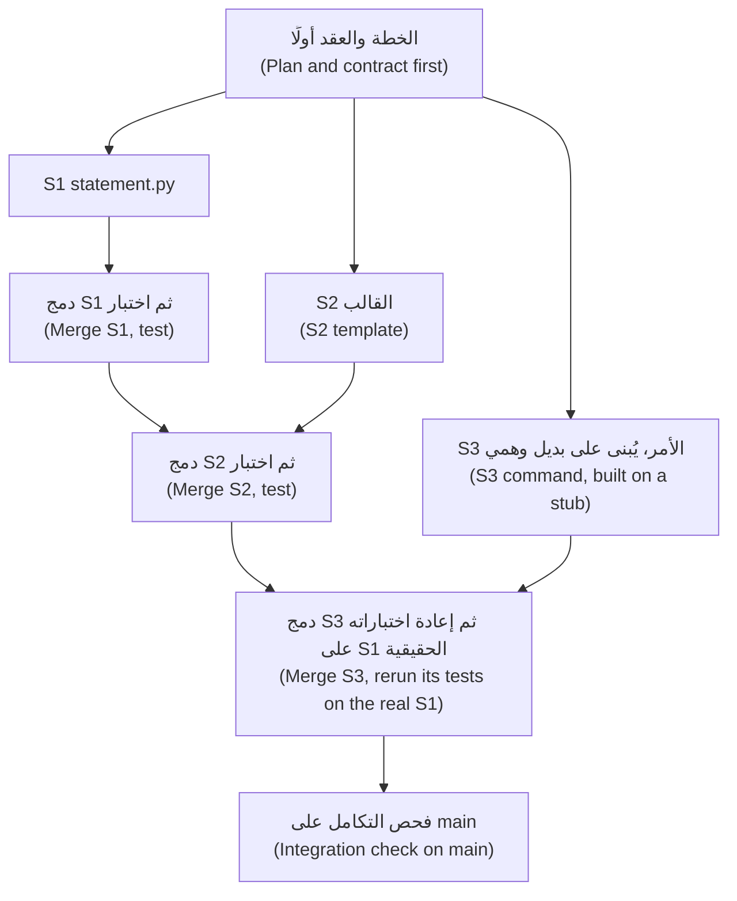

# الوحدة 10 — العمل المتوازي ومتعدد الوكلاء (Parallel and multi-agent work)

*تشغيل عدة وكلاء (agents) في وقت واحد (at once) سهل البدء وصعب الإنجاز بإتقان (easy to start and hard to finish well). الدرس 10.1 هو درس المفاهيم (the concept lesson): متى يُجدي العمل المتوازي (when parallel work pays) — مهام مستقلة (independent) ومكتوبة (written down) وسريعة الفحص (quickly checked) — ومتى لا يُجدي؛ وأشجار العمل في git (git worktrees) وكيف يدعمها Claude Code؛ وتقسيم التغيير على حدود الوحدات (splitting a change along module boundaries) وكتابة العقد (the contract) الذي تعمل المهمة وفقه؛ ونمط المنسّق والعامل (the orchestrator and worker pattern) وكلفته؛ ولماذا أنت نقطة التكامل (why you are the integration point)، وكم مسارًا (streams) تستطيع مراجعته فعلًا (can really review)، وما الذي يجب أن يحميه ترتيب الدمج (what a merge order has to protect)؛ والمهام الخلفية (background tasks)؛ وحساب الكلفة (the arithmetic of cost)؛ والطرق الخمس التي يفشل بها العمل المتوازي (the five ways parallel work fails): عمل مكرَّر (duplicated work)، وافتراضات متباينة (divergent assumptions)، وتعديلات متعارضة (conflicting edits)، ودمج نظيف لكنه خاطئ (a clean merge that is wrong)، وغياب مالك للتكامل (nobody owning integration). وينتهي بخطة العمل المتوازي (the Parallel plan)، وهي قالب من صفحة واحدة (a one-page template). أما الدرس 10.2 فهو المختبر (the lab): REMIT-361 من حصة (Hessa)، مالكة المنتج (product owner)، هي أربعة تغييرات صغيرة في أربعة مواضع (four small changes in four places) وتعارض واحد مزروع (one planted conflict) في `cli.py`. تخطط له، وتبنيه على فروع (branches) أو أشجار عمل (worktrees) منفصلة، يدويًا أو بالوكلاء، ثم تدمجه وتثبت أن الأجزاء ما زالت تعمل معًا (still work together). يقرأ المُقيِّم (the grader) النتيجة والتاريخ (the history)، ويخبرك سجل الوكيل (agent log) ما إذا كان العمل قد أجدى (whether it paid). وكل ما يخص جانب نجم خيالي (Everything on the Najm side is fictional).*

> **التركيز (Focus):** Workflow, Automate — تشغيل عدة وكلاء في وقت واحد دون أن تغرق في المراجعة (running several agents at once without drowning in review).

---

# 10.1 — العمل مع عدة وكلاء: أشجار العمل والتفويض واختناق المراجعة والكلفة (Working with several agents: worktrees, delegation, the review bottleneck and cost)
*المستوى (Level): 🔴 متقدم (Advanced)* · *المتطلبات (Prerequisites): 4.1، 5.1، 9.1* · *التركيز (Focus): Workflow, Automate*

## ⚡ الدرس في دقيقة (In 60 seconds)
- الوكلاء المتوازون (parallel agents) **يُجدون** (pay) حين تكون المهام مستقلة (independent) ومكتوبة (written down) وسريعة الفحص (quickly checked). و**لا يُجدون** (do not) حين تتشارك المهام ملفات أو قرارات (share files or decisions)، أو حين لا تستطيع فحص النتائج بسرعة وصولها (check results as fast as they arrive).
- **شجرة العمل (git worktree)** هي نسخة عمل (checkout) أخرى من مستودع واحد (one repository)، في مجلدها الخاص وعلى فرعها الخاص (its own branch): الأمر `git worktree add` أو `claude --worktree <name>`.
- **قسِّم على حدود الوحدات (Split along module boundaries)** واكتب **عقد** كل مهمة (contract): الأسماء (names) والتواقيع (signatures) والمخرجات الدقيقة (exact outputs) والملفات المسموح بها (allowed files). الملفات المشتركة (Shared files) هي المواضع التي تتصادم فيها المسارات (streams collide).
- **المنسّق (orchestrator)** — جلسة تنسّق الوكلاء الفرعيين (a session that coordinates subagents) — يضيف كلفة (cost) وملخصات (summaries) لا يجوز أن تسلّم بها دون تحقق (take on trust).
- **أنت نقطة التكامل (You are the integration point).** عدد المسارات التي تجاريها (the streams you can keep up with) يساوي تقريبًا دقائق الوكيل لكل نتيجة (the agent's minutes per result) مقسومة على دقائقك لمراجعة نتيجة واحدة (your minutes to review one).
- الفخ (Trap): أربعة فروع خضراء (four green branches) ليست برنامجًا يعمل (not a working program). اختبر بعد كل دمج (Test after every merge).

## 🧭 لماذا يهم (Why it matters)
في يوم جمعة (On a Friday)، في حالة افتراضية (hypothetical)، تبدأ لجين (Lujain)، المهندسة حديثة التخرج (graduate engineer)، أربع جلسات Claude Code على أربع تذاكر (four tickets) تظنها مستقلة (independent). وبحلول الخامسة يكون كل فرع (branch) أخضر. ثم تدمج الفروع (merges them)، وتحل تعارضين نصيين (two textual conflicts) في `notify.py` و`cli.py`، فيحمرّ التكامل المستمر (CI goes red). كانت REMIT-346 قد غيّرت طريقة كتابة `format_money` للمبالغ العربية (Arabic amounts)؛ وأضافت REMIT-347، التي كُتبت في الوقت نفسه، اختبار رسالة (a message test) يتوقع النص القديم (the old text). كان كل فرع صحيحًا وحده؛ ومعًا كانا خاطئين (together they were wrong)، وفكّ التشابك يستغرق حتى الثامنة (untangling it takes until eight).

يوم الاثنين يسأل طارق (Tariq)، قائد الهندسة (engineering lead)، عمّا وفّره الوكلاء (what the agents saved). «أربع ساعات من الكتابة (Four hours of typing).» والتكامل (integration)؟ «خمس ساعات (Five hours).» يقول: «أدّى الوكلاء عملهم، ولم يؤدِّ أحد عملك (Nobody did yours).» وقلّما يشغّل أكثر من مسارين (He rarely runs more than two streams).

لا توجد دراسة نستشهد بها تقيس تسريعًا ناتجًا عن تشغيل عدة وكلاء في وقت واحد (measures a speed-up from running several agents at once). وفي فبراير 2026 قالت METR إن قياساتها الزمنية (time measurements) غير موثوقة حين يشغّل المطورون عدة وكلاء معًا. وربط تقرير DORA لعام 2024 ارتفاع اعتماد الذكاء الاصطناعي (higher AI adoption) بانخفاض استقرار التسليم (lower delivery stability)، واقترح أن الدفعات الأكبر (larger batches) جزء من السبب؛ ولا يزال تقرير 2025 يجد ارتباطًا سلبيًا (a negative link) بالاستقرار — وهي ارتباطات استطلاعية (survey associations) كما نبّه الدرس 0.3. ويجعل تعدد الوكلاء الدفعة الكبيرة (a large batch) أمرًا سهلًا؛ فاحرص على أن تبقى صغيرة ومراجَعة (small and reviewed).

## 📐 كيف يعمل (How it works)

### 🟢 الأساسيات (The essentials)

**متى يُجدي التوازي (When parallel pays).** اطرح أربعة أسئلة (Ask four questions) بهذا الترتيب (in this order).

| السؤال (Question) | يُجدي التوازي (Parallel pays) | اعمل تباعًا (Go serial) |
|---|---|---|
| هل المهام مستقلة؟ ⁦(Independent?)⁩ | وحدات مختلفة (Different modules)؛ ولا تحتاج واحدة منها إلى شيفرة الأخرى (none needs another's code) | الدالة نفسها (Same function)، أو تحتاج إحداها إلى نتيجة الأخرى (one needs the other's result) |
| هل هي مكتوبة؟ ⁦(Written down?)⁩ | عقد (a contract) وفحص تستطيع تشغيله (a check you can run) | ما زلت تكتشف ما هي المهمة (still finding out what the task is) |
| هل فحصها سريع؟ ⁦(Quick to check?)⁩ | اختبار (a test) أو أمر يجيب في دقائق (answers in minutes) | تحتاج المراجعة (review) إلى تفكير عميق: المال والأمان (money, security) |
| هل تستطيع المجاراة؟ ⁦(Can you keep up?)⁩ | تقرأ كل نتيجة فور وصولها (as it arrives) | ستكون أنت الطابور (the queue) |

*القراءة* المتوازية (Parallel reading) — وكلاء فرعيون (subagents) يبحثون ويلخّصون (searching, summarising) — أرخص وأكثر أمانًا (cheaper and safer). أما *الكتابة* المتوازية (Parallel writing) فهي حيث تقع الكلفة والمخاطر (where cost and risk sit).

**أشجار العمل في git (Git worktrees).** للمستودع (repository) عادةً مجلد عمل واحد (one working folder). و*شجرة العمل* (worktree) تضيف مجلدًا آخر بملفاته وفرعه الخاصين (its own files and branch) فوق تاريخ واحد (over one history).

```bash
git worktree add ../remit-notice -b feat/delay-notice main   # new folder, new branch cut from main
git worktree list                                           # every checkout of this repository
git worktree remove ../remit-notice                         # when the branch is merged
```

تتشارك أشجار العمل (worktrees) الإيداعات (commits) والفروع (branches) والإعدادات (config)، لا ملفات العمل (working files): فالبيئة الافتراضية (a virtualenv) أو `remit.db` في مجلد غائبة عن المجلدات الأخرى (absent from the others). ويرفض Git سحب فرع واحد في شجرتي عمل (refuses to check out one branch in two worktrees).

**أشجار العمل في Claude Code (Worktrees in Claude Code)** — راجع الوثائق الحالية (check the current documentation)؛ فالتفاصيل تتغير (details move).
- الأمر `claude --worktree feature-auth` (واختصاره `-w`) ينشئ `<repo>/.claude/worktrees/<name>/` على فرع جديد (a new branch) اسمه `worktree-<name>`؛ و`claude --worktree "#1234"` يبدأ من طلب دمج (a pull request) يُجلب من `origin`. وتُزال شجرة العمل النظيفة غير المسماة (a clean unnamed worktree) عند الخروج (on exit)؛ أما التي فيها تغييرات (with changes) فتسأل: أتُبقيها أم تُزيلها (keep or remove).
- يسرد `.worktreeinclude` — بصيغة gitignore (gitignore syntax) — الملفات غير المتتبَّعة (untracked files) التي تُنسخ إلى الشجرة (to copy in)، مثل `.env`. وقاعدة نجم ألا أسرار في سياقات الوكلاء (no secrets in agent contexts)، لذا تبقى القائمة فارغة في ريميت (Remit): فهو يقرأ الإعدادات (settings) من متغيرات البيئة (environment variables) لا من ملف `.env`.
- يحدد الإعداد `worktree.baseRef` من أين يبدأ الفرع (where the branch starts): القيمة `"fresh"` — وهي الافتراضية (default) — تعني الفرع الافتراضي (the default branch)، و`"head"` تعني إيداعك الحالي (your current commit).
- المشترَك بين أشجار العمل (Shared between worktrees): `.git`، والذاكرة التلقائية (auto memory) المحلية للجهاز (machine-local)، وموافقات الصلاحيات (permission approvals) المحفوظة في `.claude/settings.local.json` الخاص بالنسخة الرئيسية (the main checkout)، فقد ينطبق «نعم» ("yes") في مسار على مسار آخر. ولا تتتبّع نقاط الاستعادة (Checkpoints) الجلسات المتزامنة الأخرى (other concurrent sessions): git هو وسيلة التراجع عندك (is your undo).

**المهام الخلفية (Background tasks).** ينقل `Ctrl+B` أمرًا أو وكيلًا قيد التشغيل إلى الخلفية (to the background)، ويسردها `/tasks`؛ ويفصل `/background` — واسمه المستعار (alias) `/bg` — أو `claude --bg "…"` جلسة كاملة (detaches a whole session). وتذكر الوثائق أيضًا عرض الوكلاء (agent view) — `claude agents`، وهو معاينة بحثية (a research preview) — ومهارة `/batch` المضمّنة (a bundled /batch skill)، من 5 إلى 30 وحدة (5 to 30 units) في شجرة عمل لكل منها (each in a worktree)، وفرق الوكلاء (agent teams) وهي تجريبية ومعطلة افتراضيًا (experimental, off by default)؛ فتحقق من كيفية تكامل كلٍّ منها (how each integrates) قبل أن تعتمد عليه. وللأدوات الوكيلية الأخرى (other agentic tools) طرقها الخاصة لتشغيل الجلسات جنبًا إلى جنب (side by side)؛ أما الخطة (plan) والعقد (contract) وانضباط الدمج (merge discipline) أدناه فلا تتوقف على الأداة.

### 🟡 التعمق أكثر (Going deeper)

**تقسيم العمل (Splitting the work).** اقطع على الخطوط الموجودة أصلًا في الشيفرة (Cut along lines the code already has): وحدة واحدة لكل مهمة، فتكون كل مهمة *مالكة* (owns) لملفاتها. والقطع جيد (A cut is good) حين تعمل اختبارات المهمة دون غيرها، وسيئ (bad) حين يجب أن تتفق مهمتان على شيء لم يكتبه أحد (two tasks must agree on something nobody wrote down) — كيف نقرّب الأرقام (how to round)، وكيف نصوغ العربية (how to word Arabic). القرارات المشتركة (Shared decisions) تذهب إلى العقد (the contract)، والملفات المشتركة (shared files) إلى الخطة (the plan)، والدوال المساعدة المشتركة (shared helpers) إلى مهمة تُدمج أولًا (a task that merges first). تطلب حصة (Hessa)، مالكة المنتج (product owner)، في REMIT-350 كشف حساب شهريًا (a monthly statement):

```text
S1  statement.py  monthly_statement(transfers, year, month) -> Statement   a new module
S2  notify.py     template statement_ready (en, ar): name, month, count    one new template
S3  cli.py        python -m remit statement --customer C001 --month 2026-03    calls S1
```

تحتاج S3 إلى S1، لكن إلى *عقد* S1 (contract) فقط، فيمكن أن تبدأ المهام الثلاث معًا (all three can start at once).



**العقد هو التفويض (The contract is the delegation).** بطاقة التفويض (delegation card) في الدرس 0.3، لكل مهمة، مضافًا إليها الواجهة (plus the interface).

```text
Weak:   Add a statement command to the CLI. Use the statement module someone else is writing.
```

```text
Strong:
Task S3 of REMIT-350. Branch feat/statement-command.
Goal:     python -m remit statement --customer C001 --month 2026-03 prints one line per corridor, then a total.
Contract: from remit.statement import monthly_statement   (another session writes it; do not write it)
          monthly_statement(transfers, year, month) -> Statement(year, month, lines)
          each line: corridor, count, sent (Money, QAR), fees (Money, QAR); the month is the Qatar month
May change:      src/remit/cli.py (at the marked place only), tests/test_statement_command.py
Must not change: any other file. Not in scope: PDF output, other currencies.
Until S1 is merged, test against a stub in your test file. Verify: pytest -q, then run the command.
Stop and report if the contract is unclear or you need another file.
Commit once as feat(cli): ..., then report: branch, files changed, test result, assumptions.
```

يجعل الموجز الضعيف (The weak brief) الوكيل يخمّن الأسماء (guess names). أما الموجز القوي (The strong one) فيحمل ما لا يستطيع الوكيل معرفته (what an agent cannot know): العقد (contract) والحد (boundary) والفحص (check) وقاعدة التوقف (stop rule).

**ترتيب الدمج والتعارضات (Merge order and conflicts).**
1. المزوِّدون قبل المستهلكين (Providers before consumers). بعد أن يُدمج المزوِّد (After the provider merges) أعد تشغيل اختبارات المستهلك (rerun the consumer's tests) على الشيفرة الحقيقية (the real code).
2. ثم الأكثر استقلالًا أولًا (the most independent first)، فيأتي الدمج الأخطر في النهاية (the riskiest merge comes last)، حين تعرف أكثر (when you know most).
3. الفرع الذي يشارك ملفًا مع فرع دُمج بالفعل (shares a file with an already merged branch) هو الذي يلاقي التعارض (meets the conflict). فاحلّه حيث السياق أحدث (where the freshest context is): أعد تأسيسه (rebase) على `main`، أو ادمج `main` فيه (merge main into it).
4. بعد **كل** دمج (every merge)، لا في النهاية، شغّل الاختبارات كاملة (the full tests) والأوامر يدويًا (the commands by hand). فـGit لا يعلّم إلا الأسطر المختلفة (marks only lines that differ)، ولذا قد يبقى الدمج النظيف (a clean merge) أو التعارض المحلول (a resolved conflict) خاطئًا.
5. استخدم `git merge --no-ff` ليبقى كل فرع ظاهرًا في التاريخ (visible in the history)؛ ويبيّن الدرس 10.2 السبب.

**ما الذي يوفّره التوازي وما كلفته (What parallel saves, and what it costs).** يوفّر الوكلاء المتوازون *الانتظار* (waiting)، لا القراءة (reading):

```text
saving = (sum of agent times - the longest) - setup - integration - friction
```

تستغرق المهام الأربع من الوكيل 30 و20 و20 و15 دقيقة — أرقام خيالية (fictional) — أي 85 على التوالي (in a row) و30 جنبًا إلى جنب (side by side). والإعداد (Setup)، أي الخطة والعقود وأشجار العمل (plan, contracts, worktrees)، 12 دقيقة والتكامل (integration) 15، فيكون التوفير (the saving) على الأكثر ⁦(85 − 30) − 12 − 15 = 28⁩ دقيقة، وستظل تقرأ أربعة فروقات (four diffs). أما بالرموز (In tokens) فينبغي أن يكلّف العمل نفسه نحو الكلفة نفسها، مضافًا إليها سياق بدء التشغيل (start-up context) الخاص بكل مسار وأي مسار تتخلى عنه (any stream you abandon)؛ فقِسه ولا تفترض (measure it rather than assume). والذي يتغير هو معدل الاستهلاك (the burn rate): فأربعة مسارات تستنزف الحصة (draw an allowance) بسرعة أربعة أضعاف، ولمقاعد Team وEnterprise حصص لكل مقعد (per-seat allowances) بنوافذ متجددة مدتها خمس ساعات وأسبوع (rolling five-hour and weekly windows). ويعرض `/usage` — واسمه المستعار (alias) `/cost` — الكلفة والحدود (cost and limits)؛ وتقبل التشغيلات غير التفاعلية (headless runs) الخيارين `--max-turns` و`--max-budget-usd`، في وضع الطباعة فقط (print mode only)، وهو تقدير من جهة العميل (a client-side estimate).

### 🔴 نظرة الخبير (Expert view)

**اختناق المراجعة (The review bottleneck).** بينما تراجع نتيجة واحدة (While you review one result) تواصل المسارات الأخرى عملها، فلا يستقر طابورك (your queue is stable) إلا إذا وصلت النتائج بسرعة لا تفوق سرعة معالجتك لها (no faster than you handle them). لتكن *A* الدقائق التي يحتاجها الوكيل لكل نتيجة قابلة للمراجعة (per reviewable result)، و*R* الدقائق التي تحتاجها لقراءة نتيجة واحدة وفحصها ودمجها (read, check and integrate one)، و*N* عدد المسارات (the streams). تصل نتيجة كل *A* ÷ *N* دقيقة، فتجاري ما دام *N* ≤ *A* ÷ *R* (you keep up while). أرقام خيالية (Fictional numbers):

| المهمة (Task) | A | R | المسارات التي تستطيع مجاراتها (Streams you can keep up with) |
|---|---|---|---|
| صياغة قالب (A template's wording) | 10 | 5 | 2 |
| أمر في واجهة سطر الأوامر مع اختباراته (A CLI command with tests) | 20 | 10 | 2 |
| تغيير في `limits.py` (A change to limits.py): المال ومراجع ثانٍ (money, second reviewer) | 20 | 30 | أقل من 1: اعمل تباعًا (Under 1: go serial) |

تشمل *R* زمن التنقل بين المسارات (switching between streams)، فاترك هامشًا (leave slack). وقِس *A* و*R* في سجل الوكيل (agent log). ففي تجربة METR لعام 2025 على 16 مطورًا من ذوي الخبرة في المصادر المفتوحة (16 experienced open-source developers) — بأدوات مطلع 2025 (early-2025 tools) وعلى مستودعاتهم الناضجة (their own mature repositories) — ظنّ المشاركون أن الذكاء الاصطناعي سرّع عملهم مع أن مهامهم استغرقت وقتًا أطول (their tasks took longer): دراسة صغيرة واحدة لا قاعدة (one small study, not a rule)، لكنها سبب لاستخدام الساعة لا الإحساس (to use the clock, not the feeling).

**المنسّق والعامل (Orchestrator and worker).** جلسة واحدة تقسّم العمل وتطلق عمّالًا (workers) — وكلاء فرعيين (subagents) — وتجمع تقاريرهم (collects their reports). للوكيل الفرعي نافذة سياق خاصة به (its own context window) ولا يعيد إلا تقريره النهائي (only its final report). ويبدأ بموجّه النظام الخاص به (its own system prompt) ورسالة مهمتك (your task message) و`CLAUDE.md` وحالة git (the git status)، لكن **ليس** بمحادثتك (not your conversation)، ولذا يجب أن يكون العقد داخل الرسالة (the contract must be inside the message). القيم الافتراضية وقت الكتابة (Defaults at the time of writing): ثلاثة مستويات من التداخل (three levels of nesting) و20 في وقت واحد (20 at once)؛ فتحقق (check). احفظ وكيلًا فرعيًا للمشروع (a project subagent) باسم `.claude/agents/task-worker.md`:

```markdown
---
name: task-worker
description: Implements one task from a written contract in its own worktree, then reports. Use for independent tasks that come with a contract and a test command.
tools: Read, Grep, Glob, Edit, Write, Bash
isolation: worktree
maxTurns: 40
---
You implement one task and nothing else. Read the contract in the task message; if it is unclear, stop and say what is unclear.
Touch only the files it lists; if you need another, stop and say which.
Write the tests first, watch them fail, then make them pass with `pytest -q`.
Commit once (Conventional Commits), then report: branch, files, test result, assumptions.
```

تتمثل التكاليف في سياق المنسّق المتنامي (the orchestrator's growing context)، وبدء تشغيل جديد لكل عامل (a fresh start-up per worker)، وتقارير تفقد التفاصيل (reports that lose detail). لا تدع «تم كل شيء» ("all done") تحلّ محل قراءة الفروقات (reading the diff): فصفحة أفضل الممارسات (the best-practices page) تسمّي ذلك فجوة «ثق ثم تحقق» (the trust-then-verify gap). ونمط أرخص (A cheaper pattern) هو جلستان، إحداهما تكتب والأخرى تراجع في سياق جديد (reviewing in a fresh context) — لا تتصرّف إلا بشأن مشكلات الصحة وفجوات المتطلبات (act only on correctness and requirement gaps)، فالمراجعون يبلّغون عن شيء حتى حين يكون العمل سليمًا (reviewers report something even when the work is sound). ولتصميم أنظمة متعددة الوكلاء (to design multi-agent systems) بدل استخدامها، انظر [*بناء تطبيقات الذكاء الاصطناعي والوكلاء (Building AI Applications & Agents)*، الدرس 11.1 — المشرفون والعمّال وعمليات التسليم: متى يكون تعدد الوكلاء هو الجواب الخاطئ (Supervisors, workers and hand-offs: when multi-agent is the wrong answer)](../aiapps/index.ar.html#/11.1).

**أنماط فشل العمل المتوازي (Failure modes of parallel work).**

| الفشل (Failure) | ما تراه (What you see) | أرخص وقاية (Cheapest prevention) |
|---|---|---|
| عمل مكرَّر (Duplicated work) | يكتب كل من مسارين دالة مساعدة لتنسيق المال (Two streams each write a money-formatting helper) | مالك واحد لكل دالة مساعدة في الخطة (One owner per helper, in the plan) |
| افتراضات متباينة (Divergent assumptions) | أحدهما يقرّب إلى الأقرب الزوجي (rounds half-even) والآخر إلى الأعلى عند المنتصف (half-up) | يوضع القرار في العقد (The decision goes in the contract) مع اختبار (with a test) |
| تعديلات متعارضة (Conflicting edits) | يغيّر فرعان الأسطر نفسها من `cli.py` | اسرد الملفات المشتركة (List shared files)؛ وحدد ترتيب الدمج (merge order)؛ وجهة واحدة تحل التعارض (one resolver) |
| تعارض دلالي (Semantic conflict) | دمج نظيف وبرنامج خاطئ (Clean merge, wrong program) | اختبارات وأوامر بعد كل دمج (Tests and commands after every merge) |
| لا أحد يملك التكامل (Nobody owns integration) | أربعة فروع خضراء و`main` أحمر (Four green branches, red main) | مسؤول تكامل مسمّى واحد (One named integrator) وقائمة فحص واحدة (one check list) |

**التزم بالحد (Hold the boundary).** افحص كل فرع (Check each branch) مقابل موجزه (its brief) أولًا؛ والمخرجات الفارغة تعني أنه ضمن النطاق (empty output means in scope).

```bash
# files this branch changed that its brief did not allow
git diff --name-only main...feat/delay-notice | grep -v -x -e src/remit/notify.py -e tests/test_delay_notice.py
```

لا تعرف أوضاع الصلاحيات (Permission modes) قائمة الملفات المسموح بها لديك (your allowed-files list): ففي وضع `acceptEdits`، وغالبًا في وضع `auto`، لا يثير تعديل خارجها أي طلب صلاحية (raises no prompt)، كما في الوحدة 8 (Module 8). ويستطيع الخطاف (hook) فرض القائمة (enforce the list) كما في الدرس 9.1: **أتمت الحلقة وحافظ على المهارة (Automate the loop, keep the skill)**.

## 🧰 الأدوات (The toolkit)
| الأداة أو الممارسة أو النمط (Tool, practice or pattern) | ما هي وماذا تفعل (What it is and does) | متى تلجأ إليها (When to reach for it) |
|---|---|---|
| **Worktree** — شجرة العمل | نسخة عمل ثانية (A second checkout) على فرعها الخاص (its own branch): `git worktree add` و`claude --worktree` | حين يجب أن يعدّل مساران في وقت واحد (Two streams must edit at once) |
| **Parallel plan** — خطة العمل المتوازي | صفحة واحدة (One page): مخطط المهام (task graph) والحدود (boundaries) وترتيب الدمج (merge order) والتحقق (verification) | قبل أن تُفتح الطرفية الثانية (Before the second terminal opens) |
| **Task contract** — عقد المهمة | موجز (brief) فيه الواجهة (interface) والملفات المسموح بها (allowed files) والفحص (check) وقاعدة التوقف (stop rule) | كل مهمة مفوَّضة (Every delegated task) |
| **Subagent** — الوكيل الفرعي | مساعد له نافذة سياق خاصة (its own context window) يعيد تقريرًا (returns a report) | البحث (Research) والمراجعة (review) والمهام التي يأتي معها عقد (tasks that come with a contract) |
| **Background task** — المهمة الخلفية | عمل منفصل عن موجّهك (Work detached from your prompt): `Ctrl+B` و`/background` | عمل طويل ومحدَّد جيدًا وقابل للفحص (Long, well-specified, checkable work) |
| **Integration check** — فحص التكامل | الاختبارات كاملة مع الأوامر المشغَّلة يدويًا (Full tests plus the commands run by hand)، بعد كل دمج (after each merge) | بعد كل دمج (After every merge) |
| **Stream limit** — حد المسارات | *A* ÷ *R*، من سجل الوكيل الخاص بك (from your own agent log) | قبل أن تضيف مسارًا (Before you add a stream) |

## 🏛️ عمليًا في بنك نجم (In practice at Najm Bank)
المُخرَج (The artefact) هو **خطة العمل المتوازي (Parallel plan)**. وقاعدة طارق (Tariq's rule) في عيادة الخميس (the Thursday clinic): لا طرفية ثانية (no second terminal) حتى تتسع الخطة في صفحة واحدة. ويقرؤها بثلاثة أسئلة (three questions): ما الذي ينكسر حين يُدمج اثنان من هذه (what breaks when two of these merge)، ومن يحل التعارض (who resolves it)، وماذا تشغّل بعد كل دمج؟ ⁦(what do you run after each merge?)⁩ والقالب هو ملف العدة (the kit file) `ailab/labs/m10_parallel/assets/parallel-plan-template.md`، وهو الذي يعطيك إياه المختبر 10.2 أيضًا:

```markdown
# Parallel plan: <ticket id and title>

<!-- Fill this in BEFORE you start a branch. One page. -->

### Task graph

| Task | Branch | Done by (you, an agent) | Depends on | Size |
|---|---|---|---|---|
| | | | | |

Cannot run in parallel, and why:

### Boundaries

| Task | May change | Must not change | Contract it promises |
|---|---|---|---|
| | | | |

Shared files, and who resolves them:

### Merge order

1. 
2. 

Why this order:

### Verification

| After | Check | Who looks | Stop and ask if |
|---|---|---|---|
| each branch | | | |
| each merge | | | |
| the last merge | | | |

### Limits

- Streams at once (what I can really review):
- Time box per task:
```

وهي قصيرة لـREMIT-350: S1 وS2 مستقلتان (independent)، وتبني S3 على عقد S1 (builds on S1's contract)، وترتيب الدمج (the merge order) هو S1 ثم S2 ثم S3، والملف المشترك الوحيد (the one shared file) هو قائمة الاستخدام (the usage list) في `cli.py`.

## 🛠️ التمارين (Exercises)
- 🟢 **قسِّم على الورق (Split on paper).** *بلا وكيل (No agent).* في REMIT-350 علِّم أي المهام تعتمد على عقد مهمة أخرى (depend on another's contract) وأيها تتشارك ملفًا (share a file). *يكتمل عندما (Done when):* يسمّي مخطط المهام (a task graph) ثلاث مهام وحافة اعتماد واحدة (one dependency edge) والملف المشترك (the shared file) وترتيب دمج مع سببه (a merge order with a reason).
- 🟡 **اشعر بالتعارض وبالكسر الصامت (Feel a conflict and a silent break).** *بلا وكيل (No agent).* شغّل `python -m ailab start m10 --dir ~/ainative/m10-play`، وهي نسخة للتجربة تُرمى (a throwaway copy)، وأضف شجرتي عمل (two worktrees)، وعدّل في كل منهما أسطرًا مختلفة من `notify.py`، ثم السطر نفسه، وادمج بالطريقتين (merge both ways). وللكسر الصامت (For a silent break) غيّر صياغة قالب في إحداهما مع تحديث اختباره (updating its test)، وأضف في الأخرى اختبارًا يؤكد الصياغة القديمة (asserting the old wording). *يكتمل عندما (Done when):* تُظهر ملاحظاتك دمجًا نظيفًا (a clean merge) وتعارضًا محلولًا (a resolved conflict) و`git worktree list` قبل `git worktree remove` وبعده، ودمجًا نظيفًا يفشل بعده `pytest -q`.
- 🔴 **اعثر على حد مساراتك (Find your stream limit).** *يحتاج وكيلًا (Needs an agent).* أعطِ جلستي وكيل (two agent sessions) مهمتين صغيرتين مستقلتين (two small independent tasks) في شجرتي عمل (in two worktrees). وقِس زمن كل وكيل وكل مراجعة (Time each agent and each review). *يكتمل عندما (Done when):* يحوي سجل الوكيل (agent log) المهمتين مع دقائق الوكيل والمراجعة (agent and review minutes)، و*A* ÷ *R* لديك، وعدد المسارات الذي ستشغّله في المرة القادمة (the stream count you would run next time)، وجملة عن سبب عدم كفاية مهمتين للوثوق بالنتيجة (why two tasks are too few to trust).

## ⚠️ أخطاء وفخاخ (Mistakes and traps)
- **بدء المسارات قبل العقد (Starting the streams before the contract).** يخترع كل وكيل الأسماء المشتركة (invents the shared names) على نحو مختلف. اكتب الواجهة (interface) أولًا: **حدِّد قبل أن تفوِّض (Specify before you delegate)**.
- **الوثوق بفرع أخضر (Trusting a green branch).** اختُبر وحده (tested alone). اختبر `main` بعد كل دمج: **خطوات صغيرة مُتحقَّق منها (Small verified steps)**.
- **التقسيم بحسب الملف والقرار مشترك (Splitting by file when the decision is shared).** مالكان لملفين يتخذان القرار الواحد مرتين (still make one decision twice). ضعه في العقد (Put it in the contract).
- **ترك ملخص يحل محل الفروقات (Letting a summary stand in for the diff).** «تم» ("Done") و«دُمج كل شيء» ("all merged") ادعاءات (claims). اقرأ الفروقات وشغّل الأوامر: **ثق بالدليل لا بالطلاقة (Trust evidence, not fluency)**.
- **إضافة مسارات حتى تكفّ عن القراءة (Adding streams until you stop reading).** الموافقة الآلية بلا تفكير (Approving by reflex) هي الإشارة (the signal)؛ فتوقف عند *A* ÷ *R*.

## 🧾 الخلاصة (Recap)
- الكتابة المتوازية (Parallel writing) تُجدي للمهام المستقلة والمكتوبة وسريعة الفحص (independent, written-down, quickly checked tasks)؛ فهي توفّر الانتظار لا القراءة (saves waiting, not reading). وتمنح أشجار العمل (Worktrees) كل مسار مجلده وفرعه الخاصين (its own folder and branch).
- يحمل عقد المهمة (task contract) ما لا يستطيع الوكيل معرفته (what an agent cannot know): الواجهة (interface) والملفات المسموح بها (allowed files) والفحص (check) وقاعدة التوقف (stop rule).
- أنت نقطة التكامل (the integration point): ادمج المزوِّدين أولًا (merge providers first)، واختبر بعد كل دمج (test after every merge)، وقدِّر عدد المسارات بـ*A* ÷ *R* (size streams by A ÷ R).
- يضيف المنسّقون (Orchestrators) سياقًا وكلفة وملخصات ينبغي ألا تثق بها (summaries to distrust)؛ ويرتفع معدل الاستهلاك (the burn rate) مع كل مسار.

## ✍️ اختبر نفسك (Check yourself)

**1. يحتاج الوكيل إلى نحو 20 دقيقة لكل نتيجة قابلة للمراجعة (per reviewable result)، وتحتاج أنت إلى نحو 10 دقائق لمراجعة نتيجة ودمجها (review and integrate one). كم مسارًا تستطيع مجاراته؟ ⁦(How many streams can you keep up with?)⁩**

- A. واحد: المراجعة تسلسلية (review is serial)، فالمسارات الإضافية لا تزيد إلا الطابور (only add to the queue)
- B. اثنان: تصل النتائج حينئذٍ بنحو سرعة تصريفك لها (about as fast as you clear them)
- C. أربعة: مسار لكل تذكرة (one per ticket)، لأن كل تذكرة مستقلة (independent)
- D. عشرون: بقدر ما يسمح به حد الوكلاء الفرعيين (the subagent limit)

<details><summary>الإجابة</summary>

**B.** تجاري ما دام ⁦*N* ≤ *A* ÷ *R* = 2⁩ (you keep up while). وحد الأداة يقول ما ستشغّله، لا ما تستطيع مراجعته (says what it will run, not what you can review). 🔴 اختناق المراجعة (The review bottleneck).

</details>

**2. دُمج فرعان بلا تعارض (merge with no conflict)، ونجح كل منهما في اختباراته، ومع ذلك التكامل المستمر (CI) على `main` أحمر. ما السبب الأرجح والعادة الصحيحة؟ ⁦(What is the likeliest cause and the right habit?)⁩**

- A. علة في Git (A Git bug)، فكرّر الدمج حتى يصير نظيفًا (until it is clean)
- B. أخلّ وكيل بعقده (broke its contract)، فاترك العمل المتوازي (drop parallel work)
- C. اختبارات متقلبة (Flaky tests)، فأعد تشغيل التكامل المستمر حتى ينجح (rerun CI until it passes)
- D. تعارض دلالي (A semantic conflict)، فاختبر بعد كل دمج (test after every merge)

<details><summary>الإجابة</summary>

**D.** لا يعلّم Git إلا الأسطر المختلفة (marks only lines that differ)؛ وقد يكون كل من التغييرين صحيحًا وهما معًا خاطئان (each be right and wrong together). 🟡 ترتيب الدمج والتعارضات (Merge order and conflicts).

</details>

**3. يقول زميل إن إيداعًا (commit) أُنجز في شجرة عمل (made in one worktree) لا يُرى من أخرى حتى يُدفع (until it is pushed). ما الصحيح؟ ⁦(What is accurate?)⁩**

- A. تتشارك مجلد `.git` واحدًا (share one .git)، فالإيداع مرئي باسم الفرع (visible by branch name)
- B. هما نسختان مستنسختان مستقلتان (independent clones) لا ترى إحداهما الأخرى أبدًا
- C. تتشاركان ملفات العمل (working files)، فيظهر التعديل في إحداهما في كلتيهما
- D. تتشاركان الفهرس (the index) وحده، ولكل منهما تاريخها الخاص (its own history)

<details><summary>الإجابة</summary>

**A.** الإيداعات والفروع والإعدادات مشتركة (Commits, branches and config are shared)؛ أما ملفات العمل والفرع المسحوب (the checked-out branch) فلا. 🟢 أشجار العمل في git (Git worktrees).

</details>

**4. يطلق منسّق (orchestrator) وكيلًا فرعيًا (subagent) بعبارة «نفّذ أمر كشف الحساب كما ناقشنا» ("implement the statement command as we discussed"). لماذا يُعد هذا موجزًا ضعيفًا؟ ⁦(Why is that a weak brief?)⁩**

- A. لا يمكن إخبار الوكلاء الفرعيين بالملفات التي يجوز لهم تغييرها، بل بما يبنونه فقط (only what to build)
- B. لا يُسمح للوكيل الفرعي بقراءة `CLAUDE.md`، فيجب تكرار القواعد (rules must be repeated)
- C. لا يرى محادثتك أبدًا (never sees your conversation)، فيجب أن يكون العقد في الرسالة (the contract has to be in the message)
- D. لا يستطيع المنسّق قراءة الرد حتى تنتهي جلسة العامل كلها (The orchestrator cannot read the reply until the whole worker session ends)

<details><summary>الإجابة</summary>

**C.** يحصل الوكيل الفرعي على موجّهه الخاص (its own prompt) ورسالة المهمة (the task message) و`CLAUDE.md` وحالة git (the git status)، لا على محادثتك. 🔴 المنسّق والعامل (Orchestrator and worker).

</details>

**5. تستغرق أربع مهام من الوكيل 30 و20 و20 و15 دقيقة. ويستغرق الإعداد (Setup) 12 دقيقة والتكامل 15. والمراجعة تستغرق الوقت نفسه في الحالتين (Review takes the same either way). ما أقصى ما يوفّره العمل المتوازي؟ ⁦(What is the most that parallel work saves?)⁩**

- A. 55 دقيقة، أي كامل التداخل في زمن الوكيل (the whole overlap in agent time)
- B. 28 دقيقة، بعد دفع كلفة الإعداد والتكامل (after setup and integration are paid)
- C. 43 دقيقة، بعد خصم الإعداد وحده (after setup alone is taken out)
- D. لا شيء: العمل المتوازي لا يوفّر وقتًا أبدًا (never saves any time)

<details><summary>الإجابة</summary>

**B.** التداخل (The overlap) هو ⁦85 − 30 = 55⁩؛ يُخصم منه الإعداد والتكامل فيبقى 28. 🟡 ما الذي يوفّره التوازي (What parallel saves).

</details>

## 📚 المراجع (References)
- وثائق Claude Code (Claude Code documentation): أشجار العمل (worktrees) https://code.claude.com/docs/en/worktrees; وأفضل الممارسات (best practices) https://code.claude.com/docs/en/best-practices; والوكلاء الفرعيون (subagents) https://code.claude.com/docs/en/sub-agents; والكلفة (costs) https://code.claude.com/docs/en/costs
- Git: الأمر `git worktree` https://git-scm.com/docs/git-worktree; والأمر `git merge` https://git-scm.com/docs/git-merge
- **تعمّق أكثر (Go deeper).** METR، «We are Changing our Developer Productivity Experiment Design» (2026): https://metr.org/blog/2026-02-24-uplift-update/ · تقرير DORA لعام 2024 (DORA 2024 report): https://cloud.google.com/blog/products/devops-sre/announcing-the-2024-dora-report · تقرير 2025 (2025 report): https://cloud.google.com/blog/products/ai-machine-learning/announcing-the-2025-dora-report
- [*بناء تطبيقات الذكاء الاصطناعي والوكلاء (Building AI Applications & Agents)*، الدرس 11.1 — المشرفون والعمّال وعمليات التسليم: متى يكون تعدد الوكلاء هو الجواب الخاطئ (Supervisors, workers and hand-offs: when multi-agent is the wrong answer)](../aiapps/index.ar.html#/11.1)؛ [*اختبار البرمجيات (Software Testing)*، الدرس 6.2 — الاختبارات بوصفها المواصفة لوكلاء البرمجة (Tests as the specification for coding agents)](../testing/index.ar.html#/6.2)

---

# 10.2 — المختبر: وزّع تغييرًا على عدة وكلاء وادمجه (Lab: split a change across agents and integrate it)
*المستوى (Level): 🔴 متقدم (Advanced)* · *المتطلبات (Prerequisites): 10.1، 4.2، 5.2* · *التركيز (Focus): Workflow*

## ⚡ الدرس في دقيقة (In 60 seconds)
- لدى REMIT-361 أربع مهام (four tasks): إشعار (a notification) وأمران في واجهة سطر الأوامر (two CLI commands) وصفحة دليل تشغيل (a runbook page). تخطط لها، وتبني كلًّا منها على **فرعها الخاص** (own branch) — يدويًا أو بالوكلاء (by hand or with agents) — ثم **تدمجها** (merge) في `main`.
- تضيف مهمتان أمرًا في الموضع المعلَّم نفسه (the same marked place) من `cli.py`: وهذا هو **التعارض المزروع** (planted conflict). وبعد أن تحله شغِّل كل أمر (run every command).
- **يحتاج وكيلًا (Needs an agent): لا (no)**، وإن كان الوكيل موصى به (recommended). يفحص المُقيِّم (the grader) النتيجة المدموجة والتاريخ (the merged result and history)، ولا يعرف أبدًا من صنعهما، ولا ما إذا كانت مساراتك قد تداخلت (whether your streams overlapped). أما سجل الوكيل (agent log) فيعرف.

## 🧭 لماذا يهم (Why it matters)
تسأل متصلة بمكتب خدمة العملاء (a caller on the Customer Care desk)، وهي حالة افتراضية (hypothetical)، لماذا تأخّر تحويلها إلى مانيلا (why her transfer to Manila is late) وما الذي لا يزال بوسعها إرساله اليوم (what she can still send today). ليس لدى المكتب أمر لأي منهما (no command for either)، فكتبت حصة (Hessa) التذكرة REMIT-361. وبعد جمعة لجين (Lujain's Friday) في الدرس 10.1، يسلّمها طارق (Tariq) إليك بقاعدة واحدة: الخطة أولًا (the plan comes first). والعمل هو أن تقرر من يلمس ماذا (who touches what)، وأن تثبت أن الأجزاء ما زالت تعمل حين تلتقي (once they meet). لا شيء يجعل أربعة وكلاء يتفقون على `cli.py` (nothing makes four agents agree)؛ وهذا الجزء عليك.

## 📐 كيف يعمل (How it works)

### 🟢 الأساسيات (The essentials)

**ما تبدأ به (What you start with).** ينسخ `ailab start m10` ريميت (Remit)، ويضيف تعليقين بوصفهما علامتين (two marker comments) إلى `src/remit/cli.py`، ويضيف كذلك `TASK.md` و`lab-assets/` وملف `CLAUDE.md` المرجعي (reference) من المختبر 2.2، ويودع كل ذلك برسالة «Lab starting state» (commits it all)، ويضع عليه الوسم `lab-start` (tags it).

```text
    # --- Customer Care desk commands (REMIT-361): add your parser below this line ---
    # --- Customer Care desk commands (REMIT-361): handle your command below this line, ending with `return 0` ---
```

**ثلاث طرق لتشغيل مسار (Three ways to run a stream).**

```bash
# run these in ~/ainative/m10, on main
git switch -c feat/delay-notice                               # 1. by hand, one folder; later: git switch main
git worktree add ../m10-notice -b feat/delay-notice main      # 2. by hand, a folder per task
cd ../m10-notice && claude --permission-mode plan             # 3. an agent inside that worktree
```

ويعمل `claude --worktree <name>` أيضًا، لكنه يسمّي الفرع `worktree-<name>` وقد يبدأه من الفرع الافتراضي (the default branch) — انظر `worktree.baseRef` في الدرس 10.1 — دون إيداع خطتك (without your plan commit)؛ أما `git worktree add` فيتيح لك اختيار الاثنين (lets you choose both).

### 🟡 التعمق أكثر (Going deeper)

**موجز عامل للمهمة C (A worker brief for Task C).** الصقه رسالةً أولى في وضع التخطيط (plan mode)؛ وقارن الخطة التي يقترحها بالموجز (compare the plan it proposes with the brief). كيّفه لكل مهمة (Adapt it per task): فموجز المهمة B يجب أن يسمح أيضًا بالسطر الموجود في `main` الذي يفتح المخزن (the line in main that opens the store).

```text
Task C of REMIT-361 (read TASK.md, Task C only). Branch feat/limits-command.
Context: read CONTRIBUTING.md and src/remit/limits.py first. Money is Decimal, never float.
Goal: limits.usage_line(tier, history, now) and `python -m remit limits --customer C001`, exactly as TASK.md shows.
May change: src/remit/limits.py; src/remit/cli.py at the two marked places and the usage list in its docstring;
            tests/test_care_limits.py (new). Must not change: any other file, any existing test.
Order: tests first, with a transfer just after midnight in Qatar and one at a month end; watch them fail.
Verify: pytest -q, then run the command for a customer who has sent a transfer.
Stop and report if the form in TASK.md is unclear or you need another file.
Commit in steps (feat(limits): ..., feat(cli): ..., test(limits): ...), then report: branch, files, tests, assumptions.
```

**قبل أن تدمج فرعًا (Before you merge a branch)** تحقق من أن ملفاته تطابق موجزه (its files match its brief) بالأمر `git diff --name-only main...<branch>`، وأن `pytest -q` ينجح، وأن اختباراته الجديدة تفشل حين تُعاد ملفات مصدره إلى حالتها في `main` (its new tests fail when its source files are put back to main's)، وأنك قرأت الفروقات (read the diff) — `limits.py` ببطء لأنه منطق مال (money logic) — وشغّلت الأمر (run the command).

**قراءة التعارض (Reading a conflict).** يتوقف git عند دمج الأمر الثاني في `cli.py` مع مقطع (hunk) لكل موضع لمسه الفرعان (each place both branches touched)، وهي عادةً ثلاثة: قائمة الاستخدام (the usage list) والمحلِّل (the parser) والتوجيه (the dispatch). أولها:

```text
<<<<<<< HEAD
    python -m remit corridors [QAR-INR]
=======
    python -m remit limits --customer C001
>>>>>>> feat/limits-command
```

فوق `=======` يقع `main` كما دُمج حتى الآن (as merged so far)؛ وتحته الفرع الذي تدمجه (the branch you are merging). كلا السطرين مطلوب (Both lines belong): احتفظ بهما، واحذف أسطر العلامات الثلاثة (delete the three marker lines). والأسطر الواقعة خارج المقطع مباشرةً مشتركة بين الطرفين (shared by both sides). وقبل إيداع الدمج (Before committing the merge) اقرأ كل دالة محلولة (each resolved function) كأنها شيفرة منجزة (as finished code)، ثم شغّل `pytest -q` وكل أمر (every command).

### 🔴 نظرة الخبير (Expert view)

**ما لا يستطيع المُقيِّم معرفته (What the grader cannot tell).** يرى المستودع وتاريخه (the repository and its history)، لا الساعة (not the clock): فأربع مهام تُنجز تباعًا (done in turn) تنجح، ولا شيء يثبت أن مسارين تداخلا (two streams overlapped). ولا يستطيع أن يرى من كتب سطرًا ولا ما إذا كنت قد قرأت فروقات `limits.py` (who wrote a line or whether you read the limits.py diff)، وسطر في دليل التشغيل (a runbook line) كُتب بيدك وصادف أنه صحيح ينجح. ولا يميّز فرعًا حقيقيًا (a real branch) من اسم أُضيف لاحقًا (a name added later)، إذ يبدو `git branch fake HEAD~1` تقدّمًا سريعًا (fast-forward)؛ فهذا الفحص يثق بك (this check trusts you). أما الفحوص الاستشارية (The advisory checks) فلا ترى إلا شكل خطتك وسجلك (the shape of your plan and log).

**ادمج أم أعد التأسيس أم اضغط؟ ⁦(Merge, rebase or squash?)⁩**

| الاستراتيجية (Strategy) | التاريخ الذي تتركه (History it leaves) | مع هذا المُقيِّم (With this grader) |
|---|---|---|
| `git merge --no-ff` | كل فرع خط جانبي ظاهر (Each branch a visible side line) مع إيداع دمج (a merge commit) | مقبول (Accepted)؛ وهو أوضح سجل (the clearest record) |
| إعادة التأسيس ثم التقدم السريع (Rebase, then fast-forward) | خط مستقيم (A straight line)؛ وتبقى أسماء الفروع مؤشرات (branch names kept as pointers) | مقبول ما دامت الفروع موجودة (while the branches exist) |
| `git merge --squash` | إيداع واحد لكل مهمة (One commit per task)؛ والفرع غير موجود في التاريخ (not in the history) | يفشل في فحص «الفروع المدموجة» ("branches merged")؛ وأسماء فروع مُختلقة تزيّفه (made-up branch names fake it) |

تختار الفرق بطرق مختلفة (Teams choose differently)؛ وهذه القاعدة اختيار تعليمي (a teaching choice).

## 🧰 الأدوات (The toolkit)
| الأداة أو الممارسة أو النمط (Tool, practice or pattern) | ما هي وماذا تفعل (What it is and does) | متى تلجأ إليها (When to reach for it) |
|---|---|---|
| **Parallel plan** — خطة العمل المتوازي | `docs/parallel-plan.md`: المخطط (graph) والحدود (boundaries) وترتيب الدمج (merge order) والتحقق (verification) | قبل الفرع الأول (Before the first branch) |
| **Task contract** — عقد المهمة | موجز العامل (The worker brief): الواجهة (interface) والملفات المسموح بها (allowed files) والفحص (check) وقاعدة التوقف (stop rule) | كل جلسة وكيل (Every agent session) |
| **Integration check** — فحص التكامل | `pytest -q` وكل أمر (every command)، بعد كل دمج (after each merge) | بعد كل دمج (After each merge) |

## 🏛️ عمليًا في بنك نجم (In practice at Najm Bank)
*يحتاج وكيلًا (Needs an agent): لا (no). مسار بلا وكيل (The no-agent path): اكتب كل مهمة بنفسك مستخدمًا الطريقة 1 أو 2 أعلاه (way 1 or 2 above)؛ فالمُقيِّم لا يستطيع التمييز (the grader cannot tell). والوكيل موصى به (An agent is recommended): فتشغيل عدة وكلاء هو المقصود (running several is the point).*

**التذكرة (The ticket).** هذا هو `task.md` في العدة (the kit's)، وهو `TASK.md` في مجلدك، كما كتبته حصة (Hessa).

```text
# REMIT-361: Customer Care desk pack (four small changes, one release)

**From:** Hessa, Product Owner, Najm Remit
**To:** Payments Platform
**Priority:** Medium. Customer Care want it in the next release.

Customer Care answer customers' calls from a terminal on the support desk. They keep asking for
the same four things, so this ticket has four tasks. The tasks do not need each other's code, so
they can be built at the same time. You agree the plan, and you own putting the pieces together.

### Task A: the delay notice (`notify`)

Add a notification template `transfer_delayed`, in English and Arabic. It takes `name`,
`transfer_id` and `recipient`. Customer Care approved this wording; do not rephrase it.

    en: Hi {name}, your transfer {transfer_id} to {recipient} is taking longer than expected. We are working on it and will message you as soon as it arrives. We are sorry for the wait.
    ar: مرحباً {name}، تأخّر وصول تحويلك {transfer_id} إلى {recipient} عن الموعد المتوقع. نعمل على إتمامه وسنراسلك فور وصوله. نعتذر عن الانتظار.

### Task B: the `corridors` command (`corridors`, `cli`)

Add `describe(corridor) -> str` to `src/remit/corridors.py`. It returns one line, in exactly this
form, for any `Corridor` (not only the four we ship). The first delivery method is the default.
Amounts have two decimals and no thousands separators.

    QAR-INR: 50.00 to 25000.00 QAR; delivery: bank_deposit (default), wallet; fees: STD-A

Add `python -m remit corridors [CODE]`. With no code it prints one such line per corridor, ordered
by code. With a code (`QAR-PKR`) it prints that corridor's line only. An unknown code exits with 1
and the error code on standard error, like the other commands. Like `quote`, it reads no data, so
it must not create a database file: `main` in `cli.py` decides that, away from the marked places.

### Task C: the `limits` command (`limits`, `cli`)

Add `usage_line(tier, history, now) -> str` to `src/remit/limits.py`. `history` is a customer's
earlier transfers (anything with `created_at` and `send_amount`, as `check_limits` takes). It
returns one line, in exactly this form:

    T2: today 3000.00 of 10000.00 QAR used (7000.00 left); this month 12000.00 of 40000.00 QAR used (28000.00 left)

"Today" and "this month" mean what they mean everywhere in `limits.py`. "Left" is never negative.
An unknown tier raises the usual error.

Add `python -m remit limits --customer C001`. It prints two lines: the customer's id and name,
separated by two spaces, then the `usage_line` for their KYC tier at the clock's current time. An
unknown customer exits with 1 and the error code on standard error, like `send`.

    C001  Aisha Rahman
    T2: today 500.00 of 10000.00 QAR used (9500.00 left); this month 500.00 of 40000.00 QAR used (39500.00 left)

### Task D: the runbook (`docs/CARE.md`)

The page Customer Care will open during a call. Headings: `# Customer Care desk pack`, then
`## Corridors`, `## Limits` and `## Delay message`. Under the first two, give the command and,
in a code block, example output copied from the running program (do not type it: the lines are
compared with the real ones). Under the third, give the template id and the English wording.

### How to deliver it

1. Write your plan first in `docs/parallel-plan.md` (template in `lab-assets/`): the tasks, who
   or what does each, what each may touch, the merge order, how you will check. Commit it on
   `main` before you cut a branch.
2. One branch per task; at least four commits in all. Messages follow `CONTRIBUTING.md`, with
   the module as scope (`notify`, `corridors`, `limits`, `cli`, `docs`; the list there lacks
   `corridors`, which is fine). A commit may change the files of one task only: `notify.py` is
   A, `corridors.py` B, `limits.py` C, `cli.py` B or C, `docs/CARE.md` D. Tests, the plan and
   the log belong to no task; a test that spans tasks gets a commit of its own.
3. Every task comes with tests in `tests/`. Do not change or skip an existing test; adding tests
   is fine. Change no module the tasks do not name (`notify`, `corridors`, `limits`, `cli`);
   `docs/`, `.claude/`, `CLAUDE.md` and `.gitignore` are yours.
4. B and C both add a command at the marked place in `src/remit/cli.py`, and a line to the usage
   list in its docstring. Expect them to meet there. Keep both commands. (`--help` prints to the
   real standard output, so test it with pytest's `capsys`.)
5. Merge the branches into `main` with `git merge`; at least three must end up merged. Do not
   squash; keep the branches until graded. Git's own merge message is fine.
6. `limits.py` is on the second-reviewer list in `CONTRIBUTING.md`. Read its diff yourself.
7. Finish on `main`, everything committed, `pytest -q` green, with a short log (30 words or
   more) of what you delegated, corrected and how long it took in `docs/agent-log.md`.

When you think you are done, grade it from the `ailab` folder of the course repository:
`python -m ailab grade m10 --dir <this directory>`
```

**البدء (Start).**

```bash
cd ~/system-design-for-vibe-coders/ainative/ailab    # with the virtual environment of lesson 0.2 active
python -m ailab start m10 --dir ~/ainative/m10
cd ~/ainative/m10                                   # the lab folder: run everything below here
cp lab-assets/parallel-plan-template.md docs/parallel-plan.md
export PYTHONPATH=src    # so python -m remit works; set it in every worktree shell too
```

استخدم `PYTHONPATH` لا `pip install -e .`: فالتثبيت القابل للتحرير (an editable install) سيشغّل شيفرة هذا المجلد من كل شجرة عمل (would run this folder's code from every worktree).

**دورك (Your move).** املأ الخطة (Fill in the plan)، وأودعها على `main` (commit it) بالرسالة `docs(docs): plan the parallel work for REMIT-361`، واقطع A وB وC من ذلك الإيداع (cut A, B and C from that commit). إن عبارة حصة «في الوقت نفسه» ("at the same time") خاطئة بالنسبة إلى D: فهي تنسخ مخرجات حقيقية (copies real output) من B وC. فاذكر ذلك تحت بند «لا يمكن تشغيلها بالتوازي» ("Cannot run in parallel") واقطع D من `main` بعد دمج B وC — إذا قُطعت قبل ذلك فهي تنجح أيضًا، لكن فرعها لا يستطيع تشغيل الأوامر التي تقتبسها (cannot run the commands it quotes). *يدويًا بلا وكيل (By hand, no agent):* استخدم الطريقة 1 أو 2، والاختبارات أولًا (tests first)، وإيداعات صغيرة (small commits)، و`pytest -q` قبل كل دمج؛ وتوقّع من 10 إلى 25 دقيقة للمهمة الواحدة (10 to 25 minutes a task). *بالوكلاء (With agents):* جلسة لكل شجرة عمل (one session per worktree)، والموجز أعلاه مكيَّفًا لكل مهمة (the brief above adapted per task)، ووضع التخطيط أولًا (plan mode first)، ثم `acceptEdits` داخل شجرة العمل — المستوى 3 من الدرس 0.3 (level 3) — مع السماح بـ`Bash(pytest *)` وطلب صلاحية لبقية أوامر Bash (other Bash commands on a prompt). ويسمح `CLAUDE.md` في المشروع الابتدائي (The starter's) — وهو ذاكرة المشروع المرجعية (reference memory) من الدرس 2.2 — بالإيداعات عند الطلب فقط (only when asked)، فيجب أن يطلبها موجزك. المهام صغيرة، فقد يحتاج الوكيل دقائق فقط لكل منها؛ وجلسة واحدة تنفذها تباعًا (in turn) تجربة مقبولة (a fair run) إن قال سجلك ذلك. احتفظ بكل فرع حتى تُقيِّم (Keep every branch until you have graded)؛ وسجِّل الدقائق لكل مسار (log minutes per stream).

لتجرّب أمرًا يدويًا (To try a command by hand)، أو لتنسخ مخرجات حقيقية إلى دليل التشغيل (to copy real output into the runbook)، أضف عميلًا وتحويلًا أولًا (add a customer and a transfer first)، فالملف `remit.db` متجاهَل في git (git-ignored):

```bash
python -m remit customer add --id C001 --name "Aisha Rahman" --kyc T2
python -m remit send --customer C001 QAR 500 INR --recipient "Ravi Kumar"
```

**ما يفحصه المُقيِّم (What the grader checks).** اختبارات قبول خفية (Hidden acceptance tests) لكل مهمة ولها مجتمعة (per task and together)؛ واختباراتك أنت (your own tests)؛ وثلاثة فروع أو أكثر مدموجة في `main` (three or more branches merged)؛ ولا علامات تعارض (no conflict markers)؛ وأربعة إيداعات على الأقل، كل منها عن مهمة واحدة ويتبع `CONTRIBUTING.md`؛ وتغيّر الملفات المتوقعة فقط (only the expected files changed)؛ ولا اختبار موجود أُضعف أو تُخطّي أو وُسم xfail (weakened, skipped or marked xfail)؛ ولا أسرار (no secrets)؛ و`main` مسحوب وكل شيء مودَع (checked out, all committed). استشاري (Advisory): اختبارات جديدة تفشل على الشيفرة الأصلية (new tests that fail on the original code)؛ وخطة بمحتوى من عندك (a plan with content of your own) أُودعت قبل الشيفرة؛ وسجل من 30 كلمة أو أكثر (a log of 30 words or more)؛ ولا إيداع حمل يومًا علامات تعارض (no commit that ever held conflict markers).

**التقييم (Grade).**

```bash
cd ~/system-design-for-vibe-coders/ainative/ailab
python -m ailab grade m10 --dir ~/ainative/m10
```

في الحالة الابتدائية (On the starter state) يكون المخرج الحقيقي كما يلي (the real output is as follows)، مع الاختصار حيث يُشار (abridged where marked):

```text
[PASS] You finished on main
[PASS] Everything is committed
[PASS] Your own tests pass: 99 passed
[FAIL] Task A: the delay notice works: 5 hidden checks failed: test_the_template_exists_in_english_and_arabic, test_the_english_wording_is_the_approved_text (+3 more)
       hint: Compare your template with the ticket's wording, word for word, in both languages.
... Tasks B, C, D and "The pieces work together" fail the same way ...
[PASS] No conflict markers are left in the code
[FAIL] At least 3 branches were merged into main: no branch has been merged into main yet
       hint: Give each task its own branch and `git merge` it into main (no --squash). Keep the branches until you have graded.
... nine more checks (four are advisory) ...

Lab m10: 6/15 required checks passed: NOT YET
```

حين تنجح كل الفحوص المطلوبة (every required check passes) يكون السطر الأخير `Lab m10: 15/15 required checks passed: PASSED`.

**المُخرَج الأسبوعي (Weekly deliverable) — الوحدة 10 (Module 10).** في مستودع ملاحظاتك (your notes repository)، لا في `~/ainative/m10`، أودِع `week-10/` وفيه `parallel-plan.md` كما كُتبت، مع ثلاثة أسطر عن مواضع خطئها (as written, plus three lines on where it was wrong)، و`agent-log.md`، و`m10-grade.txt` وهو مخرجات أمر التقييم محفوظة بـ`>` (the grade command's output, saved with >). والمُقيِّم يتجاهلها (The grader ignores them).

**الجلسة الجماعية (Group session) — 60 دقيقة (60 minutes).** (1) تبادلوا الخطط (Swap plans)؛ واعثروا على حد كنتم سترسمونه بطريقة مختلفة (a boundary you would draw differently) (15). (2) قارنوا حلّين لـ`cli.py` (two resolutions)؛ وشغّلوا كل أمر (15). (3) قارنوا السجلات (Compare logs): المسارات في وقت واحد (streams at once) والدقائق لكل مسار ولكل مراجعة (minutes per stream and per review) (15). (4) اتفقوا على قاعدة للفريق (Agree a team rule): أقصى عدد من المسارات (most streams) ومن يتولى التكامل (who integrates) وما تحويه الخطة (what a plan holds) (15).

**المراجعة الختامية (Debrief).** ما الذي أخطأ فيه الوكيل أو كاد؟ ⁦(What did the agent get wrong, or nearly?)⁩ وما الذي فات خطتك أو موجزاتك؟ ⁦(What did your plan or briefs miss?)⁩ وأي مهمة ما كان ينبغي أن تكون متوازية؟ ⁦(Which task should not have been parallel?)⁩ وكم استغرق التكامل قياسًا بالأجزاء؟ ⁦(How long did integration take against the parts?)⁩ وهذه أسطر حقيقية من حل متعجل (Real lines from a rushed resolution):

```text
[FAIL] Task B: the corridors command works: 3 hidden checks failed: test_the_command_lists_every_corridor_in_code_order, test_the_command_prints_one_corridor_when_given_its_code (+1 more)
[PASS] Task C: the limits command works
[FAIL] The pieces work together after the merge: 2 hidden checks failed: test_a_support_session_uses_every_command_in_one_database, test_a_new_command_never_falls_through_into_the_transfer_code
```

لماذا تفشل المهمة B مع أن فرعها نفسه نجح؟ ⁦(Why does Task B fail when its own branch passed?)⁩ وأي مقطع أحدث الضرر؟ ⁦(Which hunk did the damage?)⁩

**سجل الوكيل (Agent log).** صف لكل مسار (One row per stream)، على غرار قالب الدرس 0.1 (in the spirit of the lesson 0.1 template) — أرقام خيالية (fictional numbers).

```markdown
| Stream | Prompt (short) | What it did | What I corrected | Agent min | Review min |
|---|---|---|---|---|---|
| C limits | the brief above, plan mode | tests first, reused check_limits | added a month-end test | 18 | 12 |

Streams at once: 3.  Integration: 20 min.  A ÷ R from this one row: 1.5, so two streams next time.
```

## 🛠️ التمارين (Exercises)
- 🟢 **خطط وتنبّأ (Plan and predict).** *بلا وكيل (No agent).* املأ القالب (Fill in the template)؛ واقرأ `git diff lab-start~1 lab-start -- src` في مجلد مختبرك (your lab folder). *يكتمل عندما (Done when):* تسمّي الخطة أربع مهام (four tasks) وحدودها (their boundaries) وترتيب دمج مع سببه (a merge order with a reason)، والموضع الذي سيتصادم فيه فرعان (where two branches will collide).
- 🟡 **أنجز المختبر (Do the lab).** *لا حاجة إلى وكيل (No agent needed).* *يكتمل عندما (Done when):* يطبع `grade` الكلمة `PASSED`، ويُظهر `git log --graph --oneline` أربعة فروع تندمج في `main`، ويحوي سجلك الدقائق لكل مسار (minutes per stream).
- 🔴 **شغّل ثلاثة مسارات معًا (Run three streams at once).** *يحتاج وكيلًا (Needs an agent).* شغّل A وB وC بوصفها ثلاث جلسات متزامنة (three concurrent sessions) في ثلاث أشجار عمل (three worktrees). *يكتمل عندما (Done when):* يعطي السجل دقائق الوكيل والمراجعة لكل مسار (each stream's agent and review minutes)، و*A* ÷ *R* لديك، والمسارات التي ستشغّلها في المرة القادمة (the streams you would run next time)، وشيئًا واحدًا فاته الموجز (one thing a brief missed).

## ⚠️ أخطاء وفخاخ (Mistakes and traps)
- **عدّ التعارض محلولًا لمجرد زوال العلامات (Calling a conflict resolved when the markers are gone).** اقرأ كل دالة محلولة كأنها شيفرة منجزة (as finished code)؛ وشغّل كل أمر (run every command).
- **الدمج بالضغط عن عادة (Squash-merging out of habit).** تختفي الفروع من التاريخ (vanish from the history)؛ ولا يستطيع أحد رؤية المسارات (see the streams).
- **كتابة مثال دليل التشغيل بيدك (Typing the runbook's example).** انسخه من البرنامج العامل (Copy it from the running program).
- **التقييم من فرع ميزة أو مع بقايا (Grading from a feature branch or with leftovers).** انتهِ على `main` نظيفًا (Finish on main, clean).

## 🧾 الخلاصة (Recap)
- الخطة أولًا (Plan first) — المهام والحدود وترتيب الدمج والتحقق (tasks, boundaries, merge order, verification)؛ وأودعها قبل أن تقطع فرعًا (commit it before you cut a branch): **حدِّد قبل أن تفوِّض (Specify before you delegate)**.
- فرع واحد لكل مهمة (One branch per task): اختبارات أولًا (tests first) وإيداعات صغيرة (small commits) وملفاتك أنت فقط (only your own files).
- ادمج بالترتيب (Merge in order) واختبر بعد كل دمج؛ والتعارض المحلول يظل بحاجة إلى تشغيل أوامره (a resolved conflict still needs its commands run): **خطوات صغيرة مُتحقَّق منها (Small verified steps)**.
- يفحص المُقيِّم (the grader) النتيجة والتاريخ (the result and the history)؛ ويُظهر سجلك ما إذا كان العمل المتوازي قد أجدى (whether parallel work paid).

## ✍️ اختبر نفسك (Check yourself)

**1. بعد دمج فرعي الأمرين، ينهار `corridors` بخطأ عن `amount` مفقود (a missing amount)، مع أن فرعه نفسه نجح. ما السبب الأرجح؟ ⁦(What is the likeliest cause?)⁩**

- A. كانت اختبارات الفرع نفسه متقلبة (flaky) ونجحت مصادفةً (passed by luck)
- B. شجرة عمل متبقية (A leftover worktree) تحجب استيرادات الشيفرة المدموجة (shadowing the merged code's imports)
- C. غاب إيداع الخطة (The plan commit) عن الفرع الذي بنيته
- D. فقد مقطع التوجيه (The dispatch hunk) السطر `return 0` الذي يحتاجه الأمر

<details><summary>الإجابة</summary>

**D.** يتشارك الطرفان الأسطر غير المتغيرة حول المقطع (Git shares the unchanged lines around a hunk)، فالاحتفاظ بالجانبين قد يترك أمرًا بلا `return 0` الخاص به، فيسقط في شيفرة التحويل (falls into the transfer code) التي تقرأ `amount`. 🟡 قراءة التعارض (Reading a conflict).

</details>

**2. يقول المُقيِّم إن لا فرع دُمج مع أن الشيفرة تعمل (the grader says no branch was merged)؛ وقد استخدمت `git merge --squash` لكل فرع. ما الذي يصلح ذلك ويُبقي التاريخ مقروءًا؟ ⁦(What fixes it and keeps the history readable?)⁩**

- A. أنشئ فروعًا فارغة (empty branches) تشير إلى أحدث إيداع على main
- B. احذف الوسم `lab-start` ليُحتسب كل إيداع جديدًا (counts as new)
- C. أعد الدمج بـ`git merge` مع الاحتفاظ بالفروع (keeping the branches)
- D. أعد صياغة كل إيداع ضغط (squash commit) ليقول `merge: <branch>`

<details><summary>الإجابة</summary>

**C.** لإيداع الضغط والد واحد (A squash commit has one parent)، فالفرع ليس في التاريخ؛ أما الدمج الحقيقي فيُبقيه ظاهرًا (keeps it visible). والبقية تزيّف الدليل (fake the evidence). 🔴 ادمج أم أعد التأسيس أم اضغط؟ ⁦(Merge, rebase or squash?)⁩

</details>

**3. يقول زميل: «طبع المُقيِّم PASSED، إذن عملت مساراتي الأربعة بالتوازي» ("The grader printed PASSED, so my four streams ran in parallel"). ما الرد الدقيق؟ ⁦(What is the accurate reply?)⁩**

- A. نعم: الفرع الذي لم يتداخل مع غيره (a branch that did not overlap another) كان سيفشل في «الفروع المدموجة» ("branches merged")
- B. نعم: يرى المُقيِّم (the grader) أشجار العمل (the worktrees)، وهي لا توجد إلا أثناء الجلسة (only exist during a session)
- C. لا: المهام المنجزة الواحدة بعد الأخرى (one after another) تترك الملفات والتاريخ أنفسهما
- D. لا: يتجاهل المُقيِّم (the grader) التاريخ ويقرأ الملفات النهائية فقط (reads only the final files)

<details><summary>الإجابة</summary>

**C.** التشغيل التسلسلي (A serial run) على أربعة فروع يترك المستودع نفسه الذي يتركه التشغيل المتوازي؛ ويُظهر سجلك ما إذا كان قد أجدى (whether it paid). والمُقيِّم يقرأ التاريخ فعلًا، لكنه لا يقرأ الساعة (cannot read the clock). 🔴 ما لا يستطيع المُقيِّم معرفته (What the grader cannot tell).

</details>

**4. «نظّف» ("tidied") وكيل المهمة A أيضًا الملف `src/remit/fees.py`. أي فحص في المُقيِّم يلتقطه، وأي جزء من الموجز كان ينبغي أن يمنعه؟ ⁦(Which grader check catches it, and which part of the brief should have prevented it?)⁩**

- A. «لم يتغير إلا الملفات المتوقعة» ("Only the expected files changed")؛ سطرا ما يجوز تغييره وما لا يجوز (the may-change and must-not-change lines)
- B. «لم تُضعَف الاختبارات الموجودة» ("Existing tests were not weakened")؛ السطر الذي يأمر العامل بتشغيل الاختبارات (the line telling the worker to run the tests)
- C. «كل إيداع يخص مهمة واحدة» ("Each commit is about one task")؛ قاعدة أن الإيداعات صغيرة ومتكررة (small and frequent)
- D. «لا أسرار في التغيير» ("No secrets in the change")؛ السطر الذي يمنع الاعتماديات الجديدة في المستودع (forbidding new dependencies)

<details><summary>الإجابة</summary>

**A.** `fees.py` خارج قائمة ملفات التذكرة (outside the ticket's file list)، وهذان السطران يضبطان حدود العامل (bound a worker). 🟡 موجز العامل (A worker brief).

</details>

**5. أودعت الخطة على `plan/m10`، وشغّلت `claude --worktree notice`، فإذا بشجرة العمل بلا `docs/parallel-plan.md`. ما السبب الأرجح؟ ⁦(What is the likeliest reason?)⁩**

- A. لا تحوي أشجار العمل إلا الملفات التي دُفعت إلى مستودع بعيد (pushed to a remote)
- B. بدأ الفرع من الفرع الافتراضي لا من إيداعك (began at the default branch, not your commit)
- C. يجب أن تُدرج الخطة في `.worktreeinclude` أولًا (has to be listed in .worktreeinclude first)
- D. يحذف Claude Code مجلد `docs` في أشجار العمل الجديدة (deletes the docs folder in new worktrees)

<details><summary>الإجابة</summary>

**B.** القيمة الافتراضية لـ`worktree.baseRef` هي `"fresh"`، أي الفرع الافتراضي (the default branch). اضبطه على `"head"`، أو أنشئ شجرة العمل بنفسك بـ`git worktree add` وابدأ `claude` داخلها. 🟢 ثلاث طرق لتشغيل مسار (Three ways to run a stream).

</details>

## 📚 المراجع (References)
- وثائق Claude Code (Claude Code documentation): أشجار العمل (worktrees) https://code.claude.com/docs/en/worktrees; وأفضل الممارسات (best practices) https://code.claude.com/docs/en/best-practices
- Git: الأمر `git merge` https://git-scm.com/docs/git-merge
- عدة المختبر (The lab kit): https://github.com/Tamoura/system-design-for-vibe-coders/tree/main/ainative/ailab
- [*بناء تطبيقات الذكاء الاصطناعي والوكلاء (Building AI Applications & Agents)*، الدرس 11.2 — المختبر: فريق من ثلاثة وكلاء بعقود تسليم صريحة (Lab: a three-agent team with explicit hand-off contracts)](../aiapps/index.ar.html#/11.2)؛ [*اختبار البرمجيات (Software Testing)*، الدرس 6.2 — الاختبارات بوصفها المواصفة لوكلاء البرمجة (Tests as the specification for coding agents)](../testing/index.ar.html#/6.2)
