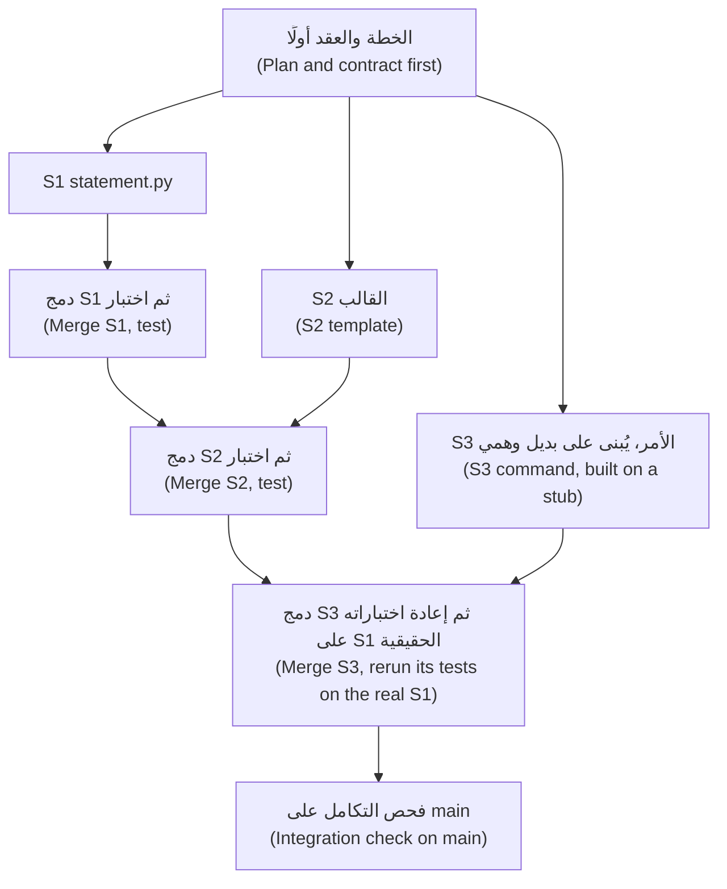

# الوحدة 10 — العمل المتوازي ومتعدد الوكلاء

*تشغيل عدة وكلاء (agents) في وقت واحد سهل البدء وصعب الإنجاز بإتقان. الدرس 10.1 هو درس المفاهيم: متى يُجدي العمل المتوازي — مهام مستقلة ومكتوبة وسريعة الفحص — ومتى لا يُجدي؛ وأشجار العمل في git (git worktrees) وكيف يدعمها Claude Code؛ وتقسيم التغيير على حدود الوحدات وكتابة العقد الذي تعمل المهمة وفقه؛ ونمط المنسّق والعامل وكلفته؛ ولماذا أنت نقطة التكامل، وكم مسارًا (streams) تستطيع مراجعته فعلًا، وما الذي يجب أن يحميه ترتيب الدمج؛ والمهام الخلفية (background tasks)؛ وحساب الكلفة؛ والطرق الخمس التي يفشل بها العمل المتوازي: عمل مكرَّر، وافتراضات متباينة، وتعديلات متعارضة، ودمج نظيف لكنه خاطئ، وغياب مالك للتكامل. وينتهي بخطة العمل المتوازي، وهي قالب من صفحة واحدة. أما الدرس 10.2 فهو المختبر: REMIT-361 من حصة، مالكة المنتج، هي أربعة تغييرات صغيرة في أربعة مواضع وتعارض واحد مزروع في `cli.py`. تخطط له، وتبنيه على فروع أو أشجار عمل (worktrees) منفصلة، يدويًا أو بالوكلاء، ثم تدمجه وتثبت أن الأجزاء ما زالت تعمل معًا. يقرأ المُقيِّم النتيجة والتاريخ، ويخبرك سجل الوكيل (agent log) ما إذا كان العمل قد أجدى. وكل ما يخص جانب نجم خيالي.*

> **التركيز:** Workflow, Automate — تشغيل عدة وكلاء في وقت واحد دون أن تغرق في المراجعة.

---

# 10.1 — العمل مع عدة وكلاء: أشجار العمل والتفويض واختناق المراجعة والكلفة
*المستوى: 🔴 متقدم* · *المتطلبات: 4.1، 5.1، 9.1* · *التركيز: Workflow, Automate*

**بعد هذا الدرس تستطيع** تقسيم تغيير إلى مهام مستقلة بترتيب دمج، وتحديد عدد مساراتك من دقائق المراجعة المقيسة. *مدة الدراسة: قراءة نحو 15 دقيقةً، وعمل تطبيقي نحو 60 دقيقةً (تقدير).*

## ⚡ الدرس في دقيقة
- الوكلاء المتوازون **يُجدون** حين تكون المهام مستقلة ومكتوبة وسريعة الفحص. و**لا يُجدون** حين تتشارك المهام ملفات أو قرارات، أو حين لا تستطيع فحص النتائج بسرعة وصولها.
- **شجرة العمل (git worktree)** هي نسخة عمل أخرى من مستودع واحد، في مجلدها الخاص وعلى فرعها الخاص: الأمر `git worktree add` أو `claude --worktree <name>`.
- **قسِّم على حدود الوحدات** واكتب **عقد** كل مهمة: الأسماء والتواقيع والمخرجات الدقيقة والملفات المسموح بها. الملفات المشتركة هي المواضع التي تتصادم فيها المسارات.
- **المنسّق (orchestrator)** — جلسة تنسّق الوكلاء الفرعيين — يضيف كلفة وملخصات لا يجوز أن تسلّم بها دون تحقق.
- **أنت نقطة التكامل.** عدد المسارات التي تجاريها يساوي تقريبًا دقائق الوكيل لكل نتيجة مقسومة على دقائقك لمراجعة نتيجة واحدة.
- الفخ: أربعة فروع خضراء ليست برنامجًا يعمل. اختبر بعد كل دمج.

## 🧭 لماذا يهم
في يوم جمعة، في حالة افتراضية، تبدأ لجين، المهندسة حديثة التخرج، أربع جلسات Claude Code على أربع تذاكر تظنها مستقلة. وبحلول الخامسة يكون كل فرع أخضر. ثم تدمج الفروع، وتحل تعارضين نصيين في `notify.py` و`cli.py`، فيحمرّ التكامل المستمر. كانت REMIT-346 قد غيّرت طريقة كتابة `format_money` للمبالغ العربية؛ وأضافت REMIT-347، التي كُتبت في الوقت نفسه، اختبار رسالة يتوقع النص القديم. كان كل فرع صحيحًا وحده؛ ومعًا كانا خاطئين، وفكّ التشابك يستغرق حتى الثامنة.

يوم الاثنين يسأل طارق، قائد الهندسة، عمّا وفّره الوكلاء. «أربع ساعات من الكتابة.» والتكامل؟ «خمس ساعات.» يقول: «أدّى الوكلاء عملهم، ولم يؤدِّ أحد عملك.» وقلّما يشغّل أكثر من مسارين.

لا توجد دراسة نستشهد بها تقيس تسريعًا ناتجًا عن تشغيل عدة وكلاء في وقت واحد. وفي فبراير 2026 قالت METR إن قياساتها الزمنية غير موثوقة حين يشغّل المطورون عدة وكلاء معًا. وربط تقرير DORA لعام 2024 ارتفاع اعتماد الذكاء الاصطناعي بانخفاض استقرار التسليم، واقترح أن الدفعات الأكبر جزء من السبب؛ ولا يزال تقرير 2025 يجد ارتباطًا سلبيًا بالاستقرار — وهي ارتباطات استطلاعية كما نبّه الدرس 0.3. ويجعل تعدد الوكلاء الدفعة الكبيرة أمرًا سهلًا؛ فاحرص على أن تبقى صغيرة ومراجَعة.

## 📐 كيف يعمل

### 🟢 الأساسيات

**متى يُجدي التوازي.** اطرح أربعة أسئلة بهذا الترتيب.

| السؤال | يُجدي التوازي | اعمل تباعًا |
|---|---|---|
| هل المهام مستقلة؟ | وحدات مختلفة؛ ولا تحتاج واحدة منها إلى شيفرة الأخرى | الدالة نفسها، أو تحتاج إحداها إلى نتيجة الأخرى |
| هل هي مكتوبة؟ | عقد وفحص تستطيع تشغيله | ما زلت تكتشف ما هي المهمة |
| هل فحصها سريع؟ | اختبار أو أمر يجيب في دقائق | تحتاج المراجعة إلى تفكير عميق: المال والأمان |
| هل تستطيع المجاراة؟ | تقرأ كل نتيجة فور وصولها | ستكون أنت الطابور |

*القراءة* المتوازية — وكلاء فرعيون (subagents) يبحثون ويلخّصون — أرخص وأكثر أمانًا. أما *الكتابة* المتوازية فهي حيث تقع الكلفة والمخاطر.

**أشجار العمل في git.** للمستودع عادةً مجلد عمل واحد. و*شجرة العمل* (worktree) تضيف مجلدًا آخر بملفاته وفرعه الخاصين فوق تاريخ واحد.

```bash
git worktree add ../remit-notice -b feat/delay-notice main   # new folder, new branch cut from main
git worktree list                                           # every checkout of this repository
git worktree remove ../remit-notice                         # when the branch is merged
```

تتشارك أشجار العمل الإيداعات (commits) والفروع والإعدادات، لا ملفات العمل: فالبيئة الافتراضية أو `remit.db` في مجلد غائبة عن المجلدات الأخرى. ويرفض Git سحب فرع واحد في شجرتي عمل.

**أشجار العمل في Claude Code** — راجع الوثائق الحالية؛ فالتفاصيل تتغير.
- الأمر `claude --worktree feature-auth` (واختصاره `-w`) ينشئ `<repo>/.claude/worktrees/<name>/` على فرع جديد اسمه `worktree-<name>`؛ و`claude --worktree "#1234"` يبدأ من طلب دمج يُجلب من `origin`. وتُزال شجرة العمل النظيفة غير المسماة عند الخروج؛ أما التي فيها تغييرات فتسأل: أتُبقيها أم تُزيلها.
- يسرد `.worktreeinclude` — بصيغة gitignore (gitignore syntax) — الملفات غير المتتبَّعة (untracked files) التي تُنسخ إلى الشجرة، مثل `.env`. وقاعدة نجم ألا أسرار في سياقات الوكلاء، لذا تبقى القائمة فارغة في ريميت: فهو يقرأ الإعدادات من متغيرات البيئة (environment variables) لا من ملف `.env`.
- يحدد الإعداد `worktree.baseRef` من أين يبدأ الفرع: القيمة `"fresh"` — وهي الافتراضية — تعني الفرع الافتراضي، و`"head"` تعني إيداعك الحالي.
- المشترَك بين أشجار العمل: `.git`، والذاكرة التلقائية (auto memory) المحلية للجهاز، وموافقات الصلاحيات المحفوظة في `.claude/settings.local.json` الخاص بالنسخة الرئيسية، فقد ينطبق «نعم» في مسار على مسار آخر. ولا تتتبّع نقاط الاستعادة (Checkpoints) الجلسات المتزامنة الأخرى: git هو وسيلة التراجع عندك.

**المهام الخلفية.** ينقل `Ctrl+B` أمرًا أو وكيلًا قيد التشغيل إلى الخلفية، ويسردها `/tasks`؛ ويفصل `/background` — واسمه المستعار `/bg` — أو `claude --bg "…"` جلسة كاملة. وتذكر الوثائق أيضًا عرض الوكلاء (agent view) — `claude agents`، وهو معاينة بحثية — ومهارة `/batch` المضمّنة، من 5 إلى 30 وحدة في شجرة عمل لكل منها، وفرق الوكلاء (agent teams) وهي تجريبية ومعطلة افتراضيًا؛ فتحقق من كيفية تكامل كلٍّ منها قبل أن تعتمد عليه. أما الخطة والعقد وانضباط الدمج أدناه فلا تتوقف على الأداة.

### 🟡 التعمق أكثر

**تقسيم العمل.** اقطع على الخطوط الموجودة أصلًا في الشيفرة: وحدة واحدة لكل مهمة، فتكون كل مهمة *مالكة* لملفاتها. والقطع جيد حين تعمل اختبارات المهمة دون غيرها، وسيئ حين يجب أن تتفق مهمتان على شيء لم يكتبه أحد — كيف نقرّب الأرقام، وكيف نصوغ العربية. القرارات المشتركة تذهب إلى العقد، والملفات المشتركة إلى الخطة، والدوال المساعدة المشتركة إلى مهمة تُدمج أولًا. تطلب حصة، مالكة المنتج، في REMIT-350 كشف حساب شهريًا:

```text
S1  statement.py  monthly_statement(transfers, year, month) -> Statement   a new module
S2  notify.py     template statement_ready (en, ar): name, month, count    one new template
S3  cli.py        python -m remit statement --customer C001 --month 2026-03    calls S1
```

تحتاج S3 إلى S1، لكن إلى *عقد* S1 فقط، فيمكن أن تبدأ المهام الثلاث معًا.



**العقد هو التفويض.** بطاقة التفويض (delegation card) في الدرس 0.3، لكل مهمة، مضافًا إليها الواجهة.

```text
Weak:   Add a statement command to the CLI. Use the statement module someone else is writing.
```

```text
Strong:
Task S3 of REMIT-350. Branch feat/statement-command.
Goal:     python -m remit statement --customer C001 --month 2026-03 prints one line per corridor, then a total.
Contract: from remit.statement import monthly_statement   (another session writes it; do not write it)
          monthly_statement(transfers, year, month) -> Statement(year, month, lines)
          each line: corridor, count, sent (Money, QAR), fees (Money, QAR); the month is the Qatar month
May change:      src/remit/cli.py (at the marked place only), tests/test_statement_command.py
Must not change: any other file. Not in scope: PDF output, other currencies.
Until S1 is merged, test against a stub in your test file. Verify: pytest -q, then run the command.
Stop and report if the contract is unclear or you need another file.
Commit once as feat(cli): ..., then report: branch, files changed, test result, assumptions.
```

يجعل الموجز الضعيف الوكيل يخمّن الأسماء. أما الموجز القوي فيحمل ما لا يستطيع الوكيل معرفته: العقد والحد والفحص وقاعدة التوقف.

**ترتيب الدمج والتعارضات.**
1. المزوِّدون قبل المستهلكين. بعد أن يُدمج المزوِّد أعد تشغيل اختبارات المستهلك على الشيفرة الحقيقية.
2. ثم الأكثر استقلالًا أولًا، فيأتي الدمج الأخطر في النهاية، حين تعرف أكثر.
3. الفرع الذي يشارك ملفًا مع فرع دُمج بالفعل هو الذي يلاقي التعارض. فاحلّه حيث السياق أحدث: أعد تأسيسه (rebase) على `main`، أو ادمج `main` فيه.
4. بعد **كل** دمج، لا في النهاية، شغّل الاختبارات كاملة والأوامر يدويًا. فـGit لا يعلّم إلا الأسطر المختلفة، ولذا قد يبقى الدمج النظيف أو التعارض المحلول خاطئًا.
5. استخدم `git merge --no-ff` ليبقى كل فرع ظاهرًا في التاريخ؛ ويبيّن الدرس 10.2 السبب.

**ما الذي يوفّره التوازي وما كلفته.** يوفّر الوكلاء المتوازون *الانتظار*، لا القراءة:

```text
saving = (sum of agent times - the longest) - setup - integration - friction
```

تستغرق المهام الأربع من الوكيل 30 و20 و20 و15 دقيقة — أرقام خيالية — أي 85 على التوالي و30 جنبًا إلى جنب. والإعداد، أي الخطة والعقود وأشجار العمل، 12 دقيقة والتكامل 15، فيكون التوفير على الأكثر ⁦(85 − 30) − 12 − 15 = 28⁩ دقيقة، وستظل تقرأ أربعة فروقات. أما بالرموز فينبغي أن يكلّف العمل نفسه نحو الكلفة نفسها، مضافًا إليها سياق بدء التشغيل الخاص بكل مسار وأي مسار تتخلى عنه؛ فقِسه ولا تفترض. والذي يتغير هو معدل الاستهلاك: فأربعة مسارات تستنزف الحصة بسرعة أربعة أضعاف، ولمقاعد Team وEnterprise حصص لكل مقعد بنوافذ متجددة مدتها خمس ساعات وأسبوع. ويعرض `/usage` — واسمه المستعار `/cost` — الكلفة والحدود؛ وتقبل التشغيلات غير التفاعلية (headless runs) الخيارين `--max-turns` و`--max-budget-usd`، في وضع الطباعة فقط، وهو تقدير من جهة العميل.

### 🔴 نظرة الخبير

**اختناق المراجعة.** بينما تراجع نتيجة واحدة تواصل المسارات الأخرى عملها، فلا يستقر طابورك إلا إذا وصلت النتائج بسرعة لا تفوق سرعة معالجتك لها. لتكن *A* الدقائق التي يحتاجها الوكيل لكل نتيجة قابلة للمراجعة، و*R* الدقائق التي تحتاجها لقراءة نتيجة واحدة وفحصها ودمجها، و*N* عدد المسارات. تصل نتيجة كل *A* ÷ *N* دقيقة، فتجاري ما دام *N* ≤ *A* ÷ *R*. أرقام خيالية:

| المهمة | A | R | المسارات التي تستطيع مجاراتها |
|---|---|---|---|
| صياغة قالب | 10 | 5 | 2 |
| أمر في واجهة سطر الأوامر مع اختباراته | 20 | 10 | 2 |
| تغيير في `limits.py`: المال ومراجع ثانٍ | 20 | 30 | أقل من 1: اعمل تباعًا |

تشمل *R* زمن التنقل بين المسارات، فاترك هامشًا. وقِس *A* و*R* في سجل الوكيل بالساعة: ففي تجربة METR الصغيرة لعام 2025 (الدرس 0.1) ظنّ المطورون أن الذكاء الاصطناعي سرّع عملهم مع أن مهامهم استغرقت وقتًا أطول.

**المنسّق والعامل (Orchestrator and worker).** جلسة واحدة تقسّم العمل وتطلق عمّالًا (workers) — وكلاء فرعيين — وتجمع تقاريرهم. للوكيل الفرعي نافذة سياق خاصة به ولا يعيد إلا تقريره النهائي. ويبدأ بموجّه النظام الخاص به ورسالة مهمتك و`CLAUDE.md` وحالة git، لكن **ليس** بمحادثتك، ولذا يجب أن يكون العقد داخل الرسالة. احفظ وكيلًا فرعيًا للمشروع باسم `.claude/agents/task-worker.md`:

```markdown
---
name: task-worker
description: Implements one task from a written contract in its own worktree, then reports. Use for independent tasks that come with a contract and a test command.
tools: Read, Grep, Glob, Edit, Write, Bash
isolation: worktree
maxTurns: 40
---
You implement one task and nothing else. Read the contract in the task message; if it is unclear, stop and say what is unclear.
Touch only the files it lists; if you need another, stop and say which.
Write the tests first, watch them fail, then make them pass with `pytest -q`.
Commit once (Conventional Commits), then report: branch, files, test result, assumptions.
```

تتمثل التكاليف في سياق المنسّق المتنامي، وبدء تشغيل جديد لكل عامل، وتقارير تفقد التفاصيل. لا تدع «تم كل شيء» تحلّ محل قراءة الفروقات: فصفحة أفضل الممارسات تسمّي ذلك فجوة «ثق ثم تحقق». ونمط أرخص هو جلستان، إحداهما تكتب والأخرى تراجع في سياق جديد — لا تتصرّف إلا بشأن مشكلات الصحة وفجوات المتطلبات، فالمراجعون يبلّغون عن شيء حتى حين يكون العمل سليمًا. ولتصميم أنظمة متعددة الوكلاء بدل استخدامها، انظر [*بناء تطبيقات الذكاء الاصطناعي والوكلاء (Building AI Applications & Agents)*، الدرس 11.1 — المشرفون والعمّال وعمليات التسليم: متى يكون تعدد الوكلاء هو الجواب الخاطئ](../aiapps/index.ar.html#/11.1).

**أنماط فشل العمل المتوازي.**

| الفشل | ما تراه | أرخص وقاية |
|---|---|---|
| عمل مكرَّر | يكتب كل من مسارين دالة مساعدة لتنسيق المال | مالك واحد لكل دالة مساعدة في الخطة |
| افتراضات متباينة | أحدهما يقرّب إلى الأقرب الزوجي (rounds half-even) والآخر إلى الأعلى عند المنتصف (half-up) | يوضع القرار في العقد مع اختبار |
| تعديلات متعارضة | يغيّر فرعان الأسطر نفسها من `cli.py` | اسرد الملفات المشتركة؛ وحدد ترتيب الدمج (merge order)؛ وجهة واحدة تحل التعارض |
| تعارض دلالي (semantic conflict) | دمج نظيف وبرنامج خاطئ | اختبارات وأوامر بعد كل دمج |
| لا أحد يملك التكامل | أربعة فروع خضراء و`main` أحمر | مسؤول تكامل مسمّى واحد وقائمة فحص واحدة |

**التزم بالحد.** افحص كل فرع مقابل موجزه أولًا؛ والمخرجات الفارغة تعني أنه ضمن النطاق.

```bash
# files this branch changed that its brief did not allow
git diff --name-only main...feat/delay-notice | grep -v -x -e src/remit/notify.py -e tests/test_delay_notice.py
```

لا تعرف أوضاع الصلاحيات (Permission modes) قائمة الملفات المسموح بها لديك: ففي وضع `acceptEdits`، وغالبًا في وضع `auto`، لا يثير تعديل خارجها أي طلب صلاحية، كما في الوحدة 8. ويستطيع الخطاف (hook) فرض القائمة كما في الدرس 9.1: **أتمت الحلقة وحافظ على المهارة**.

## 🧰 الأدوات
| الأداة أو الممارسة أو النمط | ما هي وماذا تفعل | متى تلجأ إليها |
|---|---|---|
| **Worktree** — شجرة العمل | نسخة عمل ثانية على فرعها الخاص: `git worktree add` و`claude --worktree` | حين يجب أن يعدّل مساران في وقت واحد |
| **Parallel plan** — خطة العمل المتوازي | صفحة واحدة: مخطط المهام والحدود وترتيب الدمج والتحقق | قبل أن تُفتح الطرفية الثانية |
| **Task contract** — عقد المهمة | موجز فيه الواجهة والملفات المسموح بها والفحص وقاعدة التوقف | كل مهمة مفوَّضة |
| **Subagent** — الوكيل الفرعي | مساعد له نافذة سياق خاصة يعيد تقريرًا | البحث والمراجعة والمهام التي يأتي معها عقد |
| **Background task** — المهمة الخلفية | عمل منفصل عن موجّهك: `Ctrl+B` و`/background` | عمل طويل ومحدَّد جيدًا وقابل للفحص |
| **Integration check** — فحص التكامل | الاختبارات كاملة مع الأوامر المشغَّلة يدويًا، بعد كل دمج | بعد كل دمج |
| **Stream limit** — حد المسارات | *A* ÷ *R*، من سجل الوكيل الخاص بك | قبل أن تضيف مسارًا |

## 🏛️ عمليًا في بنك نجم
المُخرَج هو **خطة العمل المتوازي**. وقاعدة طارق في عيادة الخميس: لا طرفية ثانية حتى تتسع الخطة في صفحة واحدة. ويقرؤها بثلاثة أسئلة: ما الذي ينكسر حين يُدمج اثنان من هذه، ومن يحل التعارض، وماذا تشغّل بعد كل دمج؟ والقالب هو ملف العدة `ailab/labs/m10_parallel/assets/parallel-plan-template.md`، وهو الذي يعطيك إياه المختبر 10.2 أيضًا:

```markdown
# Parallel plan: <ticket id and title>

<!-- Fill this in BEFORE you start a branch. One page. -->

### Task graph

| Task | Branch | Done by (you, an agent) | Depends on | Size |
|---|---|---|---|---|
| | | | | |

Cannot run in parallel, and why:

### Boundaries

| Task | May change | Must not change | Contract it promises |
|---|---|---|---|
| | | | |

Shared files, and who resolves them:

### Merge order

1. 
2. 

Why this order:

### Verification

| After | Check | Who looks | Stop and ask if |
|---|---|---|---|
| each branch | | | |
| each merge | | | |
| the last merge | | | |

### Limits

- Streams at once (what I can really review):
- Time box per task:
```

ولـREMIT-350: S1 وS2 مستقلتان، وتبني S3 على عقد S1، وترتيب الدمج هو S1 ثم S2 ثم S3، والملف المشترك الوحيد هو قائمة الاستخدام في `cli.py`.

## 🛠️ التمارين
- 🟢 **قسِّم على الورق.** *بلا وكيل.* في REMIT-350 علِّم أي المهام تعتمد على عقد مهمة أخرى وأيها تتشارك ملفًا. *يكتمل عندما:* يسمّي مخطط المهام ثلاث مهام وحافة اعتماد واحدة والملف المشترك وترتيب دمج مع سببه.
- 🟡 **اشعر بالتعارض وبالكسر الصامت.** *بلا وكيل.* شغّل `python -m ailab start m10 --dir ~/ainative/m10-play`، وهي نسخة للتجربة تُرمى، وأضف شجرتي عمل، وعدّل في كل منهما أسطرًا مختلفة من `notify.py`، ثم السطر نفسه، وادمج بالطريقتين. وللكسر الصامت غيّر صياغة قالب في إحداهما مع تحديث اختباره، وأضف في الأخرى اختبارًا يؤكد الصياغة القديمة. *يكتمل عندما:* تُظهر ملاحظاتك دمجًا نظيفًا وتعارضًا محلولًا و`git worktree list` قبل `git worktree remove` وبعده، ودمجًا نظيفًا يفشل بعده `pytest -q`.
- 🔴 **اعثر على حد مساراتك.** *يحتاج وكيلًا.* أعطِ جلستي وكيل مهمتين صغيرتين مستقلتين في شجرتي عمل. وقِس زمن كل وكيل وكل مراجعة. *يكتمل عندما:* يحوي سجل الوكيل المهمتين مع دقائق الوكيل والمراجعة، و*A* ÷ *R* لديك، وعدد المسارات الذي ستشغّله في المرة القادمة، وجملة عن سبب عدم كفاية مهمتين للوثوق بالنتيجة.

## ⚠️ أخطاء وفخاخ
- **بدء المسارات قبل العقد.** يخترع كل وكيل الأسماء المشتركة على نحو مختلف. اكتب الواجهة أولًا: **حدِّد قبل أن تفوِّض**.
- **الوثوق بفرع أخضر.** اختُبر وحده. اختبر `main` بعد كل دمج: **خطوات صغيرة مُتحقَّق منها**.
- **التقسيم بحسب الملف والقرار مشترك.** مالكان لملفين يتخذان القرار الواحد مرتين. ضعه في العقد.
- **ترك ملخص يحل محل الفروقات.** «تم» و«دُمج كل شيء» ادعاءات. اقرأ الفروقات وشغّل الأوامر: **ثق بالدليل لا بالطلاقة**.
- **إضافة مسارات حتى تكفّ عن القراءة.** الموافقة الآلية بلا تفكير هي الإشارة؛ فتوقف عند *A* ÷ *R*.

## 🧾 الخلاصة
- الكتابة المتوازية تُجدي للمهام المستقلة والمكتوبة وسريعة الفحص؛ فهي توفّر الانتظار لا القراءة. وتمنح أشجار العمل كل مسار مجلده وفرعه الخاصين.
- يحمل عقد المهمة ما لا يستطيع الوكيل معرفته: الواجهة والملفات المسموح بها والفحص وقاعدة التوقف.
- أنت نقطة التكامل: ادمج المزوِّدين أولًا، واختبر بعد كل دمج، وقدِّر عدد المسارات بـ*A* ÷ *R* (size streams by A ÷ R).
- يضيف المنسّقون (Orchestrators) سياقًا وكلفة وملخصات ينبغي ألا تثق بها؛ ويرتفع معدل الاستهلاك مع كل مسار.

## ✍️ اختبر نفسك

**1. يحتاج الوكيل إلى نحو 20 دقيقة لكل نتيجة قابلة للمراجعة، وتحتاج أنت إلى نحو 10 دقائق لمراجعة نتيجة ودمجها. كم مسارًا تستطيع مجاراته؟**

- A. واحد: المراجعة تسلسلية، فالمسارات الإضافية لا تزيد إلا الطابور
- B. اثنان: تصل النتائج حينئذٍ بنحو سرعة تصريفك لها
- C. أربعة: مسار لكل تذكرة، لأن كل تذكرة مستقلة
- D. عشرون: بقدر ما يسمح به حد الوكلاء الفرعيين

<details><summary>الإجابة</summary>

**B.** تجاري ما دام ⁦*N* ≤ *A* ÷ *R* = 2⁩. وحد الأداة يقول ما ستشغّله، لا ما تستطيع مراجعته. (🔴 اختناق المراجعة.)

</details>

**2. دُمج فرعان بلا تعارض، ونجح كل منهما في اختباراته، ومع ذلك التكامل المستمر (CI) على `main` أحمر. ما السبب الأرجح والعادة الصحيحة؟**

- A. علة في Git، فكرّر الدمج حتى يصير نظيفًا
- B. أخلّ وكيل بعقده، فتخلَّ عن العمل المتوازي
- C. اختبارات متقلبة، فأعد تشغيل CI حتى ينجح
- D. تعارض دلالي، لذا اختبر بعد كل عملية دمج

<details><summary>الإجابة</summary>

**D.** لا يعلّم Git إلا الأسطر المختلفة؛ وقد يكون كل من التغييرين صحيحًا وهما معًا خاطئان. (🟡 ترتيب الدمج والتعارضات.)

</details>

**3. يقول زميل إن إيداعًا (commit) أُنجز في شجرة عمل لا يُرى من أخرى حتى يُدفع. ما الصحيح؟**

- A. تتشارك مجلد `.git` واحدًا، فالإيداع في إحداهما مرئي باسم الفرع في الأخرى
- B. هما نسختان مستنسختان مستقلتان لا ترى إحداهما الأخرى أبدًا
- C. تتشاركان ملفات العمل، فيظهر التعديل في إحداهما في كلتيهما
- D. تتشاركان الفهرس وحده، ولكل منهما تاريخها الخاص

<details><summary>الإجابة</summary>

**A.** الإيداعات والفروع والإعدادات مشتركة؛ أما ملفات العمل والفرع المسحوب فلا. (🟢 أشجار العمل في git.)

</details>

**4. يطلق منسّق وكيلًا فرعيًا (subagent) بعبارة «نفّذ أمر كشف الحساب كما ناقشنا». لماذا يُعد هذا موجزًا ضعيفًا؟**

- A. لا يمكن إخبار الوكلاء الفرعيين بالملفات التي يجوز لهم تغييرها، بل بما يبنونه فقط
- B. لا يُسمح للوكيل الفرعي بقراءة `CLAUDE.md`، فيجب تكرار القواعد
- C. لا يرى محادثتك أبدًا، فيجب أن يكون العقد في الرسالة
- D. لا يستطيع المنسّق قراءة الرد حتى تنتهي جلسة العامل كلها

<details><summary>الإجابة</summary>

**C.** يحصل الوكيل الفرعي على موجّهه الخاص ورسالة المهمة و`CLAUDE.md` وحالة git، لا على محادثتك. (🔴 المنسّق والعامل.)

</details>

**5. تستغرق أربع مهام من الوكيل 30 و20 و20 و15 دقيقة. ويستغرق الإعداد 12 دقيقة والتكامل 15. والمراجعة تستغرق الوقت نفسه في الحالتين. ما أقصى ما يوفّره العمل المتوازي؟**

- A. 55 دقيقة، أي كامل التداخل في زمن الوكيل
- B. 28 دقيقة، بعد دفع كلفة الإعداد والتكامل
- C. 43 دقيقة، بعد خصم الإعداد وحده
- D. 40 دقيقة، بعد خصم التكامل وحده

<details><summary>الإجابة</summary>

**B.** التداخل هو ⁦85 − 30 = 55⁩؛ يُخصم منه الإعداد والتكامل فيبقى 28. (🟡 ما الذي يوفّره التوازي.)

</details>

## 📚 المراجع
- وثائق Claude Code: أشجار العمل https://code.claude.com/docs/en/worktrees; وأفضل الممارسات https://code.claude.com/docs/en/best-practices; والوكلاء الفرعيون https://code.claude.com/docs/en/sub-agents; والكلفة https://code.claude.com/docs/en/costs
- Git: الأمر `git worktree` https://git-scm.com/docs/git-worktree; والأمر `git merge` https://git-scm.com/docs/git-merge
- **تعمّق أكثر.** METR، «We are Changing our Developer Productivity Experiment Design» (2026): https://metr.org/blog/2026-02-24-uplift-update/ · تقرير DORA لعام 2024 (DORA 2024 report): https://cloud.google.com/blog/products/devops-sre/announcing-the-2024-dora-report · تقرير 2025: https://cloud.google.com/blog/products/ai-machine-learning/announcing-the-2025-dora-report
- [*بناء تطبيقات الذكاء الاصطناعي والوكلاء*، الدرس 11.1 — المشرفون والعمّال وعمليات التسليم: متى يكون تعدد الوكلاء هو الجواب الخاطئ](../aiapps/index.ar.html#/11.1)؛ [*اختبار البرمجيات (Software Testing)*، الدرس 6.2 — الاختبارات بوصفها المواصفة لوكلاء البرمجة](../testing/index.ar.html#/6.2)

---

# 10.2 — المختبر: وزّع تغييرًا على عدة وكلاء وادمجه
*المستوى: 🔴 متقدم* · *المتطلبات: 10.1، 4.2، 5.2* · *التركيز: Workflow*

**بعد هذا الدرس تستطيع** بناء تغيير من أربع مهام على فروع منفصلة، ودمجه في الفرع الرئيسي بترتيب يُبقي المُقيِّم أخضر. *مدة الدراسة: قراءة نحو 10 دقائق، وعمل تطبيقي نحو 3 ساعات (تقدير).*

## ⚡ الدرس في دقيقة
- لدى REMIT-361 أربع مهام: إشعار وأمران في واجهة سطر الأوامر وصفحة دليل تشغيل. تخطط لها، وتبني كلًّا منها على **فرعها الخاص** — يدويًا أو بالوكلاء — ثم **تدمجها** في `main`.
- تضيف مهمتان أمرًا في الموضع المعلَّم نفسه من `cli.py`: وهذا هو **التعارض المزروع**. وبعد أن تحله شغِّل كل أمر.
- **يحتاج وكيلًا: لا**، وإن كان الوكيل موصى به.

## 🧭 لماذا يهم
تسأل متصلة بمكتب خدمة العملاء، وهي حالة افتراضية، لماذا تأخّر تحويلها إلى مانيلا وما الذي لا يزال بوسعها إرساله اليوم. ليس لدى المكتب أمر لأي منهما، فكتبت حصة التذكرة REMIT-361. وبعد جمعة لجين في الدرس 10.1، يسلّمها طارق إليك بقاعدة واحدة: الخطة أولًا. لا شيء يجعل أربعة وكلاء يتفقون على `cli.py`؛ وهذا الجزء عليك.

## 📐 كيف يعمل

### 🟢 الأساسيات

**ما تبدأ به.** ينسخ `ailab start m10` ريميت، ويضيف تعليقين بوصفهما علامتين إلى `src/remit/cli.py`، ويضيف كذلك `TASK.md` و`lab-assets/` وملف `CLAUDE.md` المرجعي من المختبر 2.2، ويودع كل ذلك برسالة «Lab starting state»، ويضع عليه الوسم `lab-start`.

```text
    # --- Customer Care desk commands (REMIT-361): add your parser below this line ---
    # --- Customer Care desk commands (REMIT-361): handle your command below this line, ending with `return 0` ---
```

**ثلاث طرق لتشغيل مسار.**

```bash
# run these in ~/ainative/m10, on main
git switch -c feat/delay-notice                               # 1. by hand, one folder; later: git switch main
git worktree add ../m10-notice -b feat/delay-notice main      # 2. by hand, a folder per task
cd ../m10-notice && claude --permission-mode plan             # 3. an agent inside that worktree
```

ويعمل `claude --worktree <name>` أيضًا، لكنه يسمّي الفرع `worktree-<name>` وقد يبدأه من الفرع الافتراضي — انظر `worktree.baseRef` في الدرس 10.1 — دون إيداع خطتك؛ أما `git worktree add` فيتيح لك اختيار الاثنين.

### 🟡 التعمق أكثر

**موجز عامل للمهمة C.** الصقه رسالةً أولى في وضع التخطيط (plan mode)؛ وقارن الخطة التي يقترحها بالموجز. كيّفه لكل مهمة: فموجز المهمة B يجب أن يسمح أيضًا بالسطر الموجود في `main` الذي يفتح المخزن.

```text
Task C of REMIT-361 (read TASK.md, Task C only). Branch feat/limits-command.
Context: read CONTRIBUTING.md and src/remit/limits.py first. Money is Decimal, never float.
Goal: limits.usage_line(tier, history, now) and `python -m remit limits --customer C001`, exactly as TASK.md shows.
May change: src/remit/limits.py; src/remit/cli.py at the two marked places and the usage list in its docstring;
            tests/test_care_limits.py (new). Must not change: any other file, any existing test.
Order: tests first, with a transfer just after midnight in Qatar and one at a month end; watch them fail.
Verify: pytest -q, then run the command for a customer who has sent a transfer.
Stop and report if the form in TASK.md is unclear or you need another file.
Commit in steps (feat(limits): ..., feat(cli): ..., test(limits): ...), then report: branch, files, tests, assumptions.
```

**قبل أن تدمج فرعًا** تحقق من أن ملفاته تطابق موجزه بالأمر `git diff --name-only main...<branch>`، وأن `pytest -q` ينجح، وأن اختباراته الجديدة تفشل حين تُعاد ملفات مصدره إلى حالتها في `main`، وأنك قرأت الفروقات — `limits.py` ببطء لأنه منطق مال — وشغّلت الأمر.

**قراءة التعارض.** يتوقف git عند دمج الأمر الثاني في `cli.py` مع مقطع (hunk) لكل موضع لمسه الفرعان، وهي عادةً ثلاثة: قائمة الاستخدام والمحلِّل والتوجيه. أولها:

```text
<<<<<<< HEAD
    python -m remit corridors [QAR-INR]
=======
    python -m remit limits --customer C001
>>>>>>> feat/limits-command
```

فوق `=======` يقع `main` كما دُمج حتى الآن؛ وتحته الفرع الذي تدمجه. كلا السطرين مطلوب: احتفظ بهما، واحذف أسطر العلامات الثلاثة. والأسطر الواقعة خارج المقطع مباشرةً مشتركة بين الطرفين.

### 🔴 نظرة الخبير

**ما لا يستطيع المُقيِّم معرفته.** يرى المستودع وتاريخه، لا الساعة: فأربع مهام تُنجز تباعًا تنجح، ولا شيء يثبت أن مسارين تداخلا. ولا يستطيع أن يرى من كتب سطرًا ولا ما إذا كنت قد قرأت فروقات `limits.py`، وسطر في دليل التشغيل كُتب بيدك وصادف أنه صحيح ينجح. ولا يميّز فرعًا حقيقيًا من اسم أُضيف لاحقًا، إذ يبدو `git branch fake HEAD~1` تقدّمًا سريعًا (fast-forward)؛ فهذا الفحص يثق بك. أما الفحوص الاستشارية فلا ترى إلا شكل خطتك وسجلك.

**ادمج أم أعد التأسيس أم اضغط؟**

| الاستراتيجية | التاريخ الذي تتركه | مع هذا المُقيِّم |
|---|---|---|
| `git merge --no-ff` | كل فرع خط جانبي ظاهر مع إيداع دمج | مقبول؛ وهو أوضح سجل |
| إعادة التأسيس ثم التقدم السريع | خط مستقيم؛ وتبقى أسماء الفروع مؤشرات | مقبول ما دامت الفروع موجودة |
| `git merge --squash` | إيداع واحد لكل مهمة؛ والفرع غير موجود في التاريخ | يفشل في فحص «الفروع المدموجة»؛ وأسماء فروع مُختلقة تزيّفه |

تختار الفرق بطرق مختلفة؛ وهذه القاعدة اختيار تعليمي.

## 🧰 الأدوات
| الأداة أو الممارسة أو النمط | ما هي وماذا تفعل | متى تلجأ إليها |
|---|---|---|
| **Parallel plan** — خطة العمل المتوازي | `docs/parallel-plan.md`: المخطط والحدود وترتيب الدمج والتحقق | قبل الفرع الأول |
| **Task contract** — عقد المهمة | موجز العامل: الواجهة والملفات المسموح بها والفحص وقاعدة التوقف | كل جلسة وكيل |
| **Integration check** — فحص التكامل | `pytest -q` وكل أمر، بعد كل دمج | بعد كل دمج |

## 🏛️ عمليًا في بنك نجم
*يحتاج وكيلًا: لا. مسار بلا وكيل: اكتب كل مهمة بنفسك مستخدمًا الطريقة 1 أو 2 أعلاه. والوكيل موصى به: فتشغيل عدة وكلاء هو المقصود.*

**التذكرة.** هذا هو `task.md` في العدة، وهو `TASK.md` في مجلدك، كما كتبته حصة.

```text
# REMIT-361: Customer Care desk pack (four small changes, one release)

**From:** Hessa, Product Owner, Najm Remit
**To:** Payments Platform
**Priority:** Medium. Customer Care want it in the next release.

Customer Care answer customers' calls from a terminal on the support desk. They keep asking for
the same four things, so this ticket has four tasks. The tasks do not need each other's code, so
they can be built at the same time. You agree the plan, and you own putting the pieces together.

### Task A: the delay notice (`notify`)

Add a notification template `transfer_delayed`, in English and Arabic. It takes `name`,
`transfer_id` and `recipient`. Customer Care approved this wording; do not rephrase it.

    en: Hi {name}, your transfer {transfer_id} to {recipient} is taking longer than expected. We are working on it and will message you as soon as it arrives. We are sorry for the wait.
    ar: مرحباً {name}، تأخّر وصول تحويلك {transfer_id} إلى {recipient} عن الموعد المتوقع. نعمل على إتمامه وسنراسلك فور وصوله. نعتذر عن الانتظار.

### Task B: the `corridors` command (`corridors`, `cli`)

Add `describe(corridor) -> str` to `src/remit/corridors.py`. It returns one line, in exactly this
form, for any `Corridor` (not only the four we ship). The first delivery method is the default.
Amounts have two decimals and no thousands separators.

    QAR-INR: 50.00 to 25000.00 QAR; delivery: bank_deposit (default), wallet; fees: STD-A

Add `python -m remit corridors [CODE]`. With no code it prints one such line per corridor, ordered
by code. With a code (`QAR-PKR`) it prints that corridor's line only. An unknown code exits with 1
and the error code on standard error, like the other commands. Like `quote`, it reads no data, so
it must not create a database file: `main` in `cli.py` decides that, away from the marked places.

### Task C: the `limits` command (`limits`, `cli`)

Add `usage_line(tier, history, now) -> str` to `src/remit/limits.py`. `history` is a customer's
earlier transfers (anything with `created_at` and `send_amount`, as `check_limits` takes). It
returns one line, in exactly this form:

    T2: today 3000.00 of 10000.00 QAR used (7000.00 left); this month 12000.00 of 40000.00 QAR used (28000.00 left)

"Today" and "this month" mean what they mean everywhere in `limits.py`. "Left" is never negative.
An unknown tier raises the usual error.

Add `python -m remit limits --customer C001`. It prints two lines: the customer's id and name,
separated by two spaces, then the `usage_line` for their KYC tier at the clock's current time. An
unknown customer exits with 1 and the error code on standard error, like `send`.

    C001  Aisha Rahman
    T2: today 500.00 of 10000.00 QAR used (9500.00 left); this month 500.00 of 40000.00 QAR used (39500.00 left)

### Task D: the runbook (`docs/CARE.md`)

The page Customer Care will open during a call. Headings: `# Customer Care desk pack`, then
`## Corridors`, `## Limits` and `## Delay message`. Under the first two, give the command and,
in a code block, example output copied from the running program (do not type it: the lines are
compared with the real ones). Under the third, give the template id and the English wording.

### How to deliver it

1. Write your plan first in `docs/parallel-plan.md` (template in `lab-assets/`): the tasks, who
   or what does each, what each may touch, the merge order, how you will check. Commit it on
   `main` before you cut a branch.
2. One branch per task; at least four commits in all. Messages follow `CONTRIBUTING.md`, with
   the module as scope (`notify`, `corridors`, `limits`, `cli`, `docs`; the list there lacks
   `corridors`, which is fine). A commit may change the files of one task only: `notify.py` is
   A, `corridors.py` B, `limits.py` C, `cli.py` B or C, `docs/CARE.md` D. Tests, the plan and
   the log belong to no task; a test that spans tasks gets a commit of its own.
3. Every task comes with tests in `tests/`. Do not change or skip an existing test; adding tests
   is fine. Change no module the tasks do not name (`notify`, `corridors`, `limits`, `cli`);
   `docs/`, `.claude/`, `CLAUDE.md` and `.gitignore` are yours.
4. B and C both add a command at the marked place in `src/remit/cli.py`, and a line to the usage
   list in its docstring. Expect them to meet there. Keep both commands. (`--help` prints to the
   real standard output, so test it with pytest's `capsys`.)
5. Merge the branches into `main` with `git merge`; at least three must end up merged. Do not
   squash; keep the branches until graded. Git's own merge message is fine.
6. `limits.py` is on the second-reviewer list in `CONTRIBUTING.md`. Read its diff yourself.
7. Finish on `main`, everything committed, `pytest -q` green, with a short log (30 words or
   more) of what you delegated, corrected and how long it took in `docs/agent-log.md`.

When you think you are done, grade it from the `ailab` folder of the course repository:
`python -m ailab grade m10 --dir <this directory>`
```

**البدء.**

```bash
cd ~/system-design-for-vibe-coders/ainative/ailab    # with the virtual environment of lesson 0.2 active
python -m ailab start m10 --dir ~/ainative/m10
cd ~/ainative/m10                                   # the lab folder: run everything below here
cp lab-assets/parallel-plan-template.md docs/parallel-plan.md
export PYTHONPATH=src    # so python -m remit works; set it in every worktree shell too
```

استخدم `PYTHONPATH` لا `pip install -e .`: فالتثبيت القابل للتحرير سيشغّل شيفرة هذا المجلد من كل شجرة عمل.

**دورك.**

1. املأ الخطة وأودعها على `main` بالرسالة `docs(docs): plan the parallel work for REMIT-361`.
2. اقطع الفروع A وB وC من ذلك الإيداع.
3. إن عبارة حصة «في الوقت نفسه» خاطئة بالنسبة إلى D: فهي تنسخ مخرجات حقيقية من B وC. فاذكر ذلك تحت بند «لا يمكن تشغيلها بالتوازي».
4. ابنِ A وB وC (انظر أدناه)، ثم ادمجها في `main` بالترتيب الذي في خطتك.
5. اقطع D من `main` بعد دمج B وC — إذا قُطعت قبل ذلك فهي تنجح أيضًا، لكن فرعها لا يستطيع تشغيل الأوامر التي تقتبسها — ثم ابنِها وادمجها.
6. قيِّم عملك، واحتفظ بكل فرع حتى تنتهي من التقييم.

*يدويًا بلا وكيل:* استخدم الطريقة 1 أو 2، والاختبارات أولًا (tests first)، وإيداعات صغيرة، و`pytest -q` قبل كل دمج؛ وتوقّع من 10 إلى 25 دقيقة للمهمة الواحدة. *بالوكلاء:* جلسة لكل شجرة عمل، والموجز أعلاه مكيَّفًا لكل مهمة، ووضع التخطيط أولًا، ثم `acceptEdits` داخل شجرة العمل، مع السماح بـ`Bash(pytest *)` وطلب صلاحية لبقية أوامر Bash. ويسمح `CLAUDE.md` في المشروع الابتدائي — وهو ذاكرة المشروع المرجعية (reference memory) من الدرس 2.2 — بالإيداعات عند الطلب فقط، فيجب أن يطلبها موجزك. وجلسة وكيل واحدة تنفذ المهام الصغيرة تباعًا تجربة مقبولة إن قال سجلك ذلك. احتفظ بكل فرع حتى تُقيِّم؛ وسجِّل الدقائق لكل مسار.

لتجرّب أمرًا يدويًا، أو لتنسخ مخرجات حقيقية إلى دليل التشغيل، أضف عميلًا وتحويلًا أولًا، فالملف `remit.db` متجاهَل في git (git-ignored):

```bash
python -m remit customer add --id C001 --name "Aisha Rahman" --kyc T2
python -m remit send --customer C001 QAR 500 INR --recipient "Ravi Kumar"
```

**ما يفحصه المُقيِّم.** اختبارات قبول خفية (Hidden acceptance tests) لكل مهمة ولها مجتمعة؛ واختباراتك أنت؛ وثلاثة فروع أو أكثر مدموجة في `main`؛ ولا علامات تعارض؛ وأربعة إيداعات على الأقل، كل منها عن مهمة واحدة ويتبع `CONTRIBUTING.md`؛ وتغيّر الملفات المتوقعة فقط؛ ولا اختبار موجود أُضعف أو تُخطّي أو وُسم xfail؛ ولا أسرار؛ و`main` مسحوب وكل شيء مودَع. استشاري: اختبارات جديدة تفشل على الشيفرة الأصلية؛ وخطة بمحتوى من عندك أُودعت قبل الشيفرة؛ وسجل من 30 كلمة أو أكثر؛ ولا إيداع حمل يومًا علامات تعارض.

**التقييم.**

```bash
cd ~/system-design-for-vibe-coders/ainative/ailab
python -m ailab grade m10 --dir ~/ainative/m10
```

في الحالة الابتدائية يكون المخرج الحقيقي كما يلي، مع الاختصار حيث يُشار:

```text
[PASS] You finished on main
[PASS] Everything is committed
[PASS] Your own tests pass: 99 passed
[FAIL] Task A: the delay notice works: 5 hidden checks failed: test_the_template_exists_in_english_and_arabic, test_the_english_wording_is_the_approved_text (+3 more)
       hint: Compare your template with the ticket's wording, word for word, in both languages.
... Tasks B, C, D and "The pieces work together" fail the same way ...
[PASS] No conflict markers are left in the code
[FAIL] At least 3 branches were merged into main: no branch has been merged into main yet
       hint: Give each task its own branch and `git merge` it into main (no --squash). Keep the branches until you have graded.
... nine more checks (four are advisory) ...

Lab m10: 6/15 required checks passed: NOT YET
```

حين تنجح كل الفحوص المطلوبة يكون السطر الأخير `Lab m10: 15/15 required checks passed: PASSED`.

**المُخرَج الأسبوعي — الوحدة 10.** في مستودع ملاحظاتك، لا في `~/ainative/m10`، أودِع `week-10/` وفيه `parallel-plan.md` كما كُتبت، مع ثلاثة أسطر عن مواضع خطئها، و`agent-log.md`، و`m10-grade.txt` وهو مخرجات أمر التقييم محفوظة بـ`>` (the grade command's output, saved with >).

**الجلسة الجماعية — 60 دقيقة.** (1) تبادلوا الخطط؛ واعثروا على حد كنتم سترسمونه بطريقة مختلفة (15). (2) قارنوا حلّين لـ`cli.py`؛ وشغّلوا كل أمر (15). (3) قارنوا السجلات: المسارات في وقت واحد والدقائق لكل مسار ولكل مراجعة (15). (4) اتفقوا على قاعدة للفريق: أقصى عدد من المسارات ومن يتولى التكامل وما تحويه الخطة (15).

**المراجعة الختامية.** ما الذي أخطأ فيه الوكيل أو كاد؟ وما الذي فات خطتك أو موجزاتك؟ وأي مهمة ما كان ينبغي أن تكون متوازية؟ وكم استغرق التكامل قياسًا بالأجزاء؟ وهذه أسطر حقيقية من حل متعجل:

```text
[FAIL] Task B: the corridors command works: 3 hidden checks failed: test_the_command_lists_every_corridor_in_code_order, test_the_command_prints_one_corridor_when_given_its_code (+1 more)
[PASS] Task C: the limits command works
[FAIL] The pieces work together after the merge: 2 hidden checks failed: test_a_support_session_uses_every_command_in_one_database, test_a_new_command_never_falls_through_into_the_transfer_code
```

لماذا تفشل المهمة B مع أن فرعها نفسه نجح؟ وأي مقطع أحدث الضرر؟

**سجل الوكيل.** صف لكل مسار، على غرار قالب الدرس 0.1 — أرقام خيالية.

```markdown
| Stream | Prompt (short) | What it did | What I corrected | Agent min | Review min |
|---|---|---|---|---|---|
| C limits | the brief above, plan mode | tests first, reused check_limits | added a month-end test | 18 | 12 |

Streams at once: 3.  Integration: 20 min.  A ÷ R from this one row: 1.5, so two streams next time.
```

## 🛠️ التمارين
- 🟢 **خطط وتنبّأ.** *بلا وكيل.* املأ القالب؛ واقرأ `git diff lab-start~1 lab-start -- src` في مجلد مختبرك. *يكتمل عندما:* تسمّي الخطة أربع مهام وحدودها وترتيب دمج مع سببه، والموضع الذي سيتصادم فيه فرعان.
- 🟡 **أنجز المختبر.** *لا حاجة إلى وكيل.* *يكتمل عندما:* يطبع `grade` الكلمة `PASSED`، ويُظهر `git log --graph --oneline` أربعة فروع تندمج في `main`، ويحوي سجلك الدقائق لكل مسار.
- 🔴 **شغّل ثلاثة مسارات معًا.** *يحتاج وكيلًا.* شغّل A وB وC بوصفها ثلاث جلسات متزامنة في ثلاث أشجار عمل. *يكتمل عندما:* يعطي السجل دقائق الوكيل والمراجعة لكل مسار، و*A* ÷ *R* لديك، والمسارات التي ستشغّلها في المرة القادمة، وشيئًا واحدًا فاته الموجز.

## ⚠️ أخطاء وفخاخ
- **عدّ التعارض محلولًا لمجرد زوال العلامات.** اقرأ كل دالة محلولة كأنها شيفرة منجزة؛ وشغّل كل أمر.
- **الدمج بالضغط عن عادة.** تختفي الفروع من التاريخ؛ ولا يستطيع أحد رؤية المسارات.
- **كتابة مثال دليل التشغيل بيدك.** انسخه من البرنامج العامل.
- **التقييم من فرع ميزة أو مع بقايا.** انتهِ على `main` نظيفًا.

## 🧾 الخلاصة
- الخطة أولًا — المهام والحدود وترتيب الدمج والتحقق؛ وأودعها قبل أن تقطع فرعًا: **حدِّد قبل أن تفوِّض**.
- فرع واحد لكل مهمة: اختبارات أولًا وإيداعات صغيرة وملفاتك أنت فقط.
- ادمج بالترتيب واختبر بعد كل دمج؛ والتعارض المحلول يظل بحاجة إلى تشغيل أوامره: **خطوات صغيرة مُتحقَّق منها**.
- يفحص المُقيِّم النتيجة والتاريخ؛ ويُظهر سجلك ما إذا كان العمل المتوازي قد أجدى.

## ✍️ اختبر نفسك

**1. بعد دمج فرعي الأمرين، ينهار `corridors` بخطأ عن `amount` مفقود، مع أن فرعه نفسه نجح. ما السبب الأرجح؟**

- A. كانت اختبارات الفرع نفسه متقلبة ونجحت مصادفةً
- B. شجرة عمل متبقية تحجب استيرادات الشيفرة المدموجة
- C. غاب إيداع الخطة عن الفرع الذي بنيته
- D. فقد مقطع التوجيه السطر `return 0` اللازم للأمر

<details><summary>الإجابة</summary>

**D.** يتشارك الطرفان الأسطر غير المتغيرة حول المقطع، فالاحتفاظ بالجانبين قد يترك أمرًا بلا `return 0` الخاص به، فيسقط في شيفرة التحويل التي تقرأ `amount`. (🟡 قراءة التعارض.)

</details>

**2. يقول المُقيِّم إن لا فرع دُمج مع أن الشيفرة تعمل؛ وقد استخدمت `git merge --squash` لكل فرع. ما الذي يصلح ذلك ويُبقي التاريخ مقروءًا؟**

- A. أنشئ فروعًا فارغة تشير إلى أحدث إيداع على main
- B. احذف الوسم `lab-start` ليُحتسب كل إيداع جديدًا
- C. أعد الدمج بـ`git merge` مع الاحتفاظ بالفروع
- D. أعد صياغة كل إيداع ضغط ليقول `merge: <branch>`

<details><summary>الإجابة</summary>

**C.** لإيداع الضغط والد واحد، فالفرع ليس في التاريخ؛ أما الدمج الحقيقي فيُبقيه ظاهرًا. والبقية تزيّف الدليل. (🔴 ادمج أم أعد التأسيس أم اضغط؟)

</details>

**3. يقول زميل: «طبع المُقيِّم PASSED، إذن عملت مساراتي الأربعة بالتوازي». ما الرد الدقيق؟**

- A. نعم: الفرع الذي لم يتداخل مع غيره كان سيفشل في «الفروع المدموجة»
- B. نعم: يرى المُقيِّم أشجار العمل، وهي لا توجد إلا أثناء الجلسة
- C. لا: المهام المنجزة واحدة بعد أخرى تترك الملفات والتاريخ أنفسهما
- D. لا: يتجاهل المُقيِّم التاريخ ويقرأ الملفات النهائية فقط

<details><summary>الإجابة</summary>

**C.** التشغيل التسلسلي على أربعة فروع يترك المستودع نفسه الذي يتركه التشغيل المتوازي؛ ويُظهر سجلك ما إذا كان قد أجدى. والمُقيِّم يقرأ التاريخ فعلًا، لكنه لا يقرأ الساعة. (🔴 ما لا يستطيع المُقيِّم معرفته.)

</details>

**4. «نظّف» وكيل المهمة A أيضًا الملف `src/remit/fees.py`. أي فحص في المُقيِّم يلتقطه، وأي جزء من الموجز كان ينبغي أن يمنعه؟**

- A. «لم يتغير إلا الملفات المتوقعة»؛ سطرا ما يجوز تغييره وما لا يجوز
- B. «لم تُضعَف الاختبارات الموجودة»؛ السطر الذي يأمر العامل بتشغيل الاختبارات
- C. «كل إيداع يخص مهمة واحدة»؛ قاعدة أن الإيداعات صغيرة ومتكررة
- D. «لا أسرار في التغيير»؛ السطر الذي يمنع الاعتماديات الجديدة في المستودع

<details><summary>الإجابة</summary>

**A.** `fees.py` خارج قائمة ملفات التذكرة، وهذان السطران يضبطان حدود العامل. (🟡 موجز العامل.)

</details>

**5. أودعت الخطة على `plan/m10`، وشغّلت `claude --worktree notice`، فإذا بشجرة العمل بلا `docs/parallel-plan.md`. ما السبب الأرجح؟**

- A. لا تحوي أشجار العمل إلا الملفات التي دُفعت إلى مستودع بعيد
- B. بدأ الفرع من الفرع الافتراضي لا من إيداعك
- C. يجب أن تُدرج الخطة في `.worktreeinclude` أولًا
- D. يحذف Claude Code مجلد `docs` في أشجار العمل الجديدة

<details><summary>الإجابة</summary>

**B.** القيمة الافتراضية لـ`worktree.baseRef` هي `"fresh"`، أي الفرع الافتراضي. اضبطه على `"head"`، أو أنشئ شجرة العمل بنفسك بـ`git worktree add` وابدأ `claude` داخلها. (🟢 ثلاث طرق لتشغيل مسار.)

</details>

## 📚 المراجع
- وثائق Claude Code: أشجار العمل https://code.claude.com/docs/en/worktrees; وأفضل الممارسات https://code.claude.com/docs/en/best-practices
- Git: الأمر `git merge` https://git-scm.com/docs/git-merge
- عدة المختبر: https://github.com/Tamoura/system-design-for-vibe-coders/tree/main/ainative/ailab
- [*بناء تطبيقات الذكاء الاصطناعي والوكلاء*، الدرس 11.2 — المختبر: فريق من ثلاثة وكلاء بعقود تسليم صريحة](../aiapps/index.ar.html#/11.2)؛ [*اختبار البرمجيات*، الدرس 6.2 — الاختبارات بوصفها المواصفة لوكلاء البرمجة](../testing/index.ar.html#/6.2)
