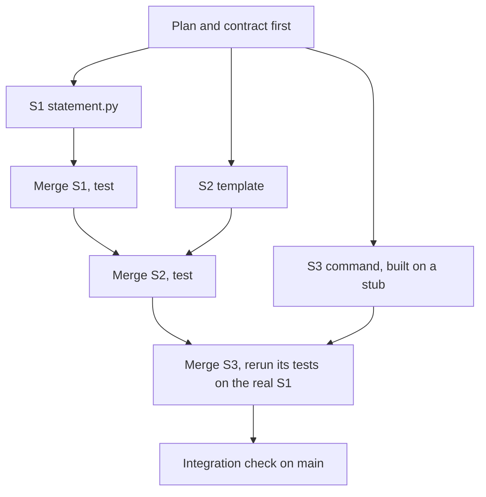

# Module 10 — Parallel and multi-agent work

*Running several agents at once is easy to start and hard to finish well. Lesson 10.1 is the concept lesson: when parallel work pays (independent, written-down, quickly checked tasks) and when it does not; git worktrees and how Claude Code supports them; splitting a change along module boundaries and writing the contract each task works to; the orchestrator and worker pattern and what it costs; why you are the integration point, how many streams you can really review and what a merge order has to protect; background tasks; the arithmetic of cost; and the four ways parallel work fails (duplicated work, divergent assumptions, conflicting edits, nobody owning integration). It ends with the Parallel plan, a one-page template. Lesson 10.2 is the lab: Hessa's REMIT-361 is four small changes in four places and one planted conflict in `cli.py`. You plan it, build it on separate branches or worktrees, by hand or with agents, merge it and prove the pieces still work together. The grader reads the result and the history; your agent log tells you whether it paid. Everything on the Najm side is fictional.*

> **Focus:** Workflow, Automate — running several agents at once without drowning in review.

---

# 10.1 — Working with several agents: worktrees, delegation, the review bottleneck and cost
*Level: 🔴 Advanced* · *Prerequisites: 4.1, 5.1, 9.1* · *Focus: Workflow, Automate*

## ⚡ In 60 seconds
- Parallel agents **pay** when tasks are independent, written down and quickly checked. They **do not** when tasks share files or decisions, or you cannot check results as fast as they arrive.
- A **git worktree** is another checkout of one repository, in its own folder on its own branch (`git worktree add`, or `claude --worktree <name>`).
- **Split along module boundaries** and write each task's **contract**: names, signatures, exact outputs, allowed files. Shared files are where streams collide.
- An **orchestrator** (a session that coordinates subagents) adds cost and summaries you must not take on trust.
- **You are the integration point.** The streams you can keep up with are about the agent's minutes per result divided by your minutes to review one.
- Trap: four green branches are not a working program. Test after every merge.

## 🧭 Why it matters
On a Friday (hypothetical), Lujain starts four Claude Code sessions on four tickets she thinks are independent. By five every branch is green. She merges them, fixes two textual conflicts in `notify.py` and `cli.py`, and CI goes red. REMIT-341 changed how `format_money` writes Arabic amounts; REMIT-343, written at the same time, added a message test that expects the old text. Each branch was right alone; together they were wrong, and untangling it takes until eight.

On Monday Tariq asks what the agents saved. "Four hours of typing." And integration? "Five hours." "The agents did their jobs," he says. "Nobody did yours." He rarely runs more than two streams.

No study we cite measures a speed-up from running several agents at once. In February 2026 METR said its time measurements are unreliable when developers run several agents together. DORA's 2024 report tied higher AI adoption to lower delivery stability and suggested larger batches as part of the reason; the 2025 report still found a negative link with stability (survey associations, as lesson 0.3 noted). Several agents make a large batch easy; keep it small and reviewed.

## 📐 How it works

### 🟢 The essentials

**When parallel pays.** Ask four questions, in this order.

| Question | Parallel pays | Go serial |
|---|---|---|
| Independent? | Different modules; none needs another's code | Same function, or one needs the other's result |
| Written down? | A contract and a check you can run | You are still finding out what the task is |
| Quick to check? | A test or command answers in minutes | Review needs deep thought: money, security |
| Can you keep up? | You read each result as it arrives | You would be the queue |

Parallel *reading* (subagents searching, summarising) is cheaper and safer. Parallel *writing* is where cost and risk sit.

**Git worktrees.** A repository usually has one working folder. A *worktree* adds another, with its own files and branch, over one history.

```bash
git worktree add ../remit-notice -b feat/delay-notice main   # new folder, new branch cut from main
git worktree list                                           # every checkout of this repository
git worktree remove ../remit-notice                         # when the branch is merged
```

Worktrees share commits, branches and config, not working files: a virtualenv or `remit.db` in one folder is absent from the others. Git refuses to check out one branch in two worktrees.

**Worktrees in Claude Code** (check the current documentation; details move).
- `claude --worktree feature-auth` (short `-w`) creates `<repo>/.claude/worktrees/<name>/` on a new branch `worktree-<name>`; `claude --worktree "#1234"` starts from a pull request fetched from `origin`. A clean unnamed worktree is removed on exit; one with changes asks keep or remove.
- `.worktreeinclude` (gitignore syntax) lists untracked files to copy in, such as `.env`. Najm's rule is no secrets in agent contexts, so for Remit the list stays empty: it reads settings from environment variables, not from a `.env` file.
- The `worktree.baseRef` setting says where the branch starts: `"fresh"` (default) is the default branch, `"head"` your current commit.
- Shared between worktrees: `.git`, auto memory (machine-local) and permission approvals saved to the main checkout's `.claude/settings.local.json`, so a "yes" in one stream can apply to another. Checkpoints do not track other concurrent sessions: git is your undo.

**Background tasks.** `Ctrl+B` moves a running command or agent to the background and `/tasks` lists them; `/background` (alias `/bg`) or `claude --bg "…"` detaches a whole session. The docs also list agent view (`claude agents`, a research preview), a bundled `/batch` skill (5 to 30 units, each in a worktree) and agent teams (experimental, off by default); check how each integrates before you rely on it. Other agentic tools have their own ways to run sessions side by side; the plan, contract and merge discipline below do not depend on the tool.

### 🟡 Going deeper

**Splitting the work.** Cut along lines the code already has: one module per task, so each task *owns* its files. A cut is good when a task's tests run without the others, bad when two tasks must agree on something nobody wrote down (how to round, how to word Arabic). Shared decisions go in the contract, shared files in the plan, shared helpers in a task that merges first. Hessa's REMIT-350 asks for a monthly statement:

```text
S1  statement.py  monthly_statement(transfers, year, month) -> Statement   a new module
S2  notify.py     template statement_ready (en, ar): name, month, count    one new template
S3  cli.py        python -m remit statement --customer C001 --month 2026-03    calls S1
```

S3 needs S1, but only S1's *contract*, so all three can start at once.



**The contract is the delegation.** Lesson 0.3's delegation card, per task, plus the interface.

```text
Weak:   Add a statement command to the CLI. Use the statement module someone else is writing.
```

```text
Strong:
Task S3 of REMIT-350. Branch feat/statement-command.
Goal:     python -m remit statement --customer C001 --month 2026-03 prints one line per corridor, then a total.
Contract: from remit.statement import monthly_statement   (another session writes it; do not write it)
          monthly_statement(transfers, year, month) -> Statement(year, month, lines)
          each line: corridor, count, sent (Money, QAR), fees (Money, QAR); the month is the Qatar month
May change:      src/remit/cli.py (at the marked place only), tests/test_statement_command.py
Must not change: any other file. Not in scope: PDF output, other currencies.
Until S1 is merged, test against a stub in your test file. Verify: pytest -q, then run the command.
Stop and report if the contract is unclear or you need another file.
Commit once as feat(cli): ..., then report: branch, files changed, test result, assumptions.
```

The weak brief makes the agent guess names. The strong one carries what an agent cannot know: contract, boundary, check, stop rule.

**Merge order and conflicts.**
1. Providers before consumers. After the provider merges, rerun the consumer's tests on the real code.
2. Then the most independent first, so the riskiest merge comes last, when you know most.
3. The branch that shares a file with an already merged branch meets the conflict. Resolve it where the freshest context is: rebase it onto `main`, or merge `main` into it.
4. After **every** merge, not at the end, run the full tests and the commands by hand. Git marks only lines that differ, so a clean merge or a resolved conflict can still be wrong.
5. Use `git merge --no-ff` so each branch stays visible in the history; lesson 10.2 shows why.

**What parallel saves, and what it costs.** Parallel agents save *waiting*, not reading:

```text
saving = (sum of agent times - the longest) - setup - integration - friction
```

Four tasks take an agent 30, 20, 20 and 15 minutes (fictional): 85 in a row, 30 side by side. Setup (plan, contracts, worktrees) is 12 and integration 15, so the saving is at most (85 − 30) − 12 − 15 = 28 minutes, and you still read four diffs. In tokens the same work should cost about the same, plus each stream's own start-up context and any stream you abandon; measure it rather than assume. What changes is the burn rate: four streams draw an allowance four times as fast, and Team and Enterprise seats have per-seat allowances with rolling five-hour and weekly windows. `/usage` (alias `/cost`) shows cost and limits; headless runs take `--max-turns` and `--max-budget-usd` (print mode only; a client-side estimate).

### 🔴 Expert view

**The review bottleneck.** While you review one result, the other streams keep working, so your queue is stable only if results arrive no faster than you handle them. Let *A* be the minutes an agent needs per reviewable result, *R* the minutes you need to read, check and integrate one, and *N* the streams. A result arrives every *A* ÷ *N* minutes, so you keep up while *N* ≤ *A* ÷ *R*. Fictional numbers:

| Task | A | R | Streams you can keep up with |
|---|---|---|---|
| A template's wording | 10 | 5 | 2 |
| A CLI command with tests | 20 | 10 | 2 |
| A change to `limits.py` (money, second reviewer) | 20 | 30 | Under 1: go serial |

*R* includes switching between streams, so leave slack. Measure *A* and *R* in your agent log. In METR's 2025 trial of 16 experienced open-source developers (early-2025 tools, their own mature repositories), people believed AI had sped them up although their tasks took longer: one small study, not a rule, but a reason to use the clock, not the feeling.

**Orchestrator and worker.** One session splits the work, launches workers (subagents), and collects their reports. A subagent has its own context window and returns only its final report. It starts with its own system prompt, your task message, `CLAUDE.md` and the git status, but **not** your conversation, so the contract must be inside the message. (Defaults at the time of writing: three levels of nesting, 20 at once; check.) Save a project subagent as `.claude/agents/task-worker.md`:

```markdown
---
name: task-worker
description: Implements one task from a written contract in its own worktree, then reports. Use for independent tasks that come with a contract and a test command.
tools: Read, Grep, Glob, Edit, Write, Bash
isolation: worktree
maxTurns: 40
---
You implement one task and nothing else. Read the contract in the task message; if it is unclear, stop and say what is unclear.
Touch only the files it lists; if you need another, stop and say which.
Write the tests first, watch them fail, then make them pass with `pytest -q`.
Commit once (Conventional Commits), then report: branch, files, test result, assumptions.
```

The costs are the orchestrator's growing context, a fresh start-up per worker, and reports that lose detail. Never let "all done" replace reading the diff: the best-practices page calls that the trust-then-verify gap. A cheaper pattern is two sessions, one writing and one reviewing in a fresh context (act only on correctness and requirement gaps: reviewers report something even when the work is sound). To design multi-agent systems rather than use them, see [*Building AI Applications & Agents*, lesson 11.1 — Supervisors, workers and hand-offs: when multi-agent is the wrong answer](../aiapps/index.html#/11.1).

**Failure modes of parallel work.**

| Failure | What you see | Cheapest prevention |
|---|---|---|
| Duplicated work | Two streams each write a money-formatting helper | One owner per helper, in the plan |
| Divergent assumptions | One rounds half-even, another half-up | The decision goes in the contract, with a test |
| Conflicting edits | Two branches change the same lines of `cli.py` | List shared files; merge order; one resolver |
| Semantic conflict | Clean merge, wrong program | Tests and commands after every merge |
| Nobody owns integration | Four green branches, red `main` | One named integrator, one check list |

**Hold the boundary.** Check each branch against its brief first; empty output means in scope.

```bash
# files this branch changed that its brief did not allow
git diff --name-only main...feat/delay-notice | grep -v -x -e src/remit/notify.py -e tests/test_delay_notice.py
```

Permission modes do not know your allowed-files list: in `acceptEdits` mode, and usually in `auto` mode, an edit outside it raises no prompt (Module 8). A hook can enforce the list (lesson 9.1): **Automate the loop, keep the skill**.

## 🧰 The toolkit
| Tool, practice or pattern | What it is and does | When to reach for it |
|---|---|---|
| **Worktree** | A second checkout on its own branch (`git worktree add`, `claude --worktree`) | Two streams must edit at once |
| **Parallel plan** | One page: task graph, boundaries, merge order, verification | Before the second terminal opens |
| **Task contract** | A brief with interface, allowed files, check and stop rule | Every delegated task |
| **Subagent** | A helper with its own context window that returns a report | Research, review, tasks that come with a contract |
| **Background task** | Work detached from your prompt (`Ctrl+B`, `/background`) | Long, well-specified, checkable work |
| **Integration check** | Full tests plus the commands run by hand, after each merge | After every merge |
| **Stream limit** | *A* ÷ *R*, from your own agent log | Before you add a stream |

## 🏛️ In practice at Najm Bank
The artefact is the **Parallel plan**. Tariq's rule at the Thursday clinic: no second terminal until the plan fits on one page. He reads it with three questions: what breaks when two of these merge, who resolves it, and what do you run after each merge? The template is the kit file `ailab/labs/m10_parallel/assets/parallel-plan-template.md`, which lab 10.2 also gives you:

```markdown
# Parallel plan: <ticket id and title>

<!-- Fill this in BEFORE you start a branch. One page. -->

### Task graph

| Task | Branch | Done by (you, an agent) | Depends on | Size |
|---|---|---|---|---|
| | | | | |

Cannot run in parallel, and why:

### Boundaries

| Task | May change | Must not change | Contract it promises |
|---|---|---|---|
| | | | |

Shared files, and who resolves them:

### Merge order

1. 
2. 

Why this order:

### Verification

| After | Check | Who looks | Stop and ask if |
|---|---|---|---|
| each branch | | | |
| each merge | | | |
| the last merge | | | |

### Limits

- Streams at once (what I can really review):
- Time box per task:
```

For REMIT-350 it is short: S1 and S2 are independent, S3 builds on S1's contract, the merge order is S1, S2, S3, and the one shared file is the usage list in `cli.py`.

## 🛠️ Exercises
- 🟢 **Split on paper.** *No agent.* For REMIT-350, mark which tasks depend on another's contract and which share a file. *Done when:* a task graph names three tasks, one dependency edge, the shared file and a merge order with a reason.
- 🟡 **Feel a conflict and a silent break.** *No agent.* Run `python -m ailab start m10 --dir ~/ainative/m10-play` (a throwaway copy), add two worktrees, edit different lines of `notify.py` in each, then the same line, and merge both ways. For a silent break, change a template's wording in one (updating its test) and add a test asserting the old wording in the other. *Done when:* your notes show a clean merge, a resolved conflict, `git worktree list` before and after `git worktree remove`, and a clean merge after which `pytest -q` fails.
- 🔴 **Find your stream limit.** *Needs an agent.* Give two agent sessions two small independent tasks in two worktrees. Time each agent and each review. *Done when:* your agent log holds both tasks with agent and review minutes, your *A* ÷ *R*, the stream count you would run next time, and a sentence on why two tasks are too few to trust.

## ⚠️ Mistakes and traps
- **Starting the streams before the contract.** Each agent invents the shared names, differently. Write the interface first: **Specify before you delegate**.
- **Trusting a green branch.** It was tested alone. Test `main` after each merge: **Small verified steps**.
- **Splitting by file when the decision is shared.** Two owners of two files still make one decision twice. Put it in the contract.
- **Letting a summary stand in for the diff.** "Done" and "all merged" are claims. Read the diff and run the commands: **Trust evidence, not fluency**.
- **Adding streams until you stop reading.** Approving by reflex is the signal; stop at *A* ÷ *R*.

## 🧾 Recap
- Parallel writing pays for independent, written-down, quickly checked tasks; it saves waiting, not reading. Worktrees give each stream its own folder and branch.
- A task contract carries what an agent cannot know: interface, allowed files, check, stop rule.
- You are the integration point: merge providers first, test after every merge, size streams by *A* ÷ *R*.
- Orchestrators add context, cost and summaries to distrust; the burn rate grows with every stream.

## ✍️ Check yourself

**1. An agent needs about 20 minutes per reviewable result and you need about 10 minutes to review and integrate one. How many streams can you keep up with?**

- A. One: review is serial, so extra streams only add to the queue
- B. Two: results then arrive about as fast as you clear them
- C. Four: one per ticket, since each is independent
- D. Twenty: as many as the subagent limit allows

<details><summary>Answer</summary>

**B.** You keep up while *N* ≤ *A* ÷ *R* = 2. The tool's limit says what it will run, not what you can review. (🔴 The review bottleneck.)

</details>

**2. Two branches merge with no conflict, each passed its own tests, and CI on `main` is red. What is the likeliest cause and the right habit?**

- A. A Git bug, so repeat the merge until it is clean
- B. An agent broke its contract, so drop parallel work
- C. Flaky tests, so rerun CI until it passes
- D. A semantic conflict, so test after every merge

<details><summary>Answer</summary>

**D.** Git marks only lines that differ; two changes can each be right and wrong together. (🟡 Merge order and conflicts.)

</details>

**3. A teammate says a commit made in one worktree cannot be seen from another until it is pushed. What is accurate?**

- A. They share one `.git`, so the commit is visible by branch name
- B. They are independent clones that never see each other
- C. They share working files, so an edit in one appears in all
- D. They share only the index, and each keeps its own history

<details><summary>Answer</summary>

**A.** Commits, branches and config are shared; working files and the checked-out branch are not. (🟢 Git worktrees.)

</details>

**4. An orchestrator starts a subagent with "implement the statement command as we discussed". Why is that a weak brief?**

- A. Subagents cannot be told which files they may change, only what to build
- B. A subagent is not allowed to read `CLAUDE.md`, so rules must be repeated
- C. It never sees your conversation, so the contract has to be in the message
- D. The orchestrator cannot read the reply until the whole worker session ends

<details><summary>Answer</summary>

**C.** A subagent gets its own prompt, the task message, `CLAUDE.md` and the git status, not your conversation. (🔴 Orchestrator and worker.)

</details>

**5. Four tasks take an agent 30, 20, 20 and 15 minutes. Setup takes 12 minutes and integration 15. Review takes the same either way. What is the most that parallel work saves?**

- A. 55 minutes, the whole overlap in agent time
- B. 28 minutes, after setup and integration are paid
- C. 43 minutes, after setup alone is taken out
- D. None: parallel work never saves any time

<details><summary>Answer</summary>

**B.** The overlap is 85 − 30 = 55; setup and integration come out of it, leaving 28. (🟡 What parallel saves.)

</details>

## 📚 References
- Claude Code documentation: worktrees https://code.claude.com/docs/en/worktrees; best practices https://code.claude.com/docs/en/best-practices; subagents https://code.claude.com/docs/en/sub-agents; costs https://code.claude.com/docs/en/costs
- Git: `git worktree` https://git-scm.com/docs/git-worktree; `git merge` https://git-scm.com/docs/git-merge
- **Go deeper.** METR, "We are Changing our Developer Productivity Experiment Design" (2026): https://metr.org/blog/2026-02-24-uplift-update/. DORA 2024 report: https://cloud.google.com/blog/products/devops-sre/announcing-the-2024-dora-report; 2025 report: https://cloud.google.com/blog/products/ai-machine-learning/announcing-the-2025-dora-report
- [*Building AI Applications & Agents*, lesson 11.1 — Supervisors, workers and hand-offs: when multi-agent is the wrong answer](../aiapps/index.html#/11.1); [*Software Testing*, lesson 6.2 — Tests as the specification for coding agents](../testing/index.html#/6.2)

---

# 10.2 — Lab: split a change across agents and integrate it
*Level: 🔴 Advanced* · *Prerequisites: 10.1, 4.2, 5.2* · *Focus: Workflow*

## ⚡ In 60 seconds
- One ticket, REMIT-361, has four tasks: a notification, two CLI commands and a runbook page. You plan it, build each on its **own branch** (by hand, in worktrees or with agents) and **merge** them into `main`.
- Two tasks add a command at the same marked place in `cli.py`: the **planted conflict**. After you resolve it, run every command.
- **Needs an agent: no**, though one is recommended. The grader checks the merged result and the history, never who produced them; it cannot tell whether your streams ran in parallel or your plan was good. Your agent log can.

## 🧭 Why it matters
A caller on the Customer Care desk (hypothetical) asks why her transfer to Manila is late and what she can still send today. The desk has no command for either, so Hessa wrote REMIT-361. After Lujain's Friday (lesson 10.1), Tariq hands it to you as a rerun with one rule: the plan comes first. It looks like a morning's typing. The work is deciding who touches what, and proving the pieces still work once they meet. Nothing makes four agents agree about `cli.py`; that part is yours.

## 📐 How it works

### 🟢 The essentials

**What you start with.** `ailab start m10` copies Remit and adds two marker comments to `src/remit/cli.py`. It also adds `TASK.md`, `lab-assets/` and lab 2.2's reference `CLAUDE.md`, commits it all as "Lab starting state" and tags it `lab-start`.

```text
    # --- Customer Care desk commands (REMIT-361): add your parser below this line ---
    # --- Customer Care desk commands (REMIT-361): handle your command below this line, ending with `return 0` ---
```

**Four moves.** *Plan*: fill in the template, commit it on `main`. *Split*: a branch or worktree per task, cut from that commit. *Build*: tests first, small commits, your task's files only. *Integrate*: merge in planned order, resolve, test after each merge.

**Three ways to run a stream.**

```bash
git switch -c feat/delay-notice                               # 1. by hand, one folder; later: git switch main
git worktree add ../m10-notice -b feat/delay-notice main      # 2. by hand, a folder per task
cd ../m10-notice && claude --permission-mode plan             # 3. an agent inside that worktree
```

`claude --worktree <name>` also works, but it names the branch `worktree-<name>` and starts it from the default branch unless `worktree.baseRef` is `"head"` (lesson 10.1), so your plan commit may be missing; `git worktree add` lets you pick the name and the start.

### 🟡 Going deeper

**A worker brief for Task C.** Paste it as the first message in plan mode; compare the plan it proposes with the brief.

```text
Task C of REMIT-361 (read TASK.md, Task C only). Branch feat/limits-command.
Context: read CONTRIBUTING.md and src/remit/limits.py first. Money is Decimal, never float.
Goal: limits.usage_line(tier, history, now) and `python -m remit limits --customer C001`, exactly as TASK.md shows.
May change: src/remit/limits.py; src/remit/cli.py at the two marked places and the usage list in its docstring;
            tests/test_care_limits.py (new). Must not change: any other file, any existing test.
Order: tests first, with a transfer just after midnight in Qatar and one at a month end; watch them fail.
Verify: pytest -q, then run the command for a customer who has sent a transfer.
Stop and report if the form in TASK.md is unclear or you need another file.
Commit in steps (feat(limits): ..., feat(cli): ..., test(limits): ...), then report: branch, files, tests, assumptions.
```

**Review a branch before you merge it.** (1) Scope: `git diff --name-only main...<branch>` lists only files its brief allowed. (2) Run `pytest -q` in its worktree. (3) Can the new tests fail? Put the source files back to `main`'s and watch them fail. (4) Read the diff, and `limits.py` slowly: it is money logic. (5) Run the command; compare its output with the ticket's form.

**Reading a conflict.** Merging the second command stops git in `cli.py` with a hunk for each place both branches touched, typically three: the usage list, the parser and the dispatch. The first:

```text
<<<<<<< HEAD
    python -m remit corridors [QAR-INR]
=======
    python -m remit limits --customer C001
>>>>>>> feat/limits-command
```

Above `=======` is `main` as merged so far; below is the branch you are merging. Both lines belong: keep both, delete the three marker lines. Git shows only lines that differ; the lines just outside a hunk are shared by both sides. Before committing the merge, read each resolved function as finished code, then run `pytest -q` and every command.

### 🔴 Expert view

**What the grader cannot tell.** It sees the final repository and its history, not the clock: four tasks done one after another on four branches pass, and no repository proves two streams overlapped. It cannot see who wrote a line, whether you read the `limits.py` diff, or whether the runbook would help on a call (it looks for headings and a real output line). The advisory checks see only the shape of your plan and log. Whether parallel work helped is in your log.

**Merge, rebase or squash?**

| Strategy | History it leaves | With this grader |
|---|---|---|
| `git merge --no-ff` | Each branch a visible side line, with a merge commit | Accepted; the clearest record |
| Rebase, then fast-forward | A straight line; branch names kept as pointers | Accepted while the branches exist |
| `git merge --squash` | One commit per task; the branch is not in the history | Fails "branches merged" |

Teams choose differently; this rule is a teaching choice (it wants to see the streams), not a verdict on squashing.

## 🧰 The toolkit
| Tool, practice or pattern | What it is and does | When to reach for it |
|---|---|---|
| **Worktree** | A folder and branch per stream, over one history | Each code task |
| **Parallel plan** | `docs/parallel-plan.md`: graph, boundaries, merge order, verification | Before the first branch |
| **Task contract** | The worker brief: interface, allowed files, check, stop rule | Every agent session |
| **Integration check** | `pytest -q` and every command, after each merge | After each merge |

## 🏛️ In practice at Najm Bank
*Needs an agent: no. The no-agent path: write each task yourself, using way 1 or 2 below; the grader cannot tell. An agent is recommended, because running several is what the lab practises.*

**The ticket.** This is `task.md`, as Hessa wrote it.

```text
# REMIT-361: Customer Care desk pack (four small changes, one release)

**From:** Hessa, Product Owner, Najm Remit
**To:** Payments Platform
**Priority:** Medium. Customer Care want it in the next release.

Customer Care answer customers' calls from a terminal on the support desk. They keep asking for
the same four things, so this ticket has four tasks. The tasks do not need each other's code, so
they can be built at the same time. You agree the plan, and you own putting the pieces together.

### Task A: the delay notice (`notify`)

Add a notification template `transfer_delayed`, in English and Arabic. It takes `name`,
`transfer_id` and `recipient`. Customer Care approved this wording; do not rephrase it.

    en: Hi {name}, your transfer {transfer_id} to {recipient} is taking longer than expected. We are working on it and will message you as soon as it arrives. We are sorry for the wait.
    ar: مرحباً {name}، تأخّر وصول تحويلك {transfer_id} إلى {recipient} عن الموعد المتوقع. نعمل على إتمامه وسنراسلك فور وصوله. نعتذر عن الانتظار.

### Task B: the `corridors` command (`corridors`, `cli`)

Add `describe(corridor) -> str` to `src/remit/corridors.py`. It returns one line, in exactly this
form, for any `Corridor` (not only the four we ship). The first delivery method is the default.
Amounts have two decimals and no thousands separators.

    QAR-INR: 50.00 to 25000.00 QAR; delivery: bank_deposit (default), wallet; fees: STD-A

Add `python -m remit corridors [CODE]`. With no code it prints one such line per corridor, ordered
by code. With a code (`QAR-PKR`) it prints that corridor's line only. An unknown code exits with 1
and the error code on standard error, like the other commands. Like `quote`, it reads no data, so
it must not create a database file.

### Task C: the `limits` command (`limits`, `cli`)

Add `usage_line(tier, history, now) -> str` to `src/remit/limits.py`. `history` is a customer's
earlier transfers (anything with `created_at` and `send_amount`, as `check_limits` takes). It
returns one line, in exactly this form:

    T2: today 3000.00 of 10000.00 QAR used (7000.00 left); this month 12000.00 of 40000.00 QAR used (28000.00 left)

"Today" and "this month" mean what they mean everywhere in `limits.py`. "Left" is never negative.
An unknown tier raises the usual error.

Add `python -m remit limits --customer C001`. It prints two lines: the customer's id and name,
separated by two spaces, then the `usage_line` for their KYC tier at the clock's current time. An
unknown customer exits with 1 and the error code on standard error, like `send`.

    C001  Aisha Rahman
    T2: today 500.00 of 10000.00 QAR used (9500.00 left); this month 500.00 of 40000.00 QAR used (39500.00 left)

### Task D: the runbook (`docs/CARE.md`)

The page Customer Care will open during a call. Headings: `# Customer Care desk pack`, then
`## Corridors`, `## Limits` and `## Delay message`. Under the first two, give the command and a
real example of its output in a code block (copy it from the running program, do not type it).
Under the third, give the template id and the English wording.

### How to deliver it

1. Write your plan first in `docs/parallel-plan.md` (template in `lab-assets/`): the tasks, who
   or what does each, what each may touch, the merge order, how you will check.
2. One branch per task. Commit messages follow `CONTRIBUTING.md` (scopes `notify`, `corridors`,
   `limits`, `cli`, `docs`). A commit belongs to one task.
3. Every task comes with tests in `tests/`. Do not change an existing test; adding tests is fine.
   Change no module the tasks do not name (`notify`, `corridors`, `limits`, `cli`); `docs/` is yours.
4. B and C both add a command at the marked place in `src/remit/cli.py`, and a line to the usage
   list in its docstring. Expect them to meet there. Keep both commands.
5. Merge the branches into `main` with `git merge`. Do not squash; keep the branches until graded.
6. `limits.py` is on the second-reviewer list in `CONTRIBUTING.md`. Read its diff yourself.
7. Finish on `main`, everything committed, `pytest -q` green, with a short log of what you
   delegated, corrected and how long it took in `docs/agent-log.md`.

When you think you are done, grade it from the `ailab` folder of the course repository:
`python -m ailab grade m10 --dir <this directory>`
```

**Start.**

```bash
cd ~/system-design-for-vibe-coders/ainative/ailab    # with the virtual environment of lesson 0.2 active
python -m ailab start m10 --dir ~/ainative/m10
cd ~/ainative/m10
cp lab-assets/parallel-plan-template.md docs/parallel-plan.md
export PYTHONPATH=src    # so python -m remit works; set it in every worktree shell too
```

**Your move.** Fill in the plan, commit it on `main` (`docs(docs): plan the parallel work for REMIT-361`) and cut every branch from that commit. Task D quotes the running program: what does that do to your merge order? *By hand, no agent:* expect roughly 10 to 25 minutes a task; use way 1 or 2, write tests first, commit in steps, run `pytest -q` before every merge. *With agents:* one session per worktree, the brief above adapted per task, plan mode first, then `acceptEdits` inside the worktree (lesson 0.3's level 3), with `Bash(pytest *)` allowed and other Bash commands left on a prompt. If the starter has a `CLAUDE.md` (lesson 2.2's reference memory), it says not to commit unless asked, so your brief must ask. Keep every branch until you have graded; log minutes per stream as you go.

To try a command by hand, add a customer and a transfer first (`remit.db` is git-ignored):

```bash
python -m remit customer add --id C001 --name "Aisha Rahman" --kyc T2
python -m remit send --customer C001 QAR 500 INR --recipient "Ravi Kumar"
```

**What the grader checks.** Hidden acceptance tests per task and together; your own tests; three or more branches merged into `main`; no conflict markers; each commit about one task, following `CONTRIBUTING.md`; only the expected files changed; no existing test weakened; no secrets; `main` checked out, all committed. Advisory: new tests that fail on the original code; a plan and a log; no commit that ever held conflict markers.

**Grade.**

```bash
cd ~/system-design-for-vibe-coders/ainative/ailab
python -m ailab grade m10 --dir ~/ainative/m10
```

On the starter state the real output is as follows (abridged where marked):

```text
[PASS] You finished on main
[PASS] Everything is committed
[PASS] Your own tests pass: 99 passed
[FAIL] Task A: the delay notice works: 5 hidden checks failed: test_the_template_exists_in_english_and_arabic, test_the_english_wording_is_the_approved_text (+3 more)
       hint: Compare your template with the ticket's wording, word for word, in both languages.
[FAIL] Task B: the corridors command works: 5 hidden checks failed: test_describe_writes_the_agreed_line_for_every_corridor, test_describe_works_for_any_corridor_not_only_the_shipped_ones (+3 more)
       hint: Run `python -m remit corridors` yourself and compare each line with the form in the ticket.
[FAIL] Task C: the limits command works: 11 hidden checks failed: test_a_customer_with_no_history_has_everything_left, test_today_and_this_month_are_added_up_separately (+9 more)
       hint: Run `python -m remit limits --customer C001` for a customer with a transfer, then re-read what 'today' means in limits.py.
[FAIL] Task D: the runbook is there: 4 hidden checks failed: test_the_runbook_has_its_title_and_the_three_sections, test_the_corridors_section_has_the_command_and_a_real_output_line (+2 more)
       hint: Check the headings, commands and example output against the ticket.
[FAIL] The pieces work together after the merge: 4 hidden checks failed: test_a_support_session_uses_every_command_in_one_database, test_the_help_lists_both_new_commands (+2 more)
       hint: Run every command by hand on the merged main, the old ones too. Check the imports, the dispatch in `_run` and the usage list.
[PASS] No conflict markers are left in the code
[FAIL] At least 3 branches were merged into main: no branch has been merged into main yet
       hint: Give each task its own branch and `git merge` it into main (no --squash). Keep the branches until you have graded.
... nine more checks in the same format (commits, files, tests, secrets; four are advisory) ...

Lab m10: 6/15 required checks passed: NOT YET
```

When every required check passes the last line reads `Lab m10: 15/15 required checks passed: PASSED`.

**Weekly deliverable (Module 10).** In your notes repository, not in `~/ainative/m10`, commit `week-10/` with `parallel-plan.md` (as written, plus three lines on where it was wrong), `agent-log.md` and `m10-grade.txt` (the grade command's output, saved with `>`).

**Group session (60 minutes).** (1) Swap plans; find a boundary you would draw differently (15). (2) Compare two resolutions of `cli.py`; run each command (15). (3) Compare logs: streams at once, minutes per stream and per review (15). (4) Agree a team rule: most streams, who integrates, what a plan holds (15).

**Debrief.** What did the agent get wrong, or nearly? What did your plan, briefs or context miss? Which task should not have been parallel? How long did integration take against the parts? Real lines from a rushed resolution:

```text
[FAIL] Task B: the corridors command works: 3 hidden checks failed: test_the_command_lists_every_corridor_in_code_order, test_the_command_prints_one_corridor_when_given_its_code (+1 more)
[PASS] Task C: the limits command works
[FAIL] The pieces work together after the merge: 2 hidden checks failed: test_a_support_session_uses_every_command_in_one_database, test_a_new_command_never_falls_through_into_the_transfer_code
```

Why does Task B fail when its own branch passed? Which hunk did the damage?

**Agent log.** One row per stream, in the spirit of the lesson 0.1 template.

```markdown
| Stream | Prompt (short) | What it did | What I corrected | Agent min | Review min |
|---|---|---|---|---|---|
| C limits | the brief above, plan mode | tests first, reused check_limits | added a month-end test | 18 | 12 |

Streams at once: 3.  Integration: 20 min.  A ÷ R from this one row: 1.5, so two streams next time.
```

## 🛠️ Exercises
- 🟢 **Plan and predict.** *No agent.* Fill in the template; read `git diff lab-start~1 lab-start -- src`. *Done when:* the plan names four tasks, their boundaries, a merge order with a reason, and where two branches will collide.
- 🟡 **Do the lab.** *No agent needed.* *Done when:* `grade` prints `PASSED`, `git log --graph --oneline` shows four branches merging into `main`, and your log has minutes per stream.
- 🔴 **Run three streams at once.** *Needs an agent.* Run A, B and C as three concurrent sessions in three worktrees. *Done when:* the log gives each stream's agent and review minutes, your *A* ÷ *R*, the streams you would run next time, and one thing a brief missed.

## ⚠️ Mistakes and traps
- **Calling a conflict resolved when the markers are gone.** Read each resolved function as finished code; run every command.
- **Squash-merging out of habit.** The branches vanish from the history; neither the grader nor a reviewer can see the streams.
- **Typing the runbook's example.** Copy it from the running program.
- **Grading from a feature branch or with leftovers.** Finish on `main`, clean.

## 🧾 Recap
- Plan first (tasks, boundaries, merge order, verification); commit it before you cut a branch (**Specify before you delegate**).
- One branch per task: tests first, small commits, only your own files.
- Merge in order and test after each merge; a resolved conflict still needs its commands run (**Small verified steps**).
- The grader checks the result and the history; your log shows whether parallel work paid.

## ✍️ Check yourself

**1. After both command branches merge, `corridors` crashes with an error about a missing `amount`, though its own branch passed. What is the likeliest cause?**

- A. The branch's own tests were flaky and passed by luck
- B. A leftover worktree is shadowing the merged code's imports
- C. The plan commit was missing from the branch you built
- D. The dispatch hunk lost the `return 0` the command needs

<details><summary>Answer</summary>

**D.** Git shares the unchanged lines around a hunk, so keeping both sides can leave one command without its own `return 0`, and it falls into the transfer code that reads `amount`. (🟡 Reading a conflict.)

</details>

**2. The grader says no branch was merged, though the code works; you used `git merge --squash` for each. What fixes it and keeps the history readable?**

- A. Create empty branches that point at the latest commit on main
- B. Delete the `lab-start` tag so every commit counts as new
- C. Redo the merges with `git merge`, keeping the branches
- D. Reword each squash commit to say `merge: <branch>`

<details><summary>Answer</summary>

**C.** A squash commit has one parent, so the branch is not in the history; a real merge keeps it visible. The rest fake the evidence. (🔴 Merge, rebase or squash?)

</details>

**3. A teammate says: "The grader printed PASSED, so my four streams ran in parallel." What is the accurate reply?**

- A. Yes: a branch that did not overlap another would fail "branches merged"
- B. Yes: the grader sees the worktrees, which only exist during a session
- C. No: tasks done one after another leave the same files and history
- D. No: the grader ignores the history and reads only the final files

<details><summary>Answer</summary>

**C.** A serial run on four branches leaves the same repository as a parallel one; your log shows whether it paid. The grader does read the history, but it cannot read the clock. (🔴 What the grader cannot tell.)

</details>

**4. Task A's agent also "tidied" `src/remit/fees.py`. Which grader check catches it, and which part of the brief should have prevented it?**

- A. "Only the expected files changed"; the may-change and must-not-change lines
- B. "Existing tests were not weakened"; the line telling the worker to run the tests
- C. "Each commit is about one task"; the rule that commits are small and frequent
- D. "No secrets in the change"; the line forbidding new dependencies in the repo

<details><summary>Answer</summary>

**A.** `fees.py` is outside the ticket's file list, and those lines bound a worker. (🟡 A worker brief.)

</details>

**5. You committed the plan on `plan/m10`, ran `claude --worktree notice`, and the worktree has no `docs/parallel-plan.md`. What is the likeliest reason?**

- A. Worktrees only contain files that were pushed to a remote
- B. The branch began at the default branch, not your commit
- C. The plan has to be listed in `.worktreeinclude` first
- D. Claude Code deletes the `docs` folder in new worktrees

<details><summary>Answer</summary>

**B.** `worktree.baseRef` defaults to `"fresh"`, the default branch. Set it to `"head"`, or make the worktree yourself with `git worktree add` and start `claude` inside it. (🟢 Three ways to run a stream.)

</details>

## 📚 References
- Claude Code documentation: worktrees https://code.claude.com/docs/en/worktrees; best practices https://code.claude.com/docs/en/best-practices
- Git: `git merge` https://git-scm.com/docs/git-merge
- The lab kit: https://github.com/Tamoura/system-design-for-vibe-coders/tree/main/ainative/ailab
- [*Building AI Applications & Agents*, lesson 11.2 — Lab: a three-agent team with explicit hand-off contracts](../aiapps/index.html#/11.2); [*Software Testing*, lesson 6.2 — Tests as the specification for coding agents](../testing/index.html#/6.2)
