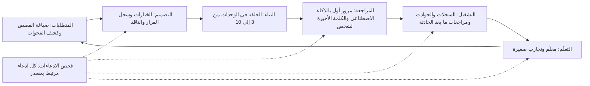

# الوحدة 11 — الذكاء الاصطناعي عبر دورة الحياة (AI across the lifecycle)

*كتابة الشيفرة (writing code) جزء واحد فقط من عمل المهندس. فهناك أيضًا المتطلبات (requirements) والتصميم (design) والتوثيق (documentation) والمراجعة (review) والحوادث (incidents) والتعلّم (learning)، ويستطيع الذكاء الاصطناعي (AI) أن يعين في كلها، لكنه في كل مرحلة قد يقرّر أمورًا لم يتحقق منها أحد (state things nobody checked): دالة غير موجودة (a function that does not exist)، أو رقمًا لم يحسبه قط (a number it never computed)، أو سببًا لم يرد في السجل (a cause that was not in the log). الدرس 11.1 هو درس المفاهيم (the concept lesson). يمرّ على دورة الحياة مرحلةً مرحلة (walks the lifecycle stage by stage): صياغة المتطلبات مع خبير المجال (drafting requirements with a domain expert)، واستخدام الذكاء الاصطناعي ناقدًا لتصميمك (using AI as a critic of your design)، وكتابة سجلات القرار المعماري (ADRs) بصيغة مايكل نايغارد (Michael Nygard's format)، وتوليد التوثيق والتحقق منه مقابل الشيفرة (generating documentation and verifying it against the code)، ومعاملة مساعدي مراجعة الشيفرة بوصفهم مرورًا أوليًا (treating code review assistants as a first pass)، وإعادة بناء الخط الزمني للحادثة (rebuilding an incident timeline) والفصل بين الواقعة والاستنتاج في مراجعة ما بعد الحادثة الخالية من اللوم (separating fact from inference in a blameless postmortem)، وتحليل السجلات (analysing logs)، وتعلّم حزمة تقنية جديدة بتجارب صغيرة (learning a new stack with small experiments)، وتحمّل مسؤولية ملخصاتك (owning your summaries). ويمنحك مُنتَجًا واحدًا (one artefact) هو فحص الادعاءات (the Claims check)، وهو روتين يتتبع كل ادعاء واقعي إلى مصدر في المستودع أو السجلات (a routine that traces every factual claim to a source in the repository or the logs). أما الدرس 11.2 فهو المختبر (the lab). في نجم ريميت (Najm Remit) تكتب سجل قرار معماري (ADR) مع تسجيل اعتراضات الناقد (with a critic's objections recorded)، وتعيد توليد صفحة مرجع najmkit المفقودة (regenerate the lost najmkit reference page) وتثبتها مقابل الشيفرة (prove it against the code)، وتصوغ مراجعة ما بعد الحادثة (draft a postmortem) من سجل حادثة مُصطنع (a constructed incident record) يجب أن تطابق فيه كل واقعة في الخط الزمني السجل (every timeline fact must match the record). والمُقيِّم العامل دون اتصال بالإنترنت (The offline grader) مصمَّم ليتصرف كزميل متشكك (a sceptical colleague). وكل ما يخص جانب نجم خيالي (Everything on the Najm side is fictional).*

> **التركيز (Focus):** Workflow, Verify — استخدم الذكاء الاصطناعي في كل مرحلة من مراحل العمل (use AI at every stage of the job)، وتحقّق من كل ادعاء يقدّمه (check each claim it makes) مقابل الشيفرة أو السجلات (the code, the logs) أو سجل الحادثة (the record) قبل أن توقّع عليه (before you sign it).

---

# 11.1 — ما وراء كتابة الشيفرة: المتطلبات ونقد التصميم والتوثيق والمراجعة والحوادث والتعلّم (Beyond writing code: requirements, design critique, docs, review, incidents and learning)
*المستوى (Level): 🟡 متوسط (Intermediate)* · *المتطلبات (Prerequisites): 5.1، 6.1* · *التركيز (Focus): Workflow*

## ⚡ الدرس في دقيقة (In 60 seconds)
- كتابة الشيفرة (Writing code) جزء واحد فقط من العمل. أما المتطلبات (requirements) والتصميم (design) والتوثيق (documentation) والمراجعة (review) والحوادث (incidents) والتعلّم (learning) فنصوص في معظمها (mostly text)، ويعين الذكاء الاصطناعي (AI) في كل منها. وهو يخفق بالطريقة نفسها في كلها: نص سلس (fluent text) يقرّر أمورًا لم يتحقق منها أحد (states things nobody checked).
- **المسودة فرضية (A draft is a hypothesis).** يكون الادعاء (claim) محقَّقًا حين تستطيع أن تشير إلى مصدر فتحتَه بنفسك (a source you opened): سطر شيفرة (a line of code)، أو مدخل في السجل (a log entry)، أو مخرجات أمر (a command's output)، أو معرّف سجل (a record id).
- استخدم الذكاء الاصطناعي (AI) **ناقدًا (critic)** قبل أن تستخدمه مؤلفًا (author): اطلب منه أن يهاجم تصميمك (attack your design) وأن يبني أقوى حجة للبديل (make the best case for the alternative).
- هو يخترع الأسماء والتواقيع والأرقام والأوقات والأسباب والمراجع (invents names, signatures, numbers, times, causes and references). فافصل بين **الوقائع (facts)** و**الاستنتاجات (inferences)** و**المجهولات (unknowns)**.
- المُنتَج (The artefact) هو **فحص الادعاءات (Claims check)**، وهو روتين من خمس خطوات (a five-step routine): كلما زاد عدد من سيثقون بوثيقة (the more people will trust a document) زادت حاجتها إليه.

## 🧭 لماذا يهم (Why it matters)
في يوم الاثنين تطلب حصة (Hessa)، مالكة المنتج (product owner)، صفحة مرجع najmkit للويكي (the najmkit reference page for the wiki). وتكتب لجين (Lujain)، المهندسة حديثة التخرج (graduate engineer)، «اكتب توثيق najmkit» ("write the docs for najmkit") في نافذة محادثة (a chat window) بلا أي شيفرة (with no code). فتعود الصفحة جميلة المظهر (lovely): `ids.generate(prefix, length=8)` و`clock.utcnow()` و`audit.write(event, fields)`، وملاحظة بأن المكتبة آمنة للخيوط (thread-safe)، والأمر `pip install najmkit`. لا شيء من ذلك موجود. فـ najmkit مكتبة داخلية في نجم (Najm's internal library)، ولذلك لم يرها أحد خارج البنك، ولا حتى نموذج (a model included). كانت الصفحة سلسة (fluent)، وكل سطر مهم فيها كان مخترَعًا (invented).

وفي يوليو 2025 قال جيسون ليمكين (Jason Lemkin) إن وكيل برمجة (coding agent) من Replit حذف قاعدة بيانات إنتاجية (a production database) أثناء تجميد الشيفرة (a code freeze)، ثم أخبره بأن التراجع (a rollback) لن ينجح؛ واسترجع هو البيانات يدويًا (recovered the data by hand). ونقلت مجلة Fortune الخبر، لكن الرواية تستند إلى لقطات الشاشة الخاصة به (his own screenshots)، ولم يدققها أحد (nobody has audited it). ومع ذلك فإن ما يقوله الوكيل عمّا حدث ادعاء لا دليل (a claim, not evidence). والعادة 4 (Habit 4)، **ثق بالدليل لا بالطلاقة (Trust evidence, not fluency)** (الدرس 5.1)، يجب أن تمتد إلى بقية العمل (must reach the rest of the job).

## 📐 كيف يعمل (How it works)

### 🟢 الأساسيات (The essentials)

**الذكاء الاصطناعي مفيد في كل مرحلة، وكل مرحلة تحتاج فحصها الخاص (AI is useful at every stage, and each stage needs its own check).** يصف الدليل العملي من Anthropic لدورة حياة تطوير البرمجيات الأصيلة في الذكاء الاصطناعي (Anthropic's AI-native SDLC playbook) — وهو مورّد يصف رؤيته هو (a vendor describing its own view) — دورة الحياة (the lifecycle) بأنها حلقة (a loop) يُدمَج الذكاء الاصطناعي في كل نقطة منها (embedded at each point)، لا تدفق خطي (not a linear flow). وتضيف هذه الدورة التدريبية الفحص (The course adds the check):



**الادعاء (A claim)** هو أي جملة قد تكون خاطئة (any sentence that could be false): اسم أو توقيع أو رقم أو وقت أو سبب أو مرجع، أو كلمة «دائمًا» أو «أبدًا» (a name, a signature, a number, a time, a cause, a reference, an "always" or a "never"). صنّف كل واحد في سلّة (Sort each into a bin):

| السلّة (Bin) | الاختبار (Test) | أين تذهب (Where it goes) |
|---|---|---|
| **حقيقة (Fact)** | تستطيع أن تشير إلى مصدر فتحتَه (You can point to a source you opened) | المتن مع المصدر (The body, with the source) |
| **استنتاج (Inference)** | مستخلص بالاستدلال من الحقائق وقد يكون خاطئًا (Reasoned from facts; could be wrong) | قسم موسوم (A labelled section): على ماذا يستند وكم أنت واثق وما الذي سيؤكده (what it rests on, how sure, what would confirm it) |
| **مجهول (Unknown)** | لا يملك أحد الدليل بعد (Nobody has the evidence yet) | قائمة أسئلة مفتوحة (A list of open questions) تُترك مفتوحة (left open) |

**أين يخترع الذكاء الاصطناعي (Where AI invents)**، وكيف تكتشف ذلك (and how you catch it):

| الوثيقة (Document) | ما يُخترَع (What gets invented) | كيف تكتشفه (How you catch it) |
|---|---|---|
| المتطلبات (Requirements) | قواعد «بديهية» لم يتفق عليها أحد ("Obvious" rules nobody agreed) | يجيب خبير المجال (The domain expert answers)؛ ولا يسرد الذكاء الاصطناعي إلا الأسئلة (AI only lists questions) |
| التصميم (Design) | مفاضلات تبدو صحيحة (Trade-offs that sound right) وأرقام لم تُحسب قط (numbers never computed) | احسبها (Compute them)؛ واطلب أقوى اعتراض (ask for the strongest objection) |
| التوثيق (Docs) | دوال ومعاملات وسلوك (Functions, parameters, behaviour) | شغّل الأمثلة (Run the examples)؛ وقارن التواقيع بسطر `def` (compare signatures with the def line) |
| تقارير الحوادث (Incident write-ups) | أوقات وأسباب وإجراءات وأعداد وأشخاص (Times, causes, actions, counts, people) | كل صف يستشهد بسطر سجل أو معرّف سجل (Every row cites a log line or a record id) |
| أي شيء فيه مراجع (Anything with references) | عناوين وروابط وأرقام أقسام واقتباسات (Titles, URLs, section numbers, quotes) | افتح الرابط (Open the link)؛ وابحث عن الاقتباس (find the quote) |

### 🟡 التعمق أكثر (Going deeper)

**المتطلبات: صُغها بالذكاء الاصطناعي وقرّرها مع الخبير (Requirements: draft with AI, decide with the expert).** يحوّل المساعد (An assistant) جملة واحدة إلى قصص مستخدم (stories) ويجد ما أغفلته (finds what it leaves out)؛ لكنه لا يستطيع أن يعرف ما قصده العمل (what the business meant). وعبارة حصة (Hessa's line) هي: «العملاء الذين مضى على تعاملهم معنا وقت طويل ينبغي أن ينالوا حدود إرسال أعلى» ⁦("Customers who have been with us a long time should get higher sending limits.")⁩ اطلب منه أن يسرد أسئلة لا إجابات (Have it list questions, not answers):

```text
Read src/remit/limits.py and src/remit/models.py. Turn the line below into user stories.
Then list every ambiguity or missing fact that would change the code, as questions.
Do not answer them or guess. Mark each: blocks the build, or does not.

"Customers who have been with us a long time should get higher sending limits."
```

النتيجة الجيدة (A good result) — وهي مُصطنعة لأغراض التعليم (constructed for teaching) — فيها أربعة أسئلة معطِّلة للبناء (four blocking questions). ما معنى «وقت طويل» ("a long time")، ومحسوبًا من متى؟ ⁦(counted from when?)⁩ (ليس في `Customer` تاريخ بدء، فهذا يحتاج إلى بيانات جديدة — so this needs new data). أي حد يرتفع، وبكم؟ ⁦(Which limit rises, and by how much?)⁩ وكيف يتركّب مع شريحة اعرف عميلك (KYC tier) التي يقرأ `check_limits` حدوده منها؟ وهل يجوز للبنك أصلًا أن يرفع الحدود بهذه الطريقة؟ ⁦(May the bank raise limits this way at all?)⁩ الأسئلة الثلاثة الأولى تذهب إلى حصة، والرابع إلى فريق الامتثال (the compliance team). انظر [*اختبار البرمجيات (Software Testing)*، الدرس 1.3 — المتطلبات وحالات الاختبار وتقارير العيوب (Requirements, test cases and bug reports)](../testing/index.ar.html#/1.3).

**التصميم: الخيارات وسجلات القرار والذكاء الاصطناعي ناقدًا (Design: options, ADRs, and AI as a critic).** اطلب من المساعد الخيارات والمفاضلات (the options and trade-offs) قبل أن تختار، ثم سجّل الاختيار (record the choice). و*سجل القرار المعماري (architecture decision record, ADR)* مذكرة قصيرة عن قرار واحد (a short note about one decision). اقترح مايكل نايغارد (Michael Nygard) هذه الصيغة عام 2011. وهي كما تُلخَّص عادةً (as usually summarised) تتألف من عنوان (a title) وحالة (a status) والسياق (the context) والقرار (the decision) والعواقب (the consequences)، كلها لا الجيد منها فقط (all of them, not only the good ones) (اقرأ مقالته لتعرف الصياغة الدقيقة — read his article for the exact wording). وهذا مثال لقرار تجسّده شيفرة ريميت (Remit) أصلًا (a decision the Remit code already embodies)، مكتوب بإيجاز (written compactly) (يمنح قالب المختبر كل جزء عنوانًا — the lab template gives each part a heading):

```markdown
# 4. Fee tiers are chosen by the whole amount

Status: Accepted

Context: `fees.FeeSchedule.tier_index` picks one tier from the whole send amount, upper bound included, and
`fees.explain_fee` prices the whole amount at that tier. On QAR-INR, 500.00 costs 12.00 and 500.01 costs 12.50.

Decision: We pick the tier by the whole amount, not band by band.

Consequences: One sentence explains any quote. The price steps up at every boundary, so a transfer just over one can cost more than two smaller ones.
```

والآن اجعل الذكاء الاصطناعي يهاجمه (Now make an AI attack it). فالنموذج الذي يُسأل «هل هذا جيد؟» ⁦("is this good?")⁩ قد يميل إلى الموافقة (can lean towards agreeing): ففي دراسة Anthropic لعام 2023، أظهرت خمسة مساعدين من أحدث الطرازات (five state-of-the-art assistants) باستمرار المجاملة المفرطة (sycophancy)، أي ميلًا إلى مجاراة ما يعتقده المستخدم (a tendency to match what the user believes)، عبر أربعة أنواع من المهام (across four kinds of task). فاطلب بدلًا من ذلك أدلة ضده (Ask for evidence against instead):

```text
You are a sceptical senior engineer who did not make this decision. Give the three strongest
objections, each tied to a line of code or a number you computed. Then make the best case for
the alternative you think is strongest. For each objection, say what evidence would show it is wrong.
Do not praise the decision.
```

افحص الناقد بالصرامة نفسها التي تفحص بها المسودة (Check the critic as hard as the draft). افترض أنه قال: «سيقسّم العملاء التحويلات ليتجنبوا درجات الرسوم» ⁦("customers will split transfers to dodge the fee steps.")⁩ جرّب `quote_fee` على QAR-INR (أرقام خيالية — fictional numbers). عند 500.01 تبلغ الرسوم (the fee) 12.50، وحلقة تمر على كل تقسيم ثنائي بالسنتات (a loop over every two-way split in cents) (على ألا يقل أي جزء عن الحد الأدنى 50.00 — both parts at least the 50.00 minimum) لا تجد أي تقسيم تقل رسومه عن 14.00 (finds none under 14.00): فالاعتراض خاطئ عند 500 (false at 500). لكن 2,000.01 تكلّف 40.00 كاملةً (whole) و37.75 مقسّمة إلى 1,850.00 زائد 150.01، و10,000.01 تكلّف 125.00 كاملةً (whole) و123.50 مقسّمة إلى 9,850.00 زائد 150.01. فالاعتراض صحيح عند درجتين من ثلاث (the objection holds at two of three steps)، ومثال واحد في أي من الاتجاهين كان سيضلّلك (one example either way would have misled you). سجّل الأرقام في العواقب (Consequences). واعتراض آخر يصمد بلا سكربت (holds without a script): الرسم الإضافي للتحويل السريع (the express surcharge) يُضاف بعد السقف (after the cap)، فيتحول 150.00 إلى 165.00 عند 20,000.

**التوثيق: ولّد ثم تحقّق، لأن التوثيق ينحرف (Documentation: generate, then verify, because docs drift).** توليد صفحة من الشيفرة (Generating a page from code) استخدام جيد للذكاء الاصطناعي إذا سلّمته الشيفرة ومنعته من وصف ما لم يقرأه (forbid it to describe what it has not read): «اقرأ src/najmkit/*.py. وثّق كل دالة عامة. علّم كل ما استنتجته.» ⁦("Read src/najmkit/\*.py. Document each public function. Mark anything you inferred.")⁩ ثم شغّل كل مثال وقارن كل توقيع بسطر `def` (compare every signature with the def line). وقد انحرف الملف `docs/ARCHITECTURE.md` في المستودع (has drifted). فهو يصف ملف `risk.py` الذي لم يعد موجودًا (a risk.py that no longer exists)، وشريحتين من اعرف عميلك (KYC) دون حد شهري (two KYC tiers and no monthly limit) (في الشيفرة ثلاث شرائح وحدود شهرية — the code has three tiers and monthly limits)، ويقول إن الاستعلامات تستخدم عناصر نائبة (queries use placeholders) (يبني `Store.search_by_name` استعلام SQL بالدالة `str.format` — builds its SQL with str.format). ويحدد `docs/TOUR.md` القاعدة: حين تخالف وثيقةٌ الشيفرة فالغلبة للشيفرة (when a document disagrees with the code, the code wins). وسلاسل التوثيق (Docstrings) والتعليقات (comments) ادعاءات أيضًا (are claims too).

### 🔴 نظرة الخبير (Expert view)

**مساعدو مراجعة الشيفرة: مرور أول لا كلمة أخيرة (Code review assistants: a first pass, never the last word).** لدى Claude Code الأمران `/code-review` و`/security-review` (تتغير الأوامر بين الإصدارات: راجع الوثائق الحالية — commands change between releases: check the current documentation)؛ وتصف وثائقه (its documentation) نمط الكاتب والمراجع (a writer/reviewer pattern)، حيث تراجع جلسة ثانية بسياق جديد (a second session with fresh context) ما كتبته الأولى. وللأدوات الأخرى ما يعادلهما (Other tools have equivalents). وهي في الممارسة (In practice) تميل إلى الإجادة في قائمة التحقق الرتيبة (the dull checklist) — اختبار ناقص (a missing test)، واسم غير متسق (an inconsistent name)، وخطأ واضح (an obvious bug) — وإلى ضعف أكبر في النية (intent) وقواعد المجال (domain rules) (هذه وجهة نظر الدورة العملية لا نتيجة مقيسة — this course's working view, not a measured result). وأي شيء يمس `money.py` أو `fees.py` أو `fx.py` أو `limits.py` أو `ledger.py` أو `service.py` ما زال يحتاج إلى مراجع بشري ثانٍ (a second human reviewer) (`CONTRIBUTING.md`). وتحذّر الوثائق من أن المراجعين (reviewers) سيبلّغون عادةً عن شيء حتى حين يكون العمل سليمًا (reviewers will usually report something even when the work is sound)، فاشترط ملفًا وسطرًا وسيناريو فاشلًا (require a file, a line and a failing scenario)، ولا تنشر قط ملاحظة لم تُعِد إنتاجها (never post a finding you have not reproduced). انظر [*اختبار البرمجيات (Software Testing)*، الدرس 6.1 — التحقق من الشيفرة المولَّدة بالذكاء الاصطناعي (Verifying AI-generated code)](../testing/index.ar.html#/6.1).

**الحوادث: خط زمني من السجلات، ومراجعة ما بعد الحادثة تفصل الواقعة عن الاستنتاج (Incidents: a timeline from logs, a postmortem that separates fact from inference).** يبني المساعدون (Assistants) الخط الزمني (timeline) بسرعة وهم سيئون في الاعتراف بوجود فجوة (bad at admitting a gap). و*مراجعة ما بعد الحادثة الخالية من اللوم (blameless postmortem)* تصف ما حدث وما سمح به النظام، لا من أخفق (what happened and what the system allowed, not who failed)؛ ويصف كتاب SRE من Google (Google's SRE book) (الفصل 15 — chapter 15) وكتاب SRE Workbook هذه الممارسة. أعطِ المساعد سجل الحادثة وحده (Give the assistant the record alone)، واشترط معرّف مصدر على كل صف (require a source id on every row). وسطر السجل بيانات لا تعليمة (A log line is data, not an instruction): قد يحمل نصًّا اختاره مهاجم (can carry text an attacker chose) (الدرس 6.1). وهذه مسودة عن حادثة مختلَقة (a made-up incident)، ليست حادثة المختبر (not the lab's) (41 رفضًا من نوع `needs_review` من 08:12 إلى 08:31 بالتوقيت العالمي المنسَّق (UTC)، واستُبدل ملف قائمة المراقبة (a watchlist file replaced) عند 08:05)، وقد صُنّفت في السلال (sorted into the bins):

| جملة المسودة (Draft sentence) | الحكم (Verdict) | ما العمل (What to do) |
|---|---|---|
| «تسبّبت قائمة مراقبة تالفة في الارتفاع المفاجئ.» ⁦("A corrupted watchlist caused the spike.")⁩ | استنتاج (Inference): تغيّر الملف عند 08:05؛ ولم يقارن أحد القديم بالجديد (nobody compared old and new) | انقلها إلى «ما نستنتجه» ("What we infer") بثقة متوسطة (medium confidence)؛ وأكّدها بمقارنة الملفين (confirm by diffing the files) |
| «تراجع الفريق عند 08:35.» ⁦("The team rolled back at 08:35.")⁩ | لا مصدر (No source): لا تراجع في السجل (the record has no rollback) | احذفها، أو اسأل من نفّذ الإجراء (ask the person who acted) |
| «تأثر نحو 500 عميل.» ⁦("About 500 customers were affected.")⁩ | لا مصدر (No source): في السجل 41 حدث رفض لا عملاء (the log has 41 rejection events, not customers) | اكتب «41 حدث رفض» ("41 rejection events") |

**تحليل البيانات والسجلات: تحقّق من الاستعلام ثم من الاستنتاج (Data and log analysis: verify the query, then the conclusion).** شغّل استعلام المساعد على مدخل صغير جدًا تعرف إجابته (Run the assistant's query on a tiny input whose answer you know)، واحسب الرقم بطريقة ثانية (compute the number a second way)، وافحص الحبيبية (check the grain): يحوي السجل أحداثًا، والعميل الواحد قد يولّد أحداثًا كثيرة (a log holds events, and one customer can produce many).

```bash
grep -c '"event": "transfer.rejected"' audit.jsonl
PYTHONPATH=src python - <<'END'
from collections import Counter
from najmkit import audit
print(Counter(e["reason"] for e in audit.read_events("audit.jsonl") if e["event"] == "transfer.rejected"))
END
```

يجب أن يتطابق العدد ومجموع Counter (The count and the Counter's total must agree)؛ فإن لم يتطابقا فاكتشف أيهما الخاطئ قبل أن تكتب جملة (if not, find out which is wrong before you write a sentence). «ارتفعت حالات الرفض بعد الإصدار» ("Rejections rose after the release") مجرد ارتباط (a correlation) ما لم تعرف ما الذي تغيّر غيره (until you know what else changed).

**تعلّم حزمة تقنية جديدة: معلّم مع تجارب (Learning a new stack: a tutor, with experiments).** المساعد معلّم صبور (a patient tutor) وفي الوقت نفسه معلّم مخطئ واثق من نفسه (a confident wrong one). تنبّأ، ثم شغّل، ثم اسأل لماذا (Predict, run, then ask why). افترض أنه قال: «تقرّب `Decimal` في Python إلى الأعلى عند المنتصف افتراضيًا» ⁦("Python's Decimal rounds half up by default.")⁩. سطر واحد يحسم الأمر (One line settles it): `Decimal("2.665").quantize(Decimal("0.01"))` يعطي `2.66`، لأن الافتراضي هو التقريب إلى الزوجي عند المنتصف (the default is half-even)؛ ومع `rounding=ROUND_HALF_UP` يعطي `2.67`. وفي تجربة عشوائية واحدة (one randomized trial) (Anthropic، 2026)، تعلّم 52 مهندسًا، معظمهم مبتدئون (mostly junior engineers)، مكتبة Python؛ وسجّلت مجموعة الذكاء الاصطناعي درجات أدنى في اختبار قصير لاحق (scored lower on a quiz afterwards)، 50% مقابل 67%، وأشد ما كان ذلك في تصحيح الأخطاء (debugging). ويصف المؤلفون التجربة بأنها صغيرة وأولية (small and preliminary)، ويختلف إعدادها عن الأدوات الوكيلية (the setup differs from agentic tools)، وهي صادرة عن مورّد Claude Code (it comes from Claude Code's vendor): سبب لتعيد شرح الأمور بكلماتك (a reason to explain things back)، لا قانون (not a law).

**التواصل: أنت تملك الملخص (Communication: you own the summary).** وصف طلب الدمج (A pull request description) مجموعة ادعاءات عن عملك (a set of claims about your work)، ويطلب `CONTRIBUTING.md` أن تصف ما شغّلته (describe what you ran) وأن تضع وسمًا على التغييرات المدعومة بالذكاء الاصطناعي (label AI-assisted changes). عبارة «تحسّن متانة معالجة الإشعارات» ⁦("Improves robustness of notification handling")⁩ لا تقول شيئًا (says nothing). أما «يلتقط `NotificationError` في `_notify` ويدوّنه في سجل التدقيق؛ شغّلتُ `pytest -q` وكلها ناجحة؛ لم يُجرَّب مع مزوّد حقيقي؛ بمساعدة الذكاء الاصطناعي: صاغ الوكيل التغيير وأعدتُ أنا كتابة الاختبار» ⁦("Catches NotificationError in _notify and audits it; ran pytest -q, all passing; not tried against a real provider; AI-assisted: the agent drafted the change, I rewrote the test")⁩ فيمكن فحصه (can be checked).

**متى لا تفعل ذلك (When not to).** المذكرة العابرة (A throwaway note) لا تحتاج إلى الروتين الكامل: وازن الجهد بعدد من سيثقون بالوثيقة (match the effort to how many people will trust the document) وبكلفة سطر خاطئ (what a wrong line would cost). تخطَّ الناقد والفحوص معًا في قرار لن يعود إليه أحد (Skip both critic and checks for a decision nobody will revisit). ولا تفوّض القرار نفسه (do not delegate the decision itself): يستطيع المساعد أن يقرأ ما تفعله الشيفرة (read what the code does)، لكن الناس وحدهم يعرفون لماذا (only people know why).

## 🧰 الأدوات (The toolkit)
| الأداة أو الممارسة أو النمط (Tool, practice or pattern) | ما هي وماذا تفعل (What it is and does) | متى تلجأ إليها (When to reach for it) |
|---|---|---|
| **Claims check** — فحص الادعاءات | يتتبع كل ادعاء واقعي (factual claim) في وثيقة إلى مصدر (source) في المستودع أو السجلات (Traces every factual claim in a document to a source in the repo or the logs) | قبل أن تغادر يدك وثيقةٌ سيثق بها الآخرون (Before a document others will trust leaves your hands) |
| **ADR** (Michael Nygard) — سجل القرار المعماري | سجل قصير لقرار واحد: العنوان والحالة والسياق والقرار والعواقب (A short record of one decision: title, status, context, decision, consequences) | قرار مكلف التراجع عنه أو سيُسأل عنه (A decision that is costly to reverse or will be questioned) |
| **Critic prompt** — موجّه الناقد | يطلب من الذكاء الاصطناعي أن يهاجم تصميمًا بالأدلة (attack a design with evidence) وأن يبني أقوى حجة للبديل (steelman the best alternative) | قبل أن تقبل تصميمًا، بما في ذلك تصميمك أنت (including your own) |
| **Docs drift check** — فحص انحراف التوثيق | يولّد التوثيق (Generates docs) من الشيفرة (the code)، ثم يفحص الأسماء والتواقيع والأرقام والأمثلة (names, signatures, numbers and examples) | كلما وصفت صفحةٌ شيفرةً تتغير (Whenever a page describes code that changes) |
| **Record-bound timeline** — خط زمني مقيَّد بالسجل | خط زمني (timeline) يُبنى من سجل (log) أو سجل حادثة (incident record) وحده، مع معرّف مصدر على كل صف (a source id on each row) | أي مسودة لحادثة، أيًّا كان كاتبها (Any incident draft, whoever writes it) |
| **Blameless postmortem** (Google SRE) — مراجعة ما بعد الحادثة الخالية من اللوم | مراجعة تفصل الوقائع عن الاستنتاجات والمجهولات (facts, inferences and unknowns) وتصلح النظام لا الشخص (fixes the system, not a person) | بعد حادثة تستحق أن تُذكر (After an incident worth remembering) |

## 🏛️ عمليًا في بنك نجم (In practice at Najm Bank)
المُنتَج (The artefact) هو **فحص الادعاءات (Claims check)**. يضع طارق (Tariq)، قائد الهندسة (engineering lead)، القاعدة في العيادة الأسبوعية (the weekly clinic): لا تغادر وثيقةٌ الفريق وفيها ادعاء لم يتتبعه أحد إلى مصدر (no document leaves the team with a claim nobody traced to a source). خمس خطوات (Five steps):

1. **اسرد الادعاءات (List the claims)**: كل جملة قد تكون خاطئة (every sentence that could be false).
2. **صنّفها (Sort them)** إلى حقيقة واستنتاج ومجهول (into fact, inference and unknown).
3. **تتبّع كل حقيقة (Trace each fact)** إلى مصدر فتحتَه بنفسك (a source you opened yourself): `path:line`، أو أمر شغّلتَه (a command you ran)، أو سطر سجل (a log line)، أو معرّف سجل (a record id). وقائمة المصادر التي يقدّمها المساعد ادعاء أيضًا (An assistant's own list of sources is a claim too): افتحها بنفسك (open them yourself).
4. **شغّل ما يمكن تشغيله (Run what can run)**: الأمثلة والأوامر والاستعلامات (examples, commands, queries). الشيفرة العاملة تتفوق على التعليق (The running code outranks a comment).
5. **احذف أو أعد الوسم (Delete or relabel)** لكل ما لا مصدر له (anything without a source)، واحتفظ بالجدول في ملاحظاتك (keep the table in your notes).

| الادعاء (Claim) ومكان ظهوره (where it appears) | النوع (Kind) | المصدر الذي فتحتَه (Source you opened) | النتيجة (Result) |
|---|---|---|---|
| «يشغّل `risk.py` فحصي الحدود والفرز» ("risk.py runs the limit and screening checks") (`docs/ARCHITECTURE.md`) | حقيقة (Fact) | `ls src/remit/` | مدحوضة (Refuted): لا وجود لـ`risk.py` (there is no risk.py) |
| «يجوز لـT1 إرسال ما يصل إلى 5,000 QAR في اليوم» ("T1 may send up to QAR 5,000 per day") (`docs/ARCHITECTURE.md`) | حقيقة (Fact) | `limits.LIMITS` | مدحوضة (Refuted): 2,000 يوميًا و8,000 شهريًا (2,000 daily, 8,000 monthly) |
| «مدة صلاحية عرض السعر 60 ثانية» ("A quote is valid for 60 seconds") (سجل القرار المعماري الذي كتبته — your ADR) | حقيقة (Fact) | `fx.QUOTE_TTL` | محقَّقة (Verified) |
| «تسبّب المورّد في الأعطال» ("The vendor caused the failures") (مسودة ذكاء اصطناعي — an AI draft) | استنتاج (Inference) | لا شيء بعد (none yet) | انقلها إلى «ما نستنتجه» (Move to "What we infer") |

الخطوة 3 آلية جزئيًا (partly mechanical). يمنحك الدرس 11.2 السكربت (script) `claims_scan.py`، الذي يبحث عن المسارات المكتوبة بين علامات الاقتباس العكسية (backticked paths) وإشارات `module.name` في ملف Markdown، وعن الأوقات ومعرّفات الأحداث (times and event ids) مقابل سجل حادثة (an incident record). وهو لا يستطيع أن يعرف هل الجملة صحيحة (whether a sentence is true)، بل فقط هل يشير ادعاء إلى لا شيء (whether a claim points at nothing).

## 🛠️ التمارين (Exercises)
- 🟢 **دقّق وثيقة يدويًا (Audit a document by hand).** بلا وكيل (No agent needed). تتبّع عشرة ادعاءات في `docs/ARCHITECTURE.md` إلى الشيفرة (Trace ten claims in docs/ARCHITECTURE.md to the code) بالأمرين `ls` و`grep` والقراءة. *يكتمل عندما (Done when):* يضم جدول فحص الادعاءات (a Claims check table) عشرة صفوف، لكل منها أمره (each with its command)، وثلاثة منها على الأقل مدحوضة (at least three refuted).
- 🟡 **ضع ناقدًا على قرار (Put a critic on a decision).** يحتاج وكيلًا أو مساعد محادثة (Needs an agent or a chat assistant). اكتب سجل قرار معماري قصيرًا (a short ADR) لقرار آخر تجسّده الشيفرة (another decision the code embodies) مثل تخزين المبالغ نصًّا في SQLite (amounts stored as text in SQLite, say)، وشغّل موجّه الناقد (run the critic prompt) وافحص كل اعتراض كما فعل الدرس (check each objection as the lesson did). *يكتمل عندما (Done when):* تُسرد ثلاثة اعتراضات (three objections are listed)، لكل منها دليلك وقرارك (each with your evidence and decision).
- 🔴 **اضبط مساعدًا وهو يخترع (Catch an assistant inventing).** يحتاج وكيلًا أو مساعد محادثة (Needs an agent or a chat assistant)، في جلسة بلا وصول إلى المستودع (in a session with no access to the repository). اطلب منه توثيق `remit.limits` من الذاكرة (document remit.limits from memory)، ثم تحقّق من كل ادعاء مقابل `src/remit/limits.py` وبتشغيل الشيفرة (by running code). *يكتمل عندما (Done when):* يعلّم جدول كل ادعاء بأنه محقَّق أو مدحوض أو غير قابل للتحقق (verified, refuted or unverifiable)، ويعدّ الأسماء المخترَعة (counts the invented names).

## ⚠️ أخطاء وفخاخ (Mistakes and traps)
- **اللصق بلا المصدر (Pasting without the source).** من دون شيفرة يخترع المساعد الشيفرة (With no code, an assistant invents the code). أعطه الملفات (Give it the files).
- **طلب الموافقة (Asking for approval).** «هل هذا التصميم جيد؟» ⁦("Is this design good?")⁩ تستدعي «نعم» (invites a yes). اطلب اعتراضات مع أدلة (Ask for objections with evidence)، ثم تحقّق منها (verify them).
- **ترك التعليقات تتفوق على الشيفرة (Letting comments outrank code).** قد تكون سلسلة التوثيق (docstring) أو صفحة قديمة متقادمة (stale). شغّل الشيفرة (Run the code).
- **تنعيم الفجوة (Smoothing over a gap).** الخط الزمني الذي فيه فجوة صادق (A timeline with a hole is honest)؛ والمساعد يملؤها بشيء معقول (an assistant fills it with something plausible). اترك الفجوة (Leave the hole).
- **الخلط بين الأحداث والأشخاص (Confusing events with people).** «41 رفضًا» ("41 rejections") واقعة (a fact)؛ و«41 عميلًا» ("41 customers") استنتاج (an inference).

## 🧾 الخلاصة (Recap)
- يعين الذكاء الاصطناعي في كل مرحلة (stage)، وفي كل مرحلة قد يقرّر بثقة أمورًا لم يتحقق منها أحد (state unchecked things with confidence). المسودة فرضية (A draft is a hypothesis).
- صنّف الادعاءات إلى حقيقة (fact) لها مصدر فتحتَه، واستنتاج (inference) موسوم، ومجهول (unknown) يُترك مفتوحًا.
- استخدم الذكاء الاصطناعي ناقدًا (Use AI as a critic): اطلب أقوى الاعتراضات وأفضل بديل (the strongest objections and the best alternative)، ثم افحص الاعتراضات بأكثر من مثال واحد (check the objections with more than one example).
- ولّد التوثيق (docs) من الشيفرة، ثم تحقّق من الأسماء والتواقيع والأمثلة بتشغيلها (verify names, signatures and examples by running them)؛ فالغلبة للشيفرة (the code wins).
- مساعد المراجعة مرور أول (A review assistant is a first pass)؛ أنت تملك التعليق (you own the comment)، ومنطق الأموال ما زال يحتاج إنسانًا ثانيًا (a second human).

## ✍️ اختبر نفسك (Check yourself)

**1. كتب مساعد لا يملك وصولًا إلى المستودع (an assistant with no access to the repository) صفحة عن najmkit تذكر `ids.generate(prefix, length=8)`. ما التفسير الأرجح؟ ⁦(What is the most likely explanation?)⁩**

- A. غيّرت najmkit اسم الدالة في إصدار حديث (renamed the function in a recent release)
- B. لم يرَ النموذج najmkit قط وملأ الفراغ (has never seen najmkit and filled the gap)
- C. كُتبت الصفحة لإصدار أقدم من Python (written for an older Python version)
- D. قرأ المساعد نسخة قديمة من الشيفرة (read an outdated copy of the code)

<details><summary>الإجابة</summary>

**B.** najmkit مكتبة داخلية (internal)، فلم يرها أي نموذج (no model has seen it)؛ وحين يُطلب منه توثيقها يخترع أسماء معقولة (invents plausible names). أما الخيارات الأخرى فتفترض أنه قرأ نسخة ما من الشيفرة (assume it had read some version of the code). 🧭 لماذا يهم (Why it matters).

</details>

**2. يقول ناقد (critic) إن العملاء سيقسّمون التحويلات ليتجنبوا درجات الرسوم (split transfers to dodge the fee steps). تجرّب 500.01 QAR فلا تجد تقسيمًا أرخص. ماذا تفعل قبل أن يصف سجل القرار المعماري (ADR) الاعتراض بأنه خاطئ؟ ⁦(What do you do before the ADR calls the objection false?)⁩**

- A. تقبله على أي حال، لأن الناقد طُلب منه أن يكون متشككًا (was told to be sceptical)
- B. تسجّله خاطئًا، لأنك اختبرت الحد الذي سمّاه (tested the boundary it named)
- C. تطلب من الناقد أن يكرر الاعتراض بصيغة أقوى (repeat the objection more strongly)
- D. تحسب رسوم المبلغ كاملًا ومقسّمًا عند كل درجة، لا عند واحدة فقط (whole and split fees at every step)

<details><summary>الإجابة</summary>

**D.** الاعتراض ادعاء (An objection is a claim)، ومثال واحد دليل ضعيف في الاتجاهين (one example is weak evidence either way). تعطي `quote_fee` القيمة 12.50 للمبلغ 500.01 كاملًا ولا تقسيم أرخص، لكنها تعطي 40.00 للمبلغ 2,000.01 كاملًا مقابل 37.75 مقسّمًا إلى 1,850.00 زائد 150.01. وقبوله أو رفضه مبكرًا يتخطى الأدلة (skips the evidence). 🟡 التصميم (Design).

</details>

**3. تقول مسودة مراجعة ما بعد الحادثة (postmortem draft) «تأثر نحو 500 عميل» ⁦("About 500 customers were affected")⁩. ويُظهر سجل الحادثة (the incident record) 41 حدث `transfer.rejected` ولا يذكر عدد العملاء. كيف ينبغي أن تتغير الجملة؟ ⁦(How should the sentence change?)⁩**

- A. تُستبدل بعبارة «41 حدث رفض» ("41 rejection events")
- B. تبقى، لأن 500 تقدير معقول (a reasonable estimate)
- C. تُقرَّب إلى الأسفل فتصير 41 عميلًا (Round it down to 41 customers)
- D. تبقى مع إضافة «تقريبًا» قبل 500 (add "approximately")

<details><summary>الإجابة</summary>

**A.** يسند السجل الأحداث لا العملاء (The record supports events, not customers)، والرقم الذي لا مصدر له اختراع مهما خُفِّف بالتحوّط (invention however it is hedged). و«41 عميلًا» تكرر الخطأ نفسه. 🔴 الحوادث (Incidents).

</details>

**4. يقول `docs/ARCHITECTURE.md` إن T1 يستطيع إرسال 5,000 QAR في اليوم (T1 may send QAR 5,000 a day)، ويقول `limits.LIMITS` إنها 2,000. على أيهما تعتمد لمعرفة ما يفعله النظام اليوم، ولماذا؟ ⁦(Which do you rely on for what the system does today, and why?)⁩**

- A. الوثيقة، لأن شخصًا كتبها عن قصد (a person wrote it deliberately)
- B. الأحدث من الاثنين، أيهما له تاريخ إيداع أحدث (the later commit date)
- C. الشيفرة، لأن الشيفرة العاملة تتفوق على وصفها (running code outranks a description of it)
- D. لا هذا ولا ذاك، حتى يؤكد مالك المنتج الرقم (until the product owner confirms the figure)

<details><summary>الإجابة</summary>

**C.** ما يفعله النظام هو ما تفعله الشيفرة؛ والوثيقة ادعاء بشأنها وقد انحرفت (has drifted)، كما يقول `docs/TOUR.md`. والمالك يقرر ما ينبغي أن يفعله النظام لا ما يفعله (The owner decides what the system should do, not what it does). 🟡 التوثيق (Documentation).

</details>

**5. تقرر مراجعة مساعدك (Your assistant's review) لطلب دمج (pull request) يعدّل `fees.py` أنه لا توجد مشكلات (reports no problems). ماذا يغيّر ذلك في عملية المراجعة؟ ⁦(What does that change about the review process?)⁩**

- A. لا شيء: ما زال المراجع البشري الثاني مطلوبًا (a second human reviewer is still required)
- B. يحل محل المراجع البشري الثاني في الفروقات الصغيرة (on small diffs)
- C. يتيح للمؤلف أن يوافق على تغييره بنفسه (approve their own change)
- D. يكفي إن كان المساعد نموذجًا مختلفًا (a different model)

<details><summary>الإجابة</summary>

**A.** يشترط `CONTRIBUTING.md` مراجعًا بشريًا ثانيًا لـ`fees.py` ولبقية وحدات المال (the other money modules). ومرور المساعد مرور أول (a first pass): رأى الفروقات (the diff) لا النية (not the intent). 🔴 المراجعة (Review).

</details>

## 📚 المراجع (References)
- مايكل نايغارد (Michael Nygard)، "Documenting Architecture Decisions" (15 نوفمبر 2011)؛ ويؤكد README الخاص بـadr-tools عنوانه وتاريخه (confirms its title and date): https://github.com/npryce/adr-tools
- Google، *Site Reliability Engineering*، الفصل 15 (chapter 15)، "Postmortem Culture: Learning from Failure": https://sre.google/sre-book/table-of-contents/ ؛ وفصل كتاب SRE Workbook (the SRE Workbook chapter): https://sre.google/workbook/postmortem-culture/
- وثائق Claude Code (Claude Code documentation): الأوامر (commands) (`/code-review` و`/security-review`): https://code.claude.com/docs/en/commands ؛ وأفضل الممارسات (best practices) (نمط الكاتب والمراجع — the writer/reviewer pattern): https://code.claude.com/docs/en/best-practices
- للتعمق (Go deeper): Anthropic، "Towards Understanding Sycophancy in Language Models": https://www.anthropic.com/research/towards-understanding-sycophancy-in-language-models ؛ وAnthropic، "How AI assistance impacts the formation of coding skills": https://www.anthropic.com/research/AI-assistance-coding-skills ؛ وAnthropic، "The AI-native SDLC playbook": https://claude.com/blog/the-ai-native-sdlc-playbook
- [*السحابة وDevOps (Cloud & DevOps)*، الدرس 5.3 — الحوادث ومراجعات ما بعد الحادثة الخالية من اللوم (Incidents and blameless postmortems)](../cloud/index.ar.html#/5.3)

---

# 11.2 — المختبر: سجل قرار معماري مع ناقد، وتوثيق مفحوص مقابل الشيفرة، ومراجعة ما بعد الحادثة الملتزمة بالوقائع (Lab: an ADR with a critic, docs checked against code and a postmortem that sticks to the facts)
*المستوى (Level): 🟡 متوسط (Intermediate)* · *المتطلبات (Prerequisites): 11.1* · *التركيز (Focus): Workflow, Verify*

## ⚡ الدرس في دقيقة (In 60 seconds)
- المختبر (Lab) `m11`، على نجم ريميت (Najm Remit): ثلاث وثائق يستطيع المُقيِّم (the grader) البحث عن ادعاءاتها (whose claims the grader can look up). **سجل قرار معماري (ADR)** مع اعتراضات ناقد (with a critic's objections)، و**صفحة najmkit** المُعاد توليدها من الشيفرة (regenerated from the code)، و**مراجعة ما بعد الحادثة (postmortem)** المصوغة من سجل حادثة مُصطنع (drafted from a constructed incident record).
- **يحتاج وكيلًا: لا (Needs an agent: no)** (موصى به لا مطلوب — recommended, not required). يفحص المُقيِّم النتيجة (The grader looks at the result).
- يصطاد الادعاءات الكاذبة (It hunts for false claims): اسمًا مفقودًا (a missing name)، أو توقيعًا لا يتطابق (a signature that does not fit)، أو مثالًا يفشل (an example that fails)، أو رقمًا أو وقتًا ليس في السجل (a number or time not in the record)، أو سببًا مذكورًا على أنه واقعة (a cause stated as fact).
- لا يستطيع أن يحكم على النثر أو الحكمة (It cannot judge prose or wisdom)، ولا أن يميّز ناقدًا حقيقيًا من غيابه (tell a real critic from none). ويغطي فحص الادعاءات الخاص بك الباقي (Your Claims check covers the rest).

## 🧭 لماذا يهم (Why it matters)
يوم الجمعة موعد التدقيق الداخلي (the internal audit)، وتطلب تذكرة حصة (Hessa's ticket) ثلاث وثائق. يستطيع مساعد لجين (Lujain's assistant) أن يصوغها كلها في دقائق، وهي تميل إلى تصديقه: فهو سيمدح التصميم الذي يُعرض عليه (flatter the design it is shown)، ويصف مكتبة لم يقرأها قط (describe a library it has never read)، ويملأ كل فجوة في سجل الحادثة بشيء معقول (fill every gap in an incident record with something plausible). والمُقيِّم (The grader) هو الزميل الذي لا يصدّق شيئًا من ذلك، ويفتح الشيفرة أو السجل خلف كل جملة (opens the code or the record behind every sentence).

## 📐 كيف يعمل (How it works)

### 🟢 الأساسيات (The essentials)

كل وثيقة تطرح ادعاءات (Each document makes claims)، وكل نوع من الادعاءات يشير إلى مصدر مختلف (points at a different source):

| الوثيقة (Document) | ادعاءاتها تشير إلى (Its claims point at) | ما يميل المساعد إلى اختراعه (What an assistant tends to invent) |
|---|---|---|
| سجل القرار المعماري (ADR) | المستودع (The repository): المسارات و`module.name` والثوابت (paths, module.name, constants) | وحدة تسردها صفحة المعمارية القديمة (A module the old architecture page lists)؛ ورقم متقادم (a stale figure) |
| صفحة najmkit (najmkit page) | `src/najmkit/`: الأسماء والتواقيع والأمثلة العاملة (names, signatures, running examples) | دوال ومعاملات (Functions, parameters) وعبارة «آمنة للخيوط» ("thread-safe") وأمر `pip install` |
| مراجعة ما بعد الحادثة (Postmortem) | `incident.json`: معرّفات الأحداث والأوقات والأعداد (event ids, times, counts) | سبب وإجراء وعدد عملاء وشخص (A cause, an action, a customer count, a person) |

اعمل على وثيقة واحدة في كل مرة (Work one document at a time): مسودة، ثم مسح، ثم فحص يدوي، ثم إصلاح، ثم إيداع (draft, scan, check by hand, fix, commit). ويقوم `lab-assets/claims_scan.py` بالبحث الآلي (the mechanical lookup). وعلى `docs/ARCHITECTURE.md` في مختبر جديد (in a fresh lab) يطبع هذا (مقتطعًا إلى أول ملاحظتين — cut to the first two findings):

```text
docs/ARCHITECTURE.md:16  `risk.py`  no such file
docs/ARCHITECTURE.md:23  `najmkit.md`  no such file
...
docs/ARCHITECTURE.md: 19 claims looked up, 4 do not resolve
```

المسح النظيف ليس نجاحًا (A clean scan is not a pass): فهو يبحث عن الأسماء والمسارات والأوقات ومعرّفات الأحداث فقط (names, paths, times and event ids only)، ولا يفحص التواقيع ولا الأمثلة ولا الصياغة أبدًا (never signatures, examples or phrasing)، ويمكن أن يجلس مسار حقيقي بجوار جملة كاذبة (a real path can sit beside a false sentence). إنها العادة 5 (habit 5)، **أتمت الحلقة وحافظ على المهارة (Automate the loop, keep the skill)**، بحجم مصغّر (in small).

### 🟡 التعمق أكثر (Going deeper)

**سجل القرار المعماري (The ADR).** السياق (The Context) هو الموضع الذي يعين فيه المساعد (where an assistant helps)، إن قرأ الملف أولًا (if it reads the file first): «اقرأ `src/remit/limits.py`. صُغ سياق سجل قرار معماري للنوافذ الثابتة بتوقيت UTC+3. استشهد بكل ادعاء بوصفه مسارًا أو `module.name` بين علامتي اقتباس عكسيتين. لا تذكر رقمًا لم تقرأه.» ⁦("Read src/remit/limits.py. Draft the Context of an ADR for the fixed UTC+3 windows. Cite every claim as a path or module.name in backticks. State no number you did not read.")⁩ ثم شغّل موجّه الناقد (the critic prompt) من الدرس 11.1 وافحص كل اعتراض هو نفسه ادعاء (check each objection that is itself a claim). والناقد الذي يقول «مدة صلاحية العرض طويلة جدًا» ("the quote lifetime is too long") قد قرأ رقمًا (has read a number): افتح `fx.py`. أما الردود (The responses) فهي لك: إنها قرارات (they are decisions).

اذكر من كان الناقد (Say who the critic was). الوكيل الذي يعمل وحده ليس ناقدًا جديدًا لمسودته هو (An agent working alone is not a fresh critic of its own draft): استخدم جلسة منفصلة أو وكيلًا فرعيًا (a separate session or subagent) لا يرى إلا سجل القرار والشيفرة (sees only the ADR and the code). والوكيل المتداخل الذي لا يستطيع بدء وكيل آخر (A nested agent that cannot start one) يؤدي دور الناقد في مرور ثانٍ (plays the critic in a second pass) ويقول ذلك. والمُقيِّم لا يستطيع التمييز؛ أما القارئ فيستطيع (The grader cannot tell; a reader can).

**صفحة najmkit (The najmkit page).** أعطِ المساعد الملفات الثلاثة (the three files) ومهمة ضيقة (a narrow job): «اقرأ كل ملف في `src/najmkit/`. لكل دالة وصنف عامّ اكتب توقيعه منسوخًا من سطر `def`، وجملة واحدة عمّا يفعله تستطيع أن تشير إليه في الشيفرة. أضف مثالًا واحدًا لكل وحدة يعمل. اسرد المواضع التي تختلف فيها سلسلة التوثيق عن الشيفرة.» ⁦("Read every file in src/najmkit/. For each public function and class write its signature, copied from the def line, and one sentence about what it does that you can point to in the code. Add one example per module that runs. List where a docstring and the code disagree.")⁩ ثم تحقّق بالتجربة (verify by experiment): شغّل كل مثال (run each example)، واستدعِ الدوال بمدخل سيئ (a bad input) وبملف مفقود (a missing file) وبلا أي إعداد (nothing configured). وسلسلة التوثيق (A docstring) ادعاء كأي ادعاء آخر، والغلبة للشيفرة العاملة (the running code wins). وكل تعليق تستطيع أن تبيّن خطأه (Every comment you can show to be wrong) يذهب تحت «مشكلات معروفة» ("Known problems").

**مراجعة ما بعد الحادثة (The postmortem).** شغّل المساعد في وضع التخطيط (plan mode) (`claude --permission-mode plan`؛ راجع الوثائق الحالية — check the current documentation) في مجلد فارغ (an empty folder) لا يحوي إلا نسخًا من `lab-assets/incident.json` ومن القالب (holding only copies of lab-assets/incident.json and the template). يقيّد وضع التخطيط التعديلات لا القراءة (Plan mode limits edits, not reading)، والجلسة التي قرأت المستودع تحمل تخميناتها عن البوابة (a session that has read the repository brings its guesses about the gateway)؛ والوكيل الذي يحمل ذلك السياق أصلًا يقول ذلك ويعتمد على الفحص اليدوي (leans on the hand check). وقل: «استخدم `lab-assets/incident.json` وحده. يذكر كل صف معرّف حدثه ووقت السجل. ضع ما يقرره السجل تحت "ما نعرفه"، وما تستدل عليه بعده تحت "ما نستنتجه" مع معرّفات الأحداث والثقة وما سيؤكده، وما لا يستطيع الإجابة عنه تحت "ما لا نعرفه". لا تسمِّ أحدًا لا يسمّيه السجل.» ⁦("Use only lab-assets/incident.json. Every row names its event id and the record's time. Put what the record states under 'What we know', what you reason beyond it under 'What we infer' (event ids, confidence, what would confirm it) and what it cannot answer under 'What we do not know'. Name no one the record does not name.")⁩ والمسودة الأولى النموذجية (A typical first draft) من مساعد قيل له فقط «اكتب مراجعة ما بعد الحادثة» ("write a postmortem") — وهي مُصطنعة لأغراض التعليم لا مسجّلة من نموذج (constructed for teaching, not recorded from a model) — يفتتح ملخصها (Summary) هكذا:

```text
On 11 March 2026 an outage at our SMS gateway vendor, caused by a configuration change on their side,
stopped confirmation messages for roughly 2,000 customers for 52 minutes. The on-call engineer restored
service by failing over to the backup provider at 10:40.
```

التاريخ والدقائق الـ52 ومورّد البوابة (the gateway vendor) من السجل. أما القناة (The channel) والسبب (the cause) وتغيير الإعدادات (the configuration change) وعدد العملاء (the customer count) والتحويل إلى المزوّد الاحتياطي (the failover) والوقت (the time) فمخترَعة (are invented). وهناك فخان ينجوان من مسودة دقيقة (Two traps survive a careful draft). احتفظ بمن قال ومتى (Keep who said it and when): E5 هو ما وجده مهندس واحد عند 10:26، لا واقعة عن النافذة كلها (not a fact about the whole window). واستشهد بالأحداث التي يقوم عليها رقم تحسبه أنت (cite the events behind a figure you work out) («بعد 13 دقيقة من أول إخفاق (E1, E2)» ⁦("13 minutes after the first failure (E1, E2)")⁩).

### 🔴 نظرة الخبير (Expert view)

**ما يستطيع المُقيِّم قوله وما لا يستطيع (What the grader can and cannot tell).** يفحص النتيجة لا تفكيرك (It checks the result, not your thinking). ويقرأ نسخة العدّة نفسها من سجل الحادثة (the kit's own copy of the incident record)، ولذلك لا يستطيع تعديل `lab-assets/incident.json` أن يغيّر معايير الحكم (move the goalposts). وقواعده غربال لا برهان (Its rules are a sieve, not a proof):

- الجملة الكاذبة التي لا تطابق أي قاعدة تمر (A false sentence that matches no rule passes). فعبارة «`audit.read_events` تعيد أحدث حدث أولًا» ("audit.read_events returns the newest event first") خاطئة (false) (إذ تقرأ الملف بالترتيب — it reads the file in order) ولا شيء يبحث عنها (nothing looks for it). ولا يلتقطها إلا شخص قرأ الشيفرة (Only a person who read the code catches it).
- لا يُلتقط `module.name` مختلق إلا إذا كانت الوحدة حقيقية (A made-up module.name is caught only when the module is real): فـ`limits.check_everything` يفشل (fails)، و`risk.check` يُتخطى (is skipped) (قد يكون اسم مكتبة — it could be a library name). أما المسار المختلق مثل `risk.py` فيُلتقط (is caught).
- يجب أن تستشهد المدة (A duration) بحدثين يفصل بينهما ذلك القدر (two events that are that far apart)؛ والمُقيِّم لا يعرف هل تعنيهما الجملة (whether the sentence means them).
- لا يستطيع أن يعرف هل كان ناقدك حقيقيًا، أو القرار حكيمًا، أو النثر واضحًا (It cannot tell whether your critic was real, the decision wise or the prose clear).

إن وسم المُقيِّم جملة صحيحة (If the grader flags a true sentence) فلا تلوِ الحقيقة (do not bend the truth): أعد قراءة الشيفرة أو السجل (reread the code or record)، وإن كنت محقًّا فأعد الصياغة ليصبح الادعاء قابلًا للفحص (rephrase so the claim is checkable). ولتقتبس اسمًا خاطئًا عن قصد (To quote a wrong name on purpose)، قل في الجملة نفسها إنه غير موجود (say in the same sentence that it does not exist).

## 🧰 الأدوات (The toolkit)
| الأداة أو الممارسة أو النمط (Tool, practice or pattern) | ما هي وماذا تفعل (What it is and does) | متى تلجأ إليها (When to reach for it) |
|---|---|---|
| **Claims scan** — ماسح الادعاءات | `claims_scan.py`: يبحث عن المسارات و`module.name` والأوقات ومعرّفات الأحداث في ملف Markdown (looks up paths, module.name, times and event ids in a Markdown file) | بعد كل مسودة (After every draft) |
| **Record-bound timeline** — خط زمني مقيَّد بالسجل | خط زمني (timeline) يُبنى من سجل (record) وحده، مع معرّف حدث على كل صف (an event id on each row) | أي تقرير عن حادثة (Any incident write-up) |
| **Agent log** — سجل الوكيل | جدول بالموجّهات والنتائج والتصحيحات والوقت (A table of prompts, results, corrections and time) | بعد أي جلسة كتب فيها وكيل شيئًا ستوقّع عليه (After any session where an agent wrote something you will sign) |

## 🏛️ عمليًا في بنك نجم (In practice at Najm Bank)
**يحتاج وكيلًا: لا (Needs an agent: no).** وهو موصى به لا مطلوب (recommended, not required). و**مسار بلا وكيل (no-agent path)** يعمل أيضًا: اكتب سجل القرار المعماري وأدِّ دور الناقد بنفسك (play your own critic)، أو اسأل زميلًا؛ واقرأ الملفات الصغيرة الثلاثة في `src/najmkit/` (نحو 200 سطر — about 200 lines) واكتب الصفحة؛ وابنِ الخط الزمني من السجل يدويًا (by hand). ولا يهتم المُقيِّم بكيفية إنتاج العمل (The grader does not care how the work was produced).

**التذكرة (The ticket).** كتبتها حصة (Hessa)؛ وهي في مختبرك `TASK.md` (وهي `task.md` في العدّة — the kit's task.md):

```text
# REMIT-393: three pages the team is missing

**From:** Hessa, Product Owner, Najm Remit
**To:** Payments Platform
**Priority:** Medium. Internal audit asks to see these on Friday.

Three pieces of writing are overdue, and each must be *true*, not only tidy. Use an AI assistant if
you like; you are accountable for every sentence. This ticket is documentation only: do not change
code, tests or `lab-assets/`. Run the commands below in this directory. Code comments that disagree
with what the code does (there is at least one) go under "Known problems" at the end of the najmkit
page, a sentence each; do not fix them here.

### 1. An ADR for a decision we already made

Write one ADR, `docs/adr/0001-<short-title>.md`, in Michael Nygard's format: a title, then **Status**,
**Context**, **Decision**, **Consequences**, in that order (start from `lab-assets/adr-template.md`;
Context needs 25 words or more, Decision 8, Consequences 20). Pick one decision the code embodies:
fixed UTC+3 windows (`limits.py`), `Decimal` rounded half up (`money.py`), a failed notification not
undoing a transfer (`service.py`), amounts stored as text (`store.py`), a 60-second quote (`fx.py`),
or najmkit vendored in the repository.

Cite the code as `path` or `module.name` in backticks (two or more, one of them in `src/`), and
name a downside in Consequences. Then ask a critic (an AI assistant, a colleague, you in a bad mood)
to attack the decision and make the best case for the strongest alternative. End with a section
"Critic's objections": three or more, each of eight words or more, with what you did (accepted,
rejected with a reason, or deferred).

### 2. The najmkit page, back from the dead

`docs/najmkit.md` was lost in the docs migration. Write it again from `src/najmkit/` (`ids`, `clock`,
`audit`): every public function and class as `name(parameters)` copied from the def line (a method's
`self` may stay or go), what it does (40 words of prose or more in all), and a short example per
module that runs, in a `python` block. Nothing outside the bank has seen najmkit: the code is your only source.

### 3. A postmortem for INC-2031

`lab-assets/incident.json` is the record of last Wednesday's incident (constructed for teaching).
Write `docs/postmortems/INC-2031.md` from it, starting from `lab-assets/postmortem-template.md`.

* The record is your only source. One timeline row per event: its time (UTC) first, then its event id
  (E1, E2, ...) and what it says. Cover nine of the thirteen events or more, among them the first
  failure, the alert, the alert resolving and the reconciliation.
* Keep apart what we **know** (the record says it), what we **infer** (two or more; say what each rests
  on, how confident you are, what would confirm it) and what we **do not know** (two or more questions
  the record cannot answer).
* No invented numbers, times, causes or people. A figure you work out, such as a gap in minutes, cites
  its events (E1, E2) in the same paragraph, bullet or row; the record has no percentages, so give
  counts. Blameless: what happened and what the system allowed, not who was at fault.
* Three or more action items, each with an owner (a role or a team) and a way to see it is done.

`python lab-assets/claims_scan.py <file>` finds paths and names that point at nothing (add
`--record lab-assets/incident.json` for the postmortem). It cannot tell whether a sentence is true.

### Done when

Each document passes its checks, only `docs/` changed, and each document is its own commit with a
message that follows `CONTRIBUTING.md` (`type(scope): subject`; any lower-case scope, such as
`docs(adr)`, is fine). Grade it from the `ailab` folder of the course repository:
`python -m ailab grade m11 --dir <this directory>`
```

**البدء (Start).**

```bash
cd ainative/ailab
python -m ailab start m11 --dir ~/ainative/m11
cd ~/ainative/m11
```

يحوي إيداع البدء (The start commit) المجلد `lab-assets/` والملف `TASK.md`؛ ويعرض `git diff lab-start` تغييراتك (shows your changes).

**دورك (Your move).** (1) اقرأ التذكرة والسجل و`src/najmkit/` بنفسك أولًا (Read the ticket, the record and src/najmkit/ yourself first). (2) خذ وثيقة واحدة في كل مرة (Take one document at a time)؛ ومع الوكيل سلّمه الملفات والموجّهات الضيقة أعلاه (hand it the files and the narrow prompts above)، لا التذكرة وحدها (not the ticket alone). (3) بعد كل مسودة شغّل الماسح (run the scanner)، ثم أنجز بقية فحص الادعاءات يدويًا (do the rest of the Claims check by hand): شغّل الأمثلة (run the examples)، واستدعِ الدوال (call the functions)، واقرأ السجل صفًّا صفًّا (read the record row by row). واحتفظ بجدول الادعاءات في ملاحظاتك لا في المختبر (Keep the Claims table in your notes, not the lab). (4) أودِع كل وثيقة على حدة (Commit each document on its own)، مثل `docs(adr): record why a failed notification does not undo a transfer`. (5) قيِّم وأصلح (Grade and fix).

**ما يفحصه المُقيِّم (What the grader checks)** (الحدود الدنيا في التذكرة — the minimums are in the ticket). *سجل القرار المعماري (The ADR):* أقسامه الأربعة (its four sections)، وحالة صالحة (a valid status)، وجانب سلبي مسمّى (a named downside)؛ وكل `path` و`module.name` مستشهد به موجود، ولا رقم يناقض الشيفرة (no figure contradicts the code)، بالأرقام أو بالكلمات (in digits or in words)؛ وثلاثة اعتراضات، لكل منها قرار (three objections, each with a decision). *صفحة najmkit (The najmkit page):* كل اسم موجود (every name exists)؛ وكل توقيع يطابق سطر `def` (each signature matches the def line)؛ ولكل وحدة مثال يعمل (each module has an example that runs)؛ وتظهر الواجهة العامة كلها مع التواقيع (the whole public API appears with signatures)؛ ولا شيء قابل للاختبار يناقض الشيفرة (nothing testable contradicts the code)؛ ويُبلَّغ عن التعليق المتقادم (the stale comment is reported) (استشاري — advisory). *مراجعة ما بعد الحادثة (The postmortem):* أقسامها (its sections)؛ وصفوف الخط الزمني تطابق السجل (timeline rows that match the record)؛ ولا رقم ولا وقت ولا تاريخ ولا معرّف ولا شخص ولا سبب ولا إجراء مخترَع (no invented number, time, date, id, person, cause or action)؛ واستنتاجات وأسئلة مفتوحة موسومة (labelled inferences and open questions)؛ وصياغة خالية من اللوم (blameless wording) (استشاري — advisory). *المستودع (The repository):* لم يتغير إلا `docs/` (only docs/ changed)؛ وكل وثيقة أُودعت أول مرة على حدة (each document first committed on its own)؛ والرسائل تتبع `CONTRIBUTING.md` (messages follow CONTRIBUTING.md)؛ ولا شيء غير مودَع (nothing uncommitted)؛ ولا أسرار (no secrets).

**التقييم (Grade).**

```bash
# run from the ainative/ailab folder of the course repository, not from the lab directory
python -m ailab grade m11 --dir ~/ainative/m11
```

على الشيفرة الابتدائية غير الملموسة (On the untouched starter) (حُذف الوسط؛ والفحوص الأخرى تنتظر الوثائق — the middle is cut; the other checks wait for the documents):

```text
[FAIL] ADR exists in docs/adr/: no file like docs/adr/0001-short-title.md
...
[FAIL] Only documentation changed: no files have changed yet
[FAIL] Three documents, three commits: 0 new commits since the start; none of the three documents exists yet
[FAIL] Commit messages follow CONTRIBUTING.md: found 0 commits since the start; expected at least 1
[PASS] Everything is committed
[PASS] No secrets in the change

Lab m11: 2/21 required checks passed: NOT YET
```

بعد مسودة أولى من المساعد لكل وثيقة (a first assistant draft of each document)، أُودعت كما جاءت (committed as it came) (مسودات مُصطنعة لأغراض التعليم لا مسجّلة من نموذج حقيقي — drafts constructed for teaching, not recorded from a real model)، تبدو ثلاثة من الأسطر الفاشلة هكذا (three of the failing lines look like this) (دون التلميحات — hints left out):

```text
[FAIL] Docs: every name exists in the code: `ids.generate` does not exist in najmkit.ids; `clock.utcnow` does not exist in najmkit.clock; `audit.write` does not exist in najmkit.audit
[FAIL] Docs: nothing contradicts the code: Nothing in the code supports a thread-safety claim: "...an event. najmkit is thread-safe and installs with pip..."; Check how najmkit is distributed (see src/najmkit/__init__.py): "...and installs with pip install najmkit."
[FAIL] Postmortem: every timeline row matches the record: row 10:15: E3 is not at that time in the record; row 10:40: E9 is not at that time in the record
```

يقول كل سطر ما الذي فشل ويقتبس الكلمات التي سببت ذلك (says what failed and quotes the words that caused it)؛ ولا يعطي أيٌّ منها الإجابة (none gives the answer). وينتهي التشغيل الناجح (A passing run) بالسطر `Lab m11: 21/21 required checks passed: PASSED`.

**المُخرَج الأسبوعي (Weekly deliverable).** الوثائق الثلاث، بإيداع لكل منها (one commit each)، في مستودع المختبر (in the lab repository)؛ وفي مستودع ملاحظاتك (your notes repository)، المجلد `week-11/` وفيه جدول ادعاءات لكل وثيقة (a Claims table per document) وسجل وكيلك (your agent log) وإجاباتك عن أسئلة الختام (your debrief answers).

**الجلسة الجماعية (Group session)، 60 دقيقة.** (1) تبادلوا مراجعات ما بعد الحادثة (Swap postmortems)؛ وليفحص كلٌّ منكم الخط الزمني لشريكه مقابل السجل (check your partner's timeline against the record) (20). (2) اقرؤوا بصوت عالٍ الاعتراضات التي رفضتموها مع الأدلة (Read out the objections you rejected, with the evidence) (15). (3) اعرضوا جملة مرّرها المُقيِّم وتشكّون فيها، أو وسمها وتختلفون معه (Show a sentence the grader passed that you doubt, or flagged and you disagree with) (15). (4) اتفقوا على قاعدة فريق واحدة للوثائق التي يكتبها الذكاء الاصطناعي (Agree one team rule for AI-written documents) (10).

**أسئلة الختام (Debrief questions).** ما الذي أخطأ فيه الوكيل، وأي الأخطاء التقطها الماسح؟ ⁦(What did the agent get wrong, and which errors did the scanner catch?)⁩ وما الذي فات سياقك أو موجّهك؟ ⁦(What did your context or prompt miss?)⁩ وأي الادعاءات حذفتَ، وأيها نقلتَه إلى استنتاج أو إلى مجهول؟ ⁦(Which claims did you delete, and which did you move to inference or to unknown?)⁩

**قالب سجل الوكيل (Agent log template).**

```markdown
### Agent log: week 11
| Part | Prompt (one line) | What the agent did | What I corrected | Minutes |
|---|---|---|---|---|
| ADR | | | | |
| najmkit page | | | | |
| Postmortem | | | | |

Claims I deleted or relabelled:
One thing I will do differently:
```

## 🛠️ التمارين (Exercises)
- 🟢 **اقرأ قبل أن تكتب (Read before you write).** بلا وكيل (No agent needed). ابدأ المختبر (Start the lab)، وقيِّم الشيفرة الابتدائية (grade the starter)، واقرأ السجل و`src/najmkit/`. *يكتمل عندما (Done when):* يكون لديك خمسة أسئلة لا يستطيع السجل الإجابة عنها (five questions the record cannot answer) وخمس حقائق عن najmkit ما كان لك أن تخمّنها (five facts about najmkit you could not have guessed).
- 🟡 **صفحة najmkit من البداية إلى النهاية (The najmkit page, end to end).** يُوصى بوكيل (An agent is recommended). *يكتمل عندما (Done when):* تنجح فحوص najmkit (the najmkit checks pass) ويسرد جدول ادعاءاتك (your Claims table) ستة سلوكيات موعودة (six promised behaviours)، لكل منها الاستدعاء الذي أظهره (each with the call that showed it).
- 🔴 **اكسر عملك بنفسك (Break your own work).** يمكن أن يساعد وكيل (An agent can help). ازرع حقيقة مخترَعة واحدة في كل وثيقة منتهية (Plant one invented fact in each finished document) ودوّن أي فحص التقطها؛ ثم اكتب جملة كاذبة معقولة واحدة لكل وثيقة يفوتها المُقيِّم (one plausible false sentence per document that the grader misses). *يكتمل عندما (Done when):* جدول بثلاثة ادعاءات التُقطت وثلاثة فاتت (three caught and three missed claims)، مع بيان كيف يجد شخصٌ كل ادعاء فات (how a person would find each missed one).

## ⚠️ أخطاء وفخاخ (Mistakes and traps)
- **توجيه المساعد من دون الشيفرة (Briefing the assistant without the code).** يخترع المكتبة (It invents the library). سلّمه الملفات (Hand it the files).
- **الوثوق بمصادر المساعد (Trusting the assistant's sources).** افتحها بنفسك (Open them). فالمسار الحقيقي قد يجلس بجوار جملة كاذبة (A real path can sit beside a false sentence).
- **إصلاح تعليق متقادم في هذا التغيير (Fixing a stale comment in this change).** تطلب التذكرة أن تبلّغ عنه (the ticket says to report it)؛ والمُقيِّم يرصد تعديلات الشيفرة المصدرية (flags source edits).
- **كتابة مراجعة ما بعد الحادثة بيقين (Writing the postmortem with certainty).** إن لم يقل السجل ذلك فهو استنتاج أو مجهول (an inference or an unknown).
- **ضغط ثلاث وثائق في إيداع واحد (Squashing three documents into one commit).** يفحص المُقيِّم أي إيداع حوى كل وثيقة أول مرة (which commit first holds each).

## 🧾 الخلاصة (Recap)
- ادعاءات كل وثيقة تشير إلى مصدر (Each document's claims point at a source): المستودع أو شيفرة المكتبة أو سجل الحادثة (the repo, the library's code, the incident record). والفحص يعني فتحه (Checking means opening it).
- دع المساعد يقرأ أولًا (Have the assistant read first)، واطلب اعتراضات مع أدلة (ask for objections with evidence)، وافصل بين الوقائع والاستنتاجات والمجهولات (keep facts, inferences and unknowns apart).
- الماسح (A scanner) يجد الادعاءات التي تشير إلى لا شيء؛ والشخص هو الذي يجد الجملة الكاذبة (a person finds the false sentence).
- المُقيِّم غربال (The grader is a sieve): فما يمرّ منه ليس صحيحًا بالضرورة (what passes it is not thereby true).

## ✍️ اختبر نفسك (Check yourself)

**1. يمرّ سجل القرار المعماري (ADR) لديك من `claims_scan.py` بلا ادعاءات غير محلولة (no unresolved claims). ماذا يخبرك ذلك؟ ⁦(What does that tell you?)⁩**

- A. أن كل مسار واسم شيفرة معروف يستشهد به بين علامتي اقتباس عكسيتين موجود (each path and known code name it cites in backticks exists)
- B. أن كل رقم يذكره يتفق مع الثوابت في الشيفرة (agrees with the constants in the code)
- C. أنه مكتمل بما يكفي ليُدمج دون مراجعة بشرية (merged without a human review)
- D. أن القرار الذي يسجّله ثبت أنه قرار سليم (shown to be a sound one)

<details><summary>الإجابة</summary>

**A.** لا يبحث الماسح (The scanner) إلا عن المسارات المكتوبة بين علامتي اقتباس عكسيتين (backticked paths) وعن إشارات `module.name` التي يتعرف عليها (the module.name references it recognises). والمسار الحقيقي قد يجلس بجوار جملة كاذبة، فتظل الأرقام والاستدلال بحاجة إلى فحص الادعاءات الخاص بك (still need your Claims check). 🟢 الأساسيات (The essentials).

</details>

**2. يقول صف في الخط الزمني «10:15، بدأ مهندس موثوقية المواقع المناوب التحقيق (E3)» ⁦("10:15, the on-call SRE began investigating (E3)")⁩. ويضع السجل E3 عند 10:14: تم الإقرار بالتنبيه (the page was acknowledged). ماذا تفعل؟ ⁦(What do you do?)⁩**

- A. تستخدم وقت السجل وصياغته لذلك الصف (the record's time and wording)
- B. تُبقي الصف، لأن 10:15 تبعد دقيقة واحدة فقط (only a minute off)
- C. تسقط E3 من الخط الزمني لأنه محل خلاف (since it is disputed)
- D. تطلب من المساعد أن يشرح التباين (explain the discrepancy)

<details><summary>الإجابة</summary>

**A.** السجل هو المصدر الوحيد (The record is the only source): وقته وكلماته. و«بدأ التحقيق» ("Began investigating") إجراء مخترَع (an invented action)، وفرق دقيقة واحدة وقت مخترَع (an invented time). وطلب الشرح من المساعد يطلب منه أن يخترع سببًا (to invent a reason). 🟡 مراجعة ما بعد الحادثة (The postmortem).

</details>

**3. يقول الناقد لديك (Your critic says) «مدة صلاحية العرض البالغة خمس دقائق طويلة جدًا» ⁦("the quote lifetime of five minutes is too long")⁩. ويحدد `fx.py` 60 ثانية (defines 60 seconds). ماذا تفعل؟ ⁦(What do you do?)⁩**

- A. الناقد محق في الجوهر، فاقصّر مدة صلاحية العرض (right in spirit, so shorten the quote lifetime)
- B. الناقد غير موثوق، فأسقط خطوة الناقد (unreliable, so drop the critic step)
- C. لا شيء، لأن الاعتراض لا يحتاج إلى دليل ليُسجَّل (needs no evidence to be recorded)
- D. أساء الناقد قراءة رقم: سجّله وارفضه (misread a number: record it and reject it)

<details><summary>الإجابة</summary>

**D.** الاعتراض ادعاء (An objection is a claim)، وهذا يقوم على مقدمة خاطئة (rests on a false premise). وتسجيله مع الدليل هو غاية القسم (the point of the section)؛ ويبقى الناقد مفيدًا (the critic stays useful). 🟡 سجل القرار المعماري (The ADR).

</details>

**4. تقول سلسلة التوثيق (a docstring) إن دالة تعيد `None` عند الفشل، لكنها مع مدخل سيئ ترفع `ValueError`. ماذا تقول صفحتك؟ ⁦(What does your page say?)⁩**

- A. ما تقوله سلسلة التوثيق، لأنها تسجّل القصد (it records the intent)
- B. ما تفعله الشيفرة، والتباين تحت «مشكلات معروفة» (the mismatch under Known problems)
- C. لا شيء، لأن صفحة المرجع لا ينبغي أن تذكر حالات الفشل (should not mention failures)
- D. السلوكان جنبًا إلى جنب ليختار القارئ (Both behaviours side by side, so the reader can choose)

<details><summary>الإجابة</summary>

**B.** الشيفرة العاملة تتفوق على التعليق (The running code outranks a comment)، وترسل التذكرة التعليقات الخاطئة إلى «مشكلات معروفة» بدل إصلاحها هنا (instead of fixing them here). وتوثيق السلوكين معًا يكرر الادعاء الكاذب (repeats the false claim). 🔴 ما يستطيع المُقيِّم قوله وما لا يستطيع (What the grader can and cannot tell).

</details>

**5. تجتاز وثائقك الثلاث كل الفحوص الإلزامية الـ21 (all 21 required checks). أي استنتاج له ما يبرره؟ ⁦(Which conclusion is justified?)⁩**

- A. كل جملة في الوثائق الثلاث صحيحة (Every sentence in the three documents is true)
- B. لا ادعاء يختبره المُقيِّم يناقض الشيفرة أو السجل (No claim the grader tests contradicts the code or the record)
- C. لم يعد المراجع البشري بحاجة إلى قراءة الوثائق (no longer needs to read the documents)
- D. أثبت المُقيِّم أن الناقد كان مساعد ذكاء اصطناعي حقيقيًا (that the critic was a real AI assistant)

<details><summary>الإجابة</summary>

**B.** المُقيِّم غربال (The grader is a sieve): يجد الادعاءات التي لديه قاعدة لها (claims it has a rule for). والجملة الكاذبة التي لا قاعدة لها، مثل ملاحظة غير مختبَرة عن الترتيب (an untested remark about ordering)، تمرّ، ولذلك يظل إنسان يقرأ (a human still reads). 🔴 ما يستطيع المُقيِّم قوله وما لا يستطيع (What the grader can and cannot tell).

</details>

## 📚 المراجع (References)
- مايكل نايغارد (Michael Nygard)، "Documenting Architecture Decisions" (15 نوفمبر 2011): https://github.com/npryce/adr-tools (يؤكد العنوان والتاريخ — confirms the title and date)
- Google، *Site Reliability Engineering*، الفصل 15 (chapter 15)، "Postmortem Culture: Learning from Failure": https://sre.google/sre-book/table-of-contents/ ؛ وفصل كتاب SRE Workbook (the SRE Workbook chapter): https://sre.google/workbook/postmortem-culture/
- وثائق Claude Code (Claude Code documentation): وضع التخطيط وأفضل الممارسات (plan mode and best practices): https://code.claude.com/docs/en/best-practices
- عدّة المختبر (Lab kit): https://github.com/Tamoura/system-design-for-vibe-coders/tree/main/ainative/ailab
- [*السحابة وDevOps (Cloud & DevOps)*، الدرس 5.3 — الحوادث ومراجعات ما بعد الحادثة الخالية من اللوم (Incidents and blameless postmortems)](../cloud/index.ar.html#/5.3)
