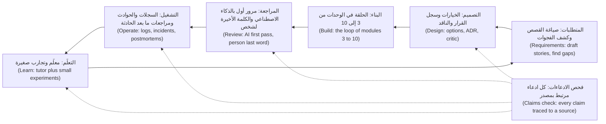

# الوحدة 11 — الذكاء الاصطناعي عبر دورة الحياة

*كتابة الشيفرة جزء واحد فقط من عمل المهندس. فهناك أيضًا المتطلبات والتصميم والتوثيق والمراجعة والحوادث والتعلّم، ويستطيع الذكاء الاصطناعي (AI) أن يعين في كلها، لكنه في كل مرحلة قد يقرّر أمورًا لم يتحقق منها أحد: دالة غير موجودة، أو رقمًا لم يحسبه قط، أو سببًا لم يرد في السجل. الدرس 11.1 هو درس المفاهيم. يمرّ على دورة الحياة مرحلةً مرحلة: صياغة المتطلبات مع خبير المجال، واستخدام الذكاء الاصطناعي ناقدًا لتصميمك، وكتابة سجلات القرار المعماري (ADRs) بصيغة مايكل نايغارد، وتوليد التوثيق والتحقق منه مقابل الشيفرة، ومعاملة مساعدي مراجعة الشيفرة بوصفهم مرورًا أوليًا، وإعادة بناء الخط الزمني للحادثة والفصل بين الواقعة والاستنتاج في مراجعة ما بعد الحادثة الخالية من اللوم، وتحليل السجلات، وتعلّم حزمة تقنية جديدة بتجارب صغيرة، وتحمّل مسؤولية ملخصاتك. ويمنحك مُنتَجًا واحدًا هو فحص الادعاءات، وهو روتين يتتبع كل ادعاء واقعي إلى مصدر في المستودع أو السجلات. أما الدرس 11.2 فهو المختبر. في نجم ريميت تكتب سجل قرار معماري (ADR) مع تسجيل اعتراضات الناقد، وتعيد توليد صفحة مرجع najmkit المفقودة وتثبتها مقابل الشيفرة، وتصوغ مراجعة ما بعد الحادثة من سجل حادثة مُصطنع يجب أن تطابق فيه كل واقعة في الخط الزمني السجل. والمُقيِّم العامل دون اتصال بالإنترنت مصمَّم ليتصرف كزميل متشكك. وكل ما يخص جانب نجم خيالي.*

> **التركيز:** Workflow, Verify — استخدم الذكاء الاصطناعي في كل مرحلة من مراحل العمل، وتحقّق من كل ادعاء يقدّمه مقابل الشيفرة أو السجلات أو سجل الحادثة قبل أن توقّع عليه.

---

# 11.1 — ما وراء كتابة الشيفرة: المتطلبات ونقد التصميم والتوثيق والمراجعة والحوادث والتعلّم
*المستوى: 🟡 متوسط* · *المتطلبات: 5.1، 6.1* · *التركيز: Workflow*

**بعد هذا الدرس تستطيع** تتبّع ادعاءات وثيقة تصميم إلى الشيفرة، وتعليم ما دُحض منها، وفحص اعتراضات ناقد آلي. *مدة الدراسة: قراءة نحو 15 دقيقة، وعمل تطبيقي نحو 60 دقيقة (تقدير).*

## ⚡ الدرس في دقيقة
- كتابة الشيفرة جزء واحد فقط من العمل. أما المتطلبات والتصميم والتوثيق والمراجعة والحوادث والتعلّم فنصوص في معظمها، ويعين الذكاء الاصطناعي في كل منها. وهو يخفق بالطريقة نفسها في كلها: نص سلس يقرّر أمورًا لم يتحقق منها أحد.
- **المسودة فرضية.** يكون الادعاء محقَّقًا حين تستطيع أن تشير إلى مصدر فتحتَه بنفسك: سطر شيفرة، أو مدخل في السجل، أو مخرجات أمر، أو معرّف سجل.
- استخدم الذكاء الاصطناعي **ناقدًا** قبل أن تستخدمه مؤلفًا: اطلب منه أن يهاجم تصميمك وأن يبني أقوى حجة للبديل.
- هو يخترع الأسماء والتواقيع والأرقام والأوقات والأسباب والمراجع. فافصل بين **الوقائع** و**الاستنتاجات** و**المجهولات**.
- المُنتَج هو **فحص الادعاءات**، وهو روتين من خمس خطوات: كلما زاد عدد من سيثقون بوثيقة زادت حاجتها إليه.

## 🧭 لماذا يهم
في يوم الاثنين تطلب حصة، مالكة المنتج، صفحة najmkit للويكي. وتكتب لجين، المهندسة حديثة التخرج، «اكتب توثيق najmkit» في نافذة محادثة بلا أي شيفرة. فتعود الصفحة جميلة المظهر: `ids.generate(prefix, length=8)` و`clock.utcnow()` و`audit.write(event, fields)`، وملاحظة بأن المكتبة آمنة للخيوط (thread-safe)، والأمر `pip install najmkit`. لا شيء من ذلك موجود. فـ najmkit مكتبة داخلية في نجم، ولذلك لم يرها أحد خارج البنك، ولا حتى نموذج. كانت الصفحة سلسة، وكل سطر مهم فيها كان مخترَعًا.

وفي رواية Replit من الدرس 0.2 درس ثانٍ: بعد الحذف أخبر الوكيلُ صاحبَه بأن التراجع لن ينجح، ثم نجح التراجع ([The Register](https://www.theregister.com/2025/07/21/replit_saastr_vibe_coding_incident/)). ورواية المؤسس لم يدققها أحد، لكن الفكرة قائمة: ما يقوله الوكيل عمّا حدث ادعاء لا دليل. والعادة 4، **ثق بالدليل لا بالطلاقة** (الدرس 5.1)، يجب أن تمتد إلى بقية العمل.

## 📐 كيف يعمل

### 🟢 الأساسيات

**الذكاء الاصطناعي مفيد في كل مرحلة، وكل مرحلة تحتاج فحصها الخاص (AI is useful at every stage, and each stage needs its own check).** يصف الدليل العملي من Anthropic لدورة حياة تطوير البرمجيات الأصيلة في الذكاء الاصطناعي — وهو مورّد يصف رؤيته هو — دورة الحياة بأنها حلقة يُدمَج الذكاء الاصطناعي في كل نقطة منها، لا تدفق خطي. وتضيف هذه الدورة التدريبية الفحص:



**الادعاء** هو أي جملة قد تكون خاطئة: اسم أو توقيع أو رقم أو وقت أو سبب أو مرجع، أو كلمة «دائمًا» أو «أبدًا». صنّف كل واحد في سلّة:

| السلّة | الاختبار | أين تذهب |
|---|---|---|
| **حقيقة** | تستطيع أن تشير إلى مصدر فتحتَه | المتن مع المصدر |
| **استنتاج** | مستخلص بالاستدلال من الحقائق وقد يكون خاطئًا | قسم موسوم: على ماذا يستند وكم أنت واثق وما الذي سيؤكده |
| **مجهول** | لا يملك أحد الدليل بعد | قائمة أسئلة مفتوحة تُترك مفتوحة |

**أين يخترع الذكاء الاصطناعي**، وكيف تكتشف ذلك:

| الوثيقة | ما يُخترَع | كيف تكتشفه |
|---|---|---|
| المتطلبات | قواعد «بديهية» لم يتفق عليها أحد | يجيب خبير المجال؛ ولا يسرد الذكاء الاصطناعي إلا الأسئلة |
| التصميم | مفاضلات تبدو صحيحة وأرقام لم تُحسب قط | احسبها؛ واطلب أقوى اعتراض |
| التوثيق | دوال ومعاملات وسلوك | شغّل الأمثلة؛ وقارن التواقيع بسطر `def` |
| تقارير الحوادث | أوقات وأسباب وإجراءات وأعداد وأشخاص | كل صف يستشهد بسطر سجل أو معرّف سجل |
| أي شيء فيه مراجع | عناوين وروابط وأرقام أقسام واقتباسات | افتح الرابط؛ وابحث عن الاقتباس |

### 🟡 التعمق أكثر

**المتطلبات: صُغها بالذكاء الاصطناعي وقرّرها مع الخبير.** يحوّل المساعد جملة واحدة إلى قصص مستخدم ويجد ما أغفلته؛ لكنه لا يستطيع أن يعرف ما قصده العمل. وعبارة حصة هي: «العملاء الذين مضى على تعاملهم معنا وقت طويل ينبغي أن ينالوا حدود إرسال أعلى» اطلب منه أن يسرد أسئلة لا إجابات:

```text
Read src/remit/limits.py and src/remit/models.py. Turn the line below into user stories.
Then list every ambiguity or missing fact that would change the code, as questions.
Do not answer them or guess. Mark each: blocks the build, or does not.

"Customers who have been with us a long time should get higher sending limits."
```

النتيجة الجيدة — وهي مُصطنعة لأغراض التعليم — فيها أربعة أسئلة معطِّلة للبناء. ما معنى «وقت طويل»، ومحسوبًا من متى؟ (ليس في `Customer` تاريخ بدء، فهذا يحتاج إلى بيانات جديدة). أي حد يرتفع، وبكم؟ وكيف يتركّب مع شريحة اعرف عميلك (KYC tier) التي يقرأ `check_limits` حدوده منها؟ وهل يجوز للبنك أصلًا أن يرفع الحدود بهذه الطريقة؟ الأسئلة الثلاثة الأولى تذهب إلى حصة، والرابع إلى فريق الامتثال. انظر [*اختبار البرمجيات (Software Testing)*، الدرس 1.3 — المتطلبات وحالات الاختبار وتقارير العيوب](../testing/index.ar.html#/1.3).

**التصميم: الخيارات وسجلات القرار والذكاء الاصطناعي ناقدًا.** اطلب من المساعد الخيارات والمفاضلات قبل أن تختار، ثم سجّل الاختيار. و*سجل القرار المعماري* مذكرة قصيرة عن قرار واحد. اقترح مايكل نايغارد (Michael Nygard) هذه الصيغة عام 2011. وهي كما تُلخَّص عادةً تتألف من عنوان وحالة والسياق والقرار والعواقب، كلها لا الجيد منها فقط. وهذا مثال لقرار تجسّده شيفرة ريميت أصلًا، مكتوب بإيجاز:

```markdown
# 4. Fee tiers are chosen by the whole amount

Status: Accepted

Context: `fees.FeeSchedule.tier_index` picks one tier from the whole send amount, upper bound included, and
`fees.explain_fee` prices the whole amount at that tier. On QAR-INR, 500.00 costs 12.00 and 500.01 costs 12.50.

Decision: We pick the tier by the whole amount, not band by band.

Consequences: One sentence explains any quote. The price steps up at every boundary, so a transfer just over one can cost more than two smaller ones.
```

والآن اجعل الذكاء الاصطناعي يهاجمه. فالنموذج الذي يُسأل «هل هذا جيد؟» قد يميل إلى الموافقة: ففي دراسة Anthropic لعام 2023، أظهرت خمسة مساعدين من أحدث الطرازات باستمرار المجاملة المفرطة (sycophancy)، أي ميلًا إلى مجاراة ما يعتقده المستخدم، عبر أربعة أنواع من المهام. فاطلب بدلًا من ذلك أدلة ضده:

```text
You are a sceptical senior engineer who did not make this decision. Give the three strongest
objections, each tied to a line of code or a number you computed. Then make the best case for
the alternative you think is strongest. For each objection, say what evidence would show it is wrong.
Do not praise the decision.
```

افحص الناقد بالصرامة نفسها التي تفحص بها المسودة. افترض أنه قال: «سيقسّم العملاء التحويلات ليتجنبوا درجات الرسوم» جرّب `quote_fee` على QAR-INR (أرقام خيالية). عند 500.01 تبلغ الرسوم 12.50، وحلقة تمر على كل تقسيم ثنائي بالسنتات (على ألا يقل أي جزء عن الحد الأدنى 50.00) لا تجد أي تقسيم تقل رسومه عن 14.00: فالاعتراض خاطئ عند 500. لكن 2,000.01 تكلّف 40.00 كاملةً و37.75 مقسّمة إلى 1,850.00 زائد 150.01، و10,000.01 تكلّف 125.00 كاملةً و123.50 مقسّمة إلى 9,850.00 زائد 150.01. فالاعتراض صحيح عند درجتين من ثلاث، ومثال واحد في أي من الاتجاهين كان سيضلّلك. سجّل الأرقام في العواقب. واعتراض آخر يصمد بلا سكربت: الرسم الإضافي للتحويل السريع يُضاف بعد السقف، فيتحول 150.00 إلى 165.00 عند 20,000.

**التوثيق: ولّد ثم تحقّق، لأن التوثيق ينحرف.** توليد صفحة من الشيفرة استخدام جيد للذكاء الاصطناعي إذا سلّمته الشيفرة ومنعته من وصف ما لم يقرأه: «اقرأ src/najmkit/*.py. وثّق كل دالة عامة. علّم كل ما استنتجته.» ثم شغّل كل مثال وقارن كل توقيع بسطر `def`. وقد انحرف الملف `docs/ARCHITECTURE.md` في المستودع. فهو يصف ملف `risk.py` الذي لم يعد موجودًا، وشريحتين من اعرف عميلك (KYC) دون حد شهري، ويقول إن الاستعلامات تستخدم عناصر نائبة (يبني `Store.search_by_name` استعلام SQL بالدالة `str.format`). ويحدد `docs/TOUR.md` القاعدة: حين تخالف وثيقةٌ الشيفرة فالغلبة للشيفرة. وسلاسل التوثيق والتعليقات ادعاءات أيضًا.

### 🔴 نظرة الخبير

**مساعدو مراجعة الشيفرة: مرور أول لا كلمة أخيرة.** لدى Claude Code الأمران `/code-review` و`/security-review`؛ وتصف وثائقه نمط الكاتب والمراجع، حيث تراجع جلسة ثانية بسياق جديد ما كتبته الأولى. وللأدوات الأخرى ما يعادلهما. وهي في الممارسة تميل إلى الإجادة في قائمة التحقق الرتيبة — اختبار ناقص، واسم غير متسق، وخطأ واضح — وإلى ضعف أكبر في النية وقواعد المجال. وأي شيء يمس `money.py` أو `fees.py` أو `fx.py` أو `limits.py` أو `ledger.py` أو `service.py` ما زال يحتاج إلى مراجع بشري ثانٍ (`CONTRIBUTING.md`). وتحذّر الوثائق من أن المراجعين سيبلّغون عادةً عن شيء حتى حين يكون العمل سليمًا، فاشترط ملفًا وسطرًا وسيناريو فاشلًا، ولا تنشر قط ملاحظة لم تُعِد إنتاجها. انظر [*اختبار البرمجيات*، الدرس 6.1 — التحقق من الشيفرة المولَّدة بالذكاء الاصطناعي](../testing/index.ar.html#/6.1).

**الحوادث: خط زمني من السجلات، ومراجعة ما بعد الحادثة تفصل الواقعة عن الاستنتاج.** يبني المساعدون الخط الزمني بسرعة وهم سيئون في الاعتراف بوجود فجوة. و*مراجعة ما بعد الحادثة الخالية من اللوم (blameless postmortem)* تصف ما حدث وما سمح به النظام، لا من أخفق؛ ويصف كتاب SRE من Google (الفصل 15) وكتاب SRE Workbook هذه الممارسة. أعطِ المساعد سجل الحادثة وحده، واشترط معرّف مصدر على كل صف. وسطر السجل بيانات لا تعليمة: قد يحمل نصًّا اختاره مهاجم (الدرس 6.1). وهذه مسودة عن حادثة مختلَقة، ليست حادثة المختبر (41 رفضًا من نوع `needs_review` من 08:12 إلى 08:31 بالتوقيت العالمي المنسَّق (UTC)، واستُبدل ملف قائمة المراقبة عند 08:05)، وقد صُنّفت في السلال:

| جملة المسودة | الحكم | ما العمل |
|---|---|---|
| «تسبّبت قائمة مراقبة تالفة في الارتفاع المفاجئ.» | استنتاج: تغيّر الملف عند 08:05؛ ولم يقارن أحد القديم بالجديد | انقلها إلى «ما نستنتجه» بثقة متوسطة؛ وأكّدها بمقارنة الملفين |
| «تراجع الفريق عند 08:35.» | لا مصدر: لا تراجع في السجل | احذفها، أو اسأل من نفّذ الإجراء |
| «تأثر نحو 500 عميل.» | لا مصدر: في السجل 41 حدث رفض لا عملاء | اكتب «41 حدث رفض» |

**تحليل البيانات والسجلات: تحقّق من الاستعلام ثم من الاستنتاج.** شغّل استعلام المساعد على مدخل صغير جدًا تعرف إجابته، واحسب الرقم بطريقة ثانية، وافحص الحبيبية: يحوي السجل أحداثًا، والعميل الواحد قد يولّد أحداثًا كثيرة.

```bash
grep -c '"event": "transfer.rejected"' audit.jsonl
PYTHONPATH=src python - <<'END'
from collections import Counter
from najmkit import audit
print(Counter(e["reason"] for e in audit.read_events("audit.jsonl") if e["event"] == "transfer.rejected"))
END
```

يجب أن يتطابق العدد ومجموع Counter؛ فإن لم يتطابقا فاكتشف أيهما الخاطئ قبل أن تكتب جملة. «ارتفعت حالات الرفض بعد الإصدار» مجرد ارتباط ما لم تعرف ما الذي تغيّر غيره.

**تعلّم حزمة تقنية جديدة: معلّم مع تجارب.** المساعد معلّم صبور وفي الوقت نفسه معلّم مخطئ واثق من نفسه. تنبّأ، ثم شغّل، ثم اسأل لماذا. افترض أنه قال: «تقرّب `Decimal` في Python إلى الأعلى عند المنتصف افتراضيًا». سطر واحد يحسم الأمر: `Decimal("2.665").quantize(Decimal("0.01"))` يعطي `2.66`، لأن الافتراضي هو التقريب إلى الزوجي عند المنتصف؛ ومع `rounding=ROUND_HALF_UP` يعطي `2.67`. وفي تجربة عشوائية واحدة (Anthropic، 2026)، تعلّم 52 مهندسًا، معظمهم مبتدئون، مكتبة Python؛ وسجّلت مجموعة الذكاء الاصطناعي درجات أدنى في اختبار قصير لاحق، 50% مقابل 67%، وأشد ما كان ذلك في تصحيح الأخطاء. ويصف المؤلفون التجربة بأنها صغيرة وأولية، ويختلف إعدادها عن الأدوات الوكيلية، وهي صادرة عن مورّد Claude Code: سبب لتعيد شرح الأمور بكلماتك، لا قانون.

**التواصل: أنت تملك الملخص.** وصف طلب الدمج مجموعة ادعاءات عن عملك، ويطلب `CONTRIBUTING.md` أن تصف ما شغّلته وأن تضع وسمًا على التغييرات المدعومة بالذكاء الاصطناعي. عبارة «تحسّن متانة معالجة الإشعارات» لا تقول شيئًا. أما «يلتقط `NotificationError` في `_notify` ويدوّنه في سجل التدقيق؛ شغّلتُ `pytest -q` وكلها ناجحة؛ لم يُجرَّب مع مزوّد حقيقي؛ بمساعدة الذكاء الاصطناعي: صاغ الوكيل التغيير وأعدتُ أنا كتابة الاختبار» فيمكن فحصه.

**متى لا تفعل ذلك.** المذكرة العابرة لا تحتاج إلى الروتين الكامل: وازن الجهد بعدد من سيثقون بالوثيقة وبكلفة سطر خاطئ. تخطَّ الناقد والفحوص معًا في قرار لن يعود إليه أحد. ولا تفوّض القرار نفسه: يستطيع المساعد أن يقرأ ما تفعله الشيفرة، لكن الناس وحدهم يعرفون لماذا.

## 🧰 الأدوات
| الأداة أو الممارسة أو النمط | ما هي وماذا تفعل | متى تلجأ إليها |
|---|---|---|
| **Claims check** — فحص الادعاءات | يتتبع كل ادعاء واقعي في وثيقة إلى مصدر في المستودع أو السجلات | قبل أن تغادر يدك وثيقةٌ سيثق بها الآخرون |
| **ADR** — سجل القرار المعماري | سجل قصير لقرار واحد: العنوان والحالة والسياق والقرار والعواقب | قرار مكلف التراجع عنه أو سيُسأل عنه |
| **Critic prompt** — موجّه الناقد | يطلب من الذكاء الاصطناعي أن يهاجم تصميمًا بالأدلة وأن يبني أقوى حجة للبديل | قبل أن تقبل تصميمًا، بما في ذلك تصميمك أنت |
| **Docs drift check** — فحص انحراف التوثيق | يولّد التوثيق من الشيفرة، ثم يفحص الأسماء والتواقيع والأرقام والأمثلة | كلما وصفت صفحةٌ شيفرةً تتغير |
| **Record-bound timeline** — خط زمني مقيَّد بالسجل | خط زمني يُبنى من سجل أو سجل حادثة (incident record) وحده، مع معرّف مصدر على كل صف | أي مسودة لحادثة، أيًّا كان كاتبها |
| **Blameless postmortem** — مراجعة ما بعد الحادثة الخالية من اللوم | مراجعة تفصل الوقائع عن الاستنتاجات والمجهولات وتصلح النظام لا الشخص | بعد حادثة تستحق أن تُذكر |

## 🏛️ عمليًا في بنك نجم
المُنتَج هو **فحص الادعاءات**. يضع طارق، قائد الهندسة، القاعدة في العيادة الأسبوعية: لا تغادر وثيقةٌ الفريق وفيها ادعاء لم يتتبعه أحد إلى مصدر. خمس خطوات:

1. **اسرد الادعاءات**: كل جملة قد تكون خاطئة.
2. **صنّفها** إلى حقيقة واستنتاج ومجهول.
3. **تتبّع كل حقيقة** إلى مصدر فتحتَه بنفسك: `path:line`، أو أمر شغّلتَه، أو سطر سجل، أو معرّف سجل. وقائمة المصادر التي يقدّمها المساعد ادعاء أيضًا.
4. **شغّل ما يمكن تشغيله**: الأمثلة والأوامر والاستعلامات. الشيفرة العاملة تتفوق على التعليق.
5. **احذف أو أعد الوسم** لكل ما لا مصدر له، واحتفظ بالجدول في ملاحظاتك.

| الادعاء ومكان ظهوره | النوع | المصدر الذي فتحتَه | النتيجة |
|---|---|---|---|
| «يشغّل `risk.py` فحصي الحدود والفرز» (`docs/ARCHITECTURE.md`) | حقيقة | `ls src/remit/` | مدحوضة: لا وجود لـ`risk.py` |
| «يجوز لـT1 إرسال ما يصل إلى 5,000 QAR في اليوم» (`docs/ARCHITECTURE.md`) | حقيقة | `limits.LIMITS` | مدحوضة: 2,000 يوميًا و8,000 شهريًا |
| «عرض السعر صالح لمدة 60 ثانية» | حقيقة | `fx.QUOTE_TTL` | محقَّقة |
| «تسبّب المورّد في الأعطال» | استنتاج | لا شيء بعد | انقلها إلى «ما نستنتجه» |

الخطوة 3 آلية جزئيًا. يمنحك الدرس 11.2 السكربت `claims_scan.py`، الذي يبحث عن المسارات المكتوبة بين علامات الاقتباس العكسية وإشارات `module.name` في ملف Markdown، وعن الأوقات ومعرّفات الأحداث مقابل سجل حادثة. وهو لا يستطيع أن يعرف هل الجملة صحيحة، بل فقط هل يشير ادعاء إلى لا شيء.

## 🛠️ التمارين
- 🟢 **دقّق وثيقة يدويًا.** بلا وكيل. تتبّع عشرة ادعاءات في `docs/ARCHITECTURE.md` إلى الشيفرة بالأمرين `ls` و`grep` والقراءة. *يكتمل عندما:* يضم جدول فحص الادعاءات عشرة صفوف، لكل منها أمره، وثلاثة منها على الأقل مدحوضة.
- 🟡 **ضع ناقدًا على قرار.** يحتاج وكيلًا أو مساعد محادثة. اكتب سجل قرار معماري قصيرًا لقرار آخر تجسّده الشيفرة مثل تخزين المبالغ نصًّا في SQLite، وشغّل موجّه الناقد وافحص كل اعتراض كما فعل الدرس. *يكتمل عندما:* تُسرد ثلاثة اعتراضات، لكل منها دليلك وقرارك.
- 🔴 **اضبط مساعدًا وهو يخترع.** يحتاج وكيلًا أو مساعد محادثة، في جلسة بلا وصول إلى المستودع. اطلب منه توثيق `remit.limits` من الذاكرة، ثم تحقّق من كل ادعاء مقابل `src/remit/limits.py` وبتشغيل الشيفرة. *يكتمل عندما:* يعلّم جدول كل ادعاء بأنه محقَّق أو مدحوض أو غير قابل للتحقق، ويعدّ الأسماء المخترَعة.

## ⚠️ أخطاء وفخاخ
- **اللصق بلا المصدر.** من دون شيفرة يخترع المساعد الشيفرة. أعطه الملفات.
- **طلب الموافقة.** «هل هذا التصميم جيد؟» تستدعي «نعم». اطلب اعتراضات مع أدلة، ثم تحقّق منها.
- **ترك التعليقات تتفوق على الشيفرة.** قد تكون سلسلة التوثيق أو صفحة قديمة متقادمة. شغّل الشيفرة.
- **تنعيم الفجوة.** الخط الزمني الذي فيه فجوة صادق؛ والمساعد يملؤها بشيء معقول. اترك الفجوة.
- **الخلط بين الأحداث والأشخاص.** «41 رفضًا» واقعة؛ و«41 عميلًا» استنتاج.

## 🧾 الخلاصة
- يعين الذكاء الاصطناعي في كل مرحلة، وفي كل مرحلة قد يقرّر بثقة أمورًا لم يتحقق منها أحد. المسودة فرضية.
- صنّف الادعاءات إلى حقيقة لها مصدر فتحتَه، واستنتاج موسوم، ومجهول يُترك مفتوحًا.
- استخدم الذكاء الاصطناعي ناقدًا: اطلب أقوى الاعتراضات وأفضل بديل، ثم افحص الاعتراضات بأكثر من مثال واحد.
- ولّد التوثيق من الشيفرة، ثم تحقّق من الأسماء والتواقيع والأمثلة بتشغيلها؛ فالغلبة للشيفرة.
- مساعد المراجعة مرور أول؛ أنت تملك التعليق، ومنطق الأموال ما زال يحتاج إنسانًا ثانيًا.

## ✍️ اختبر نفسك

**1. كتب مساعد لا يملك وصولًا إلى المستودع صفحة عن najmkit تذكر `ids.generate(prefix, length=8)`. ما التفسير الأرجح؟**

- A. غيّرت najmkit اسم الدالة في إصدار حديث
- B. لم يرَ النموذج مكتبة najmkit قط وملأ الفراغ
- C. كُتبت الصفحة لإصدار أقدم من Python
- D. قرأ المساعد نسخة قديمة من الشيفرة

<details><summary>الإجابة</summary>

**B.** najmkit مكتبة داخلية، فلم يرها أي نموذج؛ وحين يُطلب منه توثيقها يخترع أسماء معقولة. أما الخيارات الأخرى فتفترض أنه قرأ نسخة ما من الشيفرة. 🧭 لماذا يهم.

</details>

**2. يقول ناقد إن العملاء سيقسّمون التحويلات ليتجنبوا درجات الرسوم. تجرّب 500.01 QAR فلا تجد تقسيمًا أرخص. ماذا تفعل قبل أن يصف سجل القرار المعماري الاعتراض بأنه خاطئ؟**

- A. تقبله على أي حال، لأن الناقد طُلب منه أن يكون متشككًا
- B. تسجّله اعتراضًا خاطئًا، لأنك اختبرت الحد الذي سمّاه
- C. تطلب من الناقد أن يكرر اعتراضه بصيغة أشد قوة
- D. تحسب الرسم للمبلغ كاملًا ومقسّمًا في كل درجة لا واحدة

<details><summary>الإجابة</summary>

**D.** الاعتراض ادعاء، ومثال واحد دليل ضعيف في الاتجاهين. تعطي `quote_fee` القيمة 12.50 للمبلغ 500.01 كاملًا ولا تقسيم أرخص، لكنها تعطي 40.00 للمبلغ 2,000.01 كاملًا مقابل 37.75 مقسّمًا إلى 1,850.00 زائد 150.01. وقبوله أو رفضه مبكرًا يتخطى الأدلة. (🟡 التصميم.)

</details>

**3. تقول مسودة مراجعة ما بعد الحادثة (postmortem draft) «تأثر نحو 500 عميل». ويُظهر سجل الحادثة 41 حدث `transfer.rejected` ولا يذكر عدد العملاء. كيف ينبغي أن تتغير الجملة؟**

- A. تُستبدل بعبارة «41 حدث رفض»
- B. تبقى، لأن 500 تقدير معقول في مثل هذه الحالات
- C. تُقرَّب إلى الأسفل فتصير 41 عميلًا
- D. تبقى مع إضافة «تقريبًا» قبل 500

<details><summary>الإجابة</summary>

**A.** يسند السجل الأحداث لا العملاء، والرقم الذي لا مصدر له اختراع مهما خُفِّف بالتحوّط. و«41 عميلًا» تكرر الخطأ نفسه. (🔴 الحوادث.)

</details>

**4. يقول `docs/ARCHITECTURE.md` إن T1 يستطيع إرسال 5,000 QAR في اليوم، ويقول `limits.LIMITS` إنها 2,000. على أيهما تعتمد لمعرفة ما يفعله النظام اليوم، ولماذا؟**

- A. الوثيقة، لأن شخصًا كتبها عن قصد
- B. الأحدث من الاثنين، أيهما له تاريخ إيداع أحدث
- C. الشيفرة، لأن الشيفرة العاملة تتفوق على أي وصف لها
- D. لا هذا ولا ذاك، حتى يؤكد مالك المنتج الرقم

<details><summary>الإجابة</summary>

**C.** ما يفعله النظام هو ما تفعله الشيفرة؛ والوثيقة ادعاء بشأنها وقد انحرفت، كما يقول `docs/TOUR.md`. والمالك يقرر ما ينبغي أن يفعله النظام لا ما يفعله. (🟡 التوثيق.)

</details>

**5. تقرر مراجعة مساعدك لطلب دمج (pull request) يعدّل `fees.py` أنه لا توجد مشكلات. ماذا يغيّر ذلك في عملية المراجعة؟**

- A. لا شيء: ما زال المراجع البشري الثاني مطلوبًا
- B. يحل محل المراجع البشري الثاني في الفروقات الصغيرة
- C. يتيح للمؤلف أن يوافق على تغييره بنفسه
- D. يكفي إن كان المساعد نموذجًا مختلفًا

<details><summary>الإجابة</summary>

**A.** يشترط `CONTRIBUTING.md` مراجعًا بشريًا ثانيًا لـ`fees.py` ولبقية وحدات المال. ومرور المساعد مرور أول: رأى الفروقات لا النية. (🔴 المراجعة.)

</details>

## 📚 المراجع
- مايكل نايغارد، "Documenting Architecture Decisions" (15 نوفمبر 2011)؛ ويؤكد README الخاص بـadr-tools عنوانه وتاريخه: https://github.com/npryce/adr-tools
- Google، *Site Reliability Engineering*، الفصل 15، "Postmortem Culture: Learning from Failure": https://sre.google/sre-book/table-of-contents/ ؛ وفصل كتاب SRE Workbook: https://sre.google/workbook/postmortem-culture/
- وثائق Claude Code: الأوامر (`/code-review` و`/security-review`): https://code.claude.com/docs/en/commands ؛ وأفضل الممارسات: https://code.claude.com/docs/en/best-practices
- للتعمق: Anthropic، "Towards Understanding Sycophancy in Language Models": https://www.anthropic.com/research/towards-understanding-sycophancy-in-language-models ؛ وAnthropic، "How AI assistance impacts the formation of coding skills": https://www.anthropic.com/research/AI-assistance-coding-skills ؛ وAnthropic، "The AI-native SDLC playbook": https://claude.com/blog/the-ai-native-sdlc-playbook
- [*السحابة وDevOps (Cloud & DevOps)*، الدرس 5.3 — الحوادث ومراجعات ما بعد الحادثة الخالية من اللوم](../cloud/index.ar.html#/5.3)

---

# 11.2 — المختبر: سجل قرار معماري مع ناقد، وتوثيق مفحوص مقابل الشيفرة، ومراجعة ما بعد الحادثة الملتزمة بالوقائع
*المستوى: 🟡 متوسط* · *المتطلبات: 11.1* · *التركيز: Workflow, Verify*

**بعد هذا الدرس تستطيع** كتابة سجل قرار معماري مع ناقد، وصفحة مكتبة مفحوصة مقابل الشيفرة، وتحليل حادثة واقعي تنجح لدى المُقيِّم. *مدة الدراسة: قراءة نحو 15 دقيقة، وعمل تطبيقي نحو 3 ساعة (تقدير).*

## ⚡ الدرس في دقيقة
- المختبر `m11`، على نجم ريميت: ثلاث وثائق يستطيع المُقيِّم البحث عن ادعاءاتها. **سجل قرار معماري** مع اعتراضات ناقد، و**صفحة najmkit** المُعاد توليدها من الشيفرة، و**مراجعة ما بعد الحادثة (postmortem)** المصوغة من سجل حادثة مُصطنع.
- **يحتاج وكيلًا: لا**. يفحص المُقيِّم النتيجة.
- يصطاد الادعاءات الكاذبة: اسمًا مفقودًا، أو توقيعًا لا يتطابق، أو مثالًا يفشل، أو رقمًا أو وقتًا ليس في السجل، أو سببًا مذكورًا على أنه واقعة.
- لا يستطيع أن يحكم على النثر أو الحكمة، ولا أن يميّز ناقدًا حقيقيًا من غيابه. ويغطي فحص الادعاءات الخاص بك الباقي.

## 🧭 لماذا يهم
يوم الجمعة موعد التدقيق الداخلي، وتطلب تذكرة حصة ثلاث وثائق. يستطيع مساعد لجين أن يصوغها كلها في دقائق، وهي تميل إلى تصديقه: فهو سيمدح التصميم الذي يُعرض عليه، ويصف مكتبة لم يقرأها قط، ويملأ كل فجوة في سجل الحادثة بشيء معقول. والمُقيِّم هو الزميل الذي لا يصدّق شيئًا من ذلك، ويفتح الشيفرة أو السجل خلف كل جملة.

## 📐 كيف يعمل

### 🟢 الأساسيات

كل وثيقة تطرح ادعاءات، وكل نوع من الادعاءات يشير إلى مصدر مختلف:

| الوثيقة | ادعاءاتها تشير إلى | ما يميل المساعد إلى اختراعه |
|---|---|---|
| سجل القرار المعماري | المستودع: المسارات و`module.name` والثوابت | وحدة تسردها صفحة المعمارية القديمة؛ ورقم متقادم |
| صفحة najmkit | `src/najmkit/`: الأسماء والتواقيع والأمثلة العاملة | دوال ومعاملات وعبارة «آمنة للخيوط» وأمر `pip install` |
| مراجعة ما بعد الحادثة | `incident.json`: معرّفات الأحداث والأوقات والأعداد | سبب وإجراء وعدد عملاء وشخص |

ويقوم `lab-assets/claims_scan.py` بالبحث الآلي. وعلى `docs/ARCHITECTURE.md` في مختبر جديد يطبع هذا:

```text
docs/ARCHITECTURE.md:16  `risk.py`  no such file
docs/ARCHITECTURE.md:23  `najmkit.md`  no such file
...
docs/ARCHITECTURE.md: 19 claims looked up, 4 do not resolve
```

المسح النظيف ليس نجاحًا: فهو يبحث عن الأسماء والمسارات والأوقات ومعرّفات الأحداث فقط، ولا يفحص التواقيع ولا الأمثلة ولا الصياغة أبدًا، وقد يوجد مسار حقيقي إلى جانب جملة كاذبة.

### 🟡 التعمق أكثر

**سجل القرار المعماري.** السياق هو الموضع الذي يعين فيه المساعد، إن قرأ الملف أولًا: «اقرأ `src/remit/limits.py`. صُغ سياق سجل قرار معماري للنوافذ الثابتة بتوقيت UTC+3. استشهد بكل ادعاء بوصفه مسارًا أو `module.name` بين علامتي اقتباس عكسيتين. لا تذكر رقمًا لم تقرأه.» ⁦("Read src/remit/limits.py. Draft the Context of an ADR for the fixed UTC+3 windows. Cite every claim as a path or module.name in backticks. State no number you did not read.")⁩ ثم شغّل موجّه الناقد من الدرس 11.1 وافحص كل اعتراض هو نفسه ادعاء. والناقد الذي يقول «مدة بقاء العرض طويلة جدًا» قد قرأ رقمًا: افتح `fx.py`. أما الردود فهي لك: إنها قرارات.

اذكر من كان الناقد. الوكيل الذي يعمل وحده ليس ناقدًا جديدًا لمسودته هو: استخدم جلسة منفصلة أو وكيلًا فرعيًا لا يرى إلا سجل القرار والشيفرة. والوكيل المتداخل الذي لا يستطيع بدء وكيل آخر يؤدي دور الناقد في مرور ثانٍ ويقول ذلك. والمُقيِّم لا يستطيع التمييز؛ أما القارئ فيستطيع.

**صفحة najmkit.** أعطِ المساعد الملفات الثلاثة ومهمة ضيقة: «اقرأ كل ملف في `src/najmkit/`. لكل دالة وصنف عامّ اكتب توقيعه منسوخًا من سطر `def`، وجملة واحدة عمّا يفعله تستطيع أن تشير إليه في الشيفرة. أضف مثالًا واحدًا لكل وحدة يعمل. اسرد المواضع التي تختلف فيها سلسلة التوثيق عن الشيفرة.» ثم تحقّق بالتجربة: شغّل كل مثال، واستدعِ الدوال بمدخل سيئ وبملف مفقود وبلا أي إعداد. وسلسلة التوثيق ادعاء؛ والغلبة للشيفرة العاملة. وكل تعليق تستطيع أن تبيّن خطأه يذهب تحت «مشكلات معروفة».

**مراجعة ما بعد الحادثة.** شغّل المساعد في وضع التخطيط (plan mode) (`claude --permission-mode plan`) في مجلد فارغ لا يحوي إلا نسخًا من `lab-assets/incident.json` ومن القالب. يقيّد وضع التخطيط التعديلات لا القراءة، والجلسة التي قرأت المستودع تحمل تخميناتها عن البوابة؛ والوكيل الذي يحمل ذلك السياق أصلًا يقول ذلك ويعتمد على الفحص اليدوي. وقل: «استخدم `lab-assets/incident.json` وحده. يذكر كل صف معرّف حدثه ووقت السجل. ضع ما يقرره السجل تحت "ما نعرفه"، وما تستدل عليه بعده تحت "ما نستنتجه" مع معرّفات الأحداث والثقة وما سيؤكده، وما لا يستطيع الإجابة عنه تحت "ما لا نعرفه". لا تسمِّ أحدًا لا يسمّيه السجل.» والمسودة الأولى النموذجية من مساعد قيل له فقط «اكتب مراجعة ما بعد الحادثة» — وهي مُصطنعة لأغراض التعليم لا مسجّلة من نموذج — يفتتح ملخصها هكذا:

```text
On 11 March 2026 an outage at our SMS gateway vendor, caused by a configuration change on their side,
stopped confirmation messages for roughly 2,000 customers for 52 minutes. The on-call engineer restored
service by failing over to the backup provider at 10:40.
```

التاريخ والدقائق الـ52 ومورّد البوابة من السجل. أما القناة والسبب وتغيير الإعدادات وعدد العملاء والتحويل إلى المزوّد الاحتياطي والوقت فمخترَعة. وهناك فخان ينجوان من مسودة دقيقة. احتفظ بمن قال ومتى: E5 هو ما وجده مهندس واحد عند 10:26، لا واقعة عن النافذة كلها. واستشهد بالأحداث التي يقوم عليها رقم تحسبه أنت («بعد 13 دقيقة من أول إخفاق (E1, E2)»).

### 🔴 نظرة الخبير

**ما يستطيع المُقيِّم قوله وما لا يستطيع.** يفحص النتيجة لا تفكيرك. ويقرأ نسخة العدّة نفسها من سجل الحادثة، ولذلك لا يستطيع تعديل `lab-assets/incident.json` أن يغيّر معايير الحكم. وقواعده غربال لا برهان:

- الجملة الكاذبة التي لا تطابق أي قاعدة تمر. فعبارة «`audit.read_events` تعيد أحدث حدث أولًا» خاطئة ولا شيء يبحث عنها. ولا يلتقطها إلا شخص قرأ الشيفرة.
- لا يُلتقط `module.name` مختلق إلا إذا كانت الوحدة حقيقية: فـ`limits.check_everything` يفشل، و`risk.check` يُتخطى. أما المسار المختلق مثل `risk.py` فيُلتقط.
- يجب أن تستشهد المدة بحدثين يفصل بينهما ذلك القدر؛ والمُقيِّم لا يعرف هل تعنيهما الجملة.
- لا يستطيع أن يعرف هل كان ناقدك حقيقيًا، أو القرار حكيمًا، أو النثر واضحًا.

إن وسم المُقيِّم جملة صحيحة فلا تلوِ الحقيقة: أعد قراءة الشيفرة أو السجل، وإن كنت محقًّا فأعد الصياغة ليصبح الادعاء قابلًا للفحص. ولتقتبس اسمًا خاطئًا عن قصد، قل في الجملة نفسها إنه غير موجود.

## 🧰 الأدوات
| الأداة أو الممارسة أو النمط | ما هي وماذا تفعل | متى تلجأ إليها |
|---|---|---|
| **Claims scan** — ماسح الادعاءات | `claims_scan.py`: يبحث عن المسارات و`module.name` والأوقات ومعرّفات الأحداث في ملف Markdown | بعد كل مسودة |
| **Record-bound timeline** — خط زمني مقيَّد بالسجل | خط زمني يُبنى من سجل وحده، مع معرّف حدث على كل صف | أي تقرير عن حادثة |
| **Agent log** — سجل الوكيل | جدول بالموجّهات والنتائج والتصحيحات والوقت | بعد أي جلسة كتب فيها وكيل شيئًا ستوقّع عليه |

## 🏛️ عمليًا في بنك نجم
**يحتاج وكيلًا: لا.** وهو موصى به لا مطلوب. و**مسار بلا وكيل** يعمل أيضًا: اكتب سجل القرار المعماري وأدِّ دور الناقد بنفسك، أو اسأل زميلًا؛ واقرأ الملفات الصغيرة الثلاثة في `src/najmkit/` (نحو 200 سطر) واكتب الصفحة؛ وابنِ الخط الزمني من السجل يدويًا. ولا يهتم المُقيِّم بكيفية إنتاج العمل.

**التذكرة.** كتبتها حصة؛ وهي في مختبرك `TASK.md` (وهي `task.md` في العدّة):

```text
# REMIT-393: three pages the team is missing

**From:** Hessa, Product Owner, Najm Remit
**To:** Payments Platform
**Priority:** Medium. Internal audit asks to see these on Friday.

Three pieces of writing are overdue, and each must be *true*, not only tidy. Use an AI assistant if
you like; you are accountable for every sentence. This ticket is documentation only: do not change
code, tests or `lab-assets/`. Run the commands below in this directory. Code comments that disagree
with what the code does (there is at least one) go under "Known problems" at the end of the najmkit
page, a sentence each; do not fix them here.

### 1. An ADR for a decision we already made

Write one ADR, `docs/adr/0001-<short-title>.md`, in Michael Nygard's format: a title, then **Status**,
**Context**, **Decision**, **Consequences**, in that order (start from `lab-assets/adr-template.md`;
Context needs 25 words or more, Decision 8, Consequences 20). Pick one decision the code embodies:
fixed UTC+3 windows (`limits.py`), `Decimal` rounded half up (`money.py`), a failed notification not
undoing a transfer (`service.py`), amounts stored as text (`store.py`), a 60-second quote (`fx.py`),
or najmkit vendored in the repository.

Cite the code as `path` or `module.name` in backticks (two or more, one of them in `src/`), and
name a downside in Consequences. Then ask a critic (an AI assistant, a colleague, you in a bad mood)
to attack the decision and make the best case for the strongest alternative. End with a section
"Critic's objections": three or more, each of eight words or more, with what you did (accepted,
rejected with a reason, or deferred).

### 2. The najmkit page, back from the dead

`docs/najmkit.md` was lost in the docs migration. Write it again from `src/najmkit/` (`ids`, `clock`,
`audit`): every public function and class as `name(parameters)` copied from the def line (a method's
`self` may stay or go), what it does (40 words of prose or more in all), and a short example per
module that runs, in a `python` block. Nothing outside the bank has seen najmkit: the code is your only source.

### 3. A postmortem for INC-2031

`lab-assets/incident.json` is the record of last Wednesday's incident (constructed for teaching).
Write `docs/postmortems/INC-2031.md` from it, starting from `lab-assets/postmortem-template.md`.

* The record is your only source. One timeline row per event: its time (UTC) first, then its event id
  (E1, E2, ...) and what it says. Cover nine of the thirteen events or more, among them the first
  failure, the alert, the alert resolving and the reconciliation.
* Keep apart what we **know** (the record says it), what we **infer** (two or more; say what each rests
  on, how confident you are, what would confirm it) and what we **do not know** (two or more questions
  the record cannot answer).
* No invented numbers, times, causes or people. A figure you work out, such as a gap in minutes, cites
  its events (E1, E2) in the same paragraph, bullet or row; the record has no percentages, so give
  counts. Blameless: what happened and what the system allowed, not who was at fault.
* Three or more action items, each with an owner (a role or a team) and a way to see it is done.

`python lab-assets/claims_scan.py <file>` finds paths and names that point at nothing (add
`--record lab-assets/incident.json` for the postmortem). It cannot tell whether a sentence is true.

### Done when

Each document passes its checks, only `docs/` changed, and each document is its own commit with a
message that follows `CONTRIBUTING.md` (`type(scope): subject`; any lower-case scope, such as
`docs(adr)`, is fine). Grade it from the `ailab` folder of the course repository:
`python -m ailab grade m11 --dir <this directory>`
```

**البدء.**

```bash
cd ~/system-design-for-vibe-coders/ainative/ailab
python -m ailab start m11 --dir ~/ainative/m11
cd ~/ainative/m11
```

يحوي إيداع البدء المجلد `lab-assets/` والملف `TASK.md`؛ ويعرض `git diff lab-start` تغييراتك.

**دورك.** (1) اقرأ التذكرة والسجل و`src/najmkit/` بنفسك أولًا. (2) خذ وثيقة واحدة في كل مرة؛ ومع الوكيل سلّمه الملفات والموجّهات الضيقة أعلاه، لا التذكرة وحدها. (3) بعد كل مسودة شغّل الماسح، ثم أنجز بقية فحص الادعاءات يدويًا: شغّل الأمثلة، واستدعِ الدوال، واقرأ السجل صفًّا صفًّا. واحتفظ بجدول الادعاءات في ملاحظاتك لا في المختبر. (4) أودِع كل وثيقة على حدة، مثل `docs(adr): record why a failed notification does not undo a transfer`. (5) قيِّم وأصلح.

**ما يفحصه المُقيِّم**. *سجل القرار المعماري:* أقسامه الأربعة، وحالة صالحة، وجانب سلبي مسمّى؛ وكل `path` و`module.name` مستشهد به موجود، ولا رقم يناقض الشيفرة، بالأرقام أو بالكلمات؛ وثلاثة اعتراضات، لكل منها قرار. *صفحة najmkit:* كل اسم موجود؛ وكل توقيع يطابق سطر `def`؛ ولكل وحدة مثال يعمل؛ وتظهر الواجهة العامة كلها مع التواقيع؛ ولا شيء قابل للاختبار يناقض الشيفرة؛ ويُبلَّغ عن التعليق المتقادم (استشاري). *مراجعة ما بعد الحادثة:* أقسامها؛ وصفوف الخط الزمني تطابق السجل؛ ولا رقم ولا وقت ولا تاريخ ولا معرّف ولا شخص ولا سبب ولا إجراء مخترَع؛ واستنتاجات وأسئلة مفتوحة موسومة؛ وصياغة خالية من اللوم. *المستودع:* لم يتغير إلا `docs/`؛ وكل وثيقة أُودعت أول مرة على حدة؛ والرسائل تتبع `CONTRIBUTING.md`؛ ولا شيء غير مودَع؛ ولا أسرار.

**التقييم.**

```bash
# run from the ainative/ailab folder of the course repository, not from the lab directory
python -m ailab grade m11 --dir ~/ainative/m11
```

على الشيفرة الابتدائية غير الملموسة:

```text
[FAIL] ADR exists in docs/adr/: no file like docs/adr/0001-short-title.md
...
[FAIL] Only documentation changed: no files have changed yet
[FAIL] Three documents, three commits: 0 new commits since the start; none of the three documents exists yet
[FAIL] Commit messages follow CONTRIBUTING.md: found 0 commits since the start; expected at least 1
[PASS] Everything is committed
[PASS] No secrets in the change

Lab m11: 2/21 required checks passed: NOT YET
```

بعد مسودة أولى من المساعد لكل وثيقة، أُودعت كما جاءت، تبدو ثلاثة من الأسطر الفاشلة هكذا:

```text
[FAIL] Docs: every name exists in the code: `ids.generate` does not exist in najmkit.ids; `clock.utcnow` does not exist in najmkit.clock; `audit.write` does not exist in najmkit.audit
[FAIL] Docs: nothing contradicts the code: Nothing in the code supports a thread-safety claim: "...an event. najmkit is thread-safe and installs with pip..."; Check how najmkit is distributed (see src/najmkit/__init__.py): "...and installs with pip install najmkit."
[FAIL] Postmortem: every timeline row matches the record: row 10:15: E3 is not at that time in the record; row 10:40: E9 is not at that time in the record
```

يقول كل سطر ما الذي فشل ويقتبس الكلمات التي سببت ذلك؛ ولا يعطي أيٌّ منها الإجابة. وينتهي التشغيل الناجح بالسطر `Lab m11: 21/21 required checks passed: PASSED`.

**المُخرَج الأسبوعي.** الوثائق الثلاث، بإيداع لكل منها، في مستودع المختبر؛ وفي مستودع ملاحظاتك، المجلد `week-11/` وفيه جدول ادعاءات لكل وثيقة وسجل وكيلك وإجاباتك عن أسئلة الختام.

**الجلسة الجماعية، 60 دقيقة.** (1) تبادلوا مراجعات ما بعد الحادثة؛ وليفحص كلٌّ منكم الخط الزمني لشريكه مقابل السجل (20). (2) اقرؤوا بصوت عالٍ الاعتراضات التي رفضتموها مع الأدلة (15). (3) اعرضوا جملة مرّرها المُقيِّم وتشكّون فيها، أو وسمها وتختلفون معه (15). (4) اتفقوا على قاعدة فريق واحدة للوثائق التي يكتبها الذكاء الاصطناعي (10).

**أسئلة الختام.** ما الذي أخطأ فيه الوكيل، وأي الأخطاء التقطها الماسح؟ وما الذي فات سياقك أو موجّهك؟ وأي الادعاءات حذفتَ، وأيها نقلتَه إلى استنتاج أو إلى مجهول؟

**قالب سجل الوكيل (Agent log template).**

```markdown
### Agent log: week 11
| Part | Prompt (one line) | What the agent did | What I corrected | Minutes |
|---|---|---|---|---|
| ADR | | | | |
| najmkit page | | | | |
| Postmortem | | | | |

Claims I deleted or relabelled:
One thing I will do differently:
```

## 🛠️ التمارين
- 🟢 **اقرأ قبل أن تكتب.** بلا وكيل. ابدأ المختبر، وقيِّم الشيفرة الابتدائية، واقرأ السجل و`src/najmkit/`. *يكتمل عندما:* يكون لديك خمسة أسئلة لا يستطيع السجل الإجابة عنها وخمس حقائق عن najmkit ما كان لك أن تخمّنها.
- 🟡 **صفحة najmkit من البداية إلى النهاية.** يُوصى بوكيل. *يكتمل عندما:* تنجح فحوص najmkit ويسرد جدول ادعاءاتك ستة سلوكيات موعودة، لكل منها الاستدعاء الذي أظهره.
- 🔴 **اكسر عملك بنفسك.** يمكن أن يساعد وكيل. ازرع حقيقة مخترَعة واحدة في كل وثيقة منتهية ودوّن أي فحص التقطها؛ ثم اكتب جملة كاذبة معقولة واحدة لكل وثيقة يفوتها المُقيِّم. *يكتمل عندما:* جدول بثلاثة ادعاءات التُقطت وثلاثة فاتت، مع بيان كيف يجد شخصٌ كل ادعاء فات.

## ⚠️ أخطاء وفخاخ
- **توجيه المساعد من دون الشيفرة.** يخترع المكتبة. سلّمه الملفات.
- **الوثوق بمصادر المساعد.** افتحها بنفسك. فالمسار الحقيقي قد يجلس بجوار جملة كاذبة.
- **إصلاح تعليق متقادم في هذا التغيير.** تطلب التذكرة أن تبلّغ عنه؛ والمُقيِّم يرصد تعديلات الشيفرة المصدرية.
- **كتابة مراجعة ما بعد الحادثة بيقين.** إن لم يقل السجل ذلك فهو استنتاج أو مجهول.
- **ضغط ثلاث وثائق في إيداع واحد.** يفحص المُقيِّم أي إيداع حوى كل وثيقة أول مرة.

## 🧾 الخلاصة
- ادعاءات كل وثيقة تشير إلى مصدر: المستودع أو شيفرة المكتبة أو سجل الحادثة. والفحص يعني فتحه.
- دع المساعد يقرأ أولًا، واطلب اعتراضات مع أدلة، وافصل بين الوقائع والاستنتاجات والمجهولات.
- الماسح يجد الادعاءات التي تشير إلى لا شيء؛ والشخص هو الذي يجد الجملة الكاذبة.
- المُقيِّم غربال: فما يمرّ منه ليس صحيحًا بالضرورة.

## ✍️ اختبر نفسك

**1. يمرّ سجل القرار المعماري لديك من `claims_scan.py` بلا ادعاءات غير محلولة. ماذا يخبرك ذلك؟**

- A. أن كل مسار واسم معروف يذكره بين علامات الشيفرة موجود
- B. أن كل رقم يقتبسه يتفق مع الثوابت الموجودة في الشيفرة
- C. أنه مكتمل بما يكفي ليُدمج دون أي مراجعة بشرية
- D. أن القرار الذي يسجّله قد ثبت أنه قرار سليم

<details><summary>الإجابة</summary>

**A.** لا يبحث الماسح إلا عن المسارات المكتوبة بين علامتي اقتباس عكسيتين وعن إشارات `module.name` التي يتعرف عليها. والمسار الحقيقي قد يجلس بجوار جملة كاذبة، فتظل الأرقام والاستدلال بحاجة إلى فحص الادعاءات الخاص بك. (🟢 الأساسيات.)

</details>

**2. يقول صف في الخط الزمني «10:15، بدأ مهندس موثوقية المواقع المناوب التحقيق (E3)». ويضع السجل E3 عند 10:14: تم الإقرار بالتنبيه. ماذا تفعل؟**

- A. تستخدم وقت السجل وصياغته لذلك الصف
- B. تُبقي الصف، لأن 10:15 تبعد دقيقة واحدة فقط
- C. تسقط E3 من الخط الزمني لأنه محل خلاف
- D. تطلب من المساعد أن يشرح لها التباين

<details><summary>الإجابة</summary>

**A.** السجل هو المصدر الوحيد: وقته وكلماته. و«بدأ التحقيق» إجراء مخترَع، وفرق دقيقة واحدة وقت مخترَع. وطلب الشرح من المساعد يطلب منه أن يخترع سببًا. (🟡 مراجعة ما بعد الحادثة.)

</details>

**3. يقول الناقد لديك «مدة بقاء العرض البالغة خمس دقائق طويلة جدًا». ويحدد `fx.py` 60 ثانية. ماذا تفعل؟**

- A. الناقد محق في الجوهر، فاقصّر مدة بقاء العرض
- B. الناقد غير موثوق، فأسقط خطوة الناقد من السجل
- C. لا شيء، لأن الاعتراض لا يحتاج إلى دليل ليُسجَّل
- D. أساء الناقد قراءة رقم: سجّله وارفضه

<details><summary>الإجابة</summary>

**D.** الاعتراض ادعاء، وهذا يقوم على مقدمة خاطئة. وتسجيله مع الدليل هو غاية القسم؛ ويبقى الناقد مفيدًا. (🟡 سجل القرار المعماري.)

</details>

**4. تقول سلسلة التوثيق إن دالة تعيد `None` عند الفشل، لكنها مع مدخل سيئ ترفع `ValueError`. ماذا تقول صفحتك؟**

- A. ما تقوله سلسلة التوثيق، لأنها تسجّل القصد
- B. ما تفعله الشيفرة، والتباين تحت «مشكلات معروفة»
- C. لا شيء، لأن صفحة المرجع لا ينبغي أن تذكر حالات الفشل
- D. السلوكان جنبًا إلى جنب ليختار القارئ

<details><summary>الإجابة</summary>

**B.** الشيفرة العاملة تتفوق على التعليق، وترسل التذكرة التعليقات الخاطئة إلى «مشكلات معروفة» بدل إصلاحها هنا. وتوثيق السلوكين معًا يكرر الادعاء الكاذب. (🔴 ما يستطيع المُقيِّم قوله وما لا يستطيع.)

</details>

**5. تجتاز وثائقك الثلاث كل الفحوص الإلزامية الـ21. أي استنتاج له ما يبرره؟**

- A. كل جملة في الوثائق الثلاث صحيحة
- B. لا ادعاء يختبره المُقيِّم يناقض الشيفرة أو السجل
- C. لم يعد المراجع البشري بحاجة إلى قراءة الوثائق
- D. أثبت المُقيِّم أن الناقد كان مساعد ذكاء اصطناعي حقيقيًا

<details><summary>الإجابة</summary>

**B.** المُقيِّم غربال: يجد الادعاءات التي لديه قاعدة لها. والجملة الكاذبة التي لا قاعدة لها، مثل ملاحظة غير مختبَرة عن الترتيب، تمرّ، ولذلك يظل إنسان يقرأ. (🔴 ما يستطيع المُقيِّم قوله وما لا يستطيع.)

</details>

## 📚 المراجع
- مايكل نايغارد، "Documenting Architecture Decisions" (15 نوفمبر 2011): https://github.com/npryce/adr-tools
- Google، *Site Reliability Engineering*، الفصل 15، "Postmortem Culture: Learning from Failure": https://sre.google/sre-book/table-of-contents/ ؛ وفصل كتاب SRE Workbook: https://sre.google/workbook/postmortem-culture/
- وثائق Claude Code: وضع التخطيط وأفضل الممارسات: https://code.claude.com/docs/en/best-practices
- عدّة المختبر: https://github.com/Tamoura/system-design-for-vibe-coders/tree/main/ainative/ailab
- [*السحابة وDevOps*، الدرس 5.3 — الحوادث ومراجعات ما بعد الحادثة الخالية من اللوم](../cloud/index.ar.html#/5.3)
