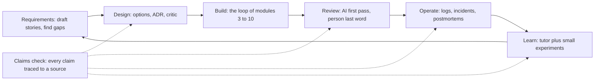

# Module 11 — AI across the lifecycle

*Writing code is only part of an engineer's job. There are also requirements, design, documentation, review, incidents and learning, and AI can help with all of them, but at every stage it can state things nobody checked: a function that does not exist, a number it never computed, a cause that was not in the log. Lesson 11.1 is the concept lesson. It walks the lifecycle stage by stage (drafting requirements with a domain expert, using AI as a critic of your design, writing ADRs in Michael Nygard's format, generating documentation and verifying it against the code, treating code review assistants as a first pass, rebuilding an incident timeline and separating fact from inference in a blameless postmortem, analysing logs, learning a new stack with small experiments, and owning your summaries) and gives you one artefact, the Claims check, a routine that traces every factual claim to a source in the repository or the logs. Lesson 11.2 is the lab. On Najm Remit you write an ADR with a critic's objections recorded, regenerate the lost najmkit reference page and prove it against the code, and draft a postmortem from a constructed incident record in which every timeline fact must match the record. The offline grader is built to behave like a sceptical colleague.*

> **Focus:** Workflow, Verify — use AI at every stage of the job, and check each claim it makes against the code, the logs or the record before you sign it.

---

# 11.1 — Beyond writing code: requirements, design critique, docs, review, incidents and learning
*Level: 🟡 Intermediate* · *Prerequisites: 5.1, 6.1* · *Focus: Workflow*

## ⚡ In 60 seconds
- Writing code is only part of the job. Requirements, design, documentation, review, incidents and learning are mostly text, and AI helps with each. It fails the same way in each: fluent text that states things nobody checked.
- **A draft is a hypothesis.** A claim is verified when you can point to a source you opened: a line of code, a log entry, a command's output, a record id.
- Use AI as a **critic** before an author: ask it to attack your design and make the best case for the alternative.
- It invents names, signatures, numbers, times, causes and references. Keep **facts**, **inferences** and **unknowns** apart.
- The artefact is the **Claims check**, a five-step routine: the more people will trust a document, the more it needs it.

## 🧭 Why it matters
On Monday Hessa asks for the najmkit reference page for the wiki. Lujain types "write the docs for najmkit" into a chat window, with no code. The page that comes back is lovely: `ids.generate(prefix, length=8)`, `clock.utcnow()`, `audit.write(event, fields)`, a note that the library is thread-safe, and `pip install najmkit`. None of it exists. najmkit is Najm's internal library, so nothing outside the bank, a model included, has ever seen it. The page was fluent, and every line that mattered was invented.

In July 2025 Jason Lemkin said a Replit coding agent deleted a production database during a code freeze, then told him a rollback would not work; he recovered the data by hand. Fortune reported it, but the account rests on his own screenshots and nobody has audited it. It still makes the point: an agent's statement about what happened is a claim, not evidence. Habit 4, **Trust evidence, not fluency** (lesson 5.1), must reach the rest of the job.

## 📐 How it works

### 🟢 The essentials

**AI is useful at every stage, and each stage needs its own check.** Anthropic's AI-native SDLC playbook (a vendor describing its own view) calls the lifecycle a loop with AI embedded at each point, not a linear flow. The course adds the check:



**A claim** is any sentence that could be false: a name, a signature, a number, a time, a cause, a reference, an "always" or a "never". Sort each into a bin:

| Bin | Test | Where it goes |
|---|---|---|
| **Fact** | You can point to a source you opened | The body, with the source |
| **Inference** | Reasoned from facts; could be wrong | A labelled section: what it rests on, how sure, what would confirm it |
| **Unknown** | Nobody has the evidence yet | A list of open questions, left open |

**Where AI invents**, and how you catch it:

| Document | What gets invented | How you catch it |
|---|---|---|
| Requirements | "Obvious" rules nobody agreed | The domain expert answers; AI only lists questions |
| Design | Trade-offs that sound right, numbers never computed | Compute them; ask for the strongest objection |
| Docs | Functions, parameters, behaviour | Run the examples; compare signatures with the `def` line |
| Incident write-ups | Times, causes, actions, counts, people | Every row cites a log line or a record id |
| Anything with references | Titles, URLs, section numbers, quotes | Open the link; find the quote |

### 🟡 Going deeper

**Requirements: draft with AI, decide with the expert.** An assistant turns a sentence into stories and finds what it leaves out; it cannot know what the business meant. Hessa's line is "Customers who have been with us a long time should get higher sending limits." Have it list questions, not answers:

```text
Read src/remit/limits.py and src/remit/models.py. Turn the line below into user stories.
Then list every ambiguity or missing fact that would change the code, as questions.
Do not answer them or guess. Mark each: blocks the build, or does not.

"Customers who have been with us a long time should get higher sending limits."
```

A good result (constructed for teaching) has four blocking questions. What is "a long time", counted from when? (`Customer` has no start date, so this needs new data.) Which limit rises, and by how much? How does it combine with the KYC tier, which `check_limits` reads its limits from? May the bank raise limits this way at all? The first three go to Hessa, the fourth to the compliance team. See [*Software Testing*, lesson 1.3 — Requirements, test cases and bug reports](../testing/index.html#/1.3).

**Design: options, ADRs, and AI as a critic.** Ask an assistant for the options and trade-offs before you choose, then record the choice. An *architecture decision record* (ADR) is a short note about one decision. Michael Nygard proposed the form in 2011. As usually summarised it has a title, a status, the context, the decision and the consequences, all of them, not only the good ones (read his article for the exact wording). Here is one for a decision the Remit code already embodies, written compactly (the lab template gives each part a heading):

```markdown
# 4. Fee tiers are chosen by the whole amount

Status: Accepted

Context: `fees.FeeSchedule.tier_index` picks one tier from the whole send amount, upper bound included, and
`fees.explain_fee` prices the whole amount at that tier. On QAR-INR, 500.00 costs 12.00 and 500.01 costs 12.50.

Decision: We pick the tier by the whole amount, not band by band.

Consequences: One sentence explains any quote. The price steps up at every boundary, so a transfer just over one can cost more than two smaller ones.
```

Now make an AI attack it. A model asked "is this good?" can lean towards agreeing: in Anthropic's 2023 study, five state-of-the-art assistants consistently showed sycophancy, a tendency to match what the user believes, across four kinds of task. Ask for evidence against instead:

```text
You are a sceptical senior engineer who did not make this decision. Give the three strongest
objections, each tied to a line of code or a number you computed. Then make the best case for
the alternative you think is strongest. For each objection, say what evidence would show it is wrong.
Do not praise the decision.
```

Check the critic as hard as the draft. Suppose it says "customers will split transfers to dodge the fee steps." Try `quote_fee` on QAR-INR (fictional numbers). At 500.01 the fee is 12.50, and a loop over every two-way split in cents (both parts at least the 50.00 minimum) finds none under 14.00: false at 500. But 2,000.01 costs 40.00 whole and 37.75 as 1,850.00 plus 150.01, and 10,000.01 costs 125.00 whole and 123.50 as 9,850.00 plus 150.01. The objection holds at two of three steps, and one example either way would have misled you. Record the numbers in Consequences. Another objection holds without a script: the express surcharge is added after the cap, so 150.00 becomes 165.00 at 20,000.

**Documentation: generate, then verify, because docs drift.** Generating a page from code is a good use of AI if you hand it the code and forbid it to describe what it has not read: "Read src/najmkit/*.py. Document each public function. Mark anything you inferred." Then run every example and compare every signature with the `def` line. The repository's `docs/ARCHITECTURE.md` has drifted. It describes a `risk.py` that no longer exists, two KYC tiers and no monthly limit (the code has three tiers and monthly limits), and says queries use placeholders (`Store.search_by_name` builds its SQL with `str.format`). `docs/TOUR.md` states the rule: when a document disagrees with the code, the code wins. Docstrings and comments are claims too.

### 🔴 Expert view

**Code review assistants: a first pass, never the last word.** Claude Code has `/code-review` and `/security-review` (commands change between releases: check the current documentation); its documentation describes a writer/reviewer pattern, where a second session with fresh context reviews what the first wrote. Other tools have equivalents. In practice they tend to do well on the dull checklist (a missing test, an inconsistent name, an obvious bug) and worse on intent and domain rules (this course's working view, not a measured result). Anything touching `money.py`, `fees.py`, `fx.py`, `limits.py`, `ledger.py` or `service.py` still needs a second human reviewer (`CONTRIBUTING.md`). The documentation warns that reviewers will usually report something even when the work is sound, so require a file, a line and a failing scenario, and never post a finding you have not reproduced. See [*Software Testing*, lesson 6.1 — Verifying AI-generated code](../testing/index.html#/6.1).

**Incidents: a timeline from logs, a postmortem that separates fact from inference.** Assistants build a timeline fast and are bad at admitting a gap. A *blameless postmortem* describes what happened and what the system allowed, not who failed; Google's SRE book (chapter 15) and SRE Workbook describe the practice. Give the assistant the record alone, and require a source id on every row. A log line is data, not an instruction: it can carry text an attacker chose (lesson 8.1). Here is a draft about a made-up incident, not the lab's (41 `needs_review` rejections from 08:12 to 08:31 UTC, a watchlist file replaced at 08:05), sorted into the bins:

| Draft sentence | Verdict | What to do |
|---|---|---|
| "A corrupted watchlist caused the spike." | Inference: the file changed at 08:05; nobody compared old and new | Move to "What we infer", medium confidence; confirm by diffing the files |
| "The team rolled back at 08:35." | No source: the record has no rollback | Delete it, or ask the person who acted |
| "About 500 customers were affected." | No source: the log has 41 rejection events, not customers | Write "41 rejection events" |

**Data and log analysis: verify the query, then the conclusion.** Run the assistant's query on a tiny input whose answer you know, compute the number a second way, and check the grain: a log holds events, and one customer can produce many.

```bash
grep -c '"event": "transfer.rejected"' audit.jsonl
PYTHONPATH=src python - <<'END'
from collections import Counter
from najmkit import audit
print(Counter(e["reason"] for e in audit.read_events("audit.jsonl") if e["event"] == "transfer.rejected"))
END
```

The count and the Counter's total must agree; if not, find out which is wrong before you write a sentence. "Rejections rose after the release" is a correlation until you know what else changed.

**Learning a new stack: a tutor, with experiments.** An assistant is a patient tutor and a confident wrong one. Predict, run, then ask why. Suppose it says "Python's `Decimal` rounds half up by default." One line settles it: `Decimal("2.665").quantize(Decimal("0.01"))` gives `2.66`, because the default is half-even; with `rounding=ROUND_HALF_UP` it gives `2.67`. In one randomized trial (Anthropic, 2026), 52 mostly junior engineers learned a Python library; the AI group scored lower on a quiz afterwards, 50% against 67%, most of all on debugging. The authors call it small and preliminary, the setup differs from agentic tools, and it comes from Claude Code's vendor: a reason to explain things back, not a law.

**Communication: you own the summary.** A pull request description is a set of claims about your work, and `CONTRIBUTING.md` asks you to describe what you ran and to label AI-assisted changes. "Improves robustness of notification handling" says nothing. "Catches `NotificationError` in `_notify` and audits it; ran `pytest -q`, all passing; not tried against a real provider; AI-assisted: the agent drafted the change, I rewrote the test" can be checked.

**When not to.** A throwaway note does not need the full routine: match the effort to how many people will trust the document and what a wrong line would cost. The critic takes minutes and checking takes longer, so skip both for a decision nobody will revisit. And do not delegate the decision itself: an assistant can read what the code does, but only people know why.

## 🧰 The toolkit
| Tool, practice or pattern | What it is and does | When to reach for it |
|---|---|---|
| **Claims check** | Traces every factual claim in a document to a source in the repo or the logs | Before a document others will trust leaves your hands |
| **ADR** (Michael Nygard) | A short record of one decision: title, status, context, decision, consequences | A decision that is costly to reverse or will be questioned |
| **Critic prompt** | Asks an AI to attack a design with evidence and to steelman the best alternative | Before you accept a design, including your own |
| **Docs drift check** | Generates docs from the code, then checks names, signatures, numbers and examples | Whenever a page describes code that changes |
| **Record-bound timeline** | A timeline built only from a log or incident record, a source id on each row | Any incident draft, whoever writes it |
| **Blameless postmortem** (Google SRE) | A review that separates facts, inferences and unknowns and fixes the system, not a person | After an incident worth remembering |

## 🏛️ In practice at Najm Bank
The artefact is the **Claims check**. Tariq's rule at the weekly clinic: no document leaves the team with a claim nobody traced to a source. Five steps:

1. **List the claims**: every sentence that could be false.
2. **Sort them** into fact, inference and unknown.
3. **Trace each fact** to a source you opened yourself: `path:line`, a command you ran, a log line, a record id. An assistant's own list of sources is a claim too: open them yourself.
4. **Run what can run**: examples, commands, queries. The running code outranks a comment.
5. **Delete or relabel** anything without a source, and keep the table in your notes.

| Claim (where it appears) | Kind | Source you opened | Result |
|---|---|---|---|
| "`risk.py` runs the limit and screening checks" (`docs/ARCHITECTURE.md`) | Fact | `ls src/remit/` | Refuted: there is no `risk.py` |
| "T1 may send up to QAR 5,000 per day" (`docs/ARCHITECTURE.md`) | Fact | `limits.LIMITS` | Refuted: 2,000 daily, 8,000 monthly |
| "A quote is valid for 60 seconds" (your ADR) | Fact | `fx.QUOTE_TTL` | Verified |
| "The vendor caused the failures" (an AI draft) | Inference | none yet | Move to "What we infer" |

Step 3 is partly mechanical. Lesson 11.2 gives you `claims_scan.py`, which looks up backticked paths and `module.name` references in a Markdown file, and times and event ids against an incident record. It cannot tell whether a sentence is true, only whether a claim points at nothing.

## 🛠️ Exercises
- 🟢 **Audit a document by hand.** No agent needed. Trace ten claims in `docs/ARCHITECTURE.md` to the code with `ls`, `grep` and reading. *Done when:* a Claims check table has ten rows, each with its command, and at least three refuted.
- 🟡 **Put a critic on a decision.** Needs an agent or a chat assistant. Write a short ADR for another decision the code embodies (amounts stored as text in SQLite, say), run the critic prompt and check each objection as the lesson did. *Done when:* three objections are listed, each with your evidence and decision.
- 🔴 **Catch an assistant inventing.** Needs an agent or a chat assistant, in a session with no access to the repository. Ask it to document `remit.limits` from memory, then verify each claim against `src/remit/limits.py` and by running code. *Done when:* a table marks each claim verified, refuted or unverifiable, and counts the invented names.

## ⚠️ Mistakes and traps
- **Pasting without the source.** With no code, an assistant invents the code. Give it the files.
- **Asking for approval.** "Is this design good?" invites a yes. Ask for objections with evidence, then verify them.
- **Letting comments outrank code.** A docstring or an old page can be stale. Run the code.
- **Smoothing over a gap.** A timeline with a hole is honest; an assistant fills it with something plausible. Leave the hole.
- **Confusing events with people.** "41 rejections" is a fact; "41 customers" is an inference.

## 🧾 Recap
- AI helps at every stage, and at every stage it can state unchecked things with confidence. A draft is a hypothesis.
- Sort claims into fact (with a source you opened), inference (labelled) and unknown (left open).
- Use AI as a critic: ask for the strongest objections and the best alternative, then check the objections with more than one example.
- Generate docs from code, then verify names, signatures and examples by running them; the code wins.
- A review assistant is a first pass; you own the comment, and money logic still needs a second human.

## ✍️ Check yourself

**1. An assistant with no access to the repository writes a page for najmkit that mentions `ids.generate(prefix, length=8)`. What is the most likely explanation?**

- A. najmkit renamed the function in a recent release
- B. The model has never seen najmkit and filled the gap
- C. The page was written for an older Python version
- D. The assistant read an outdated copy of the code

<details><summary>Answer</summary>

**B.** najmkit is internal, so no model has seen it; asked to document it, a model invents plausible names. The other options assume it had read some version of the code. (🧭)

</details>

**2. A critic says customers will split transfers to dodge the fee steps. You try 500.01 QAR and no split is cheaper. What do you do before the ADR calls the objection false?**

- A. Accept it anyway, since the critic was told to be sceptical
- B. Record it as false, since you tested the boundary it named
- C. Ask the critic to repeat the objection more strongly
- D. Compute whole and split fees at every step, not only one

<details><summary>Answer</summary>

**D.** An objection is a claim, and one example is weak evidence either way. `quote_fee` gives 12.50 for 500.01 whole and no cheaper split, but 40.00 for 2,000.01 whole against 37.75 as 1,850.00 plus 150.01. Accepting or rejecting it early skips the evidence. (🟡 Design.)

</details>

**3. A postmortem draft says "About 500 customers were affected". The incident record shows 41 `transfer.rejected` events and no customer count. How should the sentence change?**

- A. Replace it with "41 rejection events"
- B. Keep it, since 500 is a reasonable estimate
- C. Round it down to 41 customers
- D. Keep it and add "approximately" before 500

<details><summary>Answer</summary>

**A.** The record supports events, not customers, and a number with no source is an invention however it is hedged. "41 customers" repeats the mistake. (🔴 Incidents.)

</details>

**4. `docs/ARCHITECTURE.md` says T1 may send QAR 5,000 a day, and `limits.LIMITS` says 2,000. Which do you rely on for what the system does today, and why?**

- A. The document, because a person wrote it deliberately
- B. The newer of the two, whichever has the later commit date
- C. The code, because running code outranks a description of it
- D. Neither, until the product owner confirms the figure

<details><summary>Answer</summary>

**C.** What the system does is what the code does; the document is a claim about it and has drifted, as `docs/TOUR.md` says. The owner decides what the system should do, not what it does. (🟡 Documentation.)

</details>

**5. Your assistant's review of a pull request that edits `fees.py` reports no problems. What does that change about the review process?**

- A. Nothing: a second human reviewer is still required
- B. It replaces the second human reviewer on small diffs
- C. It lets the author approve their own change
- D. It is enough if the assistant was a different model

<details><summary>Answer</summary>

**A.** `CONTRIBUTING.md` requires a second human reviewer for `fees.py` and the other money modules. An assistant's pass is a first pass: it saw the diff, not the intent. (🔴 Review.)

</details>

## 📚 References
- Michael Nygard, "Documenting Architecture Decisions" (15 November 2011); the adr-tools README confirms its title and date: https://github.com/npryce/adr-tools
- Google, *Site Reliability Engineering*, chapter 15, "Postmortem Culture: Learning from Failure": https://sre.google/sre-book/table-of-contents/ ; the SRE Workbook chapter: https://sre.google/workbook/postmortem-culture/
- Claude Code documentation: commands (`/code-review`, `/security-review`): https://code.claude.com/docs/en/commands ; best practices (the writer/reviewer pattern): https://code.claude.com/docs/en/best-practices
- Go deeper: Anthropic, "Towards Understanding Sycophancy in Language Models": https://www.anthropic.com/research/towards-understanding-sycophancy-in-language-models ; Anthropic, "How AI assistance impacts the formation of coding skills": https://www.anthropic.com/research/AI-assistance-coding-skills ; Anthropic, "The AI-native SDLC playbook": https://claude.com/blog/the-ai-native-sdlc-playbook
- [*Cloud & DevOps*, lesson 5.3 — Incidents and blameless postmortems](../cloud/index.html#/5.3)

---

# 11.2 — Lab: an ADR with a critic, docs checked against code and a postmortem that sticks to the facts
*Level: 🟡 Intermediate* · *Prerequisites: 11.1* · *Focus: Workflow, Verify*

## ⚡ In 60 seconds
- Lab `m11`, on Najm Remit: three documents whose claims the grader can look up. An **ADR** with a critic's objections, the **najmkit page** regenerated from the code, and a **postmortem** drafted from a constructed incident record.
- **Needs an agent: no** (recommended, not required). The grader looks at the result.
- It hunts for false claims: a missing name, a signature that does not fit, an example that fails, a number or time not in the record, a cause stated as fact.
- It cannot judge prose or wisdom, or tell a real critic from none. Your Claims check covers the rest.

## 🧭 Why it matters
Friday is the internal audit, and Hessa's ticket asks for three documents. Lujain's assistant can draft all three in minutes and she is tempted to believe it: it will flatter the design it is shown, describe a library it has never read and fill every gap in an incident record with something plausible. The grader is the colleague who believes none of it and opens the code or the record behind every sentence.

## 📐 How it works

### 🟢 The essentials

Each document makes claims, and each kind of claim points at a different source:

| Document | Its claims point at | What an assistant tends to invent |
|---|---|---|
| ADR | The repository: paths, `module.name`, constants | A module the old architecture page lists; a stale figure |
| najmkit page | `src/najmkit/`: names, signatures, running examples | Functions, parameters, "thread-safe", `pip install` |
| Postmortem | `incident.json`: event ids, times, counts | A cause, an action, a customer count, a person |

Work one document at a time: draft, scan, check by hand, fix, commit. `lab-assets/claims_scan.py` does the mechanical lookup. On `docs/ARCHITECTURE.md` in a fresh lab it prints (cut to the first two findings):

```text
docs/ARCHITECTURE.md:16  `risk.py`  no such file
docs/ARCHITECTURE.md:23  `najmkit.md`  no such file
...
docs/ARCHITECTURE.md: 19 claims looked up, 4 do not resolve
```

A clean scan is not a pass: it looks up names, paths, times and event ids only, never signatures, examples or phrasing, and a real path can sit beside a false sentence. It is habit 5, **Automate the loop, keep the skill**, in small.

### 🟡 Going deeper

**The ADR.** The Context is where an assistant helps, if it reads the file first: "Read `src/remit/limits.py`. Draft the Context of an ADR for the fixed UTC+3 windows. Cite every claim as a path or `module.name` in backticks. State no number you did not read." Then run the critic prompt from lesson 11.1 and check each objection that is itself a claim. A critic who says "the quote lifetime is too long" has read a number: open `fx.py`. The responses are yours: they are decisions.

Say who the critic was. An agent working alone is not a fresh critic of its own draft: use a separate session or subagent that sees only the ADR and the code. A nested agent that cannot start one plays the critic in a second pass and says so. The grader cannot tell; a reader can.

**The najmkit page.** Give the assistant the three files and a narrow job: "Read every file in `src/najmkit/`. For each public function and class write its signature, copied from the `def` line, and one sentence about what it does that you can point to in the code. Add one example per module that runs. List where a docstring and the code disagree." Then verify by experiment: run each example, and call the functions with a bad input, a missing file, nothing configured. A docstring is a claim like any other, and the running code wins. Every comment you can show to be wrong goes under "Known problems".

**The postmortem.** Start the assistant in plan mode (`claude --permission-mode plan`; check the current documentation) in an empty folder holding only copies of `lab-assets/incident.json` and the template. Plan mode limits edits, not reading, and a session that has read the repository brings its guesses about the gateway; an agent that already holds that context says so and leans on the hand check. Say: "Use only `lab-assets/incident.json`. Every row names its event id and the record's time. Put what the record states under 'What we know', what you reason beyond it under 'What we infer' (event ids, confidence, what would confirm it) and what it cannot answer under 'What we do not know'. Name no one the record does not name." A typical first draft from an assistant told only to "write a postmortem" (constructed for teaching, not recorded from a model) has a Summary that opens like this:

```text
On 11 March 2026 an outage at our SMS gateway vendor, caused by a configuration change on their side,
stopped confirmation messages for roughly 2,000 customers for 52 minutes. The on-call engineer restored
service by failing over to the backup provider at 10:40.
```

The date, the 52 minutes and the gateway vendor come from the record. The channel, the cause, the configuration change, the customer count, the failover and the time are invented. Two traps survive a careful draft. Keep who said it and when: E5 is what one engineer found at 10:26, not a fact about the whole window. And cite the events behind a figure you work out ("13 minutes after the first failure (E1, E2)").

### 🔴 Expert view

**What the grader can and cannot tell.** It checks the result, not your thinking. It reads the kit's own copy of the incident record, so editing `lab-assets/incident.json` cannot move the goalposts. Its rules are a sieve, not a proof:

- A false sentence that matches no rule passes. "`audit.read_events` returns the newest event first" is false (it reads the file in order) and nothing looks for it. Only a person who read the code catches it.
- A made-up `module.name` is caught only when the module is real: `limits.check_everything` fails, `risk.check` is skipped (it could be a library name). A made-up path such as `risk.py` is caught.
- A duration must cite two events that are that far apart; the grader cannot tell whether the sentence means them.
- It cannot tell whether your critic was real, the decision wise or the prose clear.

If the grader flags a true sentence, do not bend the truth: reread the code or record and, if you are right, rephrase so the claim is checkable. To quote a wrong name on purpose, say in the same sentence that it does not exist.

## 🧰 The toolkit
| Tool, practice or pattern | What it is and does | When to reach for it |
|---|---|---|
| **Claims scan** | `claims_scan.py`: looks up paths, `module.name`, times and event ids in a Markdown file | After every draft |
| **Record-bound timeline** | A timeline built only from a record, an event id on each row | Any incident write-up |
| **Agent log** | A table of prompts, results, corrections and time | After any session where an agent wrote something you will sign |

## 🏛️ In practice at Najm Bank
**Needs an agent: no.** It is recommended, not required. The **no-agent path** works too: write the ADR and play your own critic, or ask a colleague; read the three small files of `src/najmkit/` (about 200 lines) and write the page; build the timeline from the record by hand. The grader does not care how the work was produced.

**The ticket.** Hessa wrote it; in your lab it is `TASK.md` (the kit's `task.md`):

```text
# REMIT-393: three pages the team is missing

**From:** Hessa, Product Owner, Najm Remit
**To:** Payments Platform
**Priority:** Medium. Internal audit asks to see these on Friday.

Three pieces of writing are overdue, and each must be *true*, not only tidy. Use an AI assistant if
you like; you are accountable for every sentence. This ticket is documentation only: do not change
code, tests or `lab-assets/`. Run the commands below in this directory. Code comments that disagree
with what the code does (there is at least one) go under "Known problems" at the end of the najmkit
page, a sentence each; do not fix them here.

### 1. An ADR for a decision we already made

Write one ADR, `docs/adr/0001-<short-title>.md`, in Michael Nygard's format: a title, then **Status**,
**Context**, **Decision**, **Consequences**, in that order (start from `lab-assets/adr-template.md`;
Context needs 25 words or more, Decision 8, Consequences 20). Pick one decision the code embodies:
fixed UTC+3 windows (`limits.py`), `Decimal` rounded half up (`money.py`), a failed notification not
undoing a transfer (`service.py`), amounts stored as text (`store.py`), a 60-second quote (`fx.py`),
or najmkit vendored in the repository.

Cite the code as `path` or `module.name` in backticks (two or more, one of them in `src/`), and
name a downside in Consequences. Then ask a critic (an AI assistant, a colleague, you in a bad mood)
to attack the decision and make the best case for the strongest alternative. End with a section
"Critic's objections": three or more, each of eight words or more, with what you did (accepted,
rejected with a reason, or deferred).

### 2. The najmkit page, back from the dead

`docs/najmkit.md` was lost in the docs migration. Write it again from `src/najmkit/` (`ids`, `clock`,
`audit`): every public function and class as `name(parameters)` copied from the def line (a method's
`self` may stay or go), what it does (40 words of prose or more in all), and a short example per
module that runs, in a `python` block. Nothing outside the bank has seen najmkit: the code is your only source.

### 3. A postmortem for INC-2031

`lab-assets/incident.json` is the record of last Wednesday's incident (constructed for teaching).
Write `docs/postmortems/INC-2031.md` from it, starting from `lab-assets/postmortem-template.md`.

* The record is your only source. One timeline row per event: its time (UTC) first, then its event id
  (E1, E2, ...) and what it says. Cover nine of the thirteen events or more, among them the first
  failure, the alert, the alert resolving and the reconciliation.
* Keep apart what we **know** (the record says it), what we **infer** (two or more; say what each rests
  on, how confident you are, what would confirm it) and what we **do not know** (two or more questions
  the record cannot answer).
* No invented numbers, times, causes or people. A figure you work out, such as a gap in minutes, cites
  its events (E1, E2) in the same paragraph, bullet or row; the record has no percentages, so give
  counts. Blameless: what happened and what the system allowed, not who was at fault.
* Three or more action items, each with an owner (a role or a team) and a way to see it is done.

`python lab-assets/claims_scan.py <file>` finds paths and names that point at nothing (add
`--record lab-assets/incident.json` for the postmortem). It cannot tell whether a sentence is true.

### Done when

Each document passes its checks, only `docs/` changed, and each document is its own commit with a
message that follows `CONTRIBUTING.md` (`type(scope): subject`; any lower-case scope, such as
`docs(adr)`, is fine). Grade it from the `ailab` folder of the course repository:
`python -m ailab grade m11 --dir <this directory>`
```

**Start.**

```bash
cd ainative/ailab
python -m ailab start m11 --dir ~/ainative/m11
cd ~/ainative/m11
```

The start commit holds `lab-assets/` and `TASK.md`; `git diff lab-start` shows your changes.

**Your move.** (1) Read the ticket, the record and `src/najmkit/` yourself first. (2) Take one document at a time; with an agent, hand it the files and the narrow prompts above, not the ticket alone. (3) After each draft run the scanner, then do the rest of the Claims check by hand: run the examples, call the functions, read the record row by row. Keep the Claims table in your notes, not the lab. (4) Commit each document on its own, for example `docs(adr): record why a failed notification does not undo a transfer`. (5) Grade and fix.

**What the grader checks** (the minimums are in the ticket). *The ADR:* its four sections, a valid status, a named downside; every cited `path` and `module.name` exists and no figure contradicts the code, in digits or in words; three objections, each with a decision. *The najmkit page:* every name exists; each signature matches the `def` line; each module has an example that runs; the whole public API appears with signatures; nothing testable contradicts the code; the stale comment is reported (advisory). *The postmortem:* its sections; timeline rows that match the record; no invented number, time, date, id, person, cause or action; labelled inferences and open questions; blameless wording (advisory). *The repository:* only `docs/` changed; each document first committed on its own; messages follow `CONTRIBUTING.md`; nothing uncommitted; no secrets.

**Grade.**

```bash
# run from the ainative/ailab folder of the course repository, not from the lab directory
python -m ailab grade m11 --dir ~/ainative/m11
```

On the untouched starter (the middle is cut; the other checks wait for the documents):

```text
[FAIL] ADR exists in docs/adr/: no file like docs/adr/0001-short-title.md
...
[FAIL] Only documentation changed: no files have changed yet
[FAIL] Three documents, three commits: 0 new commits since the start; none of the three documents exists yet
[FAIL] Commit messages follow CONTRIBUTING.md: found 0 commits since the start; expected at least 1
[PASS] Everything is committed
[PASS] No secrets in the change

Lab m11: 2/21 required checks passed: NOT YET
```

After a first assistant draft of each document, committed as it came (drafts constructed for teaching, not recorded from a real model), three of the failing lines look like this (hints left out):

```text
[FAIL] Docs: every name exists in the code: `ids.generate` does not exist in najmkit.ids; `clock.utcnow` does not exist in najmkit.clock; `audit.write` does not exist in najmkit.audit
[FAIL] Docs: nothing contradicts the code: Nothing in the code supports a thread-safety claim: "...an event. najmkit is thread-safe and installs with pip..."; Check how najmkit is distributed (see src/najmkit/__init__.py): "...and installs with pip install najmkit."
[FAIL] Postmortem: every timeline row matches the record: row 10:15: E3 is not at that time in the record; row 10:40: E9 is not at that time in the record
```

Each line says what failed and quotes the words that caused it; none gives the answer. A passing run ends with `Lab m11: 21/21 required checks passed: PASSED`.

**Weekly deliverable.** The three documents, one commit each, in the lab repository; in your notes repository, `week-11/` with a Claims table per document, your agent log and your debrief answers.

**Group session (60 minutes).** (1) Swap postmortems; check your partner's timeline against the record (20). (2) Read out the objections you rejected, with the evidence (15). (3) Show a sentence the grader passed that you doubt, or flagged and you disagree with (15). (4) Agree one team rule for AI-written documents (10).

**Debrief questions.** What did the agent get wrong, and which errors did the scanner catch? What did your context or prompt miss? Which claims did you delete, and which did you move to inference or to unknown?

**Agent log template.**

```markdown
### Agent log: week 11
| Part | Prompt (one line) | What the agent did | What I corrected | Minutes |
|---|---|---|---|---|
| ADR | | | | |
| najmkit page | | | | |
| Postmortem | | | | |

Claims I deleted or relabelled:
One thing I will do differently:
```

## 🛠️ Exercises
- 🟢 **Read before you write.** No agent needed. Start the lab, grade the starter, read the record and `src/najmkit/`. *Done when:* you have five questions the record cannot answer and five facts about najmkit you could not have guessed.
- 🟡 **The najmkit page, end to end.** An agent is recommended. *Done when:* the najmkit checks pass and your Claims table lists six promised behaviours, each with the call that showed it.
- 🔴 **Break your own work.** An agent can help. Plant one invented fact in each finished document and note which check caught it; then write one plausible false sentence per document that the grader misses. *Done when:* a table of three caught and three missed claims, with how a person would find each missed one.

## ⚠️ Mistakes and traps
- **Briefing the assistant without the code.** It invents the library. Hand it the files.
- **Trusting the assistant's sources.** Open them. A real path can sit beside a false sentence.
- **Fixing a stale comment in this change.** The ticket says to report it; the grader flags source edits.
- **Writing the postmortem with certainty.** If the record does not say it, it is an inference or an unknown.
- **Squashing three documents into one commit.** The grader checks which commit first holds each.

## 🧾 Recap
- Each document's claims point at a source: the repo, the library's code, the incident record. Checking means opening it.
- Have the assistant read first, ask for objections with evidence, and keep facts, inferences and unknowns apart.
- A scanner finds claims that point at nothing; a person finds the false sentence.
- The grader is a sieve: what passes it is not thereby true.

## ✍️ Check yourself

**1. Your ADR passes `claims_scan.py` with no unresolved claims. What does that tell you?**

- A. Each path and known code name it cites in backticks exists
- B. Every figure it quotes agrees with the constants in the code
- C. It is complete enough to be merged without a human review
- D. The decision that it records has been shown to be a sound one

<details><summary>Answer</summary>

**A.** The scanner only looks up backticked paths and the `module.name` references it recognises. A real path can sit beside a false sentence, so figures and reasoning still need your Claims check. (🟢 The essentials.)

</details>

**2. A timeline row reads "10:15, the on-call SRE began investigating (E3)". The record puts E3 at 10:14: the page was acknowledged. What do you do?**

- A. Use the record's time and wording for that row
- B. Keep the row, because 10:15 is only a minute off
- C. Drop E3 from the timeline since it is disputed
- D. Ask the assistant to explain the discrepancy

<details><summary>Answer</summary>

**A.** The record is the only source: its time and its words. "Began investigating" is an invented action, and a minute's difference is an invented time. Asking the assistant to explain asks it to invent a reason. (🟡 The postmortem.)

</details>

**3. Your critic says "the quote lifetime of five minutes is too long". `fx.py` defines 60 seconds. What do you do?**

- A. The critic is right in spirit, so shorten the quote lifetime
- B. The critic is unreliable, so drop the critic step
- C. Nothing, since an objection needs no evidence to be recorded
- D. The critic misread a number: record it and reject it

<details><summary>Answer</summary>

**D.** An objection is a claim, and this one rests on a false premise. Recording it with the evidence is the point of the section; the critic stays useful. (🟡 The ADR.)

</details>

**4. A docstring says a function returns `None` on failure, but with a bad input it raises `ValueError`. What does your page say?**

- A. What the docstring says, since it records the intent
- B. What the code does, and the mismatch under Known problems
- C. Nothing, since a reference page should not mention failures
- D. Both behaviours side by side, so the reader can choose

<details><summary>Answer</summary>

**B.** The running code outranks a comment, and the ticket sends wrong comments to Known problems instead of fixing them here. Documenting both repeats the false claim. (🔴 What the grader can and cannot tell.)

</details>

**5. Your three documents pass all 21 required checks. Which conclusion is justified?**

- A. Every sentence in the three documents is true
- B. No claim the grader tests contradicts the code or the record
- C. A human reviewer no longer needs to read the documents
- D. The grader has shown that the critic was a real AI assistant

<details><summary>Answer</summary>

**B.** The grader is a sieve: it finds claims it has a rule for. A false sentence with no rule, such as an untested remark about ordering, passes, so a human still reads. (🔴 What the grader can and cannot tell.)

</details>

## 📚 References
- Michael Nygard, "Documenting Architecture Decisions" (15 November 2011): https://github.com/npryce/adr-tools (confirms the title and date)
- Google, *Site Reliability Engineering*, chapter 15, "Postmortem Culture: Learning from Failure": https://sre.google/sre-book/table-of-contents/ ; the SRE Workbook chapter: https://sre.google/workbook/postmortem-culture/
- Claude Code documentation: plan mode and best practices: https://code.claude.com/docs/en/best-practices
- Lab kit: https://github.com/Tamoura/system-design-for-vibe-coders/tree/main/ainative/ailab
- [*Cloud & DevOps*, lesson 5.3 — Incidents and blameless postmortems](../cloud/index.html#/5.3)
