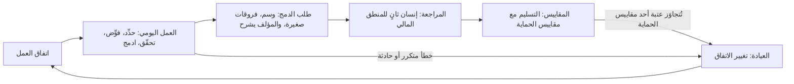

# الوحدة 12 — الفرق الأصيلة في الذكاء الاصطناعي (AI-native teams)

*معظم ما تتدرّب عليه الوحدات من 2 إلى 11 (Modules 2 to 11) شخصي (personal): سياقك (your context) ومواصفاتك (your specs) ومراجعاتك (your reviews). وفريق من ثمانية أفراد لا يصير أصيلًا في الذكاء الاصطناعي (AI-native) بجمع ثماني عادات جيدة (adding up eight good habits)، لأن طلب الدمج (pull request) الذي يكتبه شخص في دقائق يقرؤه آخر في ساعات، ولأن المقياس الذي تعرضه لوحة المتابعة (dashboard) نادرًا ما يكون المقياس المهم، ولأن المبتدئ (junior) الذي يسلّم بسرعة قد يتعلّم ببطء. الدرس 12.1 هو درس المفاهيم (the concept lesson). يغطي السياق المشترك (shared context) — ذاكرة المستودع (the repository memory) وملف CONTRIBUTING.md واتفاق العمل (the working agreement) — وأعراف مراجعة طلبات الدمج المدعومة بالذكاء الاصطناعي (review norms for AI-assisted pull requests): ضع عليها وسمًا (label them) وأبقها صغيرة (keep them small) واجعل المؤلف يشرح (make the author explain) وضع إنسانًا ثانيًا على منطق الأموال (put a second human on money logic)؛ والملكية وصاحب التغيير المسجَّل (ownership and the author of record)؛ وكيف تُدخل المبتدئين (bring juniors on) بالشرح العكسي (explain-back) وتمارين بلا ذكاء اصطناعي (no-AI reps)؛ ومقاييس التسليم من DORA (DORA's delivery metrics) بتعريفات قابلة للقياس (measurable definitions)؛ ولماذا يضلّل عدد أسطر الشيفرة وقبول الاقتراحات (why lines of code and suggestion acceptance mislead)؛ ومقاييس الحماية (guard metrics)؛ وسياسة الأدوات والبيانات والأسرار والتراخيص (policy on tools, data, secrets and licences)؛ وحوكمة الكلفة (cost governance)؛ وإدارة التغيير (change management)؛ والخطوات الخمس بعد حادثة سببها الذكاء الاصطناعي (the five steps after an AI-caused incident). ويعطيك مُخرَجًا واحدًا (one artefact) هو اتفاق العمل بالذكاء الاصطناعي (the AI working agreement). أما الدرس 12.2 فهو الورشة (the workshop): تكتب الدليل العملي للهندسة بالذكاء الاصطناعي (AI engineering playbook) لمنصة المدفوعات (Payments Platform) في نجم ريميت (Najm Remit): قواعد تنتهي بفحص (rules that end in a check)، وأعراف مراجعة محددة (concrete review norms)، وخطة مقاييس (metrics plan) يمكن فيها حساب كل مقياس مرتين (every metric can be computed twice). يقرؤه مُقيِّم يعمل دون اتصال (an offline grader) كما يقرؤه قائد تقني متشكك (a sceptical tech lead)، ويقول بوضوح ما لا يستطيع معرفته (says plainly what it cannot tell). وكل ما يخص جانب نجم خيالي (Everything on the Najm side is fictional).*

> **التركيز (Focus):** Team — تحويل العادات الشخصية الجيدة (good personal habits) إلى ممارسة مشتركة (a shared practice) مكتوبة (written down) ومملوكة (owned) وقابلة للفحص (checkable): أعراف لها مالكون (norms with owners)، ومقاييس لها تعريفات (metrics with definitions)، وسياسة يمكن أن تفشل في اختبار (policy that can fail a test).

---

# 12.1 — ممارسة الفريق: الاصطلاحات وأعراف المراجعة والملكية والمبتدئون والمقاييس والسياسة (Team practice: conventions, review norms, ownership, juniors, metrics and policy)
*المستوى (Level): 🔴 متقدم (Advanced)* · *المتطلبات (Prerequisites): 0.3، 5.1، 10.1* · *التركيز (Focus): Team*

## ⚡ الدرس في دقيقة (In 60 seconds)
- **ممارسة الفريق (team practice)** هي ما يبقى صحيحًا حين يغيب أفضل مهندس لديك (your best engineer is away): سياق مشترك (shared context) وأعراف مراجعة (review norms) ومالكون (owners) ومسار للمبتدئين (a path for juniors) ومقاييس (metrics) وسياسة (policy)، ولكل منها فحص (a check).
- المراجعة (Review) هي عنق الزجاجة (the bottleneck) الذي ينقله الذكاء الاصطناعي ولا يزيله (moves but does not remove). **ضع وسمًا** على طلب الدمج (**Label** the pull request)، وأبقه **صغيرًا** (**small**)، واجعل **المؤلف يشرحه** (make the **author explain** it)، وضع **إنسانًا ثانيًا** (a **second human**) على منطق الأموال (money logic).
- **صاحب التغيير المسجَّل (author of record)** يبقى مسؤولًا (accountable). «الوكيل فعلها» ("The agent did it") ليست سببًا جذريًا (root cause) أبدًا.
- قِس **التسليم (delivery)** بمقاييس DORA (DORA's metrics) وراقب **مقاييس الحماية (guard metrics)** بجانبها. لا تضع هدفًا (target) لعدد أسطر الشيفرة (lines of code) ولا لقبول الاقتراحات (suggestion acceptance) ولا لنسبة الشيفرة التي كتبها الذكاء الاصطناعي (the share of AI-written code).
- السياسة التي لا مالك لها ولا فحص أمنية (A policy without an owner and a check is a wish). وحين ينكسر شيء (When something breaks): احتوِ (contain)، واحفظ الأدلة (preserve)، وراجع دون لوم (review without blame)، وغيّر ضابطًا واحدًا (change one control).

## 🧭 لماذا يهم (Why it matters)
بعد ثلاثة أشهر من طرح منصة المدفوعات (Payments Platform) لأدواتها (rolled out its tools)، يسأل حمد (Hamad)، رئيس أمن المعلومات (CISO)، طارقًا (Tariq)، قائد الهندسة (engineering lead)، سؤالين: كم من شيفرتنا كتبه الذكاء الاصطناعي، وهل صرنا أسرع؟ ⁦(how much of our code is AI-written, and are we faster?)⁩ تقدّم لوحة المتابعة في بيئة التطوير (IDE dashboard) بديلًا عن الأول (41% من الاقتراحات مقبولة؛ وكل رقم هنا خيالي — every figure here is fictional) ولا شيء يجيب عن الثاني. وفي الأسبوع نفسه تفتح لجين (Lujain)، المهندسة حديثة التخرج (graduate engineer)، طلب دمج من 1,100 سطر متغيّر (1,100 changed lines)، كتب الوكيل معظمها، بلا وسم (unlabelled)، ويمسّ `fees.py`. ينتظر أربعة أيام ثم يُعتمد لأن أحدًا لا يستطيع قراءة 1,100 سطر قراءة متأنية (nobody can read 1,100 lines closely).

والمشاعر أيضًا تضلّل (Feelings also mislead): ففي تجربة عشوائية واحدة (one randomized trial) على مطورين ذوي خبرة (experienced developers) في مستودعاتهم الخاصة (their own repositories)، استغرقت المهام وقتًا أطول مع أدوات الذكاء الاصطناعي المتاحة في مطلع 2025 (took longer with early-2025 AI tools) مع أن المطورين ظنّوا أنهم كانوا أسرع (believed they had been faster) — METR، 2025؛ وقد تختلف بيئات أخرى وأدوات أحدث (other settings and newer tools may differ).

## 📐 كيف يعمل (How it works)

### 🟢 الأساسيات (The essentials)

**السياق المشترك (Shared context)** هو العادة 1 (habit 1)، **السياق أولًا (Context first)**، على مستوى الفريق (at team scale). ما يحتاجه مهندس جديد أو جلسة وكيل (a new engineer or agent session) يعيش في المستودع (lives in the repository): `CONTRIBUTING.md` للأشخاص والأدوات (for people and tools) — صيغة الإيداع (commit format) والوسم (the label) ومراجع ثانٍ (a second reviewer) — و`CLAUDE.md` للوكلاء (for agents) (الدرس 2.1)، و`.claude/settings.json` لقواعد المنع والخطافات (for deny rules and hooks). و`CLAUDE.md` سياق لا إنفاذ (context, not enforcement): فوثائق ذاكرة Claude Code (the Claude Code memory documentation) توصي باستخدام خطاف `PreToolUse` لحجب إجراء أيًّا كان ما يقرّره النموذج (to block an action whatever the model decides).

تفيد Meta، في روايتها الخاصة عن بناء تطبيق بوكيل ذكاء اصطناعي (its own account of building an app with an AI agent)، بأن الفريق يقنّن التصحيح مرة واحدة للجميع (encodes the correction once, for everyone) حين يكرر الوكيل خطأً أكثر من مرتين (when the agent repeats a mistake more than twice): هذه رواية الشركة نفسها لا دليل مستقل (a company's own account, not independent evidence)، لكنها عادة سليمة (a sound habit). وصيغة نجم (Najm's version): في المرة الثانية (the second time) يضيف من يرى الخطأ سطرًا إلى `CLAUDE.md`، أو قاعدة أو خطافًا (a rule or hook)، في طلب دمج (in a pull request).



**أعراف مراجعة طلبات الدمج المدعومة بالذكاء الاصطناعي (Review norms for AI-assisted pull requests).** يجعل الوكلاء الفروقات رخيصة (Agents make diffs cheap)؛ وقراءتها ليست أرخص (reading them is not cheaper). تحمي الأعراف المراجع (The norms protect the reviewer)، ولكل عرف فحص (each has a check):
- **ضع الوسم (Label)** `AI-assisted` على الطلب حين تكتب أداة أي جزء منه أو تشكّله (when a tool wrote or shaped any part). *الفحص (Check):* يقارن التكامل المستمر (CI) الوسم بسطر نعم/لا في القالب (compares the label with a yes/no line in the template).
- **400 سطر متغيّر على الأكثر (At most 400 changed lines)**، وتغيير منطقي واحد (one logical change) — اختيارنا؛ ولا دراسة تحدد الرقم (our choice; no study fixes the number). ربط تقرير DORA لعام 2024 (DORA's 2024 report) جزءًا من هبوط في الاستقرار (a stability dip) بالدفعات الأكبر (larger batches) — ارتباط لا سببية (an association, not a cause). *الفحص (Check):* خطوة في التكامل المستمر تعدّ الأسطر (a CI step counts lines).
- **المؤلف يشرح (The author explains).** يجوز للمراجع أن يسأل أي «لماذا» (A reviewer may ask any "why"). *الفحص (Check):* الوصف أدناه (the description, below).
- **اختبارات مع التغيير أو قبله (Tests with or before the change)**، ويُشاهَد فشلها بدونه (seen to fail without it). الاختبار الذي لا يستطيع أن يفشل لا يثبت شيئًا (A test that cannot fail proves nothing): **ثق بالدليل لا بالطلاقة (Trust evidence, not fluency)**.
- **إنسان ثانٍ (A second human)** لـ`money.py` و`fees.py` و`fx.py` و`limits.py` و`ledger.py` و`service.py`. *الفحص (Check):* مالكو الشيفرة وحماية الفرع (code owners and branch protection). ومراجعة الذكاء الاصطناعي (An AI review) فحص أولي (a first pass)، وليست الإنسان الثاني أبدًا (never the second human).
- **أول مراجعة خلال يوم عمل واحد (First review within one working day).** المراجعة هي الطابور الذي يكبر (Review is the queue that grows) (الدرس 10.1). *الفحص (Check):* تقرير أسبوعي لزمن الإنجاز (a weekly turnaround report).

الوصف الذي يجعل الأعراف حقيقية، الضعيف مقابل القوي (The description that makes the norms real, weak against strong):

```text
Weak:   Improves fee display and adds tests. All checks green.

Strong: feat(cli): add quote --explain to show how a fee is worked out
        REMIT-244. AI-assisted: yes. Claude Code drafted the change and tests; I rewrote the tier numbering.
        Size: 112 changed lines, one change. Money modules edited: none (fees.py is only read).
        Ran: pytest -q, 102 passed. Reverted src/ and watched the 2 new tests fail. Ran quote at
        100, 500, 500.01 and 20000 by hand; output pasted below.
        Not checked: Arabic output (the flag changes English text only).
```

**الملكية (Ownership).** صاحب التغيير المسجَّل (The author of record) هو الشخص الذي يحمل طلب الدمج اسمه (the person whose name is on the pull request) (الدرس 0.3). لكل شيء مشترك مالك واحد مسمّى (Every shared thing has one named owner): ملف الذاكرة (memory file) وقائمة الأدوات المعتمدة (approved-tools list) والاتفاق (agreement) وجدول المناوبة (on-call rota). «الذكاء الاصطناعي حذفه» ("The AI deleted it") بداية مراجعة ما بعد الحادثة (a postmortem's start) لا نهايتها: اسأل عمّا كان مسموحًا للوكيل أن يفعله (what the agent was allowed to do)، ومن اعتمد التغيير (who approved the change)، وأي فحص كان ينبغي أن يوقفه (which check should have stopped it).

### 🟡 التعمق أكثر (Going deeper)

**المبتدئون (Juniors).** الأدلة تشير في اتجاهين (The evidence points two ways). وجدت التجارب الميدانية (Field experiments) — Cui وزملاؤه (Cui and colleagues)، وGitHub Copilot في Microsoft وAccenture وشركة من قائمة Fortune 100 — أن عدد المهام المنجزة يزيد مع مساعد (more tasks completed with an assistant)، وأكثر ما يزيد لدى المطورين الأقل خبرة (most for less experienced developers)؛ وكانت النتيجة المقيسة عدد المهام لا الجودة (the outcome was task counts, not quality). وفي تجربة Anthropic الصغيرة المذكورة في الدرس 11.1 (the small Anthropic trial of lesson 11.1) سجّل مهندسون معظمهم مبتدئون يتعلمون مكتبة بمساعد (mostly junior engineers learning a library with an assistant) 50% في اختبار فهم (a comprehension quiz) مقابل 67% لمن برمجوا يدويًا (against 67% for hand-coders). يصفها المؤلفون بأنها أولية (preliminary)، وإعدادها يختلف عن الأدوات الوكيلية (its setup differs from agentic tools)، وAnthropic هي التي تصنع Claude Code. وتوحي النتيجتان معًا بخطر ينبغي إدارته لا بحقيقة مستقرة (a risk to manage, not a settled fact): قد يرتفع الإنتاج بينما ينخفض التعلّم (output may rise while learning falls). لذا صمّم التلمذة المهنية (So design the apprenticeship):
- **الشرح العكسي (Explain-back):** قبل الدمج (before merge) يشرح المبتدئ الفروقات (the diff) لزميل مرافق (a buddy) في عشر دقائق ودون ملاحظات (in ten minutes, without notes).
- **تمارين بلا ذكاء اصطناعي (No-AI reps):** تذكرة واحدة في كل دورة عمل (one ticket per sprint) تُنجز يدويًا، لتبقى المهارة له (so the skill stays theirs) (العادة 5، **أتمت الحلقة وحافظ على المهارة (Automate the loop, keep the skill)**).
- **العمل الثنائي ومراجع أقدم مسمّى (Pairing and a named senior reviewer)** في الأشهر الأولى (for the first months): يقود المبتدئ (the junior drives)، ويسأل الأقدم «لماذا» (the senior asks "why")، ويُخطَّط لوقت المراجعة (review time is planned).

المخاطر (The risks): يصير كبار المهندسين عنق الزجاجة (seniors become the bottleneck)، ويراجع المبتدئون ناتجًا لا يستطيعون الحكم عليه بعد (juniors review output they cannot yet judge)، ولم يعد أحد يكابد الصعوبة (nobody struggles any more)، وهذه إحدى طرق تعلّم الناس (which is one way people learn). والحظر (A ban) يميل إلى دفع الاستخدام إلى الحسابات الشخصية (push use onto personal accounts)، وهذا يخرق قواعد البيانات (which breaks the data rules).

**المقاييس: قِس التسليم (Metrics: measure delivery).** وجدت الأبحاث وراء كتاب *Accelerate* (2018) أربعة مفاتيح (four keys): تكرار النشر (deployment frequency) وزمن التسليم (lead time) وزمن الاستعادة (time to restore) ومعدل فشل التغيير (change failure rate). ويسرد دليل DORA الحالي خمسة (DORA's current guide lists five)، بإضافة معدل إعادة العمل في النشر (deployment rework rate) (2024) وإعادة تسمية زمن الاستعادة (renaming time to restore). صياغات الثلاثة الأولى تتبع الدليل (The first three wordings follow the guide)؛ أما الأخيرتان فتعريفان شائعان (common definitions)، فتحقق من dora.dev (check dora.dev).

| المقياس (Metric) | تعريف DORA (DORA's definition) | نسختنا القابلة للقياس (Our measurable version) |
|---|---|---|
| زمن تسليم التغيير (Change lead time) | من الإيداع في نظام التحكم بالإصدارات حتى النشر في الإنتاج (Committed to version control until deployed to production) | الوسيط بالساعات من أول إيداع حتى الإنتاج، أسبوعيًا (Median hours from first commit to production, per week) |
| تكرار النشر (Deployment frequency) | عدد عمليات النشر في فترة، أو الزمن بينها (Number of deployments in a period, or the time between them) | عمليات النشر في الإنتاج أسبوعيًا (Production deployments per week) |
| زمن التعافي من النشر الفاشل (Failed deployment recovery time) | الزمن اللازم للتعافي من نشر يفشل ويحتاج تدخلًا فوريًا (Time to recover from a deployment that fails and needs immediate intervention) | الوسيط بالساعات من إعلان الفشل حتى استعادة الخدمة (Median hours from failure declared to service restored) |
| معدل فشل التغيير (Change fail rate)، وكثيرًا ما يسمّى (often called change failure rate) | في الشائع (Commonly): حصة عمليات النشر التي تحتاج إلى إصلاح عاجل أو تراجع (the share of deployments needing a hotfix or rollback) | عمليات النشر التي احتاجت إلى إصلاح عاجل أو تراجع مقسومة على كل عمليات النشر، على أربعة أسابيع (Deployments needing a hotfix or rollback divided by all deployments, over four weeks) |
| معدل إعادة العمل في النشر (Deployment rework rate) | في الشائع (Commonly): عمليات النشر غير المخطط لها مقسومة على كل عمليات النشر (unplanned deployments divided by all deployments) | الإصلاحات المسلَّمة خارج الخطة مقسومة على كل عمليات النشر، فصليًا (Fixes shipped outside the plan divided by all deployments, per quarter) |

الثلاثة الأولى *إنتاجية* (throughput)، والأخيرتان *عدم استقرار* (instability). **يصير المقياس الغامض قابلًا للقياس حين يسمّي حدثين أو عدّين وفترة (A vague metric becomes measurable when it names two events or two counts and a period).** «قِس سرعة تسليمنا» ("Measure how fast we deliver") أمنية (a wish)؛ أما «الوسيط بالساعات من أول إيداع في طلب الدمج حتى وصول نشره إلى الإنتاج، أسبوعيًا» ("median hours from a pull request's first commit to its deployment reaching production, per week") فمقياس (a metric).

**ما قد يغيّره الذكاء الاصطناعي (What AI may change).** قد يرتفع إنتاج الشيفرة بينما ينمو طابور المراجعة (Code output can rise while the review queue grows)، فيتضرر زمن التسليم والاستقرار (so lead time and stability may suffer) (الدرس 10.1). ربط تقرير DORA لعام 2024 ارتفاع اعتماد الذكاء الاصطناعي بانخفاض إنتاجية التسليم واستقراره (associated higher AI adoption with lower delivery throughput and stability)، جزئيًا عبر الدفعات الأكبر (partly through larger batches)؛ ووجد تقرير 2025 ارتباطًا إيجابيًا بالإنتاجية وما زال سلبيًا بالاستقرار (throughput positive and stability still negative)، ويصوّر الذكاء الاصطناعي بوصفه مضخِّمًا لما يفعله الفريق أصلًا (frames AI as amplifying what a team already does). وهذه ارتباطات ذاتية الإبلاغ لا أسباب (self-reported associations, not causes): أبقِ الدفعات صغيرة وقِس (keep batches small and measure).

**المقاييس الشكلية ومقاييس الحماية (Vanity metrics and guard metrics).** عدد أسطر الشيفرة يكافئ الحجم (Lines of code rewards volume) — وأفضل تغيير كثيرًا ما يكون حذفًا (the best change is often a deletion) — وقبول الاقتراحات يكافئ النقر (suggestion acceptance rewards clicking)، ونسبة ما كتبه الذكاء الاصطناعي رقم استخدام (percent AI-written is a usage number) قد يرتفع بينما ينخفض التسليم (can rise while delivery falls). تفيد Meta، في روايتها الخاصة عن بناء تطبيق Forum بوكيل (its own account of building the Forum app with an agent)، بأنها قاست النجاح بالتغييرات الجاهزة للإنتاج لا بحجم الشيفرة (measured success by production-ready changes rather than code volume)، وعدّت المهمة منجزة فقط بعد نجاح الاختبارات الآلية والفحوص البصرية (counted a task done only after automated tests and visual checks passed)، لا حين تُترجَم الشيفرة (not when the code compiled). وهذا نهج DORA نفسه (That is DORA's move too): عُدَّ ما يصل إلى المستخدمين، بأمان (count what reaches users, safely). وهي وصف شركة واحدة (one company's description)، فاقرأ الأصل (Go deeper) وقِس فريقك أنت (measure your own team). و**مقياس الحماية (guard metric)** يراقب ما قد تكسره السرعة (watches what speed could break)، بعتبة واستجابة مكتوبتين سلفًا (with a threshold and response written in advance):

| مقياس الحماية (Guard) | العتبة (Threshold) | الاستجابة (Response) |
|---|---|---|
| معدل فشل التغيير (Change failure rate) | أعلى من 15% خلال أربعة أسابيع (Above 15% over four weeks) | نتوقف عن رفع استقلالية الوكيل؛ ونراجع كل حالة فشل في العيادة (Stop raising agent autonomy; review each failure at the clinic) |
| معدل إعادة العمل (Rework rate) | أعلى من 20% في ربع سنة (Above 20% in a quarter) | تراجع ندى (Nada)، قائدة هندسة الجودة (quality engineering lead)، اختبارات تلك التغييرات (reviews the tests of those changes) |
| زمن إنجاز المراجعة (Review turnaround) | وسيط يزيد على 16 ساعة في أسبوع (Median over 16 hours in a week) | نراجع الطابور ونحدّ من عمل الوكلاء الجديد (Review the queue; cap new agent work) |
| الحوادث المرتبطة بالذكاء الاصطناعي (AI-related incidents) | حادثة واحدة على الأقل في ربع سنة (At least 1 in a quarter) | نتوقف مؤقتًا ونشغّل عملية الحوادث (Pause; run the incident process) |

قارن طلبات الدمج المدعومة بالذكاء الاصطناعي (AI-assisted pull requests) بغيرها بحسب الوسم (by label)، ولكن مع 30 عملية نشر في ربع السنة (with 30 deployments a quarter) — خيالية (fictional) — فإن 3 إخفاقات مقابل 4 ضجيج (3 failures against 4 is noise). وحين تُتجاوَز عتبة مقياس حماية (A tripped guard) يبدأ نظر في الحالات (a look at cases): اقرأ الاتجاهات لا الكسور العشرية (read trends, never decimals)، ولا تقرأها لكل مهندس على حدة (never per engineer).

### 🔴 نظرة الخبير (Expert view)

**سياسة تصمد (Policy that holds).** القاعدة تحتاج إلى مالك وفحص (A rule needs an owner and a check)؛ ويمتد الإنفاذ (enforcement runs)، تقريبًا، من الأضعف إلى الأقوى (from weakest to strongest): ملف الذاكرة (memory file) نصيحةً (advice)، وقواعد الصلاحيات والخطافات (permission rules and hooks) على جهاز المطور (on the developer's machine)، والإعدادات المُدارة (managed settings) التي لا يتجاوزها ما هو أدنى منها (nothing lower overrides them)، والتكامل المستمر مع حماية الفرع (CI with branch protection) على الخادم، أيًّا كانت الأداة التي كتبت الشيفرة (on the server, whichever tool wrote the code). *الأدوات (Tools):* قائمة معتمدة واحدة (one approved list) يملكها سالم (Salem)، من هندسة المنصات (platform engineering)، مع مسار طلب (a request path) إلى نورة (Noura)، مسؤولة أمن التطبيقات والذكاء الاصطناعي (application and AI security)، وسارة (Sara)، مسؤولة حماية البيانات (data protection officer). *البيانات (Data):* فئات (classes) وبيانات اختبار تركيبية (synthetic test data) وحسابات الشركة فقط (company accounts only). تقول وثائق Anthropic إن الشروط التجارية تستبعد التدريب على موجّهات Claude Code وشيفرته ما لم يختر العميل الاشتراك (commercial terms exclude training on Claude Code prompts and code unless the customer opts in)، وإن الخطط الاستهلاكية تختلف (consumer plans differ)، وإن سجلات المحادثة المحلية (local transcripts) تُحفظ بنص صريح 30 يومًا افتراضيًا (sit in plain text for 30 days by default)؛ فتحقق من الوثائق (check it). *الأسرار (Secrets):* قواعد منع لـ`.env` (deny rules) وفحص أسرار في التكامل المستمر (a CI secret scan). *الترخيص والملكية الفكرية (Licence and IP):* اطلب من ليلى (Layla)، رئيسة حوكمة الذكاء الاصطناعي (head of AI governance)، موقفًا مكتوبًا (a written position) بشأن من يملك الشيفرة المولَّدة بالذكاء الاصطناعي (who owns AI-generated code) وما يُفعل بشيفرة يعيد المساعد إنتاجها (what to do with code an assistant reproduces)؛ وهذه الدورة ليست نصيحة قانونية (this course is not legal advice). انظر [*حوكمة الذكاء الاصطناعي (AI Governance)*، الدرس 5.2 — الملكية الفكرية في مدخلات الذكاء الاصطناعي ومخرجاته (Intellectual property in AI inputs and outputs)](../aigp/index.ar.html#/5.2).

**حوكمة الكلفة (Cost governance).** وقت الكتابة (At the time of writing)، يعرض `/usage` الإنفاق (spend) وتقبل التشغيلات غير التفاعلية (headless runs) الخيارين `--max-turns` و`--max-budget-usd` (تقدير من جهة العميل — a client-side estimate)؛ فراجع الوثائق الحالية (check the current documentation). وتذكر صفحة الكلفة في Anthropic (Anthropic's costs page) متوسطات مؤسسية (enterprise averages) نحو 13 دولارًا لكل مطور في اليوم النشط (roughly $13 per developer per active day) و150 إلى 250 دولارًا في الشهر ($150 to $250 per month) — دون تاريخ معروض؛ والأسعار تتغير (no date shown; prices change). حدّد الميزانية (Set the budget) من بيانات الشهر الأول (from the first month's data)؛ وقارن الإنفاق بالتسليم (compare spend with delivery)، مثل الكلفة لكل تغيير مدموج (cost per merged change). انظر [*السحابة وDevOps (Cloud & DevOps)*، الدرس 6.2 — FinOps: فهم الكلفة السحابية وتوزيعها وخفضها (FinOps: understanding, allocating and cutting cloud cost)](../cloud/index.ar.html#/6.2).

**إدارة التغيير (Change management).** ابدأ بفريق واحد (Start with one team) وبخط أساس (a baseline) يُقاس قبل الأدوات (measured before the tools). اكتب الاتفاق مما يفعله ذلك الفريق (Write the agreement from what that team does)، وأقم عيادة أسبوعية (hold a weekly clinic)، واطلب من المتشكك أن يملك مقياس حماية (ask the sceptic to own a guard metric). لا تفرض الاستخدام ولا تمنعه بصمت (Do not mandate usage or forbid it silently): فالاستخدام غير المعتمد إحدى طرق خروج البيانات (unapproved use is one way data leaves). انظر [*إدارة منتجات الذكاء الاصطناعي (AI Product Management)*، الدرس 7.3 — التبنّي وإدارة التغيير داخل المؤسسة (Adoption and change management inside the enterprise)](../aipm/index.ar.html#/7.3).

**حادثة سببها الذكاء الاصطناعي (An AI-caused incident).** تشترك الحوادث المبلَّغ عنها (Reported incidents) — ومعظمها روايات الضحايا أنفسهم لا تدقيقات (mostly victims' own accounts, not audits) — في نمط واحد: بيانات اعتماد واسعة (broad credentials) وأدوات هدّامة (destructive tools) ودون تأكيد (no confirmation) (OWASP: الصلاحيات المفرطة للوكيل — excessive agency). والخطوات خمس (Five steps):

1. **احتوِ (Contain)** خلال دقائق (within minutes): أوقف الجلسة (stop the session)، وأبطل ما كان بوسعها الوصول إليه أو دوِّره (revoke or rotate what it could reach)، ونفّذ `git revert`.
2. **احفظ (Preserve)** قبل التنظيف (before cleanup): النص الكامل للجلسة (the transcript) وسجل الوكيل (the agent log) وطلب الدمج (the pull request).
3. **أبلغ (Tell)** مها (Maha)، قائدة هندسة الموثوقية (SRE lead)، أو مهندس الموثوقية المناوب (the on-call SRE) خلال ساعة (within the hour).
4. **راجع دون لوم (Review without blame)** خلال خمسة أيام عمل (within five working days): الوقائع والاستنتاجات والمجهولات (facts, inferences, unknowns)، وما كان مسموحًا للوكيل أن يفعله (what the agent was allowed to do).
5. **غيّر ضابطًا واحدًا (Change one control)**، يُدمج خلال عشرة أيام عمل (merged within ten working days): قاعدة أو خطاف أو صلاحية أو سطر ذاكرة أو اختبار (a rule, hook, permission, memory line or test).

الحادثة الوشيكة (near miss) في منصة المدفوعات (Payments Platform) — خيالية (fictional): اخترع وكيل اسم حزمة (an agent invented a package name) والتقطه مراجع (a reviewer caught it). وضابط الخطوة 5 (The step-5 control): ابحث عن كل اسم حزمة يقترحه الوكيل قبل التثبيت (look up every package name an agent suggests before install)، مع فحص اعتماديات في التكامل المستمر (a CI dependency check).

**متى لا تفعل (When not to).** فريق من شخصين (A two-person team) يحتاج إلى `CONTRIBUTING.md` وإلى `CLAUDE.md` جيد، لا إلى دليل عملي (a playbook). ولا تضع سقفًا قدره 400 سطر على الفروقات المولَّدة أو الآلية (Do not cap generated or mechanical diffs at 400 lines)؛ قسِّمها بحسب الإيداع (split by commit)، وقل كيف جرى التحقق منها (say how they were verified).

## 🧰 الأدوات (The toolkit)
| الأداة أو الممارسة أو النمط (Tool, practice or pattern) | ما هي وماذا تفعل (What it is and does) | متى تلجأ إليها (When to reach for it) |
|---|---|---|
| **AI working agreement** — اتفاق العمل بالذكاء الاصطناعي | عقد من صفحة واحدة بإصدار مرقَّم (A one-page, versioned contract): الأدوات والبيانات وطلبات الدمج والمالكون والمبتدئون والمقاييس والحوادث (tools, data, pull requests, owners, juniors, measures, incidents) | حين يستخدم فريق من أكثر من شخصين الوكلاء (A team of over two uses agents) |
| **DORA delivery metrics** — مقاييس التسليم من DORA | زمن التسليم (Lead time) وتكرار النشر (deployment frequency) وزمن الاستعادة (recovery time) ومعدل فشل التغيير (change fail rate) ومعدل إعادة العمل (rework rate) | لترى هل الفريق أسرع وما زال مستقرًا (To see whether the team is faster and still stable) |
| **Guard metric** — مقياس الحماية | مقياس له عتبة واستجابة (A measure with a threshold and a response)، يُحدَّدان قبل أن تُتجاوَز العتبة (set before it trips) | بجانب كل مقياس سرعة (Next to every speed measure) |
| **Explain-back** — الشرح العكسي | يشرح المبتدئ الفروقات لزميل مرافق قبل الدمج (A junior explains the diff to a buddy before merge) | كل تغيير مدعوم بالذكاء الاصطناعي يقدّمه مهندس في سنته الأولى (Every AI-assisted change by a first-year engineer) |
| **Blameless postmortem** (Google SRE) — مراجعة ما بعد الحادثة الخالية من اللوم | مراجعة للوقائع والاستنتاجات والمجهولات تُصلح النظام (A review of facts, inferences and unknowns that fixes the system) | بعد أي حادثة مرتبطة بالذكاء الاصطناعي (After any AI-related incident) |

## 🏛️ عمليًا في بنك نجم (In practice at Najm Bank)
المُخرَج (The artefact) هو **اتفاق العمل بالذكاء الاصطناعي (AI working agreement)**. وقاعدة طارق (Tariq's rule): ما لا يتسع في صفحة واحدة (what does not fit on one page) يذهب إلى الدليل العملي (the playbook) (الدرس 12.2). انسخه باسم `ai-working-agreement.md` واستبدل كل علامة نائبة (replace every `<...>`):

```markdown
# AI working agreement: <team>
Owner: <name>.  Version: 1.  Next review: <date, and after any incident>.

### Tools and data
- Approved tools: <list>, kept by <name>. Company-managed accounts only.
- Never in a prompt: <data classes>, secrets, <anything else>.

### Pull requests
- Label `AI-assisted` when a tool wrote or shaped any part.
- At most <N> changed lines, one logical change.
- The author explains every line, lists the commands run with results, and says what was not checked.
- Tests arrive with or before the change, and were seen to fail without it.
- A second human reviews <modules>. First review within <time>.

### Ownership
- Author of record: whoever opens the pull request.
- Owners: memory file <name>; tool list <name>; this agreement <name>; incidents <name>.

### Juniors
- Explain-back before merge. One no-AI ticket per <period>. A named senior reviewer for <period>.

### Measures
- Delivery: <three DORA metrics, each with its two events or two counts>.
- Guards: <metric, threshold, response>.
- Never targets: lines of code, suggestion acceptance, share of AI-written code.

### When it goes wrong
- Contain, preserve, tell <name> within <time>, review without blame, change one control.
```

## 🛠️ التمارين (Exercises)
- 🟢 **اكتب الاتفاق (Write the agreement).** *بلا وكيل (No agent needed).* املأ القالب (Fill in the template) لفريق تعرفه، أو لمنصة المدفوعات (Payments Platform). *يكتمل عندما (Done when):* لا يبقى `<...>` وكل عرف له رقم أو اسم أو فحص (every norm has a number, a name or a check).
- 🟡 **قِس قبل أن تضع هدفًا (Measure before you target).** *يمكن أن يعمل الوكيل ناقدًا (An agent may act as critic).* عرّف كلًّا من مقاييس DORA الخمسة لفريقك (Define each of DORA's five metrics for your team). *يكتمل عندما (Done when):* يسمّي كل منها حدثين أو عدّين وفترة ومصدر بيانات (each names two events or counts, a period and a data source)، ولأحد مقاييس الحماية عتبة واستجابة (one guard has a threshold and a response).
- 🔴 **اكسر اتفاقك بنفسك (Break your own agreement).** *يمكن لوكيل أو زميل أن يكون الخصم (An agent or colleague can be the adversary).* لكل عرف اعثر على طريقتين لتحقيقه مع إفشال غرضه (find two ways to satisfy it while defeating its purpose)، مثل ثلاثة طلبات دمج من 300 سطر بدل طلب واحد من 900 (three 300-line pull requests instead of one 900-line one)؛ وقرر هل تكشف كلًّا منها أم تمنعها أم تقبلها (decide to detect, prevent or accept each). *يكتمل عندما (Done when):* ستة التفافات أو أكثر (six or more bypasses) يسمّي كل منها استجابة ومن يفحص (each name a response and who checks).

## ⚠️ أخطاء وفخاخ (Mistakes and traps)
- **وضع هدف على الاستخدام (Setting a target on usage).** نسبة ما كتبه الذكاء الاصطناعي وعدد الأسطر ومعدل القبول (Percent AI-written, lines and acceptance rate) تدعو إلى التلاعب (invite gaming). قِس التسليم ومقاييس الحماية (Measure delivery and guards).
- **قاعدة بلا فحص (A rule with no check).** قاعدة «راجع بعناية» ("Review carefully") لا يمكن أن تفشل (cannot fail). أنهِ كل قاعدة بكيفية تحقق أي شخص منها (End each rule with how anyone can verify it).
- **اعتبار الوسم حكمًا (Treating the label as a verdict).** هو معلومة (information) لا وصمة ولا ترخيص (not a stigma or a licence)؛ ومعيار المراجعة واحد (the review bar is the same).
- **حظر المبتدئين أو تجاهلهم (Banning or ignoring juniors).** الحظر ينقل الاستخدام إلى حسابات شخصية (A ban moves use to personal accounts)؛ وغياب البنية يُفوّت التعلّم (no structure skips the learning).

## 🧾 الخلاصة (Recap)
- ممارسة الفريق (A team practice) مكتوبة ومملوكة وقابلة للفحص (written, owned and checkable): السياق وأعراف المراجعة والمالكون ومسار المبتدئين والمقاييس والسياسة (context, review norms, owners, a junior path, metrics, policy).
- المراجعة هي عنق الزجاجة (Review is the bottleneck): وسم، وفروقات صغيرة، والمؤلف يشرح، وإنسان ثانٍ على منطق الأموال (label, small diff, the author explains, a second human on money logic).
- عرِّف مقاييس DORA تعريفًا قابلًا للقياس (Define DORA's metrics measurably)؛ واجعل بجانب كل مقياس سرعة مقياس حماية بعتبة واستجابة (put a guard with a threshold and a response beside every speed measure).
- المقاييس الشكلية تكافئ الحجم (Vanity metrics reward volume)، ونتائج DORA عن الذكاء الاصطناعي ارتباطات (DORA's AI findings are associations): قِس فريقك أنت (measure your own team).
- في الحادثة (In an incident): احتوِ، واحفظ، وراجع دون لوم، وغيّر ضابطًا (contain, preserve, review without blame, change a control).

## ✍️ اختبر نفسك (Check yourself)

**1. يسأل حمد (Hamad) طارقًا (Tariq) هل تُجدي أدوات الذكاء الاصطناعي نفعًا (the AI tools are working) لمنصة المدفوعات (Payments Platform). ما أفضل دليل يقدّمه؟ ⁦(Which is the best evidence to bring?)⁩**

- A. نسبة الشيفرة المدموجة التي كتبها الوكلاء (the share of merged code that the agents wrote)، من تذييلات الإيداع (from commit trailers)
- B. معدل قبول الاقتراحات في لوحة بيئة التطوير (the suggestion acceptance rate on the IDE dashboard)
- C. وسيط زمن التسليم ومعدل فشل التغيير (Median lead time and change failure rate)، مقسومين بحسب الوسم (split by label)
- D. أسطر الشيفرة المدموجة لكل مهندس في الأسبوع (lines of code merged per engineer per week)، معروضة اتجاهًا (shown as a trend)

<details><summary>الإجابة</summary>

**C.** هذه مقاييس تسليم (delivery measures) وبجانبها مقياس حماية (a guard beside them)، والوسم يتيح المقارنة (the label allows a comparison). أما البقية فتعدّ النشاط (count activity)، وقد يرتفع بينما ينخفض التسليم (can rise while delivery falls). 🟡 المقاييس (Metrics).

</details>

**2. ينخفض زمن التسليم (Lead time) من 52 إلى 40 ساعة بينما يرتفع معدل فشل التغيير (change failure rate) من 10% إلى 22% خلال أربعة أسابيع (over four weeks). وعتبة الحماية (The guard threshold) 15%. ماذا يحدث بعد ذلك؟ ⁦(What happens next?)⁩**

- A. تتوقف استقلالية الوكيل عن الارتفاع وتُراجَع حالات الفشل في العيادة (Autonomy stops rising and the failures are reviewed at the clinic)
- B. يُشدَّد هدف زمن التسليم، فالفريق يزداد سرعة بوضوح (The lead-time target is tightened, since the team is clearly getting faster)
- C. تُسحب أدوات الذكاء الاصطناعي لهذا الربع حتى يعود المعدل إلى 10% (AI tools are withdrawn for the quarter until the rate returns to 10%)
- D. لا شيء، لأن قلة عمليات النشر تجعل الأرقام مشوَّشة جدًا فلا يُعمل بها (Nothing, because so few deployments make the figures too noisy to act on)

<details><summary>الإجابة</summary>

**A.** الاستجابة كُتبت سلفًا (The response was written in advance). والسرعة المشتراة بعدم الاستقرار هي ما وُجدت مقاييس الحماية لأجله (Speed bought with instability is what guards exist for)؛ والحظر يتجاوز المراجعة (a ban skips the review)، وقلة عمليات النشر سبب لقراءة الحالات (a handful of deployments is a reason to read the cases). 🟡 المقاييس الشكلية ومقاييس الحماية (Vanity metrics and guard metrics).

</details>

**3. بعد ستة أشهر (Six months in)، تسلّم لجين (Lujain) بسرعة مع الوكيل (ships quickly with the agent) لكنها لا تستطيع شرح الفروقات (explain a diff) حين يسألها المراجع (when a reviewer asks). ما الذي يوافق الدرس؟ ⁦(What fits the lesson?)⁩**

- A. تُمنع من استخدام الوكيل حتى تجتاز اختبار مراجعة شيفرة في الفريق (Ban agent use for her until she passes a code review test on the team)
- B. تُضاف حصة أسبوعية من الأسطر يجب أن تكتبها يدويًا بدلًا من ذلك (Add a weekly quota of lines she must write by hand instead)
- C. يعيد كبار المراجعين كتابة طلبات الدمج عنها (Let the senior reviewers rewrite her pull requests for her)
- D. يُشترط الشرح العكسي قبل الدمج، مع تذكرة واحدة بلا ذكاء اصطناعي في كل دورة عمل (Require explain-back before merge, plus one no-AI ticket a sprint)

<details><summary>الإجابة</summary>

**D.** يبقيها سريعة ويجعل الفهم ثمن الدمج (It keeps her fast and makes understanding the price of merging). والحظر يدفع الاستخدام إلى الخفاء (A ban pushes use underground)، والحصة تقيس الحجم (a quota measures volume)، وإعادة الكتابة تزيل التعلّم (rewriting removes the learning). 🟡 المبتدئون (Juniors).

</details>

**4. تفتح لجين (Lujain) طلب دمج من 1,100 سطر (a 1,100-line pull request)، كتب الوكيل معظمه (mostly written by an agent)، بلا وسم (unlabelled)، ويعدّل `fees.py`. ماذا يشترط الاتفاق قبل الدمج؟ ⁦(What does the agreement require before merge?)⁩**

- A. لا شيء إضافيًا، فالتكامل المستمر أخضر وهي صاحبة التغيير المسجَّل (Nothing extra, because CI is green and she is the author of record)
- B. تقسيمه وإضافة الوسم وإنسان ثانٍ يراجع `fees.py` (Split it, add the label, and get a second human reviewer for fees.py)
- C. مراجعة من نموذج ذكاء اصطناعي ثانٍ، يمكنه أن يحل محل المراجع البشري (A review by a second AI model, which can stand in for the human one)
- D. الوسم وحده، لأن حد الحجم ينطبق على الشيفرة التي يكتبها البشر (Only the label, since the size limit applies to human-written code)

<details><summary>الإجابة</summary>

**B.** الأعراف هي الحجم والوسم وإنسان ثانٍ لوحدات الأموال (The norms are size, the label and a second human for money modules). ومراجعة الذكاء الاصطناعي فحص أولي فقط (An AI review is only a first pass)، وحد الحجم لا يتوقف على من كتب الأسطر (the size limit does not depend on who wrote the lines). 🟢 أعراف المراجعة (Review norms).

</details>

**5. عند الساعة 02:10 (At 02:10) تُكتشف جلسة وكيل على حاسوب محمول (an agent session on a laptop) تعدّل ملفات برمز تكامل مستمر يصل إلى الإنتاج (a CI token that could reach production). ما الذي يأتي أولًا؟ ⁦(What comes first?)⁩**

- A. كتابة مراجعة ما بعد الحادثة فورًا، والتفاصيل ما زالت طازجة (Write the postmortem straight away, while the details are still fresh)
- B. معرفة من اعتمد صلاحيات الجلسة (Find out who approved the session's permissions)
- C. إيقاف الجلسة وإبطال الرمز وحفظ النص الكامل للجلسة (Stop the session, revoke the token and save the transcript)
- D. إضافة سطر إلى `CLAUDE.md` يمنع هذا السلوك، ثم إعادة تشغيل الجلسة (Add a line to CLAUDE.md forbidding the behaviour, then restart the session)

<details><summary>الإجابة</summary>

**C.** احتوِ أولًا واحفظ النص الكامل قبل أن يُنظَّف أي شيء (Contain first and keep the transcript before anything is cleaned up). وتأتي بعد ذلك مراجعة ما بعد الحادثة وسؤال الاعتماد والقاعدة الجديدة (The postmortem, the approval question and the new rule come after). 🔴 حادثة سببها الذكاء الاصطناعي (An AI-caused incident).

</details>

## 📚 المراجع (References)
- DORA، مقاييس تسليم البرمجيات (software delivery metrics): https://dora.dev/guides/dora-metrics/ ؛ Forsgren وHumble وKim، *Accelerate* (IT Revolution, 2018)
- Google Cloud عن تقارير DORA (on the DORA reports): https://cloud.google.com/blog/products/devops-sre/announcing-the-2024-dora-report ؛ https://cloud.google.com/blog/products/ai-machine-learning/announcing-the-2025-dora-report
- وثائق Claude Code (Claude Code documentation): الذاكرة (memory) https://code.claude.com/docs/en/memory ؛ والصلاحيات (permissions) https://code.claude.com/docs/en/permissions ؛ والكلفة (costs) https://code.claude.com/docs/en/costs ؛ واستخدام البيانات (data usage) https://code.claude.com/docs/en/data-usage
- Google، *Site Reliability Engineering*، الفصل 15، «Postmortem Culture»: https://sre.google/sre-book/table-of-contents/
- **تعمّق أكثر (Go deeper).** Engineering at Meta، «How Meta Built Forum With AI-Native Engineering»، رواية شركة واحدة عن نفسها فاقرأ الأصل (one company's own account, so read the original): https://engineering.fb.com/2026/10/15/ml-applications/how-meta-built-forum-ai-native-engineering/ ؛ METR، «Measuring the Impact of Early-2025 AI on Experienced Open-Source Developer Productivity»: https://metr.org/blog/2025-07-10-early-2025-ai-experienced-os-dev-study/ ؛ Anthropic، «How AI assistance impacts the formation of coding skills»: https://www.anthropic.com/research/AI-assistance-coding-skills ؛ Cui وآخرون، «The Effects of Generative AI on High-Skilled Work» (Management Science, 2025): https://papers.ssrn.com/abstract=4945566
- [*تصميم الأنظمة لمبرمجي الفايب (System Design for Vibe Coders)*، الدرس 9.3 — كل تعليق مراجعة متكرر هو حاجز وقائي مفقود (Every repeated review comment is a missing guardrail)](../vibe/index.ar.html#l9-3) ؛ [*الذكاء الاصطناعي الآمن وأمان التطبيقات (Secure AI & Application Security)*، الدرس 10.2 — الاستجابة للحوادث: الاستعداد والكشف والاحتواء والتعافي والتعلّم (Incident response: prepare, detect, contain, recover, learn)](../secai/index.ar.html#/10.2) ؛ [*من التخرّج إلى التوظيف (From Graduate to Hired)*، الدرس 1.2 — البناء بوكلاء البرمجة بالذكاء الاصطناعي دون أن تنجرف معهم (Building with AI coding agents without being carried by them)](../career/index.ar.html#/1.2)

---

# 12.2 — الورشة: اكتب الدليل العملي لفريقك للهندسة بالذكاء الاصطناعي (Workshop: write your team's AI engineering playbook)
*المستوى (Level): 🔴 متقدم (Advanced)* · *المتطلبات (Prerequisites): 12.1* · *التركيز (Focus): Team*

## ⚡ الدرس في دقيقة (In 60 seconds)
- المختبر `m12` (Lab m12) (**لا يحتاج وكيلًا** — **needs an agent: no**): اكتب `playbook.md` لمنصة المدفوعات (Payments Platform): عشرة أقسام (ten sections)، واثنتا عشرة **قاعدة** أو أكثر (twelve or more **rules**) (`MUST ... Check: ...`)، وأعراف مراجعة محددة (concrete review norms)، و**خطة مقاييس** (**metrics plan**) بكتلة واحدة لكل مقياس (one block per metric).
- يقرأ المُقيِّم (The grader reads) بحثًا عن الفحوص والأرقام والصدق (for checks, numbers and honesty): آلية بعد كل `Check:` (a mechanism after every Check:)، ورقم في كل مقياس حماية (a number in every guard)، وخطوط أساس (baselines) من الوقائع (from the facts)، ولا ملف مخترع (no invented file). وتسرد التذكرة (The ticket lists) قواعدها (its rules).
- لا يستطيع أن يعرف هل السياسة حكيمة (It cannot tell whether the policy is wise)، وعبارة `Check:` التي تسمّي مهمة تكامل مستمر (a Check: that names a CI job) تنجح حتى لو لم يبنِ أحد المهمة (passes even if nobody has built the job).
- المُخرَج (Deliverable): `playbook.md` مودَع (committed)، إضافة إلى سجل الوكيل (your agent log) وإجابات النقاش الختامي (debrief answers) في مجلد ملاحظات (a notes folder).

## 🧭 لماذا يهم (Why it matters)
في العيادة (At the clinic) يقرأ طارق (Tariq) صفحة من إرشادات شركته السابقة (a page of guidance from his last company)، وتبدأ كل جملة تقريبًا بكلمة «ينبغي» ("should"). يسأل: «أيّ هذه يمكنك فحصه؟» ⁦("Which of these could you check?")⁩ فلا يستطيع أحد أن يسمّي واحدة. القاعدة التي لا تستطيع فحصها أمنية (A rule you cannot check is a hope)، والمقياس الذي لا تستطيع حسابه مزاج (a metric you cannot compute is a mood). وتطلب حصة (Hessa)، مالكة المنتج (product owner)، العكس في تذكرتها (asks for the opposite in her ticket): كل قاعدة تنتهي بكيفية تحقق أي شخص منها (every rule ends with how anyone could verify it)، وكل رقم يستطيع شخصان إعادة حسابه (every number can be recomputed by two people). يصوغ المساعد (An assistant drafts) نصًّا سلسًا في دقائق (something fluent in minutes)؛ وهذا المختبر يعلّمك أن تقرأ تلك المسودة كما يقرؤها المُقيِّم (to read that draft the way the grader does).

## 📐 كيف يعمل (How it works)

### 🟢 الأساسيات (The essentials)

**من الأمنية إلى القاعدة (From wish to rule).** القاعدة تسمّي الشيء والحد والفحص، بهذا الترتيب (A rule names the thing, the limit and the check, in that order). ضعيفًا مقابل قوي، كله لمنصة المدفوعات (Weak against strong, all for Payments Platform):

| الأمنية (Wish) | القاعدة (Rule) |
|---|---|
| تعامل مع الأسرار بأمان (Handle secrets safely) | يجب ألا نضع سرًّا في موجّه أو ملف ذاكرة أو إيداع (MUST NOT put a secret in a prompt, a memory file or a commit). الفحص (Check): يعمل فحص الأسرار في التكامل المستمر على كل طلب دمج (the secret scan runs in CI on every pull request) |
| أبقِ طلبات الدمج صغيرة (Keep pull requests small) | يجب ألا ندمج طلب دمج يزيد على 400 سطر متغيّر (MUST NOT merge a pull request of more than 400 changed lines). الفحص (Check): خطوة في التكامل المستمر تعدّ الأسطر المتغيّرة وتفشل فوق الحد (a CI step counts changed lines and fails above the limit) |
| راجع شيفرة الذكاء الاصطناعي بعناية (Review AI code carefully) | يجب أن نحصل على موافقة إنسان ثانٍ على `fees.py` (MUST get a second human approval on fees.py). الفحص (Check): تشترط حماية الفرع موافقتين على ذلك المسار (branch protection requires two approvals on that path) |
| أبلغ عن حوادث الذكاء الاصطناعي سريعًا (Report AI incidents promptly) | يجب أن نخبر مهندس الموثوقية المناوب خلال ساعة واحدة (MUST tell the on-call SRE within 1 hour). الفحص (Check): تسجّل تذكرة الحادثة وقت البلاغ (the incident ticket records the time of the report) |

في `playbook.md` اكتب كل قاعدة بندًا في قائمة (write each rule as a list item) (`- MUST ...`) داخل القسم الذي تنتمي إليه (inside the section it belongs to)؛ فالمُقيِّم يقرأ النقاط لا صفوف الجداول (the grader reads bullets, not table rows). الفحص يعمل أو يترك سجلًا (A check runs or leaves a record). «يراجعها قائد الفريق» ("The team lead reviews it") تسمّي شخصًا لا آلية (names a person, not a mechanism).

**ما الموجود اليوم (What exists today).** يشغّل التكامل المستمر (CI) الأمر `pytest -q` ولا شيء غيره؛ ولا يوجد `CLAUDE.md` ولا `AGENTS.md` ولا `CODEOWNERS` ولا قالب لطلب الدمج (pull-request template) ولا إعدادات `.claude/` (ملف الوقائع يقول ذلك — the facts file says so). الدليل العملي يصف كيف سيعمل الفريق (A playbook describes how the team will work)، فسمِّ هذه جديدة (so call these new): «ملف `CODEOWNERS` جديد» ("a new CODEOWNERS file"). والمسار الموضوع بين علامتي اقتباس خلفيتين (A backticked path) الذي لا يملكه المستودع ولا تسميه أي جملة جديدًا (that the repository lacks and no sentence calls new) هو ملف اخترعتَه (is a file you invented).

**المقياس كتلة (A metric as a block).** يعطي الهيكل (The skeleton gives) كل مقياس ستة حقول (every metric six fields). وهذه كتلة حماية مملوءة (A filled guard block) لمقياس ليس في ملف الوقائع رقم له (for a metric the facts file has no figure for)، فيقول خط أساسه ذلك (so its baseline says so):

```markdown
### Pull request size
- Kind: guard
- Definition: Median number of changed lines (additions plus deletions) per pull request merged in the week.
- Source: the pull-request history in GitHub.
- Cadence: weekly, reviewed by Tariq at the clinic.
- Baseline: to be measured; the facts file has no figure for it.
- Threshold: Above 250 changed lines at the median in any week, we ask at the clinic whether tickets are cut too big and split the next ones before an agent starts.
```

النسخة الضعيفة (The weak version)، «التعريف: مدى كبر طلبات الدمج لدينا» ("Definition: how big our pull requests are")، تفشل في فحص «قابل للقياس» (fails the "measurable" check): فلا يستطيع شخصان حسابها (two people could not compute it). وحقل خط الأساس (Baseline) لمقياس التسليم هو رقم ملف الوقائع بوحدته أو ما يعادله (A delivery metric's Baseline is the facts file's figure in its unit or an equivalent) — زمن التسليم: 52 ساعة، أو نحو يومين (lead time: 52 hours, or about 2 days)؛ وحقل العتبة (Threshold) فيه هدف (a target). أما عتبة مقياس الحماية (A guard's Threshold) فتجعلنا نتصرف (makes us act): رقم ومقارنة واستجابة (a number, a comparison and a response)، مثل «فوق 15% خلال أي أربعة أسابيع نتوقف عن رفع استقلالية الوكيل ونراجع كل تغيير فاشل» ("Above 15% over any four weeks, we stop raising agent autonomy and review each failed change"). العتبات خيار فريقك (Thresholds are your team's choice)؛ فقل ذلك (say so).

### 🟡 التعمق أكثر (Going deeper)

**الصياغة بمساعد (Drafting with an assistant).** أعطِه الملفات (Hand it the files) ومهمة ضيقة (a narrow job)، واجعله يعترف بما خمّنه (make it confess what it guessed):

```text
Read lab-assets/team-context.md, CONTRIBUTING.md and playbook.md (the skeleton).
Draft playbook.md for Payments Platform using only facts from those files. Write
each rule as a list item that starts with MUST or MUST NOT and ends with "Check:"
and a mechanism someone could run or inspect. Write "to be measured" for any figure
the facts file lacks. Name only files the repository has, or call a file new.
At the end, list every assumption and every place you guessed.
```

ثم دقّق المسودة (Then audit the draft). المسودة السلسة (A fluent draft) تميل إلى هذه العيوب (tends to have these flaws) — مصنوعة للتعليم لا مسجَّلة من نموذج (constructed for teaching, not recorded from a model):

| ما تقوله المسودة (What the draft says) | سطر المُقيِّم الذي يكشفه (Grader line that finds it) |
|---|---|
| «الفحص: مراجعة قائد الفريق» ("Check: team lead review") | كل قاعدة تقول كيف تُفحص (Every rule says how it is checked) |
| «حيثما أمكن» و«بمسؤولية» ("where possible", "responsibly") | لا كلمات رخوة في القواعد (No weasel words in the rules) |
| «خط الأساس: 4 ساعات» ("Baseline: 4 hours") | خطوط الأساس تأتي من الوقائع (Baselines come from the facts) |
| مقياس اسمه «معدل القبول» (A metric called "acceptance rate") | لا مقاييس شكلية (No vanity measures) |
| `src/remit/risk.py` (ما زال `docs/ARCHITECTURE.md` يصفه — still describes it) | كل ملف تشير إليه موجود (Every file it points to exists) |
| «تُظهر الدراسات أن الذكاء الاصطناعي يجعل الفرق أسرع بنسبة 30%» ("Studies show AI makes teams 30% faster") | لا ادعاءات بلا مصدر عن الإنتاجية (No unsourced claims about productivity) |

وقائمة الافتراضات التي يقدمها المساعد ادعاء أيضًا (The assistant's list of assumptions is a claim too) (الدرس 11.1): افتح الملفات (open the files).

### 🔴 نظرة الخبير (Expert view)

**ما لا يستطيع المُقيِّم معرفته (What the grader cannot tell).** هل يناسب فريقك حدّ 400 سطر أو نسبة 15% أو يوم عمل واحد (Whether 400 lines, 15% or one working day suit your team)، ومن كتب الملف (or who wrote the file). هو يطابق الأنماط (It matches patterns)، فقد يمرّ تخفيف بكلمات لا يعرفها (a loosening in words it does not know can pass)، ويوقف التزييف الرخيص (it stops cheap fakes) — عبارة «مهمة تكامل مستمر» وحدها (a bare "a CI job")، وفحص واحد ملصق على قواعد كثيرة (one check pasted onto many rules) — لكنه لا يوقف التزييف المقنع (but not a plausible one): `Check: the pr-hygiene CI job` تمرّ سواء وُجدت المهمة أم لا (passes whether or not the job exists). والدليل العملي مقترح (A playbook is a proposal) إلى أن يُبنى كل فحص (until each check is built)، فالخطوة التالية تذاكر (so the next step is tickets): مهام تكامل مستمر لسالم (CI jobs for Salem)، وقواعد منع وخطافات (deny rules and hooks) (الوحدة 8)، واستعلامات مقاييس لمها (metric queries for Maha). وإن علّم المُقيِّم جملة صحيحة (If it flags a true sentence)، فأعد الصياغة حتى يصير الادعاء قابلًا للفحص (rephrase until the claim is checkable)؛ ولا تلوِ الحقيقة (do not bend the truth).

**متى لا تفعل (When not to).** لا تكتب الدليل العملي من صفحة بيضاء (Do not write the playbook from a blank page) لفريق ليس لديه سجلات وكلاء بعد (for a team with no agent logs yet). شغّل اتفاق العمل من صفحة واحدة (Run the one-page working agreement) شهرًا، ودع الأخطاء الحقيقية تمدّك بالقواعد (let the real mistakes supply the rules).

## 🧰 الأدوات (The toolkit)
| الأداة أو الممارسة أو النمط (Tool, practice or pattern) | ما هي وماذا تفعل (What it is and does) | متى تلجأ إليها (When to reach for it) |
|---|---|---|
| **AI engineering playbook** — الدليل العملي للهندسة بالذكاء الاصطناعي | سياسة الفريق المطوَّلة (The team's long-form policy)، في عشرة أقسام (in ten sections) | حين لا يعود اتفاق العمل يتسع في صفحة (When the working agreement stops fitting on a page) |
| **Rule with a check** — قاعدة لها فحص | بند MUST أو MUST NOT ينتهي بكيفية تحقق أي شخص منه (A MUST or MUST NOT bullet that ends with how anyone can verify it) | كل جملة سياسة (Every policy sentence) |
| **Metric block** — كتلة المقياس | النوع والتعريف والمصدر والوتيرة وخط الأساس والعتبة تحت عنوان واحد (Kind, definition, source, cadence, baseline, threshold under one heading) | كل مقياس يقدّم الفريق تقريرًا عنه (Every metric the team reports) |
| **Playbook audit** — تدقيق الدليل | قراءة مسودة بحثًا عن الآليات والأرقام المخترعة والملفات الناقصة والادعاءات بلا مصدر (Reading a draft for mechanisms, invented numbers, missing files, unsourced claims) | قبل قبول مسودة سياسة من مساعد (Before accepting an assistant's policy draft) |
| **Agent log** — سجل الوكيل | الموجّهات والنتائج والتصحيحات والوقت (Prompts, results, corrections and time) | بعد أي جلسة وكيل ستوقّع عليها (After any agent session you will sign) |

## 🏛️ عمليًا في بنك نجم (In practice at Najm Bank)
**لا يحتاج وكيلًا (Needs an agent: no).** **المسار بلا وكيل (no-agent path)** هو الأبسط (the plain one): اقرأ ملف الوقائع (the facts file) و`CONTRIBUTING.md`، ثم اكتب الأقسام أدناه (then write the sections below). ويستطيع مساعد صياغتها في دقائق إن شئت (An assistant can draft them in minutes if you want one)؛ والمُقيِّم لا يهمه كيف أُنتج النص (the grader does not care how the text was produced).

**التذكرة (The ticket).** كتبتها حصة (Hessa wrote it) — هي ملف `task.md` في العدة (the kit's task.md)؛ والأمر `start` يكتبه في مجلد مختبرك باسم `TASK.md`، والحروف الكبيرة مهمة (capitals matter):

```text
# REMIT-262: write the Payments Platform AI engineering playbook

**From:** Hessa, Product Owner, Najm Remit, for Tariq
**To:** Payments Platform
**Priority:** Medium. Tariq presents it at Thursday's AI-native clinic.

Most of us use AI coding tools every day, each a little differently. Tariq wants one document we can
point to when a pull request, a new joiner or an incident asks "what is our rule for this?". Write it as
`playbook.md` in the repository root; a skeleton is already there. You may draft it with an AI
assistant. You are accountable for every line, and a playbook that says nothing anyone can check is
worse than none.

You may rely on `lab-assets/team-context.md`: the team, the bank's six rules, the data classes, the
approved tools, what the repository has today and last quarter's numbers. Do not edit it, and do not
edit `CONTRIBUTING.md` to suit your playbook: the playbook sits under both.

### What I need

1. **The ten sections** of the skeleton, in order, each with real content, in 700 to 4,500 words. Keep
   each heading's key word (tools, data, context or memory, spec or review, verification, security,
   automation, metrics, incident, onboarding): a topic is read only in its own section.
2. **Rules, not wishes.** A rule is one list item that starts with `MUST` or `MUST NOT` and ends with
   `Check:` and what runs or leaves a record: a command, a CI job or status check, a hook, a script, a
   scan, a report or log, a checklist item, a label, a branch-protection setting, or an audit that
   compares or lists named things. A person ("the team lead reviews it") is not a check, nor is "a CI
   job" with no word on what it looks at. Write at least 12, with at least one each under data rules,
   spec and review norms, verification standard, security baseline, automation and incident handling.
   No soft words ("carefully", "regularly", "where possible"). "Be careful with customer data" is a
   wish; "MUST NOT put customer names or account numbers in a prompt. Check: ..." is a rule.
3. **Concrete review norms, in section 4:** the label, the largest diff you accept (10 to 800 lines), who must
   review money logic (`CONTRIBUTING.md` names the modules), how soon a review happens, what the author
   must explain.
4. **A metrics plan**, one `###` block per metric in the skeleton's shape; `Kind` is `delivery` or
   `guard`. At least three delivery metrics (DORA-style: lead time, deployment frequency, change
   failure rate, recovery time or rework rate) and at least one guard metric, whose Threshold gives a
   number and says what we do when it is crossed. A definition says what is counted or timed, from
   which event to which event, over which period. A baseline is a figure from the facts file, in its
   unit or an equivalent (52 hours, about 2 days), or "to be measured". Thresholds and limits are our
   own choice: say so. Lines of code, suggestion acceptance and the share of AI-written code are not
   metrics or targets here, nor is the 60% label share, which is context.
5. **The bank's rules hold:** nothing looser than the six rules or `CONTRIBUTING.md`; say in your own
   words that agents never touch production.
6. **No invented evidence:** no statistic or "studies show" without a source in the same sentence. A
   backticked file must exist, or the sentence that names it must call it new or proposed ("a new
   `CODEOWNERS` file").

### Done when

- `playbook.md` has no `<<...>>` left, and nothing else has changed.
- It is committed on the branch you started on, with messages that follow `CONTRIBUTING.md` (any
  lower-case scope, such as `docs(playbook):`).
- Grade it from the `ailab` folder of the course repository:
  `python -m ailab grade m12 --dir <this directory>`
```

**البدء (Start).**

```bash
cd ~/system-design-for-vibe-coders/ainative/ailab      # with the virtual environment of lesson 0.2 active
python -m ailab start m12 --dir ~/ainative/m12
cd ~/ainative/m12
```

يحوي إيداع البدء (The start commit holds) `lab-assets/team-context.md` (الوقائع — the facts) والهيكل `playbook.md` (the skeleton) و`TASK.md`؛ والأمر `git diff lab-start` يُظهر تغييراتك (shows your changes). أودِع على الفرع الذي بدأت عليه (Commit on the branch you start on): فالمُقيِّم يقرأ ما هو مسحوب هناك (the grader reads what is checked out there).

**خطوتك (Your move).** (1) اقرأ التذكرة والوقائع و`CONTRIBUTING.md` والهيكل أولًا (Read the ticket, the facts, CONTRIBUTING.md and the skeleton first). (2) اكتب الأقسام 1 إلى 3 من الوقائع، و4 و5 من `CONTRIBUTING.md`، ثم 6 و7 و9 و10، وخطة المقاييس (8) أخيرًا لأنها تحتاج الأرقام (Write sections 1 to 3 from the facts, 4 and 5 from CONTRIBUTING.md, then 6, 7, 9 and 10, and the metrics plan (8) last: it needs the numbers). (3) مع وكيل، استخدم الموجّه أعلاه ثم جدول التدقيق (With an agent, use the prompt above, then the audit table). (4) قيّم أثناء العمل (Grade as you go) — تبقى أسطر الأقسام غير المكتوبة فاشلة (lines for unwritten sections keep failing) — وأودِع كلما بدا جزء سليمًا عند قراءته (commit when a part reads well)، مثل `docs(playbook): add the review norms` (يصلح أي نطاق بأحرف صغيرة، مع أن قائمة `CONTRIBUTING.md` تخلو من `playbook` — any lower-case scope works, though CONTRIBUTING.md's list lacks playbook). (5) اقرأه كما يقرؤه المهندس الذي سيتبعه (Read it as the engineer who must follow it).

**ما يفحصه المُقيِّم (What the grader checks).** نقاط التذكرة الست، فئاتٍ (The ticket's six points, as categories). *الشكل (Shape):* الأقسام ونص القالب والطول (sections, template text, length). *القواعد (Rules):* العدد والتوزيع والآلية والكلمات الرخوة، وألا يُلصق فحص واحد على قواعد كثيرة (count, spread, mechanism, soft words, no one check pasted onto many). *الأقسام (Sections):* ما يقوله القسم الجيد (what a good one says) — المراجعة: الوسم وحد الفروقات والوحدات المالية الست وزمن الاستجابة وما يشرحه المؤلف (review: label, diff limit, six money modules, response time, what the author explains). *المقاييس (Metrics):* ستة حقول وثلاثة مقاييس تسليم ومقياس حماية له استجابة وتعريفات قابلة للقياس وخطوط أساس ولا مقاييس شكلية في أي موضع من الملف (six fields, three delivery metrics, a guard with a response, measurable definitions, baselines, no vanity measures anywhere in the file). *الصدق (Honesty):* قواعد البنك والملفات المخترعة والادعاءات بلا مصدر (the bank's rules, invented files, unsourced claims). *المستودع (Repository):* لم يتغير إلا `playbook.md`، ولا أسرار، وإيداعات بصيغة Conventional Commits، وكل شيء مودَع (only playbook.md changed, no secrets, Conventional Commits, everything committed).

**التقييم (Grade).**

```bash
cd ~/system-design-for-vibe-coders/ainative/ailab
python -m ailab grade m12 --dir ~/ainative/m12
```

على الهيكل الأصلي غير المعدَّل (On the untouched starter) ينتهي الناتج بـ`Lab m12: 6/35 required checks passed: NOT YET`. وبعد مسودة أولى تتبع التذكرة (After a first draft that follows the ticket) — مصنوعة للتعليم لا مسجَّلة من نموذج؛ حُذفت التلميحات والأسطر الناجحة، والأسطر المحذوفة المعلَّمة بـ`...` هي كلمة رخوة وحد فروقات ناقص ومقياس حماية بلا استجابة ومقياس شكلي وادعاء بلا مصدر (constructed for teaching, not recorded from a model; hints and passing lines are cut, and the lines cut as ... are a weasel word, a missing diff limit, a guard with no response, a vanity metric and an unsourced claim):

```text
[FAIL] Every rule says how it is checked: "MUST NOT put Confidential or Restricted data, ...": the check names no mechanism
...
[FAIL] Review: a second human for every money module: modules not named: ledger.py
...
[FAIL] Metrics: baselines come from the facts: "Lead time for changes" quotes 4 hours, which the facts file does not give for this metric
...
[FAIL] Every file it points to exists: `src/remit/risk.py` (line 44)
...

Lab m12: 26/35 required checks passed: NOT YET
```

كل سطر يقول ما فشل وأين، ولا يعطي الجواب أبدًا (Each line says what failed and where, never the answer). والتشغيل الناجح ينتهي بـ`Lab m12: 35/35 required checks passed: PASSED`؛ وستة فحوص استشارية لا تحجب أبدًا (six advisory checks never block).

**المُخرَج الأسبوعي (Weekly deliverable).** في مستودع المختبر (In the lab repository)، `playbook.md` مودَع (committed). وفي مجلد ملاحظاتك (In your own notes folder) — ليس للعدة مجلد كهذا والمُقيِّم يتجاهله (the kit has none and the grader ignores it) — `week-12/` بسجل الوكيل (your agent log) («بلا وكيل» — "no agent" إن لم تستخدم أحدًا) وإجابات النقاش الختامي (debrief answers) ومن الدرس 12.1 اتفاق العمل من صفحة واحدة (your one-page working agreement).

**الجلسة الجماعية (Group session) (60 دقيقة — 60 minutes).** (1) تبادلوا الأدلة؛ ويسمّي شريكك القاعدة التي سيكسرها أولًا وكيف (Swap playbooks; your partner names the rule they would break first and how) (20). (2) دافعوا عن كل عتبة حماية (Defend each guard threshold) (15). (3) اختاروا ثلاث قواعد لتُبنى فحوصًا حقيقية هذا الشهر، مع مالكين (Pick three rules to build as real checks this month, with owners) (15). (4) اتفقوا على شيء واحد يُقاس في الربع القادم (Agree one thing to measure next quarter) (10).

**أسئلة النقاش الختامي (Debrief questions).** ما الذي أخطأ فيه الوكيل، وأي سطر من المُقيِّم كشفه؟ ⁦(What did the agent get wrong, and which grader line found it?)⁩ وما الذي فات وقائعك أو موجّهك؟ ⁦(What did your facts or prompt miss?)⁩ وأي قاعدة لم يكن لها فحص حقيقي حتى كتبت واحدًا؟ ⁦(Which rule had no real check until you wrote one?)⁩ وأي رقم أردت أن تخترعه، وماذا كتبت بدلًا منه؟ ⁦(Which number did you want to invent, and what did you write instead?)⁩

**قالب سجل الوكيل (Agent log template).**

```markdown
### Agent log: week 12
| Part | Prompt | What the agent did | What I corrected | Minutes |
|---|---|---|---|---|
| Rules | | | | |
| Review norms and metrics | | | | |

Lines the grader flagged on the first draft:
```

## 🛠️ التمارين (Exercises)
- 🟢 **حوّل الأماني إلى قواعد (Wishes into rules).** *بلا وكيل (No agent needed).* أعد كتابة هذه العبارات الخمس (Rewrite these five): «استخدم الأدوات المعتمدة فقط» ("Use only approved tools")، و«تعامل مع بيانات العملاء بعناية» ("Handle customer data carefully")، و«اختبر شيفرة الذكاء الاصطناعي جيدًا» ("Test AI code well")، و«لا تدع الوكلاء يقتربون من الإنتاج» ("Don't let agents near production")، و«أبقِ ملف الذاكرة مرتبًا» ("Keep the memory file tidy"). *يكتمل عندما (Done when):* تبدأ كل منها بكلمة MUST أو MUST NOT وتنتهي بـ`Check:` وبشيء يستطيع أحد تشغيله (starts with MUST or MUST NOT and ends with Check: and something someone could run)؛ وحين تُلصق في مسودة دليل عملي (pasted into a draft playbook) يمرّ فحصا «كل قاعدة تقول كيف تُفحص» ("Every rule says how it is checked") و«لا كلمات رخوة» ("No weasel words").
- 🟡 **دقّق مسودة (Audit a draft).** *يحتاج وكيلًا (Needs an agent).* أعطِ مساعدًا الموجّه أعلاه وقيّم مسودته الأولى قبل أن تحرّرها (Give an assistant the prompt above and grade its first draft before you edit it). *يكتمل عندما (Done when):* يسرد سجل الوكيل كل سطر فاشل وسببه وإصلاحك له، مع الدقائق (your agent log lists each failing line, its cause and your fix, with minutes).
- 🔴 **ابنِ فحصًا واحدًا (Build one check).** *يستطيع وكيل أن يساعد (An agent can help).* لا يجوز أن يتغير في مستودع المختبر إلا `playbook.md` (The lab repository may change only playbook.md)، فاعمل في مجلد مؤقت (so work in a scratch folder): اكتب سكربتًا للفحص الذي وراء قاعدة واحدة (script the check behind one rule)، مثل حد الفروقات (such as the diff limit). *يكتمل عندما (Done when):* ينتهي برمز غير صفري على عينة فروقات من 900 سطر وبصفر على عينة من 12 سطرًا (it exits non-zero on a 900-line sample diff and zero on a 12-line one)، وقد شغّلتهما كلتيهما (you ran both)، وتسمّي قاعدة دليلك السكربت ملفًا جديدًا (your playbook rule names the script as a new file).

## ⚠️ أخطاء وفخاخ (Mistakes and traps)
- **البدء من قالب عام (Starting from a generic template).** هو سلس ولا يملكه أحد (It is fluent and owned by nobody). ابدأ من ملف الوقائع و`CONTRIBUTING.md` (Start from the facts file and CONTRIBUTING.md).
- **كتابة المقاييس أولًا (Writing the metrics first).** بلا الأرقام ستخترعها (Without the numbers you will invent them). اكتبها أخيرًا، واستخدم عبارة «يُقاس لاحقًا» ("to be measured").
- **تعديل `CONTRIBUTING.md` ليناسب الدليل (Editing CONTRIBUTING.md to fit the playbook).** الدليل يقع تحته ولا يمكن أن يكون إلا أشد صرامة (The playbook sits under it and can only be stricter).
- **التوقف عند 35 من 35 (Stopping at 35 of 35).** التقدير الأخضر يعني أن الشكل سليم (A green grade means the shape is right). وما زال لزامًا أن يُبنى كل `Check:` (Every Check: still has to be built).
- **تسمية ملفات ليست موجودة (Naming files that are not there).** `CLAUDE.md` و`CODEOWNERS` ومهام التكامل المستمر (the CI jobs) غير موجودة بعد (do not exist yet): سمِّها جديدة (call them new).

## 🧾 الخلاصة (Recap)
- القاعدة تسمّي الشيء والحد والفحص (A rule names the thing, the limit and the check)؛ والأمنية (a wish) لا تحمل شيئًا من ذلك.
- المقياس كتلة (A metric is a block): النوع والتعريف بحدثين أو عدّين والمصدر والوتيرة وخط الأساس والعتبة (kind, definition with two events or two counts, source, cadence, baseline, threshold). وعتبة مقياس الحماية لها استجابة (A guard's threshold has a response).
- أعطِ المساعد الملفات وشكل القاعدة (Give an assistant the files and the rule shape)، واجعله يسرد تخميناته (make it list its guesses)، ثم دقّق المسودة (then audit the draft).
- المُقيِّم يفحص الشكل والصدق (The grader checks shape and honesty). وهل السياسة حكيمة، وهل الفحوص موجودة، أمران عليك أنت (Whether the policy is wise, and whether the checks exist, are yours).

## ✍️ اختبر نفسك (Check yourself)

**1. أي إعادة كتابة لعبارة «راجع الشيفرة التي كتبها الذكاء الاصطناعي بعناية» ("Review AI-written code carefully") تُعدّ قاعدة بمعنى المختبر؟ ⁦(Which rewrite is a rule in the lab's sense?)⁩**

- A. يجب مراجعة كل شيفرة كتبها الذكاء الاصطناعي بعناية وحسن نية (MUST review all AI-written code carefully and in good faith). الفحص (Check): يستخدم المراجعون حكمهم الخاص (reviewers use their own judgement)
- B. ينبغي مراجعة الشيفرة التي كتبها الذكاء الاصطناعي قبل دمجها (SHOULD review AI-written code before it merges). الفحص (Check): ثقافة الاحترام المتبادل في الفريق (the culture of mutual respect on the team)
- C. يجب ألا تُدمج شيفرة كتبها الذكاء الاصطناعي دون قراءة (MUST NOT merge AI-written code unread). الفحص (Check): يثق قائد الفريق بأن المؤلف قرأها (the team lead trusts the author to have read it)
- D. يجب الحصول على موافقة إنسان ثانٍ على `fees.py` (MUST get a second human approval on fees.py). الفحص (Check): تشترط حماية الفرع موافقتين هناك (branch protection requires two approvals there)

<details><summary>الإجابة</summary>

**D.** تسمّي الشيء والحد وآلية يستطيع شخص أن يفحصها (It names the thing, the limit and a mechanism a person could inspect). أما البقية فتستعمل كلمة رخوة أو «ينبغي» (SHOULD)، أو فحصًا هو حكم أو ثقافة أو شخص (a check that is a judgement, a culture or a person). 🟢 من الأمنية إلى القاعدة (From wish to rule).

</details>

**2. يكتب مساعدك «خط الأساس: 3.5 أيام (متوسط الصناعة)» ("Baseline: 3.5 days (industry average)") لزمن التسليم (lead time). ويعطي ملف الوقائع (The facts file) 52 ساعة لمنصة المدفوعات (Payments Platform). ماذا تكتب؟ ⁦(What do you write?)⁩**

- A. إبقاء 3.5 أيام، فمتوسط الصناعة خط أساس عادل (an industry average is a fair baseline)
- B. الـ52 ساعة من ملف الوقائع، مكتوبة بوحدتها (The 52 hours from the facts file, written with its unit)
- C. متوسط 3.5 أيام و52 ساعة حلًّا وسطًا (The mean of 3.5 days and 52 hours as a compromise)
- D. «يُقاس لاحقًا» ("To be measured")، فلا أحد يستطيع الجزم بالـ52 (since nobody can be sure of 52)

<details><summary>الإجابة</summary>

**B.** خط الأساس هو رقم الفريق نفسه (The baseline is the team's own figure). ومتوسط الصناعة بلا مصدر مخترَع (An unsourced industry average is invented)؛ و«يُقاس لاحقًا» ("to be measured") للمقاييس التي لا تغطيها الوقائع (for metrics the facts do not cover). 🟡 الصياغة بمساعد (Drafting with an assistant).

</details>

**3. يجتاز دليلك 35 من 35 فحصًا مطلوبًا (35 of 35 required checks). ويسأل طارق (Tariq): «إذن، هل نحن مغطّون؟» ⁦("So are we covered?")⁩ ما الجواب الصادق؟ ⁦(What is the honest answer?)⁩**

- A. ليس بعد: الشكل سليم، لكن لا بد أن يُبنى كل فحص، والحدود اجتهاد منا (Not yet: the shape is right, but each check must still be built and the limits are our judgement)
- B. في الغالب: يؤكد المُقيِّم أن القواعد متّبعة، عدا العتبات التي نحكم عليها نحن (Mostly: the grader confirms the rules are followed, apart from the thresholds, which are ours to judge)
- C. نعم، عدا المقاييس: فالباقي يطابق `CONTRIBUTING.md` وقواعد البنك حرفيًا (Yes, apart from the metrics: the rest matches CONTRIBUTING.md and the bank's rules word for word)
- D. لا: المُقيِّم الذي يعمل دون اتصال لا يقول شيئًا مفيدًا عن سياسة، فالنجاح بلا معنى (No: an offline grader cannot say anything useful about a policy, so a pass means nothing)

<details><summary>الإجابة</summary>

**A.** يقرأ المُقيِّم الكلمات (The grader reads words): الشكل والأرقام والاتساق (shape, numbers and consistency)، لا هل `pr-hygiene` موجودة ولا هل 400 سطر رقم صائب (not whether pr-hygiene exists or 400 lines is right). مفيد، لكنه غربال (Useful, but a sieve). 🔴 ما لا يستطيع المُقيِّم معرفته (What the grader cannot tell).

</details>

**4. تقول مسودة المساعد (The assistant's draft): «التغييرات على `src/remit/risk.py` تحتاج مراجعًا ثانيًا» ⁦("Changes to src/remit/risk.py need a second reviewer.")⁩. ما الإصلاح الصحيح؟ ⁦(What is the right fix?)⁩**

- A. إنشاء `risk.py` فارغ ليكون للقاعدة ما تشير إليه فعلًا (Create an empty risk.py so that the rule has something real to point at)
- B. إبقاء القاعدة وإضافة عبارة «أو وحدة مكافئة» احتياطًا (Keep the rule and add the words "or an equivalent module" to be safe)
- C. تسمية الوحدات الست التي يسردها `CONTRIBUTING.md`، لأن `risk.py` لم يعد موجودًا (Name the six modules CONTRIBUTING.md lists, since risk.py no longer exists)
- D. حذف القاعدة كلها، فقد تكون صفحة البنية قديمة (Delete the rule altogether, because the architecture page may be out of date)

<details><summary>الإجابة</summary>

**C.** ما زال `docs/ARCHITECTURE.md` يصف `risk.py`، لكن الشيفرة هي الحَكَم (the code wins): فالحدود تعيش في `limits.py`، ويسرد `CONTRIBUTING.md` الوحدات المالية الست (lists the six money modules). 🟡 الصياغة بمساعد (Drafting with an assistant).

</details>

**5. أي إدخال لمقياس حماية (guard metric) مكتمل؟ ⁦(Which guard metric entry is complete?)⁩**

- A. معدل إعادة العمل: أبقِه منخفضًا، وراقبه عن كثب في العيادة كل أسبوع (Rework rate: keep it low, and watch it closely at the clinic every single week)
- B. معدل إعادة العمل: ينبغي ألا يرتفع من ربع سنة إلى التالي، مهما تغيّر غيره (Rework rate: it should not rise from one quarter to the next, whatever else changes)
- C. معدل إعادة العمل: أكثر من 20% من عمليات النشر في ربع سنة، وتراجع ندى (Nada) تلك الاختبارات (Rework rate: more than 20% of deployments in a quarter, and Nada reviews those tests)
- D. معدل إعادة العمل: يراجعه قائد الهندسة أسبوعيًا لأي تغيير يُسلَّم متأخرًا (Rework rate: reviewed weekly by the engineering lead for any change that ships late)

<details><summary>الإجابة</summary>

**C.** مقياس الحماية الكامل له رقم ومقارنة واستجابة (A complete guard has a number, a comparison and a response): 20% و«أكثر من» ومراجعة الاختبارات. أما البقية فتذكر أملًا أو اتجاهًا أو وتيرة (a hope, a direction or a cadence). 🟢 المقياس كتلة (A metric as a block).

</details>

## 📚 المراجع (References)
- DORA، مقاييس تسليم البرمجيات (software delivery metrics): https://dora.dev/guides/dora-metrics/
- وثائق Claude Code (Claude Code documentation): الذاكرة (memory) https://code.claude.com/docs/en/memory ؛ والصلاحيات (permissions) https://code.claude.com/docs/en/permissions ؛ والخطافات (hooks) https://code.claude.com/docs/en/hooks-guide
- عدة المختبر (Lab kit): https://github.com/Tamoura/system-design-for-vibe-coders/tree/main/ainative/ailab
- [*حوكمة الذكاء الاصطناعي (AI Governance)*، الدرس 2.3 — الإلمام بالذكاء الاصطناعي والتدريب والثقافة (AI literacy, training and culture)](../aigp/index.ar.html#/2.3) ؛ [*السحابة وDevOps (Cloud & DevOps)*، الدرس 5.3 — الحوادث ومراجعات ما بعد الحادثة الخالية من اللوم (Incidents and blameless postmortems)](../cloud/index.ar.html#/5.3)
