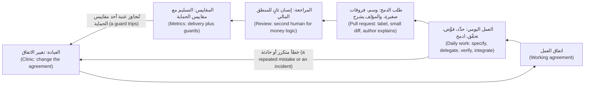

# الوحدة 12 — الفرق الأصيلة في الذكاء الاصطناعي

*معظم ما تتدرّب عليه الوحدات من 2 إلى 11 شخصي: سياقك ومواصفاتك ومراجعاتك. وفريق من ثمانية أفراد لا يصير أصيلًا في الذكاء الاصطناعي بجمع ثماني عادات جيدة، لأن طلب الدمج (pull request) الذي يكتبه شخص في دقائق يقرؤه آخر في ساعات، ولأن المقياس الذي تعرضه لوحة المتابعة نادرًا ما يكون المقياس المهم، ولأن المبتدئ الذي يسلّم بسرعة قد يتعلّم ببطء. الدرس 12.1 هو درس المفاهيم. يغطي السياق المشترك — ذاكرة المستودع وملف CONTRIBUTING.md واتفاق العمل — وأعراف مراجعة طلبات الدمج المدعومة بالذكاء الاصطناعي: ضع عليها وسمًا وأبقها صغيرة واجعل المؤلف يشرح وضع إنسانًا ثانيًا على منطق الأموال؛ والملكية وصاحب التغيير المسجَّل؛ وكيف تُدخل المبتدئين بالشرح العكسي (explain-back) وتمارين بلا ذكاء اصطناعي؛ ومقاييس التسليم من DORA بتعريفات قابلة للقياس؛ ولماذا يضلّل عدد أسطر الشيفرة وقبول الاقتراحات؛ ومقاييس الحماية (guard metrics)؛ وسياسة الأدوات والبيانات والأسرار والتراخيص؛ وحوكمة الكلفة؛ وإدارة التغيير؛ والخطوات الخمس بعد حادثة سببها الذكاء الاصطناعي. ويعطيك مُخرَجًا واحدًا هو اتفاق العمل بالذكاء الاصطناعي. أما الدرس 12.2 فهو الورشة: تكتب الدليل العملي للهندسة بالذكاء الاصطناعي لمنصة المدفوعات في نجم ريميت: قواعد تنتهي بفحص، وأعراف مراجعة محددة، وخطة مقاييس يمكن فيها حساب كل مقياس مرتين. يقرؤه مُقيِّم يعمل دون اتصال كما يقرؤه قائد تقني متشكك، ويقول بوضوح ما لا يستطيع معرفته. وكل ما يخص جانب نجم خيالي.*

> **التركيز:** Team — تحويل العادات الشخصية الجيدة إلى ممارسة مشتركة مكتوبة ومملوكة وقابلة للفحص: أعراف لها مالكون، ومقاييس لها تعريفات، وسياسة يمكن أن تفشل في اختبار.

---

# 12.1 — ممارسة الفريق: الاصطلاحات وأعراف المراجعة والملكية والمبتدئون والمقاييس والسياسة
*المستوى: 🔴 متقدم* · *المتطلبات: 0.3، 5.1، 10.1* · *التركيز: Team*

**بعد هذا الدرس تستطيع** كتابة اتفاق عمل للفريق مع الذكاء الاصطناعي يكون لكل قاعدة فيه رقم أو اسم أو فحص. *مدة الدراسة: قراءة نحو 15 دقيقة، وعمل تطبيقي نحو 60 دقيقة (تقدير).*

## ⚡ الدرس في دقيقة
- **ممارسة الفريق** هي ما يبقى صحيحًا حين يغيب أفضل مهندس لديك: سياق مشترك وأعراف مراجعة ومالكون ومسار للمبتدئين ومقاييس وسياسة، ولكل منها فحص.
- المراجعة هي عنق الزجاجة الذي ينقله الذكاء الاصطناعي ولا يزيله. **ضع وسمًا** على طلب الدمج، وأبقه **صغيرًا**، واجعل **المؤلف يشرحه**، وضع **إنسانًا ثانيًا** على منطق الأموال.
- **صاحب التغيير المسجَّل** يبقى مسؤولًا. «الوكيل فعلها» ليست سببًا جذريًا (root cause) أبدًا.
- قِس **التسليم** بمقاييس DORA (DORA's metrics) وراقب **مقاييس الحماية** بجانبها. لا تضع هدفًا لعدد أسطر الشيفرة ولا لقبول الاقتراحات ولا لنسبة الشيفرة التي كتبها الذكاء الاصطناعي.
- السياسة التي لا مالك لها ولا فحص أمنية. وحين ينكسر شيء: احتوِ، واحفظ الأدلة، وراجع دون لوم، وغيّر ضابطًا واحدًا.

## 🧭 لماذا يهم
بعد ثلاثة أشهر من طرح منصة المدفوعات لأدواتها، يسأل حمد، رئيس أمن المعلومات (CISO)، طارقًا، قائد الهندسة، سؤالين: كم من شيفرتنا كتبه الذكاء الاصطناعي، وهل صرنا أسرع؟ تقدّم لوحة المتابعة في بيئة التطوير (IDE dashboard) بديلًا عن الأول (41% من الاقتراحات مقبولة؛ وكل رقم هنا خيالي) ولا شيء يجيب عن الثاني. وفي الأسبوع نفسه تفتح لجين، المهندسة حديثة التخرج، طلب دمج من 1,100 سطر متغيّر، كتب الوكيل معظمها، بلا وسم، ويمسّ `fees.py`. ينتظر أربعة أيام ثم يُعتمد لأن أحدًا لا يستطيع قراءة 1,100 سطر قراءة متأنية.

والمشاعر أيضًا تضلّل: ففي تجربة عشوائية واحدة على مطورين ذوي خبرة في مستودعاتهم الخاصة، استغرقت المهام وقتًا أطول مع أدوات الذكاء الاصطناعي المتاحة في مطلع 2025 مع أن المطورين ظنّوا أنهم كانوا أسرع — METR، 2025؛ وقد تختلف بيئات أخرى وأدوات أحدث.

## 📐 كيف يعمل

### 🟢 الأساسيات

**السياق المشترك** هو العادة 1، **السياق أولًا**، على مستوى الفريق. ما يحتاجه مهندس جديد أو جلسة وكيل يعيش في المستودع: `CONTRIBUTING.md` للأشخاص والأدوات — صيغة الإيداع والوسم ومراجع ثانٍ — و`CLAUDE.md` للوكلاء (الدرس 2.1)، و`.claude/settings.json` لقواعد المنع والخطافات. و`CLAUDE.md` سياق لا إنفاذ: فوثائق ذاكرة Claude Code توصي باستخدام خطاف `PreToolUse` لحجب إجراء أيًّا كان ما يقرّره النموذج.

تفيد Meta، في روايتها الخاصة عن بناء تطبيق بوكيل ذكاء اصطناعي، بأن الفريق يقنّن التصحيح مرة واحدة للجميع حين يكرر الوكيل خطأً أكثر من مرتين: هذه رواية الشركة نفسها لا دليل مستقل، لكنها عادة سليمة. وصيغة نجم: في المرة الثانية يضيف من يرى الخطأ سطرًا إلى `CLAUDE.md`، أو قاعدة أو خطافًا، في طلب دمج.



**أعراف مراجعة طلبات الدمج المدعومة بالذكاء الاصطناعي.** يجعل الوكلاء الفروقات رخيصة؛ وقراءتها ليست أرخص. تحمي الأعراف المراجع، ولكل عرف فحص:
- **ضع الوسم** `AI-assisted` على الطلب حين تكتب أداة أي جزء منه أو تشكّله. *الفحص:* يقارن التكامل المستمر (CI) الوسم بسطر نعم/لا في القالب.
- **400 سطر متغيّر على الأكثر**، وتغيير منطقي واحد — اختيارنا؛ ولا دراسة تحدد الرقم. ربط تقرير DORA لعام 2024 (DORA's 2024 report) جزءًا من هبوط في الاستقرار بالدفعات الأكبر — ارتباط لا سببية. *الفحص:* خطوة في التكامل المستمر تعدّ الأسطر.
- **المؤلف يشرح.** يجوز للمراجع أن يسأل أي «لماذا». *الفحص:* الوصف أدناه.
- **اختبارات مع التغيير أو قبله**، ويُشاهَد فشلها بدونه. الاختبار الذي لا يستطيع أن يفشل لا يثبت شيئًا: **ثق بالدليل لا بالطلاقة**.
- **إنسان ثانٍ** لـ`money.py` و`fees.py` و`fx.py` و`limits.py` و`ledger.py` و`service.py`. *الفحص:* مالكو الشيفرة وحماية الفرع. ومراجعة الذكاء الاصطناعي فحص أولي، وليست الإنسان الثاني أبدًا.
- **أول مراجعة خلال يوم عمل واحد.** المراجعة هي الطابور الذي يكبر (الدرس 10.1). *الفحص:* تقرير أسبوعي لزمن الإنجاز.

الوصف الذي يجعل الأعراف حقيقية، الضعيف مقابل القوي:

```text
Weak:   Improves fee display and adds tests. All checks green.

Strong: feat(cli): add quote --explain to show how a fee is worked out
        REMIT-244. AI-assisted: yes. Claude Code drafted the change and tests; I rewrote the tier numbering.
        Size: 112 changed lines, one change. Money modules edited: none (fees.py is only read).
        Ran: pytest -q, 102 passed. Reverted src/ and watched the 2 new tests fail. Ran quote at
        100, 500, 500.01 and 20000 by hand; output pasted below.
        Not checked: Arabic output (the flag changes English text only).
```

**الملكية.** صاحب التغيير المسجَّل هو الشخص الذي يحمل طلب الدمج اسمه (الدرس 0.3). لكل شيء مشترك مالك واحد مسمّى: ملف الذاكرة وقائمة الأدوات المعتمدة (approved-tools list) والاتفاق وجدول المناوبة (on-call rota). «الذكاء الاصطناعي حذفه» بداية مراجعة ما بعد الحادثة لا نهايتها: اسأل عمّا كان مسموحًا للوكيل أن يفعله، ومن اعتمد التغيير، وأي فحص كان ينبغي أن يوقفه.

### 🟡 التعمق أكثر

**المبتدئون.** الأدلة تشير في اتجاهين. وجدت التجارب الميدانية — Cui وزملاؤه، وGitHub Copilot في Microsoft وAccenture وشركة من قائمة Fortune 100 — أن عدد المهام المنجزة يزيد مع مساعد، وأكثر ما يزيد لدى المطورين الأقل خبرة؛ وكانت النتيجة المقيسة عدد المهام لا الجودة. وفي تجربة Anthropic الصغيرة المذكورة في الدرس 11.1 سجّل مهندسون معظمهم مبتدئون يتعلمون مكتبة بمساعد 50% في اختبار فهم مقابل 67% لمن برمجوا يدويًا. يصفها المؤلفون بأنها أولية، وإعدادها يختلف عن الأدوات الوكيلية، وAnthropic هي التي تصنع Claude Code. وتوحي النتيجتان معًا بخطر ينبغي إدارته لا بحقيقة مستقرة: قد يرتفع الإنتاج بينما ينخفض التعلّم. لذا صمّم التلمذة المهنية:
- **الشرح العكسي:** قبل الدمج يشرح المبتدئ الفروقات لزميل مرافق في عشر دقائق ودون ملاحظات.
- **تمارين بلا ذكاء اصطناعي:** تذكرة واحدة في كل دورة عمل تُنجز يدويًا، لتبقى المهارة له (العادة 5، **أتمت الحلقة وحافظ على المهارة**).
- **العمل الثنائي ومراجع أقدم مسمّى** في الأشهر الأولى: يقود المبتدئ، ويسأل الأقدم «لماذا»، ويُخطَّط لوقت المراجعة.

المخاطر: يصير كبار المهندسين عنق الزجاجة، ويراجع المبتدئون ناتجًا لا يستطيعون الحكم عليه بعد، ولم يعد أحد يكابد الصعوبة، وهذه إحدى طرق تعلّم الناس. والحظر يميل إلى دفع الاستخدام إلى الحسابات الشخصية، وهذا يخرق قواعد البيانات.

**المقاييس: قِس التسليم.** وجدت الأبحاث وراء كتاب *Accelerate* (2018) أربعة مفاتيح: تكرار النشر (deployment frequency) وزمن التسليم (lead time) وزمن الاستعادة (time to restore) ومعدل فشل التغيير (change failure rate). ويسرد دليل DORA الحالي خمسة، بإضافة معدل إعادة العمل في النشر (2024) وإعادة تسمية زمن الاستعادة. صياغات الثلاثة الأولى تتبع الدليل؛ أما الأخيرتان فتعريفان شائعان، فتحقق من dora.dev.

| المقياس | تعريف DORA (DORA's definition) | نسختنا القابلة للقياس |
|---|---|---|
| زمن تسليم التغيير | من الإيداع في نظام التحكم بالإصدارات حتى النشر في الإنتاج | الوسيط بالساعات من أول إيداع حتى الإنتاج، أسبوعيًا |
| تكرار النشر | عدد عمليات النشر في فترة، أو الزمن بينها | عمليات النشر في الإنتاج أسبوعيًا |
| زمن التعافي من النشر الفاشل | الزمن اللازم للتعافي من نشر يفشل ويحتاج تدخلًا فوريًا | الوسيط بالساعات من إعلان الفشل حتى استعادة الخدمة |
| معدل فشل التغيير، وكثيرًا ما يسمّى | في الشائع: حصة عمليات النشر التي تحتاج إلى إصلاح عاجل أو تراجع | عمليات النشر التي احتاجت إلى إصلاح عاجل أو تراجع مقسومة على كل عمليات النشر، على أربعة أسابيع |
| معدل إعادة العمل في النشر | في الشائع: عمليات النشر غير المخطط لها مقسومة على كل عمليات النشر | الإصلاحات المسلَّمة خارج الخطة مقسومة على كل عمليات النشر، فصليًا |

الثلاثة الأولى *إنتاجية* (throughput)، والأخيرتان *عدم استقرار*. **يصير المقياس الغامض قابلًا للقياس حين يسمّي حدثين أو عدّين وفترة.** «قِس سرعة تسليمنا» أمنية؛ أما «الوسيط بالساعات من أول إيداع في طلب الدمج حتى وصول نشره إلى الإنتاج، أسبوعيًا» فمقياس.

**ما قد يغيّره الذكاء الاصطناعي.** قد يرتفع إنتاج الشيفرة بينما ينمو طابور المراجعة، فيتضرر زمن التسليم والاستقرار (الدرس 10.1). ربط تقرير DORA لعام 2024 ارتفاع اعتماد الذكاء الاصطناعي بانخفاض إنتاجية التسليم واستقراره، جزئيًا عبر الدفعات الأكبر؛ ووجد تقرير 2025 ارتباطًا إيجابيًا بالإنتاجية وما زال سلبيًا بالاستقرار، ويصوّر الذكاء الاصطناعي بوصفه مضخِّمًا لما يفعله الفريق أصلًا. وهذه ارتباطات ذاتية الإبلاغ لا أسباب: أبقِ الدفعات صغيرة وقِس.

**المقاييس الشكلية ومقاييس الحماية.** عدد أسطر الشيفرة يكافئ الحجم — وأفضل تغيير كثيرًا ما يكون حذفًا — وقبول الاقتراحات يكافئ النقر، ونسبة ما كتبه الذكاء الاصطناعي رقم استخدام قد يرتفع بينما ينخفض التسليم. تفيد Meta، في روايتها الخاصة عن بناء تطبيق Forum بوكيل، بأنها قاست النجاح بالتغييرات الجاهزة للإنتاج لا بحجم الشيفرة. وهذا نهج DORA نفسه: عُدَّ ما يصل إلى المستخدمين، بأمان. وهي وصف شركة واحدة، فاقرأ الأصل وقِس فريقك أنت. و**مقياس الحماية (guard metric)** يراقب ما قد تكسره السرعة، بعتبة واستجابة مكتوبتين سلفًا:

| مقياس الحماية | العتبة | الاستجابة |
|---|---|---|
| معدل فشل التغيير | أعلى من 15% خلال أربعة أسابيع | نتوقف عن رفع استقلالية الوكيل؛ ونراجع كل حالة فشل في العيادة |
| معدل إعادة العمل | أعلى من 20% في ربع سنة | تراجع ندى، قائدة هندسة الجودة، اختبارات تلك التغييرات |
| زمن إنجاز المراجعة | وسيط يزيد على 16 ساعة في أسبوع | نراجع الطابور ونحدّ من عمل الوكلاء الجديد |
| الحوادث المرتبطة بالذكاء الاصطناعي | حادثة واحدة على الأقل في ربع سنة | نتوقف مؤقتًا ونشغّل عملية الحوادث |

قارن طلبات الدمج المدعومة بالذكاء الاصطناعي بغيرها بحسب الوسم، ولكن مع 30 عملية نشر في ربع السنة — خيالية — فإن 3 إخفاقات مقابل 4 ضجيج. وحين تُتجاوَز عتبة مقياس حماية يبدأ نظر في الحالات: اقرأ الاتجاهات لا الكسور العشرية، ولا تقرأها لكل مهندس على حدة.

### 🔴 نظرة الخبير

**سياسة تصمد.** القاعدة تحتاج إلى مالك وفحص؛ ويمتد الإنفاذ، تقريبًا، من الأضعف إلى الأقوى: ملف الذاكرة نصيحةً، وقواعد الصلاحيات والخطافات على جهاز المطور، والإعدادات المُدارة (managed settings) التي لا يتجاوزها ما هو أدنى منها، والتكامل المستمر مع حماية الفرع على الخادم، أيًّا كانت الأداة التي كتبت الشيفرة. *الأدوات:* قائمة معتمدة واحدة يملكها سالم، من هندسة المنصات، مع مسار طلب إلى نورة، مسؤولة أمن التطبيقات والذكاء الاصطناعي، وسارة، مسؤولة حماية البيانات. *البيانات:* فئات وبيانات اختبار تركيبية وحسابات الشركة فقط. تقول وثائق Anthropic إن الشروط التجارية تستبعد التدريب على موجّهات Claude Code وشيفرته ما لم يختر العميل الاشتراك، وإن الخطط الاستهلاكية تختلف، وإن سجلات المحادثة المحلية تُحفظ بنص صريح 30 يومًا افتراضيًا؛ فتحقق من الوثائق. *الأسرار:* قواعد منع لـ`.env` (deny rules) وفحص أسرار في التكامل المستمر. *الترخيص والملكية الفكرية:* اطلب من ليلى، رئيسة حوكمة الذكاء الاصطناعي، موقفًا مكتوبًا بشأن من يملك الشيفرة المولَّدة بالذكاء الاصطناعي وما يُفعل بشيفرة يعيد المساعد إنتاجها؛ وهذه الدورة ليست نصيحة قانونية. انظر [*حوكمة الذكاء الاصطناعي (AI Governance)*، الدرس 5.2 — الملكية الفكرية في مدخلات الذكاء الاصطناعي ومخرجاته](../aigp/index.ar.html#/5.2).

**حوكمة الكلفة.** وقت الكتابة، يعرض `/usage` الإنفاق وتقبل التشغيلات غير التفاعلية (headless runs) الخيارين `--max-turns` و`--max-budget-usd` (وهو تقدير من جهة العميل)؛ فراجع الوثائق الحالية. وتذكر صفحة الكلفة في Anthropic أن متوسطات المؤسسات تبلغ نحو 13 دولارًا لكل مطور في اليوم النشط و150 إلى 250 دولارًا في الشهر — دون تاريخ معروض؛ والأسعار تتغير. حدّد الميزانية من بيانات الشهر الأول؛ وقارن الإنفاق بالتسليم، مثل الكلفة لكل تغيير مدموج. انظر [*السحابة وDevOps (Cloud & DevOps)*، الدرس 6.2 — FinOps: فهم الكلفة السحابية وتوزيعها وخفضها](../cloud/index.ar.html#/6.2).

**إدارة التغيير.** ابدأ بفريق واحد وبخط أساس يُقاس قبل الأدوات. اكتب الاتفاق مما يفعله ذلك الفريق، وأقم عيادة أسبوعية، واطلب من المتشكك أن يملك مقياس حماية. لا تفرض الاستخدام ولا تمنعه بصمت: فالاستخدام غير المعتمد إحدى طرق خروج البيانات. انظر [*إدارة منتجات الذكاء الاصطناعي (AI Product Management)*، الدرس 7.3 — التبنّي وإدارة التغيير داخل المؤسسات](../aipm/index.ar.html#/7.3).

**حادثة سببها الذكاء الاصطناعي.** تشترك الحوادث المبلَّغ عنها — ومعظمها روايات الضحايا أنفسهم لا تدقيقات — في نمط واحد: بيانات اعتماد واسعة وأدوات هدّامة ودون تأكيد. والخطوات خمس:

1. **احتوِ** خلال دقائق: أوقف الجلسة، وأبطل ما كان بوسعها الوصول إليه أو دوِّره، ونفّذ `git revert`.
2. **احفظ** قبل التنظيف: النص الكامل للجلسة وسجل الوكيل وطلب الدمج.
3. **أبلغ** مها، قائدة هندسة الموثوقية (SRE lead)، أو مهندس الموثوقية المناوب خلال ساعة.
4. **راجع دون لوم** خلال خمسة أيام عمل: الوقائع والاستنتاجات والمجهولات، وما كان مسموحًا للوكيل أن يفعله.
5. **غيّر ضابطًا واحدًا**، يُدمج خلال عشرة أيام عمل: قاعدة أو خطاف أو صلاحية أو سطر ذاكرة أو اختبار.

الحادثة الوشيكة في منصة المدفوعات — خيالية: اخترع وكيل اسم حزمة والتقطه مراجع. وضابط الخطوة 5: ابحث عن كل اسم حزمة يقترحه الوكيل قبل التثبيت، مع فحص اعتماديات في التكامل المستمر.

**متى لا تفعل.** فريق من شخصين يحتاج إلى `CONTRIBUTING.md` وإلى `CLAUDE.md` جيد، لا إلى دليل عملي. ولا تضع سقفًا قدره 400 سطر على الفروقات المولَّدة أو الآلية؛ قسِّمها بحسب الإيداع، وقل كيف جرى التحقق منها.

## 🧰 الأدوات
| الأداة أو الممارسة أو النمط | ما هي وماذا تفعل | متى تلجأ إليها |
|---|---|---|
| **AI working agreement** — اتفاق العمل بالذكاء الاصطناعي | عقد من صفحة واحدة بإصدار مرقَّم: الأدوات والبيانات وطلبات الدمج والمالكون والمبتدئون والمقاييس والحوادث | حين يستخدم فريق من أكثر من شخصين الوكلاء |
| **DORA delivery metrics** — مقاييس التسليم من DORA | زمن التسليم وتكرار النشر وزمن الاستعادة ومعدل فشل التغيير ومعدل إعادة العمل | لترى هل الفريق أسرع وما زال مستقرًا |
| **Guard metric** — مقياس الحماية | مقياس له عتبة واستجابة، يُحدَّدان قبل أن تُتجاوَز العتبة | بجانب كل مقياس سرعة |
| **Explain-back** — الشرح العكسي | يشرح المبتدئ الفروقات لزميل مرافق قبل الدمج | كل تغيير مدعوم بالذكاء الاصطناعي يقدّمه مهندس في سنته الأولى |
| **Blameless postmortem** — مراجعة ما بعد الحادثة الخالية من اللوم | مراجعة للوقائع والاستنتاجات والمجهولات تُصلح النظام | بعد أي حادثة مرتبطة بالذكاء الاصطناعي |

## 🏛️ عمليًا في بنك نجم
المُخرَج هو **اتفاق العمل بالذكاء الاصطناعي (AI working agreement)**. وقاعدة طارق: ما لا يتسع في صفحة واحدة يذهب إلى الدليل العملي (الدرس 12.2). انسخه باسم `ai-working-agreement.md` واستبدل كل علامة نائبة (replace every `<...>`):

```markdown
# AI working agreement: <team>
Owner: <name>.  Version: 1.  Next review: <date, and after any incident>.

### Tools and data
- Approved tools: <list>, kept by <name>. Company-managed accounts only.
- Never in a prompt: <data classes>, secrets, <anything else>.

### Pull requests
- Label `AI-assisted` when a tool wrote or shaped any part.
- At most <N> changed lines, one logical change.
- The author explains every line, lists the commands run with results, and says what was not checked.
- Tests arrive with or before the change, and were seen to fail without it.
- A second human reviews <modules>. First review within <time>.

### Ownership
- Author of record: whoever opens the pull request.
- Owners: memory file <name>; tool list <name>; this agreement <name>; incidents <name>.

### Juniors
- Explain-back before merge. One no-AI ticket per <period>. A named senior reviewer for <period>.

### Measures
- Delivery: <three DORA metrics, each with its two events or two counts>.
- Guards: <metric, threshold, response>.
- Never targets: lines of code, suggestion acceptance, share of AI-written code.

### When it goes wrong
- Contain, preserve, tell <name> within <time>, review without blame, change one control.
```

## 🛠️ التمارين
- 🟢 **اكتب الاتفاق.** *بلا وكيل.* املأ القالب لفريق تعرفه، أو لمنصة المدفوعات. *يكتمل عندما:* لا يبقى `<...>` وكل عرف له رقم أو اسم أو فحص.
- 🟡 **قِس قبل أن تضع هدفًا.** *يمكن أن يعمل الوكيل ناقدًا.* عرّف كلًّا من مقاييس DORA الخمسة لفريقك. *يكتمل عندما:* يسمّي كل منها حدثين أو عدّين وفترة ومصدر بيانات، ولأحد مقاييس الحماية عتبة واستجابة.
- 🔴 **اكسر اتفاقك بنفسك.** *يمكن لوكيل أو زميل أن يكون الخصم.* لكل عرف اعثر على طريقتين لتحقيقه مع إفشال غرضه، مثل ثلاثة طلبات دمج من 300 سطر بدل طلب واحد من 900؛ وقرر هل تكشف كلًّا منها أم تمنعها أم تقبلها. *يكتمل عندما:* ستة التفافات أو أكثر يسمّي كل منها استجابة ومن يفحص.

## ⚠️ أخطاء وفخاخ
- **وضع هدف على الاستخدام.** نسبة ما كتبه الذكاء الاصطناعي وعدد الأسطر ومعدل القبول تدعو إلى التلاعب. قِس التسليم ومقاييس الحماية.
- **قاعدة بلا فحص.** قاعدة «راجع بعناية» لا يمكن أن تفشل. أنهِ كل قاعدة بكيفية تحقق أي شخص منها.
- **اعتبار الوسم حكمًا.** هو معلومة لا وصمة ولا ترخيص؛ ومعيار المراجعة واحد.
- **حظر المبتدئين أو تجاهلهم.** الحظر ينقل الاستخدام إلى حسابات شخصية؛ وغياب البنية يُفوّت التعلّم.

## 🧾 الخلاصة
- ممارسة الفريق مكتوبة ومملوكة وقابلة للفحص: السياق وأعراف المراجعة والمالكون ومسار المبتدئين والمقاييس والسياسة.
- المراجعة هي عنق الزجاجة: وسم، وفروقات صغيرة، والمؤلف يشرح، وإنسان ثانٍ على منطق الأموال.
- عرِّف مقاييس DORA تعريفًا قابلًا للقياس؛ واجعل بجانب كل مقياس سرعة مقياس حماية بعتبة واستجابة.
- المقاييس الشكلية تكافئ الحجم، ونتائج DORA عن الذكاء الاصطناعي ارتباطات: قِس فريقك أنت.
- في الحادثة: احتوِ، واحفظ، وراجع دون لوم، وغيّر ضابطًا.

## ✍️ اختبر نفسك

**1. يسأل حمد طارقًا هل تُجدي أدوات الذكاء الاصطناعي نفعًا لمنصة المدفوعات. ما أفضل دليل يقدّمه؟**

- A. نسبة الشيفرة المدموجة التي كتبها الوكلاء، من تذييلات الإيداع
- B. معدل قبول الاقتراحات في لوحة بيئة التطوير
- C. وسيط زمن التسليم ومعدل فشل التغيير، مقسومين بحسب الوسم
- D. أسطر الشيفرة المدموجة لكل مهندس في الأسبوع، معروضة اتجاهًا

<details><summary>الإجابة</summary>

**C.** هذه مقاييس تسليم وبجانبها مقياس حماية، والوسم يتيح المقارنة. أما البقية فتعدّ النشاط، وقد يرتفع بينما ينخفض التسليم. (🟡 المقاييس.)

</details>

**2. ينخفض زمن التسليم من 52 إلى 40 ساعة بينما يرتفع معدل فشل التغيير من 10% إلى 22% خلال أربعة أسابيع. وعتبة الحماية 15%. ماذا يحدث بعد ذلك؟**

- A. تتوقف استقلالية الوكيل عن الارتفاع وتُراجَع حالات الفشل في العيادة
- B. يُشدَّد هدف زمن التسليم، فالفريق يزداد سرعة بوضوح
- C. تُسحب أدوات الذكاء الاصطناعي لهذا الربع حتى يعود المعدل إلى 10%
- D. لا شيء، لأن قلة عمليات النشر تجعل الأرقام مشوَّشة جدًا فلا يُعمل بها

<details><summary>الإجابة</summary>

**A.** الاستجابة كُتبت سلفًا. والسرعة المشتراة بعدم الاستقرار هي ما وُجدت مقاييس الحماية لأجله؛ والحظر يتجاوز المراجعة، وقلة عمليات النشر سبب لقراءة الحالات. (🟡 المقاييس الشكلية ومقاييس الحماية.)

</details>

**3. بعد ستة أشهر، تسلّم لجين بسرعة مع الوكيل لكنها لا تستطيع شرح الفروقات حين يسألها المراجع. ما الذي يوافق الدرس؟**

- A. تُمنع من استخدام الوكيل حتى تجتاز اختبار مراجعة شيفرة في الفريق
- B. تُضاف حصة أسبوعية من الأسطر يجب أن تكتبها يدويًا بدلًا من ذلك
- C. يعيد كبار المراجعين كتابة طلبات الدمج الخاصة بها نيابةً عنها
- D. يُشترط الشرح العكسي قبل الدمج، وتذكرة بلا ذكاء اصطناعي كل دورة

<details><summary>الإجابة</summary>

**D.** يبقيها سريعة ويجعل الفهم ثمن الدمج. والحظر يدفع الاستخدام إلى الخفاء، والحصة تقيس الحجم، وإعادة الكتابة تزيل التعلّم. (🟡 المبتدئون.)

</details>

**4. تفتح لجين طلب دمج من 1,100 سطر، كتب الوكيل معظمه، بلا وسم، ويعدّل `fees.py`. ماذا يشترط الاتفاق قبل الدمج؟**

- A. لا شيء إضافيًا، فالتكامل المستمر أخضر وهي صاحبة التغيير المسجَّل
- B. تقسيمه وإضافة الوسم وإنسان ثانٍ يراجع `fees.py`
- C. مراجعة من نموذج ذكاء اصطناعي ثانٍ، يمكنه أن يحل محل المراجع البشري
- D. الوسم وحده، لأن حد الحجم ينطبق على الشيفرة التي يكتبها البشر

<details><summary>الإجابة</summary>

**B.** الأعراف هي الحجم والوسم وإنسان ثانٍ لوحدات الأموال. ومراجعة الذكاء الاصطناعي فحص أولي فقط، وحد الحجم لا يتوقف على من كتب الأسطر. (🟢 أعراف المراجعة.)

</details>

**5. عند الساعة 02:10 (At 02:10) تُكتشف جلسة وكيل على حاسوب محمول تعدّل ملفات برمز تكامل مستمر يصل إلى الإنتاج. ما الذي يأتي أولًا؟**

- A. كتابة مراجعة ما بعد الحادثة فورًا، والتفاصيل ما زالت طازجة
- B. معرفة من اعتمد صلاحيات الجلسة
- C. إيقاف الجلسة وإبطال الرمز وحفظ النص الكامل للجلسة
- D. إضافة سطر إلى `CLAUDE.md` يمنع هذا السلوك، ثم إعادة تشغيل الجلسة

<details><summary>الإجابة</summary>

**C.** احتوِ أولًا واحفظ النص الكامل قبل أن يُنظَّف أي شيء. وتأتي بعد ذلك مراجعة ما بعد الحادثة وسؤال الاعتماد والقاعدة الجديدة. (🔴 حادثة سببها الذكاء الاصطناعي.)

</details>

## 📚 المراجع
- DORA، مقاييس تسليم البرمجيات: https://dora.dev/guides/dora-metrics/ ؛ Forsgren وHumble وKim، *Accelerate* (IT Revolution, 2018)
- Google Cloud عن تقارير DORA: https://cloud.google.com/blog/products/devops-sre/announcing-the-2024-dora-report ؛ https://cloud.google.com/blog/products/ai-machine-learning/announcing-the-2025-dora-report
- وثائق Claude Code: الذاكرة https://code.claude.com/docs/en/memory ؛ والصلاحيات https://code.claude.com/docs/en/permissions ؛ والكلفة https://code.claude.com/docs/en/costs ؛ واستخدام البيانات https://code.claude.com/docs/en/data-usage
- Google، *Site Reliability Engineering*، الفصل 15، «Postmortem Culture»: https://sre.google/sre-book/table-of-contents/
- **تعمّق أكثر.** Engineering at Meta، «How Meta Built Forum With AI-Native Engineering»، رواية شركة واحدة عن نفسها فاقرأ الأصل: https://engineering.fb.com/2026/10/15/ml-applications/how-meta-built-forum-ai-native-engineering/ ؛ METR، «Measuring the Impact of Early-2025 AI on Experienced Open-Source Developer Productivity»: https://metr.org/blog/2025-07-10-early-2025-ai-experienced-os-dev-study/ ؛ Anthropic، «How AI assistance impacts the formation of coding skills»: https://www.anthropic.com/research/AI-assistance-coding-skills ؛ Cui وآخرون، «The Effects of Generative AI on High-Skilled Work» (Management Science, 2025): https://papers.ssrn.com/abstract=4945566
- [*تصميم الأنظمة لمبرمجي الفايب (System Design for Vibe Coders)*، الدرس 9.3 — كل تعليق مراجعة متكرر هو حاجز وقائي مفقود](../vibe/index.ar.html#l9-3) ؛ [*الذكاء الاصطناعي الآمن وأمان التطبيقات (Secure AI & Application Security)*، الدرس 10.2 — الاستجابة للحوادث: الاستعداد والكشف والاحتواء والتعافي والتعلّم](../secai/index.ar.html#/10.2) ؛ [*من التخرّج إلى التوظيف*، الدرس 1.2 — البناء بوكلاء البرمجة بالذكاء الاصطناعي دون أن تنجرف معهم](../career/index.ar.html#/1.2)

---

# 12.2 — الورشة: اكتب الدليل العملي لفريقك للهندسة بالذكاء الاصطناعي
*المستوى: 🔴 متقدم* · *المتطلبات: 12.1* · *التركيز: Team*

**بعد هذا الدرس تستطيع** كتابة دليل هندسة بالذكاء الاصطناعي للفريق من اثنتي عشرة قاعدة قابلة للفحص أو أكثر ينجح لدى المُقيِّم. *مدة الدراسة: قراءة نحو 15 دقيقة، وعمل تطبيقي نحو 150 دقيقة (تقدير).*

## ⚡ الدرس في دقيقة
- المختبر `m12`: اكتب `playbook.md` لمنصة المدفوعات: عشرة أقسام، واثنتا عشرة **قاعدة** أو أكثر (`MUST ... Check: ...`)، وأعراف مراجعة محددة، و**خطة مقاييس** بكتلة واحدة لكل مقياس.
- يقرأ المُقيِّم بحثًا عن الفحوص والأرقام والصدق: آلية بعد كل `Check:`، ورقم في كل مقياس حماية، وخطوط أساس من الوقائع، ولا ملف مخترع. وتسرد التذكرة قواعدها.
- لا يستطيع أن يعرف هل السياسة حكيمة، وعبارة `Check:` التي تسمّي مهمة تكامل مستمر تنجح حتى لو لم يبنِ أحد المهمة.
- المُخرَج: `playbook.md` مودَع، إضافة إلى سجل الوكيل وإجابات النقاش الختامي في مجلد ملاحظات.

## 🧭 لماذا يهم
في العيادة يقرأ طارق صفحة من إرشادات شركته السابقة، وتبدأ كل جملة تقريبًا بكلمة «ينبغي». يسأل: «أيّ هذه يمكنك فحصه؟» فلا يستطيع أحد أن يسمّي واحدة. القاعدة التي لا تستطيع فحصها أمنية، والمقياس الذي لا تستطيع حسابه مزاج. وتطلب تذكرة حصة العكس: كل قاعدة تنتهي بكيفية تحقق أي شخص منها، وكل رقم يستطيع شخصان إعادة حسابه. يصوغ المساعد نصًّا سلسًا في دقائق؛ وهذا المختبر يعلّمك أن تقرأ تلك المسودة كما يقرؤها المُقيِّم.

## 📐 كيف يعمل

### 🟢 الأساسيات

**من الأمنية إلى القاعدة.** القاعدة تسمّي الشيء والحد والفحص، بهذا الترتيب. ضعيفًا مقابل قوي، كله لمنصة المدفوعات:

| الأمنية | القاعدة |
|---|---|
| تعامل مع الأسرار بأمان | يجب ألا نضع سرًّا في موجّه أو ملف ذاكرة أو إيداع. الفحص: يعمل فحص الأسرار في التكامل المستمر على كل طلب دمج |
| أبقِ طلبات الدمج صغيرة | يجب ألا ندمج طلب دمج يزيد على 400 سطر متغيّر (MUST NOT merge a pull request of more than 400 changed lines). الفحص: خطوة في التكامل المستمر تعدّ الأسطر المتغيّرة وتفشل فوق الحد |
| راجع شيفرة الذكاء الاصطناعي بعناية | يجب أن نحصل على موافقة إنسان ثانٍ على `fees.py`. الفحص: تشترط حماية الفرع موافقتين على ذلك المسار |
| أبلغ عن حوادث الذكاء الاصطناعي سريعًا | يجب أن نخبر مهندس الموثوقية المناوب خلال ساعة واحدة. الفحص: تسجّل تذكرة الحادثة وقت البلاغ |

في `playbook.md` اكتب كل قاعدة بندًا في قائمة (`- MUST ...`) داخل القسم الذي تنتمي إليه؛ فالمُقيِّم يقرأ النقاط لا صفوف الجداول. الفحص يعمل أو يترك سجلًا. «يراجعها قائد الفريق» تسمّي شخصًا لا آلية.

**ما الموجود اليوم.** يشغّل التكامل المستمر الأمر `pytest -q` ولا شيء غيره؛ ولا يوجد `CLAUDE.md` ولا `AGENTS.md` ولا `CODEOWNERS` ولا قالب لطلب الدمج ولا إعدادات `.claude/`. الدليل العملي يصف كيف سيعمل الفريق، فسمِّ هذه جديدة: «ملف `CODEOWNERS` جديد». والمسار الموضوع بين علامتي اقتباس خلفيتين الذي لا يملكه المستودع ولا تسميه أي جملة جديدًا هو ملف اخترعتَه.

**المقياس كتلة.** يعطي الهيكل كل مقياس ستة حقول. وهذه كتلة حماية مملوءة لمقياس ليس في ملف الوقائع رقم له، فيقول خط أساسه ذلك:

```markdown
### Pull request size
- Kind: guard
- Definition: Median number of changed lines (additions plus deletions) per pull request merged in the week.
- Source: the pull-request history in GitHub.
- Cadence: weekly, reviewed by Tariq at the clinic.
- Baseline: to be measured; the facts file has no figure for it.
- Threshold: Above 250 changed lines at the median in any week, we ask at the clinic whether tickets are cut too big and split the next ones before an agent starts.
```

النسخة الضعيفة، «التعريف: مدى كبر طلبات الدمج لدينا»، تفشل في فحص «قابل للقياس»: فلا يستطيع شخصان حسابها. وحقل خط الأساس لمقياس التسليم هو رقم ملف الوقائع بوحدته أو ما يعادله — زمن التسليم: 52 ساعة، أو نحو يومين؛ وحقل العتبة فيه هدف. أما عتبة مقياس الحماية فتجعلنا نتصرف: رقم ومقارنة واستجابة، مثل «فوق 15% خلال أي أربعة أسابيع نتوقف عن رفع استقلالية الوكيل ونراجع كل تغيير فاشل». العتبات خيار فريقك؛ فقل ذلك.

### 🟡 التعمق أكثر

**الصياغة بمساعد.** أعطِه الملفات ومهمة ضيقة، واجعله يعترف بما خمّنه:

```text
Read lab-assets/team-context.md, CONTRIBUTING.md and playbook.md (the skeleton).
Draft playbook.md for Payments Platform using only facts from those files. Write
each rule as a list item that starts with MUST or MUST NOT and ends with "Check:"
and a mechanism someone could run or inspect. Write "to be measured" for any figure
the facts file lacks. Name only files the repository has, or call a file new.
At the end, list every assumption and every place you guessed.
```

ثم دقّق المسودة. المسودة السلسة تميل إلى هذه العيوب — مصنوعة للتعليم لا مسجَّلة من نموذج:

| ما تقوله المسودة | سطر المُقيِّم الذي يكشفه |
|---|---|
| «الفحص: مراجعة قائد الفريق» | كل قاعدة تقول كيف تُفحص |
| «حيثما أمكن» و«بمسؤولية» | لا كلمات رخوة في القواعد |
| «خط الأساس: 4 ساعات» | خطوط الأساس تأتي من الوقائع |
| مقياس اسمه «معدل القبول» | لا مقاييس شكلية |
| `src/remit/risk.py` (ما زال `docs/ARCHITECTURE.md` يصفه) | كل ملف تشير إليه موجود |
| «تُظهر الدراسات أن الذكاء الاصطناعي يجعل الفرق أسرع بنسبة 30%» | لا ادعاءات بلا مصدر عن الإنتاجية |

وقائمة الافتراضات التي يقدمها المساعد ادعاء أيضًا (الدرس 11.1): افتح الملفات.

### 🔴 نظرة الخبير

**ما لا يستطيع المُقيِّم معرفته.** هل يناسب فريقك حدّ 400 سطر أو نسبة 15% أو يوم عمل واحد، ومن كتب الملف. هو يطابق الأنماط، فقد يمرّ تخفيف بكلمات لا يعرفها، ويوقف التزييف الرخيص — عبارة «مهمة تكامل مستمر» وحدها، وفحص واحد ملصق على قواعد كثيرة — لكنه لا يوقف التزييف المقنع: `Check: the pr-hygiene CI job` تمرّ سواء وُجدت المهمة أم لا. والدليل العملي مقترح إلى أن يُبنى كل فحص، فالخطوة التالية تذاكر: مهام تكامل مستمر لسالم، وقواعد منع وخطافات (الوحدة 8)، واستعلامات مقاييس لمها. وإن علّم المُقيِّم جملة صحيحة، فأعد الصياغة حتى يصير الادعاء قابلًا للفحص؛ ولا تلوِ الحقيقة.

**متى لا تفعل.** لا تكتب الدليل العملي من صفحة بيضاء لفريق ليس لديه سجلات وكلاء بعد. شغّل اتفاق العمل من صفحة واحدة شهرًا، ودع الأخطاء الحقيقية تمدّك بالقواعد.

## 🧰 الأدوات
| الأداة أو الممارسة أو النمط | ما هي وماذا تفعل | متى تلجأ إليها |
|---|---|---|
| **AI engineering playbook** — الدليل العملي للهندسة بالذكاء الاصطناعي | سياسة الفريق المطوَّلة، في عشرة أقسام | حين لا يعود اتفاق العمل يتسع في صفحة |
| **Rule with a check** — قاعدة لها فحص | بند MUST أو MUST NOT ينتهي بكيفية تحقق أي شخص منه | كل جملة سياسة |
| **Metric block** — كتلة المقياس | النوع والتعريف والمصدر والوتيرة وخط الأساس والعتبة تحت عنوان واحد | كل مقياس يقدّم الفريق تقريرًا عنه |
| **Playbook audit** — تدقيق الدليل | قراءة مسودة بحثًا عن الآليات والأرقام المخترعة والملفات الناقصة والادعاءات بلا مصدر | قبل قبول مسودة سياسة من مساعد |
| **Agent log** — سجل الوكيل | الموجّهات والنتائج والتصحيحات والوقت | بعد أي جلسة وكيل ستوقّع عليها |

## 🏛️ عمليًا في بنك نجم
**لا يحتاج وكيلًا.** **المسار بلا وكيل** هو الأبسط: اقرأ ملف الوقائع و`CONTRIBUTING.md`، ثم اكتب الأقسام أدناه. ويستطيع مساعد صياغتها في دقائق إن شئت؛ والمُقيِّم لا يهمه كيف أُنتج النص.

**التذكرة.** كتبتها حصة — هي ملف `task.md` في العدة، ويُكتب في مجلد مختبرك باسم `TASK.md`:

```text
# REMIT-262: write the Payments Platform AI engineering playbook

**From:** Hessa, Product Owner, Najm Remit, for Tariq
**To:** Payments Platform
**Priority:** Medium. Tariq presents it at Thursday's AI-native clinic.

Most of us use AI coding tools every day, each a little differently. Tariq wants one document we can
point to when a pull request, a new joiner or an incident asks "what is our rule for this?". Write it as
`playbook.md` in the repository root; a skeleton is already there. You may draft it with an AI
assistant. You are accountable for every line, and a playbook that says nothing anyone can check is
worse than none.

You may rely on `lab-assets/team-context.md`: the team, the bank's six rules, the data classes, the
approved tools, what the repository has today and last quarter's numbers. Do not edit it, and do not
edit `CONTRIBUTING.md` to suit your playbook: the playbook sits under both.

### What I need

1. **The ten sections** of the skeleton, in order, each with real content, in 700 to 4,500 words. Keep
   each heading's key word (tools, data, context or memory, spec or review, verification, security,
   automation, metrics, incident, onboarding): a topic is read only in its own section.
2. **Rules, not wishes.** A rule is one list item that starts with `MUST` or `MUST NOT` and ends with
   `Check:` and what runs or leaves a record: a command, a CI job or status check, a hook, a script, a
   scan, a report or log, a checklist item, a label, a branch-protection setting, or an audit that
   compares or lists named things. A person ("the team lead reviews it") is not a check, nor is "a CI
   job" with no word on what it looks at. Write at least 12, with at least one each under data rules,
   spec and review norms, verification standard, security baseline, automation and incident handling.
   No soft words ("carefully", "regularly", "where possible"). "Be careful with customer data" is a
   wish; "MUST NOT put customer names or account numbers in a prompt. Check: ..." is a rule.
3. **Concrete review norms, in section 4:** the label, the largest diff you accept (10 to 800 lines), who must
   review money logic (`CONTRIBUTING.md` names the modules), how soon a review happens, what the author
   must explain.
4. **A metrics plan**, one `###` block per metric in the skeleton's shape; `Kind` is `delivery` or
   `guard`. At least three delivery metrics (DORA-style: lead time, deployment frequency, change
   failure rate, recovery time or rework rate) and at least one guard metric, whose Threshold gives a
   number and says what we do when it is crossed. A definition says what is counted or timed, from
   which event to which event, over which period. A baseline is a figure from the facts file, in its
   unit or an equivalent (52 hours, about 2 days), or "to be measured". Thresholds and limits are our
   own choice: say so. Lines of code, suggestion acceptance and the share of AI-written code are not
   metrics or targets here, nor is the 60% label share, which is context.
5. **The bank's rules hold:** nothing looser than the six rules or `CONTRIBUTING.md`; say in your own
   words that agents never touch production.
6. **No invented evidence:** no statistic or "studies show" without a source in the same sentence. A
   backticked file must exist, or the sentence that names it must call it new or proposed ("a new
   `CODEOWNERS` file").

### Done when

- `playbook.md` has no `<<...>>` left, and nothing else has changed.
- It is committed on the branch you started on, with messages that follow `CONTRIBUTING.md` (any
  lower-case scope, such as `docs(playbook):`).
- Grade it from the `ailab` folder of the course repository:
  `python -m ailab grade m12 --dir <this directory>`
```

**البدء.**

```bash
cd ~/system-design-for-vibe-coders/ainative/ailab      # with the virtual environment of lesson 0.2 active
python -m ailab start m12 --dir ~/ainative/m12
cd ~/ainative/m12
```

يحوي إيداع البدء `lab-assets/team-context.md` والهيكل `playbook.md` و`TASK.md`؛ والأمر `git diff lab-start` يُظهر تغييراتك. أودِع على الفرع الذي بدأت عليه: فالمُقيِّم يقرأ ما هو مسحوب هناك.

**خطوتك.** (1) اقرأ التذكرة والوقائع و`CONTRIBUTING.md` والهيكل أولًا. (2) اكتب الأقسام 1 إلى 3 من الوقائع، و4 و5 من `CONTRIBUTING.md`، ثم 6 و7 و9 و10، وخطة المقاييس (8) أخيرًا لأنها تحتاج الأرقام (Write sections 1 to 3 from the facts, 4 and 5 from CONTRIBUTING.md, then 6, 7, 9 and 10, and the metrics plan (8) last: it needs the numbers). (3) مع وكيل، استخدم الموجّه أعلاه ثم جدول التدقيق. (4) قيّم أثناء العمل وأودِع كلما بدا جزء سليمًا عند قراءته، مثل `docs(playbook): add the review norms` (يصلح أي نطاق بأحرف صغيرة، مع أن قائمة `CONTRIBUTING.md` تخلو من `playbook`). (5) اقرأه كما يقرؤه المهندس الذي سيتبعه.

**ما يفحصه المُقيِّم.** نقاط التذكرة الست، فئاتٍ. *الشكل:* الأقسام ونص القالب والطول. *القواعد:* العدد والتوزيع والآلية والكلمات الرخوة، وألا يُلصق فحص واحد على قواعد كثيرة. *الأقسام:* ما يقوله القسم الجيد — المراجعة: الوسم وحد الفروقات والوحدات المالية الست وزمن الاستجابة وما يشرحه المؤلف. *المقاييس:* ستة حقول وثلاثة مقاييس تسليم ومقياس حماية له استجابة وتعريفات قابلة للقياس وخطوط أساس ولا مقاييس شكلية في أي موضع من الملف. *الصدق:* قواعد البنك والملفات المخترعة والادعاءات بلا مصدر. *المستودع:* لم يتغير إلا `playbook.md`، ولا أسرار، وإيداعات بصيغة Conventional Commits، وكل شيء مودَع.

**التقييم.**

```bash
cd ~/system-design-for-vibe-coders/ainative/ailab
python -m ailab grade m12 --dir ~/ainative/m12
```

على الهيكل الأصلي غير المعدَّل ينتهي الناتج بـ`Lab m12: 6/35 required checks passed: NOT YET`. وبعد مسودة أولى تتبع التذكرة — مصنوعة للتعليم لا مسجَّلة من نموذج؛ حُذفت التلميحات والأسطر الناجحة، والأسطر المحذوفة المعلَّمة بـ`...` هي كلمة رخوة وحد فروقات ناقص ومقياس حماية بلا استجابة ومقياس شكلي وادعاء بلا مصدر:

```text
[FAIL] Every rule says how it is checked: "MUST NOT put Confidential or Restricted data, ...": the check names no mechanism
...
[FAIL] Review: a second human for every money module: modules not named: ledger.py
...
[FAIL] Metrics: baselines come from the facts: "Lead time for changes" quotes 4 hours, which the facts file does not give for this metric
...
[FAIL] Every file it points to exists: `src/remit/risk.py` (line 44)
...

Lab m12: 26/35 required checks passed: NOT YET
```

كل سطر يقول ما فشل وأين، ولا يعطي الجواب أبدًا. والتشغيل الناجح ينتهي بـ`Lab m12: 35/35 required checks passed: PASSED`؛ وستة فحوص استشارية لا تحجب أبدًا.

**المُخرَج الأسبوعي.** في مستودع المختبر، `playbook.md` مودَع. وفي مجلد ملاحظاتك `week-12/` بسجل الوكيل وإجابات النقاش الختامي ومن الدرس 12.1 اتفاق العمل من صفحة واحدة.

**الجلسة الجماعية (60 دقيقة — 60 minutes).** (1) تبادلوا الأدلة؛ ويسمّي شريكك القاعدة التي سيكسرها أولًا وكيف (20). (2) دافعوا عن كل عتبة حماية (15). (3) اختاروا ثلاث قواعد لتُبنى فحوصًا حقيقية هذا الشهر، مع مالكين (15). (4) اتفقوا على شيء واحد يُقاس في الربع القادم (10).

**أسئلة النقاش الختامي.** ما الذي أخطأ فيه الوكيل، وأي سطر من المُقيِّم كشفه؟ وما الذي فات وقائعك أو موجّهك؟ وأي قاعدة لم يكن لها فحص حقيقي حتى كتبت واحدًا؟ وأي رقم أردت أن تخترعه، وماذا كتبت بدلًا منه؟

**قالب سجل الوكيل (Agent log template).**

```markdown
### Agent log: week 12
| Part | Prompt | What the agent did | What I corrected | Minutes |
|---|---|---|---|---|
| Rules | | | | |
| Review norms and metrics | | | | |

Lines the grader flagged on the first draft:
```

## 🛠️ التمارين
- 🟢 **حوّل الأماني إلى قواعد.** *بلا وكيل.* أعد كتابة هذه العبارات الخمس: «استخدم الأدوات المعتمدة فقط»، و«تعامل مع بيانات العملاء بعناية»، و«اختبر شيفرة الذكاء الاصطناعي جيدًا»، و«لا تدع الوكلاء يقتربون من الإنتاج»، و«أبقِ ملف الذاكرة مرتبًا». *يكتمل عندما:* تبدأ كل منها بكلمة MUST أو MUST NOT وتنتهي بـ`Check:` وبشيء يستطيع أحد تشغيله؛ وحين تُلصق في مسودة دليل عملي يمرّ فحصا «كل قاعدة تقول كيف تُفحص» و«لا كلمات رخوة».
- 🟡 **دقّق مسودة.** *يحتاج وكيلًا.* أعطِ مساعدًا الموجّه أعلاه وقيّم مسودته الأولى قبل أن تحرّرها. *يكتمل عندما:* يسرد سجل الوكيل كل سطر فاشل وسببه وإصلاحك له، مع الدقائق.
- 🔴 **ابنِ فحصًا واحدًا.** *يستطيع وكيل أن يساعد.* لا يجوز أن يتغير في مستودع المختبر إلا `playbook.md`، فاعمل في مجلد مؤقت: اكتب سكربتًا للفحص الذي وراء قاعدة واحدة، مثل حد الفروقات. *يكتمل عندما:* ينتهي برمز غير صفري على عينة فروقات من 900 سطر وبصفر على عينة من 12 سطرًا، وقد شغّلتهما كلتيهما، وتسمّي قاعدة دليلك السكربت ملفًا جديدًا.

## ⚠️ أخطاء وفخاخ
- **البدء من قالب عام.** هو سلس ولا يملكه أحد. ابدأ من ملف الوقائع و`CONTRIBUTING.md`.
- **كتابة المقاييس أولًا.** بلا الأرقام ستخترعها. اكتبها أخيرًا، واستخدم عبارة «يُقاس لاحقًا».
- **تعديل `CONTRIBUTING.md` ليناسب الدليل.** الدليل يقع تحته ولا يمكن أن يكون إلا أشد صرامة.
- **التوقف عند 35 من 35.** التقدير الأخضر يعني أن الشكل سليم. وما زال لزامًا أن يُبنى كل `Check:`.
- **تسمية ملفات ليست موجودة.** `CLAUDE.md` و`CODEOWNERS` ومهام التكامل المستمر غير موجودة بعد: سمِّها جديدة.

## 🧾 الخلاصة
- القاعدة تسمّي الشيء والحد والفحص؛ والأمنية لا تحمل شيئًا من ذلك.
- المقياس كتلة: النوع والتعريف بحدثين أو عدّين والمصدر والوتيرة وخط الأساس والعتبة. وعتبة مقياس الحماية لها استجابة.
- أعطِ المساعد الملفات وشكل القاعدة، واجعله يسرد تخميناته، ثم دقّق المسودة.
- المُقيِّم يفحص الشكل والصدق. وهل السياسة حكيمة، وهل الفحوص موجودة، أمران عليك أنت.

## ✍️ اختبر نفسك

**1. أي إعادة كتابة لعبارة «راجع الشيفرة التي كتبها الذكاء الاصطناعي بعناية» تُعدّ قاعدة بمعنى المختبر؟**

- A. يجب مراجعة كل شيفرة كتبها الذكاء الاصطناعي بعناية وحسن نية. الفحص: يستخدم المراجعون حكمهم الخاص
- B. ينبغي مراجعة الشيفرة التي كتبها الذكاء الاصطناعي قبل دمجها. الفحص: ثقافة الاحترام المتبادل في الفريق
- C. يجب ألا تُدمج شيفرة كتبها الذكاء الاصطناعي دون قراءة. الفحص: يثق قائد الفريق بأن المؤلف قرأها
- D. يجب الحصول على موافقة إنسان ثانٍ على `fees.py`. الفحص: تشترط حماية الفرع موافقتين هناك

<details><summary>الإجابة</summary>

**D.** تسمّي الشيء والحد وآلية يستطيع شخص أن يفحصها. أما البقية فتستعمل كلمة رخوة أو «ينبغي»، أو فحصًا هو حكم أو ثقافة أو شخص. (🟢 من الأمنية إلى القاعدة.)

</details>

**2. يكتب مساعدك «خط الأساس: 3.5 أيام (متوسط الصناعة)» لزمن التسليم. ويعطي ملف الوقائع 52 ساعة لمنصة المدفوعات. ماذا تكتب؟**

- A. إبقاء 3.5 أيام، فمتوسط الصناعة خط أساس عادل
- B. الـ52 ساعة من ملف الوقائع، مكتوبة بوحدتها
- C. متوسط 3.5 أيام و52 ساعة حلًّا وسطًا
- D. «يُقاس لاحقًا»، فلا أحد يستطيع الجزم بالـ52

<details><summary>الإجابة</summary>

**B.** خط الأساس هو رقم الفريق نفسه. ومتوسط الصناعة بلا مصدر مخترَع؛ و«يُقاس لاحقًا» للمقاييس التي لا تغطيها الوقائع. (🟡 الصياغة بمساعد.)

</details>

**3. يجتاز دليلك 35 من 35 فحصًا مطلوبًا. ويسأل طارق: «إذن، هل نحن مغطّون؟» ما الجواب الصادق؟**

- A. ليس بعد: الشكل سليم، لكن لا بد أن يُبنى كل فحص، والحدود اجتهاد منا
- B. في الغالب: يؤكد المُقيِّم أن القواعد متّبعة، عدا العتبات التي نحكم عليها نحن
- C. نعم، عدا المقاييس: فالباقي يطابق `CONTRIBUTING.md` وقواعد البنك حرفيًا
- D. لا: المُقيِّم الذي يعمل دون اتصال لا يقول شيئًا مفيدًا عن سياسة، فالنجاح بلا معنى

<details><summary>الإجابة</summary>

**A.** يقرأ المُقيِّم الكلمات: الشكل والأرقام والاتساق، لا هل `pr-hygiene` موجودة ولا هل 400 سطر رقم صائب. مفيد، لكنه غربال. (🔴 ما لا يستطيع المُقيِّم معرفته.)

</details>

**4. تقول مسودة المساعد: «التغييرات على `src/remit/risk.py` تحتاج مراجعًا ثانيًا». ما الإصلاح الصحيح؟**

- A. إنشاء `risk.py` فارغ ليكون للقاعدة ما تشير إليه فعلًا
- B. إبقاء القاعدة وإضافة عبارة «أو وحدة مكافئة» احتياطًا
- C. تسمية الوحدات الست التي يسردها `CONTRIBUTING.md`، لأن `risk.py` لم يعد موجودًا
- D. حذف القاعدة كلها، فقد تكون صفحة البنية قديمة

<details><summary>الإجابة</summary>

**C.** ما زال `docs/ARCHITECTURE.md` يصف `risk.py`، لكن الشيفرة هي الحَكَم: فالحدود تعيش في `limits.py`، ويسرد `CONTRIBUTING.md` الوحدات المالية الست. (🟡 الصياغة بمساعد.)

</details>

**5. أي إدخال لمقياس حماية مكتمل؟**

- A. معدل إعادة العمل: أبقِه منخفضًا، وراقبه عن كثب في العيادة كل أسبوع
- B. معدل إعادة العمل: ينبغي ألا يرتفع من ربع سنة إلى التالي، مهما تغيّر غيره
- C. معدل إعادة العمل: أكثر من 20% من عمليات النشر في ربع سنة، وتراجع ندى تلك الاختبارات
- D. معدل إعادة العمل: يراجعه قائد الهندسة أسبوعيًا لأي تغيير يُسلَّم متأخرًا

<details><summary>الإجابة</summary>

**C.** مقياس الحماية الكامل له رقم ومقارنة واستجابة: 20% و«أكثر من» ومراجعة الاختبارات. أما البقية فتذكر أملًا أو اتجاهًا أو وتيرة. (🟢 المقياس كتلة.)

</details>

## 📚 المراجع
- DORA، مقاييس تسليم البرمجيات: https://dora.dev/guides/dora-metrics/
- وثائق Claude Code: الذاكرة https://code.claude.com/docs/en/memory ؛ والصلاحيات https://code.claude.com/docs/en/permissions ؛ والخطافات (hooks) https://code.claude.com/docs/en/hooks-guide
- عدة المختبر: https://github.com/Tamoura/system-design-for-vibe-coders/tree/main/ainative/ailab
- [*حوكمة الذكاء الاصطناعي*، الدرس 2.3 — الإلمام بالذكاء الاصطناعي والتدريب والثقافة (AI literacy, training and culture)](../aigp/index.ar.html#/2.3) ؛ [*السحابة وDevOps*، الدرس 5.3 — الحوادث ومراجعات ما بعد الحادثة الخالية من اللوم](../cloud/index.ar.html#/5.3)
