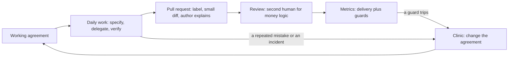

# Module 12 — AI-native teams

*Most of what Modules 2 to 11 practise is personal: your context, your specs, your reviews. A team of eight does not become AI-native by adding up eight good habits, because the pull request one person writes in minutes is read by another in hours, the metric the dashboard offers is rarely the one that matters, and the junior who ships fast may be learning slowly. Lesson 12.1 is the concept lesson. It covers shared context (the repository memory, CONTRIBUTING.md, the working agreement), review norms for AI-assisted pull requests (label them, keep them small, make the author explain, put a second human on money logic), ownership and the author of record, how to bring juniors on with explain-back and no-AI reps, DORA's delivery metrics with measurable definitions, why lines of code and suggestion acceptance mislead, guard metrics, policy on tools, data, secrets and licences, cost governance, change management and the five steps after an AI-caused incident, and it gives you one artefact, the AI working agreement. Lesson 12.2 is the workshop. You write the Payments Platform's AI engineering playbook for Najm Remit: rules that end in a check, concrete review norms and a metrics plan in which every metric can be computed twice. An offline grader reads it like a sceptical tech lead, and says plainly what it cannot tell.*

> **Focus:** Team — turn good personal habits into a shared practice that is written down, owned and checkable: norms with owners, metrics with definitions, policy that can fail a test.

---

# 12.1 — Team practice: conventions, review norms, ownership, juniors, metrics and policy
*Level: 🔴 Advanced* · *Prerequisites: 0.3, 5.1, 10.1* · *Focus: Team*

## ⚡ In 60 seconds
- A **team practice** is what stays true when your best engineer is on holiday: shared context, review norms, owners, a path for juniors, metrics and policy, each with a check.
- Review is the bottleneck AI moves but does not remove. **Label** the pull request, keep it **small**, make the **author explain** it, and put a **second human** on money logic.
- The **author of record** stays accountable. "The agent did it" is never a root cause.
- Measure **delivery** with DORA's metrics and watch **guard metrics** beside them. Never set a target on lines of code, suggestion acceptance or the share of AI-written code.
- A policy without an owner and a check is a wish. When something breaks: contain, preserve, review without blame, change one control.

## 🧭 Why it matters
Three months after Payments Platform rolled out its tools, Hamad asks Tariq two questions: how much of our code is AI-written, and are we faster? The IDE dashboard offers a stand-in for the first (41% of suggestions accepted; every figure here is fictional) and nothing answers the second. The same week Lujain opens a pull request of 1,100 changed lines, mostly agent-written, unlabelled, touching `fees.py`. It waits four days, then is approved because nobody can read 1,100 lines closely.

Both problems are the team's, not the tool's: a practice needs norms written down, an owner and a measure that matters. Feelings mislead: in one randomized trial of experienced developers on their own repositories, tasks took longer with early-2025 AI tools although the developers believed they had been faster (METR, 2025; METR warns that other settings and newer tools may differ).

## 📐 How it works

### 🟢 The essentials

**Shared context** is habit 1, **Context first**, at team scale. What a new engineer or agent session needs lives in the repository: `CONTRIBUTING.md` for people and tools (commit format, the label, a second reviewer), `CLAUDE.md` for agents (lesson 2.1), `.claude/settings.json` for deny rules and hooks. `CLAUDE.md` is context, not enforcement: the Claude Code memory documentation says to use a `PreToolUse` hook to block an action whatever the model decides.

Meta reports, in its own account of building an app with an AI agent, that when the agent repeats a mistake more than twice the team encodes the correction once, for everyone: one company's account, not independent evidence, but a sound habit. Najm's version: the second time, whoever sees it adds a line to `CLAUDE.md`, or a rule or hook, in a pull request.



**Review norms for AI-assisted pull requests.** Agents make diffs cheap and reading them is not cheaper, so the norms protect the reviewer, and each has a check:
- **Label** `AI-assisted` when a tool wrote or shaped any part. Reviewers read differently; metrics can compare. *Check:* CI compares the label with a yes/no line in the template.
- **At most 400 changed lines**, one logical change (our choice; no study fixes the number). DORA's 2024 report tied part of a stability dip to larger batches (an association, not a cause). *Check:* a CI step counts lines.
- **The author explains.** A reviewer may ask any "why". *Check:* the description, below.
- **Tests with or before the change**, seen to fail without it. A test that cannot fail proves nothing: **Trust evidence, not fluency**.
- **A second human** for `money.py`, `fees.py`, `fx.py`, `limits.py`, `ledger.py` and `service.py`. *Check:* code owners and branch protection. An AI review is a first pass, never the second human.
- **First review within one working day.** Review is the queue that grows (lesson 10.1). *Check:* a weekly turnaround report.

The description that makes the norms real, weak against strong:

```text
Weak:   Improves fee display and adds tests. All checks green.

Strong: feat(cli): add quote --explain to show how a fee is worked out
        REMIT-244. AI-assisted: yes. Claude Code drafted the change and tests; I rewrote the tier numbering.
        Size: 112 changed lines, one change. Money modules edited: none (fees.py is only read).
        Ran: pytest -q, 101 passed. Reverted src/ and watched the 2 new tests fail. Ran quote at
        100, 500, 500.01 and 20000 by hand; output pasted below.
        Not checked: Arabic output (the flag changes English text only).
```

**Ownership.** The author of record is the person whose name is on the pull request (lesson 0.3). Every shared thing has one named owner: memory file, approved-tools list, agreement, on-call rota. "The AI deleted it" is where a postmortem starts, not ends: ask what the agent was allowed to do, who approved the change and which check should have stopped it.

### 🟡 Going deeper

**Juniors.** The evidence points two ways. Field experiments (Cui and colleagues, testing GitHub Copilot at Microsoft, Accenture and a Fortune 100 firm) found more tasks completed with an assistant, most for less experienced developers; the outcome was task counts, not quality. In the small Anthropic trial of lesson 11.1, mostly junior engineers learning a library with an assistant scored 50% on a comprehension quiz, against 67% for hand-coders, most on debugging. The authors call it preliminary, its setup differs from agentic tools, and Anthropic makes Claude Code. Read together, they suggest a risk to manage, not a settled fact: output may rise while learning falls. So design the apprenticeship:
- **Explain-back:** before merge the junior explains the diff to a buddy in ten minutes, without notes.
- **No-AI reps:** one ticket per sprint by hand, so the skill stays theirs (habit 5, **Automate the loop, keep the skill**; Module 13).
- **Pairing and a named senior reviewer** for the first months: the junior drives, the senior asks "why", and review time is planned.

The risks: seniors become the bottleneck, juniors review output they cannot yet judge, and nobody struggles any more, which is one way people learn. A ban tends to push use onto personal accounts, which breaks the data rules; do not ban AI for juniors, and do not leave them unguided.

**Metrics: measure delivery.** The research behind *Accelerate* (2018) found four keys (deployment frequency, lead time, time to restore, change failure rate). DORA's current guide lists five, adding deployment rework rate (2024) and renaming time to restore. The first three wordings follow the guide; the last two are common definitions, so check dora.dev:

| Metric | DORA's definition | Our measurable version |
|---|---|---|
| Change lead time | Committed to version control until deployed to production | Median hours from first commit to production, per week |
| Deployment frequency | Number of deployments in a period, or the time between them | Production deployments per week |
| Failed deployment recovery time | Time to recover from a deployment that fails and needs immediate intervention | Median hours from failure declared to service restored |
| Change fail rate (often called change failure rate) | Commonly: the share of deployments needing a hotfix or rollback | Those deployments divided by all, over four weeks |
| Deployment rework rate | Commonly: unplanned deployments divided by all deployments | Fixes shipped outside the plan divided by all, per quarter |

The first three are *throughput*, the last two *instability*. **A vague metric becomes measurable when it names two events or two counts and a period.** "Measure how fast we deliver" is a wish; "median hours from a pull request's first commit to its deployment reaching production, per week" is a metric.

**What AI may change.** Code output can rise while the review queue grows, so lead time and stability may suffer (lesson 10.1). DORA's 2024 report associated higher AI adoption with lower delivery throughput and stability, and attributes part of the stability dip to larger batches; the 2025 report found throughput positive and stability still negative, and frames AI as amplifying what a team already does. These are self-reported associations, not causes: keep batches small and measure your own team.

**Vanity metrics and guard metrics.** Lines of code rewards volume (the best change is often a deletion), suggestion acceptance rewards clicking, and percent AI-written is a usage number that can rise while delivery falls. Meta reports that it measured production-ready changes rather than code volume. A **guard metric** watches what speed could break, with a threshold and response written in advance:

| Guard | Threshold | Response |
|---|---|---|
| Change failure rate | Above 15% over four weeks | Stop raising agent autonomy; review each failure at the clinic |
| Rework rate | Above 20% in a quarter | Nada reviews the tests of those changes |
| Review turnaround | Median over 16 hours in a week | Review the queue; cap new agent work |
| AI-related incidents | At least 1 in a quarter | Pause; run the incident process |

Compare AI-assisted pull requests with the rest by label, but with 30 deployments a quarter (fictional), 3 failures against 4 is noise, and at about 8 deployments in four weeks two failures already read as 25%. A tripped guard starts a look at cases: read trends, never decimals, never per engineer.

### 🔴 Expert view

**Policy that holds.** A rule needs an owner and a check; enforcement runs, roughly, from weakest to strongest: memory file (advice), permission rules and hooks (on the developer's machine), managed settings (nothing lower overrides them), CI with branch protection (on the server, whichever tool wrote the code). *Tools:* one approved list, owned by Salem, with a request path (Noura for security, Sara for data). *Data:* classes, synthetic test data, company accounts only. Anthropic's documentation says commercial terms exclude training on Claude Code prompts and code unless the customer opts in, consumer plans differ, and local transcripts sit in plain text for 30 days by default; check it. *Secrets:* deny rules for `.env`, a secret scan in CI, nothing in memory files. *Licence and IP:* ask Layla for a written position on who owns AI-generated code and what to do with code an assistant reproduces; this course is not legal advice. See [*AI Governance*, lesson 5.2 — Intellectual property in AI inputs and outputs](../aigp/index.html#/5.2).

**Cost governance.** `/usage` shows spend, and headless runs take `--max-turns` and `--max-budget-usd` (a client-side estimate). Anthropic's costs page gives enterprise averages of roughly $13 per developer per active day and $150 to $250 per developer per month (no date shown; prices and plans change, so check). Set the budget from the first month's data and compare spend with delivery, such as cost per merged change. See [*Cloud & DevOps*, lesson 6.2 — FinOps: understanding, allocating and cutting cloud cost](../cloud/index.html#/6.2).

**Change management.** Start with one team and a baseline measured before the tools. Write the agreement from what that team does, hold a weekly clinic, and ask the sceptic to own a guard metric. Do not mandate usage, and do not forbid it silently: unapproved use is one way data leaves. See [*AI Product Management*, lesson 7.3 — Adoption and change management inside the enterprise](../aipm/index.html#/7.3).

**An AI-caused incident.** Reported incidents (mostly the victims' own accounts, not audits) share a pattern: broad credentials, destructive tools, no confirmation (OWASP: excessive agency). Five steps:

1. **Contain** within minutes: stop the session, revoke or rotate what it could reach, `git revert`.
2. **Preserve** before cleanup: the transcript, the agent log, the pull request.
3. **Tell** Maha or the on-call SRE within the hour.
4. **Review without blame** within five working days: facts, inferences, unknowns, and what the agent was allowed to do.
5. **Change one control**, merged within ten working days: a rule, hook, permission, memory line or test.

Payments Platform's near miss (fictional) shows step 5: an agent invented a package name and a reviewer caught it. The control: "every package name an agent suggests is looked up before install", plus a dependency check in CI.

**When not to.** A two-person team needs `CONTRIBUTING.md` and a good `CLAUDE.md`, not a playbook. Do not cap generated or mechanical diffs at 400 lines (split by commit and say how they were verified).

## 🧰 The toolkit
| Tool, practice or pattern | What it is and does | When to reach for it |
|---|---|---|
| **AI working agreement** | A one-page, versioned contract: tools, data, pull requests, owners, juniors, measures, incidents | A team of more than two uses agents |
| **DORA delivery metrics** | Lead time, deployment frequency, recovery time, change fail rate, rework rate | To see whether the team is faster and still stable |
| **Guard metric** | A measure with a threshold and a response, set before it trips | Next to every speed measure |
| **Explain-back** | A junior explains the diff to a buddy before merge | Every AI-assisted change by a first-year engineer |
| **Blameless postmortem** (Google SRE) | A review of facts, inferences and unknowns that fixes the system | After any AI-related incident |

## 🏛️ In practice at Najm Bank
The artefact is the **AI working agreement**. Tariq's rule: what does not fit on one page goes in the playbook (lesson 12.2). Copy it as `ai-working-agreement.md` and replace every `<...>`:

```markdown
# AI working agreement: <team>
Owner: <name>.  Version: 1.  Next review: <date, and after any incident>.

### Tools and data
- Approved tools: <list>, kept by <name>. Company-managed accounts only.
- Never in a prompt: <data classes>, secrets, <anything else>.

### Pull requests
- Label `AI-assisted` when a tool wrote or shaped any part.
- At most <N> changed lines, one logical change.
- The author explains every line, lists the commands run with results, and says what was not checked.
- Tests arrive with or before the change, and were seen to fail without it.
- A second human reviews <modules>. First review within <time>.

### Ownership
- Author of record: whoever opens the pull request.
- Owners: memory file <name>; tool list <name>; this agreement <name>; incidents <name>.

### Juniors
- Explain-back before merge. One no-AI ticket per <period>. A named senior reviewer for <period>.

### Measures
- Delivery: <three DORA metrics, each with its two events or two counts>.
- Guards: <metric, threshold, response>.
- Never targets: lines of code, suggestion acceptance, share of AI-written code.

### When it goes wrong
- Contain, preserve, tell <name> within <time>, review without blame, change one control.
```

## 🛠️ Exercises
- 🟢 **Write the agreement.** No agent needed. Fill in the template for a team you know, or for Payments Platform. *Done when:* no `<...>` is left and every norm has a number, a name or a check.
- 🟡 **Measure before you target.** An agent may act as critic. Write a measurable definition for each of DORA's five metrics for your team. *Done when:* each names two events or two counts, a period and a data source, and one guard metric has a threshold and a response.
- 🔴 **Break your own agreement.** An agent or colleague can play adversary. For each norm find two ways to satisfy it while defeating its purpose (three 300-line pull requests instead of one 900-line one); decide to detect, prevent or accept each. *Done when:* six or more bypasses each name a response and who checks.

## ⚠️ Mistakes and traps
- **Setting a target on usage.** Percent AI-written, lines and acceptance rate invite gaming. Measure delivery and guards.
- **A rule with no check.** "Review carefully" cannot fail. End each rule with how anyone can verify it.
- **Treating the label as a verdict.** It is information, not a stigma or a licence; the review bar is the same.
- **Banning or ignoring juniors.** A ban moves use to personal accounts; no structure skips the learning.

## 🧾 Recap
- A team practice is written, owned and checkable: context, review norms, owners, a junior path, metrics, policy.
- Review is the bottleneck: label, small diff, the author explains, a second human on money logic.
- Define DORA's metrics measurably and put a guard with a threshold and a response beside every speed measure.
- Vanity metrics reward volume, and DORA's AI findings are associations: measure your own team.
- In an incident: contain, preserve, review without blame, change a control.

## ✍️ Check yourself

**1. Hamad asks Tariq whether the AI tools are working for Payments Platform. Which is the best evidence to bring?**

- A. The share of merged code that the agents wrote, from commit trailers
- B. The suggestion acceptance rate on the IDE dashboard
- C. Median lead time and change failure rate, split by label
- D. Lines of code merged per engineer per week, shown as a trend

<details><summary>Answer</summary>

**C.** These are delivery measures with a guard beside them, and the label allows a comparison. The others count activity, which can rise while delivery falls. (🟡 Metrics.)

</details>

**2. Lead time falls from 52 to 40 hours while change failure rate rises from 10% to 22% over four weeks. The guard threshold is 15%. What happens next?**

- A. Autonomy stops rising and the failures are reviewed at the clinic
- B. The lead-time target is tightened, since the team is clearly getting faster
- C. AI tools are withdrawn for the quarter until the rate returns to 10%
- D. Nothing, because so few deployments make the figures too noisy to act on

<details><summary>Answer</summary>

**A.** The response was written in advance. Speed bought with instability is what guards exist for; a ban skips the review, and a handful of deployments is a reason to read the cases. (🟡 Vanity metrics and guard metrics.)

</details>

**3. Six months in, Lujain ships quickly with the agent but cannot explain a diff when a reviewer asks. What fits the lesson?**

- A. Ban agent use for her until she passes a code review test on the team
- B. Add a weekly quota of lines she must write by hand instead
- C. Let the senior reviewers rewrite her pull requests for her
- D. Require explain-back before merge, plus one no-AI ticket a sprint

<details><summary>Answer</summary>

**D.** It keeps her fast and makes understanding the price of merging. A ban pushes use underground, a quota measures volume, and rewriting removes the learning. (🟡 Juniors.)

</details>

**4. Lujain opens a 1,100-line pull request, mostly written by an agent, unlabelled, editing `fees.py`. What does the agreement require before merge?**

- A. Nothing extra, because CI is green and she is the author of record
- B. Split it, add the label, and get a second human reviewer for `fees.py`
- C. A review by a second AI model, which can stand in for the human one
- D. Only the label, since the size limit applies to human-written code

<details><summary>Answer</summary>

**B.** The norms are size, the label and a second human for money modules. An AI review is only a first pass, and the size limit does not depend on who wrote the lines. (🟢 Review norms.)

</details>

**5. At 02:10 an agent session on a laptop is found editing files with a CI token that could reach production. What comes first?**

- A. Write the postmortem straight away, while the details are still fresh
- B. Find out who approved the session's permissions
- C. Stop the session, revoke the token and save the transcript
- D. Add a line to `CLAUDE.md` forbidding the behaviour, then restart the session

<details><summary>Answer</summary>

**C.** Contain first and keep the transcript before anything is cleaned up. The postmortem, the approval question and the new rule come after. (🔴 An AI-caused incident.)

</details>

## 📚 References
- DORA, software delivery metrics: https://dora.dev/guides/dora-metrics/ ; Forsgren, Humble and Kim, *Accelerate* (IT Revolution, 2018)
- Google Cloud on the DORA reports: https://cloud.google.com/blog/products/devops-sre/announcing-the-2024-dora-report ; https://cloud.google.com/blog/products/ai-machine-learning/announcing-the-2025-dora-report
- Claude Code documentation: memory https://code.claude.com/docs/en/memory ; permissions https://code.claude.com/docs/en/permissions ; costs https://code.claude.com/docs/en/costs ; data usage https://code.claude.com/docs/en/data-usage
- Google, *Site Reliability Engineering*, chapter 15, "Postmortem Culture": https://sre.google/sre-book/table-of-contents/
- **Go deeper.** Engineering at Meta, "How Meta Built Forum With AI-Native Engineering", one company's own account, so read the original: https://engineering.fb.com/2026/10/15/ml-applications/how-meta-built-forum-ai-native-engineering/ ; METR, "Measuring the Impact of Early-2025 AI on Experienced Open-Source Developer Productivity": https://metr.org/blog/2025-07-10-early-2025-ai-experienced-os-dev-study/ ; Anthropic, "How AI assistance impacts the formation of coding skills": https://www.anthropic.com/research/AI-assistance-coding-skills ; Cui and others, "The Effects of Generative AI on High-Skilled Work" (Management Science, 2025): https://papers.ssrn.com/abstract=4945566
- [*System Design for Vibe Coders*, lesson 9.3 — Every repeated review comment is a missing guardrail](../vibe/index.en.html#l9-3) ; [*Secure AI & Application Security*, lesson 10.2 — Incident response: prepare, detect, contain, recover, learn](../secai/index.html#/10.2) ; [*From Graduate to Hired*, lesson 1.2 — Building with AI coding agents without being carried by them](../career/index.html#/1.2)

---

# 12.2 — Workshop: write your team's AI engineering playbook
*Level: 🔴 Advanced* · *Prerequisites: 12.1* · *Focus: Team*

## ⚡ In 60 seconds
- Lab `m12`: write `playbook.md` for Payments Platform. Ten sections, at least twelve **rules** in the shape `MUST ... Check: ...`, concrete review norms and a **metrics plan** with one block per metric.
- **Needs an agent: no.** An assistant is an optional drafting aid; the no-agent path is to write it from the facts file and `CONTRIBUTING.md`.
- The grader reads for checks, numbers and honesty: a mechanism after every `Check:`, a number in every guard, baselines from the facts, no file that does not exist.
- It cannot tell whether the policy is wise or whether the team will follow it, and a `Check:` that names a CI job passes even if nobody has built the job.
- Deliverable: `playbook.md` committed, plus an agent log and your answers in your notes repository.

## 🧭 Why it matters
At the clinic Tariq reads out a page of guidance from his last company, nearly every sentence starting "should". "Which of these could you check?" he asks. Nobody can name one. A rule you cannot check is a hope, and a metric you cannot compute is a mood. Hessa's ticket asks for the opposite: every rule ends with how anyone could verify it, and every number can be recomputed by two people. An assistant drafts something fluent in minutes; this lab teaches you to read that draft the way the grader does.

## 📐 How it works

### 🟢 The essentials

**From wish to rule.** A rule names the thing, the limit and the check, in that order. Weak against strong, all for Payments Platform:

| Wish | Rule |
|---|---|
| Handle secrets safely | MUST NOT put a secret in a prompt, a memory file or a commit. Check: the secret scan runs in CI on every pull request |
| Keep pull requests small | MUST NOT merge a pull request of more than 400 changed lines. Check: a CI step counts changed lines and fails above the limit |
| Review AI code carefully | MUST get a second human approval on `fees.py`. Check: branch protection requires two approvals on that path |
| Report AI incidents promptly | MUST tell the on-call SRE within 1 hour. Check: the incident ticket records the time of the report |

In `playbook.md` write each rule as a list item (`- MUST ...`) inside the section it belongs to; the grader reads bullets, not table rows.

**A metric as a block.** The skeleton gives every metric six fields. A filled guard block, for a metric the facts file has no figure for (so its baseline says so):

```markdown
### Pull request size
- Kind: guard
- Definition: Median number of changed lines (additions plus deletions) per pull request merged in the week.
- Source: the pull-request history in GitHub.
- Cadence: weekly, reviewed by Tariq at the clinic.
- Baseline: to be measured; the facts file has no figure for it.
- Threshold: Above 250 changed lines at the median in any week, we ask at the clinic whether tickets are cut too big and split the next ones before an agent starts.
```

The weak version says "Definition: how big our pull requests are". Two people could not compute it, so it fails the grader's "measurable" check. A delivery metric's Baseline is the facts file's own figure with its unit (lead time: 52 hours) and its Threshold a target. A guard's Threshold is a line that makes us act: a number, a comparison and a response, such as "Above 15% over any four weeks, we stop raising agent autonomy and review each failed change".

### 🟡 Going deeper

**Drafting with an assistant.** Hand it the files and a narrow job, and make it confess what it guessed:

```text
Read lab-assets/team-context.md, CONTRIBUTING.md and playbook.md (the skeleton).
Draft playbook.md for Payments Platform. Use only facts from those files.
Write each rule as a list item that starts with MUST or MUST NOT and ends with
"Check:" and a mechanism someone could run or inspect. Use no figure that is not in
the facts file: write "to be measured" instead. Mention only files that exist in
this repository. At the end, list every assumption and every place you guessed.
```

Then audit the draft. A fluent draft tends to have these flaws (constructed for teaching, not recorded from a model), each found by one grader line:

| What the draft says | Why it appears | Grader line |
|---|---|---|
| "Check: team lead review" | Review sounds like a check | Every rule says how it is checked |
| "where possible", "responsibly" | Fluent hedging | No weasel words in the rules |
| "Baseline: 4 hours" | A plausible number | Baselines come from the facts |
| A metric called "acceptance rate" | Vendor dashboards show it | No vanity measures |
| `src/remit/risk.py` | `docs/ARCHITECTURE.md` still describes it | Every file it points to exists |
| "Studies show AI makes teams 30% faster" | A half-remembered statistic | No unsourced claims about productivity |

The same rule applies as in lesson 11.2: the assistant's list of assumptions is a claim too. Open the files.

### 🔴 Expert view

**What the grader cannot tell.** It cannot tell whether 400 lines, 15% or one working day suit your team: those are judgements the group session argues about. It cannot tell who wrote the file. It checks a few patterns against `CONTRIBUTING.md`, so a rule that loosens it in words the patterns do not know will pass. And `Check: the pr-hygiene CI job` passes whether or not the job exists. A playbook is a proposal until each check is built, so the real next step is a list of tickets: CI jobs for Salem, deny rules and hooks from Module 8, commands from Module 9, metric queries for Maha. The grader is a pattern matcher and errs both ways: if it flags a sentence that is true, do not bend the truth, rephrase until the claim is checkable.

**When not to.** Do not write the playbook from a blank page for a team that has no agent logs yet. Run the one-page working agreement for a month and let the real mistakes supply the rules.

## 🧰 The toolkit
| Tool, practice or pattern | What it is and does | When to reach for it |
|---|---|---|
| **AI engineering playbook** | The team's long-form policy, in ten sections | Once the working agreement stops fitting on a page |
| **Rule with a check** | A MUST or MUST NOT bullet that ends with how anyone can verify it | Every policy sentence |
| **Metric block** | Kind, definition, source, cadence, baseline, threshold under one heading | Every metric the team reports |
| **Playbook audit** | Reading a draft for mechanisms, invented numbers, missing files and unsourced claims | Before you accept any assistant's policy draft |
| **Agent log** | A table of prompts, results, corrections and time | After any agent session whose output you will sign |

## 🏛️ In practice at Najm Bank
**Needs an agent: no.** An assistant can draft all ten sections in minutes if you want one. The **no-agent path** is the plain one: read the facts file and `CONTRIBUTING.md`, then write the sections in the order below. The grader does not care how the text was produced.

**The ticket.** Hessa wrote it (the kit's `task.md`):

```text
# REMIT-262: write the Payments Platform AI engineering playbook

**From:** Hessa, Product Owner, Najm Remit, for Tariq
**To:** Payments Platform
**Priority:** Medium. Tariq presents it at Thursday's AI-native clinic.

Most of us use AI coding tools every day, each a little differently. Tariq wants one document we can
point to when a pull request, a new joiner or an incident asks "what is our rule for this?". Write it as
`playbook.md` in the repository root; a skeleton is already there. You may draft it with an AI
assistant. You are accountable for every line, and a playbook that says nothing anyone can check is
worse than none.

You may rely on `lab-assets/team-context.md`: the team, the bank's six rules, the data classes, the
approved tools and last quarter's numbers. Do not edit it, and do not edit `CONTRIBUTING.md` to suit
your playbook: the playbook sits under both.

### What I need

1. **The ten sections** of the skeleton, each with real content, in roughly 800 to 3,000 words in all.
2. **Rules, not wishes.** A rule is one list item that starts with `MUST` or `MUST NOT` and ends with
   `Check:` and how anyone can verify it: a command, a CI job, a hook, a checklist item or an audit.
   Write at least 12, with at least one each under data rules, spec and review norms, verification
   standard, security baseline, automation and incident handling. "Be careful with customer data" is a
   wish; "MUST NOT put customer names or account numbers in a prompt. Check: ..." is a rule.
3. **Concrete review norms:** the label, the largest diff you accept (in lines), who must review money
   logic (`CONTRIBUTING.md` names the modules), how soon a review happens, what the author must explain.
4. **A metrics plan**, one `###` block per metric in the skeleton's shape: at least three delivery
   metrics (DORA-style: lead time, deployment frequency, change failure rate, recovery time or rework
   rate) and at least one guard metric, whose Threshold gives a number and says what we do when it is
   crossed. A definition says what is counted or timed, from which event to which event, over which
   period. A baseline is a figure from the facts file, or "to be measured". Lines of code, suggestion
   acceptance and the share of AI-written code are not metrics or targets here.
5. **No invented evidence:** no statistic or "studies show" without a source, and no file the
   repository does not have.

### Done when

- `playbook.md` has no `<<...>>` left, and nothing else has changed.
- It is committed, with messages that follow `CONTRIBUTING.md`.
- `python -m ailab grade m12 --dir <this directory>`, run from the `ailab` folder of the course
  repository, passes.
```

**Start.**

```bash
cd ainative/ailab
python -m ailab start m12 --dir ~/ainative/m12
cd ~/ainative/m12
```

The start commit holds `lab-assets/team-context.md` (the facts), the skeleton `playbook.md` and `TASK.md`; `git diff lab-start` shows what you changed.

**Your move.** (1) Read the ticket, the facts, `CONTRIBUTING.md` and the skeleton yourself first. (2) Write in this order: tools and data (from the facts), review and verification (from `CONTRIBUTING.md`), security and automation, incidents and onboarding, and the metrics plan last, because it needs the numbers. (3) With an agent, use the prompt above and then the audit table. (4) Grade after each group of sections and commit when its lines stop failing, for example `docs(playbook): add the review norms and verification standard` (the scope is the area you touched). (5) Read it as the engineer who must follow it on a bad Friday.

**What the grader checks.** *Shape:* ten sections with substance, no template text, a sensible length. *Rules:* at least twelve, spread over the six areas, each ending with a mechanism, none with a weasel word. *Sections:* what a good one says about tools, data, memory, review (label, diff limit, the six money modules, response time, what the author explains), verification, security, automation, incidents, onboarding. *Metrics:* six fields per block, three DORA-style delivery metrics, a guard with a threshold and a response, measurable definitions, baselines from the facts, no vanity measures. *Honesty:* nothing looser than the bank's rules or `CONTRIBUTING.md`, no missing files, no unsourced claims. *Repository:* only `playbook.md` changed, no secrets, Conventional Commits, everything committed.

**Grade.**

```bash
python -m ailab grade m12 --dir ~/ainative/m12
```

On the untouched starter (hint lines and the middle are cut):

```text
[FAIL] All ten sections are there, with substance: too thin (under 40 words of your own): tools and environments, data rules, context and memory, spec and review norms (+6 more)
[FAIL] No template text is left: template or unfinished text at line 3, line 5, line 8, line 11 (+15 more)
[FAIL] A length people will read: 71 words; a playbook that covers ten areas needs at least 700
...
[FAIL] Commit messages follow CONTRIBUTING.md: found 0 commits since the start; expected at least 1
[PASS] Everything is committed (nothing left over)

Lab m12: 6/35 required checks passed: NOT YET
```

After a first draft that follows the ticket (constructed for teaching, not recorded from a model; hints and passing lines are cut, and the three lines cut as `...` are a weasel word, a missing diff limit and an unsourced claim):

```text
[FAIL] Every rule says how it is checked: "MUST NOT put Confidential or Restricted data, ...": the check names no mechanism
...
[FAIL] Review: a second human for every money module: modules not named: ledger.py
[FAIL] Metrics: a guard with a threshold and a response: "Review turnaround": no number, no comparison (above, below, more than, at least), no response (what do we do when it is crossed?)
[FAIL] Metrics: baselines come from the facts: "Lead time for changes" quotes 4, which the facts file does not give for this metric
[FAIL] Metrics: no vanity measures: "Suggestion acceptance rate"
[FAIL] Every file it points to exists: `src/remit/risk.py` (line 44)
...

Lab m12: 26/35 required checks passed: NOT YET
```

Each line says what failed and where; none gives the answer. A passing run ends with `Lab m12: 35/35 required checks passed: PASSED`. Six advisory checks appear too and never block.

**Weekly deliverable.** In the lab repository, `playbook.md`, committed. In your notes repository, `week-12/` with your agent log, your debrief answers and, from lesson 12.1, your one-page working agreement.

**Group session (60 minutes).** (1) Swap playbooks; your partner names the rule they would break first and how they would get round it (20). (2) Read out your guard metrics and defend each threshold (15). (3) Pick the three rules to turn into real checks this month, with owners (15). (4) Agree one thing to measure next quarter that you cannot measure today (10).

**Debrief questions.** What did the agent get wrong, and which grader line found it? What did your facts or prompt miss that would have prevented it? Which rule had no real check until you wrote one? Which number did you want to invent, and what did you write instead?

**Agent log template.**

```markdown
### Agent log: week 12
| Part | Prompt (one line) | What the agent did | What I corrected | Minutes |
|---|---|---|---|---|
| Rules | | | | |
| Review norms | | | | |
| Metrics plan | | | | |
| Incident and onboarding | | | | |

Lines the grader flagged on the first draft:
One thing I will do differently:
```

## 🛠️ Exercises
- 🟢 **Wishes into rules.** No agent needed. Rewrite these five as rules with a mechanism: "Use only approved tools", "Handle customer data carefully", "Test AI code well", "Don't let agents near production", "Keep the memory file tidy". *Done when:* each starts with MUST or MUST NOT, ends with `Check:` and something someone could run, and has no soft word.
- 🟡 **Audit a draft.** Needs an agent. Give an assistant the prompt above and grade its first draft before you edit it. *Done when:* your agent log lists each failing line, the flaw behind it and what you changed, with minutes.
- 🔴 **Build one check.** An agent can help. Pick one rule whose `Check:` you wrote, such as the diff limit or the label, and build that check as a script or CI step. *Done when:* it fails on a bad sample, passes on a good one, and the rule names it.

## ⚠️ Mistakes and traps
- **Starting from a generic template.** It is fluent and owned by nobody. Start from the facts file and `CONTRIBUTING.md`.
- **Writing the metrics first.** Without the numbers you will invent them. Write them last, and use "to be measured".
- **Editing `CONTRIBUTING.md` to fit the playbook.** The playbook sits under it and can only be stricter.
- **Stopping at 35 of 35.** A green grade means the shape is right. Every `Check:` still has to be built.
- **A Check that only names a person.** "The team lead" is not a mechanism; a report or a branch-protection setting is.

## 🧾 Recap
- A rule names the thing, the limit and the check; a wish has none of them.
- A metric is a block: kind, definition with two events or two counts, source, cadence, baseline, threshold. A guard's threshold has a response.
- Give an assistant the files and the rule shape, make it list its guesses, then audit the draft.
- The grader checks shape and honesty. Whether the policy is wise, and whether the checks exist, are yours.

## ✍️ Check yourself

**1. Which rewrite of "Review AI-written code carefully" is a rule in the lab's sense?**

- A. MUST review all AI-written code carefully and in good faith. Check: reviewers use their own judgement
- B. SHOULD review AI-written code before it merges. Check: the culture of mutual respect on the team
- C. MUST NOT merge AI-written code unread. Check: the team lead trusts the author to have read it
- D. MUST get a second human approval on `fees.py`. Check: branch protection requires two approvals there

<details><summary>Answer</summary>

**D.** It names the thing, the limit and a mechanism a person could inspect. The others use a soft word or SHOULD, or a check that names a judgement, a culture or a person. (🟢 From wish to rule.)

</details>

**2. Your assistant writes "Baseline: 3.5 days (industry average)" for lead time. The facts file gives 52 hours for Payments Platform. What do you write?**

- A. Keep the 3.5 days, since an industry average is a fair baseline
- B. The 52 hours from the facts file, written with its unit
- C. The mean of 3.5 days and 52 hours as a compromise
- D. "To be measured", since nobody can be sure of 52

<details><summary>Answer</summary>

**B.** The baseline is the team's own figure from the facts. An unsourced industry average is an invented number; "to be measured" is for metrics the facts do not cover. (🟡 Drafting with an assistant.)

</details>

**3. Your playbook passes 35 of 35 required checks. Tariq asks, "So are we covered?" What is the honest answer?**

- A. Not yet: the shape is right, but each check must still be built and the limits are our judgement
- B. Mostly: the grader confirms the rules are followed, apart from the thresholds, which are ours to judge
- C. Yes, apart from the metrics: the rest matches `CONTRIBUTING.md` and the bank's rules word for word
- D. No: an offline grader cannot say anything useful about a policy, so a pass means nothing

<details><summary>Answer</summary>

**A.** The grader reads words: it checks shape, numbers and consistency, not whether `pr-hygiene` exists or whether 400 lines is right. It is useful, but it is a sieve. (🔴 What the grader cannot tell.)

</details>

**4. The assistant's draft says "Changes to `src/remit/risk.py` need a second reviewer." What is the right fix?**

- A. Create an empty `risk.py` so that the rule has something real to point at
- B. Keep the rule and add the words "or an equivalent module" to be safe
- C. Name the six modules `CONTRIBUTING.md` lists, since `risk.py` no longer exists
- D. Delete the rule altogether, because the architecture page may be out of date

<details><summary>Answer</summary>

**C.** `docs/ARCHITECTURE.md` still describes `risk.py`, but the code wins: limits live in `limits.py` and the six money modules are in `CONTRIBUTING.md`. (🟡 Drafting with an assistant.)

</details>

**5. Which guard metric entry is complete?**

- A. Rework rate: keep it low, and watch it closely at the clinic every single week
- B. Rework rate: it should not rise from one quarter to the next, whatever else changes
- C. Rework rate: more than 20% of deployments in a quarter, and Nada reviews those tests
- D. Rework rate: reviewed weekly by the engineering lead for any change that ships late

<details><summary>Answer</summary>

**C.** A complete guard has a number, a comparison and a response: here 20%, "more than" and a review of the tests. The others state a hope, a direction or a cadence. (🟢 A metric as a block.)

</details>

## 📚 References
- DORA, software delivery metrics: https://dora.dev/guides/dora-metrics/
- Claude Code documentation: memory https://code.claude.com/docs/en/memory ; permissions https://code.claude.com/docs/en/permissions ; hooks https://code.claude.com/docs/en/hooks-guide
- Lab kit: https://github.com/Tamoura/system-design-for-vibe-coders/tree/main/ainative/ailab
- [*AI Governance*, lesson 2.3 — AI literacy, training and culture](../aigp/index.html#/2.3) ; [*Cloud & DevOps*, lesson 5.3 — Incidents and blameless postmortems](../cloud/index.html#/5.3)
