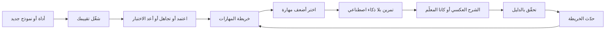

# الوحدة 13 — الحفاظ على حدّة مهاراتك (Staying sharp)

*تتغير الأدوات (tools) والنماذج (models) كل بضعة أشهر، ويجب أن يعمّر حكمك المهني (judgement) أطول منها. تتناول الوحدة 13 الجزء من العمل الذي لا يؤديه أي وكيل (agent) نيابةً عنك: أن تُبقي مهاراتك (skills) حادّة بينما تتحسن الأدوات. الدرس 13.1 هو درس المفاهيم (the concept lesson). فهو يسمّي الأساسيات (fundamentals) التي ما زال التحقق (verification) يقوم عليها (قراءة الشيفرة — reading code، وتصحيح الأخطاء — debugging، والتفكير في الأنظمة — systems thinking، وهياكل البيانات — data structures، والاختبار — testing، وأساسيات الأمان — security basics)، ويزن الأدلة المبكرة المحدودة (the early, limited evidence) عن تآكل المهارة (deskilling)، ويحوّل الممارسة المقصودة (deliberate practice) إلى عادات (habits): تمارين بلا ذكاء اصطناعي (no-AI reps)، والشرح العكسي (explain-back)، وتمارين الكاتا (katas) مع معلّم ذكاء اصطناعي (AI tutor) يعطي تلميحات (hints) لا إجابات، وقراءة الشيفرة الجيدة (reading good code)، وكتابة متطلبات واضحة (writing clear requirements). ويتناول كذلك تقييم الأدوات والنماذج على مهامك أنت (evaluating tools and models on your own tasks) بدل لوحات الصدارة (leaderboards)، ومواكبة الجديد دون مطاردة كل إصدار (staying current without chasing every release)، والصدق في استخدام الذكاء الاصطناعي في العمل (being honest about AI use at work)، وكيف قد تتغير الأدوار (how roles may shift). ومُنتَجه (artefact) هو خريطة المهارات وروتين الممارسة الأسبوعي (Skills map and weekly practice routine). أما الدرس 13.2 فهو ورشة العمل (the workshop). في نجم ريميت (Najm Remit) تبني تقييمًا شخصيًا (personal eval) من ثماني مهام على الأقل، لكل منها فحص (check) يستطيع سكربت (script) تشغيله، وخطة لتسعين يومًا (90-day plan) بأهداف قابلة للقياس (measurable goals)، ثم يشغّل المُقيِّم غير المتصل (offline grader) فحوصك ليرى هل ستلتقط شيئًا (would catch anything). وكل ما يخص جانب نجم خيالي (Everything on the Najm side is fictional).*

> **التركيز (Focus):** Mindset, Team — أبقِ أساسياتك (fundamentals) وذائقتك (taste) وصدقك (honesty) في نمو بينما تتغير الأدوات (while the tools change)، وقِس الأدوات على عملك أنت لا على درجات الآخرين (measure tools on your own work instead of on other people's scores).

---

# 13.1 — مهارات تتراكم: الأساسيات والذائقة والممارسة المقصودة وتقييم الأدوات وتجنّب تآكل المهارة (Skills that compound: fundamentals, taste, deliberate practice, evaluating tools and avoiding deskilling)
*المستوى (Level): 🔴 متقدم (Advanced)* · *المتطلبات (Prerequisites): 5.1، 12.1* · *التركيز (Focus): Mindset*

## ⚡ الدرس في دقيقة (In 60 seconds)
- تتغير الأدوات (tools) كل بضعة أشهر. أما المهارات التي تجعل مخرجات الذكاء الاصطناعي (AI output) آمنة للإطلاق (safe to ship) فلا تتغير: قراءة الشيفرة (reading code)، وتصحيح الأخطاء (debugging)، والتفكير في الأنظمة (systems thinking)، وهياكل البيانات (data structures)، والاختبار (testing)، وأساسيات الأمان (security basics). فلا تستطيع أن **تتحقق (verify)** إلا مما تستطيع قراءته.
- تآكل المهارة (Deskilling) خطر يُدار لا حكم نهائي (a risk to manage, not a verdict): فالدليل دراسة عشوائية صغيرة واحدة (one small randomized study)، ولا شيء يغطي سنوات من العمل الوكيلي (years of agentic work).
- احتفظ بـ**روتين ممارسة أسبوعي (weekly practice routine)**: تمرين بلا ذكاء اصطناعي (no-AI rep)، وشرح عكسي (explain-back)، وكاتا بوضع المعلّم (tutor-mode kata)، وقراءة شيفرة جيدة (reading good code).
- احكم على الأدوات بحسب **مهامك أنت (your own tasks)**، بفحوص تفشل أولًا (checks that fail first)، لا بلوحات الصدارة (leaderboards) ولا بما تشعر به من سرعة (how fast you feel).
- واكب الجديد بإيقاع ثابت (on a cadence) لا بدورة الأخبار (the news cycle)، وقل بوضوح ما كتبه الذكاء الاصطناعي وما فحصتَه أنت (what AI wrote and what you checked).

## 🧭 لماذا يهم (Why it matters)
يوم الثلاثاء الماضي طلبت لجين (Lujain)، المهندسة حديثة التخرج (graduate engineer)، من وكيلها (agent) أن «ينظّف التقريب في دفتر الأستاذ» ("tidy the rounding in the ledger"). فجعلت الفروقات (diff) التي أنتجها حصةَ الشريك (partner's share) من الرسوم تُقرَّب إلى الأعلى عند المنتصف (round half up) «مثل كل شيء آخر في ريميت» ("like everything else in Remit"). ولا اختبارات لدفتر الأستاذ (the ledger) نفسه، فلم يفشل أي اختبار (nothing went red)، وفتحت طلب دمج (pull request). وفي يوم الخميس تسأل ندى (Nada)، قائدة هندسة الجودة (quality engineering lead)، وهي المراجع الثاني (second reviewer) الذي يحتاجه منطق الأموال (money logic)، في العيادة (the clinic): «لماذا يمنح دفتر الأستاذ الشريك 3.04 من رسوم قدرها 10.15 لا 3.05؟» ⁦("Why does the ledger give the partner 3.04 on a fee of 10.15, not 3.05?")⁩ لم تفتح لجين `ledger.py` قط. فسلسلة التوثيق (docstring) فيه توثّق هذا السلوك الغريب (the quirk) (Q-LED-1) وتحذّر من إعادة هيكلة (refactoring) الملف دون اختبارات توصيف (characterization tests). وقد تجاوز الوكيل ذلك أو ظنّه خطأً (a bug)، ولم تستطع هي أن تقول أيّهما.

ما كان ينقصها لم يكن حيلة في الموجّهات (a prompt trick) بل أساسًا (a fundamental): قراءة الشيفرة وسؤال لماذا هي على ما هي عليه (reading code and asking why it is the way it is). وهي مهارة تقلّ ممارستك لها حين يتولى وكيل القراءة (when an agent does the reading). والعادة الخامسة (The fifth habit)، **أتمت الحلقة وحافظ على المهارة (Automate the loop, keep the skill)**، لها نصفان (two halves): بنت الوحدة 9 الأول وتبني هذه الوحدة الثاني. وفي يناير 2026 نشر باحثو Anthropic دراسة عشوائية صغيرة (a small randomized study) سجّل فيها مهندسون معظمهم مبتدئون (mostly junior engineers) تعلّموا مكتبة (a library) بمساعدة مساعد ذكاء اصطناعي (AI assistant) درجات أدنى في اختبار فهم (comprehension quiz) لاحق. ويذكر مؤلفوها حدودها (state its limits)؛ وهذا سبب كافٍ لأن تمارس عن قصد (practise on purpose).

## 📐 كيف يعمل (How it works)

### 🟢 الأساسيات (The essentials)

**الأساسيات التي يقوم عليها التحقق (The fundamentals verification stands on).** تفترض العادة **ثق بالدليل لا بالطلاقة (Trust evidence, not fluency)** (الدرس 5.1) أن أحدًا يستطيع قراءة الدليل (read the evidence)، والوكيل يكتب أسرع مما تقرأ أنت. سمِّ هذا الحد *سقف المراجع (reviewer's ceiling)* (مصطلح هذه الدورة لا قياس — this course's term, not a measurement): فما وراء حافة ما تستطيع قراءته تكون واثقًا لا مراجعًا (trusting, not reviewing)، وتحتاج إلى اختبار (a test) أو خطوة أصغر (a smaller step) أو مراجع ثانٍ (a second reviewer). ست مهارات تُبقيه عاليًا (Six skills keep it high):

| الأساس (Fundamental) | ما لا يستطيعه الوكيل ⁦(The agent cannot...)⁩ | أين يظهر ضرره في نجم (Where it bites at Najm) | تمرين بلا ذكاء اصطناعي (A no-AI rep) |
|---|---|---|---|
| قراءة الشيفرة (Reading code) | أن يخبرك لأي غرض وُضعت الشيفرة (tell you what code is *for*) | Q-LED-1: تُقرَّب الحصة إلى الزوجي عند المنتصف (the share rounds half-even) خلافًا لبقية ريميت (unlike the rest of Remit) | تتبَّع استدعاء `send` واحدًا على الورق ثم شغّله (Trace one send call on paper, then run it) |
| تصحيح الأخطاء (Debugging) | أن يحمل فرضيات عن نظامك أنت (hold hypotheses about *your* system) | حدّ طُبِّق عند منتصف ليل خاطئ (A limit applied at the wrong midnight) (الدرس 6.2) | اكتب ثلاث فرضيات واختبر أرخصها (Write three hypotheses, test the cheapest) |
| التفكير في الأنظمة (Systems thinking) | أن يرى ما ينكسر حول التغيير (see what breaks around a change) | يسجّل دفتر الأستاذ القيد ويفشل المخزن ولا شيء يتراجع عن ذلك (The ledger posts, the store fails, nothing undoes it) (D-SVC-1) | اسرد ما تتركه وراءها كل خطوة فاشلة من `send` (List what each failed send step leaves behind) |
| هياكل البيانات (Data structures) | أن يعرف كلفة الاختيار (know what a choice costs) | يحمّل `send` سجل العميل كله (loads a customer's whole history) | احسب إجمالي يوم بقاموس (Total a day with a dict) وقل ما الذي ينمو (say what grows) |
| الاختبار (Testing) | أن يقرر ما الذي سيثبت خطأه (decide what would prove it wrong) | اختبار لا يؤكد شيئًا (A test that asserts nothing) | اكتب اختبارات الحدود قبل قراءة الشيفرة (Write boundary tests before reading the code) |
| أساسيات الأمان (Security basics) | أن ينتبه إلى ما يجب ألا يُبنى بدمج النصوص أبدًا (notice what must never be string-built) | يبني `search_by_name` استعلام SQL بالدالة `format` (builds SQL with format) | راجع وحدة واحدة بحثًا عن الحقن والأسرار (Review one module for injection and secrets) |

**ما تقوله الأدلة عن تآكل المهارة (What the evidence says about deskilling). الأدلة ما زالت مبكرة (It is early).** مصادر فحصتها الدورة (Sources the course has checked):
- شِن وتامكين (Shen and Tamkin) (Anthropic، 2026)، تجربة عشوائية (randomized): 52 مهندسًا معظمهم مبتدئون (mostly junior engineers) يتعلمون مكتبة Trio. بلغ متوسط مجموعة الذكاء الاصطناعي (The AI group) 50% في اختبار الفهم (comprehension quiz) ومتوسط مجموعة الكتابة اليدوية (the hand-coders) 67%؛ ولم يكن مكسب السرعة البالغ نحو دقيقتين ذا دلالة إحصائية (a speed gain of about two minutes was not significant)؛ وكانت أكبر فجوة في أسئلة تصحيح الأخطاء (debugging questions). وحدود المؤلفين (The authors' limits): عينة صغيرة (a small sample)، واختبار بعد المهمة مباشرة (a quiz right after the task)، وإعداد يختلف عن الأدوات الوكيلية (a setup unlike agentic tools)، ونتائج أولية (preliminary results). وAnthropic هي التي تصنع Claude Code (Anthropic makes Claude Code).
- METR (2025)، تجربة عشوائية (randomized): 16 مطورًا متمرسًا في المصادر المفتوحة (experienced open-source developers) في مستودعاتهم الناضجة (their own mature repositories)، بأدوات مطلع 2025 (early-2025 tools). توقعوا تسريعًا بنسبة 24% (forecast a 24% speed-up)، واعتقدوا بعد ذلك أن التسريع بلغ نحو 20% (afterwards believed about 20%)، واستغرقوا وقتًا أطول بنسبة 19% (took 19% longer). وتقول METR إن الإعدادات الأخرى والأدوات اللاحقة قد تختلف (other settings and later tools may differ)؛ وفي 2026 وصفت بياناتها الأحدث بأنها «دليل ضعيف جدًا فحسب» ("only very weak evidence") على التسريع الآن (of the speed-up now).

مجتمعةً (Together): في تجربة صغيرة واحدة (one small trial) تلا التعلمَ بمساعد انخفاضٌ في درجات الاختبار (learning with an assistant was followed by lower quiz scores)، وقد يخطئ الناس في تقدير سرعتهم (people can misjudge their own speed). ولا شيء مما فحصته الدورة يغطي سنوات من العمل الوكيلي (years of agentic work). وتنتج عن ذلك قاعدة متواضعة (A modest rule follows): *احمِ المهارات التي تتحقق بها (protect the skills you verify with)*.

**الممارسة المقصودة مع الذكاء الاصطناعي (Deliberate practice with AI).** اعمل على ضعف محدد (a specific weakness)، عند حافة قدرتك (at the edge of your ability)، مع تغذية راجعة سريعة (fast feedback). يعطيك الوكيل تغذية راجعة فورية (instant feedback) لكنه قد يزيل الجهد الذي يعلّمك (remove the effort that teaches you). وثلاثة أساليب تحفظ الأمرين (Three moves keep both):
- **تمرين بلا ذكاء اصطناعي (No-AI rep)**: مهمة حقيقية صغيرة (a small real task) بلا عون ومحسوبة الوقت (unaided and timed)، ثم تقارنها بنسخة الوكيل (compared with the agent's version).
- **الشرح العكسي (Explain-back)**: بعد تغيير يجريه الوكيل، أغلق الفروقات (diff) واشرح كل سطر من الذاكرة (explain every line from memory)، ثم افتحها.
- **كاتا بوضع المعلّم (Tutor-mode kata)**: يعطي الوكيل تلميحات (hints) وأمثلة مضادة (counter-examples) ولا يعطي الحل (never the solution) أبدًا.

موجّه الكاتا الضعيف (A weak kata prompt) يسلّم ما أردت أن تتمرن عليه (hands over what you wanted to practise):

```text
Write a function that returns the fee tier for an amount in Remit.
```

أما موجّه المعلّم (A tutor prompt) فيُبقي الجهد عندك (keeps the effort with you). استخدم مجلدًا فارغًا للتجربة (an empty scratch folder): فإن استطاع الوكيل فتح `src/remit/fees.py` فالإجابة على بعد قراءة واحدة (the answer is one read away)، و«لا تنظر» ("do not look") سياق لا إنفاذ (context, not enforcement).

```text
I am practising, so do not write the solution. Task: write tier_index(amount) for a fee schedule
whose tiers end at QAR 500, 2,000 and 10,000, then one tier with no upper bound. An amount equal
to a bound stays in the lower tier. I will paste each attempt.
1. Reply with one hint per turn: a question, or an amount that breaks my code. Never fixed code.
2. After two hints on one problem you may point at the line, not rewrite it.
3. When my code passes, ask about one boundary I have not tested.
4. If I type "give up", show the shortest correct version and make me explain it back.
```

### 🟡 التعمق أكثر (Going deeper)

**الذائقة (Taste)** أن تعرف كيف يبدو الجيد (what good looks like) وما يجب تركه (what to leave out). سينتج الوكيل ما لا تستطيع أن تحكم عليه (An agent will produce what you cannot judge)، فاقرأ طلب دمج (pull request) واحدًا مدموجًا (merged) في الأسبوع من فريق آخر: قبل أن تفتح تعليقات المراجعة (the review comments)، اكتب الأسئلة الثلاثة التي كنت ستطرحها، ثم قارن. يقول طارق (Tariq)، قائد الهندسة (engineering lead): «الذائقة في معظمها قائمة بما اخترتَ ألا تفعله» ⁦("Taste is mostly the list of things you chose not to do.")⁩

**التواصل والمتطلبات (Communication and requirements).** لا يستطيع الوكيل أن يعرف ما قصدته حصة (Hessa)، مالكة المنتج (product owner). خذ تذكرة (ticket) غامضة، «اجعل الرسوم أوضح» ("make the fee clearer")، واكتب أسئلتك (شاشة عرض السعر أم الرسالة النصية؟ ⁦(the quote screen or the SMS?)⁩ بالإنجليزية فقط أم بالعربية أيضًا؟ ⁦(English only, or Arabic too?)⁩) وأربعة معايير قبول (acceptance criteria) (الدرس 3.1) قبل أن توجِّه الوكيل (before you prompt). ثم قارنها بأسئلته هو (compare with its questions).

**تقييم الأدوات والنماذج على مهامك أنت (Evaluating tools and models on your own tasks).** تجيب لوحة الصدارة (A leaderboard) عن سؤال «كيف يؤدي هذا النموذج في مهام الآخرين؟» ⁦("how does this model do on other people's tasks?")⁩. وهذه حدودها المعروفة (Known limits)، من مصادر فحصتها الدورة (from sources the course has checked):

| ما أظهرته نتائج المقاييس المرجعية العامة (What public benchmark results have shown) | المصدر وتحفظه هو (Source and its own caveat) |
|---|---|
| تعتمد بعض الرقع الناجحة (passing patches) على حلول مسرّبة (leaked solutions) أو اختبارات ضعيفة (weak tests) | SWE-Bench+ (زوج واحد من الوكيل والنموذج — one agent-model pair) |
| تسمّي النماذج الملف المطلوب تعديله من نص المشكلة وحده (name the file to edit from the issue text alone) بدقة أعلى بكثير (far better) على مستودعات المقياس المرجعي نفسه (the benchmark's own repositories)، ما يوحي بالحفظ (memorisation) | The SWE-Bench Illusion (تختلف الأرقام بين الإصدارات — numbers differ across versions) |
| توقف مورّد (vendor) عن الإبلاغ عن إحدى النسخ (stopped reporting one version)، مستشهدًا بالتلوث (contamination) واختبارات معيبة (flawed tests) في مجموعة فرعية دقّقها (a subset it audited) | OpenAI، نحو فبراير 2026 (about February 2026) |
| رأى المشرفون (maintainers) أن حصة كبيرة من الرقع التي يجتازها المُقيِّم (grader-passing patches) لن تُدمج (would not be merged) | METR، مارس 2026 (مجموعة فرعية من مقياس مرجعي واحد، وأداة تشغيل واحدة، ومحاولة واحدة — a subset of one benchmark, one harness, one attempt) |

الدرجة العامة (A public score) تلميح عن مهام الآخرين لا قياس لمهامك أنت (a hint about other people's tasks, not a measurement of yours). أما **التقييم الشخصي (personal eval)** فهو مهامك أنت، لكل منها فحص (check) **يفشل قبل أن تعمل الأداة وينجح على حل تثق به (fails before the tool runs and passes on a solution you trust)**، يُخفى عن الأداة (kept hidden from the tool) ويُكرَّر لأن المخرجات تتفاوت (repeated because output varies). و`najmkit` هي المكتبة المضمَّنة (the vendored library) التي لا يستطيع الوكيل معرفتها من التدريب (cannot know from training) (الدرس 2.1)، فالمهام التي تستخدمها تختبر القراءة لا التذكر (test reading, not recall). والدرس 13.2 يبني واحدًا؛ و[*اختبار البرمجيات (Software Testing)*، الدرس 7.1 — التقييمات الآلية: اختبار تطبيقات النماذج اللغوية الكبيرة بمجموعات البيانات والمقيِّمات والنموذج اللغوي حَكَمًا وعدم الحتمية وبوابات التكامل المستمر (Evals: testing LLM applications with datasets, graders, LLM-as-judge, non-determinism and CI gates)](../testing/index.ar.html#/7.1) يعلّم الطريقة للمنتجات القائمة على الذكاء الاصطناعي (teaches the method for AI products).

**مواكبة الجديد دون مطاردته (Staying current without chasing).** الإيقاع الثابت (A cadence) يتفوق على التدفق الإخباري (a feed):
- 30 دقيقة ثابتة في الأسبوع (A fixed 30 minutes a week) لملاحظات الإصدار (release notes) لأدواتك (نشر Claude Code ملاحظات أسبوعية؛ راجع الوثائق الحالية — Claude Code has published weekly ones; check the current documentation) وللنشرات الأمنية (security advisories). وفي أغسطس 2025 أمكن لحقن موجّه (prompt injection) أن يجعل GitHub Copilot يفعّل إعداد الموافقة التلقائية (auto-approve setting) الخاص به (CVE-2025-53773، رُقِّع في الشهر نفسه — patched that month).
- تجربة صغيرة واحدة في الشهر (One small experiment a month): فرضية (a hypothesis)، وصندوق زمني بساعة واحدة (a one-hour time box)، ورقم واحد (one number)، وقرار (a decision). «وضع التخطيط قبل أي تغيير يتجاوز ثلاثة ملفات: هل تقل التصحيحات؟» ⁦("Plan mode before any change over three files: do corrections fall?")⁩
- قاعدة المصدرين (The two-source rule) (قاعدة تقريبية في هذه الدورة — this course's rule of thumb): غيّر عادة حين يتفق مصدران موثوقان (two trusted sources agree)، أو حين يُظهر تقييمك الشخصي (your own eval) ذلك. وحيل الموجّهات تنتهي صلاحيتها (Prompt tricks expire) (ففي 2026 صارت «think hard» نصًّا عاديًا في Claude Code — in 2026, "think hard" is ordinary text in Claude Code): راجع الوثائق الحالية (check the current documentation).

**المسؤولية والصدق (Responsibility and honesty).** قواعد نجم (Najm's rules): يُوسَم كل تغيير بمساعدة الذكاء الاصطناعي (every AI-assisted change is labelled) ويبقى المؤلف خاضعًا للمساءلة (the author stays accountable). ويمتد الصدق إلى ما فحصتَه (Honesty extends to what you checked)؛ والملاحظة القوية (the strong note) تخبر المراجع أين ينظر (tells the reviewer where to look):

```text
Weak:   Updated fee tiers. All tests pass.
Strong: AI-assisted (label added). The agent drafted the tier change; I wrote the 500.00 and 500.01
        tests first and read the whole diff. I did not review the Arabic text of the quote screen:
        Hessa, please have it checked. Ran: pytest -q (101 passed: 99 existing, 2 mine).
```

**كيف قد تتغير الأدوار (How roles may shift). لا أحد يعرف بعد (Nobody knows yet).** ليس لعبارة «الأصيل في الذكاء الاصطناعي» ("AI-native") تعريف معياري (standard definition)، والمصادر التي قرأتها الدورة مورّدون (vendors) وشركات استشارات (consultancies) ومقالات (essays). يرى الدليل العملي (playbook) من Atlassian أن عنق الزجاجة (the bottleneck) انتقل إلى العمل المحيط بالشيفرة (the work around the code)؛ وتتفق المصادر على أنك تعيد تصميم سير العمل وضوابطه (redesign the workflow and its controls) لا أن تضيف أداة فحسب. ويقول تقرير DORA لعام 2025 إن الذكاء الاصطناعي «يضخّم ما هو موجود أصلًا» ("amplifies what's already there")، استنادًا إلى ارتباطات مبلَّغ عنها ذاتيًا (self-reported associations). والتنبؤات بوظائف بعينها تخمين (speculation)؛ والرهان المعقول أن تبني التحقق والحكم المهني (verification and judgement) وتحتفظ بأدلة عليهما (keep evidence of them). وتغطي دورة المسار المهني (the career course) السوق: [*من التخرّج إلى التوظيف (From Graduate to Hired)*، الدرس 0.1 — سوق التقنية للمبتدئين في عصر الذكاء الاصطناعي: ما الذي تغيّر وما الذي لم يتغيّر (The entry-level tech market in the AI era: what changed and what didn't)](../career/index.ar.html#/0.1).

### 🔴 نظرة الخبير (Expert view)

**المعايرة (Calibration).** قبل أن تشغّل الاختبارات، دوّن «سينجح هذا» ("this will pass") و«سيستغرق هذا عشر دقائق» ("this will take ten minutes"). سجّل كلًّا منهما مع نتيجته (Log each with its outcome)؛ وبعد عشرين مدخلًا أو نحوها (قاعدة تقريبية — a rule of thumb) ترى أين تكون ثقتك في محلها (where your trust is earned).

**ما الذي تمارسه ومتى لا تمارس (What to practise, and when not to).** الفرضية العملية (The working assumption)، التي لا تثبتها أي دراسة هنا، أن المهارات *تضمر إن لم تُستخدم (fade if unused)* (قراءة شيفرة غير مألوفة — reading unfamiliar code، وتصحيح الأخطاء من الصفر — debugging cold) بينما خيارات الأدوات (tool flags) وعبارات الموجّهات (prompt phrases) *تنتهي صلاحيتها (expire)* فحسب. مارِس النوع الأول. وتخطَّ التمرين (the rep) يوم الموعد النهائي (on deadline day)، وفي الشيفرة الروتينية المتكررة (boilerplate) التي أتقنتها قبل سنوات، وفي المهارات التي ليست على خريطتك (skills off your map).

**جانب الفريق (The team's side).** دوِّروا المهام بلا عون (Rotate unaided tasks)، وأجروا تمارين حوادث (incident drills) والوكيل مطفأ (with the agent off)، وابدؤوا التمارين مع المبتدئين (juniors)، لأن دراسة تكوين المهارة الوحيدة (the one skill-formation study) كان معظم مشاركيها مبتدئين: سبب للحذر لا دليل على أن المهندسين الأقدم بمأمن (a reason for care, not proof that seniors are safe) (الدرس 12.1).



## 🧰 الأدوات (The toolkit)
| الأداة أو الممارسة أو النمط (Tool, practice or pattern) | ما هي وماذا تفعل (What it is and does) | متى تلجأ إليها (When to reach for it) |
|---|---|---|
| **Skills map** — خريطة المهارات | ستة أساسيات (Six fundamentals): آخر استخدام بلا عون (last unaided use)، والثقة من 1 إلى 5 (confidence 1 to 5)، والدليل (evidence) | كل ربع سنة (Each quarter)، أو بعد مفاجأة (after a surprise) |
| **Weekly practice routine** — روتين الممارسة الأسبوعي | ثلاث إلى ست ممارسات محدودة الوقت (Three to six time-boxed practices)، واحدة منها بلا وكيل (one without the agent) | كل أسبوع (Every week)؛ وهو مُنتَج هذا الدرس (this lesson's artefact) |
| **No-AI rep** — التمرين بلا ذكاء اصطناعي | مهمة حقيقية صغيرة تُنجَز بلا عون ومحسوبة الوقت ثم تُقارَن (A small real task done unaided and timed, then compared) | حين تكون مهارة على الخريطة ضعيفة (When a skill on the map is weak) |
| **Explain-back** — الشرح العكسي | شرح تغيير أجراه وكيل من الذاكرة قبل أن تدمجه (Explaining an agent's change from memory before you merge) | قبل طلب دمج لم تكتبه أنت (Before a pull request you did not write) |
| **Tutor prompt** — موجّه المعلّم | تلميحات وأمثلة مضادة ولا حل أبدًا (Hints and counter-examples, never the solution) | تمارين الكاتا (Katas)، وتعلّم مكتبة جديدة (learning a new library) |
| **Calibration log** — سجل المعايرة | التوقعات إلى جانب النتائج (Predictions beside outcomes) | حين تثق بالوكيل أكثر مما ينبغي أو أقل (When you trust the agent too much or too little) |
| **Personal eval** — التقييم الشخصي | مهامك أنت، لكل منها فحص يفشل أولًا (Your own tasks, each with a check that fails first) (الدرس 13.2) | قبل أن تعتمد أداة أو نموذجًا أو تبدّله (Before you adopt or switch a tool or model) |

## 🏛️ عمليًا في بنك نجم (In practice at Najm Bank)
**المُنتَج: خريطة المهارات وروتين الممارسة الأسبوعي (The artefact: the Skills map and weekly practice routine).** يطلب طارق (Tariq) من الجميع ملء واحدة (fill one in). كانت محاولة لجين (Lujain) الأولى كلها 4 و5، مع «تصحيح الأخطاء: 5، أصحّح الأخطاء طوال اليوم مع Claude» ⁦("Debugging: 5, I debug all day with Claude.")⁩ وقاعدة طارق الوحيدة: **الدليل تاريخ وشيء فعلته دون مساعدة (evidence is a date and something you did without help).** ومحاولتها الثانية (Her second attempt) (مُصطنعة لأغراض التعليم — constructed for teaching):

```markdown
### Skills map
| Skill | Last did it without AI | Confidence (1-5) | Evidence |
|---|---|---|---|
| Reading unfamiliar code | never in this repo | 2 | I could not say why the ledger share rounds half-even |
| Debugging | July, a flaky fixture | 3 | Found it with prints in an hour; since then I only prompt |
| Systems thinking | not yet | 2 | I cannot say what a failed store write leaves behind |
| Data structures | May, a practice site | 3 | Fine with dicts and sets; I look up heaps |
| Testing | last week, 3 fee tests | 4 | Boundary cases first; I can explain a mutation test |
| Security basics | June, a course lab | 2 | I spot string-built SQL, not a threat model |

### Weekly routine
| Day | Practice | Minutes |
|---|---|---|
| Sunday | Release notes and my calibration log | 20 |
| Tuesday | Kata with the tutor prompt: one function, no solutions from the agent | 40 |
| Wednesday | Read a merged pull request outside my area; write three questions | 30 |
| Thursday | Explain-back of the week's biggest agent change, then open the diff | 20 |
```

أعد التقييم كل ربع سنة (Re-rate every quarter) وارفع مهارة ضعيفة **واحدة** في كل مرة (lift one weak skill at a time). قاعدة تقريبية في هذه الدورة (A rule of thumb of this course) لا نتيجة بحثية (not a finding): ضع سقفًا للثقة عند 3 (cap confidence at 3) لأي مهارة لم تستخدمها بلا عون منذ ثلاثة أشهر (not used unaided in three months). ويبدأ الدرس 13.2 من الجدولين أنفسهما (the same two tables).

## 🛠️ التمارين (Exercises)
- 🟢 **املأ خريطة المهارات بأمانة (Fill the Skills map honestly).** بلا وكيل (No agent). *يكتمل عندما (Done when):* يكون لكل صف تاريخ ورقم وجملة دليل (every row has a date, a number and a sentence of evidence)، وتكون مهارة واحدة موسومة لترفعها أولًا (one skill is marked to lift first).
- 🟡 **تمرين بلا ذكاء اصطناعي واحد وشرح عكسي واحد (One no-AI rep and one explain-back).** الوكيل اختياري (An agent is optional)، وبعد التمرين فقط (only after the rep). اختر مهمة من ريميت (a Remit task) كنت ستفوّضها (would delegate)، مثل اختبارات حدود الحد الشهري (monthly-limit boundary tests) للدالة `check_limits`. أنجزها بلا عون ومحسوبة الوقت، ثم دع وكيلًا أو زميلًا يراجعها بوضع المعلّم (in tutor mode). *يكتمل عندما (Done when):* يكون لديك الدقائق (the minutes) والتلميحات التي أخذتها ورفضتها (the hints you took and rejected) وشرح عكسي من خمسة أسطر مكتوب قبل أن تفتح نسخة المراجع (written before you open the reviewer's version).
- 🔴 **قارن أداتين على مهامك أنت (Compare two tools on your own tasks).** يحتاج وكيلًا (Needs an agent)؛ وإن كانت لديك أداة واحدة فقارن إعدادين (compare two settings) (بملف `CLAUDE.md` الخاص بك وبدونه — with and without your CLAUDE.md). خذ ثلاث مهام من آخر أسبوعين، واكتب لكل منها فحصًا يفشل أولًا (a check that fails first)، وشغّل كلًّا منها مرتين لكل إعداد من نسخة نظيفة (from a clean copy). *يكتمل عندما (Done when):* يكون لديك جدول بالنجاحات والدقائق والتصحيحات (a table of passes, minutes and corrections) وقرار تفويض (a delegation decision) وتحفظ واحد عن العينة (one caveat about the sample).

## ⚠️ أخطاء وفخاخ (Mistakes and traps)
- **قراءة دراسة واحدة بوصفها حكمًا نهائيًا (Reading one study as a verdict)**، في أي اتجاه. قل ما الذي قاسته (what it measured) وما حدودها (its limits).
- **الممارسة بلا تغذية راجعة (Practising without feedback).** تمرين لا يفحصه أحد عمل بطيء (a rep nobody checks is slow work).
- **طلب التلميحات ثم أخذ الإجابة (Asking for hints, then taking the answer).** في وضع المعلّم (tutor mode) الجهد هو المقصود (the effort is the point).
- **الوثوق بما تشعر به من سرعة أو مهارة (Trusting how fast or skilled you feel).** أعطِ توقعاتك درجات (Score predictions) واستخدم ساعة (use a clock).
- **المبالغة في ما فحصتَه (Overclaiming what you checked).** «كل الاختبارات تنجح» ("All tests pass") ليست «راجعتُه» ("I reviewed it"). قل أيّهما.

## 🧾 الخلاصة (Recap)
- يقوم التحقق (Verification) على ست أساسيات (six fundamentals)؛ وما وراء حافة ما تستطيع قراءته تكون واثقًا لا مراجعًا (you are trusting, not reviewing).
- أدلة تآكل المهارة (The deskilling evidence) مبكرة وصغيرة: أدر الخطر، ولا تدّعِ نتيجة (do not claim a result)، ومارس عن قصد (practise on purpose).
- قيِّم الأدوات على مهامك أنت (Evaluate tools on your own tasks)، بفحوص تفشل أولًا (checks that fail first)؛ ودرجة المقياس المرجعي (a benchmark score) تلميح عن مهام الآخرين.
- واكب الجديد بإيقاع ثابت (Stay current on a cadence)، وكن صادقًا في استخدام الذكاء الاصطناعي (be honest about AI use)، وتمسّك بتوقعات الأدوار بخفة (hold predictions about roles loosely).

## ✍️ اختبر نفسك (Check yourself)

**1. يقول زميل «أثبتت دراسة أن الذكاء الاصطناعي يجعل المهندسين أسوأ» ("a study proved that AI makes engineers worse"). ما أكثر ردٍّ يمكن الدفاع عنه؟ ⁦(What is the most defensible reply?)⁩**

- A. صحيح: أظهرت الدراسة أن التعلم بالذكاء الاصطناعي يخفض دائمًا مهارات المهندس (always lowers an engineer's skills)
- B. لم يثبت: وجدت تجربة صغيرة واحدة درجات اختبار أدنى (one small trial found lower quiz scores)، ويسرد مؤلفوها حدودًا (its authors list limits)
- C. خطأ: وجدت التجربة العشوائية نفسها أن مجموعة الذكاء الاصطناعي سجلت درجات أعلى في الفهم (scored higher on comprehension)
- D. غير ذي صلة: اختبار في مكتبة واحدة لا يقول شيئًا عن المهندسين الذين يستخدمون الوكلاء (says nothing about engineers using agents)

<details><summary>الإجابة</summary>

**B.** كانت الدراسة صغيرة (52 مهندسًا معظمهم مبتدئون ومكتبة واحدة — 52 mostly junior engineers, one library) وأولية (preliminary): دليل يؤخذ بجدية (evidence to take seriously) لا برهان (not proof)، وهي صامتة عن سنوات من العمل الوكيلي (silent about years of agentic work). الخيار A يحوّل نتيجة واحدة إلى قانون (turns one result into a law)، وC يعكسها (reverses it)، وD يطرحها جانبًا (discards it). (🟢 الأساسيات (The essentials).)

</details>

**2. تتمرن لجين (Lujain) على `tier_index` بالموجّه «اكتب دالة تعيد شريحة الرسوم لمبلغ» ("write a function that returns the fee tier for an amount"). أي تغيير يعيد أثر الممارسة؟ ⁦(Which change restores the practice effect?)⁩**

- A. اطلب الحل الكامل واقرأه مرتين (Ask for the full solution and read it twice)
- B. اطلب من الوكيل أن يشرح حله بعد كتابة الشيفرة (explain its solution after writing the code)
- C. اطلب حلًّا أطول بتعليق على كل سطر (a longer solution with a comment on every line)
- D. اطلب تلميحًا واحدًا أو مثالًا مضادًا في كل دور، ولا شيفرة أبدًا (one hint or counter-example per turn, never code)

<details><summary>الإجابة</summary>

**D.** يُبقي موجّه المعلّم (A tutor prompt) التغذية الراجعة (the feedback) ويحجب الإجابة (withholds the answer). أما قراءة الحل (A) أو شرحه (B) أو نسخة معلّقة منه (C) فتزيل العناء (removes the struggle). (🟢 الأساسيات (The essentials).)

</details>

**3. سيضيف سالم (Salem)، من هندسة المنصة (platform engineering)، أداة معتمدة ثانية (a second approved tool). تقترح لجين اختيار الأداة التي تتصدر مقياسًا مرجعيًا عامًا للبرمجة (tops a public coding benchmark). ما أفضل اعتراض؟ ⁦(What is the best objection?)⁩**

- A. الدرجات تعكس مهام الآخرين (reflect other people's tasks)؛ فلنختبر على مهامنا، بفحوص تفشل أولًا (test on ours, with checks that fail first)
- B. لوحات الصدارة (Leaderboards) خاطئة دائمًا، فأي أداة معتمدة ستؤدي عملنا بالجودة نفسها (will do just as well for our work)
- C. الأداة الأرخص هي الخيار الأفضل (The cheaper tool is the better choice)، لأن فجوات الجودة صغيرة (quality gaps are small)
- D. عرض المورّد نفسه (The vendor's own demo) دليل أفضل لعملنا من درجة عامة (a public score)

<details><summary>الإجابة</summary>

**A.** تصف المصادر التي فُحصت حلولًا مسرّبة (leaked solutions) واختبارات ضعيفة (weak tests) وحفظًا (memorisation). و«خاطئة دائمًا» ("Always wrong") والسعر (price) والعرض التوضيحي (a demo) لا تقول ما يلائم عملنا؛ أما التقييم الشخصي (a personal eval) فيقوله. (🟡 تقييم الأدوات (Evaluating tools).)

</details>

**4. صغتَ تغيير رسوم مع الوكيل، وكتبتَ اختبارات الحدود أولًا (wrote the boundary tests first)، وقرأتَ الفروقات كلها (read the whole diff)، ولم تفحص النص العربي (did not check the Arabic text). أي ملاحظة في طلب الدمج (pull request) هي الأصدق والأنفع؟ ⁦(Which pull request note is most honest and useful?)⁩**

- A. «حدّثتُ شرائح الرسوم في fees.py. كل الاختبارات تنجح والفروقات صغيرة كما طلبت التذكرة.» ⁦("Updated the fee tiers in fees.py. All tests pass and the diff is small, as the ticket asked.")⁩
- B. «بمساعدة الذكاء الاصطناعي. راجعت التغيير بعناية وأنا واثق من صحته.» ⁦("AI-assisted. I reviewed the change carefully and I am confident that it is correct.")⁩
- C. «بمساعدة الذكاء الاصطناعي. كتبتُ اختبارات الشرائح أولًا وقرأتُ الفروقات؛ ولم أفحص النص العربي.» ⁦("AI-assisted. I wrote the tier tests first and read the diff; I did not check the Arabic.")⁩
- D. «غيّره الوكيل من التذكرة، فأي عيوب تعود إلى الأداة لا إليّ.» ⁦("Changed by the agent from the ticket, so any defects belong to the tool, not to me.")⁩

<details><summary>الإجابة</summary>

**C.** تضع وسمًا على التغيير (It labels the change)، وتقول ما فعله المؤلف وأين لا يجوز الافتراض (where not to assume). A تُخفي الذكاء الاصطناعي (hides the AI)، وB غير قابلة للفحص (not checkable)، وD تكسر القاعدة القائلة إن المؤلف يبقى خاضعًا للمساءلة (the author stays accountable). (🟡 المسؤولية (Responsibility).)

</details>

**5. أُعلن عن نموذج جديد يوم الاثنين مع عرض توضيحي ينتشر انتشارًا واسعًا (a viral demo). ما أفضل خطة لهذا الأسبوع؟ ⁦(What is the best plan for this week?)⁩**

- A. انقلوا الفريق كله إليه هذا الأسبوع، ما دامت الميزة جديدة (while the advantage is new)
- B. دوِّنوه، واقرؤوا ملاحظاته في موعدكم الأسبوعي (in your weekly slot)، وشغّلوا تقييمكم قبل أن تقرروا (run your eval before deciding)
- C. تجاهلوا كل نموذج جديد لمدة سنة حتى لا يتشتت الفريق (so that the team is not distracted)
- D. انتظروا حتى يتصدر لوحة صدارة عامة لمدة شهر ثم اعتمدوه في الفريق كله (tops a public leaderboard for a month)

<details><summary>الإجابة</summary>

**B.** الإيقاع الثابت (A cadence) مع تقييمك الشخصي (your own eval) يحوّلان الإعلان إلى قياس (turns an announcement into a measurement). والعرض التوضيحي (A) أو الدرجة (D) يكرران خطأ لوحة الصدارة (repeats the leaderboard mistake)؛ وتجاهل كل شيء (C) يضيّع مكاسب حقيقية (misses real gains). (🟡 مواكبة الجديد (Staying current).)

</details>

## 📚 المراجع (References)
- **للتعمق (Go deeper) — الأدلة (evidence).** شِن وتامكين (Shen and Tamkin)، Anthropic، "How AI assistance impacts the formation of coding skills": https://www.anthropic.com/research/AI-assistance-coding-skills · METR، دراسة 2025 (2025 study): https://metr.org/blog/2025-07-10-early-2025-ai-experienced-os-dev-study/ · METR، تحديث 2026 (2026 update): https://metr.org/blog/2026-02-24-uplift-update/ · DORA 2025: https://cloud.google.com/blog/products/ai-machine-learning/announcing-the-2025-dora-report · Atlassian، "The AI SDLC transformation playbook" (مورّد — vendor): https://www.atlassian.com/blog/ai-at-work/ai-sdlc-transformation-playbook
- **للتعمق (Go deeper) — المقاييس المرجعية (benchmarks).** SWE-Bench+: https://arxiv.org/abs/2410.06992 · "The SWE-Bench Illusion": https://arxiv.org/abs/2506.12286 · OpenAI، "Why we no longer evaluate SWE-bench Verified": https://openai.com/index/why-we-no-longer-evaluate-swe-bench-verified/ · METR، "Many SWE-bench-Passing PRs Would Not Be Merged into Main": https://metr.org/notes/2026-03-10-many-swe-bench-passing-prs-would-not-be-merged-into-main/
- وثائق Claude Code (Claude Code documentation): https://code.claude.com/docs/en/best-practices
- [*بناء تطبيقات الذكاء الاصطناعي والوكلاء (Building AI Applications & Agents)*، الدرس 12.1 — تقييم الوكلاء: مجموعات التقييم والمقيِّمات والنموذج اللغوي حَكَمًا ومسارات التنفيذ وبوابات الانحدار (Evaluating agents: eval sets, graders, LLM-as-judge, trajectories and regression gates)](../aiapps/index.ar.html#/12.1)
- [*من التخرّج إلى التوظيف (From Graduate to Hired)*، الدرس 1.2 — البناء بوكلاء البرمجة بالذكاء الاصطناعي دون أن تنجرف معهم (Building with AI coding agents without being carried by them)](../career/index.ar.html#/1.2)

---

# 13.2 — ورشة العمل: تقييمك الشخصي وخطة تعلّمك وخطة التسعين يومًا (Workshop: your personal eval, learning plan and 90-day plan)
*المستوى (Level): 🔴 متقدم (Advanced)* · *المتطلبات (Prerequisites): 13.1* · *التركيز (Focus): Mindset, Team*

## ⚡ الدرس في دقيقة (In 60 seconds)
- المختبر (Lab) `m13` على نجم ريميت (Najm Remit): ابنِ **تقييمًا شخصيًا (personal eval)** (`eval/tasks.jsonl`، ثماني مهام أو أكثر بفحوص يستطيع سكربت تشغيلها — eight or more tasks with checks a script can run) و**خطة تسعين يومًا (90-day plan)** (`plan.md`).
- **يحتاج وكيلًا: لا (Needs an agent: no).** يجوز لك استخدام وكيل؛ والمُقيِّم (the grader) ينظر إلى النتيجة وحدها (looks only at the result).
- القاعدة المهمة (The rule that matters): يجب أن **يفشل الفحص على المستودع غير الملموس (fail on the untouched repository)** و**ينجح على حل تثق به (pass on a solution you trust)** و**يرفض الإجابة الكسولة (refuse a lazy answer)**. وتختبر العدّة (The kit) هذا على نسخ مؤقتة (throw-away copies)؛ ولا تستطيع الحكم هل مهامك أو خطتك حكيمة (whether your tasks or plan are wise).

## 🧭 لماذا يهم (Why it matters)
في الربع القادم يضيف سالم (Salem) أداة معتمدة ثانية (a second approved tool). تقول لجين (Lujain) إنها «تتصدر لوحة الصدارة» ("tops the leaderboard"). فيسأل طارق (Tariq): «على أي من مهامنا؟» ⁦("On which of our tasks?")⁩ لا أحد يعرف؛ وتقضي العيادة (the clinic) ساعتها في الآراء (opinions). أما نسخة ندى (Nada's version): ثماني مهام حقيقية (eight real tasks)، لكل منها فحص (a check)، تُشغَّل ثلاث مرات لكل أداة (run three times per tool).

وطلب طارق الثاني (Tariq's second ask): «ما الذي ستتحسن فيه خلال تسعين يومًا، وكيف سنعرف؟» ⁦("What will you be better at in ninety days, and how will we know?")⁩ فعبارة «تحسّن في تصحيح الأخطاء» ("Get better at debugging") لا يمكن تحقيقها ولا إخفاقها (can be neither met nor missed)؛ أما الهدف الذي له مقياس (a metric) وخط أساس (a baseline) ورقم (a number) وتاريخ (a date) فيمكن أن يتحقق أو يخفق. إنها العادة **حدِّد قبل أن تفوِّض (Specify before you delegate)** من جديد (again).

## 📐 كيف يعمل (How it works)

### 🟢 الأساسيات (The essentials)

**المهمة خمسة أجزاء (A task is five parts).** يحتوي `lab-assets/tasks.example.jsonl` على أربعة أمثلة محلولة (four worked examples). **الموجّه (prompt)** هو الكلمات الدقيقة التي تعطيها للأداة (the exact words you give the tool) (عبارة EX3 «أضف خيار --json...» ⁦("Add a --json flag...")⁩). و**الحالة الابتدائية (starting state)** نسخة نظيفة عند `lab-start`، مع رقعة **إعداد (setup)** اختيارية (an optional patch) تزرع خطأً أو ملفًا للمراجعة (plants a bug or a file to review). و**الفحص (check)** أمر تقول حالة خروجه (exit status) نجاحًا أو فشلًا، ويُحفظ حيث لا تراه الأداة (kept where the tool cannot see it). و**الحارس (guard)** يجب أن ينجح قبل العمل وبعده، ليلتقط الضرر الجانبي (collateral damage) (EX1 يحرس ملفات الاختبار المجاورة — guards the neighbouring test files). و**المرجع (reference)** رقعة تثق بها، لتثبت أن الفحص يمكن أن ينجح (to prove the check can pass).

يكتسب الفحص الثقة بثلاث طرق (A check earns trust three ways): **يفشل على نسخة نظيفة (fails on a clean copy)**، و**ينجح على المرجع (passes on the reference)**، و**لا تنجح عنده إجابة كسولة (a lazy answer does not pass it)**. خذ EX2: *اشرح كيف ترتبط الرسوم الإضافية للخدمة السريعة (express surcharge) بسقف الرسوم (fee cap)، واكتب الإجابة في `ANSWER.md`*. الفحص الضعيف (A weak check) لا يطلب إلا أن يوجد الملف (asks only that the file exists). يفشل على نسخة نظيفة وينجح على المرجع، فيبدو سليمًا (looks fine)، لكن مجسّات الإجابات الكسولة (lazy-answer probes) في العدّة تكتب `TODO` أو فقرة حشو (a paragraph of filler) أو موجّهك أنت في `ANSWER.md`، ولا يزال ينجح. والفحص الحقيقي في المثال (The example's real check)، `lab-assets/example/check_ex2.py`، يقرأ الإجابة (reads the answer):

```python
# lab-assets/example/check_ex2.py
import pathlib
import re
import sys

answer = pathlib.Path("ANSWER.md").read_text(encoding="utf-8").lower()  # fails until the tool writes the file
wanted = [
    ("names the express surcharge", "express" in answer and "surcharge" in answer),
    ("says it is added after the cap", re.search(r"after the cap|after[^.]{0,25}\bcap(?:ped|ping)\b|on top of the cap|beyond the cap", answer) is not None),
]
missing = [what for what, ok in wanted if not ok]
if missing:
    sys.exit("the answer does not say: " + "; ".join(missing))
```

تفشل النسخة النظيفة، وينجح المرجع، ويفشل `TODO` ويسمّي الحقائق الناقصة (names the missing facts). ومع ذلك فإن فحص العبارات (a phrase check) حدٌّ أدنى (a floor): فقد تفشل إجابة صحيحة بكلمات أخرى (a correct answer in other words can fail)، وقد تنجح إجابة خاطئة تستعير العبارات (a wrong one that borrows the phrases can pass).

**مهمة «اكتب اختبارات» (A "write tests" task)** لا يمكن فحصها بتشغيل الاختبارات التي تكتبها الأداة: فالاختبار الذي لا يؤكد شيئًا (a test that asserts nothing) ينجح. وفحص EX4، `lab-assets/example/check_ex4.py`، يشغّلها على الشيفرة الحقيقية (يجب أن تنجح — they must pass) وعلى نسخة غُيّرت فيها القاعدة (يجب أن تفشل — they must fail). أعد استخدامه بتغيير ثوابته الثلاثة (Reuse it by changing its three constants).

### 🟡 التعمق أكثر (Going deeper)

**شغّله من مساحة عمل نظيفة (Run it from a clean workspace).** ينشئ الأمر `python lab-assets/eval_runner.py prepare T03 --dir ../runs/T03-a` نسخة نظيفة بلا `eval/` أو `lab-assets/`، فلا تستطيع الأداة قراءة الفحص (cannot read the check)، ويطبع الموجّه (prints the prompt). أعطِ الأداة ذلك الموجّه وحده. ثم يعرض الأمر `git -C ../runs/T03-a add -A && git -C ../runs/T03-a diff --cached` ما غيّرته الأداة (what it changed): **اقرأ فروقات كل نجاح (read the diff of every pass)**، لأن الفحص حدٌّ أدنى لا مراجعة (a check is a floor, not a review). ويشغّل الأمر `score T03 --dir ../runs/T03-a --tool claude-code --minutes 6` الفحص على ملفات الأداة، أودعتها أم لا (committed or not)، ويلحق سطرًا بـ`eval/results.jsonl` (appends a line)؛ ويطبع `report` النجاحات لكل أداة (prints passes per tool). كرّر كل مهمة نحو ثلاث مرات (Repeat each task about three times). المجلد النظيف ليس أداة نظيفة (A clean folder is not a clean tool): فـClaude Code يقرأ أيضًا `~/.claude/CLAUDE.md` في كل مكان، فدوّن النموذج وملفات الذاكرة (the model and memory files) بالخيارين `--model` و`--note`.

**ازرع خطأً ثم اكتب المرجع (Plant a bug, then write the reference).** في مهمة الإصلاح (For a fix task)، أضف المهمة بلا `setup`، ثم نفّذ `prepare` عليها، وازرع الخطأ (plant the bug) في تلك النسخة (that copy) واحفظ ناتج `git diff` باسم `eval/setup/<id>.patch`؛ وعندها فقط أضف `"setup"` (only then add "setup"). يجب أن ينجح الحارس والخطأ مزروع (The guard must pass with the bug planted)، غير أن معظم الأخطاء تكسر اختبارًا موجودًا (most bugs break an existing test): فاحرس ملفات الاختبار التي لا يمسّها خطؤك (guard the test files yours leaves alone)، كما يفعل EX1. وللمرجع (For the reference)، نفّذ `prepare` مرة أخرى، واحلل المهمة هناك واحفظ ناتج `git add -N . && git diff`.

**اختر المهام كمتشكك (Choose tasks like a sceptic).** خذها من العمل الحقيقي (real work)، ومنها مهمة تعثّرت في الشهر الماضي (one that went wrong last month)؛ وفضّل شيفرة يستبعد أن يكون النموذج قد رآها (code a model is unlikely to have seen)، مثل `najmkit` (الدرس 2.1). واجعل كل فحص *عادلًا (fair)*: أي قراءة معقولة للموجّه تنجح (any reasonable reading of the prompt passes). واحتفظ بمهمتين أو ثلاث لا تضبط عليها شيئًا أبدًا (never tune against)، وإلا قست ضبطك أنت (you measure your tuning).

**اقرأ النتائج بأمانة (Read results honestly).** لنفترض أن الأداة A تنجح في 15 من 24 تشغيلًا والأداة B في 17 من 24 (tool A passes 15 of 24 runs and tool B 17 of 24). فارق تشغيلين في 24 تشغيلًا ضمن ما يستطيع الحظ إنتاجه (within what luck can produce)، فلا تسمِّ فائزًا (name no winner): انظر أي المهام تختلف (which tasks differ)، وهل تصمد نجاحات B أمام قراءة الفروقات (whether B's passes survive a read of the diff)، وانظر الدقائق والتصحيحات (the minutes and corrections)، ثم أضف تشغيلات (add runs). قارن المهام لا المجاميع فقط (Compare tasks, not only totals).

**متى لا تبني واحدًا (When not to build one).** إن كنت ستستخدم أداة لأسبوع، أو تستطيع التراجع عن الاختيار في ظهيرة واحدة (reverse the choice in an afternoon)، فجرّبها وحسب. يؤتي التقييم ثماره حين يكون القرار مكلفًا أو متكررًا (when the decision is costly or repeats). وهو يكلّف وقتًا ومالًا (It costs time and money) (9 مهام × 3 تشغيلات × أداتين = 54 تشغيلًا — 9 tasks × 3 runs × 2 tools is 54 runs): فابدأ بثلاث (start with three).

**أهداف يمكنك أن تخفق فيها (Goals you can miss).** ضعيف (Weak): «افهم قاعدة الشيفرة أفضل» ⁦("Understand the codebase better.")⁩ وقوي (Strong)، بوصفه صفًّا في جدول الأهداف (a row of the Goals table) (تاريخ البدء 2026-11-02 — start date 2026-11-02):

| الهدف (Goal) | المقياس (Metric) | خط الأساس (Baseline) | المستهدف (Target) | بحلول (By) | كيف سأقيسه (How I will measure it) |
|---|---|---|---|---|---|
| تتبّع مسارات ريميت بلا عون (Trace Remit flows unaided) | مسارات تُتبَّع على الورق ثم تُشغَّل (Flows traced on paper, then run) | 1 (send) | 4 | 2026-12-20 | التتبعات الأربعة في مستودع ملاحظاتي (The four traces in my notes repo) |

### 🔴 نظرة الخبير (Expert view)

**ما لا يستطيع المُقيِّم قوله (What the grader cannot tell).** هل مهامك هي المهام الصحيحة (whether your tasks are the right ones)، وهل يقيس الفحص ما يسأل عنه موجّهه (whether a check measures what its prompt asks) (فهو لا يعرف إلا أن الفحص يفشل أولًا وينجح على المرجع ويرفض الإجابات الكسولة — it knows only that the check fails first, passes on the reference and refuses lazy answers)، وهل خطتك حكيمة (whether your plan is wise). ولا يستطيع أن يقول لماذا يفشل الفحص (why a check fails): فالفحص الذي ينهار بسبب خطأ في شيفرته هو يفشل أيضًا (one that crashes on a bug of its own fails too)، فاقرأ السبب الذي يطبعه `baseline`. والنسخة المؤقتة ليست بيئة معزولة (A throw-away copy is not a sandbox): فالفحص شيفرة تعمل بصلاحياتك (a check is code that runs as you)، ويستطيع الوكيل أن يكتب واحدًا. اقرأ كل فحص قبل أن تشغّله، بما فيه فحص شريكك (a partner's included).

**يمكن التلاعب بالفحوص (Checks can be gamed).** قد تعالج الأداة المثال بحالة خاصة (A tool can special-case the example): فاستخدم عدة مدخلات (several inputs)، وحارسًا (a guard)، واقرأ الفروقات (read diffs)، وأبقِ مهام محجوبة (held-out tasks).

## 🧰 الأدوات (The toolkit)
| الأداة أو الممارسة أو النمط (Tool, practice or pattern) | ما هي وماذا تفعل (What it is and does) | متى تلجأ إليها (When to reach for it) |
|---|---|---|
| **Personal eval** — التقييم الشخصي | `eval/tasks.jsonl`: موجّهاتك وفحوصك وحرّاسك ورقع المرجع (your own prompts, checks, guards and reference patches) | قبل أن تعتمد أداة أو نموذجًا أو تبدّله (Before you adopt or switch a tool or model) |
| **Eval runner** — مشغّل التقييم | `lab-assets/eval_runner.py`: التحقق من الصحة وخط الأساس والتحقق من المرجع والتحضير والتسجيل والتقرير (validate, baseline, verify, prepare, score, report) | بعد كل تعديل (After every edit)؛ ولتسجيل تشغيل (to score a run) |
| **90-day plan** — خطة التسعين يومًا | خريطة المهارات وروتين أسبوعي وأهداف بمقياس وخط أساس ومستهدف وتاريخ (Skills map, weekly routine, goals with metric, baseline, target, date) | كل ربع سنة وتُراجَع شهريًا (Quarterly, reviewed monthly) |

## 🏛️ عمليًا في بنك نجم (In practice at Najm Bank)
**يحتاج وكيلًا: لا (Needs an agent: no).** يستطيع الوكيل أن يقترح مهامًا (propose tasks) ويصوغ فحوصًا ورقعًا (draft checks and patches)، لكن **المسار بلا وكيل (no-agent path)** مكتمل: ملفات `pytest` صغيرة وسكربتات (small pytest files and scripts)، و`git diff` للرقع (for the patches)، وMarkdown للخطة (for the plan).

**التذكرة (The ticket).** كتبها طارق (Tariq) (ملف `task.md` في العدّة، الذي ينسخه `start` إلى `TASK.md` — the kit's task.md, which start copies to TASK.md):

```text
# GROW-13: your personal eval and your 90-day plan

**From:** Tariq, Engineering Lead, Payments Platform
**To:** you
**Priority:** Normal. Do it this week, then revisit it every month.

Tools change every few months, and a leaderboard cannot say which one is good at *our* work. I want two things you
keep: an eval you run yourself, and a plan that keeps your skills growing. Use an AI assistant if you like; you must
be able to explain every task and every number. Run commands in your lab repository unless told otherwise.

### 1. A personal eval: `eval/tasks.jsonl`

At least **eight different tasks** you would really give a coding agent, as JSON Lines: one complete JSON object per
line, no array. At least six must be about this repository; the rest may come from your own project (`"repo": "own"`;
the kit cannot run those, but they count). The four examples in `lab-assets/tasks.example.jsonl` do not count, and
copies of one task count once. A task has:

* `id` (unique, for example `"T01"`), `title`, `kind` (`fix`, `feature`, `refactor`, `test`, `docs`, `explain`,
  `review` or `other`) and `prompt`: the exact words you would give a tool, 15 words or more.
* `check`: `{"run": "<command>", "guard": "<command>"}`. `run` decides pass or fail. The optional `guard` must pass
  before the work and after a correct solution, so a tool that fixes the task and breaks something else fails.
* `reference`: a `.patch` file under `eval/` holding a solution you trust. Every task about this repository needs one;
  a docs, explain or review reference, or any that changes only text files, must change eight words or more.
* Optional `setup`: a `.patch` file under `eval/` that plants the starting situation (a bug, a file to review).

A check is one command (`pytest`, `python`, `grep` or read-only `git`; no shell operators; offline), kept under
`eval/` (for example `eval/checks/`) so a tool never sees it. It runs from the root of a clean copy of the repository,
a git repository with one commit, so `git diff` shows what a solution changed. There `PYTHONPATH` is `src`; `python`
and `pytest` are the runner's interpreter; paths are relative, with forward slashes; a command gets 60 seconds;
secret-looking environment variables are removed. (`grep` is missing on some systems; a Python script always works.)
A check must:

1. **fail on the untouched repository** (the `lab-start` state): a check that passes before any work proves nothing;
2. **pass on the reference**;
3. **reject a lazy answer**: a placeholder or filler note, a test that asserts nothing, or a stray edit must not pass.

`python lab-assets/eval_runner.py validate`, `baseline` and `verify` test all three; `baseline` prints why each check
fails, so read it. Also write `eval/README.md` (60 words or more): how to run the eval, what counts as a pass, how
many repeats, when you rerun it.

### 2. A 90-day plan: `plan.md`

Start from `lab-assets/plan-template.md` and keep its headings: a start date, a skills map for six skills, a weekly
routine (minutes per practice), three to six goals, days 1-30, 31-60 and 61-90, your eval cadence, and what you will
ignore. Write dates as YYYY-MM-DD. A goal has a metric, a baseline, a target with a number, a date inside the 90 days
and a way to measure it.

### Done when

Only `eval/` and `plan.md` changed, in at least two commits that follow `CONTRIBUTING.md` (for example
`test(eval): ...` and `docs(plan): ...`; any lower-case scope works), and everything is committed, except the log
`eval/results.jsonl` that `score` writes. Grade it from the `ailab` folder of the course repository:
`python -m ailab grade m13 --dir <this directory>`
```

**البدء (Start).**

```bash
# from the root of the course repository
cd ainative/ailab
python -m ailab start m13 --dir ~/ainative/m13
cd ~/ainative/m13        # run every eval_runner command from here
mkdir -p eval/checks eval/setup eval/reference
python lab-assets/eval_runner.py --tasks lab-assets/tasks.example.jsonl baseline
python lab-assets/eval_runner.py --tasks lab-assets/tasks.example.jsonl verify
```

يطبع كلٌّ منهما `ok:` أربع مرات (Each prints ok: four times)؛ ويضيف `baseline` سبب فشل كل فحص (why each check fails). ويجب أن يتوافر `pytest` في `python` (python must have pytest) (يفحص ذلك `python -m ailab doctor`).

**دورك (Your move).** (1) اسرد اثنتي عشرة مهمة مرشحة (a dozen candidate tasks) من آخر أسبوعين ومن الأمور العالقة في ريميت (Remit's loose ends) (`grep -rn "KNOWN SMELL\|TODO" src`، أو بحث محررك؛ ووثيقة تخالف الشيفرة — or your editor's search; a document that disagrees with the code)؛ واحتفظ بثماني أو تسع منها بخليط من الأنواع (a mix of kinds). (2) اكتب كل مهمة في `eval/tasks.jsonl` وفحصها في `eval/checks/`، مع زرع الأخطاء كما سبق (planting bugs as above). شغّل `baseline`: يجب أن يفشل كل فحص، لسبب صحيح (for the right reason). (3) أعطِ كل مهمة ريميت مرجعًا (Give every Remit task a reference)؛ وشغّل `verify`. (4) اكتب `eval/README.md`؛ وأودعه (commit) بالرسالة `test(eval): ...`. (5) املأ قالب الخطة (Fill in the plan template) من جدولي الدرس 13.1؛ وأودعه بالرسالة `docs(plan): ...`. (6) شغّل المُقيِّم (Grade). ومع وكيل، اطلب أفكار مهام وصياغة فحوص (ask for task ideas and draft checks)، لكن شغّل `baseline` و`verify` بنفسك واسقط أي فحص لا تستطيع شرحه (drop any check you cannot explain).

**ما يفحصه المُقيِّم (What the grader checks).** *التقييم (The eval):* JSON Lines صالح (valid JSON Lines)؛ وثماني مهام مختلفة، ست منها عن ريميت (eight different tasks, six about Remit)؛ وفحوص تعمل (checks that run) و**تفشل على المستودع غير الملموس (fail on the untouched repo)** و**ترفض الإجابات الكسولة (refuse lazy answers)** (نص مؤقت — a placeholder، وحشو — filler، وموجّهك مُعادًا إليك — your prompt handed back، واختبار لا يؤكد شيئًا — a test that asserts nothing، وتعديل شارد — a stray edit)؛ ومرجع ناجح لكل مهمة ريميت (a passing reference for every Remit task). *الخطة (The plan):* الأقسام (sections)، وتاريخ بدء (a start date)، وخريطة من ست مهارات (a six-skill map)، وروتين واقعي (a realistic routine)، وأهداف قابلة للقياس (measurable goals). *المستودع (The repository):* لم يتغير إلا `eval/` و`plan.md`، في إيداعات تتبع `CONTRIBUTING.md` (commits that follow CONTRIBUTING.md)، ولا شيء غير مودَع (nothing uncommitted)، ولا أسرار (no secrets).

**تشغيل المُقيِّم (Grade).**

```bash
# from the ainative/ailab folder of the course repository
python -m ailab grade m13 --dir ~/ainative/m13
```

يسجّل المستودع الابتدائي غير الملموس (The untouched starter) `2/20 required checks passed: NOT YET`. ومسودة أولى كما قد يكتبها مساعد (A first draft such as an assistant might write) (مُصطنعة لأغراض التعليم لا مسجّلة من نموذج حقيقي — constructed for teaching, not recorded from a real model)، أسطر الفشل فقط، مع حذف التلميحات (failing lines only, hints cut):

```text
[FAIL] Every check is allowed and runs: T06 (line 6): the check cannot run (the script eval/checks/check_length.py does not exist)
[FAIL] Every check fails on the untouched repo: these checks already pass before any work is done: T03 (line 3)
[FAIL] Every Remit task has a passing reference: no reference for T03 (line 3); T05 (line 5)
[FAIL] Checks reject lazy answers: the check accepts a lazy answer: T04 (line 4): a placeholder in ANSWER.md, filler text in ANSWER.md, the prompt copied back in ANSWER.md
[FAIL] Goals are measurable: goal 1: the target has no number; goal 2: 2027-03-01 is outside the 90 days from 2026-11-02
Lab m13: 15/20 required checks passed: NOT YET
```

فحص T03 ينجح أصلًا (already passes)، وفحص T04 لا يطلب إلا وجود ملف (only asks that a file exists)، وT06 يسمّي سكربتًا لم يُكتب قط (names a script never written). وينتهي التشغيل الناجح (A passing run) بالسطر `Lab m13: 20/20 required checks passed: PASSED`. وإن انتهت مهلة أمر على جهاز مشغول (If a command times out on a busy machine) فشغّل المُقيِّم مرة أخرى (grade again).

**المُخرَج الأسبوعي (Weekly deliverable).** في مستودع المختبر (In the lab repository)، `eval/` و`plan.md` في إيداعين (in two commits). وفي مستودع ملاحظاتك (your notes repository)، المجلد `week-13/`: سجل الوكيل (agent log) وإجاباتك عن أسئلة الختام (debrief answers) وأي مخرجات من `report`.

**الجلسة الجماعية (Group session)، 60 دقيقة.** (1) تبادلوا المستودعات (Swap repositories)، واقرؤوا `eval/checks/` عند بعضكم، ثم شغّلوا `baseline` و`verify` لدى شريككم (15). (2) حاولوا اجتياز فحص شريككم بنص مؤقت أو بإجابة مكتوبة صراحة في الشيفرة (a placeholder or a hard-coded answer) (15). (3) اقرؤوا أهداف بعضكم: أي هدف لا يمكن أن يخفق؟ ⁦(which could not be missed?)⁩ (15) (4) اتفقوا على ما يعيد الفريق تشغيله شهريًا (what the team re-runs monthly) (15).

**أسئلة الختام (Debrief questions).** ما الذي أخطأ فيه الوكيل، وأي فحوصه نجحت على لا شيء؟ ⁦(What did the agent get wrong, and which of its checks passed on nothing?)⁩ وما الذي فات موجّهك أو سياقك؟ ⁦(What did your prompt or context miss?)⁩ وأي مهامك لن تختبرها لوحة صدارة أبدًا؟ ⁦(Which of your tasks would a leaderboard never test?)⁩

**قالب سجل الوكيل (Agent log template).**

```markdown
### Agent log: week 13
| Part | Prompt (one line) | What the agent did | What I corrected | Minutes |
|---|---|---|---|---|
| Task ideas | | | | |
| Checks | | | | |
| References | | | | |
| Plan | | | | |

Checks that passed on nothing:
```

## 🛠️ التمارين (Exercises)
- 🟢 **اقرأ الأمثلة (Read the examples).** بلا وكيل (No agent). شغّل `baseline` و`verify` على الأمثلة الأربعة (the four examples). ثم انسخ `tasks.example.jsonl` خارج المستودع، وأعطِ EX2 فحص «الملف موجود» ("file exists") ذا السطر الواحد، وشغّل `verify --tasks` على النسخة (واترك `lab-assets/` دون مساس — leave lab-assets/ untouched). *يكتمل عندما (Done when):* يقول `verify` إن نصًّا مؤقتًا في `ANSWER.md` ينجح (a placeholder passes)، وتستطيع أن تقول لماذا بدا الفحص الضعيف سليمًا (why the weak check looked fine).
- 🟡 **ابنِ التقييم (Build the eval).** الوكيل اختياري (An agent is optional). *يكتمل عندما (Done when):* تنجح فحوص التقييم لدى المُقيِّم (the grader's eval checks pass)، ويكون لأربع مهام حارس (four tasks have a guard)، وتكون واحدة منها من مشروعك أنت (one is from your own project).
- 🔴 **سجّل نتيجة تشغيلين وقرّر (Score two runs and decide).** يحتاج وكيلًا (Needs an agent)، أو ضع وكيلًا في مواجهة تشغيلاتك أنت بلا عون (pit an agent against your own unaided runs) (`--tool me`). نفّذ `prepare` و`score` لمهمة واحدة بأداتين أو إعدادين (with two tools or settings)، ثلاث تشغيلات لكل منهما. *يكتمل عندما (Done when):* يعرض `report` الأعداد (the counts)، وتقرأ فروقات كل نجاح (every passing diff)، وتقول ملاحظة ما كنت ستفوّضه، مع تحفظ (a note says what you would delegate, with a caveat).

## ⚠️ أخطاء وفخاخ (Mistakes and traps)
- **فحص ينجح على المستودع غير الملموس (A check that passes on the untouched repo).** لا يثبت شيئًا (It proves nothing). شغّل `baseline` أولًا.
- **فحص يفشل لسبب خاطئ (A check that fails for the wrong reason).** انهيار في دالته المساعدة (A crash in its own helper) يفشل أيضًا. اقرأ السبب الذي يطبعه `baseline` وشغّل الفحص مرة يدويًا (run the check once by hand).
- **الفحص بأن الملف موجود أو فيه بعض الكلمات (Checking that a file exists, or has some words).** افحص ما يقوله (Check what it says).
- **الوثوق باختبارات الأداة نفسها (Trusting a tool's own tests).** شغّلها على شيفرة غُيّرت قاعدتها (against code with the rule changed)، كما يفعل EX4.
- **تشغيل فحص لم تقرأه (Running a check you have not read).** إنه يعمل بصلاحياتك (It runs as you)؛ فاقرأ ما كتبه وكيل أولًا (read an agent's first).

## 🧾 الخلاصة (Recap)
- المهمة موجّه (prompt) وحالة ابتدائية نظيفة (a clean starting state) وفحص (a check) وحارس (a guard) ومرجع (a reference).
- يجب أن يفشل الفحص على المستودع غير الملموس (fail on the untouched repo)، وينجح على المرجع (pass on the reference)، ويرفض الإجابة الكسولة (refuse a lazy answer).
- شغّل الأدوات من مساحات عمل نظيفة (Run tools from clean workspaces)، وكرّر، واقرأ الفروقات (read the diffs)، وقارن المهام والمجاميع (compare tasks and totals).
- يكون الهدف قابلًا للقياس حين يستطيع غريب أن يقول في اليوم 90 هل تحقق (a stranger could say at day 90 whether it was met).

## ✍️ اختبر نفسك (Check yourself)

**1. فحصك لمهمة «أضف خيار --json» ("add a --json flag") هو الحزمة كلها، `pytest -q`، ويقول `baseline` إنه ينجح على المستودع غير الملموس (passes on the untouched repo). ماذا يخبرك ذلك؟ ⁦(What does that tell you?)⁩**

- A. لن تحتاج الأداة إلى تغيير أي شيفرة لتجتاز المهمة (will not need to change any code to pass the task)
- B. الفحص صارم أكثر من اللازم (too strict)، فينبغي حذف الحارس (the guard should go)
- C. الفحص لا يثبت شيئًا حتى يختبر السلوك الجديد (until it tests the new behaviour)
- D. المهمة أسهل من أن تنتمي إلى تقييم (too easy to belong in an eval)

<details><summary>الإجابة</summary>

**C.** الفحص الذي ينجح قبل أي عمل لا يستطيع أن يميّز أداة أنجزت المهمة من أداة لم تفعل شيئًا (cannot tell a tool that did the task from one that did nothing). أبقِ الحزمة حارسًا (Keep the suite as the guard). (🟢 الأساسيات (The essentials).)

</details>

**2. تُفحص مهمة الشرح لديك بالشرط «ANSWER.md موجود» ("ANSWER.md exists")، ويبلّغ `verify` بأن نصًّا مؤقتًا (a placeholder) ينجح. ما الإصلاح الصحيح؟ ⁦(What is the right fix?)⁩**

- A. أضف حارسًا يشغّل حزمة الاختبارات كلها (runs the whole test suite)
- B. اجعل الموجّه أطول لتصير الإجابات أطول (so the answers are longer)
- C. احذف المرجع لكي لا يبقى شيء للمقارنة (nothing remains to compare against)
- D. افحص ما تقوله الإجابة، مثل الحقائق التي يجب أن تتضمنها (the facts it must contain)

<details><summary>الإجابة</summary>

**D.** يجب أن يفشل الفحص على إجابة لا تقول شيئًا (an answer that says nothing). والحارس (A) يراقب الضرر لا الفراغ (watches for damage, not emptiness)، والموجّه (B) ليس هو الفحص. (🟢 الأساسيات (The essentials).)

</details>

**3. بعد تشغيل، تجد لجين (Lujain) أن أداتها اجتازت T05 بتعديل ملف الاختبار الظاهر (editing the visible test file). أي تصميم كان سيلتقط ذلك؟ ⁦(Which design would have caught it?)⁩**

- A. شغّل الأداة مرتين واحتفظ بالأفضل من النتيجتين للتقرير (keep the better of the two results for the report)
- B. اسأل الأداة في النهاية هل غيّرت أي ملفات اختبار (whether it changed any test files)
- C. أبقِ الفحص خارج مساحة العمل (outside the workspace) وانسخه إليها عند التسجيل فقط (copy it in only to score)
- D. سجّل نتائج المهام ذات الموجّهات القصيرة السهلة المتابعة فقط (short and simple to follow)

<details><summary>الإجابة</summary>

**C.** يعيش الفحص في `eval/`، الذي يتركه `prepare` خارجًا وينسخه `score` إلى الداخل، فلا تستطيع تعديلات اختبارات الأداة نفسها أن تغيّر الحكم (cannot change the verdict). وسؤال الأداة (B) ثقة بها (trusts it). (🟡 شغّله من مساحة عمل نظيفة (Run it from a clean workspace).)

</details>

**4. هدف زميل هو «تحسين تصحيحي للأخطاء بنهاية الربع» ("improve my debugging by the end of the quarter"). أي إعادة صياغة تلبي معيار الورشة؟ ⁦(Which rewrite meets the workshop's standard?)⁩**

- A. «خفض وقت تصحيحي للأخطاء إلى النصف بنهاية الربع» ("Cut my debugging time by half by the end of the quarter")
- B. «قضاء ثلاث ساعات كل أسبوع في تصحيح الأخطاء بلا وكيل، ابتداءً من صباح الاثنين القادم» ("Spend three hours every week debugging without the agent, starting next Monday morning")
- C. «أن أصبح أفضل مصحّح للأخطاء في الفريق بحلول المراجعة القادمة» ("Become the team's best debugger by the time of the next review")
- D. «إصلاح 6 أخطاء بلا عون بحلول 2026-12-15، من خط أساس 0، تُحصى في سجل وكيلي» ("Fix 6 bugs unaided by 2026-12-15, from a baseline of 0, counted in my agent log")

<details><summary>الإجابة</summary>

**D.** له مقياس وخط أساس ورقم وتاريخ وطريقة قياس (a metric, a baseline, a number, a date and a way to measure). وA يفتقر إلى خط أساس وإلى قياس (lacks a baseline and a measure)، وB نشاط بلا تاريخ انتهاء (an activity with no end date)، وC بلا رقم (has no number). (🟡 أهداف يمكنك أن تخفق فيها (Goals you can miss).)

</details>

**5. في تقييمك 8 مهام، بثلاث تشغيلات لكل منها (3 runs each). تنجح الأداة B في 17 من 24 تشغيلًا والأداة A في 15 من 24. ما الاستنتاج الأمين؟ ⁦(What is the honest conclusion?)⁩**

- A. الأداة B أفضل بنحو 8%، فينبغي أن ينتقل الفريق الآن (the team should switch now)
- B. فارق صغير على عينة صغيرة (A small gap on a small sample): اقرأ الفروقات وأضف تشغيلات (read the diffs and run more)
- C. لا يمكن استنتاج شيء من مهام قليلة كهذه، فتجاوزوا التقييمات (skip evals)
- D. الأداة A أسوأ، لأنها نجحت في تشغيلات أقل من الأداة B (passed fewer runs than tool B)

<details><summary>الإجابة</summary>

**B.** فارق تشغيلين في 24 تشغيلًا ضمن ما يستطيع الحظ إنتاجه (within what luck can produce): قارن المهام والفروقات والدقائق والتصحيحات (compare tasks, diffs, minutes and corrections)، وأضف تشغيلات (add runs). و«لا شيء» ("Nothing") (C) يذهب بعيدًا (goes too far)؛ والنسبة المئوية (A) تدّعي دقة (a percentage pretends precision). (🟡 اقرأ النتائج بأمانة (Read results honestly).)

</details>

## 📚 المراجع (References)
- وثائق Claude Code (Claude Code documentation)، أفضل الممارسات (best practices) (امنح الوكيل طريقة ليتحقق من عمله — give the agent a way to verify its work): https://code.claude.com/docs/en/best-practices
- pytest: https://docs.pytest.org/ · git: https://git-scm.com/docs
- عدّة المختبر (Lab kit): https://github.com/Tamoura/system-design-for-vibe-coders/tree/main/ainative/ailab
- [*اختبار البرمجيات (Software Testing)*، الدرس 7.1 — التقييمات الآلية: اختبار تطبيقات النماذج اللغوية الكبيرة بمجموعات البيانات والمقيِّمات والنموذج اللغوي حَكَمًا وعدم الحتمية وبوابات التكامل المستمر (Evals: testing LLM applications with datasets, graders, LLM-as-judge, non-determinism and CI gates)](../testing/index.ar.html#/7.1)
- [*إدارة منتجات الذكاء الاصطناعي (AI Product Management)*، الدرس 6.1 — جودة يمكنك قياسها: المقاييس والمجموعات المرجعية وتحليل الأخطاء (Quality you can measure: metrics, golden sets and error analysis)](../aipm/index.ar.html#/6.1)
