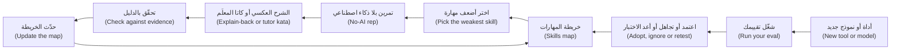

# الوحدة 13 — الحفاظ على حدّة مهاراتك (Staying sharp)

*تتغير الأدوات (tools) والنماذج (models) كل بضعة أشهر، ويجب أن يعمّر حكمك المهني (judgement) أطول منها. تتناول الوحدة 13 الجزء من العمل الذي لا يؤديه أي وكيل (agent) نيابةً عنك: أن تُبقي مهاراتك (skills) حادّة بينما تتحسن الأدوات. الدرس 13.1 هو درس المفاهيم. فهو يسمّي الأساسيات (fundamentals) التي ما زال التحقق (verification) يقوم عليها، ويزن الأدلة المبكرة المحدودة عن تآكل المهارة (deskilling)، ويحوّل الممارسة المقصودة (deliberate practice) إلى عادات (habits): تمارين بلا ذكاء اصطناعي (no-AI reps)، والشرح العكسي (explain-back)، وتمارين الكاتا (katas) مع معلّم ذكاء اصطناعي (AI tutor) يعطي تلميحات (hints) لا إجابات، وقراءة الشيفرة الجيدة، وكتابة متطلبات واضحة. ويتناول كذلك تقييم الأدوات والنماذج على مهامك أنت بدل لوحات الصدارة (leaderboards)، ومواكبة الجديد دون مطاردة كل إصدار، والصدق في استخدام الذكاء الاصطناعي في العمل، وكيف قد تتغير الأدوار. ومُنتَجه (artefact) هو خريطة المهارات وروتين الممارسة الأسبوعي. أما الدرس 13.2 فهو ورشة العمل. في نجم ريميت (Najm Remit) تبني تقييمًا شخصيًا (personal eval) من ثماني مهام على الأقل، لكل منها فحص (check) يستطيع سكربت (script) تشغيله، وخطة لتسعين يومًا (90-day plan) بأهداف قابلة للقياس (measurable goals)، ثم يشغّل المُقيِّم غير المتصل (offline grader) فحوصك ليرى هل ستلتقط شيئًا. وكل ما يخص جانب نجم خيالي.*

> **التركيز (Focus):** Mindset, Team — أبقِ أساسياتك وذائقتك (taste) وصدقك (honesty) في نمو بينما تتغير الأدوات، وقِس الأدوات على عملك أنت لا على درجات الآخرين.

---

# 13.1 — مهارات تتراكم: الأساسيات والذائقة والممارسة المقصودة وتقييم الأدوات وتجنّب تآكل المهارة
*المستوى (Level): 🔴 متقدم (Advanced)* · *المتطلبات (Prerequisites): 5.1، 12.1* · *التركيز: Mindset*

## ⚡ الدرس في دقيقة (In 60 seconds)
- تتغير الأدوات كل بضعة أشهر. أما المهارات التي تجعل مخرجات الذكاء الاصطناعي (AI output) آمنة للإطلاق فلا تتغير: قراءة الشيفرة (reading code)، وتصحيح الأخطاء (debugging)، والتفكير في الأنظمة (systems thinking)، وهياكل البيانات (data structures)، والاختبار (testing)، وأساسيات الأمان (security basics). فلا تستطيع أن **تتحقق (verify)** إلا مما تستطيع قراءته.
- تآكل المهارة خطر يُدار لا حكم نهائي: فالدليل دراسة عشوائية صغيرة واحدة، ولا شيء يغطي سنوات من العمل الوكيلي.
- احتفظ بـ**روتين ممارسة أسبوعي (weekly practice routine)**: تمرين بلا ذكاء اصطناعي (no-AI rep)، وشرح عكسي، وكاتا بوضع المعلّم (tutor-mode kata)، وقراءة شيفرة جيدة.
- احكم على الأدوات بحسب **مهامك أنت (your own tasks)**، بفحوص تفشل أولًا، لا بلوحات الصدارة ولا بما تشعر به من سرعة.
- واكب الجديد بإيقاع ثابت لا بدورة الأخبار، وقل بوضوح ما كتبه الذكاء الاصطناعي وما فحصتَه أنت.

## 🧭 لماذا يهم
يوم الثلاثاء الماضي طلبت لجين (Lujain)، المهندسة حديثة التخرج (graduate engineer)، من وكيلها أن «ينظّف التقريب في دفتر الأستاذ». فجعلت الفروقات (diff) التي أنتجها حصةَ الشريك (partner's share) من الرسوم تُقرَّب إلى الأعلى عند المنتصف «مثل كل شيء آخر في ريميت». ولا اختبارات لدفتر الأستاذ نفسه، فلم يفشل أي اختبار، وفتحت طلب دمج (pull request). وفي يوم الخميس تسأل ندى (Nada)، قائدة هندسة الجودة (quality engineering lead)، وهي المراجع الثاني (second reviewer) الذي يحتاجه منطق الأموال (money logic)، في العيادة: «لماذا يمنح دفتر الأستاذ الشريك 3.04 من رسوم قدرها 10.15 لا 3.05؟» ⁦("Why does the ledger give the partner 3.04 on a fee of 10.15, not 3.05?")⁩ لم تفتح لجين `ledger.py` قط. فسلسلة التوثيق (docstring) فيه توثّق هذا السلوك الغريب (Q-LED-1) وتحذّر من إعادة هيكلة (refactoring) الملف دون اختبارات توصيف (characterization tests). وقد تجاوز الوكيل ذلك أو ظنّه خطأً، ولم تستطع هي أن تقول أيّهما.

ما كان ينقصها لم يكن حيلة في الموجّهات بل أساسًا: قراءة الشيفرة وسؤال لماذا هي على ما هي عليه. وهي مهارة تقلّ ممارستك لها حين يتولى وكيل القراءة. والعادة الخامسة، **أتمت الحلقة وحافظ على المهارة (Automate the loop, keep the skill)**، لها نصفان (two halves): بنت الوحدة 9 الأول وتبني هذه الوحدة الثاني. وفي يناير 2026 نشر باحثو Anthropic دراسة عشوائية صغيرة سجّل فيها مهندسون معظمهم مبتدئون (mostly junior engineers) تعلّموا مكتبة بمساعدة مساعد ذكاء اصطناعي (AI assistant) درجات أدنى في اختبار فهم (comprehension quiz) لاحق. ويذكر مؤلفوها حدودها؛ وهذا سبب كافٍ لأن تمارس عن قصد.

## 📐 كيف يعمل

### 🟢 الأساسيات

**الأساسيات التي يقوم عليها التحقق (The fundamentals verification stands on).** تفترض العادة **ثق بالدليل لا بالطلاقة (Trust evidence, not fluency)** (الدرس 5.1) أن أحدًا يستطيع قراءة الدليل، والوكيل يكتب أسرع مما تقرأ أنت. سمِّ هذا الحد *سقف المراجع (reviewer's ceiling)*: فما وراء حافة ما تستطيع قراءته تكون واثقًا لا مراجعًا، وتحتاج إلى اختبار أو خطوة أصغر أو مراجع ثانٍ. ست مهارات تُبقيه عاليًا:

| الأساس (Fundamental) | ما لا يستطيعه الوكيل ⁦⁩ | أين يظهر ضرره في نجم | تمرين بلا ذكاء اصطناعي |
|---|---|---|---|
| قراءة الشيفرة | أن يخبرك لأي غرض وُضعت الشيفرة | Q-LED-1: تُقرَّب الحصة إلى الزوجي عند المنتصف خلافًا لبقية ريميت | تتبَّع استدعاء `send` واحدًا على الورق ثم شغّله |
| تصحيح الأخطاء | أن يحمل فرضيات عن نظامك أنت | حدّ طُبِّق عند منتصف ليل خاطئ (الدرس 6.2) | اكتب ثلاث فرضيات واختبر أرخصها |
| التفكير في الأنظمة | أن يرى ما ينكسر حول التغيير | يسجّل دفتر الأستاذ القيد ويفشل المخزن ولا شيء يتراجع عن ذلك (D-SVC-1) | اسرد ما تتركه وراءها كل خطوة فاشلة من `send` |
| هياكل البيانات | أن يعرف كلفة الاختيار | يحمّل `send` سجل العميل كله | احسب إجمالي يوم بقاموس وقل ما الذي ينمو |
| الاختبار | أن يقرر ما الذي سيثبت خطأه | اختبار لا يؤكد شيئًا | اكتب اختبارات الحدود قبل قراءة الشيفرة |
| أساسيات الأمان | أن ينتبه إلى ما يجب ألا يُبنى بدمج النصوص أبدًا | يبني `search_by_name` استعلام SQL بالدالة `format` | راجع وحدة واحدة بحثًا عن الحقن والأسرار |

**ما تقوله الأدلة عن تآكل المهارة (What the evidence says about deskilling). الأدلة ما زالت مبكرة (It is early).** مصادر فحصتها الدورة:
- شِن وتامكين (Anthropic، 2026)، تجربة عشوائية (randomized): 52 مهندسًا معظمهم مبتدئون يتعلمون مكتبة Trio. بلغ متوسط مجموعة الذكاء الاصطناعي 50% في اختبار الفهم ومتوسط مجموعة الكتابة اليدوية 67%؛ ولم يكن مكسب السرعة البالغ نحو دقيقتين ذا دلالة إحصائية؛ وكانت أكبر فجوة في أسئلة تصحيح الأخطاء (debugging questions). وحدود المؤلفين: عينة صغيرة، واختبار بعد المهمة مباشرة، وإعداد يختلف عن الأدوات الوكيلية، ونتائج أولية (preliminary results). وAnthropic هي التي تصنع Claude Code.
- METR (2025)، تجربة عشوائية: 16 مطورًا متمرسًا في المصادر المفتوحة (experienced open-source developers) في مستودعاتهم الناضجة، بأدوات مطلع 2025 (early-2025 tools). توقعوا تسريعًا بنسبة 24% (forecast a 24% speed-up)، واعتقدوا بعد ذلك أن التسريع بلغ نحو 20% (afterwards believed about 20%)، واستغرقوا وقتًا أطول بنسبة 19% (took 19% longer). وتقول METR إن الإعدادات الأخرى والأدوات اللاحقة قد تختلف؛ وفي 2026 وصفت بياناتها الأحدث بأنها «دليل ضعيف جدًا فحسب» على التسريع الآن.

مجتمعةً (Together): في تجربة صغيرة واحدة تلا التعلمَ بمساعد انخفاضٌ في درجات الاختبار، وقد يخطئ الناس في تقدير سرعتهم. ولا شيء مما فحصته الدورة يغطي سنوات من العمل الوكيلي. وتنتج عن ذلك قاعدة متواضعة: *احمِ المهارات التي تتحقق بها*.

**الممارسة المقصودة مع الذكاء الاصطناعي (Deliberate practice with AI).** اعمل على ضعف محدد، عند حافة قدرتك، مع تغذية راجعة سريعة (fast feedback). يعطيك الوكيل تغذية راجعة فورية (instant feedback) لكنه قد يزيل الجهد الذي يعلّمك. وثلاثة أساليب تحفظ الأمرين:
- **تمرين بلا ذكاء اصطناعي (No-AI rep)**: مهمة حقيقية صغيرة بلا عون ومحسوبة الوقت، ثم تقارنها بنسخة الوكيل.
- **الشرح العكسي (Explain-back)**: بعد تغيير يجريه الوكيل، أغلق الفروقات واشرح كل سطر من الذاكرة، ثم افتحها.
- **كاتا بوضع المعلّم (Tutor-mode kata)**: يعطي الوكيل تلميحات وأمثلة مضادة (counter-examples) ولا يعطي الحل أبدًا.

موجّه الكاتا الضعيف يسلّم ما أردت أن تتمرن عليه:

```text
Write a function that returns the fee tier for an amount in Remit.
```

أما موجّه المعلّم فيُبقي الجهد عندك. استخدم مجلدًا فارغًا للتجربة: فإن استطاع الوكيل فتح `src/remit/fees.py` فالإجابة على بعد قراءة واحدة، و«لا تنظر» سياق لا إنفاذ (context, not enforcement).

```text
I am practising, so do not write the solution. Task: write tier_index(amount) for a fee schedule
whose tiers end at QAR 500, 2,000 and 10,000, then one tier with no upper bound. An amount equal
to a bound stays in the lower tier. I will paste each attempt.
1. Reply with one hint per turn: a question, or an amount that breaks my code. Never fixed code.
2. After two hints on one problem you may point at the line, not rewrite it.
3. When my code passes, ask about one boundary I have not tested.
4. If I type "give up", show the shortest correct version and make me explain it back.
```

### 🟡 التعمق أكثر (Going deeper)

**الذائقة (Taste)** أن تعرف كيف يبدو الجيد وما يجب تركه. سينتج الوكيل ما لا تستطيع أن تحكم عليه، فاقرأ طلب دمج واحدًا مدموجًا (merged) في الأسبوع من فريق آخر: قبل أن تفتح تعليقات المراجعة، اكتب الأسئلة الثلاثة التي كنت ستطرحها، ثم قارن. يقول طارق (Tariq)، قائد الهندسة (engineering lead): «الذائقة في معظمها قائمة بما اخترتَ ألا تفعله» ⁦⁩

**التواصل والمتطلبات (Communication and requirements).** لا يستطيع الوكيل أن يعرف ما قصدته حصة (Hessa)، مالكة المنتج (product owner). خذ تذكرة (ticket) غامضة، «اجعل الرسوم أوضح»، واكتب أسئلتك (شاشة عرض السعر أم الرسالة النصية؟ ⁦⁩ بالإنجليزية فقط أم بالعربية أيضًا؟ ⁦⁩) وأربعة معايير قبول (acceptance criteria) (الدرس 3.1) قبل أن توجِّه الوكيل. ثم قارنها بأسئلته هو.

**تقييم الأدوات والنماذج على مهامك أنت (Evaluating tools and models on your own tasks).** تجيب لوحة الصدارة عن سؤال «كيف يؤدي هذا النموذج في مهام الآخرين؟» ⁦⁩. وهذه حدودها المعروفة (Known limits)، من مصادر فحصتها الدورة:

| ما أظهرته نتائج المقاييس المرجعية العامة | المصدر وتحفظه هو |
|---|---|
| تعتمد بعض الرقع الناجحة (passing patches) على حلول مسرّبة (leaked solutions) أو اختبارات ضعيفة (weak tests) | SWE-Bench+ |
| تسمّي النماذج الملف المطلوب تعديله من نص المشكلة وحده بدقة أعلى بكثير (far better) على مستودعات المقياس المرجعي نفسه، ما يوحي بالحفظ (memorisation) | The SWE-Bench Illusion |
| توقف مورّد (vendor) عن الإبلاغ عن إحدى النسخ، مستشهدًا بالتلوث (contamination) واختبارات معيبة (flawed tests) في مجموعة فرعية دقّقها | OpenAI، نحو فبراير 2026 (about February 2026) |
| رأى المشرفون (maintainers) أن حصة كبيرة من الرقع التي يجتازها المُقيِّم (grader-passing patches) لن تُدمج | METR، مارس 2026 |

الدرجة العامة تلميح عن مهام الآخرين لا قياس لمهامك أنت. أما **التقييم الشخصي (personal eval)** فهو مهامك أنت، لكل منها فحص **يفشل قبل أن تعمل الأداة وينجح على حل تثق به (fails before the tool runs and passes on a solution you trust)**، يُخفى عن الأداة ويُكرَّر لأن المخرجات تتفاوت. و`najmkit` هي المكتبة المضمَّنة التي لا يستطيع الوكيل معرفتها من التدريب (الدرس 2.1)، فالمهام التي تستخدمها تختبر القراءة لا التذكر. والدرس 13.2 يبني واحدًا؛ و[*اختبار البرمجيات (Software Testing)*، الدرس 7.1 — التقييمات الآلية: اختبار تطبيقات النماذج اللغوية الكبيرة بمجموعات البيانات والمقيِّمات والنموذج اللغوي حَكَمًا وعدم الحتمية وبوابات التكامل المستمر](../testing/index.ar.html#/7.1) يعلّم الطريقة للمنتجات القائمة على الذكاء الاصطناعي.

**مواكبة الجديد دون مطاردته (Staying current without chasing).** الإيقاع الثابت يتفوق على التدفق الإخباري:
- 30 دقيقة ثابتة في الأسبوع (A fixed 30 minutes a week) لملاحظات الإصدار (release notes) لأدواتك وللنشرات الأمنية (security advisories). وفي أغسطس 2025 أمكن لحقن موجّه (prompt injection) أن يجعل GitHub Copilot يفعّل إعداد الموافقة التلقائية (auto-approve setting) الخاص به (CVE-2025-53773، رُقِّع في الشهر نفسه — patched that month).
- تجربة صغيرة واحدة في الشهر: فرضية، وصندوق زمني بساعة واحدة، ورقم واحد (one number)، وقرار. «وضع التخطيط قبل أي تغيير يتجاوز ثلاثة ملفات: هل تقل التصحيحات؟» ⁦⁩
- قاعدة المصدرين: غيّر عادة حين يتفق مصدران موثوقان، أو حين يُظهر تقييمك الشخصي ذلك. وحيل الموجّهات تنتهي صلاحيتها (ففي 2026 صارت «think hard» نصًّا عاديًا في Claude Code — in 2026, "think hard" is ordinary text in Claude Code): راجع الوثائق الحالية (check the current documentation).

**المسؤولية والصدق (Responsibility and honesty).** قواعد نجم (Najm's rules): يُوسَم كل تغيير بمساعدة الذكاء الاصطناعي ويبقى المؤلف خاضعًا للمساءلة. ويمتد الصدق إلى ما فحصتَه؛ والملاحظة القوية تخبر المراجع أين ينظر:

```text
Weak:   Updated fee tiers. All tests pass.
Strong: AI-assisted (label added). The agent drafted the tier change; I wrote the 500.00 and 500.01
        tests first and read the whole diff. I did not review the Arabic text of the quote screen:
        Hessa, please have it checked. Ran: pytest -q (101 passed: 99 existing, 2 mine).
```

**كيف قد تتغير الأدوار (How roles may shift). لا أحد يعرف بعد (Nobody knows yet).** ليس لعبارة «الأصيل في الذكاء الاصطناعي» ("AI-native") تعريف معياري (standard definition)، والمصادر التي قرأتها الدورة مورّدون (vendors) وشركات استشارات (consultancies) ومقالات (essays). يرى الدليل العملي (playbook) من Atlassian أن عنق الزجاجة انتقل إلى العمل المحيط بالشيفرة؛ وتتفق المصادر على أنك تعيد تصميم سير العمل وضوابطه لا أن تضيف أداة فحسب. ويقول تقرير DORA لعام 2025 إن الذكاء الاصطناعي «يضخّم ما هو موجود أصلًا»، استنادًا إلى ارتباطات مبلَّغ عنها ذاتيًا (self-reported associations). والتنبؤات بوظائف بعينها تخمين (speculation)؛ والرهان المعقول أن تبني التحقق والحكم المهني وتحتفظ بأدلة عليهما. وتغطي دورة المسار المهني السوق: [*من التخرّج إلى التوظيف*، الدرس 0.1 — سوق التقنية للمبتدئين في عصر الذكاء الاصطناعي: ما الذي تغيّر وما الذي لم يتغيّر](../career/index.ar.html#/0.1).

### 🔴 نظرة الخبير (Expert view)

**المعايرة (Calibration).** قبل أن تشغّل الاختبارات، دوّن «سينجح هذا» و«سيستغرق هذا عشر دقائق». سجّل كلًّا منهما مع نتيجته؛ وبعد عشرين مدخلًا أو نحوها ترى أين تكون ثقتك في محلها.

**ما الذي تمارسه ومتى لا تمارس (What to practise, and when not to).** الفرضية العملية، التي لا تثبتها أي دراسة هنا، أن المهارات *تضمر إن لم تُستخدم* بينما خيارات الأدوات (tool flags) وعبارات الموجّهات (prompt phrases) *تنتهي صلاحيتها (expire)* فحسب. مارِس النوع الأول. وتخطَّ التمرين يوم الموعد النهائي، وفي الشيفرة الروتينية المتكررة (boilerplate) التي أتقنتها قبل سنوات، وفي المهارات التي ليست على خريطتك.

**جانب الفريق (The team's side).** دوِّروا المهام بلا عون، وأجروا تمارين حوادث (incident drills) والوكيل مطفأ، وابدؤوا التمارين مع المبتدئين (juniors)، لأن دراسة تكوين المهارة الوحيدة كان معظم مشاركيها مبتدئين: سبب للحذر لا دليل على أن المهندسين الأقدم بمأمن (الدرس 12.1).



## 🧰 الأدوات
| الأداة أو الممارسة أو النمط (Tool, practice or pattern) | ما هي وماذا تفعل | متى تلجأ إليها |
|---|---|---|
| **Skills map** — خريطة المهارات | ستة أساسيات (Six fundamentals): آخر استخدام بلا عون، والثقة من 1 إلى 5 (confidence 1 to 5)، والدليل (evidence) | كل ربع سنة (Each quarter)، أو بعد مفاجأة |
| **Weekly practice routine** — روتين الممارسة الأسبوعي | ثلاث إلى ست ممارسات محدودة الوقت، واحدة منها بلا وكيل | كل أسبوع (Every week)؛ وهو مُنتَج هذا الدرس |
| **No-AI rep** — التمرين بلا ذكاء اصطناعي | مهمة حقيقية صغيرة تُنجَز بلا عون ومحسوبة الوقت ثم تُقارَن | حين تكون مهارة على الخريطة ضعيفة |
| **Explain-back** — الشرح العكسي | شرح تغيير أجراه وكيل من الذاكرة قبل أن تدمجه | قبل طلب دمج لم تكتبه أنت |
| **Tutor prompt** — موجّه المعلّم | تلميحات وأمثلة مضادة ولا حل أبدًا | تمارين الكاتا، وتعلّم مكتبة جديدة |
| **Calibration log** — سجل المعايرة | التوقعات إلى جانب النتائج | حين تثق بالوكيل أكثر مما ينبغي أو أقل |
| **Personal eval** — التقييم الشخصي | مهامك أنت، لكل منها فحص يفشل أولًا (الدرس 13.2) | قبل أن تعتمد أداة أو نموذجًا أو تبدّله |

## 🏛️ عمليًا في بنك نجم
**المُنتَج: خريطة المهارات وروتين الممارسة الأسبوعي (The artefact: the Skills map and weekly practice routine).** يطلب طارق من الجميع ملء واحدة. كانت محاولة لجين الأولى كلها 4 و5، مع «تصحيح الأخطاء: 5، أصحّح الأخطاء طوال اليوم مع Claude» ⁦("Debugging: 5, I debug all day with Claude.")⁩ وقاعدة طارق الوحيدة: **الدليل تاريخ وشيء فعلته دون مساعدة (evidence is a date and something you did without help).** ومحاولتها الثانية:

```markdown
### Skills map
| Skill | Last did it without AI | Confidence (1-5) | Evidence |
|---|---|---|---|
| Reading unfamiliar code | never in this repo | 2 | I could not say why the ledger share rounds half-even |
| Debugging | July, a flaky fixture | 3 | Found it with prints in an hour; since then I only prompt |
| Systems thinking | not yet | 2 | I cannot say what a failed store write leaves behind |
| Data structures | May, a practice site | 3 | Fine with dicts and sets; I look up heaps |
| Testing | last week, 3 fee tests | 4 | Boundary cases first; I can explain a mutation test |
| Security basics | June, a course lab | 2 | I spot string-built SQL, not a threat model |

### Weekly routine
| Day | Practice | Minutes |
|---|---|---|
| Sunday | Release notes and my calibration log | 20 |
| Tuesday | Kata with the tutor prompt: one function, no solutions from the agent | 40 |
| Wednesday | Read a merged pull request outside my area; write three questions | 30 |
| Thursday | Explain-back of the week's biggest agent change, then open the diff | 20 |
```

أعد التقييم كل ربع سنة وارفع مهارة ضعيفة **واحدة** في كل مرة. قاعدة تقريبية في هذه الدورة لا نتيجة بحثية: ضع سقفًا للثقة عند 3 (cap confidence at 3) لأي مهارة لم تستخدمها بلا عون منذ ثلاثة أشهر. ويبدأ الدرس 13.2 من الجدولين أنفسهما.

## 🛠️ التمارين (Exercises)
- 🟢 **املأ خريطة المهارات بأمانة (Fill the Skills map honestly).** بلا وكيل. *يكتمل عندما (Done when):* يكون لكل صف تاريخ ورقم وجملة دليل، وتكون مهارة واحدة موسومة لترفعها أولًا.
- 🟡 **تمرين بلا ذكاء اصطناعي واحد وشرح عكسي واحد (One no-AI rep and one explain-back).** الوكيل اختياري، وبعد التمرين فقط. اختر مهمة من ريميت كنت ستفوّضها (would delegate)، مثل اختبارات حدود الحد الشهري للدالة `check_limits`. أنجزها بلا عون ومحسوبة الوقت، ثم دع وكيلًا أو زميلًا يراجعها بوضع المعلّم. *يكتمل عندما:* يكون لديك الدقائق والتلميحات التي أخذتها ورفضتها وشرح عكسي من خمسة أسطر مكتوب قبل أن تفتح نسخة المراجع.
- 🔴 **قارن أداتين على مهامك أنت (Compare two tools on your own tasks).** يحتاج وكيلًا (Needs an agent)؛ وإن كانت لديك أداة واحدة فقارن إعدادين (بملف `CLAUDE.md` الخاص بك وبدونه — with and without your CLAUDE.md). خذ ثلاث مهام من آخر أسبوعين، واكتب لكل منها فحصًا يفشل أولًا، وشغّل كلًّا منها مرتين لكل إعداد من نسخة نظيفة. *يكتمل عندما:* يكون لديك جدول بالنجاحات والدقائق والتصحيحات وقرار تفويض وتحفظ واحد عن العينة.

## ⚠️ أخطاء وفخاخ (Mistakes and traps)
- **قراءة دراسة واحدة بوصفها حكمًا نهائيًا (Reading one study as a verdict)**، في أي اتجاه. قل ما الذي قاسته وما حدودها.
- **الممارسة بلا تغذية راجعة (Practising without feedback).** تمرين لا يفحصه أحد عمل بطيء.
- **طلب التلميحات ثم أخذ الإجابة (Asking for hints, then taking the answer).** في وضع المعلّم (tutor mode) الجهد هو المقصود.
- **الوثوق بما تشعر به من سرعة أو مهارة (Trusting how fast or skilled you feel).** أعطِ توقعاتك درجات (Score predictions) واستخدم ساعة.
- **المبالغة في ما فحصتَه (Overclaiming what you checked).** «كل الاختبارات تنجح» ليست «راجعتُه». قل أيّهما.

## 🧾 الخلاصة (Recap)
- يقوم التحقق على ست أساسيات؛ وما وراء حافة ما تستطيع قراءته تكون واثقًا لا مراجعًا.
- أدلة تآكل المهارة مبكرة وصغيرة: أدر الخطر، ولا تدّعِ نتيجة، ومارس عن قصد.
- قيِّم الأدوات على مهامك أنت، بفحوص تفشل أولًا؛ ودرجة المقياس المرجعي تلميح عن مهام الآخرين.
- واكب الجديد بإيقاع ثابت، وكن صادقًا في استخدام الذكاء الاصطناعي، وتمسّك بتوقعات الأدوار بخفة.

## ✍️ اختبر نفسك (Check yourself)

**1. يقول زميل «أثبتت دراسة أن الذكاء الاصطناعي يجعل المهندسين أسوأ» ("a study proved that AI makes engineers worse"). ما أكثر ردٍّ يمكن الدفاع عنه؟ ⁦(What is the most defensible reply?)⁩**

- A. صحيح: أظهرت الدراسة أن التعلم بالذكاء الاصطناعي يخفض دائمًا مهارات المهندس
- B. لم يثبت: وجدت تجربة صغيرة واحدة درجات اختبار أدنى، ويسرد مؤلفوها حدودًا
- C. خطأ: وجدت التجربة العشوائية نفسها أن مجموعة الذكاء الاصطناعي سجلت درجات أعلى في الفهم
- D. غير ذي صلة: اختبار في مكتبة واحدة لا يقول شيئًا عن المهندسين الذين يستخدمون الوكلاء فلا يُعتدّ به

<details><summary>الإجابة</summary>

**B.** كانت الدراسة صغيرة (52 مهندسًا معظمهم مبتدئون ومكتبة واحدة — 52 mostly junior engineers, one library) وأولية (preliminary): دليل يؤخذ بجدية لا برهان، وهي صامتة عن سنوات من العمل الوكيلي. الخيار A يحوّل نتيجة واحدة إلى قانون، وC يعكسها (reverses it)، وD يطرحها جانبًا (discards it). (🟢 الأساسيات.)

</details>

**2. تتمرن لجين (Lujain) على `tier_index` بالموجّه «اكتب دالة تعيد شريحة الرسوم لمبلغ» ("write a function that returns the fee tier for an amount"). أي تغيير يعيد أثر الممارسة؟ ⁦(Which change restores the practice effect?)⁩**

- A. اطلب الحل الكامل واقرأه مرتين
- B. اطلب من الوكيل أن يشرح حله بعد كتابة الشيفرة
- C. اطلب حلًّا أطول بتعليق على كل سطر
- D. اطلب تلميحًا واحدًا أو مثالًا مضادًا في كل دور، ولا شيفرة أبدًا

<details><summary>الإجابة</summary>

**D.** يُبقي موجّه المعلّم التغذية الراجعة ويحجب الإجابة. أما قراءة الحل أو شرحه (B) أو نسخة معلّقة منه (C) فتزيل العناء. (🟢 الأساسيات.)

</details>

**3. سيضيف سالم (Salem)، من هندسة المنصة (platform engineering)، أداة معتمدة ثانية (a second approved tool). تقترح لجين اختيار الأداة التي تتصدر مقياسًا مرجعيًا عامًا للبرمجة (tops a public coding benchmark). ما أفضل اعتراض؟ ⁦(What is the best objection?)⁩**

- A. الدرجات تعكس مهام الآخرين؛ فلنختبر على مهامنا، بفحوص تفشل أولًا
- B. لوحات الصدارة (Leaderboards) خاطئة دائمًا، فأي أداة معتمدة ستؤدي عملنا بالجودة نفسها
- C. الأداة الأرخص هي الخيار الأفضل، لأن فجوات الجودة صغيرة
- D. عرض المورّد نفسه دليل أفضل لعملنا من درجة عامة

<details><summary>الإجابة</summary>

**A.** تصف المصادر التي فُحصت حلولًا مسرّبة (leaked solutions) واختبارات ضعيفة (weak tests) وحفظًا (memorisation). و«خاطئة دائمًا» ("Always wrong") والسعر (price) والعرض التوضيحي لا تقول ما يلائم عملنا؛ أما التقييم الشخصي فيقوله. (🟡 تقييم الأدوات (Evaluating tools).)

</details>

**4. صغتَ تغيير رسوم مع الوكيل، وكتبتَ اختبارات الحدود أولًا (wrote the boundary tests first)، وقرأتَ الفروقات كلها (read the whole diff)، ولم تفحص النص العربي (did not check the Arabic text). أي ملاحظة في طلب الدمج (pull request) هي الأصدق والأنفع؟ ⁦(Which pull request note is most honest and useful?)⁩**

- A. «حدّثتُ شرائح الرسوم في fees.py. كل الاختبارات تنجح والفروقات صغيرة كما طلبت التذكرة، ولا حاجة إلى مراجعة أخرى.» ⁦⁩
- B. «بمساعدة الذكاء الاصطناعي. راجعت التغيير بعناية وأنا واثق من صحته.» ⁦("AI-assisted. I reviewed the change carefully and I am confident that it is correct.")⁩
- C. «بمساعدة الذكاء الاصطناعي. كتبتُ اختبارات الشرائح أولًا وقرأتُ الفروقات؛ ولم أفحص النص العربي.» ⁦("AI-assisted. I wrote the tier tests first and read the diff; I did not check the Arabic.")⁩
- D. «غيّره الوكيل من التذكرة، فأي عيوب تعود إلى الأداة لا إليّ.» ⁦⁩

<details><summary>الإجابة</summary>

**C.** تضع وسمًا على التغيير، وتقول ما فعله المؤلف وأين لا يجوز الافتراض. A تُخفي الذكاء الاصطناعي، وB غير قابلة للفحص، وD تكسر القاعدة القائلة إن المؤلف يبقى خاضعًا للمساءلة. (🟡 المسؤولية (Responsibility).)

</details>

**5. أُعلن عن نموذج جديد يوم الاثنين مع عرض توضيحي ينتشر انتشارًا واسعًا (a viral demo). ما أفضل خطة لهذا الأسبوع؟ ⁦(What is the best plan for this week?)⁩**

- A. انقلوا الفريق كله إليه هذا الأسبوع، ما دامت الميزة جديدة
- B. دوِّنوه، واقرؤوا ملاحظاته في موعدكم الأسبوعي، وشغّلوا تقييمكم قبل أن تقرروا
- C. تجاهلوا كل نموذج جديد لمدة سنة حتى لا يتشتت الفريق
- D. انتظروا حتى يتصدر لوحة صدارة عامة لمدة شهر ثم اعتمدوه في الفريق كله

<details><summary>الإجابة</summary>

**B.** الإيقاع الثابت مع تقييمك الشخصي يحوّلان الإعلان إلى قياس. والعرض التوضيحي أو الدرجة (D) يكرران خطأ لوحة الصدارة؛ وتجاهل كل شيء (C) يضيّع مكاسب حقيقية. (🟡 مواكبة الجديد (Staying current).)

</details>

## 📚 المراجع (References)
- **للتعمق (Go deeper) — الأدلة (evidence).** شِن وتامكين، Anthropic، "How AI assistance impacts the formation of coding skills": https://www.anthropic.com/research/AI-assistance-coding-skills · METR، دراسة 2025 (2025 study): https://metr.org/blog/2025-07-10-early-2025-ai-experienced-os-dev-study/ · METR، تحديث 2026 (2026 update): https://metr.org/blog/2026-02-24-uplift-update/ · DORA 2025: https://cloud.google.com/blog/products/ai-machine-learning/announcing-the-2025-dora-report · Atlassian، "The AI SDLC transformation playbook" (مورّد — vendor): https://www.atlassian.com/blog/ai-at-work/ai-sdlc-transformation-playbook
- **للتعمق (Go deeper) — المقاييس المرجعية (benchmarks).** SWE-Bench+: https://arxiv.org/abs/2410.06992 · "The SWE-Bench Illusion": https://arxiv.org/abs/2506.12286 · OpenAI، "Why we no longer evaluate SWE-bench Verified": https://openai.com/index/why-we-no-longer-evaluate-swe-bench-verified/ · METR، "Many SWE-bench-Passing PRs Would Not Be Merged into Main": https://metr.org/notes/2026-03-10-many-swe-bench-passing-prs-would-not-be-merged-into-main/
- وثائق Claude Code (Claude Code documentation): https://code.claude.com/docs/en/best-practices
- [*بناء تطبيقات الذكاء الاصطناعي والوكلاء (Building AI Applications & Agents)*، الدرس 12.1 — تقييم الوكلاء: مجموعات التقييم والمقيِّمات والنموذج اللغوي حَكَمًا ومسارات التنفيذ وبوابات الانحدار](../aiapps/index.ar.html#/12.1)
- [*من التخرّج إلى التوظيف*، الدرس 1.2 — البناء بوكلاء البرمجة بالذكاء الاصطناعي دون أن تنجرف معهم](../career/index.ar.html#/1.2)

---

# 13.2 — ورشة العمل: تقييمك الشخصي وخطة تعلّمك وخطة التسعين يومًا (Workshop: your personal eval, learning plan and 90-day plan)
*المستوى: 🔴 متقدم* · *المتطلبات: 13.1* · *التركيز: Mindset, Team*

## ⚡ الدرس في دقيقة (In 60 seconds)
- المختبر (Lab) `m13` على نجم ريميت: ابنِ **تقييمًا شخصيًا (personal eval)** (`eval/tasks.jsonl`، ثماني مهام أو أكثر بفحوص يستطيع سكربت تشغيلها — eight or more tasks with checks a script can run) و**خطة تسعين يومًا (90-day plan)** (`plan.md`).
- **يحتاج وكيلًا: لا (Needs an agent: no).** يجوز لك استخدام وكيل؛ والمُقيِّم ينظر إلى النتيجة وحدها.
- القاعدة المهمة: يجب أن **يفشل الفحص على المستودع غير الملموس (fail on the untouched repository)** و**ينجح على حل تثق به (pass on a solution you trust)** و**يرفض الإجابة الكسولة (refuse a lazy answer)**. وتختبر العدّة هذا على نسخ مؤقتة (throw-away copies)؛ ولا تستطيع الحكم هل مهامك أو خطتك حكيمة.

## 🧭 لماذا يهم
في الربع القادم يضيف سالم أداة معتمدة ثانية. تقول لجين إنها «تتصدر لوحة الصدارة». فيسأل طارق: «على أي من مهامنا؟» ⁦⁩ لا أحد يعرف؛ وتقضي العيادة ساعتها في الآراء (opinions). أما نسخة ندى (Nada's version): ثماني مهام حقيقية، لكل منها فحص، تُشغَّل ثلاث مرات لكل أداة.

وطلب طارق الثاني: «ما الذي ستتحسن فيه خلال تسعين يومًا، وكيف سنعرف؟» ⁦⁩ فعبارة «تحسّن في تصحيح الأخطاء» لا يمكن تحقيقها ولا إخفاقها؛ أما الهدف الذي له مقياس وخط أساس ورقم وتاريخ فيمكن أن يتحقق أو يخفق. إنها العادة **حدِّد قبل أن تفوِّض (Specify before you delegate)** من جديد (again).

## 📐 كيف يعمل

### 🟢 الأساسيات

**المهمة خمسة أجزاء (A task is five parts).** يحتوي `lab-assets/tasks.example.jsonl` على أربعة أمثلة محلولة. **الموجّه (prompt)** هو الكلمات الدقيقة التي تعطيها للأداة (عبارة EX3 «أضف خيار --json...» ⁦⁩). و**الحالة الابتدائية (starting state)** نسخة نظيفة عند `lab-start`، مع رقعة **إعداد (setup)** اختيارية تزرع خطأً أو ملفًا للمراجعة. و**الفحص (check)** أمر تقول حالة خروجه (exit status) نجاحًا أو فشلًا، ويُحفظ حيث لا تراه الأداة. و**الحارس (guard)** يجب أن ينجح قبل العمل وبعده، ليلتقط الضرر الجانبي (collateral damage) (EX1 يحرس ملفات الاختبار المجاورة — guards the neighbouring test files). و**المرجع (reference)** رقعة تثق بها، لتثبت أن الفحص يمكن أن ينجح.

يكتسب الفحص الثقة بثلاث طرق: **يفشل على نسخة نظيفة (fails on a clean copy)**، و**ينجح على المرجع (passes on the reference)**، و**لا تنجح عنده إجابة كسولة (a lazy answer does not pass it)**. خذ EX2: *اشرح كيف ترتبط الرسوم الإضافية للخدمة السريعة (express surcharge) بسقف الرسوم (fee cap)، واكتب الإجابة في `ANSWER.md`*. الفحص الضعيف لا يطلب إلا أن يوجد الملف. يفشل على نسخة نظيفة وينجح على المرجع، فيبدو سليمًا (looks fine)، لكن مجسّات الإجابات الكسولة (lazy-answer probes) في العدّة تكتب `TODO` أو فقرة حشو أو موجّهك أنت في `ANSWER.md`، ولا يزال ينجح. والفحص الحقيقي في المثال، `lab-assets/example/check_ex2.py`، يقرأ الإجابة:

```python
# lab-assets/example/check_ex2.py
import pathlib
import re
import sys

answer = pathlib.Path("ANSWER.md").read_text(encoding="utf-8").lower()  # fails until the tool writes the file
wanted = [
    ("names the express surcharge", "express" in answer and "surcharge" in answer),
    ("says it is added after the cap", re.search(r"after the cap|after[^.]{0,25}\bcap(?:ped|ping)\b|on top of the cap|beyond the cap", answer) is not None),
]
missing = [what for what, ok in wanted if not ok]
if missing:
    sys.exit("the answer does not say: " + "; ".join(missing))
```

تفشل النسخة النظيفة، وينجح المرجع، ويفشل `TODO` ويسمّي الحقائق الناقصة. ومع ذلك فإن فحص العبارات حدٌّ أدنى: فقد تفشل إجابة صحيحة بكلمات أخرى، وقد تنجح إجابة خاطئة تستعير العبارات.

**مهمة «اكتب اختبارات» (A "write tests" task)** لا يمكن فحصها بتشغيل الاختبارات التي تكتبها الأداة: فالاختبار الذي لا يؤكد شيئًا ينجح. وفحص EX4، `lab-assets/example/check_ex4.py`، يشغّلها على الشيفرة الحقيقية وعلى نسخة غُيّرت فيها القاعدة. أعد استخدامه بتغيير ثوابته الثلاثة.

### 🟡 التعمق أكثر

**شغّله من مساحة عمل نظيفة (Run it from a clean workspace).** ينشئ الأمر `python lab-assets/eval_runner.py prepare T03 --dir ../runs/T03-a` نسخة نظيفة بلا `eval/` أو `lab-assets/`، فلا تستطيع الأداة قراءة الفحص، ويطبع الموجّه. أعطِ الأداة ذلك الموجّه وحده. ثم يعرض الأمر `git -C ../runs/T03-a add -A && git -C ../runs/T03-a diff --cached` ما غيّرته الأداة: **اقرأ فروقات كل نجاح (read the diff of every pass)**، لأن الفحص حدٌّ أدنى لا مراجعة. ويشغّل الأمر `score T03 --dir ../runs/T03-a --tool claude-code --minutes 6` الفحص على ملفات الأداة، أودعتها أم لا، ويلحق سطرًا بـ`eval/results.jsonl`؛ ويطبع `report` النجاحات لكل أداة. كرّر كل مهمة نحو ثلاث مرات. المجلد النظيف ليس أداة نظيفة: فـClaude Code يقرأ أيضًا `~/.claude/CLAUDE.md` في كل مكان، فدوّن النموذج وملفات الذاكرة بالخيارين `--model` و`--note`.

**ازرع خطأً ثم اكتب المرجع (Plant a bug, then write the reference).** في مهمة الإصلاح، أضف المهمة بلا `setup`، ثم نفّذ `prepare` عليها، وازرع الخطأ في تلك النسخة واحفظ ناتج `git diff` باسم `eval/setup/<id>.patch`؛ وعندها فقط أضف `"setup"`. يجب أن ينجح الحارس والخطأ مزروع، غير أن معظم الأخطاء تكسر اختبارًا موجودًا: فاحرس ملفات الاختبار التي لا يمسّها خطؤك، كما يفعل EX1. وللمرجع، نفّذ `prepare` مرة أخرى، واحلل المهمة هناك واحفظ ناتج `git add -N . && git diff`.

**اختر المهام كمتشكك (Choose tasks like a sceptic).** خذها من العمل الحقيقي (real work)، ومنها مهمة تعثّرت في الشهر الماضي؛ وفضّل شيفرة يستبعد أن يكون النموذج قد رآها، مثل `najmkit` (الدرس 2.1). واجعل كل فحص *عادلًا (fair)*: أي قراءة معقولة للموجّه تنجح. واحتفظ بمهمتين أو ثلاث لا تضبط عليها شيئًا أبدًا، وإلا قست ضبطك أنت.

**اقرأ النتائج بأمانة (Read results honestly).** لنفترض أن الأداة A تنجح في 15 من 24 تشغيلًا والأداة B في 17 من 24 (tool A passes 15 of 24 runs and tool B 17 of 24). فارق تشغيلين في 24 تشغيلًا ضمن ما يستطيع الحظ إنتاجه، فلا تسمِّ فائزًا: انظر أي المهام تختلف، وهل تصمد نجاحات B أمام قراءة الفروقات، وانظر الدقائق والتصحيحات، ثم أضف تشغيلات (add runs). قارن المهام لا المجاميع فقط.

**متى لا تبني واحدًا (When not to build one).** إن كنت ستستخدم أداة لأسبوع، أو تستطيع التراجع عن الاختيار في ظهيرة واحدة، فجرّبها وحسب. يؤتي التقييم ثماره حين يكون القرار مكلفًا أو متكررًا. وهو يكلّف وقتًا ومالًا (9 مهام × 3 تشغيلات × أداتين = 54 تشغيلًا — 9 tasks × 3 runs × 2 tools is 54 runs): فابدأ بثلاث.

**أهداف يمكنك أن تخفق فيها (Goals you can miss).** ضعيف (Weak): «افهم قاعدة الشيفرة أفضل» ⁦⁩ وقوي (Strong)، بوصفه صفًّا في جدول الأهداف (تاريخ البدء 2026-11-02 — start date 2026-11-02):

| الهدف (Goal) | المقياس (Metric) | خط الأساس (Baseline) | المستهدف (Target) | بحلول | كيف سأقيسه (How I will measure it) |
|---|---|---|---|---|---|
| تتبّع مسارات ريميت بلا عون | مسارات تُتبَّع على الورق ثم تُشغَّل | 1 (send) | 4 | 2026-12-20 | التتبعات الأربعة في مستودع ملاحظاتي |

### 🔴 نظرة الخبير

**ما لا يستطيع المُقيِّم قوله (What the grader cannot tell).** هل مهامك هي المهام الصحيحة، وهل يقيس الفحص ما يسأل عنه موجّهه، وهل خطتك حكيمة. ولا يستطيع أن يقول لماذا يفشل الفحص: فالفحص الذي ينهار بسبب خطأ في شيفرته هو يفشل أيضًا، فاقرأ السبب الذي يطبعه `baseline`. والنسخة المؤقتة ليست بيئة معزولة: فالفحص شيفرة تعمل بصلاحياتك، ويستطيع الوكيل أن يكتب واحدًا. اقرأ كل فحص قبل أن تشغّله، بما فيه فحص شريكك.

**يمكن التلاعب بالفحوص (Checks can be gamed).** قد تعالج الأداة المثال بحالة خاصة: فاستخدم عدة مدخلات (several inputs)، وحارسًا، واقرأ الفروقات (read diffs)، وأبقِ مهام محجوبة (held-out tasks).

## 🧰 الأدوات
| الأداة أو الممارسة أو النمط | ما هي وماذا تفعل | متى تلجأ إليها |
|---|---|---|
| **Personal eval** — التقييم الشخصي | `eval/tasks.jsonl`: موجّهاتك وفحوصك وحرّاسك ورقع المرجع | قبل أن تعتمد أداة أو نموذجًا أو تبدّله |
| **Eval runner** — مشغّل التقييم | `lab-assets/eval_runner.py`: التحقق من الصحة وخط الأساس والتحقق من المرجع والتحضير والتسجيل والتقرير | بعد كل تعديل؛ ولتسجيل تشغيل |
| **90-day plan** — خطة التسعين يومًا | خريطة المهارات وروتين أسبوعي وأهداف بمقياس وخط أساس ومستهدف وتاريخ | كل ربع سنة وتُراجَع شهريًا |

## 🏛️ عمليًا في بنك نجم
**يحتاج وكيلًا: لا (Needs an agent: no).** يستطيع الوكيل أن يقترح مهامًا (propose tasks) ويصوغ فحوصًا ورقعًا، لكن **المسار بلا وكيل (no-agent path)** مكتمل: ملفات `pytest` صغيرة وسكربتات، و`git diff` للرقع، وMarkdown للخطة.

**التذكرة (The ticket).** كتبها طارق (ملف `task.md` في العدّة، الذي ينسخه `start` إلى `TASK.md` — the kit's task.md, which start copies to TASK.md):

```text
# GROW-13: your personal eval and your 90-day plan

**From:** Tariq, Engineering Lead, Payments Platform
**To:** you
**Priority:** Normal. Do it this week, then revisit it every month.

Tools change every few months, and a leaderboard cannot say which one is good at *our* work. I want two things you
keep: an eval you run yourself, and a plan that keeps your skills growing. Use an AI assistant if you like; you must
be able to explain every task and every number. Run commands in your lab repository unless told otherwise.

### 1. A personal eval: `eval/tasks.jsonl`

At least **eight different tasks** you would really give a coding agent, as JSON Lines: one complete JSON object per
line, no array. At least six must be about this repository; the rest may come from your own project (`"repo": "own"`;
the kit cannot run those, but they count). The four examples in `lab-assets/tasks.example.jsonl` do not count, and
copies of one task count once. A task has:

* `id` (unique, for example `"T01"`), `title`, `kind` (`fix`, `feature`, `refactor`, `test`, `docs`, `explain`,
  `review` or `other`) and `prompt`: the exact words you would give a tool, 15 words or more.
* `check`: `{"run": "<command>", "guard": "<command>"}`. `run` decides pass or fail. The optional `guard` must pass
  before the work and after a correct solution, so a tool that fixes the task and breaks something else fails.
* `reference`: a `.patch` file under `eval/` holding a solution you trust. Every task about this repository needs one;
  a docs, explain or review reference, or any that changes only text files, must change eight words or more.
* Optional `setup`: a `.patch` file under `eval/` that plants the starting situation (a bug, a file to review).

A check is one command (`pytest`, `python`, `grep` or read-only `git`; no shell operators; offline), kept under
`eval/` (for example `eval/checks/`) so a tool never sees it. It runs from the root of a clean copy of the repository,
a git repository with one commit, so `git diff` shows what a solution changed. There `PYTHONPATH` is `src`; `python`
and `pytest` are the runner's interpreter; paths are relative, with forward slashes; a command gets 60 seconds;
secret-looking environment variables are removed. (`grep` is missing on some systems; a Python script always works.)
A check must:

1. **fail on the untouched repository** (the `lab-start` state): a check that passes before any work proves nothing;
2. **pass on the reference**;
3. **reject a lazy answer**: a placeholder or filler note, a test that asserts nothing, or a stray edit must not pass.

`python lab-assets/eval_runner.py validate`, `baseline` and `verify` test all three; `baseline` prints why each check
fails, so read it. Also write `eval/README.md` (60 words or more): how to run the eval, what counts as a pass, how
many repeats, when you rerun it.

### 2. A 90-day plan: `plan.md`

Start from `lab-assets/plan-template.md` and keep its headings: a start date, a skills map for six skills, a weekly
routine (minutes per practice), three to six goals, days 1-30, 31-60 and 61-90, your eval cadence, and what you will
ignore. Write dates as YYYY-MM-DD. A goal has a metric, a baseline, a target with a number, a date inside the 90 days
and a way to measure it.

### Done when

Only `eval/` and `plan.md` changed, in at least two commits that follow `CONTRIBUTING.md` (for example
`test(eval): ...` and `docs(plan): ...`; any lower-case scope works), and everything is committed, except the log
`eval/results.jsonl` that `score` writes. Grade it from the `ailab` folder of the course repository:
`python -m ailab grade m13 --dir <this directory>`
```

**البدء (Start).**

```bash
# from the root of the course repository
cd ainative/ailab
python -m ailab start m13 --dir ~/ainative/m13
cd ~/ainative/m13        # run every eval_runner command from here
mkdir -p eval/checks eval/setup eval/reference
python lab-assets/eval_runner.py --tasks lab-assets/tasks.example.jsonl baseline
python lab-assets/eval_runner.py --tasks lab-assets/tasks.example.jsonl verify
```

يطبع كلٌّ منهما `ok:` أربع مرات؛ ويضيف `baseline` سبب فشل كل فحص. ويجب أن يتوافر `pytest` في `python` (يفحص ذلك `python -m ailab doctor`).

**دورك (Your move).** (1) اسرد اثنتي عشرة مهمة مرشحة من آخر أسبوعين ومن الأمور العالقة في ريميت (`grep -rn "KNOWN SMELL\|TODO" src`، أو بحث محررك؛ ووثيقة تخالف الشيفرة — or your editor's search; a document that disagrees with the code)؛ واحتفظ بثماني أو تسع منها بخليط من الأنواع. (2) اكتب كل مهمة في `eval/tasks.jsonl` وفحصها في `eval/checks/`، مع زرع الأخطاء كما سبق. شغّل `baseline`: يجب أن يفشل كل فحص، لسبب صحيح. (3) أعطِ كل مهمة ريميت مرجعًا؛ وشغّل `verify`. (4) اكتب `eval/README.md`؛ وأودعه (commit) بالرسالة `test(eval): ...`. (5) املأ قالب الخطة من جدولي الدرس 13.1؛ وأودعه بالرسالة `docs(plan): ...`. (6) شغّل المُقيِّم (Grade). ومع وكيل، اطلب أفكار مهام وصياغة فحوص، لكن شغّل `baseline` و`verify` بنفسك واسقط أي فحص لا تستطيع شرحه.

**ما يفحصه المُقيِّم (What the grader checks).** *التقييم:* JSON Lines صالح؛ وثماني مهام مختلفة، ست منها عن ريميت؛ وفحوص تعمل و**تفشل على المستودع غير الملموس (fail on the untouched repo)** و**ترفض الإجابات الكسولة (refuse lazy answers)**؛ ومرجع ناجح لكل مهمة ريميت. *الخطة:* الأقسام (sections)، وتاريخ بدء، وخريطة من ست مهارات، وروتين واقعي، وأهداف قابلة للقياس. *المستودع:* لم يتغير إلا `eval/` و`plan.md`، في إيداعات تتبع `CONTRIBUTING.md`، ولا شيء غير مودَع (nothing uncommitted)، ولا أسرار.

**تشغيل المُقيِّم (Grade).**

```bash
# from the ainative/ailab folder of the course repository
python -m ailab grade m13 --dir ~/ainative/m13
```

يسجّل المستودع الابتدائي غير الملموس `2/20 required checks passed: NOT YET`. ومسودة أولى كما قد يكتبها مساعد، أسطر الفشل فقط، مع حذف التلميحات:

```text
[FAIL] Every check is allowed and runs: T06 (line 6): the check cannot run (the script eval/checks/check_length.py does not exist)
[FAIL] Every check fails on the untouched repo: these checks already pass before any work is done: T03 (line 3)
[FAIL] Every Remit task has a passing reference: no reference for T03 (line 3); T05 (line 5)
[FAIL] Checks reject lazy answers: the check accepts a lazy answer: T04 (line 4): a placeholder in ANSWER.md, filler text in ANSWER.md, the prompt copied back in ANSWER.md
[FAIL] Goals are measurable: goal 1: the target has no number; goal 2: 2027-03-01 is outside the 90 days from 2026-11-02
Lab m13: 15/20 required checks passed: NOT YET
```

فحص T03 ينجح أصلًا (already passes)، وفحص T04 لا يطلب إلا وجود ملف، وT06 يسمّي سكربتًا لم يُكتب قط. وينتهي التشغيل الناجح بالسطر `Lab m13: 20/20 required checks passed: PASSED`. وإن انتهت مهلة أمر على جهاز مشغول فشغّل المُقيِّم مرة أخرى (grade again).

**المُخرَج الأسبوعي (Weekly deliverable).** في مستودع المختبر، `eval/` و`plan.md` في إيداعين. وفي مستودع ملاحظاتك، المجلد `week-13/`: سجل الوكيل (agent log) وإجاباتك عن أسئلة الختام (debrief answers) وأي مخرجات من `report`.

**الجلسة الجماعية (Group session)، 60 دقيقة.** (1) تبادلوا المستودعات (Swap repositories)، واقرؤوا `eval/checks/` عند بعضكم، ثم شغّلوا `baseline` و`verify` لدى شريككم (15). (2) حاولوا اجتياز فحص شريككم بنص مؤقت أو بإجابة مكتوبة صراحة في الشيفرة (15). (3) اقرؤوا أهداف بعضكم: أي هدف لا يمكن أن يخفق؟ ⁦⁩ (15) (4) اتفقوا على ما يعيد الفريق تشغيله شهريًا (15).

**أسئلة الختام (Debrief questions).** ما الذي أخطأ فيه الوكيل، وأي فحوصه نجحت على لا شيء؟ ⁦⁩ وما الذي فات موجّهك أو سياقك؟ ⁦⁩ وأي مهامك لن تختبرها لوحة صدارة أبدًا؟ ⁦⁩

**قالب سجل الوكيل (Agent log template).**

```markdown
### Agent log: week 13
| Part | Prompt (one line) | What the agent did | What I corrected | Minutes |
|---|---|---|---|---|
| Task ideas | | | | |
| Checks | | | | |
| References | | | | |
| Plan | | | | |

Checks that passed on nothing:
```

## 🛠️ التمارين
- 🟢 **اقرأ الأمثلة (Read the examples).** بلا وكيل. شغّل `baseline` و`verify` على الأمثلة الأربعة. ثم انسخ `tasks.example.jsonl` خارج المستودع، وأعطِ EX2 فحص «الملف موجود» ("file exists") ذا السطر الواحد، وشغّل `verify --tasks` على النسخة (واترك `lab-assets/` دون مساس — leave lab-assets/ untouched). *يكتمل عندما:* يقول `verify` إن نصًّا مؤقتًا في `ANSWER.md` ينجح، وتستطيع أن تقول لماذا بدا الفحص الضعيف سليمًا.
- 🟡 **ابنِ التقييم (Build the eval).** الوكيل اختياري. *يكتمل عندما:* تنجح فحوص التقييم لدى المُقيِّم، ويكون لأربع مهام حارس، وتكون واحدة منها من مشروعك أنت.
- 🔴 **سجّل نتيجة تشغيلين وقرّر (Score two runs and decide).** يحتاج وكيلًا، أو ضع وكيلًا في مواجهة تشغيلاتك أنت بلا عون (`--tool me`). نفّذ `prepare` و`score` لمهمة واحدة بأداتين أو إعدادين، ثلاث تشغيلات لكل منهما. *يكتمل عندما:* يعرض `report` الأعداد، وتقرأ فروقات كل نجاح، وتقول ملاحظة ما كنت ستفوّضه، مع تحفظ.

## ⚠️ أخطاء وفخاخ
- **فحص ينجح على المستودع غير الملموس (A check that passes on the untouched repo).** لا يثبت شيئًا. شغّل `baseline` أولًا.
- **فحص يفشل لسبب خاطئ (A check that fails for the wrong reason).** انهيار في دالته المساعدة يفشل أيضًا. اقرأ السبب الذي يطبعه `baseline` وشغّل الفحص مرة يدويًا.
- **الفحص بأن الملف موجود أو فيه بعض الكلمات (Checking that a file exists, or has some words).** افحص ما يقوله.
- **الوثوق باختبارات الأداة نفسها (Trusting a tool's own tests).** شغّلها على شيفرة غُيّرت قاعدتها، كما يفعل EX4.
- **تشغيل فحص لم تقرأه (Running a check you have not read).** إنه يعمل بصلاحياتك؛ فاقرأ ما كتبه وكيل أولًا.

## 🧾 الخلاصة
- المهمة موجّه وحالة ابتدائية نظيفة وفحص وحارس ومرجع.
- يجب أن يفشل الفحص على المستودع غير الملموس، وينجح على المرجع، ويرفض الإجابة الكسولة.
- شغّل الأدوات من مساحات عمل نظيفة، وكرّر، واقرأ الفروقات، وقارن المهام والمجاميع.
- يكون الهدف قابلًا للقياس حين يستطيع غريب أن يقول في اليوم 90 هل تحقق (a stranger could say at day 90 whether it was met).

## ✍️ اختبر نفسك

**1. فحصك لمهمة «أضف خيار --json» ("add a --json flag") هو الحزمة كلها، `pytest -q`، ويقول `baseline` إنه ينجح على المستودع غير الملموس (passes on the untouched repo). ماذا يخبرك ذلك؟ ⁦(What does that tell you?)⁩**

- A. لن تحتاج الأداة إلى تغيير أي شيفرة لتجتاز المهمة
- B. الفحص صارم أكثر من اللازم (too strict)، فينبغي حذف الحارس
- C. الفحص لا يثبت شيئًا حتى يختبر السلوك الجديد
- D. المهمة أسهل من أن تنتمي إلى تقييم

<details><summary>الإجابة</summary>

**C.** الفحص الذي ينجح قبل أي عمل لا يستطيع أن يميّز أداة أنجزت المهمة من أداة لم تفعل شيئًا. أبقِ الحزمة حارسًا. (🟢 الأساسيات.)

</details>

**2. تُفحص مهمة الشرح لديك بالشرط «ANSWER.md موجود» ("ANSWER.md exists")، ويبلّغ `verify` بأن نصًّا مؤقتًا (a placeholder) ينجح. ما الإصلاح الصحيح؟ ⁦(What is the right fix?)⁩**

- A. أضف حارسًا يشغّل حزمة الاختبارات كلها
- B. اجعل الموجّه أطول لتصير الإجابات أطول
- C. احذف المرجع لكي لا يبقى شيء للمقارنة
- D. افحص ما تقوله الإجابة، مثل الحقائق التي يجب أن تتضمنها

<details><summary>الإجابة</summary>

**D.** يجب أن يفشل الفحص على إجابة لا تقول شيئًا. والحارس يراقب الضرر لا الفراغ، والموجّه (B) ليس هو الفحص. (🟢 الأساسيات.)

</details>

**3. بعد تشغيل، تجد لجين (Lujain) أن أداتها اجتازت T05 بتعديل ملف الاختبار الظاهر (editing the visible test file). أي تصميم كان سيلتقط ذلك؟ ⁦(Which design would have caught it?)⁩**

- A. شغّل الأداة مرتين واحتفظ بالأفضل من النتيجتين للتقرير دون ذكر ذلك
- B. اسأل الأداة في النهاية هل غيّرت أي ملفات اختبار
- C. أبقِ الفحص خارج مساحة العمل وانسخه إليها عند التسجيل فقط
- D. سجّل نتائج المهام ذات الموجّهات القصيرة السهلة المتابعة فقط

<details><summary>الإجابة</summary>

**C.** يعيش الفحص في `eval/`، الذي يتركه `prepare` خارجًا وينسخه `score` إلى الداخل، فلا تستطيع تعديلات اختبارات الأداة نفسها أن تغيّر الحكم. وسؤال الأداة (B) ثقة بها (trusts it). (🟡 شغّله من مساحة عمل نظيفة.)

</details>

**4. هدف زميل هو «تحسين تصحيحي للأخطاء بنهاية الربع» ("improve my debugging by the end of the quarter"). أي إعادة صياغة تلبي معيار الورشة؟ ⁦(Which rewrite meets the workshop's standard?)⁩**

- A. «خفض وقت تصحيحي للأخطاء إلى النصف بنهاية الربع»
- B. «قضاء ثلاث ساعات كل أسبوع في تصحيح الأخطاء بلا وكيل، ابتداءً من صباح الاثنين القادم»
- C. «أن أصبح أفضل مصحّح للأخطاء في الفريق بحلول المراجعة القادمة»
- D. «إصلاح 6 أخطاء بلا عون بحلول 2026-12-15، من خط أساس 0، تُحصى في سجل وكيلي» ("Fix 6 bugs unaided by 2026-12-15, from a baseline of 0, counted in my agent log")

<details><summary>الإجابة</summary>

**D.** له مقياس وخط أساس ورقم وتاريخ وطريقة قياس. وA يفتقر إلى خط أساس وإلى قياس، وB نشاط بلا تاريخ انتهاء، وC بلا رقم. (🟡 أهداف يمكنك أن تخفق فيها.)

</details>

**5. في تقييمك 8 مهام، بثلاث تشغيلات لكل منها (3 runs each). تنجح الأداة B في 17 من 24 تشغيلًا والأداة A في 15 من 24. ما الاستنتاج الأمين؟ ⁦(What is the honest conclusion?)⁩**

- A. الأداة B أفضل بنحو 8%، فينبغي أن ينتقل الفريق الآن
- B. فارق صغير على عينة صغيرة: اقرأ الفروقات وأضف تشغيلات
- C. لا يمكن استنتاج شيء من مهام قليلة كهذه، فتجاوزوا التقييمات (skip evals)
- D. الأداة A أسوأ، لأنها نجحت في تشغيلات أقل من الأداة B

<details><summary>الإجابة</summary>

**B.** فارق تشغيلين في 24 تشغيلًا ضمن ما يستطيع الحظ إنتاجه: قارن المهام والفروقات والدقائق والتصحيحات، وأضف تشغيلات (add runs). و«لا شيء» ("Nothing") (C) يذهب بعيدًا؛ والنسبة المئوية تدّعي دقة. (🟡 اقرأ النتائج بأمانة.)

</details>

## 📚 المراجع
- وثائق Claude Code، أفضل الممارسات (best practices): https://code.claude.com/docs/en/best-practices
- pytest: https://docs.pytest.org/ · git: https://git-scm.com/docs
- عدّة المختبر (Lab kit): https://github.com/Tamoura/system-design-for-vibe-coders/tree/main/ainative/ailab
- [*اختبار البرمجيات*، الدرس 7.1 — التقييمات الآلية: اختبار تطبيقات النماذج اللغوية الكبيرة بمجموعات البيانات والمقيِّمات والنموذج اللغوي حَكَمًا وعدم الحتمية وبوابات التكامل المستمر](../testing/index.ar.html#/7.1)
- [*إدارة منتجات الذكاء الاصطناعي (AI Product Management)*، الدرس 6.1 — جودة يمكنك قياسها: المقاييس والمجموعات المرجعية وتحليل الأخطاء](../aipm/index.ar.html#/6.1)
