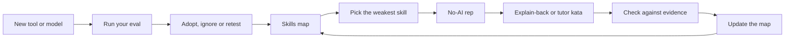

# Module 13 — Staying sharp

*Tools and models change every few months. Your judgement has to outlast them. Module 13 is about the part of the job that no agent does for you: keeping your own skills sharp while the tools get better. Lesson 13.1 is the concept lesson. It names the fundamentals that verification still stands on (reading code, debugging, systems thinking, data structures, testing, security basics), weighs the early, limited evidence about deskilling, and turns deliberate practice into habits: no-AI reps, explain-back, katas with an AI tutor that gives hints and not answers, reading good code, writing clear requirements. It also covers evaluating tools and models on your own tasks instead of leaderboards, staying current without chasing every release, being honest about AI use at work, and how roles may shift. Its artefact is the Skills map and weekly practice routine. Lesson 13.2 is the workshop. On Najm Remit you build a personal eval (at least eight tasks, each with a check a script can run) and a 90-day plan with measurable goals, and the offline grader runs your checks to see whether they would catch anything.*

> **Focus:** Mindset, Team — keep your fundamentals, your taste and your honesty growing while the tools change, and measure tools on your own work instead of on other people's scores.

---

# 13.1 — Skills that compound: fundamentals, taste, deliberate practice, evaluating tools and avoiding deskilling
*Level: 🔴 Advanced* · *Prerequisites: 5.1, 12.1* · *Focus: Mindset*

## ⚡ In 60 seconds
- Tools change every few months. The skills that make AI output safe to ship do not: reading code, debugging, systems thinking, data structures, testing, security basics. You can only **verify** what you can read.
- Deskilling is a risk to manage, not a verdict: the evidence is one small randomized study, and nothing covers years of agentic work.
- Keep a **weekly practice routine**: a no-AI rep, an explain-back, a tutor-mode kata, reading good code.
- Judge tools on **your own tasks**, with checks that fail first, not on leaderboards or on how fast you feel.
- Stay current on a cadence, not on the news cycle, and say plainly what AI wrote and what you checked.

## 🧭 Why it matters
Last Tuesday Lujain asked her agent to "tidy the rounding in the ledger". Its diff made the partner's share of the fee round half up, "like everything else in Remit". The ledger has no tests of its own, so nothing went red, and she opened a pull request. On Thursday Nada, the second reviewer that money logic needs, asks in the clinic: "Why does the ledger give the partner 3.04 on a fee of 10.15, not 3.05?" Lujain has never opened `ledger.py`. Its docstring documents the quirk (Q-LED-1) and warns against refactoring the file without characterization tests. The agent skipped that or took it for a bug, and she could not say which.

What was missing was not a prompt trick but a fundamental: reading code and asking why it is the way it is. It is a skill you practise less when an agent does the reading. The fifth habit, **Automate the loop, keep the skill**, has two halves: Module 9 built the first, this module the second. In January 2026 Anthropic researchers published a small randomized study in which mostly junior engineers who learned a library with an AI assistant scored lower on a comprehension quiz afterwards. Its authors state its limits; it is reason enough to practise on purpose.

## 📐 How it works

### 🟢 The essentials

**The fundamentals verification stands on.** The habit **Trust evidence, not fluency** (lesson 5.1) assumes someone can read the evidence, and an agent writes faster than you read. Call the limit your *reviewer's ceiling* (this course's term, not a measurement): past the edge of what you can read you are trusting, not reviewing, and you need a test, a smaller step or a second reviewer. Six skills keep it high:

| Fundamental | The agent cannot... | Where it bites at Najm | A no-AI rep |
|---|---|---|---|
| Reading code | tell you what code is *for* | Q-LED-1: the share rounds half-even, unlike the rest of Remit | Trace one `send` call on paper, then run it |
| Debugging | hold hypotheses about *your* system | A limit applied at the wrong midnight (lesson 6.2) | Write three hypotheses, test the cheapest |
| Systems thinking | see what breaks around a change | The ledger posts, the store fails, nothing undoes it (D-SVC-1) | List what each failed `send` step leaves behind |
| Data structures | know what a choice costs | `send` loads a customer's whole history | Total a day with a dict; say what grows |
| Testing | decide what would prove it wrong | A test that asserts nothing | Write boundary tests before reading the code |
| Security basics | notice what must never be string-built | `search_by_name` builds SQL with `format` | Review one module for injection and secrets |

**What the evidence says about deskilling. It is early.** Sources the course has checked:
- Shen and Tamkin (Anthropic, 2026), randomized: 52 mostly junior engineers learning the Trio library. The AI group averaged 50% on a comprehension quiz, the hand-coders 67%; a speed gain of about two minutes was not significant; the biggest gap was on debugging questions. The authors' limits: a small sample, a quiz right after the task, a setup unlike agentic tools, preliminary results. Anthropic makes Claude Code.
- METR (2025), randomized: 16 experienced open-source developers in their own mature repositories, early-2025 tools. They forecast a 24% speed-up, afterwards believed about 20%, and took 19% longer. METR says other settings and later tools may differ; in 2026 it called its newer data "only very weak evidence" of the speed-up now.

Together: in one small trial, learning with an assistant was followed by lower quiz scores, and people can misjudge their own speed. Nothing the course has checked covers years of agentic work. A modest rule follows: *protect the skills you verify with.*

**Deliberate practice with AI.** Work on a specific weakness, at the edge of your ability, with fast feedback. An agent gives instant feedback but can remove the effort that teaches you. Three moves keep both:
- **No-AI rep**: a small real task, unaided and timed, then compared with the agent's version.
- **Explain-back**: after an agent's change, close the diff and explain every line from memory, then open it.
- **Tutor-mode kata**: the agent gives hints and counter-examples, never the solution.

A weak kata prompt hands over what you wanted to practise:

```text
Write a function that returns the fee tier for an amount in Remit.
```

A tutor prompt keeps the effort with you. Use an empty scratch folder: if the agent can open `src/remit/fees.py`, the answer is one read away, and "do not look" is context, not enforcement.

```text
I am practising, so do not write the solution. Task: write tier_index(amount) for a fee schedule
whose tiers end at QAR 500, 2,000 and 10,000, then one tier with no upper bound. An amount equal
to a bound stays in the lower tier. I will paste each attempt.
1. Reply with one hint per turn: a question, or an amount that breaks my code. Never fixed code.
2. After two hints on one problem you may point at the line, not rewrite it.
3. When my code passes, ask about one boundary I have not tested.
4. If I type "give up", show the shortest correct version and make me explain it back.
```

### 🟡 Going deeper

**Taste** is knowing what good looks like and what to leave out. An agent will produce what you cannot judge, so read one merged pull request a week from another team: before you open the review comments, write the three questions you would ask, then compare. Tariq: "Taste is mostly the list of things you chose not to do."

**Communication and requirements.** An agent cannot know what Hessa meant. Take a vague ticket, "make the fee clearer", and write your questions (the quote screen or the SMS? English only, or Arabic too?) and four acceptance criteria (lesson 3.1) before you prompt. Then compare with its questions.

**Evaluating tools and models on your own tasks.** A leaderboard answers "how does this model do on other people's tasks?". Known limits, from sources the course has checked:

| What public benchmark results have shown | Source and its own caveat |
|---|---|
| Some passing patches rely on leaked solutions or weak tests | SWE-Bench+ (one agent-model pair) |
| Models name the file to edit from the issue text alone far better on the benchmark's own repositories, suggesting memorisation | The SWE-Bench Illusion (numbers differ across versions) |
| A vendor stopped reporting one version, citing contamination and flawed tests in a subset it audited | OpenAI, about February 2026 |
| Maintainers judged that a substantial share of grader-passing patches would not be merged | METR, March 2026 (a subset of one benchmark, one harness, one attempt) |

A public score is a hint about other people's tasks, not a measurement of yours. A **personal eval** is your own tasks, each with a check that **fails before the tool runs and passes on a solution you trust**, kept hidden from the tool and repeated because output varies. `najmkit` is the vendored library an agent cannot know from training (lesson 2.1), so tasks that use it test reading, not recall. Lesson 13.2 builds one; [*Software Testing*, lesson 7.1 — Evals: testing LLM applications with datasets, graders, LLM-as-judge, non-determinism and CI gates](../testing/index.html#/7.1) teaches the method for AI products.

**Staying current without chasing.** A cadence beats a feed:
- A fixed 30 minutes a week for the release notes of your tools (Claude Code has published weekly ones; check the current documentation) and for security advisories. In August 2025 a prompt injection could make GitHub Copilot enable its own auto-approve setting (CVE-2025-53773, patched that month).
- One small experiment a month: a hypothesis, a one-hour time box, one number, a decision. "Plan mode before any change over three files: do corrections fall?"
- The two-source rule (this course's rule of thumb): change a habit when two trusted sources agree, or your own eval shows it. Prompt tricks expire: in Claude Code at the time of writing (2026), "think hard" is ordinary text while "ultrathink" still requests deeper reasoning for one turn; check the current documentation.

**Responsibility and honesty.** Najm's rules: every AI-assisted change is labelled and the author stays accountable. Honesty extends to what you checked; the strong note tells the reviewer where to look:

```text
Weak:   Updated fee tiers. All tests pass.
Strong: AI-assisted (label added). The agent drafted the tier change; I wrote the 500.00 and 500.01
        tests first and read the whole diff. I did not review the Arabic text of the quote screen:
        Hessa, please have it checked. Ran: pytest -q (101 passed: 99 existing, 2 mine).
```

**How roles may shift. Nobody knows yet.** "AI-native" has no standard definition, and the sources the course has read are vendors, consultancies and essays. Atlassian's playbook argues the bottleneck has moved to the work around the code; the sources agree you redesign the workflow and its controls, not just add a tool. DORA's 2025 report says AI "amplifies what's already there", from self-reported associations. Predictions about particular jobs are speculation; a sensible bet is to build verification and judgement and keep evidence of them. The career course covers the market: [*From Graduate to Hired*, lesson 0.1 — The entry-level tech market in the AI era: what changed and what didn't](../career/index.html#/0.1).

### 🔴 Expert view

**Calibration.** Before you run the tests, write down "this will pass" and "this will take ten minutes". Log each with its outcome; after twenty or so entries (a rule of thumb) you can see where your trust is earned.

**What to practise, and when not to.** The working assumption, which no study here proves, is that skills *fade if unused* (reading unfamiliar code, debugging cold) while tool flags and prompt phrases merely *expire*. Practise the first kind. Skip the rep on deadline day, on boilerplate you mastered years ago, and for skills off your map.

**The team's side.** Rotate unaided tasks, run incident drills with the agent off, and start the reps with juniors, since the one skill-formation study was mostly junior: a reason for care, not proof that seniors are safe (lesson 12.1).



## 🧰 The toolkit
| Tool, practice or pattern | What it is and does | When to reach for it |
|---|---|---|
| **Skills map** | Six fundamentals: last unaided use, confidence 1 to 5, evidence | Each quarter, or after a surprise |
| **Weekly practice routine** | Three to six time-boxed practices, one without the agent | Every week; this lesson's artefact |
| **No-AI rep** | A small real task done unaided and timed, then compared | When a skill on the map is weak |
| **Explain-back** | Explaining an agent's change from memory before you merge | Before a pull request you did not write |
| **Tutor prompt** | Hints and counter-examples, never the solution | Katas, and learning a new library |
| **Calibration log** | Predictions beside outcomes | When you trust the agent too much or too little |
| **Personal eval** | Your own tasks, each with a check that fails first (lesson 13.2) | Before you adopt or switch a tool or model |

## 🏛️ In practice at Najm Bank
**The artefact: the Skills map and weekly practice routine.** Tariq asks everyone to fill one in. Lujain's first attempt is all 4s and 5s, with "Debugging: 5, I debug all day with Claude." Tariq's one rule: **evidence is a date and something you did without help.** Her second attempt (constructed for teaching):

```markdown
### Skills map
| Skill | Last did it without AI | Confidence (1-5) | Evidence |
|---|---|---|---|
| Reading unfamiliar code | never in this repo | 2 | I could not say why the ledger share rounds half-even |
| Debugging | July, a flaky fixture | 3 | Found it with prints in an hour; since then I only prompt |
| Systems thinking | not yet | 2 | I cannot say what a failed store write leaves behind |
| Data structures | May, a practice site | 3 | Fine with dicts and sets; I look up heaps |
| Testing | last week, 3 fee tests | 4 | Boundary cases first; I can explain a mutation test |
| Security basics | June, a course lab | 2 | I spot string-built SQL, not a threat model |

### Weekly routine
| Day | Practice | Minutes |
|---|---|---|
| Sunday | Release notes and my calibration log | 20 |
| Tuesday | Kata with the tutor prompt: one function, no solutions from the agent | 40 |
| Wednesday | Read a merged pull request outside my area; write three questions | 30 |
| Thursday | Explain-back of the week's biggest agent change, then open the diff | 20 |
```

Re-rate every quarter and lift **one** weak skill at a time. A rule of thumb of this course, not a finding: cap confidence at 3 for any skill you have not used unaided in three months. Lesson 13.2 starts from the same two tables.

## 🛠️ Exercises
- 🟢 **Fill the Skills map honestly.** No agent. *Done when:* every row has a date, a number and a sentence of evidence, and one skill is marked to lift first.
- 🟡 **One no-AI rep and one explain-back.** An agent is optional, and only after the rep. Pick a Remit task you would delegate, such as monthly-limit boundary tests for `check_limits`. Do it unaided and timed, then have an agent or a colleague review it in tutor mode. *Done when:* you have the minutes, the hints you took and rejected, and a five-line explain-back written before you open the reviewer's version.
- 🔴 **Compare two tools on your own tasks.** Needs an agent; with one tool, compare two settings (with and without your `CLAUDE.md`). Take three tasks from your last two weeks, write a check that fails first for each, and run each twice per setting from a clean copy. *Done when:* you have a table of passes, minutes and corrections, a delegation decision, and one caveat about the sample.

## ⚠️ Mistakes and traps
- **Reading one study as a verdict**, either way. Say what it measured, and its limits.
- **Practising without feedback.** A rep nobody checks is slow work.
- **Asking for hints, then taking the answer.** In tutor mode the effort is the point.
- **Trusting how fast or skilled you feel.** Score predictions and use a clock.
- **Overclaiming what you checked.** "All tests pass" is not "I reviewed it". Say which.

## 🧾 Recap
- Verification stands on six fundamentals; past the edge of what you can read, you are trusting, not reviewing.
- The deskilling evidence is early and small: manage the risk, do not claim a result, and practise on purpose.
- Evaluate tools on your own tasks, with checks that fail first; a benchmark score is a hint about other people's tasks.
- Stay current on a cadence, be honest about AI use, and hold predictions about roles loosely.

## ✍️ Check yourself

**1. A colleague says "a study proved that AI makes engineers worse". What is the most defensible reply?**

- A. Correct: the study showed that learning with AI always lowers an engineer's skills
- B. Not proven: one small trial found lower quiz scores, and its authors list limits
- C. Wrong: the same randomized trial found that the AI group scored higher on comprehension
- D. Irrelevant: a quiz on one library says nothing about engineers using agents

<details><summary>Answer</summary>

**B.** The study was small (52 mostly junior engineers, one library) and preliminary: evidence to take seriously, not proof, and silent about years of agentic work. A turns one result into a law, C reverses it, D discards it. (🟢 The essentials.)

</details>

**2. Lujain practises `tier_index` with the prompt "write a function that returns the fee tier for an amount". Which change restores the practice effect?**

- A. Ask for the full solution and read it twice
- B. Ask the agent to explain its solution after writing the code
- C. Ask for a longer solution with a comment on every line
- D. Ask for one hint or counter-example per turn, never code

<details><summary>Answer</summary>

**D.** A tutor prompt keeps the feedback and withholds the answer. Reading a solution (A), an explanation of it (B) or a commented one (C) removes the struggle. (🟢 The essentials.)

</details>

**3. Salem will add a second approved tool. Lujain proposes picking whichever tops a public coding benchmark. What is the best objection?**

- A. Scores reflect other people's tasks; test on ours, with checks that fail first
- B. Leaderboards are always wrong, so any approved tool will do just as well for our work
- C. The cheaper tool is the better choice, since quality gaps are small
- D. The vendor's own demo is a better guide to our work than a public score

<details><summary>Answer</summary>

**A.** The checked sources describe leaked solutions, weak tests and memorisation. "Always wrong", price and a demo do not say what suits our work; a personal eval does. (🟡 Evaluating tools.)

</details>

**4. You drafted a fee change with the agent, wrote the boundary tests first, read the whole diff and did not check the Arabic text. Which pull request note is most honest and useful?**

- A. "Updated the fee tiers in fees.py. All tests pass and the diff is small, as the ticket asked."
- B. "AI-assisted. I reviewed the change carefully and I am confident that it is correct."
- C. "AI-assisted. I wrote the tier tests first and read the diff; I did not check the Arabic."
- D. "Changed by the agent from the ticket, so any defects belong to the tool, not to me."

<details><summary>Answer</summary>

**C.** It labels the change, says what the author did and where not to assume. A hides the AI, B is not checkable, D breaks the rule that the author stays accountable. (🟡 Responsibility.)

</details>

**5. A new model is announced on Monday with a viral demo. What is the best plan for this week?**

- A. Move the whole team to it this week, while the advantage is new
- B. Note it, read its notes in your weekly slot, and run your eval before deciding
- C. Ignore every new model for a year, so that the team is not distracted
- D. Wait until it tops a public leaderboard for a month, then adopt it across the team

<details><summary>Answer</summary>

**B.** A cadence plus your own eval turns an announcement into a measurement. A demo (A) or a score (D) repeats the leaderboard mistake; ignoring everything (C) misses real gains. (🟡 Staying current.)

</details>

## 📚 References
- **Go deeper (evidence).** Shen and Tamkin, Anthropic, "How AI assistance impacts the formation of coding skills": https://www.anthropic.com/research/AI-assistance-coding-skills · METR, 2025 study: https://metr.org/blog/2025-07-10-early-2025-ai-experienced-os-dev-study/ · METR, 2026 update: https://metr.org/blog/2026-02-24-uplift-update/ · DORA 2025: https://cloud.google.com/blog/products/ai-machine-learning/announcing-the-2025-dora-report · Atlassian, "The AI SDLC transformation playbook" (vendor): https://www.atlassian.com/blog/ai-at-work/ai-sdlc-transformation-playbook
- **Go deeper (benchmarks).** SWE-Bench+: https://arxiv.org/abs/2410.06992 · "The SWE-Bench Illusion": https://arxiv.org/abs/2506.12286 · OpenAI, "Why we no longer evaluate SWE-bench Verified": https://openai.com/index/why-we-no-longer-evaluate-swe-bench-verified/ · METR, "Many SWE-bench-Passing PRs Would Not Be Merged into Main": https://metr.org/notes/2026-03-10-many-swe-bench-passing-prs-would-not-be-merged-into-main/
- Claude Code documentation: https://code.claude.com/docs/en/best-practices
- [*Building AI Applications & Agents*, lesson 12.1 — Evaluating agents: eval sets, graders, LLM-as-judge, trajectories and regression gates](../aiapps/index.html#/12.1)
- [*From Graduate to Hired*, lesson 1.2 — Building with AI coding agents without being carried by them](../career/index.html#/1.2)

---

# 13.2 — Workshop: your personal eval, learning plan and 90-day plan
*Level: 🔴 Advanced* · *Prerequisites: 13.1* · *Focus: Mindset, Team*

## ⚡ In 60 seconds
- Lab `m13`, on Najm Remit: build a **personal eval** (`eval/tasks.jsonl`, eight or more tasks, each with a check a script can run) and a **90-day plan** (`plan.md`) with measurable goals.
- **Needs an agent: no.** You may use one; the grader looks only at the result, and the no-agent path is complete.
- The rule that matters: a check must **fail on the untouched repository** and **pass on a solution you trust**. The kit runs your checks on throw-away copies to find out. It cannot judge whether your tasks are the right ones or your plan is wise.

## 🧭 Why it matters
Next quarter Salem adds a second approved tool. Lujain says it "tops the leaderboard". Tariq asks: "On which of our tasks?" Nobody knows, and the clinic spends its hour on opinions. Nada's version: eight real tasks, each with a check, run three times per tool; the slide shows passes, minutes, corrections and which tool suits which task.

Tariq's second ask is quieter: "What will you be better at in ninety days, and how will we know?" "Get better at debugging" can be neither met nor missed; a goal with a metric, a baseline, a number and a date can be both. It is the habit **Specify before you delegate** again: say what done means, then check it.

## 📐 How it works

### 🟢 The essentials

**A task is five parts.** `lab-assets/tasks.example.jsonl` holds three worked examples.

| Part | What it is | In the examples |
|---|---|---|
| Prompt | The exact words you give the tool | EX3: "Add a --json flag to `python -m remit quote`..." |
| Starting state | A clean copy at `lab-start`, plus an optional **setup** patch (a planted bug, a file to review) | EX1 plants a fee-tier boundary bug |
| Check | A command whose exit status says pass or fail, kept where the tool cannot see it | `pytest -q lab-assets/example/test_ex1_tier_boundary.py` |
| Guard | A command that must pass before and after (so not a test your planted bug breaks), to catch collateral damage | `pytest -q tests/test_limits.py tests/test_notify.py tests/test_money.py` |
| Reference | A patch you trust, to prove the check can pass | `ex1-reference.patch` |

A check earns trust three ways: it **fails on a clean copy**, it **passes on the reference**, and a **lazy answer does not pass it**. Take EX2: *explain how the express surcharge relates to the fee cap, and write the answer to `ANSWER.md`*. A weak check asks only that the file exists:

```json
{"run": "python -c \"import pathlib; assert pathlib.Path('ANSWER.md').exists()\""}
```

It fails on the clean copy and passes on the reference, so it looks fine, but the kit's lazy-answer test writes `TODO` into `ANSWER.md` and it still passes. The example's real check reads the answer:

```python
# ailab/labs/m13_personal_eval/assets/example/check_ex2.py
"""Example EX2: does ANSWER.md say what the code does? Until the tool writes it, reading the file fails."""
import pathlib
import re
import sys

answer = pathlib.Path("ANSWER.md").read_text(encoding="utf-8").lower()
wanted = [
    ("names the express surcharge", "express" in answer and "surcharge" in answer),
    ("says it is added after the cap", re.search(r"after the cap|after[^.]{0,25}\bcap(?:ped|ping)\b|on top of the cap|beyond the cap", answer) is not None),
    ("says the fee can pass the cap", re.search(r"exceed|above the cap|over the cap|past the cap|higher than the cap|more than the cap", answer) is not None),
]
missing = [what for what, ok in wanted if not ok]
if missing:
    sys.exit("the answer does not say: " + "; ".join(missing))
```

A clean copy fails, the reference passes, and `TODO` fails and names the missing facts. Still, a phrase check is a floor both ways: a correct answer in other words can fail (widen the phrases), and a wrong one that borrows them can pass (read the answer).

### 🟡 Going deeper

**Run it from a clean workspace.** `python lab-assets/eval_runner.py prepare T03 --dir ../runs/T03-a` makes a clean copy without `eval/` or `lab-assets/`, so the tool cannot read the check, and prints the prompt. Give the tool that prompt and nothing else. Then `git -C ../runs/T03-a add -A && git -C ../runs/T03-a diff --cached` shows what it changed; **read the diff of every pass**, because a check is a floor, not a review (lesson 5.1). `score T03 --dir ../runs/T03-a --tool claude-code --minutes 6` adds the check, runs it and appends a line to `eval/results.jsonl`; `report` prints passes per tool. Repeat each task about three times, because output varies. A clean folder is not a clean tool: Claude Code also reads your user-level `~/.claude/CLAUDE.md` in every folder, so record the model and memory files with `--model` and `--note`.

**Choose tasks like a sceptic.** Take them from real work, in a mix of kinds, including one that went wrong last month. Prefer code a model is unlikely to have seen, such as `najmkit` (lesson 2.1). Make each check *fair*: any reasonable reading of the prompt passes it. Keep two or three tasks you never tune prompts or project memory against (lesson 2.2), or you will measure your tuning.

**Read results honestly.** Say tool A passes 15 of 24 runs and tool B 17 of 24. A two-run gap on 24 runs is within what luck can produce, so name no winner: see which tasks differ, whether B's passes survive a read of the diff, and the minutes and corrections, then add runs. Compare tasks, not only totals: 3 of 3 is a different fact from 1 of 3.

**When not to build one.** If you will use a tool for a week, or the choice is reversible in an afternoon, just try it. An eval pays when the decision is costly to reverse or repeats: a team-wide tool, a model change every month. It costs time and money (9 tasks × 3 runs × 2 tools is 54 runs), so start with three tasks.

**Goals you can miss.** Weak: "Understand the codebase better." Strong, as a row of the Goals table (start date 2026-11-02):

| Goal | Metric | Baseline | Target | By | How I will measure it |
|---|---|---|---|---|---|
| Trace Remit flows unaided | Flows traced on paper, then run | 1 (send) | 4 | 2026-12-20 | The four traces in my notes repo |

The stranger test: at day 90, could someone who does not know you say if it was met?

### 🔴 Expert view

**What the grader cannot tell.** Whether your tasks are the right ones, whether a check measures what its prompt asks (it knows only that the check fails on the untouched repo, passes on the reference and refuses a placeholder), or whether your plan is wise. It runs your checks in throw-away copies with a time limit, which is not a sandbox: a check is code that runs as you, and an agent can write one as easily as you. Read every check before you run it, a partner's included.

**Checks can be gamed.** A tool can pass by special-casing the example. Defences: a check with several inputs, a guard, a read diff, held-out tasks. Add a task for each real failure, and run `verify` a few times to find flaky checks.

## 🧰 The toolkit
| Tool, practice or pattern | What it is and does | When to reach for it |
|---|---|---|
| **Personal eval** | `eval/tasks.jsonl`: your own prompts, checks, guards (commands that must pass before and after) and reference solutions (patches that prove a check can pass) | Before you adopt or switch a tool or model |
| **Eval runner** | `lab-assets/eval_runner.py`: validate, baseline, verify, prepare, score, report | After every edit, and to score a run |
| **90-day plan** | Skills map, weekly routine, goals with metric, baseline, target, date | Quarterly, reviewed monthly |

## 🏛️ In practice at Najm Bank
**Needs an agent: no.** An agent can propose tasks and draft checks and patches, but the **no-agent path** is complete: small `pytest` files and scripts for the checks, `git diff` for the patches, Markdown for the plan.

**The ticket.** Tariq wrote it (the kit's `task.md`):

```text
# GROW-13: your personal eval and your 90-day plan

**From:** Tariq, Engineering Lead, Payments Platform
**To:** you
**Priority:** Normal. Do it this week, then revisit it every month.

Tools change every few months, and a leaderboard cannot say which one is good at *our* work. I want two things you
keep: a small eval you run yourself, and a plan that keeps your skills growing. Use an AI assistant if you like;
you must be able to explain every task and every number.

### 1. A personal eval: `eval/tasks.jsonl`

At least **eight tasks** you would really give a coding agent, as JSON Lines: one complete JSON object per line, no
array. `lab-assets/tasks.example.jsonl` has three worked examples (they do not count). A task has:

* `id` (unique, for example `"T01"`), `title`, `kind` (`fix`, `feature`, `refactor`, `test`, `docs`, `explain`,
  `review` or `other`) and `prompt`: the exact words you would give a tool, 15 words or more.
* `check`: `{"run": "<command>", "guard": "<command>"}`. `run` decides pass or fail. The optional `guard` must pass
  before the work and after a correct solution, so a tool that fixes the task and breaks something else fails.
* Optional `setup` and `reference`: `.patch` files under `eval/`. A setup plants the starting situation (a bug, a
  file to review); a reference is a solution you trust.
* Optional `"repo": "own"` for a task from your own project, which the kit cannot run. At least six tasks must be
  about this repository.

A check is one command (`pytest`, `python`, `grep` or a read-only `git` command; paths relative to the repository
root; no shell operators; offline), kept in `eval/checks/` so a tool never sees it. It must:

1. **fail on the untouched repository** (the `lab-start` state): a check that passes before any work proves nothing;
2. **pass on a reference solution**: give at least three tasks a `reference`;
3. **reject a lazy answer**: an empty note, or a test that asserts nothing, must not pass.

`python lab-assets/eval_runner.py validate`, `baseline` and `verify` test all three. Also write `eval/README.md`
(60 words or more): how to run the eval, what counts as a pass, how many repeats, when you run it again.

### 2. A 90-day plan: `plan.md`

Start from `lab-assets/plan-template.md` and keep its headings: a start date, a skills map for six skills, a weekly
routine (minutes per practice), three to six goals, days 1-30, 31-60 and 61-90, your eval cadence, and what you will
ignore. A goal has a metric, a baseline, a target with a number, a date inside the 90 days and a way to measure it.

### Done when

Only `eval/` and `plan.md` changed, in at least two commits (the eval, then the plan) that follow `CONTRIBUTING.md`.
Grade it from the `ailab` folder of the course repository: `python -m ailab grade m13 --dir <this directory>`
```

**Start.**

```bash
cd ainative/ailab
python -m ailab start m13 --dir ~/ainative/m13
cd ~/ainative/m13
mkdir -p eval/checks eval/setup eval/reference
python lab-assets/eval_runner.py --tasks lab-assets/tasks.example.jsonl baseline
python lab-assets/eval_runner.py --tasks lab-assets/tasks.example.jsonl verify
```

Each prints `ok:` three times. The start commit holds `lab-assets/` and `TASK.md`.

**Your move.** (1) List a dozen candidate tasks from your last two weeks and Remit's loose ends (`grep -rn "KNOWN SMELL\|TODO" src`, a document that disagrees with the code); keep eight or nine in a mix of kinds. (2) Write each task in `eval/tasks.jsonl` and its check in `eval/checks/`. For a bug to fix, run `python lab-assets/eval_runner.py prepare <id> --dir ../scratch/<id>`, plant the bug in that copy, save its `git diff` as `eval/setup/<id>.patch` and add `"setup"` to the task. Run `baseline`: every check must fail. (3) For at least three tasks make a reference: `prepare` again, solve the task in the copy, then `git add -N . && git diff > ~/ainative/m13/eval/reference/<id>.patch`; run `verify`. (4) Write `eval/README.md`; commit as `test(eval): ...`. (5) Fill in the plan template from lesson 13.1's tables; commit as `docs(plan): ...` (`type(scope): subject`, at most 72 characters, no full stop). (6) Grade. With an agent, ask for task ideas and draft checks, but run `baseline` and `verify` yourself and drop any check you cannot explain.

**What the grader checks.** *The eval:* valid JSON Lines; at least eight tasks of your own; checks that run, offline, **fail on the untouched repo** and **refuse a placeholder answer**; guards that pass there; at least three references that pass. *The plan:* sections, a start date, a six-skill map, a realistic routine, three to six measurable goals. *The repository:* only `eval/` and `plan.md` changed, in two or more commits that follow `CONTRIBUTING.md`, nothing uncommitted, no secrets. Advisory: kinds, guards, an `own` task, a README.

**Grade.**

```bash
# from the ainative/ailab folder of the course repository
python -m ailab grade m13 --dir ~/ainative/m13
```

The untouched starter scores `2/19 required checks passed: NOT YET`. A first draft such as an assistant might write (constructed for teaching, not recorded from a real model), failing lines only, hints cut:

```text
[FAIL] Every check is allowed and runs: T06 (line 6): the check cannot run (the script eval/checks/check_length.py does not exist)
[FAIL] Every check fails on the untouched repo: these checks already pass before any work is done: T03 (line 3)
[FAIL] Three references pass their checks: 1 reference passes its check; at least 3 are needed
[FAIL] Checks reject a placeholder answer: the check accepts a lazy answer: T04 (line 4): a placeholder in ANSWER.md
[FAIL] Goals are measurable: goal 1: the target has no number; goal 2: 2027-03-01 is outside the 90 days from 2026-11-02
Lab m13: 14/19 required checks passed: NOT YET
```

T03's check was `pytest -q`, which already passes; T04's only asks that a file exists; T06 names a script that was never written. A passing run ends `Lab m13: 19/19 required checks passed: PASSED`.

**Weekly deliverable.** In the lab repository, `eval/` and `plan.md` in two commits. In your notes repository, `week-13/` with your agent log, debrief answers and, if you scored a run, the `report` output.

**Group session (60 minutes).** (1) Swap repositories, read each other's `eval/checks/`, then run your partner's `baseline` and `verify` (15). (2) Attack the checks: try to pass a partner's check with a placeholder or a hard-coded answer, and report what got through (15). (3) Read each other's goals: which could not be missed? (15) (4) Agree what the team re-runs monthly (15).

**Debrief questions.** What did the agent get wrong, and which of its checks passed on nothing? What did your prompt or context miss? Which of your tasks would a leaderboard never test? Which goal will be hardest to measure honestly?

**Agent log template.**

```markdown
### Agent log: week 13
| Part | Prompt (one line) | What the agent did | What I corrected | Minutes |
|---|---|---|---|---|
| Task ideas | | | | |
| Checks | | | | |
| References | | | | |
| Plan | | | | |

Checks that passed on nothing:
One task I will add after this week:
```

## 🛠️ Exercises
- 🟢 **Read the examples.** No agent. Run `baseline` and `verify` on the three examples. Then copy `tasks.example.jsonl` outside the repository, give EX2 the one-line "file exists" check, and run `verify --tasks` on the copy (leave `lab-assets/` untouched, or the grade flags it). *Done when:* `verify` says a placeholder in `ANSWER.md` passes, and you can say in two sentences why the weak check looked fine.
- 🟡 **Build the eval.** An agent is optional. *Done when:* the grader's eval checks pass, four tasks have a reference and a guard, and one is from your own project.
- 🔴 **Score two runs and decide.** Needs an agent, or pit an agent against your own unaided runs (`--tool me`). `prepare` and `score` one task with two tools or settings, three runs each. *Done when:* `report` shows the counts, you read every passing diff, and a note says what you would delegate, with one caveat about your sample.

## ⚠️ Mistakes and traps
- **A check that passes on the untouched repo.** It proves nothing. Run `baseline` first.
- **Checking that a file exists.** Check what it says, or what the tests catch.
- **Trusting a tool's own tests.** Run them against code with the rule changed.
- **Goals with no number.** "Improve" cannot be missed. Give a metric, a baseline and a date.
- **Running a check you have not read.** It runs as you; read it first, an agent's especially.

## 🧾 Recap
- A task is a prompt, a clean starting state, a check, a guard and a reference.
- A check must fail on the untouched repo, pass on the reference, and refuse a lazy answer.
- Run tools from clean workspaces, repeat, read the diffs, compare tasks as well as totals.
- A goal is measurable when a stranger could say at day 90 whether it was met. The grader checks the artefacts; the judgement stays yours.

## ✍️ Check yourself

**1. Your check for "add a --json flag" is the whole suite, `pytest -q`, and `baseline` says it passes on the untouched repo. What does that tell you?**

- A. The tool will not need to change any code to pass the task
- B. The check is too strict, so the guard should go
- C. The check proves nothing until it tests the new behaviour
- D. The task is too easy to belong in an eval

<details><summary>Answer</summary>

**C.** A check that passes before any work cannot tell a tool that did the task from one that did nothing. Keep the suite as the guard. (🟢 The essentials.)

</details>

**2. Your explain task is checked by "ANSWER.md exists", and `verify` reports that a placeholder passes. What is the right fix?**

- A. Add a guard that runs the whole test suite
- B. Make the prompt longer, so the answers are longer
- C. Delete the reference, so that nothing remains to compare against
- D. Check what the answer says, such as the facts it must contain

<details><summary>Answer</summary>

**D.** The check must fail on an answer that says nothing. A guard (A) watches for damage, not emptiness, and the prompt (B) is not the check. (🟢 The essentials.)

</details>

**3. After a run, Lujain finds her tool passed T05 by editing the visible test file. Which design would have caught it?**

- A. Run the tool twice and keep the better of the two results for the report
- B. Ask the tool at the end whether it changed any test files
- C. Keep the check outside the workspace and copy it in only to score
- D. Score only the tasks whose prompts are short and simple to follow

<details><summary>Answer</summary>

**C.** The check lives in `eval/`, which `prepare` leaves out and `score` copies in, so edits to the tool's own tests cannot change the verdict. Asking the tool (B) trusts it. (🟡 Run it from a clean workspace.)

</details>

**4. A colleague's goal is "improve my debugging by the end of the quarter". Which rewrite meets the workshop's standard?**

- A. "Cut my debugging time by half by the end of the quarter"
- B. "Spend three hours every week debugging without the agent, starting next Monday morning"
- C. "Become the team's best debugger by the time of the next review"
- D. "Fix 6 bugs unaided by 2026-12-15, from a baseline of 0, counted in my agent log"

<details><summary>Answer</summary>

**D.** It has a metric, a baseline, a number, a date and a way to measure. A lacks a baseline and a measure, B is an activity with no end date, and C has no number. (🟡 Goals you can miss.)

</details>

**5. Your eval has 8 tasks, 3 runs each. Tool B passes 17 of 24 runs and tool A passes 15 of 24. What is the honest conclusion?**

- A. Tool B is about 8% better, so the team should switch now
- B. A small gap on a small sample: read the diffs and run more
- C. Nothing can be concluded from so few tasks, so skip evals
- D. Tool A is worse, because it passed fewer runs than tool B

<details><summary>Answer</summary>

**B.** A two-run gap on 24 runs is within what luck can produce: compare tasks, diffs, minutes and corrections, and add runs. "Nothing" (C) goes too far; a percentage (A) pretends precision. (🟡 Read results honestly.)

</details>

## 📚 References
- Claude Code documentation, best practices (give the agent a way to verify its work): https://code.claude.com/docs/en/best-practices
- pytest: https://docs.pytest.org/ · git: https://git-scm.com/docs
- Lab kit: https://github.com/Tamoura/system-design-for-vibe-coders/tree/main/ainative/ailab
- [*Software Testing*, lesson 7.1 — Evals: testing LLM applications with datasets, graders, LLM-as-judge, non-determinism and CI gates](../testing/index.html#/7.1)
- [*AI Product Management*, lesson 6.1 — Quality you can measure: metrics, golden sets and error analysis](../aipm/index.html#/6.1)
